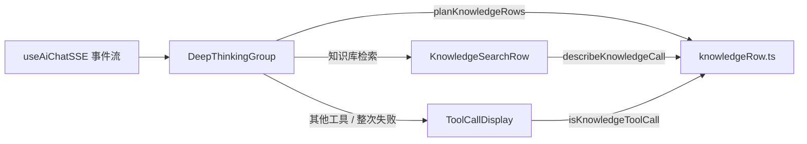

# PROJECTWIKI

本文档记录中粮 1125 分支上“知识库检索逐条独立展示”功能的设计和实现，面向后续维护者。范围只限该功能，不覆盖整个毕昇仓库；仓库级文档见 `docs/` 和 `features/`。变更记录见 [CHANGELOG.md](./CHANGELOG.md)。

## 1. 项目概述

- 目标：深度思考中的每次知识库检索显示为独立的一行，让用户一眼看出检索了什么、命中多少条、搜了哪个知识库。
- 背景：原先知识库检索是普通工具调用，多次检索无法区分，也看不出命中的文档。
- 范围：仅前端（`src/frontend/client`），不增加后端字段。
- 非目标：不合并多次检索；不做会话级参考资料汇总；文档标签本期不可点击。
- 干系人：王洁（产品、实现）、庄婧瑶（设计）。
- PRD：《中粮知识库检索结果聚合展示优化PRD》。

## 2. 架构设计

| 节点 | 代码路径（`src/frontend/client/src/components/Chat/Messages/`） |
| --- | --- |
| DeepThinkingGroup | `DeepThinkingGroup.tsx` |
| KnowledgeSearchRow | `KnowledgeSearchRow.tsx` |
| knowledgeRow | `knowledgeRow.ts`，测试在 `knowledgeRow.test.ts` |
| ToolCallDisplay | `ToolCallDisplay.tsx` |

## 3. 架构决策记录

### ADR-1 每次检索一行，不合并

- 背景：最初方案把同一轮的多次检索合并成一张卡片。
- 取舍：合并会打乱“检索、思考、检索”的真实顺序，改为每次检索独立成行。
- 影响：行数随检索次数线性增加，靠检索词和知识库标签区分各行。

### ADR-2 只用后端已有字段

- 使用 `tool_call_id`、`args.query`、`args.knowledge_base_ids` 和结果里的标签串（`<knowledge_base_id>`、`<knowledge_base_name>`、`<file_title>`、`<retrieval_error>`）。
- 检索中的行没有知识库名，用同一次深度思考里已出现的结果补全，第一次检索在结果返回前不显示知识库标签。

### ADR-3 整次调用失败与部分失败的判定

- 后端对单个知识库失败也会给整次调用设置 `error` 和 `failure_info`，所以不能只看这两个标志。
- 规则：调用带错误标志且没有任何知识库结果，才交给 `ToolCallDisplay`；只要有知识库返回结果（含带 `<retrieval_error>` 的结果），就保留检索行并提示“部分知识库检索失败”。

## 4. 模块文档

### knowledgeRow.ts

| 函数 | 作用 |
| --- | --- |
| `isKnowledgeToolCall` | 判断是否知识库工具调用，`ToolCallDisplay` 与检索行共用 |
| `compactKnowledgeQuery` | 检索词按空白拆分，忽略大小写去重 |
| `isReadableKnowledgeQuery` | 空、含 AND/OR/NOT、`^*~`、成对括号、`field:value`、超过 40 字的检索词视为不可读 |
| `summariseKnowledgeBaseNames` | 知识库名最多显示 2 个，3 个及以上显示第一个加 `+N` |
| `describeKnowledgeCall` | 解析一次调用：知识库、检索词、命中条数、文档、是否出错 |
| `planKnowledgeRows` | 给每次检索编号，并收集 id 到名称的映射 |

### KnowledgeSearchRow.tsx

| 状态 | 表现 |
| --- | --- |
| 检索中 | “正在检索：{词}...”，旋转图标 |
| 收起 | `检索：{词} · N 条 [知识库] ⌄`，行首为放大镜图标 |
| 展开 | 文档名标签（最多 3 个，其余折叠为 `+K`）；0 命中显示“未命中相关文档” |
| 全部失败 | 红色图标和“检索失败”，默认展开 |
| 部分失败 | 条数后追加“部分知识库检索失败” |

## 5. 已知技术债务

| 项 | 说明 | 优先级 |
| --- | --- | --- |
| 解析逻辑重复 | `knowledgeRow.ts` 与 `ToolCallDisplay.tsx` 各有一份标签解析，正则不同 | 中 |
| 记忆化失效 | 事件每帧是新对象，`memo` 和 `useMemo` 基本不命中，每帧约多 0.9 ms 解析 | 低 |
| 缺组件测试 | 只有纯函数测试，没有 `KnowledgeSearchRow` 的组件测试 | 中 |
| 知识库标签来源 | 取自模型传入的 `knowledge_base_ids`，模型传错 id 时可能显示未检索的库 | 低 |
| 无障碍 | 收起的面板中文档标签仍可聚焦 | 低 |
| 文档标签不可点击 | 需后端补文档标识 | 待产品确认 |

## 6. 测试

- 单元测试：`npx jest src/components/Chat/Messages/knowledgeRow.test.ts`，共 46 个用例。
- 代码审查：2026.11.23 完成 codex 审查，Gemini 外部分析因额度用尽未完成。结论见 CHANGELOG 的 Fixed 部分。

## 7. 变更日志

见 [CHANGELOG.md](./CHANGELOG.md)。
