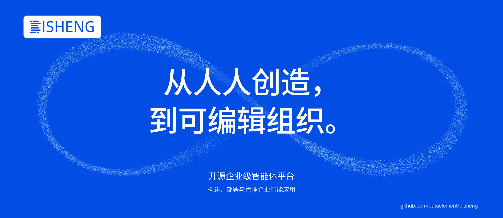

> 源自中国匠心，希望我们能像 DeepSeek、黑神话：悟空团队一样，给世界带来更多美好。



<p align="center">
    <a href="https://dataelem.feishu.cn/wiki/ZxW6wZyAJicX4WkG0NqcWsbynde"></a>
    
    
    <a href="https://github.com/dataelement/bisheng/commits"></a>
    <a href="https://star-history.com/#dataelement/bisheng&Timeline"></a> 
</p>
<p align="center">
  <a href="./README.md">简体中文</a> |
  <a href="./README_EN.md">English</a> |
  <a href="./README_JPN.md">日本語</a> |
  <a href="./README_ES.md">Español</a> |
  <a href="./README_PT.md">Português</a> |
  <a href="./README_RU.md">Русский</a>
</p>

<p align="center">
  <a href="https://trendshift.io/repositories/717" target="_blank"></a>
</p>

BISHENG是一款 <b>开源的企业级一站式 Agent 平台</b>，专注办公效率与企业 AI 应用落地，已有大量行业头部组织及世界 500 强企业在使用。

### 重要更新：BISHENG 客户端重磅发布

BISHENG 桌面端基于 DeepSeek Harness（DSH）开发，与 BISHENG 平台协同，为企业提供一整套开源、可私有化部署、自主可控的企业级 Agent 平台方案。

简单来说，你可以把它理解为 WorkBuddy／豆包工作的开源替代方案，让企业把 AI 能力真正掌握在自己手中。


[下载 BISHENG 客户端](https://dshdesktop.com/zh/enterprise/) · [BISHENG 客户端使用说明](https://dataelem.feishu.cn/wiki/BWSMwdc2Ciwif4kfe5HcyGHgn3b#share-QZrMdHGRdokzWixRl6vc30w1n8P)

若需要对客户端进行改造（比如更换 LOGO），可基于[客户端开源代码](https://github.com/dataelement/bisheng-desktop)改造。

> BISHENG 团队于 DSH 发布当晚第一时间开源了 DSH 的桌面客户端（[dshdesktop.com](https://dshdesktop.com/)）。BISHENG 客户端基于 DSHDesktop 开发。截至目前，DSHDesktop 已获得 90 万+下载、17.4K GitHub ⭐️。个人用户可以使用 DSHDesktop。
>
> [DSHDesktop 官网](https://dshdesktop.com/zh/)

## 特点

1. **🖥️ BISHENG 客户端：连接本地工作与企业云端**

   - **Chat 与 Work 两种工作方式**：Chat 支持知识问答与云端多步任务；Work 在获准的本地目录中整理材料，生成可编辑的 Word、Excel、PPT，并根据反馈持续修改。
   - **企业资源按身份开放**：员工使用企业账号调用获准的模型、API/MCP 工具、技能与知识空间，也可从应用中心打开已发布的应用；知识检索只返回该员工有权限访问的空间和文件内容。
   - **模型与积分集中管理**：管理员统一配置模型授权、月度积分和调用记录；Chat 与 Work 的企业模型调用共用当前用户的积分账本，用户可查看余额与用量。
   - **企业扩展统一分发**：管理员集中导入插件和工作台，员工按企业配置与授权获取使用。

2. **🛠️ 托管应用：把团队自己开发的应用发布给同事使用**

   - **把业务需求做成应用**：把报名表、项目台账、部门看板等需求做成专门的页面。应用上线后，有权限的员工在应用中心点击「进入应用」，即可在新标签页使用，无需再次登录。
   - **本地开发后提交到平台**：开发者安装 bisheng 命令行工具，用服务账号密钥登录，在本地开发和调试应用，也可以让 Coding Agent 辅助开发。开发者在应用清单中声明运行时、资源档位、要用的平台模型和知识库，再把应用提交到平台。平台对提交的应用做预检、密钥扫描和构建。
   - **审批后上线**：审批人在审批中心查看应用的源码文件树并预览应用，再决定批准或驳回。
   - **负责人统一管理**：应用负责人在「构建 → 应用」中查看资源档位、设置可见范围、录入第三方密钥、在线查看和编辑应用数据，并执行上线、下线和删除。
   - **复用平台能力**：平台向应用注入当前访问者的身份，应用不需要自建登录。应用可以调用平台模型，并按访问者的权限检索知识库。

   

3. **🚀 任务模式：面向多步骤复杂工作的通用 Agent**
   你给出目标，按需附上文件、知识库、工具和技能，它会拆解任务、逐步执行，最后交付 HTML、Markdown、PPT、Excel 或 Word 文件。

   - 🧠 **任务规划 + 子 Agent 并行**：主 Agent 动态生成任务清单、跟踪进度，把独立调研交给子 Agent 并行完成。
   - 🙋 **人机交互（Human in the loop）**：遇到只有你知道的关键信息，任务暂停等你回答。
   - 🧰 **技能（Skill）即插即用**：内置 Word、Excel、PPT 和 HTML 报告四个技能包，开箱即用；也可以从本地或 GitHub 导入团队自己的技能。
   - 📎 **结论可溯源**：报告带引用角标，点击后打开原文，并定位到被引用的段落。
   <p align="center"></p>

4. **📚 知识空间：企业版团队知识库**

   - 🗂️ **有序组织**：支持多级文件夹、标签、卡片与列表视图，支持关键词和标签联合检索。
   - 👥 **团队共建**：可以按权限模板（所有者/管理者/编辑者/查看者）邀请成员，也可以发布到知识广场供他人加入。超级管理员可以为部门一键开通「部门知识空间」。
   - 🔐 **权限细到单个文件**：空间、文件夹、文件三级共用一套权限模板，可以一次授权给个人、部门（含子部门）或用户组。文件夹和文件默认继承上级权限，也可以单独设置。
   - 💬 **AI 问答**：可以针对单篇文档提问，也可以基于整个空间提问；回答标注引用来源，点开即可查看原文及溯源定位。
   <p align="center"></p>

5. **📡 频道订阅：外部资讯每天自动送达，有价值的一键存成知识**

   - 📰 **主题频道**：把公众号和网站聚合成主题频道，每天自动更新，可以再分子频道。
   - 🎯 **精准过滤**：自定义规则过滤标题和正文，只留下相关资讯。
   <p align="center"></p>

6. **🧩 独具特色的 [BISHENG workflow](https://dataelem.feishu.cn/wiki/R7HZwH5ZGiJUDrkHZXicA9pInif)**

   - **独立、完备的应用编排框架**：不区分 chatflow 和 workflow，多轮对话和自动化处理可以混在同一个流程里。
   - **Human in the loop**：流程执行到中途可以等人输入、确认或修改。
   - **成环、并行、批量运行自由组合**：画圈即成环（大多数同类产品不支持成环），并列即并行，多选即批量，适合文档审核、固定版式报告生成等复杂场景。
   <p align="center"></p>

7. **🏢 企业级特性：企业 AI 落地需要的管控能力**

   - **客户端统一管理**：管理员集中配置 BISHENG 客户端可用的模型、技能、API/MCP 工具与知识空间，通过企业插件市场分发插件和工作台，并统一管理模型授权、月度积分和调用记录。
   - **部门和用户管理**：维护组织架构、用户和配额。
   - **功能与资源权限分开管理**：RBAC 通过角色控制功能菜单与操作；ReBAC 控制知识空间、文件夹和单个文件的访问，可按个人、部门（含下级部门）或用户组授权。文件夹和文件默认继承上级权限，也可独立设置。
   - **操作审批**：知识空间加入、频道订阅、菜单权限申请等操作可以走审批，审批流程和节点可自定义。
   - **审计**：记录会话内容和系统操作日志，可按人、时间、模块追溯。
   - **统计看板**（商业版）：预置用户活跃度、应用使用、token 用量、知识库使用等数据看板。
   - **API Key 权限边界**：管理员为服务账号签发密钥，配置有效期、接口权限，并授予可访问的应用、知识库等资源。接口权限决定能做什么，资源授权决定能对哪些资源操作；获得密钥不等于拥有整个平台权限。

     

   - **信创适配**：同时支持 MySQL 和达梦 DM8。
   - 以及 SSO/LDAP、高可用部署方案、安全审查、流量控制、监控统计、漏洞扫描修复。
   <p align="center"></p>

   

8. **🔍 高精度文档解析**：5年海量数据沉淀，高精度文档解析模型支持免费私有化部署使用，包括高精度印刷体、手写体与生僻字识别模型、表格识别模型、版式分析模型、印章模型等。
   <p align="center"></p>

## 快速安装

安装 BISHENG 前请先确保满足以下条件：

- CPU >= 8 Core
- RAM >= 32 GB
- 已安装并启动 Docker
- Docker Compose（推荐 V2）
- Bash

默认部署包括 MySQL、Redis、MinIO、OpenFGA、ES 和 Milvus 等组件。OnlyOffice 为可选服务，不随基础部署启动。

下载 BISHENG 代码（以下两种方式任选其一）：

```bash
git clone https://github.com/dataelement/bisheng.git
cd bisheng
```

没有 Git 时，可下载并解压 ZIP 包：

```bash
wget https://github.com/dataelement/bisheng/archive/refs/heads/main.zip
unzip main.zip
cd bisheng-main
```

在代码根目录执行安装脚本：

```bash
bash docker/install.sh
```

脚本首次会从 `docker/.env.example` 生成 `docker/.env`，校验配置，登录镜像仓库、拉取镜像并启动服务；已有 `.env` 会保留。请先运行安装脚本，不要在缺少 `.env` 的情况下直接执行 `docker compose up`。部署使用预构建镜像，不会编译下载的源码。

查看服务状态和启动日志：

```bash
cd docker
docker compose ps
docker compose logs -f backend backend_worker
```

服务就绪后，在浏览器中访问 `http://服务器IP:3001` 并注册用户，默认第一个注册的用户会成为系统 admin。然后在系统中配置模型。

如需启用全部功能（BISHENG 客户端、托管应用、微调等），请参见文档：[私有化部署](https://dataelem.feishu.cn/wiki/BSCcwKd4Yiot3IkOEC8cxGW7nPc)

## 感谢

感谢我们的贡献者：

<a href="https://github.com/dataelement/bisheng/graphs/contributors">
  
</a>


<br>
BISHENG 采用了以下依赖库：

- 感谢开源LLM应用开发库 [langchain](https://github.com/langchain-ai/langchain)。
- 感谢开源非结构化数据解析引擎 [unstructured](https://github.com/Unstructured-IO/unstructured)。
- 感谢开源LLM微调框架 [LLaMA-Factory](https://github.com/hiyouga/LLaMA-Factory)。


## 社区与支持
欢迎加入我们的交流群


<!--
## Star History

[](https://star-history.com/#dataelement/bisheng&Date)
-->

## 服务企业

BISHENG 已服务众多行业头部企业，以下为部分客户。


## 企业咨询

如需了解 BISHENG 企业部署、桌面客户端接入、产品演示或商务合作，欢迎联系我们。

[填写飞书表单，联系 BISHENG 团队](https://dataelem.feishu.cn/share/base/form/shrcnVow7GQwwKYEBCD41Bu5qoh)
