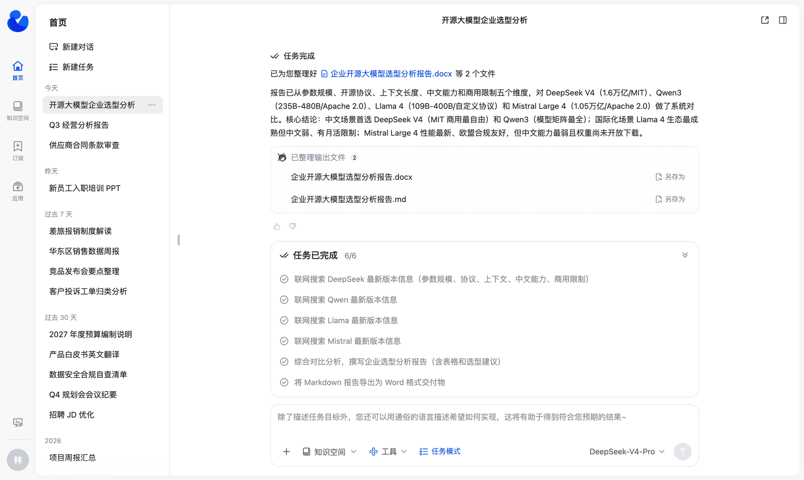
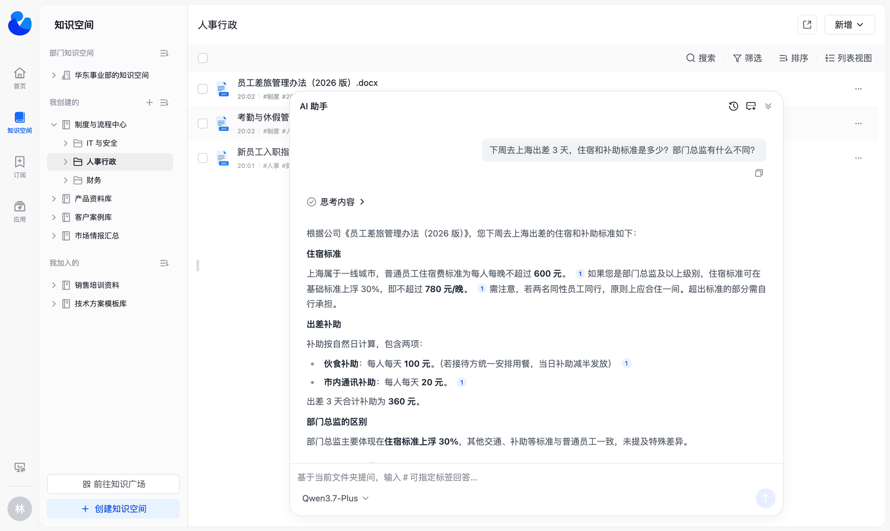
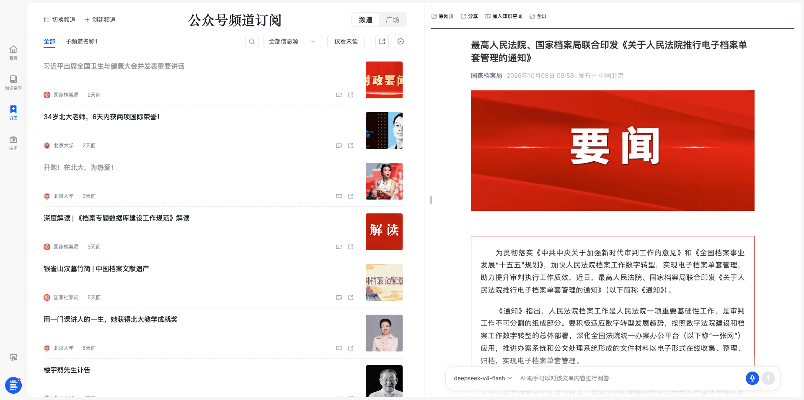

<p align="center">
    <a href="https://dataelem.feishu.cn/wiki/ZxW6wZyAJicX4WkG0NqcWsbynde"></a>
    
    
    <a href=""></a>
    <a href="https://star-history.com/#dataelement/bisheng&Timeline"></a> 
</p>
<p align="center">
  <a href="./README_CN.md">简体中文</a> |
  <a href="./README.md">English</a> |
  <a href="./README_JPN.md">日本語</a>
</p>

<p align="center">
  <a href="https://trendshift.io/repositories/717" target="_blank"></a>
</p>
<div class="column" align="middle">
  <!-- <a href="https://bisheng.slack.com/join/shared_invite/"> -->
    <!--  -->
  </a>
  <!--  -->
  <!--  -->
</div>


BISHENG毕昇 是一款 <b>开源</b> LLM应用开发平台，主攻<b>企业场景</b>， 已有大量行业头部组织及世界500强企业在使用。

“毕昇”是活字印刷术的发明人，活字印刷术为人类知识的传递起到了巨大的推动作用。我们希望“BISHENG毕昇”同样能够为智能应用的广泛落地提供有力支撑。欢迎大家一道参与。


## 特点
1. **🚀 任务模式：面向多步骤复杂工作的通用 Agent**
   你给出目标，按需附上文件、知识库、工具和技能，它会拆解任务、逐步执行，最后交付报告、PPT、Excel 或 Word。

   - 🧠 **任务规划 + 子 Agent 并行**：主 Agent 动态生成任务清单、跟踪进度，把独立调研交给子 Agent 并行完成。
   - 🙋 **人机交互（Human in the loop）**：遇到只有你知道的关键信息，任务暂停等你回答。
   - 🧰 **技能（Skill）即插即用**：内置 PPT、Excel、Word 三个技能包，开箱即用；也可以从本地或 GitHub 导入团队自己的技能。
   - 📎 **结论可溯源**：报告带引用角标，点击后打开原文，并定位到被引用的段落。
   <p align="center"></p>

2. **📚 知识空间：企业版团队知识库**

   - 🗂️ **有序组织**：支持多级文件夹、标签、卡片与列表视图，支持关键词和标签联合检索。
   - 👥 **团队共建**：可以按权限模板（所有者/管理者/编辑者/查看者）邀请成员，也可以发布到知识广场供他人加入。超级管理员可以为部门一键开通「部门知识空间」。
   - 🔐 **权限细到单个文件**：空间、文件夹、文件三级共用一套权限模板，可以一次授权给个人、部门（含子部门）或用户组。文件夹和文件默认继承上级权限，也可以单独设置。
   - 💬 **AI 问答**：可以针对单篇文档提问，也可以基于整个空间提问；回答标注引用来源，点开即可查看原文及溯源定位。
   <p align="center"></p>

3. **📡 频道订阅：外部资讯每天自动送达，有价值的一键存成知识**

   - 📰 **主题频道**：把公众号和网站聚合成主题频道，每天自动更新，可以再分子频道。
   - 🎯 **精准过滤**：自定义规则过滤标题和正文，只留下相关资讯。
   <p align="center"></p>

4. **🧩 独具特色的 [BISHENG workflow](https://dataelem.feishu.cn/wiki/R7HZwH5ZGiJUDrkHZXicA9pInif)**

   - **独立、完备的应用编排框架**：不区分 chatflow 和 workflow，多轮对话和自动化处理可以混在同一个流程里。
   - **Human in the loop**：流程执行到中途可以等人输入、确认或修改。
   - **成环、并行、批量运行自由组合**：画圈即成环（大多数同类产品不支持成环），并列即并行，多选即批量，适合文档审核、固定版式报告生成等复杂场景。
   <p align="center"></p>

5. **🏢 企业级特性：企业 AI 落地需要的管控能力**

   - **部门和用户管理**：组织架构管理和人员设置，支持按角色开放功能菜单和设置配额。
   - **RBAC + ReBAC 双权限模型**：角色控制能用哪些功能，ReBAC 控制能访问哪份资源（精确到单个文件）。
   - **操作审批**：知识空间加入、频道订阅、菜单权限申请等操作可以走审批，审批流程和节点可自定义。
   - **审计**：记录会话内容和系统操作日志，可按人、时间、模块追溯。
   - **统计看板**（商业版）：预置用户活跃度、应用使用、token 用量、知识库使用等数据看板。
   - **API 开放能力**：通过服务账号和 API 密钥调用应用、知识库等接口，也可以按员工本人权限代表用户调用。
   - **DSH Desktop 桌面客户端企业接入**（商业版）：员工用平台账号登录客户端，直接使用 BISHENG 平台配置的模型；支持管理员按人按月分配模型额度。
   - **信创适配**：同时支持 MySQL 和达梦 DM8。
   - 以及 SSO/LDAP、高可用部署方案、安全审查、流量控制、监控统计、漏洞扫描修复。
   <p align="center"></p>

6. **🔍 高精度文档解析**：5年海量数据沉淀，高精度文档解析模型支持免费私有化部署使用，包括高精度印刷体、手写体与生僻字识别模型、表格识别模型、版式分析模型、印章模型...
   <p align="center"></p>

## 快速安装 

安装BISHENG前请先确保满足以下条件：
- CPU >= 8 Core
- RAM >= 32 GB
- Docker 19.03.9+
- Docker Compose 1.25.1+
> 除了BISHENG前后端，我们默认还会安装第三方组件ES、Milvus、Onlyoffice

下载BISHENG代码
```bash
# 如果系统中有git命令，可以直接下载毕昇代码
git clone https://github.com/dataelement/bisheng.git
# 进入安装目录
cd bisheng/docker

# 如果系统没有没有git命令，可以下载毕昇代码zip包
wget https://github.com/dataelement/bisheng/archive/refs/heads/main.zip
# 解压并进入安装目录
unzip main.zip && cd bisheng-main/docker
```
启动BISHENG
```bash
# 进入bisheng/docker或bisheng-main/docker目录，执行
docker compose -f docker-compose.yml -p bisheng up -d
```
启动后，在浏览器中访问 http://IP:3001 ，出现登录页，进行用户注册。默认第一个注册的用户会成为系统admin。

其他安装部署问题参考：[私有化部署](https://dataelem.feishu.cn/wiki/BSCcwKd4Yiot3IkOEC8cxGW7nPc)


## 资源
- [📄应用案例/场景库](https://dataelem.feishu.cn/wiki/ZfkmwLPfeiAhQSkK2WvcX87unxc)
- [📄经验技巧](https://dataelem.feishu.cn/wiki/OWFRwknFaiIMajke4m5cFeLrnie)
- [📄功能使用说明](https://dataelem.feishu.cn/wiki/WxH6wubbAiBkRIkSEyecmpDMnjF)
- [📄BISHENG Blog](https://dataelem.feishu.cn/wiki/BiNowcaYWilewdksXQ5cZl3tnzy)


## 感谢 

感谢我们的贡献者：

<a href="https://github.com/dataelement/bisheng/graphs/contributors">
  
</a>


<br>
Bisheng 采用了以下依赖库:

- 感谢开源LLM应用开发库 [langchain](https://github.com/langchain-ai/langchain)。
- 感谢开源langchain可视化工具 [langflow](https://github.com/logspace-ai/langflow)。
- 感谢开源非结构化数据解析引擎 [unstructured](https://github.com/Unstructured-IO/unstructured)。
- 感谢开源LLM微调框架 [LLaMA-Factory](https://github.com/hiyouga/LLaMA-Factory) 。


## 社区与支持 
欢迎加入我们的交流群


<!--
## Star History

[](https://star-history.com/#dataelement/bisheng&Date)
-->
