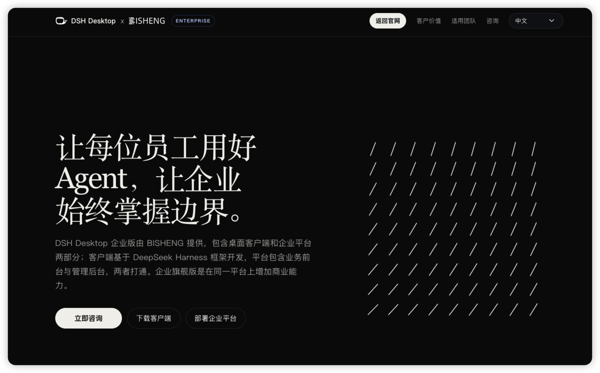

> Crafted in China. Like the teams behind [Deepseek] and [Black Myth: Wukong], we hope to bring more beauty to the world.


<p align="center">
    <a href="https://dataelem.feishu.cn/wiki/ZxW6wZyAJicX4WkG0NqcWsbynde"></a>
    
    
    <a href=""></a>
    <a href="https://star-history.com/#dataelement/bisheng&Timeline"></a> 
</p>
<p align="center">
  <a href="./README.md">简体中文</a> |
  <a href="./README_EN.md">English</a> |
  <a href="./README_JPN.md">日本語</a>
</p>

<p align="center">
  <a href="https://trendshift.io/repositories/717" target="_blank"></a>
</p>
<div class="column" align="middle">
  <!-- <a href="https://bisheng.slack.com/join/shared_invite/"> -->
    <!--  -->
  </a>
  <!--  -->
  <!--  -->
</div>


## BISHENG Enterprise Platform

BISHENG is an **open-source, all-in-one enterprise Agent platform** focused on office productivity and putting enterprise AI applications to work. It is used by leading organizations across industries and Fortune 500 companies.

## Major update: BISHENG Desktop connects your computer to enterprise AI

**BISHENG Desktop is a desktop Agent that connects local work with enterprise AI.** Employees sign in with their enterprise account to use authorized models, knowledge bases, tools and skills for knowledge Q&A, multi-step tasks and generating Word, Excel and PowerPoint files, then continue refining them in authorized local directories. The enterprise centrally manages resources, permissions, credits and usage.



[Download BISHENG Desktop](https://dshdesktop.com/zh/enterprise/) · [Client GitHub repository](https://github.com/dataelement/bisheng-desktop)

> Enterprise integration capabilities, configuration requirements, and open-source and commercial edition availability depend on the relevant release documentation.

### DSH Desktop personal edition: start with local tasks

**DSH Desktop is an open-source desktop Agent application built by Dataelem on DeepSeek Harness.** Individual users can configure a model, choose a local working directory and let the Agent process everyday materials without deploying the BISHENG enterprise platform.

**17k stars** on GitHub.

[DSH Desktop](https://dshdesktop.com/zh/) · [GitHub](https://github.com/dataelement/dsh-desktop)

## Features

1. **🖥️ BISHENG Desktop: connect local work with your enterprise cloud**

   - **Two ways to work: Chat and Work**: Chat supports knowledge Q&A and multi-step cloud tasks. Work organizes materials in authorized local directories, generates editable Word, Excel and PowerPoint files, and keeps refining them based on your feedback.
   - **Enterprise resources authorized by identity**: Use your enterprise account to access approved models, API/MCP tools, skills and knowledge spaces, or open published assistants and workflows in the Application Center. Knowledge retrieval continues to enforce space and file permissions.
   - **Central model and credit management**: Administrators manage model access, monthly credits and call records. Enterprise model calls in Chat and Work share the current user's credit ledger; users can check their balance and usage.
   - **Central distribution of enterprise extensions**: Administrators import plugins and workbenches centrally. Employees receive them according to enterprise configuration and authorization.

   Capabilities, deployment requirements, and open-source and enterprise edition availability depend on the relevant release documentation.

   

   > The mobile app is coming soon. Features and release plans are subject to the relevant release documentation.

   **Enterprise management**

   

2. **🚀 Task Mode: a general-purpose agent for complex, multi-step work**
   You give it a goal and, if needed, attach files, knowledge bases, tools and skills. The agent breaks the goal into tasks, runs them step by step, and delivers a report, PPT, Excel or Word file.

   - 🧠 **Task planning + parallel sub-agents**: The main agent builds a task checklist, tracks progress, and gives independent research tasks to sub-agents that run in parallel.
   - 🙋 **Human in the loop**: When the agent needs information that only you have, the task pauses until you answer.
   - 🧰 **Plug-and-play skills**: Three built-in skill packs (PPT, Excel, Word) work out of the box. You can also import your team's own skills from a local file or from GitHub.
   - 📎 **Traceable conclusions**: Reports carry citation markers. Click a marker to open the source and go to the cited passage.
   <p align="center"></p>

3. **📚 Knowledge Space: an enterprise knowledge base for teams**

   - 🗂️ **Organized content**: Multi-level folders, tags, card and list views, and search by keyword and tag together.
   - 👥 **Built by the team**: Invite members with a permission template (Owner / Manager / Editor / Viewer), or publish the space to the Knowledge Square so that others can join. A super admin can create a Department Space for a department in one step.
   - 🔐 **Permissions down to a single file**: Spaces, folders and files use the same set of permission templates. You can grant access to a person, a department (including its sub-departments) or a user group in one step. Folders and files inherit permissions from their parent by default, and you can also set them separately.
   - 💬 **AI Q&A**: Ask questions about one document or about the whole space. Answers show their sources; click a source to open the original text at the cited location.
   <p align="center"></p>

4. **📡 Channels: external news delivered every day, and saved as knowledge in one click**

   - 📰 **Topic channels**: Combine WeChat official accounts and websites into topic channels that update every day. A channel can have sub-channels.
   - 🎯 **Precise filtering**: Custom rules filter titles and body text, so only relevant articles stay.
   <p align="center"></p>

5. **🧩 Unique [BISHENG Workflow](https://dataelem.feishu.cn/wiki/R7HZwH5ZGiJUDrkHZXicA9pInif)**

   - **Independent and complete orchestration framework**: There is no split between chatflow and workflow. Multi-turn conversation and automated processing can be in the same flow.
   - **Human in the loop**: A running flow can stop and wait for a person to give input, confirm, or make changes.
   - **Loops, parallel branches and batch runs in any combination**: Draw a circle to make a loop (most similar products do not support loops), place nodes side by side to run them in parallel, and select multiple items to run a batch. This fits complex scenarios such as document review and fixed-layout report generation.
   <p align="center"></p>

6. **🛠️ Application Workshop: publish Vibe Apps for your team**

   - **Turn business needs into applications**: Build dedicated pages for registration forms, project registers or department dashboards, and let colleagues open them from the Application Center.
   - **From local development to team use**: Submit an application developed locally or with a Coding Agent. After preflight checks, secret scanning, build and release approval, set its access scope and publish it to the Application Center.
   - **Reuse platform capabilities**: Applications can reuse platform sign-in and visitor identity, and access models and knowledge resources as needed, reducing duplicate infrastructure. Capabilities and configuration requirements depend on the relevant release documentation.

   

7. **🏢 Enterprise-grade features: the controls that enterprise AI needs**

   - **Department and user management**: Maintain the organization structure, users and quotas.
   - **Separate feature and resource permissions**: RBAC roles control feature menus and actions. ReBAC controls access to knowledge spaces, folders and individual files, with grants to individuals, departments (including sub-departments) or user groups. Folders and files inherit parent permissions by default and can also be configured independently.
   - **Approvals**: Joining a knowledge space, subscribing to a channel, requesting menu permissions and other actions can require approval. You can customize approval flows and nodes.
   - **Audit**: Records conversation content and system operation logs, searchable by user, time and module.
   - **Dashboards** (commercial edition): Preset dashboards for user activity, application usage, token usage, knowledge base usage and more.
   - **API key permission boundaries**: Administrators issue keys for service accounts, set expiration and interface permissions, and grant access to specific applications, knowledge bases and other resources. Interface permissions determine which actions are allowed; resource grants determine where those actions apply. Possessing a key does not grant access to the entire platform.

     

   - **Xinchuang (domestic IT stack) support**: Supports both MySQL and Dameng DM8.
   - Also: SSO/LDAP, high-availability deployment, content security review, traffic control, monitoring and statistics, and vulnerability scanning and fixes.
   <p align="center"></p>

8. **🔍 High-precision document parsing**: Our document parsing models are trained on a large amount of high-quality data collected over 5 years, and you can deploy them privately for free. They include high-precision models for printed text, handwriting and rare characters, table recognition, layout analysis, and seals.
   <p align="center"></p>


## Quick start 

Please ensure the following conditions are met before installing BISHENG:
- CPU >= 8 Core
- RAM >= 32 GB
- Docker 19.03.9+
- Docker Compose 1.25.1+
> In addition to installing BISHENG, we will also install the following third-party components by default: ES, Milvus, and Onlyoffice.

Download BISHENG
```bash
git clone https://github.com/dataelement/bisheng.git
# Enter the installation directory
cd bisheng/docker

# If the system does not have the git command, you can download the BISHENG code as a zip file.
wget https://github.com/dataelement/bisheng/archive/refs/heads/main.zip
# Unzip and enter the installation directory
unzip main.zip && cd bisheng-main/docker
```
Start BISHENG
```bash
docker compose -f docker-compose.yml -p bisheng up -d
```
After the startup is complete, access http://IP:3001 in the browser. The login page will appear, proceed with user registration. 

By default, the first registered user will become the system admin. 

For more installation and deployment issues, refer to:：[Self-hosting](https://dataelem.feishu.cn/wiki/BSCcwKd4Yiot3IkOEC8cxGW7nPc)

## Resources

- [📄 Application examples and use cases](https://dataelem.feishu.cn/wiki/ZfkmwLPfeiAhQSkK2WvcX87unxc)
- [📄 Tips and best practices](https://dataelem.feishu.cn/wiki/OWFRwknFaiIMajke4m5cFeLrnie)
- [📄 Feature guides](https://dataelem.feishu.cn/wiki/WxH6wubbAiBkRIkSEyecmpDMnjF)
- [📄 BISHENG Blog](https://dataelem.feishu.cn/wiki/BiNowcaYWilewdksXQ5cZl3tnzy)

## Acknowledgement 
This repo benefits from [langchain](https://github.com/langchain-ai/langchain) [langflow](https://github.com/logspace-ai/langflow) [unstructured](https://github.com/Unstructured-IO/unstructured) and [LLaMA-Factory](https://github.com/hiyouga/LLaMA-Factory) . Thanks for their wonderful works.

<b>Thank you to our contributors：</b>

<a href="https://github.com/dataelement/bisheng/graphs/contributors">
  
</a>


## Community & contact 
Welcome to join our discussion group


<!--
## Star History

[](https://star-history.com/#dataelement/bisheng&Date)
-->

## Selected customers

BISHENG serves leading enterprises across industries. Here are some of our customers.


## Enterprise inquiries

Contact us to discuss BISHENG enterprise deployment, desktop client integration, product demonstrations or business partnerships.

[Contact the BISHENG team through the Feishu form](https://dataelem.feishu.cn/share/base/form/shrcnVow7GQwwKYEBCD41Bu5qoh)
