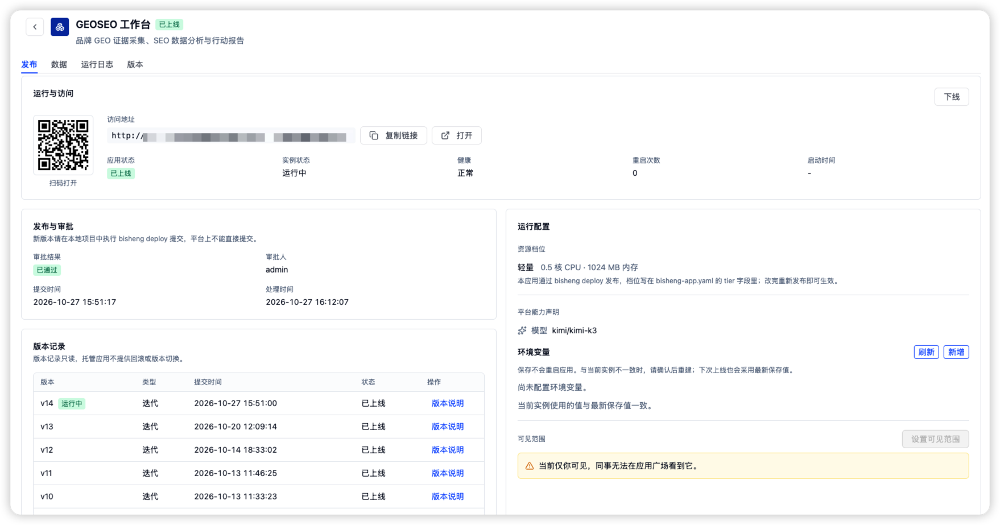
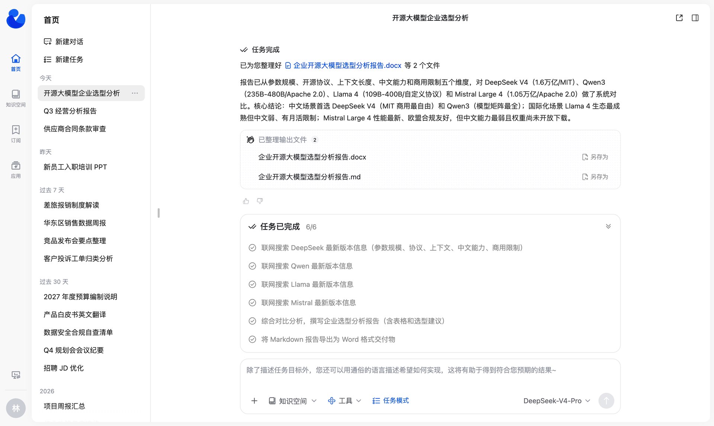
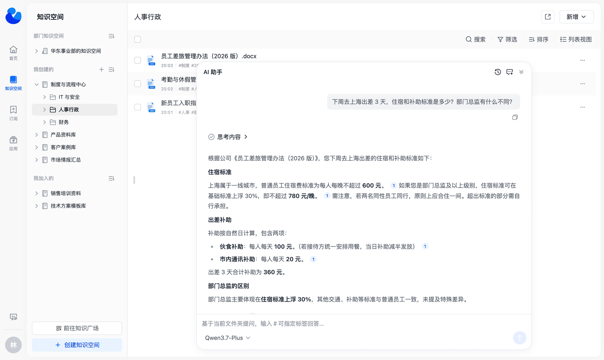
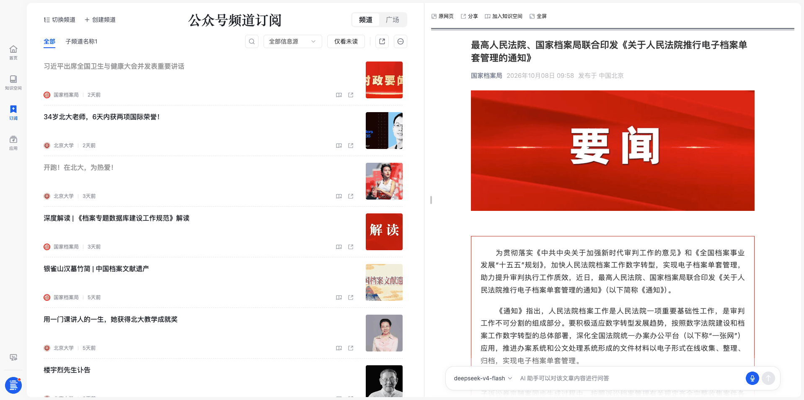
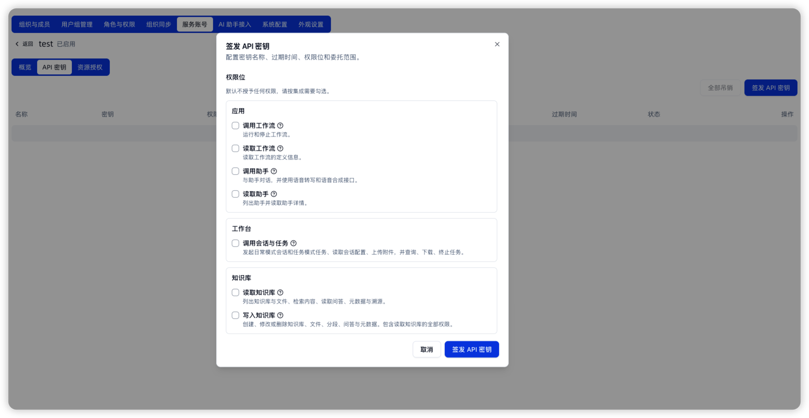
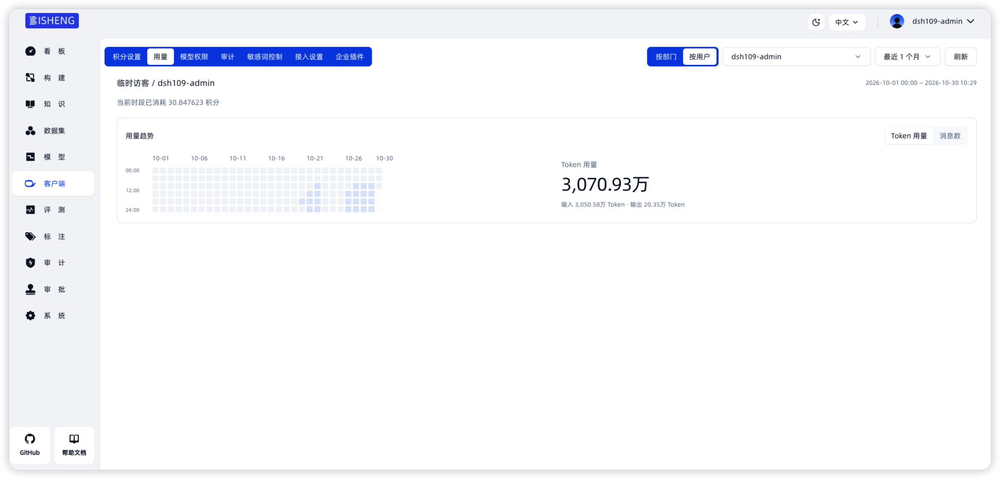

> Criado na China. Assim como as equipes por trás de [Deepseek] e [Black Myth: Wukong], esperamos trazer mais beleza ao mundo.


<p align="center">
    <a href="https://dataelem.feishu.cn/wiki/ZxW6wZyAJicX4WkG0NqcWsbynde"></a>
    
    
    <a href=""></a>
    <a href="https://star-history.com/#dataelement/bisheng&Timeline"></a>
</p>
<p align="center">
  <a href="./README.md">简体中文</a> |
  <a href="./README_EN.md">English</a> |
  <a href="./README_JPN.md">日本語</a> |
  <a href="./README_ES.md">Español</a> |
  <a href="./README_PT.md">Português</a> |
  <a href="./README_RU.md">Русский</a>
</p>

<p align="center">
  <a href="https://trendshift.io/repositories/717" target="_blank"></a>
</p>
<div class="column" align="middle">
  <!-- <a href="https://bisheng.slack.com/join/shared_invite/"> -->
    <!--  -->
  </a>
  <!--  -->
  <!--  -->
</div>


BISHENG é uma **plataforma empresarial de agentes, de código aberto e tudo em um**, voltada à produtividade no escritório e à aplicação prática da IA nas empresas. É utilizada por organizações líderes de diversos setores e por empresas da Fortune 500.

### Grande novidade: chegou o BISHENG Desktop

O BISHENG Desktop é desenvolvido sobre o DeepSeek Harness (DSH) e funciona em conjunto com a plataforma BISHENG para oferecer uma solução completa de plataforma empresarial de agentes de código aberto, que pode ser implantada de forma privada e mantida totalmente sob seu controle.

Em poucas palavras, pense nele como uma alternativa de código aberto ao WorkBuddy / Doubao Work, que permite às empresas realmente possuir e controlar seus recursos de IA.


[Baixar o BISHENG Desktop](https://dshdesktop.com/zh/enterprise/)

Para personalizar o cliente (por exemplo, substituir o logotipo), você pode modificar o [código aberto do cliente](https://github.com/dataelement/bisheng-desktop).

> A equipe do BISHENG disponibilizou um cliente desktop de código aberto para o DSH ([dshdesktop.com](https://dshdesktop.com/)) na mesma noite em que o DSH foi lançado. O BISHENG Desktop é desenvolvido sobre o DSHDesktop. Até o momento, o DSHDesktop ultrapassou 900.000 downloads e 17,4 mil estrelas no GitHub ⭐️. Usuários individuais podem utilizar o DSHDesktop.
>
> [Site do DSHDesktop](https://dshdesktop.com/zh/)

## Funcionalidades

1. **🖥️ BISHENG Desktop: conecte o trabalho local à nuvem da sua empresa**

   - **Duas formas de trabalhar: Chat e Work**: O Chat permite fazer perguntas sobre o conhecimento e executar tarefas na nuvem com várias etapas. O Work organiza materiais em diretórios locais autorizados, gera arquivos editáveis de Word, Excel e PowerPoint e continua aperfeiçoando-os com base no seu feedback.
   - **Recursos empresariais autorizados por identidade**: Use sua conta empresarial para acessar modelos, ferramentas API/MCP, habilidades e espaços de conhecimento aprovados, ou abra assistentes e fluxos de trabalho publicados na Central de aplicativos. A recuperação de conhecimento continua respeitando as permissões dos espaços e arquivos.
   - **Gestão centralizada de modelos e créditos**: Os administradores gerenciam o acesso aos modelos, os créditos mensais e os registros de chamadas. As chamadas a modelos empresariais no Chat e no Work compartilham o registro de créditos do usuário atual; os usuários podem consultar seu saldo e consumo.
   - **Distribuição centralizada de extensões empresariais**: Os administradores importam plugins e ambientes de trabalho de forma centralizada. Os funcionários os recebem de acordo com a configuração e a autorização da empresa.

2. **🛠️ Oficina de aplicativos: publique Vibe Apps para sua equipe**

   - **Transforme necessidades de negócio em aplicativos**: Crie páginas dedicadas a formulários de inscrição, cadastros de projetos ou painéis departamentais, e permita que seus colegas as abram pela Central de aplicativos.
   - **Do desenvolvimento local ao uso pela equipe**: Envie um aplicativo desenvolvido localmente ou com um Coding Agent. Após as verificações preliminares, a varredura de segredos, a compilação e a aprovação da publicação, defina seu escopo de acesso e publique-o na Central de aplicativos.
   - **Reutilize os recursos da plataforma**: Os aplicativos podem reutilizar o login da plataforma e a identidade do visitante, e acessar modelos e recursos de conhecimento conforme necessário, reduzindo a duplicação de infraestrutura. Os recursos e os requisitos de configuração dependem da documentação da versão correspondente.

   

3. **🚀 Modo de tarefas: um agente de uso geral para trabalhos complexos com várias etapas**
   Você fornece um objetivo e, se necessário, anexa arquivos, bases de conhecimento, ferramentas e habilidades. O agente divide o objetivo em tarefas, executa-as passo a passo e entrega um relatório ou um arquivo de PPT, Excel ou Word.

   - 🧠 **Planejamento de tarefas + subagentes em paralelo**: O agente principal cria uma lista de tarefas, acompanha o progresso e atribui pesquisas independentes a subagentes que são executados em paralelo.
   - 🙋 **Participação humana**: Quando o agente precisa de informações que só você tem, a tarefa é pausada até que você responda.
   - 🧰 **Habilidades prontas para usar**: Três pacotes de habilidades integrados (PPT, Excel e Word) funcionam de imediato. Você também pode importar as habilidades da sua equipe de um arquivo local ou do GitHub.
   - 📎 **Conclusões rastreáveis**: Os relatórios incluem marcadores de citação. Clique em um marcador para abrir a fonte e ir até o trecho citado.
   <p align="center"></p>

4. **📚 Espaço de conhecimento: uma base de conhecimento empresarial para equipes**

   - 🗂️ **Conteúdo organizado**: Pastas com vários níveis, etiquetas, visualizações em cartões e listas, e busca combinada por palavra-chave e etiqueta.
   - 👥 **Construído pela equipe**: Convide membros com um modelo de permissões (Proprietário / Gestor / Editor / Leitor), ou publique o espaço na Praça do conhecimento para que outras pessoas possam participar. Um superadministrador pode criar um Espaço departamental para um departamento em uma única etapa.
   - 🔐 **Permissões até o nível de arquivo individual**: Espaços, pastas e arquivos usam o mesmo conjunto de modelos de permissões. Você pode conceder acesso a uma pessoa, a um departamento (incluindo seus subdepartamentos) ou a um grupo de usuários em uma única etapa. Por padrão, pastas e arquivos herdam as permissões do elemento pai, e você também pode configurá-las separadamente.
   - 💬 **Perguntas e respostas com IA**: Faça perguntas sobre um documento ou sobre todo o espaço. As respostas mostram suas fontes; clique em uma fonte para abrir o texto original no local citado.
   <p align="center"></p>

5. **📡 Canais: notícias externas todos os dias, salvas como conhecimento com um clique**

   - 📰 **Canais temáticos**: Combine contas oficiais do WeChat e sites em canais temáticos atualizados diariamente. Um canal pode ter subcanais.
   - 🎯 **Filtragem precisa**: Regras personalizadas filtram os títulos e o corpo do texto, mantendo apenas os artigos relevantes.
   <p align="center"></p>

6. **🧩 O exclusivo [BISHENG Workflow](https://dataelem.feishu.cn/wiki/R7HZwH5ZGiJUDrkHZXicA9pInif)**

   - **Framework de orquestração independente e completo**: Não há separação entre chatflow e workflow. Conversas com vários turnos e processamento automatizado podem coexistir no mesmo fluxo.
   - **Participação humana**: Um fluxo em execução pode parar e aguardar uma pessoa fornecer informações, confirmar ou fazer alterações.
   - **Loops, ramificações paralelas e execuções em lote em qualquer combinação**: Desenhe um círculo para criar um loop (a maioria dos produtos semelhantes não oferece suporte a loops), coloque nós lado a lado para executá-los em paralelo e selecione vários itens para executar um lote. Isso atende a cenários complexos, como revisão de documentos e geração de relatórios com layout fixo.
   <p align="center"></p>

7. **🏢 Funcionalidades de nível empresarial: os controles de que a IA empresarial precisa**

   - **Gestão centralizada do cliente desktop**: Os administradores configuram de forma centralizada os modelos, habilidades, ferramentas API/MCP e espaços de conhecimento disponíveis no cliente, concedendo acesso aos funcionários de acordo com a configuração empresarial e as permissões dos recursos. O marketplace empresarial de plugins distribui plugins e ambientes de trabalho, enquanto os créditos mensais, o consumo de chamadas e os registros de auditoria são gerenciados de forma centralizada.
   - **Gestão de departamentos e usuários**: Mantenha a estrutura organizacional, os usuários e as cotas.
   - **Permissões de funcionalidades e recursos separadas**: Os papéis RBAC controlam os menus de funcionalidades e as ações. O ReBAC controla o acesso a espaços de conhecimento, pastas e arquivos individuais, com concessões a pessoas, departamentos (incluindo subdepartamentos) ou grupos de usuários. Por padrão, pastas e arquivos herdam as permissões do elemento pai e também podem ser configurados de forma independente.
   - **Aprovações**: Participar de um espaço de conhecimento, assinar um canal, solicitar permissões de menu e outras ações podem exigir aprovação. Você pode personalizar os fluxos e nós de aprovação.
   - **Auditoria**: Registra o conteúdo das conversas e os logs de operações do sistema, com busca por usuário, data e hora e módulo.
   - **Painéis** (edição comercial): Painéis predefinidos para atividade dos usuários, uso de aplicativos, consumo de tokens, uso de bases de conhecimento e muito mais.
   - **Limites de permissão das chaves API**: Os administradores emitem chaves para contas de serviço, definem a validade e as permissões das interfaces e concedem acesso a aplicativos, bases de conhecimento e outros recursos específicos. As permissões das interfaces determinam quais ações são permitidas; as concessões de recursos determinam onde essas ações se aplicam. Possuir uma chave não concede acesso a toda a plataforma.

     

   - **Suporte a Xinchuang (infraestrutura de TI nacional chinesa)**: Compatível tanto com MySQL quanto com Dameng DM8.
   - Além disso: SSO/LDAP, implantação de alta disponibilidade, revisão de segurança de conteúdo, controle de tráfego, monitoramento e estatísticas, e varredura e correção de vulnerabilidades.
   <p align="center"></p>

   

8. **🔍 Análise de documentos de alta precisão**: Nossos modelos de análise de documentos são treinados com uma grande quantidade de dados de alta qualidade coletados ao longo de 5 anos, e você pode implantá-los de forma privada e gratuita. Eles incluem modelos de alta precisão para texto impresso, escrita à mão e caracteres raros, reconhecimento de tabelas, análise de layout e selos.
   <p align="center"></p>


## Início rápido

Antes de instalar o BISHENG, verifique se os seguintes requisitos são atendidos:
- CPU >= 8 núcleos
- RAM >= 32 GB
- Docker 19.03.9+
- Docker Compose 1.25.1+
> Além de instalar o BISHENG, também instalaremos por padrão os seguintes componentes de terceiros: ES, Milvus e Onlyoffice.

Baixar o BISHENG
```bash
git clone https://github.com/dataelement/bisheng.git
# Entrar no diretório de instalação
cd bisheng/docker

# Se o sistema não tiver o comando git, você pode baixar o código do BISHENG como um arquivo zip.
wget https://github.com/dataelement/bisheng/archive/refs/heads/main.zip
# Descompactar e entrar no diretório de instalação
unzip main.zip && cd bisheng-main/docker
```
Iniciar o BISHENG
```bash
docker compose -f docker-compose.yml -p bisheng up -d
```
Após a conclusão da inicialização, acesse http://IP:3001 no navegador. A página de login será exibida; prossiga com o cadastro de usuário.

Por padrão, o primeiro usuário cadastrado se tornará o administrador do sistema.

Para mais informações sobre instalação e implantação, consulte: [Hospedagem própria](https://dataelem.feishu.cn/wiki/BSCcwKd4Yiot3IkOEC8cxGW7nPc)

## Agradecimentos
Este repositório se beneficia de [langchain](https://github.com/langchain-ai/langchain), [langflow](https://github.com/logspace-ai/langflow), [unstructured](https://github.com/Unstructured-IO/unstructured) e [LLaMA-Factory](https://github.com/hiyouga/LLaMA-Factory). Agradecemos pelo excelente trabalho.

<b>Obrigado aos nossos colaboradores:</b>

<a href="https://github.com/dataelement/bisheng/graphs/contributors">
  
</a>


## Comunidade e contato
Participe do nosso grupo de discussão


<!--
## Histórico de estrelas

[](https://star-history.com/#dataelement/bisheng&Date)
-->

## Alguns dos nossos clientes

O BISHENG atende empresas líderes de diversos setores. Estes são alguns dos nossos clientes.


## Consultas empresariais

Entre em contato conosco para conversar sobre a implantação empresarial do BISHENG, integração do cliente desktop, demonstrações do produto ou parcerias comerciais.

[Entre em contato com a equipe do BISHENG pelo formulário do Feishu](https://dataelem.feishu.cn/share/base/form/shrcnVow7GQwwKYEBCD41Bu5qoh)
