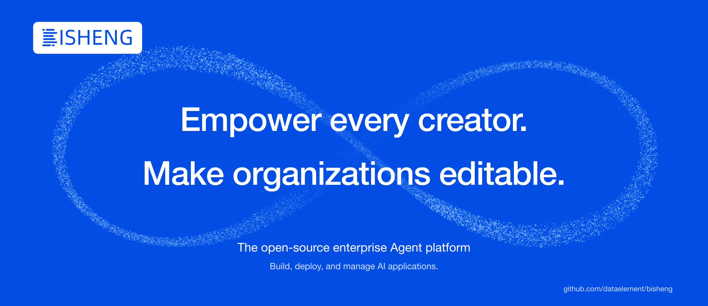

> Создано в Китае. Как и команды, стоящие за DeepSeek и Black Myth: Wukong, мы надеемся сделать мир прекраснее.



<p align="center">
    <a href="https://dataelem.feishu.cn/wiki/ZxW6wZyAJicX4WkG0NqcWsbynde"></a>
    
    
    <a href="https://github.com/dataelement/bisheng/commits"></a>
    <a href="https://star-history.com/#dataelement/bisheng&Timeline"></a>
</p>
<p align="center">
  <a href="./README.md">简体中文</a> |
  <a href="./README_EN.md">English</a> |
  <a href="./README_JPN.md">日本語</a> |
  <a href="./README_ES.md">Español</a> |
  <a href="./README_PT.md">Português</a> |
  <a href="./README_RU.md">Русский</a>
</p>

<p align="center">
  <a href="https://trendshift.io/repositories/717" target="_blank"></a>
</p>

BISHENG — это **единая корпоративная платформа ИИ-агентов с открытым исходным кодом**, ориентированная на повышение продуктивности офисной работы и практическое внедрение корпоративных ИИ-приложений. Ею пользуются ведущие организации из разных отраслей и компании из списка Fortune 500.

### Важное обновление: встречайте BISHENG Desktop

BISHENG Desktop создан на базе DeepSeek Harness (DSH) и вместе с платформой BISHENG образует полноценное корпоративное решение для ИИ-агентов с открытым исходным кодом, которое можно развернуть в собственной инфраструктуре и полностью контролировать.

Проще говоря, это открытая альтернатива WorkBuddy / Doubao Work, позволяющая компаниям по-настоящему владеть своими ИИ-возможностями и управлять ими.


[Скачать BISHENG Desktop](https://dshdesktop.com/zh/enterprise/) · [Руководство пользователя BISHENG Desktop](https://dataelem.feishu.cn/wiki/BWSMwdc2Ciwif4kfe5HcyGHgn3b#share-QZrMdHGRdokzWixRl6vc30w1n8P)

Чтобы настроить клиент под свои нужды (например, заменить логотип), можно изменить [открытый исходный код клиента](https://github.com/dataelement/bisheng-desktop).

> Команда BISHENG опубликовала исходный код настольного клиента для DSH ([dshdesktop.com](https://dshdesktop.com/)) в ту же ночь, когда вышел DSH. BISHENG Desktop создан на базе DSHDesktop. На сегодняшний день DSHDesktop скачали более 900 000 раз, а его репозиторий получил 17,4 тыс. звёзд на GitHub ⭐️. Для индивидуального использования доступен DSHDesktop.
>
> [Сайт DSHDesktop](https://dshdesktop.com/zh/)

## Возможности

1. **🖥️ BISHENG Desktop: объедините локальную работу с корпоративным облаком**

   - **Два режима работы: Chat и Work**: Chat поддерживает ответы на вопросы по базе знаний и многоэтапные облачные задачи. Work упорядочивает материалы в локальных каталогах, к которым вы предоставили доступ, создаёт редактируемые файлы Word, Excel и PowerPoint и дорабатывает их на основе ваших замечаний.
   - **Доступ к корпоративным ресурсам с учётом учётной записи**: Используйте корпоративную учётную запись для доступа к разрешённым моделям, инструментам API/MCP, навыкам и пространствам знаний или открывайте опубликованные приложения в Центре приложений. Поиск по базе знаний возвращает только те пространства и содержимое файлов, к которым у сотрудника есть доступ.
   - **Централизованное управление моделями и кредитами**: Администраторы управляют доступом к моделям, ежемесячными кредитами и записями вызовов. Вызовы корпоративных моделей в Chat и Work учитываются на общем кредитном счёте текущего пользователя; пользователи могут проверять свой баланс и расход.
   - **Централизованное распространение корпоративных расширений**: Администраторы централизованно импортируют плагины и рабочие среды. Сотрудники получают их в соответствии с настройками организации и предоставленными правами.

2. **🛠️ Размещаемые приложения: публикуйте для коллег приложения, которые разрабатывает ваша команда**

   - **Превращайте бизнес-потребности в приложения**: Создавайте отдельные страницы с регистрационными формами, реестрами проектов или панелями показателей отделов. Когда приложение запущено, сотрудники с доступом нажимают «Открыть приложение» в Центре приложений и работают с ним в новой вкладке без повторного входа.
   - **Локальная разработка и отправка на платформу**: Разработчик устанавливает инструмент командной строки bisheng, входит с ключом сервисной учётной записи, а затем разрабатывает и отлаживает приложение локально, при необходимости с помощью Coding Agent. В манифесте приложения разработчик указывает среду выполнения, уровень ресурсов, а также модели и базы знаний платформы, которые использует приложение, и отправляет приложение на платформу. Платформа выполняет предварительные проверки, сканирование на секреты и сборку.
   - **Запуск после согласования**: Согласующий открывает Центр согласований, просматривает дерево исходных файлов приложения, запускает предпросмотр и затем одобряет или отклоняет приложение.
   - **Централизованное управление владельцем**: В разделе «Создание → Приложения» владелец приложения проверяет уровень ресурсов, задаёт круг пользователей, вводит сторонние секреты, просматривает и редактирует данные приложения онлайн, а также запускает, останавливает или удаляет приложение.
   - **Повторное использование возможностей платформы**: Платформа передаёт приложению данные о текущем посетителе, поэтому приложению не нужен собственный вход. Приложение может вызывать модели платформы и искать по базам знаний с правами посетителя.

   

3. **🚀 Режим задач: универсальный агент для сложной многоэтапной работы**
   Вы задаёте цель и при необходимости прикрепляете файлы, базы знаний, инструменты и навыки. Агент разбивает цель на задачи, выполняет их шаг за шагом и предоставляет файл HTML, Markdown, PPT, Excel или Word.

   - 🧠 **Планирование задач и параллельные субагенты**: Главный агент составляет список задач, отслеживает ход выполнения и поручает независимые исследовательские задачи субагентам, работающим параллельно.
   - 🙋 **Участие человека**: Когда агенту нужна информация, которой располагаете только вы, выполнение задачи приостанавливается до вашего ответа.
   - 🧰 **Готовые к использованию навыки**: Четыре встроенных пакета навыков (Word, Excel, PPT и HTML-отчёт) работают сразу после установки. Вы также можете импортировать собственные навыки команды из локального файла или с GitHub.
   - 📎 **Проверяемые выводы**: Отчёты содержат ссылки на источники. Нажмите на маркер ссылки, чтобы открыть источник и перейти к процитированному фрагменту.
   <p align="center"></p>

4. **📚 Пространство знаний: корпоративная база знаний для команд**

   - 🗂️ **Упорядоченное содержимое**: Многоуровневые папки, теги, представления в виде карточек и списка, а также совместный поиск по ключевым словам и тегам.
   - 👥 **Совместное наполнение**: Приглашайте участников с шаблоном прав (Владелец / Управляющий / Редактор / Читатель) или публикуйте пространство на Площади знаний, чтобы другие пользователи могли к нему присоединиться. Суперадминистратор может одним действием создать пространство для отдела.
   - 🔐 **Права доступа вплоть до отдельного файла**: Для пространств, папок и файлов используется единый набор шаблонов прав. Вы можете одним действием предоставить доступ человеку, отделу (включая подчинённые отделы) или группе пользователей. По умолчанию папки и файлы наследуют права родительского объекта, но их можно настроить и отдельно.
   - 💬 **Ответы на вопросы с помощью ИИ**: Задавайте вопросы по одному документу или по всему пространству. В ответах указаны источники; нажмите на источник, чтобы открыть исходный текст в месте цитирования.
   <p align="center"></p>

5. **📡 Каналы: свежие внешние публикации каждый день и сохранение в базу знаний одним нажатием**

   - 📰 **Тематические каналы**: Объединяйте официальные аккаунты WeChat и сайты в тематические каналы, которые обновляются ежедневно. Канал может содержать подканалы.
   - 🎯 **Точная фильтрация**: Настраиваемые правила фильтруют заголовки и основной текст, оставляя только подходящие статьи.
   <p align="center"></p>

6. **🧩 Уникальный [BISHENG Workflow](https://dataelem.feishu.cn/wiki/R7HZwH5ZGiJUDrkHZXicA9pInif)**

   - **Самостоятельный и полноценный механизм оркестрации**: Разделения на chatflow и workflow нет. Многошаговый диалог и автоматизированная обработка могут быть частью одного рабочего процесса.
   - **Участие человека**: Выполняющийся процесс может приостановиться и ждать, пока человек введёт данные, подтвердит действие или внесёт изменения.
   - **Циклы, параллельные ветви и пакетное выполнение в любых сочетаниях**: Нарисуйте замкнутый контур, чтобы создать цикл (большинство аналогичных продуктов не поддерживают циклы), разместите узлы рядом для параллельного выполнения или выберите несколько элементов для пакетной обработки. Это подходит для сложных сценариев, таких как проверка документов и создание отчётов с фиксированной структурой.
   <p align="center"></p>

7. **🏢 Корпоративные возможности: средства управления, необходимые для ИИ в компании**

   - **Централизованное управление настольным клиентом**: Администраторы централизованно настраивают доступные в BISHENG Desktop модели, навыки, инструменты API/MCP и пространства знаний, распространяют плагины и рабочие среды через корпоративный маркетплейс плагинов и управляют доступом к моделям, ежемесячными кредитами и записями вызовов.
   - **Управление отделами и пользователями**: Ведение организационной структуры, пользователей и квот.
   - **Раздельные права на функции и ресурсы**: Роли RBAC управляют доступом к пунктам меню и действиям. ReBAC управляет доступом к пространствам знаний, папкам и отдельным файлам с предоставлением прав людям, отделам (включая подчинённые отделы) или группам пользователей. По умолчанию папки и файлы наследуют права родительского объекта, но их можно настраивать независимо.
   - **Согласования**: Вступление в пространство знаний, подписка на канал, запрос прав на пункты меню и другие действия могут требовать согласования. Процессы и узлы согласования можно настраивать.
   - **Аудит**: Запись содержимого разговоров и журналов системных операций с поиском по пользователю, времени и модулю.
   - **Панели показателей** (коммерческая редакция): Готовые панели активности пользователей, использования приложений, расхода токенов, использования баз знаний и других показателей.
   - **Границы прав API-ключей**: Администраторы выпускают ключи для служебных учётных записей, задают срок действия и права на интерфейсы API, а также предоставляют доступ к конкретным приложениям, базам знаний и другим ресурсам. Права на интерфейсы определяют разрешённые действия, а права на ресурсы — объекты, к которым эти действия применимы. Само по себе наличие ключа не даёт доступа ко всей платформе.

     

   - **Поддержка Xinchuang (китайского стека ИТ)**: Поддерживаются MySQL и Dameng DM8.
   - **Также**: SSO/LDAP, отказоустойчивое развёртывание, проверка безопасности контента, управление трафиком, мониторинг и статистика, сканирование и устранение уязвимостей.
   <p align="center"></p>

   

8. **🔍 Высокоточный разбор документов**: Наши модели разбора документов обучены на большом объёме высококачественных данных, собранных за 5 лет, и их можно бесплатно развернуть в собственной инфраструктуре. В их число входят высокоточные модели распознавания печатного и рукописного текста, редких иероглифов, таблиц, структуры страниц и печатей.
   <p align="center"></p>


## Быстрый старт

Перед установкой BISHENG убедитесь, что выполнены следующие требования:

- CPU >= 8 ядер
- RAM >= 32 GB
- Docker установлен и запущен
- Docker Compose (рекомендуется V2)
- Bash

По умолчанию развертываются MySQL, Redis, MinIO, OpenFGA, ES, Milvus и другие компоненты. OnlyOffice является дополнительным сервисом и не запускается в базовой конфигурации.

Скачайте BISHENG одним из следующих способов:

```bash
git clone https://github.com/dataelement/bisheng.git
cd bisheng
```

Если Git недоступен, скачайте и распакуйте ZIP-архив:

```bash
wget https://github.com/dataelement/bisheng/archive/refs/heads/main.zip
unzip main.zip
cd bisheng-main
```

Запустите установщик из корневого каталога репозитория:

```bash
bash docker/install.sh
```

При первом запуске установщик создает `docker/.env` из `docker/.env.example`, проверяет конфигурацию, выполняет вход в реестр образов, загружает образы и запускает сервисы. Существующий файл `.env` сохраняется. Запустите установщик перед использованием `docker compose up`: конфигурация Compose требует наличия `.env`. Для развертывания используются готовые образы; скачанный исходный код не компилируется.

Проверьте состояние сервисов и журналы запуска:

```bash
cd docker
docker compose ps
docker compose logs -f backend backend_worker
```

Когда сервисы будут готовы, откройте `http://IP_СЕРВЕРА:3001` в браузере и зарегистрируйте пользователя. Первый зарегистрированный пользователь станет администратором системы. Затем настройте модели.

Чтобы включить все возможности (BISHENG Desktop, размещаемые приложения, дообучение и другие), см. документацию: [Самостоятельное развёртывание](https://dataelem.feishu.cn/wiki/BSCcwKd4Yiot3IkOEC8cxGW7nPc)

## Благодарности
Этот репозиторий использует наработки [langchain](https://github.com/langchain-ai/langchain), [unstructured](https://github.com/Unstructured-IO/unstructured) и [LLaMA-Factory](https://github.com/hiyouga/LLaMA-Factory). Благодарим их авторов за замечательную работу.

<b>Спасибо всем участникам проекта:</b>

<a href="https://github.com/dataelement/bisheng/graphs/contributors">
  
</a>


## Сообщество и контакты
Присоединяйтесь к нашей группе для обсуждений


<!--
## История звёзд

[](https://star-history.com/#dataelement/bisheng&Date)
-->

## Некоторые из наших клиентов

BISHENG используют ведущие предприятия из разных отраслей. Вот некоторые из наших клиентов.


## Запросы от организаций

Свяжитесь с нами, чтобы обсудить корпоративное развёртывание BISHENG, интеграцию настольного клиента, демонстрацию продукта или деловое партнёрство.

[Связаться с командой BISHENG через форму Feishu](https://dataelem.feishu.cn/share/base/form/shrcnVow7GQwwKYEBCD41Bu5qoh)
