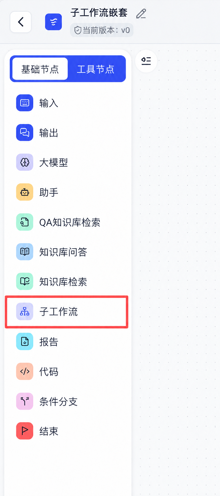
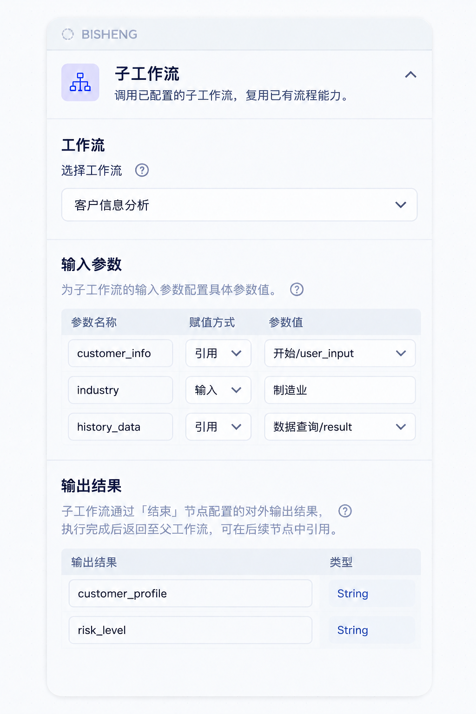
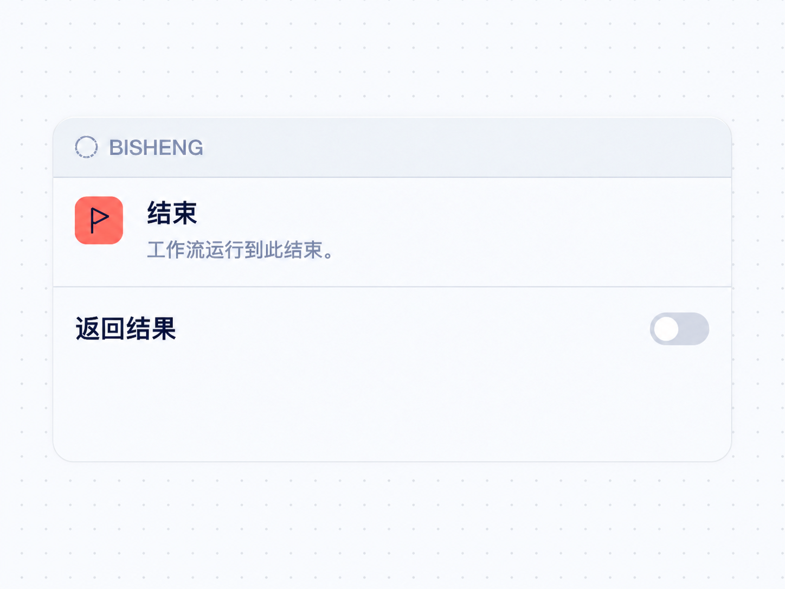
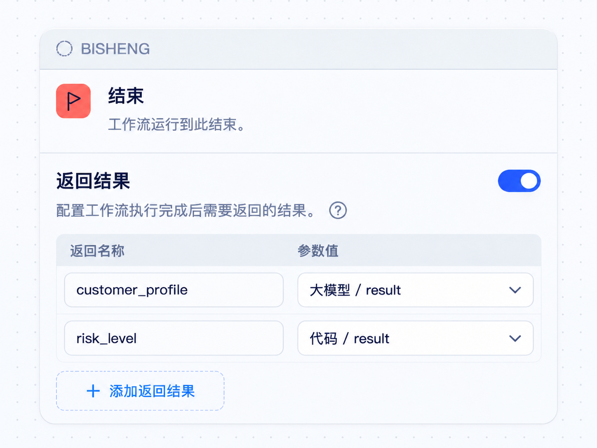
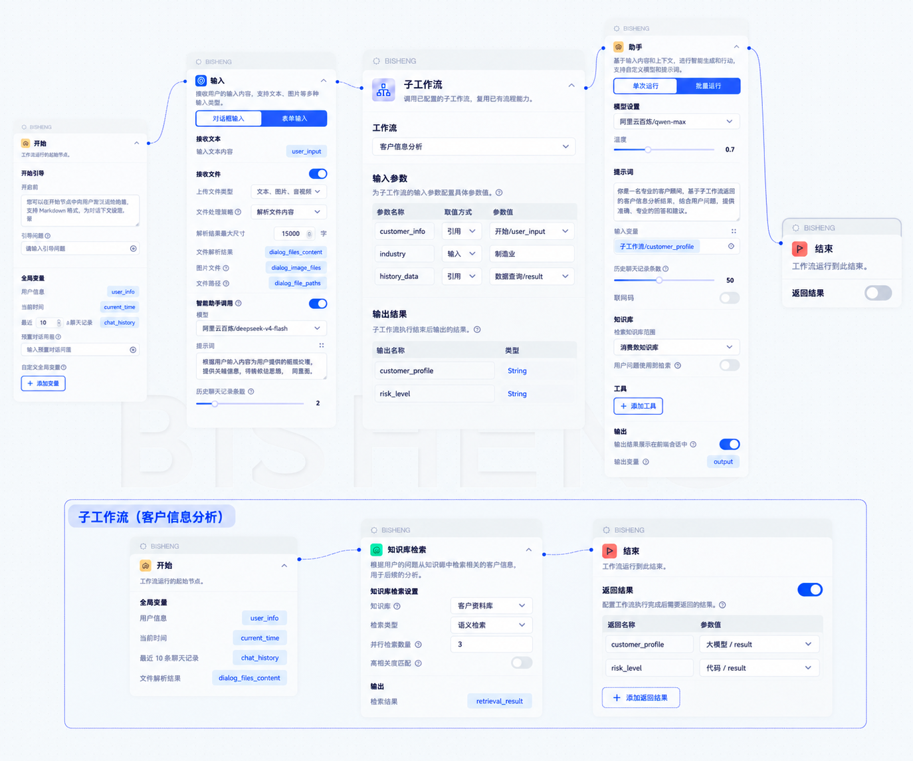

# 工作流嵌套工作流 PRD

> 来源：《上海电气-工作流功能需求与设计方案》「工作流嵌套工作流」一章，原样摘出，作为后续讨论和优化的底稿。
> 摘出时只做了三处调整：加了小节编号；原文「见 2.2.3 子工作流返回结果」改为指向本文 §2.3；配图改名放入 `images/`。
> 2026-10-19 起新增 §3–§5 与附录 A：§1–§2 保持原文，原文未写清之处以 §3 的规则为准；§2 配图与 §3 不一致时（例如返回结果类型一律写成 String、子工作流开始节点没有输入参数），以 §3 为准。
> 同一来源文档中的另外两章（助手节点支持 Skill、跨会话长期记忆）不在本文范围内；其中 Skill 一章已由 `features/v3.0.0/078-agent-skills` 承接。

## 1. 需求说明

在现有工作流编排能力基础上，支持将已有工作流作为子工作流嵌入父工作流，实现流程能力的组合与复用。

子工作流仅支持选择不包含【输入】节点的已有工作流，并通过工作流参数接收父工作流传入的数据；父工作流调用子工作流并传入所需参数，子工作流执行完成后将结果返回父工作流，供后续节点继续使用。同时支持父子工作流执行状态、结果回传及异常处理。

## 2. 功能设计方案

### 2.1 子工作流节点

在工作流编排画布的【基础节点】中新增【子工作流】节点，用于调用已有工作流并复用其流程能力。

可将【子工作流】节点添加至父工作流画布中，并与其他节点进行连接，作为父工作流中的一个执行环节。

### 2.2 子工作流配置

在父工作流中选择【子工作流】节点，可在节点配置面板中选择需要调用的已有工作流。具体设计如下：

- **工作流选择：** 在【工作流】配置项中，从已有工作流中选择需要复用的工作流。当前仅支持选择：
  - **用户拥有编辑及以上权限**的工作流；
  - **不包含【输入】节点**的工作流。

- **输入参数配置：** 选择子工作流后，配置面板展示该工作流运行所需的输入参数。父工作流编排者可为子工作流的输入参数配置参数值，支持：
  - **固定值：** 直接输入参数值；
  - **变量引用：** 引用父工作流中此前节点产生的变量。

- **输出结果：** 选择子工作流后，配置面板展示该子工作流可返回的结果。返回结果来源于子工作流【结束】节点中配置的【返回结果】，具体配置方式见 §2.3 子工作流返回结果。

### 2.3 子工作流返回结果

子工作流执行完成后，可将指定结果返回至父工作流。

为支持自定义子工作流返回给父工作流的参数，对现有【结束】节点进行能力升级，使子工作流可根据实际需求配置需要返回的参数。具体设计如下：

- **返回结果开关：** 在【结束】节点新增【返回结果】开关，默认状态为关闭。开启后展示返回结果配置区域；关闭后隐藏配置区域，节点按照原有方式结束工作流。
- **返回结果配置：** 开启【返回结果】后，可配置一个或多个返回结果。
- **结果配置项：** 每个返回结果可配置**返回名称**和**参数值**，参数值可引用子工作流内部其他节点产生的变量。

### 2.4 子工作流执行

父工作流运行至【子工作流】节点时，触发所选子工作流执行，并根据节点配置完成参数传递及结果回传。

- **参数传入：** 按【子工作流】节点中配置的参数，将固定值或父工作流中的变量传入子工作流。
- **子工作流执行：** 子工作流按照自身已配置的节点及流程执行。
- **结果回传：** 子工作流执行完成后，通过【结束】节点中配置的【返回结果】，将一个或多个结果返回至父工作流。
- **结果使用：** 父工作流后续节点可引用子工作流返回的结果，继续参与流程编排。
- **异常处理：** 子工作流执行过程中发生异常时，按照现有工作流异常处理机制进行处理。

## 3. 需求澄清规则

本章是对 §1–§2 的补充，规则编号（R-x.y）供 §4 验收对照引用。术语约定：

- **父工作流**：画布中放置了【子工作流】节点的工作流。
- **子工作流**：被【子工作流】节点选中并调用的工作流。
- **输入参数**：子工作流【开始】节点中的「自定义全局变量」（见 §3.1）。
- **返回结果**：子工作流【结束】节点「返回结果」中配置的条目（见 §2.3）。
- **交互型【输出】节点**：交互类型为「输入」或「选择」、运行到此会暂停等待用户操作的【输出】节点。

### 3.1 输入参数

| 编号 | 规则 | 依据 |
|---|---|---|
| R-1.1 | 子工作流【开始】节点中的「自定义全局变量」即为它的输入参数，不新增独立的参数声明区。 | 复用已有概念，子工作流内部的引用方式不变 |
| R-1.2 | 【子工作流】节点的「输入参数」表按子工作流的自定义全局变量逐项列出，参数名称取变量名称。 | — |
| R-1.3 | 父工作流为某个输入参数配置了值时，子工作流运行时用该值覆盖对应变量；未配置值时，使用子工作流中该变量自身的值。 | 子工作流单独运行时变量自身的值即为默认值 |
| R-1.4 | 同一工作流内，自定义全局变量的名称不能重复；重名时保存提示错误。 | 父工作流按名称区分参数 |

### 3.2 子工作流的选择条件

【子工作流】节点的「选择工作流」下拉列表只列出同时满足以下条件的工作流：

| 编号 | 条件 |
|---|---|
| R-2.1 | 当前用户对其拥有编辑及以上权限。 |
| R-2.2 | 不要求处于上线状态：已上线和未上线的工作流均可选择。 |
| R-2.3 | 不包含【输入】节点，也不包含交互型【输出】节点。 |
| R-2.4 | 不包含【子工作流】节点。 |
| R-2.5 | 不是当前正在编辑的工作流本身，且与当前工作流属于同一租户。 |

### 3.3 嵌套层数与循环调用

| 编号 | 规则 | 依据 |
|---|---|---|
| R-3.1 | 最多嵌套 2 层：父工作流算第 1 层，子工作流中不能再包含【子工作流】节点。 | 层数限制为 2 时循环调用无法形成 |
| R-3.2 | 父工作流上线时校验：它引用的每个子工作流都满足 R-2.3、R-2.4；不满足时拒绝上线，提示中写明不满足条件的子工作流名称及原因。父工作流保存草稿时不拦截，只在画布上的【子工作流】节点提示。 | 编排过程中允许出现临时不完整状态 |
| R-3.3 | 一个正被其他工作流作为子工作流引用的工作流，保存时如果包含【子工作流】节点、【输入】节点或交互型【输出】节点，保存照常成功，同时弹窗提示「该工作流正被 X 作为子工作流引用，包含 Y 节点后，X 运行到子工作流节点时会失败」，X 列出全部引用方。 | 父工作流调用的是子工作流的当前版本（R-4.1），子工作流一保存即对父工作流生效；不拦截保存是为了不打断编辑 |
| R-3.4 | 运行期兜底：子工作流执行到【子工作流】节点、【输入】节点或交互型【输出】节点时，该节点直接失败，按 §3.7 处理。 | R-3.3 只提醒不拦截，需要运行期保证层数与交互规则 |

### 3.4 运行版本

| 编号 | 规则 | 依据 |
|---|---|---|
| R-4.1 | 父工作流在调试和正式运行时，都调用子工作流的当前版本，即子工作流构建界面中显示的版本。子工作流修改并保存后，或切换了当前版本后，所有父工作流在下一次运行时即生效。 | 复用的目标是一处修改、处处生效 |
| R-4.2 | 子工作流是否上线不影响它被调用。 | 子工作流无需上线，也就不会作为独立应用出现在终端用户的工作台中 |

### 3.5 权限与子工作流变更

| 编号 | 规则 | 依据 |
|---|---|---|
| R-5.1 | 运行时不校验运行者对子工作流的权限：用户能运行父工作流，即可运行其中的子工作流。 | 编排者配置时已具备编辑权限（R-2.1），配置即授权；终端用户感知不到子工作流 |
| R-5.2 | 子工作流内部各节点以父工作流运行者的身份执行，各节点原有的权限行为不变。 | — |
| R-5.3 | 编排者在配置后失去对子工作流的编辑权限，不影响已配置的父工作流运行；该编排者再次打开节点配置时，下拉列表按 R-2.1 重新过滤。 | — |
| R-5.4 | 删除一个正被引用的工作流时拒绝删除，提示中列出全部引用方。 | 删除不可恢复 |
| R-5.5 | 子工作流保存时，如果它的输入参数或返回结果相对保存前有增删改，弹窗列出受影响的父工作流作为提醒，不拦截保存。 | — |
| R-5.6 | 运行时参数匹配：父工作流传入的参数在子工作流中不存在时忽略；子工作流中存在而父工作流未传的参数，使用子工作流自身的值（同 R-1.3）。 | — |
| R-5.7 | 运行时返回结果匹配：父工作流引用的返回结果在子工作流中不存在时，【子工作流】节点失败，失败信息写明缺少的返回结果名称。不以空值代替。 | 以空值继续执行会掩盖接口不匹配 |

本节「引用方」指当前版本中含有指向该工作流的【子工作流】节点的工作流，不区分引用方是否上线。

### 3.6 执行展示

| 编号 | 规则 | 依据 |
|---|---|---|
| R-6.1 | 子工作流静默执行：其内部节点的「输出结果展示在前端会话中」不生效，【开始】节点的开场白、引导问题不展示，普通【输出】节点不向会话推送消息。 | 子工作流只通过返回结果与父工作流交换数据，同一子工作流被不同父工作流复用时行为一致 |
| R-6.2 | 子工作流【开始】节点的系统变量（用户信息、当前时间、聊天记录）取父工作流本次运行的值：同一运行者、同一会话的聊天记录。 | — |
| R-6.3 | 父工作流的调试面板中，【子工作流】节点显示为一个节点，可展开查看子工作流内部每个节点的输入、输出与耗时。 | 子工作流出错时需要定位到内部节点 |
| R-6.4 | 父工作流通过开放 API 调用时，子工作流的行为与在平台内运行时一致，开放 API 不单独暴露子工作流的输入、输出或中间状态。 | — |

### 3.7 数据类型与异常处理

| 编号 | 规则 | 依据 |
|---|---|---|
| R-7.1 | 输入参数和返回结果的值原样传递，不做类型转换；字符串、列表、文件路径列表等均可传递。 | 工作流变量本身不限定类型 |
| R-7.2 | 输入参数「赋值方式」为「输入」（固定值）时，值按字符串处理。 | — |
| R-7.3 | 【子工作流】节点「输出结果」表与【结束】节点「返回结果」的类型列，显示所引用变量自身的类型，不统一写成 String。 | — |
| R-7.4 | 子工作流内部任一节点失败时，【子工作流】节点失败，父工作流整体失败，与现有节点失败的处理一致；不提供失败分支或重试。 | 平台现有节点均无异常分支；需要失败后继续执行时，作为「节点通用异常处理」另行立项 |
| R-7.5 | 子工作流失败时，父工作流的失败信息包含三项：子工作流名称、失败的内部节点名称、原始错误信息。 | — |
| R-7.6 | 子工作流的运行耗时与执行步数计入父工作流本次运行，不单独计算超时。 | — |

## 4. 验收对照

| 小节 | 规则 | 验收标准 |
|---|---|---|
| §3.1 | R-1.1、R-1.2、R-1.3 | AC-SW-01：子工作流配置自定义全局变量 `industry`=「通用」；父工作流节点为其配置固定值「制造业」后运行，子工作流内引用 `industry` 的节点拿到「制造业」；删去父工作流的配置值后运行，拿到「通用」。 |
| §3.1 | R-1.4 | AC-SW-02：同一工作流内新增两个同名自定义全局变量，保存时提示重名错误。 |
| §3.2 | R-2.1、R-2.2、R-2.3、R-2.4、R-2.5 | AC-SW-03：分别准备只有使用权限的、含【输入】节点的、含交互型【输出】节点的、含【子工作流】节点的、其他租户的工作流各一个，以及当前工作流自身，它们均不出现在下拉列表中；满足全部条件的工作流无论是否上线，都出现在列表中。 |
| §3.3 | R-3.2 | AC-SW-04：父工作流引用的子工作流被改为含【子工作流】节点后，父工作流保存草稿成功且节点有提示；父工作流上线被拒，提示中写明子工作流名称和原因。 |
| §3.3 | R-3.3 | AC-SW-05：工作流 B 被 A 引用；给 B 分别加入【子工作流】节点、【输入】节点、交互型【输出】节点后保存，均保存成功并弹窗列出引用方 A。 |
| §3.3 | R-3.4 | AC-SW-06：AC-SW-05 的三种改动保存后运行 A，【子工作流】节点失败，失败信息符合 R-7.5。 |
| §3.4 | R-4.1 | AC-SW-07：子工作流修改返回内容并保存后，父工作流不做任何操作，下一次运行即拿到新内容；子工作流在构建界面切换当前版本后，父工作流下一次运行执行切换后的版本。 |
| §3.4 | R-4.2 | AC-SW-08：子工作流从未上线，父工作流调试和上线后运行均成功调用它；终端用户的工作台中看不到该子工作流。 |
| §3.5 | R-5.1、R-5.2 | AC-SW-09：用户只对父工作流有使用权限、对子工作流无任何权限，运行父工作流成功；子工作流内的工具节点以该用户身份执行。 |
| §3.5 | R-5.3 | AC-SW-10：编排者配置完成后被收回子工作流的编辑权限，父工作流照常运行。 |
| §3.5 | R-5.4 | AC-SW-11：删除被引用的工作流被拒，提示中列出全部引用方；解除全部引用后可以删除。 |
| §3.5 | R-5.5 | AC-SW-12：子工作流删除一个返回结果后保存，弹窗列出受影响的父工作流，保存成功。 |
| §3.5 | R-5.6 | AC-SW-13：子工作流删除一个输入参数、新增一个输入参数后保存；父工作流运行成功，多传的参数被忽略，新增参数取子工作流自身的值。 |
| §3.5 | R-5.7 | AC-SW-14：子工作流删除父工作流正在引用的返回结果后保存；父工作流运行到【子工作流】节点失败，失败信息写明缺少的返回结果名称。 |
| §3.6 | R-6.1 | AC-SW-15：子工作流内大模型节点开启「输出结果展示在前端会话中」、配置开场白和普通【输出】节点；运行父工作流，会话中不出现以上任何内容。 |
| §3.6 | R-6.2 | AC-SW-16：子工作流的返回结果引用开始节点的用户信息与聊天记录，父工作流运行后拿到的是当前运行者和当前会话的值。 |
| §3.6 | R-6.3 | AC-SW-17：父工作流调试面板中可展开【子工作流】节点，看到子工作流每个内部节点的输入、输出与耗时。 |
| §3.6 | R-6.4 | AC-SW-18：通过开放 API 调用父工作流，返回结果与在平台内运行一致，响应中不出现子工作流内部节点的消息。 |
| §3.7 | R-7.1、R-7.2、R-7.3 | AC-SW-19：子工作流返回一个列表变量和一个文件路径列表，父工作流后续节点拿到的值与子工作流内完全一致；界面类型列显示被引用变量的类型；固定值参数在子工作流内为字符串。 |
| §3.7 | R-7.4、R-7.5 | AC-SW-20：子工作流内某节点报错，父工作流整体失败，失败信息含子工作流名称、内部节点名称和原始错误。 |
| §3.7 | R-7.6 | AC-SW-21：父工作流的运行耗时与步数统计包含子工作流部分。 |

## 5. 决策记录

2026-10-19 需求澄清逐项拍板，被否决的方案及原因如下。

| 议题 | 采纳 | 否决的方案与原因 |
|---|---|---|
| 输入参数在哪里声明 | 复用开始节点自定义全局变量（R-1.1） | 新增独立「输入参数」区：开始节点多出一个需要与全局变量区分的概念。父工作流直接覆盖子工作流内部节点参数：暴露子工作流内部结构，子工作流改动后父工作流易失效。 |
| 嵌套层数 | 2 层（R-3.1） | 3 层、5 层：需要引用链展开与循环检测，调试和排障链路更长，当前场景用不到。 |
| 循环/超限的拦截时机 | 父工作流上线拦截、草稿提示；被引用的工作流保存时提醒；运行期兜底（R-3.2、R-3.3、R-3.4） | 保存即拦截：编排中途被打断。被引用的工作流含禁止节点时拦截保存：同样打断编辑，运行期兜底已能保证规则。 |
| 运行哪个版本 | 实时调用子工作流的当前版本（构建界面显示的版本），不要求上线（R-4.1、R-4.2） | 实时调用当前上线版本：子工作流必须上线，会作为独立应用出现在终端用户工作台；且修改子工作流须先下线，下线期间父工作流失败。父工作流上线时冻结子工作流副本：子工作流修复问题后需逐个重新上线父工作流。配置时固定版本号：非当前版本仍可被编辑或删除，无法保证内容不变。已知代价：子工作流每次保存即对已上线的父工作流生效，包括未改完的中间状态，修改被引用的工作流需自行把握保存时机（R-3.3、R-5.5 提供提醒）。 |
| 运行时权限 | 不校验，随父工作流授权（R-5.1） | 校验使用权限：管理员需为全部终端用户补授子工作流权限，否则父工作流失败。 |
| 删除 | 被引用时拦截删除（R-5.4） | 不拦截：删除不可恢复。 |
| 接口变更 | 保存时提醒，缺返回结果则节点失败（R-5.5、R-5.6、R-5.7） | 接口变更时拦截保存：子工作流修改接口前必须先改全部父工作流，顺序上无法完成。 |
| 交互节点 | 含【输入】节点或交互型【输出】节点的工作流不能作为子工作流（R-2.3）；2026-10-19 复议后维持 | 此项是产品取舍，不是技术限制（技术可行性见附录 A.2）。子工作流定位为「给参数、出结果」的后台流程。否决的方案：【输入】节点不暂停、由父工作流传参填充（能直接复用现有对话型工作流，但子工作流若从【输出】节点连回【输入】节点形成多轮循环，就永远走不到【结束】节点）；【输入】节点或交互型【输出】节点暂停并透传到父会话（需在 R-6.1、R-6.4 开例外，并在引擎层实现暂停转发与输入路由）。 |
| 会话展示 | 静默执行，调试面板可展开（R-6.1、R-6.3） | 透传展示：会话中出现父工作流编排者看不见也控制不了的内容。 |
| 数据类型 | 原样传递，类型跟随被引用变量（R-7.1、R-7.3） | 只支持 String：文件、列表需在两端手动序列化。 |
| 异常处理 | 整体失败，补全失败信息（R-7.4、R-7.5） | 子工作流节点单独加失败分支：全平台仅此节点有异常分支，行为不一致。 |

## 附录 A. 实现约束与取证

### A.1 引擎现状

以下为 2026-10-19 在 `feat/SEC-3.0.0-1016` 分支上核实的现状，路径相对 `src/`，供设计阶段参考。

| 事实 | 位置 | 对本需求的影响 |
|---|---|---|
| 开始节点的自定义全局变量参数名为 `custom_variables`，每项为 `{key, label, value}`，`value` 为最长 1000 字符的字符串，运行时转成 `{key: value}`。 | `backend/bisheng/workflow/nodes/start/start.py:75-77`；`frontend/platform/src/pages/BuildPage/flow/FlowNode/component/GlobalVarItem.tsx:15-17` | R-1.3 的覆盖需要在运行时替换 `value`；R-1.4 的重名校验目前不存在，需要新增。R-7.1 要求传入非字符串值时绕过界面上的字符串限制。 |
| 【结束】节点没有任何配置，`_run` 直接返回 `None`。 | `backend/bisheng/workflow/nodes/end/end.py:6-7` | §2.3 的「返回结果」为全新能力。 |
| 运行时读取 `Flow.data`（当前版本），不检查上线状态；上线期间不能编辑或切换版本；下线状态下编辑保存直接写入当前版本。 | `backend/bisheng/open_endpoints/domain/services/published_workflow_service.py:43,90`；`backend/bisheng/api/v1/workflow.py:549-552` | R-4.1 直接读取子工作流的 `Flow.data` 即可；也因此子工作流每次保存即对父工作流生效。 |
| 引擎只对【输入】节点和交互型【输出】节点暂停，通过 LangGraph `interrupt_before` 实现。 | `backend/bisheng/workflow/graph/graph_engine.py:259-268,376-401`；`backend/bisheng/workflow/nodes/output/output.py:54` | R-2.3 的筛选与 R-3.4 的兜底按这两类节点判断。 |
| 节点失败即整个工作流失败，没有异常分支或重试；每个节点有执行步数上限。 | `backend/bisheng/workflow/nodes/base.py:220,237-239`；`graph_engine.py:312-334` | R-7.4 沿用现状；R-7.6 需要把子工作流步数并入父工作流计数。 |
| 变量池不区分类型：`variables_pool: Dict[node_id, Dict[key, Any]]`，类型只是界面元数据。 | `backend/bisheng/workflow/graph/graph_state.py:15` | R-7.1 可原样传递。 |
| 所有运行入口只校验 `use` 权限，节点以运行者身份执行。 | `backend/bisheng/api/v1/workflow.py:389-394`；`backend/bisheng/worker/workflow/tasks.py:109-124` | R-5.1 不需要新增校验；R-5.2 沿用现状。 |
| 平台中不存在任何子工作流节点或「调用工作流」类工具。 | `backend/bisheng/workflow/common/node.py:8-25` | 全新节点类型。 |

### A.2 LangGraph 子图中断的可行性

本节记录 2026-10-19 对「子工作流能否包含交互节点」的技术调研，结论是可行，排除交互节点的原因见 §5。

| 事实 | 来源 |
|---|---|
| 子图默认继承父图的 checkpointer，支持 `interrupt()`；中断无论嵌套多深都会传到顶层图。 | LangGraph 文档 [use-subgraphs](https://docs.langchain.com/oss/python/langgraph/use-subgraphs) |
| 在节点内调用子图时，恢复后父图从该节点开头重新执行，子图从触发中断的节点开头重新执行，因此这个节点必须幂等。 | LangGraph 文档 [interrupts](https://docs.langchain.com/oss/python/langgraph/interrupts)「Using with subgraphs called as functions」 |
| 在 langgraph 1.2.10（本仓库锁定版本）上实测两种嵌套方式均可暂停并恢复：子工作流作为独立引擎在父节点内运行，停在输入节点时父节点调用 `interrupt()` 交出暂停，父图用 `Command(resume=...)` 恢复后两层都能走完；带 `interrupt_before` 的子图直接作为父图节点，父图停在该节点，用 `stream(None)` 恢复后能走完。 | 本地实验脚本 |
| 平台引擎在暂停期间把整个 `Workflow` 对象常驻在 worker 内存，并通过 StatefulWorker 把后续请求绑定到同一节点。子引擎挂在父节点实例上，可以随父对象一起存活。 | `backend/bisheng/worker/workflow/tasks.py:27-53` |
| 支持交互节点需要改动平台引擎：`judge_status` 要能识别子工作流节点的暂停，`continue_run` 要把用户输入路由到子引擎（节点 id 需要加命名空间），开放 API 要能回传子工作流节点的输入。 | `backend/bisheng/workflow/graph/graph_engine.py:342-401` |
