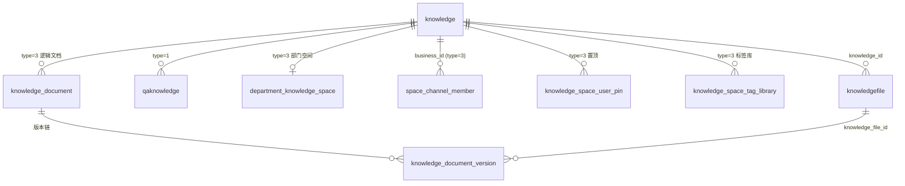

# 知识空间 vs 知识库：概念、区别与联系

> 适用版本：v3.0.x 代码线（2026-11-16 核对）。本文结论全部来自源码与接口清单核对，核对方法见 §9。
> 相关文档：[知识库与 RAG 管道](./04-knowledge-rag.md) · [用户与权限体系](./10-permission-rbac.md) · [数据模型与存储层](./07-data-models.md)

---

## 0. 一句话结论

**知识库（Knowledge Base）和知识空间（Knowledge Space）不是父子或新旧关系，而是同一个聚合根 `knowledge` 下、由 `type` 区分的两种并列「知识资源」**：

- **知识库** = 面向**搭建者**的 RAG 资料资产：扁平文件集、**库级权限**、自选 Embedding 模型，主要被工作流/助手/开放 API「**使用（use）**」。
- **知识空间** = 面向**使用者**的协作式知识工作区：文件夹树、**文件级权限**、成员/订阅/加入审批，主要被「**分享（share）**」给人来浏览、检索和问答。

二者共用同一套表、同一套解析与双路召回管道、同一套租户隔离与权限底座；因此"联系"在**底座**，"区别"在**组织形态、权限粒度与使用人群**。

---

## 1. 概念定位

| 视角 | 知识库（type=0） | 知识空间（type=3） |
|------|------------------|--------------------|
| 解决的问题 | 给应用提供稳定、可控的 RAG 语料 | 给一群人提供共享、可协作、可发现的知识场所 |
| 典型使用者 | 应用搭建者 / 管理员 / 开放 API 调用方 | 终端用户（浏览、订阅、提问、上传） |
| 心智模型 | 一个"语料包" | 一个"资料库 + 成员 + 目录"的协作空间 |
| 消费方式 | 被应用、工作流、助手、Linsight 检索 | 被人直接使用，也可被应用/助手选为检索范围 |
| 权限问题 | 「这个库我能用吗？」 | 「这个空间/这个文件夹/这个文件我能看吗？」 |

> 命名沿革：平台多语言资源里 `workbench2` 的文案就是「知识空间」（`src/frontend/platform/public/locales/zh-Hans/bs.json:216`），
> 说明该概念沿用了早期「工作台」的叫法；但今天的知识空间与知识库在权限与结构上已是两套产品形态。

---

## 2. 联系：它们共享什么

```
                    ┌─────────────────────────────┐
                    │  knowledge（聚合根，一张表） │
                    │  type: 0=文档库 1=QA 3=空间  │
                    └──────────────┬──────────────┘
                                   │ knowledge_id
                    ┌──────────────▼──────────────┐
                    │ knowledgefile（同一张文件表）│
                    └─────────────────────────────┘
```

1. **同一个聚合根、同一张表**：二者都是 `knowledge` 表里的一行，靠 `KnowledgeTypeEnum` 区分——
   `NORMAL=0`（文档知识库）、`QA=1`（问答知识库）、`SPACE=3`（知识空间），`PRIVATE=2` 为已下线的个人知识库。
   （`src/backend/bisheng/knowledge/domain/models/knowledge.py:28-36`）
2. **同一套文件表**：文件都写在 `knowledgefile`，都以 `knowledge_id` 归属到对应的库或空间。
   （`knowledge/domain/models/knowledge_file.py:114` 等）
3. **同一套解析管道**：Load → Transform → Ingest，Celery `knowledge_celery` 驱动；解析器、分块、
   摘要、缩略图、预览缓存完全共用。（详见 [04-knowledge-rag.md](./04-knowledge-rag.md)）
4. **同一套双路召回**：每个库 / 每个空间各自生成独立的 Milvus Collection 与 ES Index
   （`knowledge_service.py:886-905`），检索时 Milvus 稠密 + ES 稀疏 + RRF 融合。
5. **同一套租户隔离**：`knowledge.tenant_id` + ContextVar 自动过滤，二者都在租户隔离范围内。
6. **同一套权限内核**：OpenFGA / ReBAC（F048）+ 动作目录（action catalog），资源类型分别是
   `knowledge_library` 与 `knowledge_space` / `folder` / `knowledge_file`。
7. **同一个检索门面**：统一检索门面只接受这两类知识资源——
   `SUPPORTED_KNOWLEDGE_TYPES = {NORMAL, SPACE}`（`knowledge/domain/schemas/retrieval_facade.py:33-37`）。
   QA 库（type=1）与已下线的个人库（type=2）在检索面上不可达。
8. **可以同时出现在同一个检索范围里**：助手可同时勾选文档知识库与知识空间，结果合并引用
   （`features/v2.6.0/041-knowledge-space-select-flow-assistant/spec.md` AC-04）。

---

## 3. 速查：关键区别

| 维度 | 知识库（type=0） | 知识空间（type=3） | 依据 |
|------|------------------|--------------------|------|
| 组织形态 | **扁平**文件列表，无目录接口 | **文件夹树**（`file_type=0` 目录 + `file_level_path` 路径） | `knowledge_space.py` 的 `/folders`、`/files/move` 路由；`knowledge.py` 无目录路由 |
| 权限粒度 | **库级**：整库可见/可用或不可见 | **容器 + 文件夹 + 文件级**（含继承与"最近绑定优先"） | `retrieval_facade.py:33`；`knowledge_permission_service.py:858-875` |
| 授权动作 | `use`（被应用使用）、`visible`/`edit`/`delete` | `share`、`create_folder`、`upload_file`、`move`、`download` 等 | `permission/domain/services/catalog_policy.py:68-74` |
| 获取方式 | 管理员/创建者**显式授权**给用户、部门、用户组 | 公开空间可**自助订阅**；审批空间走**加入审批**；私有空间不可订阅 | `knowledge_space_service.py:5075` 起 |
| 成员模型 | 无成员概念 | `space_channel_member`（creator / admin / member；ACTIVE / PENDING / REJECTED） | `common/models/space_channel_member.py:20-101` |
| 发现机制 | 仅在"有权限"的范围内被列出 | **知识广场** `/knowledge/space/square`（`is_released` + PUBLIC/APPROVAL） | `knowledge_space.py:347` |
| 内容来源 | 上传文件、Excel、网页等 | 上传、**网页链接**、**频道文章同步**、**音视频转写** | `FileSource`：`knowledge_file.py:72-78`；`/{space_id}/web-links` |
| 版本管理 | 无版本链 | `knowledge_document` + `knowledge_document_version`（文档版本、主版本、相似文件） | `knowledge/domain/models/knowledge_document.py:1` |
| 内容治理 | 分段编辑（`/chunk`）、元数据字段、复制、索引重建 | 预览/下载、批量重试/删除/打标、标签库与自动标签、置顶 | `knowledge.py` 与 `knowledge_space.py` 路由对比 |
| 直接问答 | 无"针对某文件/文件夹聊天" | 有：`/chat/file/{file_id}`、`/chat/folder`，带独立会话历史 | `knowledge_space.py` 路由 |
| Embedding 模型 | 创建时**自选**并绑定到库 | 忽略请求值，统一使用**租户工作台**的 Embedding 模型 | `knowledge_space_service.py:1285-1298`；`KnowledgeCreate.model` 注释 |
| 部门绑定 | 无 | `department_knowledge_space`（一部一空间）、上传审批/内容安全检查开关；部门空间不可私有 | `department_knowledge_space.py:13-44`；`knowledge_space_service.py:1891` |
| 删除 | 直接删除 | 提交业务删除后，用可重试的 `knowledge_space_delete_job` 清理向量/MinIO | `knowledge_space_direct_delete_service.py:1` |
| API 前缀 | `/api/v1/knowledge` | `/api/v1/knowledge/space` | 两个 `APIRouter(prefix=...)` |
| 主要界面 | 平台端 `/filelib`（管理端） | 用户端 `/knowledge/space/:spaceId` | `platform/src/routes/index.tsx:109`；`client/src/routes/index.tsx:280-295` |
| 配额 | — | 空间创建数、订阅数、空间文件容量分别限额 | 错误码 18001 / 18032 / 18024 |

---

## 4. 逐个展开

### 4.1 数据模型：同根、不同枝



- `knowledge` 是聚合根，`type` 决定它是库、QA 库还是空间。
- `knowledgefile` 同时服务库与空间：空间用 `file_type=0` 表示目录、`file_level_path` 表示父目录路径，
  `SpaceFileDao` 就是"在 `knowledgefile` 表上做空间文件夹/文件操作"的 DAO。
- 仅空间使用的旁路表：成员、置顶、标签库、部门绑定、删除作业、文档版本。

### 4.2 组织形态：扁平 vs 目录树

知识库的接口里没有"新建文件夹/移动文件"，文件就是一组平铺记录；
知识空间以"容器 → 文件夹 → 文件"组织，子节点列表、按目录搜索、批量移动、下载、重试都按目录组织。
这就是为什么空间能对"某个文件夹"单独授权，而库不能。

### 4.3 权限粒度：库级 vs 文件级（最重要的区别）

- **知识库**：授权与校验都停在库这一层。动作目录只给 `knowledge_library` 开放 `use`，
  检索只在库级收口（`ensure_knowledge_read_async` / `ensure_knowledge_use_async`，
  `knowledge_permission_service.py:185-205`）。一个库要么整库可见，要么不可见。
- **知识空间**：容器、文件夹、文件都是可授权对象。检索走 **F029 双层过滤**——
  索引层按 `can_read on knowledge_file` 下推 Milvus/ES 过滤条件，结果层再按 `view_file` 有效权限兜底，
  与空间列表 UI 同源（`knowledge_file_visibility_service.py`）。
  工作台的检索实现也印证了这一点：空间桶（space bucket）做 `view_space` + `view_file` 过滤，
  组织库桶（org bucket）只做 `use` 库级收口（`workstation_service.py:1280-1300`）。

一句话：**知识库回答"这个库能不能用"，知识空间回答"这个库里的哪个文件能不能看"。**

### 4.4 成员与获取方式

- 知识库：没有"加入"概念，只能由有授权能力的人显式授权。
- 知识空间：有完整的社会化机制——
  - 三种可见性：`PUBLIC`（自助订阅）、`APPROVAL`（提交加入审批，场景码 `knowledge_space_subscribe_request`）、
    `PRIVATE`（不可订阅，错误码 18030）；
  - 成员角色 `creator / admin / member`，审批通过后把成员关系投影成 FGA 授权；
  - 部门空间：一个部门绑定一个空间，可配置"上传需审批"（动作码 `request_department_knowledge_space_upload`）
    与"上传需内容安全检查"，且不允许设为私有（18081）。

### 4.5 检索行为

| | 知识库 | 知识空间 |
|---|---|---|
| 检索面支持 | ✅ | ✅ |
| 过滤强度 | 库级 | 容器 + 文件夹 + 文件级（双层） |
| 在应用里的入口 | 工作流知识检索节点（类型 `knowledge`）、助手、Linsight 组织知识库、开放 API `/filelib` | 用户端输入框选空间、空间内文件/文件夹问答、工作流/助手（类型 `space`） |

二者可以在同一条回答里混合引用，引用与溯源协议相同。

### 4.6 内容治理：各管一段

- 知识库偏向"**把语料调好**"：分段（chunk）查看/修改/删除、自定义元数据字段、复制知识库、
  切换 Embedding 后重建索引。
- 知识空间偏向"**把资料管好、用起来**"：预览/下载/批量操作、标签与自动标签、置顶、
  文档版本（V1/V2、主版本、相似文件）、文件/文件夹级问答、分享与引用。

### 4.7 Embedding 模型：自选 vs 租户默认

- 知识库创建时必须选择 Embedding 模型（错误码 10901），之后可重建；
- 知识空间创建时**忽略**请求里的 `model`，固定使用租户"工作台"的 Embedding 模型
  （`knowledge_space_service.py:1285-1298`，未配置则抛 `WorkbenchEmbeddingError`）。

### 4.8 生命周期

- 知识库：创建 → 发布/复制 → 文件解析 →（可选）重建 → 删除。
- 知识空间：创建（含初始授权）→ 成员订阅/审批 → 上传（可能需审批/敏感词检查）→ 使用/分享 →
  删除（先提交业务删除，再用可重试作业清理向量与对象存储，并通知成员）。

---

## 5. 两者如何协作

1. **同一助手/工作流可同时选择二者**：配置里只是两组 ID，检索时按各自类型走对应过滤强度，
   结果合并后再交给 LLM；引用协议一致。
2. **统一检索门面按类型分派**：`type=0` 走库级过滤，`type=3` 走文件级过滤，
   对外契约保持"我只接受这两类知识"。
3. **开放 API / MCP 也同时覆盖二者**：资源列表、文件列表、检索接口都以类型区分装饰字段。

---

## 6. 常见误区

| 误区 | 事实 |
|------|------|
| "知识空间是装知识库的容器" | ❌ 没有父子关系。空间直接持有 `knowledgefile`（含文件夹）；库与空间是并列资源，`knowledge` 表里没有 parent 字段 |
| "知识空间是知识库的升级版" | ❌ 面向人群与权限粒度不同，检索面二者并列，不能互相替代 |
| "知识库里也有文件夹" | ❌ 后端库接口与平台端库界面都没有目录概念；目录是空间能力 |
| "知识库也是按文件授权的" | ❌ 库的授权与校验停在库级；文件级授权是空间能力 |
| "知识空间就是会话里的临时文件" | ❌ 会话临时上传走的是另一套临时/分区知识资源，不是 `type=3` |
| "只要进了同一个租户就都能看" | ❌ 同租户默认仍不可见，必须显式授权或订阅；隔离与授权是两层 |
| "问答知识库也是一种空间" | ❌ `QA=1` 是第三种类型，检索面不支持 |

---

## 7. 选型建议

| 需求 | 选择 |
|------|------|
| 给工作流/助手/开放 API 提供稳定语料，需要人工校订分段、元数据、换模型重建 | **知识库** |
| 一批人共享资料，要按文件夹/文件授权、要订阅/加入审批、要部门空间或知识广场 | **知识空间** |
| 既要给应用检索，又要给人浏览与提问 | 两者都建，并按需同时挂到同一个助手/工作流 |
| 只是临时给一次对话补充资料 | 都不要建，用会话临时文件 |

---

## 8. 代码锚点

| 主题 | 文件 |
|------|------|
| 类型枚举、聚合根字段 | `src/backend/bisheng/knowledge/domain/models/knowledge.py:28-115` |
| 文件表 / 来源 / 目录路径 | `src/backend/bisheng/knowledge/domain/models/knowledge_file.py:72-114` |
| 空间文件夹 DAO | `src/backend/bisheng/knowledge/domain/models/knowledge_space_file.py` |
| 空间业务服务（创建/订阅/删除/权限） | `src/backend/bisheng/knowledge/domain/services/knowledge_space_service.py:1237`、`:1797`、`:5075` |
| 库业务服务（创建/索引初始化） | `src/backend/bisheng/knowledge/domain/services/knowledge_service.py:886-910` |
| 库级权限校验 | `src/backend/bisheng/knowledge/domain/services/knowledge_permission_service.py:185-235`、`:858-875` |
| 文件级双层过滤（F029） | `src/backend/bisheng/knowledge/domain/services/knowledge_file_visibility_service.py` |
| 统一检索门面契约 | `src/backend/bisheng/knowledge/domain/schemas/retrieval_facade.py:33-37` |
| 工作流/助手空间检索（F041） | `src/backend/bisheng/knowledge/domain/services/space_flow_retrieval.py` |
| 动作 → 资源类型目录 | `src/backend/bisheng/permission/domain/services/catalog_policy.py:68-74` |
| 成员模型 | `src/backend/bisheng/common/models/space_channel_member.py:20-101` |
| 部门空间 | `src/backend/bisheng/knowledge/domain/models/department_knowledge_space.py:13-70` |
| 文档版本 | `src/backend/bisheng/knowledge/domain/models/knowledge_document.py`、`knowledge_document_version.py` |
| 空间删除作业 | `src/backend/bisheng/knowledge/domain/services/knowledge_space_direct_delete_service.py` |
| 空间 API | `src/backend/bisheng/knowledge/api/endpoints/knowledge_space.py:52` |
| 库 API | `src/backend/bisheng/knowledge/api/endpoints/knowledge.py:80` |
| 前端入口 | `src/frontend/platform/src/routes/index.tsx:109-113`；`src/frontend/client/src/routes/index.tsx:280-295` |

---

## 9. 本文核对方式

- 逐条对照源码：聚合根与枚举、文件表字段、权限服务与动作目录、订阅/审批逻辑、检索门面常量、
  工作流节点与工作台检索分支。
- 对照接口清单：`knowledge.py` / `knowledge_space.py` / `knowledge_version.py` 的全部路由，
  确认"目录、版本、网页链接、文件/文件夹问答"为空间独有，"分段、元数据、复制、重建"为库独有。
- 对照前端路由与 API 调用：确认知识空间在用户端（client）管理，知识库在平台端（platform）管理，
  用户端仅以"组织知识库"形式在 Linsight 中消费 `type=0`。
- 未运行集成测试；涉及产品口径的判断均可在上述锚点复核。
