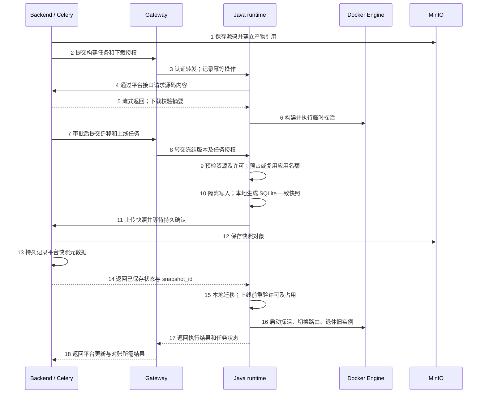
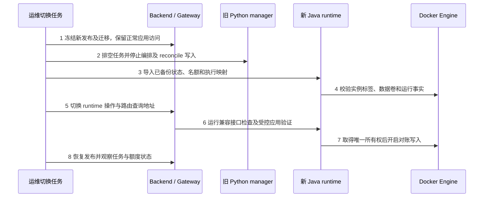

# bisheng-gateway 商业托管模块同仓库实施方案

日期：2026-10-19　｜　状态：实施方案草案　｜　范围：仓库组织、运行进程、功能迁移、授权与交付

> **历史参考，已被替代（2026-10-19）：** Vibe 已确定全部按开源实现，代码继续留在 BiSheng 仓库。本文中的迁入 Gateway、Java 商业 runtime、授权和固定上线额度建议不再作为实施要求；当前有效方案见 [Vibe 应用托管全开源技术方案](vibe-app-open-source-technical-design.html)。下文保留原评审记录。

在现有 `bisheng-gateway` Git 仓库内增加完整托管编排实现，将当前单 Maven 应用重组为多模块工程，Gateway 与托管服务分别构建、启动和升级。这是既有仓库内的工程组织调整，不涉及新建或合并 Git 仓库。先完成现有 Docker 功能及已确认的存储解耦，再扩展应用包和 K8s。

**已经确认的边界：** 附件接口归 BiSheng backend；manager 保留本地 SQLite 备份、迁移和恢复，通过 backend 下载源码、上传快照，不直接访问 MinIO；免费同时在线 10 个应用，停用释放名额。前文按代理与 manager 分进程展开，本轮进一步比较三者合并部署；分进程是可选运行形态，不是技术硬性要求，见 [§2.4](#process-options)。Java 重实现、元数据库部署方式和分阶段切换是本方案建议，进入开发前需完成对应设计。

本方案基于本地 Gateway `feat/dsh-access@faed249a96ea43a4c65b90765dd4054bf6e55722`，工作区检查时无改动；runtime 功能清单以 BiSheng `feat/3.0.0-vibe@736ef593f3fc6e1634008c842d2604304d6f70a6` 为基线。Gateway 基线是当前本地检出，不代表远端最新提交。本文交付方案，不调整这两个项目的业务代码、POM、配置或运行进程。

## 阅读导航

- [1 当前仓库与改造前置](#section-1)
- [2 目标目录与进程](#section-2)
- [3 Maven 构建与依赖隔离](#section-3)
- [4 完整 runtime 的功能迁移](#section-4)
- [5 平台协议与存储解耦](#section-5)
- [6 授权与运行状态](#section-6)
- [7 分阶段实施](#section-7)
- [8 切换与回退](#section-8)
- [9 验收和交付](#section-9)
- [10 开发前的决策](#section-10)
- [11 代码和官方资料](#section-11)

<a id="section-1"></a>

## 1 当前仓库与改造前置

### 1.1 当前目录

```text
bisheng-gateway/
├── pom.xml                         # 单个 gateway 可执行工程
├── Dockerfile                      # COPY gateway.jar，启动一个 JVM
├── src/main/java/com/dataelem/gateway/
│   ├── GatewayApplication.java
│   ├── controller/ filter/ config/  # 网关、SSO、到期控制等
│   ├── service/ mapper/ sdk/
│   └── dsh/                        # DSH 控制器、授权、席位及持久化
├── src/main/resources/
├── src/test/java/
├── docker/
│   ├── docker-compose.yml          # 当前示例仅声明 gateway
│   ├── gateway/config/application.yml
│   └── db/                         # MySQL 和 DM SQL
├── scripts/                        # 打包、上传、重启和本地启动脚本
└── docs/                           # Gateway 与 DSH 说明
```

根 POM 的 artifact 为 `gateway`，采用 Java 17、Spring Boot 3.2.6、Spring Cloud 2023.0.1，包含 Spring Cloud Gateway、Reactor 集成及 MyBatis、MySQL/DM 驱动。根 POM 尚无 `<modules>` 或聚合工程配置。[G01]

`/Users/zhangguoqing/works/bisheng-gateway` 已经是 Git 仓库。Git 管版本，Maven 模块管构建，进程管运行边界；增加 Maven 子模块不会创建子 Git 仓库，模块数量也不决定进程数量。

### 1.2 必须一起处理的现有耦合

| 当前实现 | 改造影响 | 实施要求 |
| --- | --- | --- |
| 单个根 POM 管理全部依赖 | 新 runtime 若直接加到根 `src`，会进入 Gateway 同一个 classpath 和启动范围 | 将两个应用分开，不以 profile 切换同一份完整应用来模拟独立服务 |
| `GatewayApplication` 扫描 `com.dataelem.gateway`，并注册 Mapper | 新服务误用扫描范围会带起 SSO、DSH、旧数据库配置及定时任务 | runtime 使用 `com.dataelem.runtime` 独立启动包；共享库不自动扫描 Gateway 组件 [G02] |
| `deploy.sh` 在根目录执行 Maven，寻找 `target/gateway-*.jar` | 移动源码后旧脚本找不到产物，或误发其他模块 JAR | 修改 Shell、PowerShell、本地启动和 Docker 打包入口，保留 Gateway 产物名称和外部启动约定 [G03] |
| 旧授权到期 WebFilter 会处理未单独分类的网关自有 API | 新 hosting 路由可能被旧 SSO 授权误拦，影响免费 10 应用 | 增加精确路由归属和独立 hosting 授权规则，覆盖缺少/过期旧授权的测试 [G04] |
| DSH 验签与内置 10 席位在 `dsh` 包中 | DSH 的 audience、格式、人数及回收规则不是应用托管授权 | 抽密码学基础接口，保留 DSH 协议适配；另建 hosting 授权模型 [G05] [G06] |
| DSH 已有 MySQL/DM 事务及幂等操作记录 | 可借鉴短事务、并发控制方式，但表和语义不能直接复用 | 托管使用自己的运行任务、应用占用和所有权记录，独立验证两种数据库 [G07] |

当前检出未发现 `.github` 工作流目录；不能把现有脚本中的 `-DskipTests` 当作发布验证。实施时需要明确实际使用的 CI 系统、制品仓库及镜像发布入口，并将下文的构建与验收要求落到该系统。

<a id="section-2"></a>

## 2 目标目录与进程

### 2.1 推荐目录

```text
bisheng-gateway/
├── pom.xml                         # 聚合父 POM，packaging=pom
├── apps/
│   ├── gateway/
│   │   ├── pom.xml                 # artifactId=gateway
│   │   ├── Dockerfile
│   │   └── src/                    # 现有 Gateway 源码与测试迁入
│   └── runtime-manager/
│       ├── pom.xml
│       ├── Dockerfile
│       └── src/
│           ├── main/java/com/dataelem/runtime/
│           │   ├── RuntimeManagerApplication.java
│           │   ├── api/ application/ domain/
│           │   ├── infrastructure/
│           │   │   ├── docker/ platform/ persistence/ sqlite/
│           │   │   └── egress/
│           │   └── config/
│           ├── main/resources/templates/
│           └── test/
├── libs/
│   ├── license-core/               # 通用验签、受信公钥、时钟等；普通 JAR
│   └── runtime-contracts/          # Java DTO、错误码与协议版本；普通 JAR
├── contracts/
│   ├── runtime/                    # 语言无关 schema、请求/响应和签名样例
│   ├── platform-artifacts/         # backend 文件传输协议
│   └── egress-policy/              # 与开源代理对齐的策略样例和兼容测试
├── deploy/
│   ├── compose/                    # 内部网络、服务和配置示例
│   ├── config/                     # Gateway/runtime/egress 分别配置
│   ├── db/mysql/                   # 商业 runtime 元数据 SQL
│   ├── db/dm/
│   └── offline/                    # 镜像、配置、校验清单和安装次序
├── scripts/                        # 按服务选择构建和发布
└── docs/                           # 架构、协议、升级、故障恢复和版本矩阵
```

第一轮只设四个 Maven 模块：`apps/gateway`、`apps/runtime-manager`、`libs/license-core`、`libs/runtime-contracts`。Docker/K8s 适配先通过 runtime 内部接口与包隔离；实际出现独立复用或发布需求后，再拆 Maven 模块。egress-proxy 继续留在 BiSheng 开源仓库，独立管理依赖和镜像，不进入商业仓库的源码或 Maven 构建。

该目录不要求修改仓库名称；同一个 Git 提交可对应多个独立制品，运行时依赖由服务协议表达。

### 2.2 进程及代码归属

下表是独立组件部署形态下的建议，代码归属与运行形态分别判断。合并部署时，组件仍保持逻辑模块，具体取舍见 §2.4；不能把表中的“独立进程”当成架构必须条件。

| 组件 | 建议代码归属 | 运行方式和权限 |
| --- | --- | --- |
| Gateway | `bisheng-gateway/apps/gateway` | 独立 JVM，继续负责入口、SSO/DSH；增加 hosting 内部 API 路由及授权展示，不持编排凭据和应用数据卷 |
| runtime-manager | `bisheng-gateway/apps/runtime-manager` | 独立 JVM/容器，管理托管任务、生命周期、额度、路由和本地 SQLite；仅内部开放 API，建议保留 8091 服务端口 |
| egress-proxy | BiSheng 开源仓库；目标拆为独立模块和镜像 | 独立进程，负责策略读取和 HTTP/CONNECT 转发；商业 runtime 生成、更新及撤销策略，不将代理转发实现商业化 |
| app-proxy | BiSheng 开源仓库 | 独立进程，继续调用 backend 授权、runtime 路由；接口兼容即可，不因仓库合并而要求改写 |
| docker-socket-proxy | 引用第三方镜像，不复制其源码进业务模块 | 独立容器，持 Docker socket；runtime 经其 Engine API 编排 |
| backend / Celery / SDK | BiSheng 仓库 | 平台业务、权限、附件、产物/快照存储和应用侧 SDK；与商业仓库通过版本化协议协作 |

因此，Docker 部署仍有 Gateway、runtime、app-proxy、egress-proxy 和 socket proxy 等独立服务。商业仓库收拢托管编排与商业授权实现，部署清单引用开源代理制品，不把代理源码迁入商业仓库，也不把这些进程塞进 Gateway 的 JVM。

**分进程交付时，egress 使用独立精简镜像，源码保持开源。** 当前代理代码位于 BiSheng `src/runtime-manager/runtime_manager/egress_proxy.py`，并使用原 Python runtime-manager 镜像的另一入口。建议在 BiSheng 仓库内拆出 `src/egress-proxy/` 目标模块；独立镜像只包含代理、策略读取和必要依赖，不包含 intent API、builder、lifecycle、reconciler 或可启动的完整 manager。该拆分解决交付边界，不改变代理的开源归属；既有公开的 manager 源码也不会因镜像精简而消失。[B01] [B02]

策略协议及代理侧行为在开源仓库维护，商业仓库只保存兼容样例与测试，并实现运行时策略生成、注册和撤销。商业化价值及额度控制位于编排执行，不依赖将通用代理闭源。

### 2.3 实现语言与过渡选择

推荐以 Java 17 独立 runtime 为目标，与当前 Gateway 工程体系一致；Spring Boot 版本升级作为另一个受控变更，避免同时引入目录重组、框架大升级和行为重写。目标 JDK/依赖版本须在开发启动时重新核定支持与安全要求。

若短期仅做代码归仓，也可将 Python manager 放入 `services/runtime-manager-python`，保持独立构建；但这只完成仓库迁移，不会自动满足 Java 交付或代码保护目标。该路径可作为受控迁移环境，不建议成为另一套长期、无限制的完整执行入口。

<a id="process-options"></a>

### 2.4 代理与 manager 合并进程的可行性

**app-proxy、egress-proxy 和 runtime-manager 可以合并为同一进程。** 三者分别是应用入口反向代理、出站正向代理和编排控制模块，不存在要求它们必须有不同 PID 的协议限制。同一 JVM 可以启动多个监听器和执行器；Reactor Netty 提供配置监听地址和端口、绑定服务器的能力，具体三个服务的集成属于新增设计。[Reactor Netty 官方说明](https://projectreactor.io/docs/netty/release/reference/http-server.html)

```text
Gateway JVM                          # 现有网关，继续独立

托管服务 JVM                         # 三合一候选形态
├── app-proxy 模块       :8090        # HTTP / WebSocket 入口
├── egress-proxy 模块    :3128        # HTTP / CONNECT 出站代理
└── runtime-manager 模块 :8091        # 内部管理 API、构建/迁移任务与对账

应用容器 / Pod                        # 应用代码仍在各自隔离执行体内
```

端口为示意，可以复用当前服务端口；同一进程监听多个端口不代表全部端口都对外发布。管理接口仍需单独绑定/网络策略、服务认证和调用角色限制，不能因为代理端口面向应用开放，就让应用获得 intent API。manager 经 socket proxy 调 API 仍拥有有效编排权限；同进程模块共享运行身份、内存和凭据，线程池或端口分开不能形成进程级权限隔离。

| 运行形态 | 收益 | 代价与适用条件 |
| --- | --- | --- |
| 三者合成一个托管进程 | 服务数量最少；路由/策略可在进程内协作；部署配置较少 | 共享内存、有效权限和重启周期；构建/迁移负载及 OOM 可影响代理；升级需处理 HTTP/WebSocket 与 CONNECT 连接中断 |
| 两个代理合为一个进程，manager 独立 | 从三个进程减为两个；开源代理与商业编排仍分别运行；manager 重启不直接关闭代理连接 | 两个代理共享故障和连接资源；需整合现有两个 Python 组件及各自配置，验证资源竞争和隔离 |
| 三个进程独立 | 权限、资源和升级边界清楚，可分别扩缩容及排障 | 服务和协议配置较多；路由及策略同步需单独管理 |

当前 app-proxy 和 egress-proxy 都是 Python，规划中的新 manager 是 Java。保留现有代理实现时，放到同一镜像、容器或 Pod 里仍然是多个进程。若要求单 JVM，必须将 HTTP/WebSocket 入口、身份头处理、撤权断连、CONNECT 隧道、DNS/IP 校验和流控等代理功能移植到 JVM 实现；这部分工作量不能省略，也不能认为普通 Gateway 路由已完整覆盖这些行为。[B01] [B02] [B09]

采用三合一时，逻辑模块继续解耦：代理使用独立事件循环、连接池和有界缓冲，构建/SQLite 操作使用有界后台执行器；为并发连接、文件传输和构建分别设限。进程重启会同时影响三个模块，需要明确排空、恢复与可用性目标。开源代理源码的归属与发布条件需在合并构建方案中保持清楚，不能因同一进程就将代理功能整体认定为闭源商业逻辑。

**结合原需求的建议：** 若保留 F054 AC-22“运行时服务重启时已运行应用继续对外服务”和 AC-60“运行时与 app-proxy 可独立启停”的承诺，应让 manager 与代理流量进程分开；两个代理是否合并仍可单独评估。三合一在协议和实现上可行，但属于运行边界调整，不能视为完全保持原需求的等价替换；需要先确认可接受的连接中断，或设计并验证额外高可用机制。P0 应同时比较改造量、权限、运行开销和原规格的兼容性，后续制品/进程组合随该决策调整。[B10]

### 2.5 原实现拆分的依据

原设计将编排控制、应用入口转发和出站转发分开，主要依据是控制面重启与权限变化不应直接影响应用流量。此处说明设计意图及已有实现边界，不把规格中的承诺等同于已经完整实测通过。

| 依据 | 原实现中的落点 | 对合并方案的约束 |
| --- | --- | --- |
| 运行稳定性 | F054 AC-22 要求 runtime 服务重启时应用继续对外服务，AC-60 要求 runtime 与 app-proxy 可独立启停；egress 代码明确只依赖持久策略文件，不依赖 manager 一直在线 | 三合一重启会关闭同进程的入口/出口连接，需要变更运行承诺或另做高可用设计 [B10] [B12] |
| 编排权限和网络攻击面 | manager 负责容器操作，意图 API 在内部；egress 面向应用网络，只提供代理协议，Compose 刻意不给它 manager HMAC secret 和 Docker host 配置 | socket proxy 收窄的是 Engine API，不会消除 manager 的有效编排能力；分端口不能替代进程权限边界 [B02] [B12] |
| 专用入口与出口职责 | app-proxy 处理平台授权、可信头/OBO 注入、HTTP/WS 和拒绝页面；egress 处理正向代理、目标域名与解析地址校验；manager 维护路由与生命周期 | 职责可以合并实现，但各自鉴权和协议边界仍要完整保留；原 D5 还要求开源/商业版共用入口行为 [B11] [B12] |

实际实现也有需要验证的边界：app-proxy 的路由仍查询 manager，只缓存约 3 秒；缓存失效后 manager 不可达会进入恢复处理。因此，分进程确实使既有转发连接不因 manager 退出而直接被关闭，egress 也可继续按已保存策略工作，但不能据此宣称当前版本已保证任意时长 manager 故障下所有新请求都不受影响。原路由依赖应在迁移验收中单独覆盖。[B13]

<a id="section-3"></a>

## 3 Maven 构建与依赖隔离

### 3.1 模块依赖

```text
apps/gateway
  ├── libs/license-core
  └── libs/runtime-contracts

apps/runtime-manager
  ├── libs/license-core
  └── libs/runtime-contracts

BiSheng/src/egress-proxy              # 开源仓库内的目标独立模块
  └── 版本化策略协议，与商业仓库的兼容样例互验
```

Gateway 不依赖 runtime 应用 JAR；runtime 不依赖 Gateway 应用 JAR。`license-core` 不引入 Gateway controller、DSH 席位服务、数据源、Spring Web starter 或整套 `LicenseLoader`。`runtime-contracts` 只表达协议，不包含部署执行器、数据库访问或授权决策。

Gateway 保持 WebFlux；runtime 建议采用独立 Spring MVC 应用，将阻塞的 Engine、文件、SQLite 操作放入有界任务池。不能把两个 Web starter 都放入公共依赖后期待自动选对框架：Spring Boot 3.2.6 在两者同时存在时默认选择 MVC。[Spring Boot 官方说明](https://docs.spring.io/spring-boot/docs/3.2.6/reference/html/web.html#web.reactive)

### 3.2 构建规则

父 POM 使用 `dependencyManagement` 和 `pluginManagement` 管版本及插件配置；两个应用分别声明 Boot 打包插件，公共库产生普通 JAR。先保持 Gateway 的 artifactId 和外部镜像名称约定，内部产物路径改由脚本显式选择。

```shell
# 以下是目标结构的示例命令，当前单模块仓库尚不能这样执行。
mvn -pl apps/gateway -am verify
mvn -pl apps/runtime-manager -am verify
mvn verify
```

Maven reactor 根据模块依赖排序，支持构建指定模块及其依赖；选定模块的命令应在父工程运行。[Maven 官方说明](https://maven.apache.org/guides/mini/guide-multiple-modules.html)

| 文件或入口 | 改造方式 | 检查点 |
| --- | --- | --- |
| 根 `pom.xml` | 改为父工程；将现有业务依赖移到 gateway 子 POM | runtime 不被传递引入 Sa-Token Reactor、SSO 或 DSH 业务配置 |
| 根 `src/` | 用保留 Git 可追踪关系的移动迁入 `apps/gateway/src/` | Java 包名、资源路径、Mapper XML 与测试资源仍可用 |
| 根 `Dockerfile` | 调整为明确构建 Gateway 的兼容入口，或以模块 Dockerfile 替代并同步发布脚本 | 不再依赖人工将任意 JAR 放成根 `gateway.jar` |
| `deploy.sh`、`deploy.ps1` | 指定 gateway 模块、准确产物路径；新增 runtime 发布入口 | 不使用递归通配符从多个模块中猜选 JAR |
| `start-local-stack.ps1` | 指定 gateway 模块启动，runtime 使用独立启动命令 | 两个进程可分别调试，端口与配置互不覆盖 |
| 镜像与离线发布 | 商业仓库构建两个 Java 服务，BiSheng 构建开源 egress 镜像；清单记录各自 Git SHA、镜像 digest 和协议版本 | 更新 runtime 不要求同步替换 Gateway 或代理，兼容范围内可分别回退 |

共享库变化需验证所有消费者。源码统一提交，制品是否一起升级由兼容矩阵决定；离线交付通过版本清单锁定一组经过验证的服务镜像。

<a id="section-4"></a>

## 4 完整 runtime 的功能迁移

### 4.1 Python 到 Java 的功能对应

“完整实现”以已落地的 Docker manager 行为为范围，同时落实确认的存储边界；附件和 MinIO 直连从职责中迁出。不能只把容器 create/start 包成 Java 接口即宣告迁移完成。

| 原模块 | Java 目标职责 | 必须保留或调整的语义 |
| --- | --- | --- |
| `api/intents.py`、`api/schemas.py`、`auth.py` | API、DTO、服务认证、操作幂等与任务提交 | 参数默认值、错误码/HTTP 状态、超时和签名样例跨语言对齐；区分读写调用者 |
| `builder.py`、`source_facts.py`、`templates/` | 源码检查、环境解析、模板渲染、构建任务和日志 | Python/Node/static 模板、入口识别、锁文件/依赖层、构建网络及受保护参数；Jinja 模板改写后需比较结果 |
| `docker_backend.py` | `ContainerBackend` 接口及 Docker 实现 | 通过 socket proxy 调 Engine API；构建流、inspect、日志、网络、删除和错误分类；不要求宿主 Docker CLI |
| `admission.py` | 资源容量准入 | CPU/内存保留和并发准备资源；与商业应用数分开判断、分别报错 |
| `lifecycle.py` | 部署、更新、停止、销毁和实例退休 | 固定安全容器参数、挂卷、环境保留字段、出站主体、探活后换路由及旧实例清理 |
| `desired_state.py`、`reconciler.py` | 持久期望、实例接管、故障恢复与对账 | 实例标签、generation、未知实例隔离、重启恢复；自动创建路径也执行授权及占用检查 |
| `probe.py`、`routing.py`、只读 API | 临时探活、正式就绪、路由、状态、自检和日志 | 临时实例不使用正式卷；app-proxy HTTP/WS 查询契约；坏 Engine 不导致读接口完全无法启动 |
| `preview.py` | 审批预览生命周期 | 临时库、独立策略、到期清理、无生产附件凭据；预览资源限制独立于正式名额 |
| `appdb.py`、`api/appdb.py` | SQLite 数据查询/导出、本地备份、迁移及恢复 | 标识符白名单、事务/幂等迁移、一致性 Backup API、所有权和卷路径；业务权限仍由 backend 判断 |
| `egress.py` | 出站策略生成、注册、撤销及安装前置检查 | 与独立 egress 服务保持策略文件兼容；必要防火墙规则由部署流程受控安装，不给业务应用额外宿主权限 |
| `storage.py`、`api/storage.py` | 从 manager 删除；由 backend 承接 | 附件句柄、路径隔离、大小限制、错误信封及令牌校验迁移；manager 不再接收附件数据流 |
| `config.py`、观测和入口 | 独立配置、任务日志、指标、健康和停机行为 | RTM 配置迁移表、敏感信息脱敏、任务恢复；没有 MinIO 密钥/bucket 配置 |

基线模块及测试清单见 [B01]—[B07]。现有 Python 测试用作行为规格和案例来源；Java 必须重新建立 API 契约、领域及真实执行后端测试，不能只统计原测试数量。

### 4.2 关键实现边界

**任务与资源。** 构建、部署、迁移采用持久操作记录和有界执行池，明确排队、并发、取消、超时和进程重启后的处理。HTTP 接收线程不承担整个构建过程；数据库短事务中不执行拉镜像、上传文件或等就绪等远程动作。

**模板与系统操作。** 对源码安全解包、模板生成、环境变量覆盖规则和命令参数逐项迁移；不执行用户提供的任意宿主命令。Docker 适配器负责 Engine 差异，领域层只使用固定的部署模型。镜像、网络和数据卷清理只匹配受管标签及当前所有者。

**SQLite 与国产化。** Java 不消除 SQLite 的本地库依赖。Xerial JDBC 使用 native 库并公布平台列表，选定版本须核对实际 OS、CPU、libc 和动态库加载条件；不能由 JAR 通用性推断龙芯、MIPS 等未验证环境可用。将打开 WAL 库、Backup API、DDL 事务、文件权限和恢复列为最早的原型检查。[SQLite JDBC 官方说明](https://github.com/xerial/sqlite-jdbc)

备份使用一致性备份 API，不以复制活跃 `app.db` 替代。若目标架构缺少可用驱动，应先交付并验证对应 native 依赖，或另行评审受限本地执行器方案；不得通过不一致文件拷贝绕过该前置。[SQLite 官方备份说明](https://www.sqlite.org/backup.html)

**K8s。** 第一阶段只定义执行后端接口并交付 Docker。现有 BiSheng K8s 内容属于规格；真正增加 K8s 还要处理构建器、仓库、RBAC、PVC、节点数据访问和网络策略，不能将 Docker 客户端替换视作完整 K8s 实现。[B08]

<a id="section-5"></a>

## 5 平台协议与存储解耦

### 5.1 三类调用各有边界

| 链路 | 目标接口与身份 | 归属 |
| --- | --- | --- |
| backend/worker → Gateway → runtime | 托管操作入口、服务认证、请求关联；runtime 校验实际操作权限、许可和占用 | Gateway 是门面，runtime 是执行与运行事实来源 |
| app-proxy → runtime | 路由和必要只读状态；使用单独只读身份 | 不能拿与 backend 相同的全能力密钥去调用 intent API |
| runtime → backend | 源码下载、快照上传/查询/恢复下载；服务身份和限定任务授权 | backend 返回文件流，操作对象由平台校验，不把 bucket/key 下发 |
| 应用 SDK → backend | 每应用附件句柄、能力凭据和访问者上下文 | 附件由 backend 处理；应用得不到 runtime 管理凭据或快照任务授权 |

Gateway 新 hosting API 建议使用明确的内部路径前缀，并与现有到期过滤器分开归属。Gateway 校验上游服务身份后，按下游方法、路径和请求体摘要重新签署对 runtime 的请求；路径改写后不能原样转发按旧路径生成的 HMAC。最终路径和字段在协议设计中冻结。

### 5.2 保持兼容的范围

先对齐现有 `/v1/intents/build`、build 查询、deploy/stop/destroy/probe/preview、db-migrate、路由、日志和数据库操作的字段及返回行为。新版产物引用、幂等任务和调用方权限通过显式版本协商或兼容适配加入；不能悄悄将同步返回改成 202 而不改调用者。

`contracts/` 保存 Python 与 Java 都可消费的固定请求、响应、UTF-8 原始请求体、签名及错误样例；覆盖路径编码、空 body、中文、浮点资源参数、缺省字段和签名失败。SDK 当前识别 manager 风格的错误信封，backend 附件迁移需提供兼容适配或发布 SDK 更新。[B04] [B05] [B07]

新存储协议至少覆盖：产物内容下载；快照任务创建、上传、状态查询和恢复下载；附件对象与元信息操作。具体路径沿用存储评审中的草案继续设计，不把草案名称认定为现有接口。

### 5.3 发布和快照链路



图中的持久化元数据由 backend 写平台数据库，MinIO 保存对象内容。发布任务需要先完成资源及许可预检，再进入停写和迁移；最终执行前仍须重新校验。首次上线名额预占的准确时点、迁移失败补偿与升级复用策略按下一节实现，不能让迁移和运行结果被当成单一事务。

源码和快照 API 直接传输文件内容，不返回或重定向到 MinIO 预签名 URL；manager、准备任务和初始化执行体的网络权限中不包含对象存储。平台凭据绑定应用、版本/任务、操作、有效期、摘要及幂等标识，并限制下载目标，避免将任意 URL 变成下载入口。

快照的对象和元数据均确认保存后才执行破坏性 DDL；失败或响应丢失时查询任务、幂等重试，不能继续迁移。backend 与 runtime 采用任务协调和流式传输，避免请求线程互相等待形成资源耗尽。附件已从 runtime 移除，应用 SDK 直接访问 backend。

<a id="section-6"></a>

## 6 授权与运行状态

### 6.1 可以复用和必须新增的能力

`license-core` 提供受信公钥、签名校验、时间处理、严格字段解析等基础能力；保留 DSH 自己的适配器、schema、audience 和席位模型。新增 `HostingLicenseService`，使用独立的托管能力、部署范围和在线应用上限，runtime 启动后本地验签。

建议 hosting 扩展授权使用独立文件或独立版本化 envelope。现有 DSH 签名绑定外层旧许可证字段，不能未经兼容设计就在原文中添加字段或扩展其严格 schema。托管授权只交付受信公钥；厂商签名私钥不进入客户仓库或镜像。[G05]

免费 10 个在线应用由 runtime 内置规则提供，不要求持有 DSH 席位或有效 SSO 授权。Gateway 展示授权及用量，并可提前拒绝超额请求；实际上线、恢复、自动对账和实例接管仍必须在 runtime 验证。许可失效后的超额存量行为沿用原评审的待定事项，不能直接采用 DSH 自动撤销席位的规则。

### 6.2 推荐运行元数据方案

建议为商业 runtime 增加独立的持久元数据域，存储任务、期望状态、在线名额及执行所有者。可以复用现有 MySQL/DM 服务，使用独立 schema 或明确隔离的表与最小权限账号；runtime 只访问自己的运行元数据，不查询 BiSheng 应用、用户、审批或权限业务表。

这会增加 runtime 的元数据库配置和连通性前置，应作为本轮架构决策确认。相比将全局额度只记在本地 JSON 或进程缓存中，该方案更适合任务恢复、并发准入和后续多执行节点。首版建议一个部署范围只有一个活动编排写入者，先完成正确性，再开放多副本主动写入。

| 建议记录 | 关键约束 | 用途 |
| --- | --- | --- |
| `runtime_quota_scope` | 部署范围唯一；短事务锁定范围记录后判断和预占 | 同一授权范围共享在线上限，避免每节点各送 10 个 |
| `runtime_app` | `(deployment_scope, app_id)` 唯一；保存当前/候选引用及占用状态 | 升级复用已有应用名额，停止与销毁分别处理 |
| `runtime_operation` | 幂等 ID 唯一并关联 payload hash、阶段、结果和错误 | 响应丢失、重试、进程中断后可查询和恢复 |
| `runtime_owner` | 执行节点、所有权代次及存活记录 | 限定对账操作范围；后续多节点接管需明确旧所有者失效规则 |

这些名称为设计建议，DDL、长度、索引和锁语义需要同时验证 MySQL/DM。可借鉴现有 DSH 短 SQL 事务及幂等实现，但不复用 `dsh_*` 数据，也不在锁内执行 Engine/文件调用。[G07]

本地期望状态文件可用于迁移读取和节点执行缓存，不能与数据库同时成为两份可独立修改的权威。新库导入、标签重建及本地文件读写优先级应在切换设计中明确。元数据库不可达时，不启动新应用或放宽额度；对已在线实例的转发可按已验证路由继续服务，恢复后先对账，不能因一次故障自动全量停服或无限创建。

### 6.3 名额和操作时序

首次上线在进入实际变更前原子预占名额；同一 app 升级复用原占用，临时候选不另算在线应用。构建和审批不占正式名额，预览另设资源/数量/TTL。破坏性迁移前预占成功并不等于应用上线，记录必须保留阶段差异。

名额仅在确认候选或正式实例与路由已按动作收敛后释放；网络超时、进程失联、任务 TTL 过期本身不代表应用已经离线。恢复和自愈必须查验既有占用，不得绕过商业许可。多节点实现要同时解决全局账本和执行所有权；数据库租约并不自动阻止旧进程继续调用 Docker API，未完成 fencing 验证前不承诺多活动编排。

<a id="section-7"></a>

## 7 分阶段实施

| 阶段 | 主要工作 | 完成条件和后续依赖 |
| --- | --- | --- |
| P0 技术原型与契约 | 固定代码基线；列齐接口/错误/模板/状态；验证 Java Engine 调用、SQLite 备份/恢复及元数据库锁；比较三合一、两代理合并与三进程形态 | 明确代理保留或移植范围、权限与连接可用性；Docker/SQLite 原型通过，决定进程组合、Java 路线及存储模型后进入 P1 |
| P1 仓库工程重组 | 父 POM、现有 Gateway 子模块、普通共享库、独立配置、脚本和 Dockerfile；先保持 Gateway 行为 | Gateway 单独打包启动；SSO、DSH、路由、WebSocket、授权到期及既有 SQL 行为回归；本阶段不替换生产 manager |
| P2 平台接口与 runtime 骨架 | BiSheng backend 附件/产物/快照接口及 SDK 兼容，在 BiSheng 拆出独立开源 egress 镜像；商业仓库实现 runtime API、认证、任务/元数据、自检和平台传输客户端 | 移除 MinIO 配置后可走 backend 下载/上传；读写调用者隔离；平台与商业仓库按契约互验 |
| P3 Docker 全功能迁移 | 构建、准入、生命周期、路由、预览、数据面、备份/迁移、对账/自愈、出站策略和日志 | 使用隔离应用完成 Python/Node/static、SQLite、更新失败和重启接管；无遗漏的旧 manager 调用 |
| P4 商业授权闭环 | 独立 hosting 许可、免费 10 个、原子占用、升级复用、失败补偿、停止释放、恢复和对账 | 并发第 10/11 个应用、超时重试、重启、失联和旧授权到期情形均通过；不能仅验证手动 deploy 路径 |
| P5 迁移演练与交付 | 旧状态/标签盘点与导入、附件句柄切换、只读影子比较、停写切换、回退演练；离线包和运维手册 | 同一应用只有一个编排所有者；原卷和数据可恢复；版本清单可离线安装；交付说明覆盖兼容范围 |
| P6 独立后续工作 | 应用包路线、用户完整镜像准入、K8s、多活动或多节点编排 | 分别完成需求和设计评审；不计入首轮 Docker 完整迁移已完成的依据 |

P0 契约工作完成后，P1 与 backend 接口开发可并行推进；P3 的文件路径依赖 P2，P4 可以随 P3 实现但必须在 P5 切换前完成。商业运行包不能以“授权以后再补”为由先开放一套完整无限制执行服务。

跨仓库交付应至少有三组关联变更：Gateway 工程重组；BiSheng 平台存储接口与 SDK；商业 runtime 及部署交付。每组列明协议版本和依赖，合并到各仓库约定的开发主线后再集成，避免将 feature 文档完成视为功能已交付。

<a id="section-8"></a>

## 8 切换与回退

### 8.1 切换前准备

盘点受管容器、app/version、真实挂载目录、当前/退休/预览实例、路由、出站主体和本地期望状态。备份元数据、状态文件及实际 SQLite 数据；业务能力凭据和附件令牌按敏感数据处理，不能写入迁移报告或普通日志。

先在隔离 Engine/应用环境验证新 runtime。对生产数据做影子比较时，只读查询实例和状态，不运行旧、新两套 reconcile 写入循环，不在同一应用数据目录上做双写或迁移。

### 8.2 受控切换流程



切换时保留内部服务名可减少配置变化，但必须验证协议、HMAC 及状态已经就绪；不能把 Java 镜像换到旧服务名就直接启动自愈。既有实例在接管时建立合法占用，未知或超额实例进入明确处理流程，不能默认新库为空就再赠送 10 个名额。

附件旧地址和令牌需要单独迁移。可通过受控重新部署切换到 backend 句柄，或在限定期限内提供旧地址兼容转发，并由 backend 校验经授权迁移的应用凭据。过渡路径不应继续持有 MinIO 配置，也不能保留完整旧 manager 作为长期附件服务。

### 8.3 回退约束

保留可回退的服务镜像、配置、数据库变更说明和状态导出格式；不能假定新 runtime 写入的状态旧 Python 可直接读取。回退需要先停止新写入者，再由验证过的转换/导入流程交回所有权。

代码版本回退不自动回退 SQLite schema 和已写入的业务数据。破坏性迁移已经完成时，按批准的数据库恢复点和停写窗口操作；快照无法保存或验证时应在迁移前拒绝任务。候选启动失败也要检查应用能力凭据是否已轮换，不能把旧容器还在等同于旧版本完整可用。

退回已公开的旧完整 manager 会降低商业控制能力，应作为有期限、可审计的故障处置，并在产品交付中明确支持边界；正式免费托管包仍由同一商业执行实现提供 10 个名额。

<a id="section-9"></a>

## 9 验收和交付

### 9.1 必要验证

| 领域 | 必须验证的场景 | 通过条件 |
| --- | --- | --- |
| 工程隔离 | 仅构建/启动 Gateway，或仅构建/启动 runtime | 各自产物和配置正确，公共库不是可执行应用；Gateway 无编排库和数据卷 |
| 既有功能回归 | SSO、DSH 登录/席位、授权到期、HTTP 和 WebSocket 路由 | 行为符合原契约；引入 hosting 不改变其他授权范围 |
| 协议对齐 | 原始签名、编码、DTO 缺省、错误信封、build/preview/db API | Python 调用方与 Java 响应一致；任何不兼容都有明确版本和适配 |
| Docker 生命周期 | 构建、探活、发布、更新、停止、删除、重启收养和孤儿清理 | 只操作受管资源；失败和重试可恢复，路由与实例可对账 |
| 存储隔离 | 禁止 runtime/准备任务直连 MinIO；文件和附件操作正常 | 没有存储 SDK/长期密钥/bucket 依赖或 302 旁路；附件请求不进入 runtime |
| SQLite | 并发写入下的一致备份、迁移独占、快照上传故障、导出、指定恢复 | 快照确认后才做破坏性变更；不跨应用；backend 不挂应用数据库目录 |
| 额度 | 并发争最后一名额、重复请求、升级双实例、停用、失联、重启/恢复 | 同一应用唯一占用；全局不超过许可；超时不错误释放，自动路径同样受控 |
| 授权独立 | 无 DSH/SSO 扩展、旧授权过期、托管签名无效或过期 | 免费 10 个逻辑独立；新增及存量规则按托管策略执行 |
| 代理隔离 | 伪造身份头、app-proxy 尝试写 intent、egress 不合法目标、预览访问正式数据 | 最小身份有效；旧全量 manager 不在 egress 镜像中 |
| 合并形态 | 构建/快照高负载时代理 HTTP/WS/CONNECT；管理端口访问控制；进程重启与连接排空 | 对所选进程组合明确资源上限和中断行为；不把线程池或多监听端口当成进程级隔离 |
| 国产化与离线 | 支持矩阵内的 JVM、SQLite native 库、镜像、pip/npm、SDK 分发 | 在目标架构和无外网条件真实验证，缺依赖能定位，不用开发机成功替代 |
| 状态切换与回退 | 旧实例接管、非空账本、异常挂载、回退、双写防护 | 单一编排所有者、数据不丢失或错挂、未知事实先隔离后处理 |

上述是实施验收集合，本次没有运行新服务、客户 Docker/K8s、离线安装或授权压力测试。现有 Gateway 测试也未在此次目录分析中重跑。

### 9.2 交付物

商业仓库交付多模块源码及普通共享库、独立 Gateway/runtime 镜像、API 与错误码契约、MySQL/DM 元数据迁移脚本、状态导入/导出和校验工具、Compose 配置及离线镜像清单、支持架构列表、兼容矩阵和升级/回退手册。配套 egress/app-proxy 镜像由 BiSheng 开源仓库构建，完整交付包按版本和 digest 引用，不改变其源码归属。

离线包需要分别准备管理服务镜像、应用运行基础镜像、应用依赖来源、平台 SDK 及存储/元数据库配置。Java manager 不依赖 Python 解释器运行自身，不等于被托管的 Python 应用不需要解释器或依赖。K8s、应用包和自带镜像属于单独交付范围。

<a id="section-10"></a>

## 10 开发前的决策

| 事项 | 本方案建议 | 对实施的影响 |
| --- | --- | --- |
| 目标语言和归仓路线 | 独立 Java runtime 为目标，先做 P0；Python 仅作受控参考/过渡 | 决定驱动、模板、数据操作和功能对齐的投入 |
| 仓库布局 | 商业仓库仅新增 runtime 应用及共享库；egress 独立模块留在 BiSheng | 目录重组和脚本先行，避免把 runtime 依赖引入网关 |
| 进程组合 | 保持原 AC-22/AC-60 时 manager 与代理分开；两代理合并可评估，三合一需另行确认可用性或高可用方案 | 影响代理移植、镜像组合、权限、线程/连接资源及重启可用性；不由 Git 或 Maven 模块数量决定 |
| 运行元数据 | 独立 runtime 元数据域，可复用已有 MySQL/DM 服务；首版单活动写入者 | 新增连接、DDL 与备份前置；后续多节点不靠 JSON 计数 |
| 代理范围 | app-proxy、egress-proxy 均留在 BiSheng 开源仓库；egress 拆独立精简镜像 | 商业 runtime 管理策略并对齐协议，代理不承担商业授权或应用额度控制 |
| 首版范围 | 当前 Docker 完整功能＋确认的存储解耦＋许可额度闭环 | 避免将 K8s、应用包和框架大升级一起成为首发依赖 |
| 授权到期与预览 | 独立 hosting 策略，存量超额/到期行为和预览口径按原评审定案 | 需要产品规则后才能冻结对应恢复、升级和回收实现 |

按上述建议推进时，下一阶段先形成两仓库的接口契约、元数据、进程组合和切换设计，再开始工程重组与实现。变更是在现有 Git 仓库内组织工程；服务启动权限、发布上线入口和商业额度控制仍由所选运行边界约束。

<a id="section-11"></a>

## 11 代码和官方资料

### 11.1 Gateway 固定基线

以下 Gateway 链接固定到本次本地检出的提交；私有仓库需要读取权限。

| 编号 | 代码入口 | 说明 |
| --- | --- | --- |
| [G01] | `pom.xml` | 单模块、Java/Spring 版本与依赖 |
| [G02] | `GatewayApplication.java` | 启动与 Mapper 扫描范围 |
| [G03] | `scripts/deploy.sh` | Maven 根目录构建及产物位置 |
| [G04] | `LicenseExpiredGlobalFilter.java` | 到期规则及独立能力路由归属 |
| [G05] | `DshEntitlementService.java` | 严格签名 schema、audience 及旧授权绑定 |
| [G06] | `DshLicenseState.java` | DSH 内置 10 席位与有效授权状态 |
| [G07] | `DshSeatRepository.java` | MySQL/DM 短事务及容量控制 |
| [G08] | `Dockerfile`、`docker/docker-compose.yml` | 当前单进程镜像与服务示例 |

### 11.2 BiSheng 固定基线

| 编号 | 代码入口 | 说明 |
| --- | --- | --- |
| [B01] | `src/runtime-manager/runtime_manager/` | 原 manager 完整职责和 API |
| [B02] | `docker/docker-compose.yml` | manager、egress、app-proxy、socket proxy 的部署关系 |
| [B03] | `runtime_manager/appdb.py` | SQLite 迁移、一致性快照及原 MinIO 保存路径 |
| [B04] | `runtime_manager/api/storage.py` | 当前应用附件接口与令牌校验 |
| [B05] | `bisheng_sdk/_storage_remote.py` | SDK 句柄和错误信封兼容要求 |
| [B06] | `runtime_manager/egress.py` | 出站策略持久化及宿主网络前置 |
| [B07] | `runtime_manager/auth.py` | 当前内部 HMAC 契约 |
| [B08] | `features/v3.0.0/059-k8s-runtime-backend/spec.md` | K8s 规格范围 |
| [B09] | `src/app-proxy/app_proxy/main.py` | 现有 Python 应用入口、HTTP/WS 与连接控制 |
| [B10] | `054-app-domain-runtime/spec.md` | AC-22 重启可用性及 AC-60 独立启停要求 |
| [B11] | `054-app-domain-runtime/design.md` | D5 专用入口服务与开源/商业版通用行为 |
| [B12] | `runtime_manager/egress_proxy.py` | 独立出口、无编排接口及持久策略文件依赖 |
| [B13] | `app_proxy/clients.py` | 路由查询和短缓存的当前实现边界 |

存储职责和原实现的完整评审见同目录 [Vibe 应用托管评审](vibe-app-hosting-commercialization-review.md)。本方案继承其中已确认的业务边界；源包/应用镜像/应用包路线仍按原评审区分。

### 11.3 官方技术资料

- [Maven 多模块与 reactor](https://maven.apache.org/guides/mini/guide-multiple-modules.html)：聚合、依赖顺序和按模块构建。
- [Spring Boot 3.2.6 Web](https://docs.spring.io/spring-boot/docs/3.2.6/reference/html/web.html#web.reactive)：MVC/WebFlux 自动配置关系。
- [Xerial SQLite JDBC](https://github.com/xerial/sqlite-jdbc)：native 依赖和支持平台；实施时按选定版本再次核对。
- [SQLite Backup API](https://www.sqlite.org/backup.html)：一致性备份与文件操作边界。
- [Reactor Netty HTTP Server](https://projectreactor.io/docs/netty/release/reference/http-server.html)：监听器地址、端口及服务器生命周期；三模块合并属于本方案的工程推导。

[G01]: https://github.com/dataelement/bisheng-gateway/blob/faed249a96ea43a4c65b90765dd4054bf6e55722/pom.xml#L1
[G02]: https://github.com/dataelement/bisheng-gateway/blob/faed249a96ea43a4c65b90765dd4054bf6e55722/src/main/java/com/dataelem/gateway/GatewayApplication.java#L10
[G03]: https://github.com/dataelement/bisheng-gateway/blob/faed249a96ea43a4c65b90765dd4054bf6e55722/scripts/deploy.sh#L15
[G04]: https://github.com/dataelement/bisheng-gateway/blob/faed249a96ea43a4c65b90765dd4054bf6e55722/src/main/java/com/dataelem/gateway/filter/LicenseExpiredGlobalFilter.java#L39
[G05]: https://github.com/dataelement/bisheng-gateway/blob/faed249a96ea43a4c65b90765dd4054bf6e55722/src/main/java/com/dataelem/gateway/dsh/service/DshEntitlementService.java#L25
[G06]: https://github.com/dataelement/bisheng-gateway/blob/faed249a96ea43a4c65b90765dd4054bf6e55722/src/main/java/com/dataelem/gateway/dsh/service/DshLicenseState.java#L13
[G07]: https://github.com/dataelement/bisheng-gateway/blob/faed249a96ea43a4c65b90765dd4054bf6e55722/src/main/java/com/dataelem/gateway/dsh/repository/DshSeatRepository.java#L18
[G08]: https://github.com/dataelement/bisheng-gateway/blob/faed249a96ea43a4c65b90765dd4054bf6e55722/docker/docker-compose.yml#L1
[B01]: https://github.com/dataelement/bisheng/tree/736ef593f3fc6e1634008c842d2604304d6f70a6/src/runtime-manager/runtime_manager
[B02]: https://github.com/dataelement/bisheng/blob/736ef593f3fc6e1634008c842d2604304d6f70a6/docker/docker-compose.yml#L277
[B03]: https://github.com/dataelement/bisheng/blob/736ef593f3fc6e1634008c842d2604304d6f70a6/src/runtime-manager/runtime_manager/appdb.py#L717
[B04]: https://github.com/dataelement/bisheng/blob/736ef593f3fc6e1634008c842d2604304d6f70a6/src/runtime-manager/runtime_manager/api/storage.py#L1
[B05]: https://github.com/dataelement/bisheng/blob/736ef593f3fc6e1634008c842d2604304d6f70a6/src/bisheng-sdk/bisheng_sdk/_storage_remote.py#L1
[B06]: https://github.com/dataelement/bisheng/blob/736ef593f3fc6e1634008c842d2604304d6f70a6/src/runtime-manager/runtime_manager/egress.py#L444
[B07]: https://github.com/dataelement/bisheng/blob/736ef593f3fc6e1634008c842d2604304d6f70a6/src/runtime-manager/runtime_manager/auth.py#L42
[B08]: https://github.com/dataelement/bisheng/blob/736ef593f3fc6e1634008c842d2604304d6f70a6/features/v3.0.0/059-k8s-runtime-backend/spec.md#L108
[B09]: https://github.com/dataelement/bisheng/blob/736ef593f3fc6e1634008c842d2604304d6f70a6/src/app-proxy/app_proxy/main.py#L1
[B10]: https://github.com/dataelement/bisheng/blob/736ef593f3fc6e1634008c842d2604304d6f70a6/features/v3.0.0/054-app-domain-runtime/spec.md#L88-L97
[B11]: https://github.com/dataelement/bisheng/blob/736ef593f3fc6e1634008c842d2604304d6f70a6/features/v3.0.0/054-app-domain-runtime/design.md#L121
[B12]: https://github.com/dataelement/bisheng/blob/736ef593f3fc6e1634008c842d2604304d6f70a6/src/runtime-manager/runtime_manager/egress_proxy.py#L1-L42
[B13]: https://github.com/dataelement/bisheng/blob/736ef593f3fc6e1634008c842d2604304d6f70a6/src/app-proxy/app_proxy/clients.py#L281-L307
