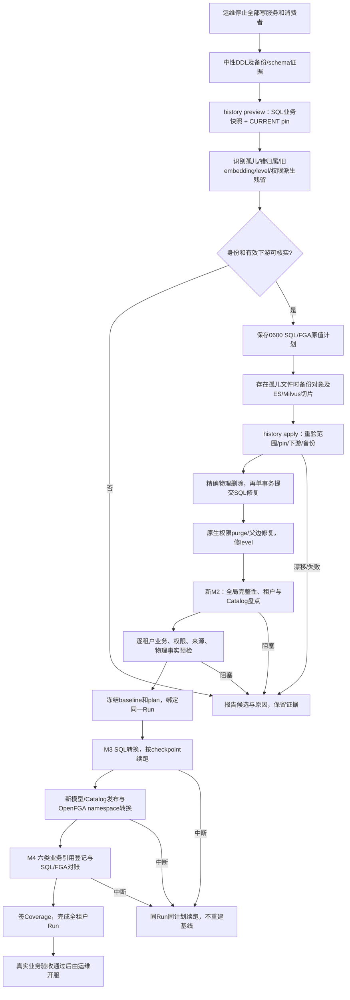
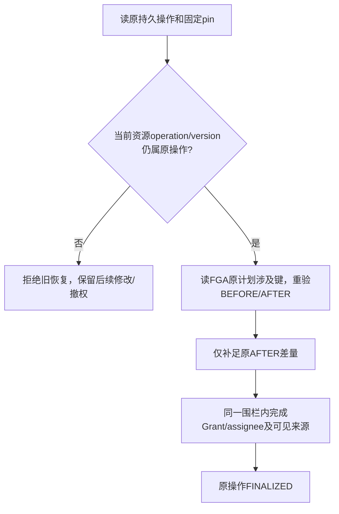

# F118 已确认规则修复与迁移流程

日期：2026-11-13。实现基于 `feat/3.1.0-beta1`，隔离分支 `codex/f118-confirmed-rules-20261113`。

本文承接[规则缺口核查](f118-confirmed-rules-gap-audit-20261113.md)。核查文档记录修复前状态；本文描述最终代码、运行顺序和剩余边界。本轮仅修改和验证本地代码，没有执行116/109升级、清理服务器数据、挂载代码或恢复服务。

## 已落实范围

| 缺口 | 处理规则与落点 |
| --- | --- |
| G1 | history准备识别父库/目录缺失的文件。检查保存引用、权限状态及下游；备份SQL和精确物理内容后清理。新M2不再把这类失败文件默认为历史保留。FAILED本身不构成删除依据。 |
| G2 | 清理失去父库、文档或有效文件依据的文档/版本关联。有效knowledgefile独立保留；存在其他有效版本但主版本指向失效关联时报告，不猜选主版本。 |
| G3 | 无Tag或无有效文件目标的TagLink清理；失去容器且无有效下游的Tag清理。有效标签关系保留。 |
| G4 | 仅删除父空间不存在的space_channel_member；不删除用户。 |
| G5 | 文件/目录tenant按实际父Knowledge纠正；维护已登记目标tenant与同父标签关系。实际有效权限Owner冲突时报告，不复制权限或用户。 |
| G6 | FlowVersion按真实type10父Flow纠正tenant，保留载荷、状态和删除标记；存在原租户独立来源登记/权限时报告。新M2要求先完成纠正。 |
| G7 | Knowledge的旧非数字embedding名称，无当前模型名/旧配置映射、无文件/QA登记且无模型切换时，备份后清NULL。助手旧名称、数字模型ID不套用此规则。 |
| G8 | 原canonical父边和SQL唯一父关系闭合时，清失效额外父边；已保存系统/共享语义按原合同保留。来源不明的其他授权报告，不因schema合法就保留为有效来源。 |
| G9 | 新M2冻结真实业务存活及最后操作状态的marker策略。只有真实存在、未逻辑删除且最后操作已正确收尾的资源才补当前mode所需marker；CURRENT权限行本身不作为存活证明；删除权限已提交但业务行仍存活的半态报告阻塞。已删除资源不补marker。 |
| G10 | 按真实父Flow领域排除已下线type1技能，其子版本type1/10/NULL均不纳入；真实type10流程的旧type1版本仍处理。 |
| R1 | recover/reconcile改用只读CURRENT pin的维护组合；不要求新业务模型已发布，不创建Store/model或初始化RAG。每个原生scope/finalizer调用重验pin。 |
| R2 | 当前操作/版本围栏内，原账本所拥有的FAILED_CLOSED Grant可与assignee一同推进。系统资源巡检仅续办其原bootstrap；CURRENT上已撤销的授权不恢复。 |
| R3 | Owner收尾、补偿及Grant收尾核对原operation/version；Owner还核对idempotency、租户、scope、pin和操作类型。迟到旧操作不能覆盖后续修改/撤权。 |
| R4 | 工作流、助手、频道、应用、工具、看板的现有RESOURCE_DELETE链，均在业务提交后接清理；知识删除原接线保留。清mode/Grant/assignee/visible_source及对应FGA派生关系，保留原操作/tuple审计。不是全平台后台垃圾回收。 |

## 主流程



## history先查什么、如何判定

1. 读取唯一CURRENT PermissionCatalogRelease及其ACTIVE AuthorizationModelRelease，固定release/checksum/Store/model/model_checksum；存在活动冻结Run则停止准备。不存在“新模型未发布所以无法维护旧操作”的前置循环。
2. 读取Knowledge、KnowledgeFile、KnowledgeDocument、KnowledgeDocumentVersion、Tag、TagLink、SpaceChannelMember、Flow/FlowVersion、来源登记及删除job原清单；读取LLMModel名称及旧embedding配置的名称键。备份选中原值，并对完整业务读取范围计算前/后摘要。配置密钥不输出到控制台。
3. 文件逐级核对 `knowledge_id -> Knowledge.id`、`file_level_path -> 真实目录链`。父目录仅缺失与循环/畸形路径区别处理；循环、归属冲突和不明关系报告。合法链以路径长度修level。孤儿文件还需核实无有效/不明直接引用，权限残留可进入同计划purge。
4. 版本按 `version.document_id -> document.id`、`version.knowledge_file_id -> knowledgefile.id`、文件真实父库与document.knowledge_id一致性判断。只删失效关联；清理后无有效版本的文档外壳删除。主版本仍有歧义不自动提升其他版本。
5. TagLink按Tag和文件两端存在性核对，Tag按真实容器及剩余下游核对；space成员只核父空间，不删除成员账号。
6. 文件tenant以真实父Knowledge为准；FlowVersion以真实type10父Flow为准。已有独立权限/来源归属冲突不以“统一改tenant”掩盖。
7. 无文件旧embedding只在当前模型名称、旧配置名称均无可靠映射且无切换配置时清NULL；原index_name/collection_name不改。
8. 权限先读SQL镜像，再以HIGHER_CONSISTENCY盘点原FGA键。缺正确父边不猜补；有正确父边才删额外父边。删除资源的SQL/FGA下游必须闭合，不能仅凭资源表不存在就删授权。
9. apply先重验SQL范围、CURRENT pin、权限镜像、入边及对象键范围，再做外部清理。物理成功后再次锁定SQL核摘要，提交业务修复，再执行原生权限清理和level修正。中断使用同一计划，不回灌旧SQL快照。

## 物理文件如何备份和删除

- 原绑定来自仍存在的Knowledge；父库已消失时，只接受匹配租户、库ID、文件ID的持久删除清单中唯一原绑定。找不到原绑定就报告，禁止按库名推测或换空索引。
- MinIO读取SQL记录中的源文件、bbox、preview、thumbnail、html_snapshot、该文件的knowledge/images精确前缀，以及现有业务代码规定的转换PDF/旧预览键。先核共享引用、stat/ETag/size/version，保存私有SHA256备份，再精确删除这些键。
- ES必须是原绑定的具体索引，验证document_id字段，附加可用的knowledge_id过滤；完整滚动读取命中切片的ID、source、sequence/primary-term并备份。删除使用原ID和并发条件，不执行整索引删除。
- Milvus必须是原集合及可验证document_id/主键；完整迭代备份切片（含向量），使用原主键删除并核余量。不drop集合，不重建embedding。
- apply只接受原记录或该计划已经删除的记录；新切片、对象替换、schema/绑定/SQL变化或备份损坏均停止。所有有效相邻文件和集合本体保留。
- 旧QA专用物理形状、缺乏文件标识的旧schema、缺原绑定的孤儿仍报告阻塞。这是缺少精确清理依据，不自动扩大到清理整个库。一般SQL/向量数量差异治理仍按用户决定暂缓。

## 正式M2/M3/M4查询与比较

| 阶段 | 读取 | 通过条件 / 转换 |
| --- | --- | --- |
| 新M2全局入口 | 已有Run、真实租户、删除半态、无主关联、版本归属、全局资源/权限完整性 | 已冻结则读原材料；新Run必须先清业务孤儿并纠正版本归属。Role治理/Celery队列不在迁移检查范围。 |
| M2逐租户 | 资源/文件/文档/版本/QA、标签、成员、创建者、模型默认配置 | 父链、租户、主版本、有效关联和配置解析闭合。FAILED解析状态及已确认存量失效引用按各自规则处理。 |
| M2权限 | CURRENT Catalog、动作/模型、mode/Grant/assignee/visible_source、原Store全部键 | 来源、namespace计划和当前有效授权对应；空动作/空模型、未生效授权按已确认历史语义保留。冻结业务存活marker策略。 |
| M2物理 | 原索引绑定、ES schema/count、Milvus schema/count、对象stat | 原绑定和事实可复验。SQL无文件与物理非空的差异保留，不换空索引。 |
| M2来源 | 工作流版本、应用版本、助手、频道同步、Knowledge模型、租户模型默认配置 | 当前保存配置逐槽提取；已确认历史失效槽保留并登记失效，不补权限、不猜模型。 |
| M3业务SQL | 冻结的转换命令与当前业务摘要 | 普通知识库 `knowledge.type 0 -> 3`；保留QA type1、已有type3及索引绑定；建立/绑定V1文档链；按计划转换Tag/TagLink及默认配置。冲突不覆盖。 |
| M3权限SQL/FGA | 原权限快照、目标授权模型/Catalog、精确原Store键 | `knowledge_library:id -> knowledge_space:id`；Grant稳定键随资源类型重算；父边/可见来源与模型发布同计划变化。等价已有目标边复用，失效额外父边删除，不增加未知授权。 |
| M4 | 原始来源/物理事实、实际SQL转换结果、权限after、六类引用与Coverage | 同Run、摘要、集合和计数闭合；签发全租户Coverage后完成。服务HTTP200不代替业务验收。 |

新Run在baseline/plan metadata保存 `preparation_policy_version=2`，每个权限计划保存冻结的 `restore_missing_markers` 业务存活事实。它们不改变引用writer版本（仍为f118-v1）。旧材料无这些字段时按原策略解码/续跑，不能用新版策略重写旧Run。

## 恢复不会回退新操作的依据



不使用昨天的业务快照覆盖当前配置。Owner补偿也不能按resource_id无条件关停当前新操作。FAILED_CLOSED Grant须命中原账本的Grant对象才推进，其他失效来源不被顺带激活。系统巡检跳过CURRENT资源，避免把管理员后来撤销的全员授权补回。

## 使用与证据

从目标release镜像的 `src/backend` 工作目录，用服务相同config执行。以下仅为操作说明，本轮未运行服务器命令。

```bash
python scripts/prepare_f118_history.py --plan /secure/upgrade/f118-history.json
python scripts/prepare_f118_history.py --plan /secure/upgrade/f118-history.json --apply --operator-id 7
```

preview没有SQL/FGA/对象/向量写入；会写本地选中数据与物理内容备份。完整计划0600排他创建；有物理候选时先保存 `.candidates.json`，物理备份在 `.payloads/`，事件在 `.events.jsonl`。物理预览中断时只有候选证据，不是可执行完成计划。禁止覆盖旧计划；中断apply使用同份计划。整个历史范围变化需重新预览，已执行部分则先依据日志核实，不自动还原。

完成history后，再使用同一正式Run参数执行 `unify_knowledge_spaces.py --apply`；中断加 `--resume`。本轮没有打包release镜像、执行116/109验证或宣布可开服。

SQLite与HTTP MockTransport/物理端口验证不替代真实MySQL/DM8及生产MinIO/ES/Milvus演练。


## 验证口径与已同步的旧测试

回归文件清单见[f118-confirmed-rules-regression-files-20261113.txt](f118-confirmed-rules-regression-files-20261113.txt)。从src/backend在测试专用config下，可用 `xargs python -m pytest -q --disable-warnings < ../../../docs/reviews/f118-confirmed-rules-regression-files-20261113.txt` 运行。此次使用进程级socket禁网插件，存储边界使用MockTransport/原始客户端替身，SQL使用真实SQLite事务；没有访问配置中的生产中间件。

扩展检查发现的14个旧失败，均在未修改的aa8b75f844基线复现：6个broker旧准入断言、6个角色盘点移除后的查询次数/故障注入位置断言、1个空模型错误文案、1个仅测试动作映射却未隔离创建就绪查询的fixture。现已按用户31/33及既有真实行为更新这些测试；不为通过旧测试恢复角色盘点或队列检查。原broker/角色历史材料的独立解码测试保留。

正常删除接线覆盖本轮列出的Owner。失败会报告并保留原生journal；非知识Owner没有在本次引入全平台后台垃圾回收器。软删除后的派生清理若需续办，应使用原删除回执调用清理应用，不能把只处理全局硬删除缺失的history purge描述为涵盖所有软删除历史。


### 最终验证记录

- 合并回归选集：562 passed，71.42秒。随后补充“最后删除操作/未收尾操作不能补marker”的检查，受影响M2/权限发布/维护模块56 passed，21.75秒（与主选集有重叠，不相加）。
- 已覆盖预览不写业务、备份校验、孤儿SQL及对象/切片/内嵌图片精确清理、共享对象保护、物理/SQL漂移拒绝、同计划续跑、FGA成功SQL失败恢复、按父归属纠正、QA非空/数字ID不清模型、旧技能排除、旧冻结策略续跑、活资源marker恢复与死资源不复活、迟到补偿/收尾不覆盖新撤权、系统bootstrap失败恢复及撤权保留、六类业务引用与Coverage。
- Ruff检查及格式、逐文件架构守卫、git diff --check通过。原有大量SQLModel弃用警告单列，未隐藏成零告警。
- 这不是全仓全环境E2E通过声明；未登录116/109，未运行真实MySQL/DM8或生产对象/向量删除，未构建/部署镜像，未开服。

交付前已正常合入并行更新的beta1知识空间前端提交（远端a3ebe5828c）。合并无冲突；后端及F118合同树与修复提交b2413c4eef完全一致，未覆盖远端UI改动；合并后正式CLI专项再次验证通过。
