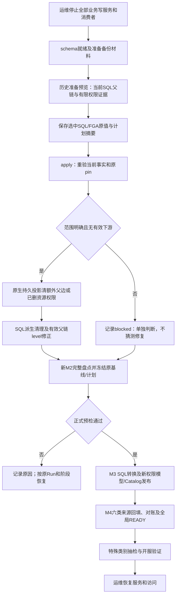

# F118通用修复、历史准备与OpenFGA交接

本轮按2026-11-12用户最新决定处理14、18、20/24、31、37，并落实此前33的队列职责收敛。已先fetch并合入远端`feat/3.1.0-beta1`的`8a84f252e5`，保留此前116修复；没有修改或重新停服116，没有更改OpenFGA项目源码或镜像。

## 范围与结果

| 项目 | 本轮处理 | 数据与业务含义 |
| --- | --- | --- |
| 14 | 暂缓SQL文件与底层向量不一致的治理 | 不改原索引绑定，不换空索引，不据SQL零文件删除/重建ES或Milvus；原升级保留逻辑继续读取原事实 |
| 18 在线根因 | 旧`KnowledgeUtils.process_retry_files`先验证整批目标路径，重试始终保留原目录 | 跨目录覆盖/重试在复制对象、改SQL、派发任务前拒绝；真正移动仍走当前Move计划和持久投影，路径/level/文档链同步 |
| 18 历史数据 | 新增正式升级前置`prepare_f118_history.py` | 对当前有效SQL父链重算file/document层级；仅正确FGA父边已经存在且SQL mode父链一致时，删除额外旧父边；不猜目录、不写新授权、不改实际路径 |
| 20/24 | 共用派生清理应用及SQL仓库；接入知识空间确认删除链 | 先完成原RESOURCE_DELETE及业务提交，再清FGA资源/所属Grant关系，核验后删除mode/Grant/assignee/visible_source。原operation/tuple账本和业务审计保留。历史硬删除目标由前置脚本备份、核实后走同一清理；不是把全平台其他业务删除入口一并重写 |
| 31 | 新M2不再枚举/强校验Role、UserRole | 不改角色适用语义、不改角色或关联数据；与知识迁移无关的角色孤儿不再成为阻塞。原冻结角色事实的codec继续兼容 |
| 33 | 正式CLI不再接Redis broker/SQL排队任务盘点 | 不读/消费/清理Celery队列，不探测服务是否停。运维保证所有写服务/消费者已停。已prepare却未完成SQL业务删除、deleting tombstone仍属业务一致性阻塞，不能因停服忽略 |
| 37 | 独立OpenFGA变更交接 | [索引、镜像和read_tuples评估](openfga-mysql-read-index-handoff-20261112.md)交由用户另行安排的agent执行；本轮不更换镜像或重复给116加索引 |

### 派生清理的恢复边界

知识删除原业务事务仍严格校验原RESOURCE_DELETE台账及mode；不能在该校验之前删mode。提交后新增RESOURCE_DELETE_PURGE台账，固定原Store/model、资源、原版本和操作身份，残留tuple先全部持久登记。超过90条时分STAGE/COMMIT执行，COMMIT始终使用原真实存在的键，不伪造技术marker。清理重试复用同一台账；FGA已完成、SQL暂时失败时只重做SQL清理。

SQL purge锁定mode并比对operation_id、版本与CURRENT；当前意图已改变则不清。对已删除资源，不再查询当前个人归属来批准清理，因为业务行已经不存在；权限与个人范围已在原删除提交前校验，后续只接受已校验删除job/原生回执授权的同一有限范围清理。没有新HTTP授权入口。

本轮同时修正两处影响此恢复路径的旧写问题：迟到`fail_closed`必须匹配原operation和版本，不能污染后来操作；STAGE逆向补偿前重新核验原围栏，围栏失效则不向FGA写逆操作。此前报告中的owner专用收尾/补偿及“无变化撤权”竞态仍不能据这两个修正宣称全部解决，详见[此前恢复问题](f118-recovery-and-open-questions-20261112.md)。

空动作权限模型不是本轮清理对象；仍存在资源上的有效/历史授权继续走已确认保留策略。目标已经硬删除且无有效下游时，visible_source是可重建派生行，与需要保留的真实操作审计/tuple前后快照不同。

## 历史准备执行方法

```bash
cd src/backend
export config=config.yaml  # 与部署一致
export PYTHONPATH=./

# 运维已停全部写服务/消费者；新M2尚未冻结。
python scripts/prepare_f118_history.py --plan /secure/upgrade/f118-history.json

# 审阅同一文件及blocked清单；apply仍会重读原SQL、FGA及pin。
python scripts/prepare_f118_history.py --plan /secure/upgrade/f118-history.json \
  --apply --operator-id 7

# 中断后用完全相同的plan和操作者继续；不重新生成覆盖原备份。
python scripts/prepare_f118_history.py --plan /secure/upgrade/f118-history.json \
  --apply --operator-id 7

# 完成结构准备后，才执行unify_knowledge_spaces.py的原M2→M3→M4。
```

- 默认仅保存选中数据的SQL原行、祖先/父库事实、FGA键及CURRENT pin；文件以0600、O_EXCL创建，fsync后重新读取并验SHA256，拒绝覆盖。它是选中数据备份，不是整库/物理存储恢复点。
- `f118-history.json.events.jsonl`保留开始、完成/失败、操作者、计划摘要与结果；原生投影表保留每个权限操作的键、前后摘要和结果。备份包含业务元数据，只放受限运维目录，不提交Git。
- apply返回本次原生permission_operation_ids；仍有blocked时退出码2，执行错误/漂移为3，不能将已完成的选中修复当作所有阻塞已清。默认预览退出0只表示报告已保存。
- 正式baseline已冻结但尚未完成时拒绝前置修复，继续原Run，不换基线。完成的旧Run和未冻结preparing行不被当成新冻结。
- 只按已验证的当前父链修计数。父目录/父库缺失、路径循环、祖先错租户、正确FGA父边缺失、mode父关系不一致均不自动补父或搬文件。坏版本链也不猜选主版本。
- 历史派生清理以现有mode为围栏，只处理已知资源类型的**全局物理行不存在**；既有其他租户行、旧namespace转换后的同ID知识资源、软删原行及未知类型均不当作硬删除。待清理树按叶到根排序，SQL子资源/登记引用或FGA有效/未知下游仍在时阻断；不创建缺失mode或补授权来强行清理模糊记录。
- SQL未改前及续跑会比对原行/授权集合、实际业务存在性和pin；未知新FGA边、来源/版本漂移拒绝。不清MinIO、ES、Milvus，不处理任务消费。父库/目录真正孤儿文件的物理清理是另一项已确认治理，不能用本脚本的计数/权限清理冒充已完成。

## 当前流程



此图承接原完整流程，不将准备脚本成功、抽检或进程health当作最终升级完成。新M2仍会拦住未处置的真实业务不一致；已冻结Run不插入前置修复。

## 验证边界

本轮自动化针对当前改动：实际旧重试helper；原生SQLite SQL/ProjectionService/删除确认与历史主版本保留；180条残留的分批清理；SQL清理失败后续跑；预览零数据写入、备份篡改/覆盖拒绝、业务/父链/下游漂移拒绝；无关角色及队列不盘点，旧冻结codec可读。FGA/对象/任务传输边界使用隔离fake，不连接正式环境。

2026-11-12最终组合回归：**309 passed，0 failed，0 skipped**；17个pytest文件，耗时80.01秒。包含本轮新增及受影响的旧重试、历史准备、知识删除、正式M2/转换/来源生命周期、移动重试、通用持久投影及SQL围栏。执行方式为后端根目录下`config=<既有服务配置路径> PYTHONPATH=. python -m pytest -q --tb=short --show-capture=no --disable-warnings <下列文件>`：

```text
test/knowledge/test_legacy_retry_parent.py
test/knowledge_unification/test_prepare_history.py
test/knowledge_unification/test_kn_delete_projection.py
test/knowledge_unification/test_kn_delete_plan.py
test/knowledge_unification/test_migration_preflight.py
test/knowledge_unification/test_migration_control_repository.py
test/knowledge_unification/test_migration_inventory_application.py
test/knowledge_unification/test_migration_cli.py
test/knowledge_unification/test_migration_cli_runtime.py
test/knowledge_unification/test_migration_conversion_application.py
test/knowledge_unification/test_migration_source_lifecycle.py
test/knowledge_unification/test_legacy_space_retry.py
test/knowledge_unification/test_move_job_retry.py
test/knowledge_unification/test_move_job_retry_scale.py
test/permission/test_f048_projection_service.py
test/permission/test_f048_projection_sql_runtime.py
test/permission/test_f048_delete_retry.py
```

Ruff对22个变更Python文件检查/格式验证通过；业务与运维脚本12文件arch-guard违规0，diff-check通过。native测试中的既有FGAClient导入属于测试边界，不把脚本按工作区目录名误匹配到测试路径的RULE-9提示当成生产架构违反。旧用例保留SQLModel.execute等废弃警告，不宣称全仓零警告。修正了一处既有频道生命周期测试接线：新版创建已调用QuotaService.check_quota，旧fixture只隔离get_effective_quota会落入真实DB工厂；现隔离当前公共配额边界。网络保护全程阻断该路径，没有实际连库或修改116。

CLI `prepare_f118_history.py --help`可直接运行；默认报告与完整选中备份、篡改/覆盖拒绝、同计划重放及FGA键重新出现不冒充成功都有回归。真实MySQL/DM8锁并发、真实OpenFGA新镜像、116重新部署及登录后的完整业务验收不在本轮本地通过声明中，继续保留T1036及E2E清单。

## 七维代码审查

审查范围是`2d690cae7e`（已合入最新远端`8a84f252e5`）之后的本轮修复，对照AC-114–117；不是整个F118从零重验。结论：**PASS_WITH_WARNINGS，可交付本轮代码；真实中间件/业务验收仍待执行**。

| 维度 | High | Medium | 结论与证据 |
| --- | --- | --- | --- |
| 边界 | 0 | 0 | 路径循环/缺父/NULL层级、目录漂移、冻结Run、备份篡改、失去围栏及旧回执后新边均处理；不猜补父/授权 |
| 权限与认证 | 0 | 0 | 原业务删除准入/个人范围及回执保留；后续只删原已确认范围；tenant条件明确；角色/模型/有效授权不重建 |
| 并发/恢复 | 0 | 1 | 原生台账与SQL mode行锁/版本/operation CAS，失败重放及逆向补偿失去围栏反例通过；实际MySQL/DM8竞争仍须CI验证 |
| 信息暴露 | 0 | 0 | 备份0600且拒绝覆盖，事件只存摘要/主键/结果；未提交配置、密钥或业务证据包；CLI不打印provider异常原文 |
| 测试 | 0 | 1 | 309组合回归通过；真实传输/浏览器/中间件E2E继续未执行，不能替代上线验收 |
| 代码风格/分层 | 0 | 0 | 22文件Ruff、12业务/脚本架构检查通过；业务Owner存在性由脚本组合，permission不查询业务ORM；无Alembic数据写入 |
| 文档同步 | 0 | 0 | spec/design/tasks/test-cases、release-contract、scripts README/E2E清单及OpenFGA交接同步；原历史报告保持当时证据 |

其中真实并发与真实E2E属于交付验证待办，不是把尚未实现的旧Owner自动恢复或物理孤儿清理标为完成；这两类范围仍由前述边界单列。
