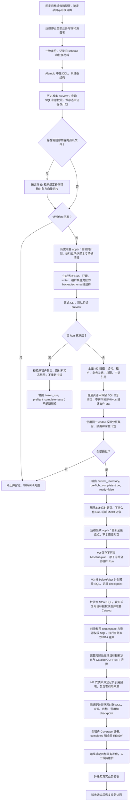

# F118 当前迁移流程、查询顺序与通过条件

日期：2026-11-13。基于 `feat/3.1.0-beta1` 的 `0b78bd7acc` 及本轮修复后的调用链，供评审；不表示该修复已构建镜像、发布或在服务器验证。

## 操作边界

- 普通知识资源保留原 ID、`index_name`、`collection_name` 和底层数据。此次迁移不以 ES/Milvus 的存在性、schema、文档数量或普通文件 MinIO stat 为准入条件；SQL 与底层向量的生命周期差异留给独立治理。
- 已明确批准的孤儿文件清理是单独的历史准备动作：按原文件 ID、原绑定和对象键核对、备份并精确删除相关内容。无法证明范围、存在有效下游或共享存储冲突时停止，不删除整个索引。
- MinIO 仍保存正式迁移的不可变证据、baseline 和 plan。移除普通文件/向量盘点不等于移除迁移证据校验。
- 停止所有业务写入、消费者及恢复访问由运维负责。脚本不负责停服、不检查 Celery 消费或队列，也不迁移租户角色策略。

## 完整流程

每个写阶段都可能因事实漂移、执行失败或未知提交结果停止；恢复只使用原 Run、原材料、原计划及 checkpoint，不回灌升级前业务快照。新预览初查后若有其他进程抢先冻结同 Run，扫描入口报 `migration_inventory_preview_requires_new_run`，不会把旧图复核报告成新扫描成功。

## 新 Run 的实际查询顺序

以下是代码阶段顺序；阶段内使用有界主键分页或批量查询，不依赖历史报告中的固定记录数量。

| 顺序 | 查询/读取对象 | 如何比较、什么条件通过 |
| --- | --- | --- |
| 1 | SQL 结构、`knowledge_unification_run`、`tenant`；业务删除任务/墓碑的未提交状态 | 结构可读；Run/writer 格式有效；实际租户集合有序且唯一；没有竞争中的迁移 Run、未完成业务删除切换。此处不读取任务队列。 |
| 2 | 已有同 Run 的全租户台账 | 已冻结时要求原租户集合、原哈希及阶段满足恢复合同；不因当前多出新租户而补造原 Run 行。新 Run 无冻结结果才继续新扫描。 |
| 3 | backup/schema 描述符指向的 MinIO 证据对象 | 对象存在、内容 SHA256 与规范 envelope 正确；Run、环境、writer、租户集合摘要完全对应当次输入。原30租户证据不能证明当前31租户。 |
| 4 | 全局业务关联、资源和权限完整性探针 | 无主子记录、父工作流归属、文件/文档/版本父链、标签容器、主版本指针及权限派生关联必须闭合；需要历史准备的问题在正式冻结前处理。 |
| 5 | `permission_catalog_release` 的 CURRENT；它引用的 `authorization_model_release`；Catalog 动作及模型定义 | SQL CURRENT 与其授权发布 pin 合法、唯一；生成原 namespace 到目标 namespace 的完整计划。不能将任意 ACTIVE 模型当成当前业务已切换。 |
| 6 | 原 OpenFGA Store/模型及全部原 tuple | 固定 Store/model/checksum，完整分页读取；原 key 闭集参与 namespace、可见来源及动作计划。不能用截断分页或只看部分授权当成通过。 |
| 7 | 每租户来源上下文：助手关联、Root 合法共享模型服务、模型目录、知识资源名称目录 | 当前 SQL 与原固定权限 pin 对应；按当前保存配置建立名称/目标上下文，不恢复旧快照，不猜绑重名模型。 |
| 8 | 每租户 `knowledge`，空间成员及创建者账户事实 | 区分旧文档库、QA、已有空间；创建者成员计划与实际成员闭集一致。已确认的无文件旧空间失联创建者按保留规则处理，不补账号或授权。 |
| 9 | 每租户 `knowledgefile`、`knowledge_document`、`knowledge_document_version`、QA、Tag/TagLink、标签库、部门空间关系 | 文件/目录父链、租户、层级、文档主版本及关联资源有效；先完成允许的历史修复，再按修复后的真实 SQL 生成转换计划。`FAILED` 本身不构成删除条件。 |
| 10 | 祖先目录的批量事实、租户模型默认配置、`user_tenant` 和部门 | 祖先同租户、同空间、路径前缀与层级一致；默认配置可解析并生成确定转换；不把无关的全量 Role/UserRole 资格治理设为前置。空间成员的 `user_role` 身份及权限来源主体仍按精确关联读取、校验，不复制或改绑租户角色。 |
| 11 | 每租户 `resource_permission_mode`、Grant、assignee、visible_source | 原稳定身份、主体、来源及目标 namespace 闭合；已确认的空动作模型保留原语义，不补动作或凭空扩大可见范围。 |
| 12 | 六类来源及其目标行、现有引用/来源登记和删除墓碑 | 读取所有有效来源/版本并逐槽解析；目标存在性与父归属通过 SQL 仓储判断。代码中的这类 `physical_fact` 不是 ES/Milvus 查询。存量失效按各自已确认规则登记，新增引用仍严格校验。 |
| 13 | 完整分页图、各来源 Header、转换命令、namespace 与保留规则证明 | 同一 Run、tenant、section、页序、记录集合和摘要一致；无漏页、重复、悬空或未消费计划。正常资源只记录 SQL 索引绑定，不生成新的物理 count/schema/stat 基线。 |

六类来源是：工作流版本、托管应用版本、助手、频道同步、知识资源模型配置、租户模型默认配置。下线技能不混入工作流迁移；软删除的工作流及历史失效来源遵循当前专门过滤/登记规则。旧频道 `new-folder-<digits>` 选择仅跳过该失效文件夹引用并记录用户手动重绑，原配置和其他真实引用保留。

## dry-run、正式冻结与恢复的区别

| 模式 | 扫描和写入 | 返回含义 |
| --- | --- | --- |
| 新 Run 默认 preview | 完整执行上述新 M2 预检；规范分页暂存在本地私有临时目录；正常/异常退出自动清理，不写 SQL/FGA/MinIO、不冻结 Run | `validation_scope=current_inventory`、`preflight_complete=true`、`frozen=false`、`ready=false`。只表示预检通过。 |
| 已冻结 Run preview；可加 `--resume` 强制要求原 Run 存在 | 检查原冻结租户、材料和图；不重新盘点为一个新基线 | `validation_scope=frozen_run`、`preflight_complete=false`。只表示该历史冻结图通过复核。 |
| 新 Run `--apply --operator-id <ID>` | 重新读取当次事实，写正式不可变 baseline/plan，验证完整图后在一个事务中冻结全部租户 | 进入 M3/M4；不能将成功创建 baseline 或模型当成升级已完成。 |
| 同 Run `--apply --resume` | 保持原基线，按原 checkpoint 和实际 before/after 恢复，校验已提交前缀 | 不覆盖后续合法业务操作；事实冲突仍停止。 |

临时分页用于复用完整校验算法和控制内存占用，不是备份，也不能用于续跑；CLI 不输出它们作为可持久恢复的描述符。现有证据读取仍通过原 MinIO 适配器。

## 数据如何转换

1. **资源 SQL 转换**：旧 `knowledge.type=0` 按冻结计划变为 `type=3`，保留资源 ID、租户、创建者和原索引绑定；设置目标发布状态和迁移来源。QA 的 `type=1` 保留，已有 `type=3` 不重复变为新资源。创建者成员按计划插入或保留，不随意补权限。
2. **文档/版本、标签及默认配置**：以当前业务行为生成确定命令；已有文档和版本核对原指针及 after 结果，需要的初始版本按计划补齐。旧知识标签容器转换到空间容器，相关 TagLink 按目标资源类型转换；默认模型配置按已有 resolver/提取器规则转换，不猜测助手旧名称的目标。
3. **权限 namespace 与发布**：目标为 `knowledge_library → knowledge_space`，同时处理资源 mode、Grant/来源及 OpenFGA tuple 中原 namespace 的主体和对象引用。先完整核对原 SQL/Store，再准备目标模型及 Catalog，持久记录投影计划，执行 SQL 及固定 pin 的 FGA 差集，完整对账后完成 Catalog CURRENT/授权状态切换。不是修改 ES/Milvus 的 namespace 或数据。
4. **引用回填**：在权限发布完成后，按六类真实来源/版本写来源集合及引用明细；保留零引用来源以证明“已扫描且确实无引用”。已确认的失效 ID、跨租户槽位及旧模型名称保留配置并登记失效，不新增共享或授权、不自动使用默认模型。
5. **最终认证**：重新读取实际来源与目标，比较来源摘要、引用集合、有效/失效分类、计数及 checkpoint；全部租户、全部六类来源均闭合后，原子保存 Coverage 证书与 Run 完成状态，再要求全局 READY。

M3 执行前及恢复时比较当前行与冻结 before/after 摘要；匹配已提交 after 的前缀只验证，不重复覆盖。超过原计划、归属变化或证据漂移继续阻断。补偿围栏的目标是阻止旧失败授权覆盖后续撤权，不允许以恢复为由回灌旧授权。

## 历史准备的精确物理清理例外

`prepare_f118_history.py` 在新 M2 前生成私有计划；有孤儿物理候选时先保存 `.candidates.json`，再按已保存文件标识检查原 MinIO 对象键及 ES/Milvus 文件切片，备份到 `.payloads/`。这不是普通空间 count/schema 的全量健康巡检。

apply 重读同计划并验证 pin、SQL、关联、共享存储保护和物理证据，只清已核实孤儿对应内容。缺父库且缺乏可靠索引定位、存在有效下游、无法证明共享保护、旧物理 schema 不支持精确定位时仍阻断；不会换空索引或扩大到删除整库。执行事件保存在相邻 `.events.jsonl`，中断按同计划核实恢复，不自动还原旧 SQL。

## 开服条件及本次验证边界

数据转换、目标授权模型/Catalog 发布、引用回填及全租户 Coverage 都是正式开服前置。还需按真实升级验收核对业务访问与关键链路；HTTP 200、模型 ACTIVE、`preflight_complete=true` 或本地测试通过都不能独立代替这些条件。

当前116已经迁移，基于现状的新扫描不能替代“未迁移旧库到新版”的完整转换验证。此文及本轮修复没有启动、停止、修改或再次迁移116或其他服务器。

代码依据：`scripts/prepare_f118_history.py`、`scripts/f118_history_business.py`、`scripts/f118_history_physical.py`、`scripts/unify_knowledge_spaces.py`；`unification_inventory.py`、`unification_preview_artifacts.py`、`unification_preflight.py`、`unification_conversion.py`、`unification_permissions.py`、`unification_references.py`、`unification_coverage.py`。以上业务模块均位于 `src/backend/bisheng/knowledge/application/`，具体查询位于对应 domain repository。
