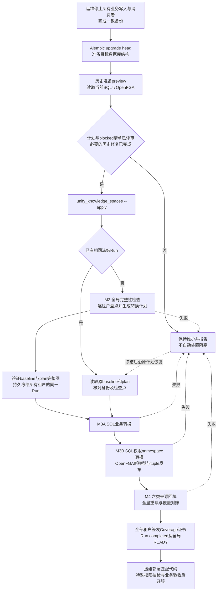
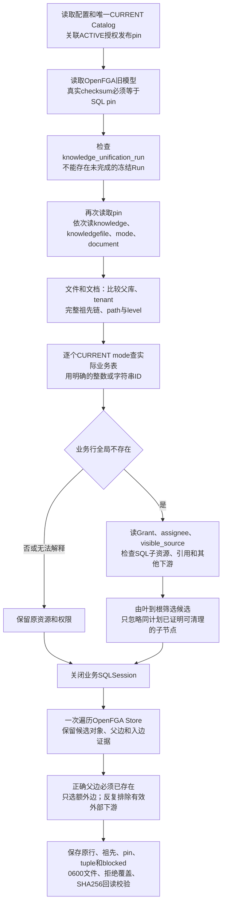
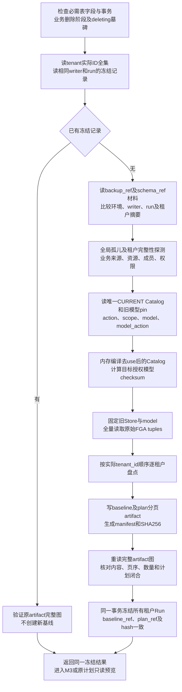
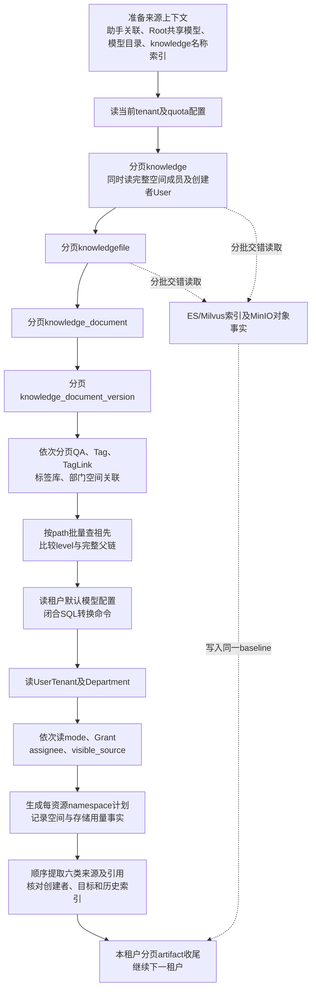
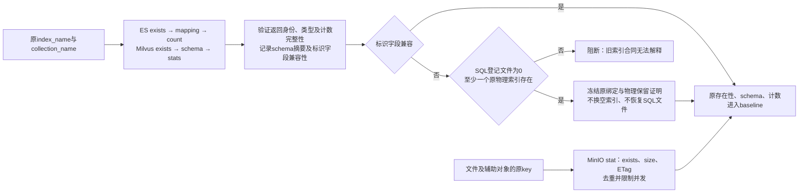
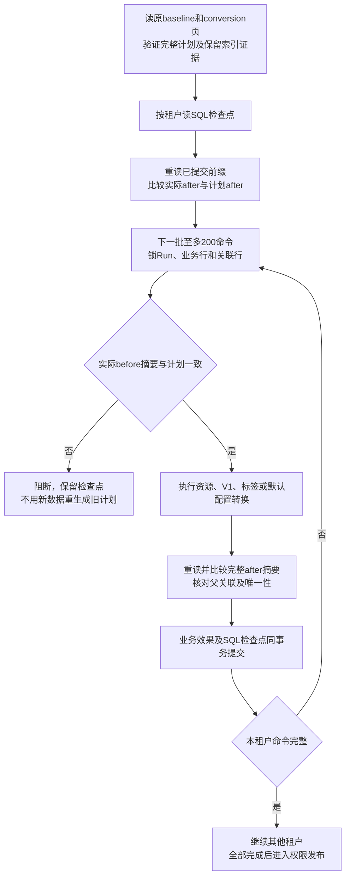
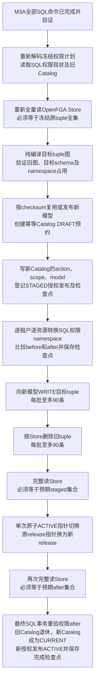
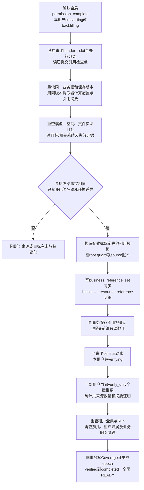
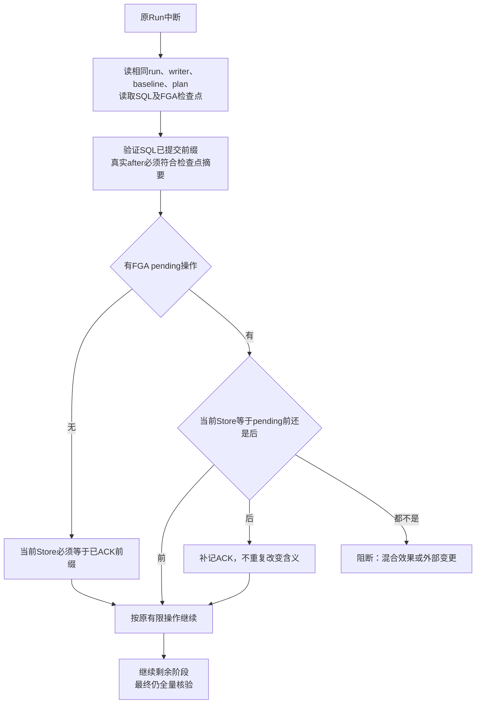

# F118迁移：查询顺序、预检比较与数据转换流程

日期：2026-11-13。按`feat/3.1.0-beta1`基线`36a9cc2833`实际调用链整理，包含本轮资源ID解析修复。本文描述代码现状；没有在116或109重新执行升级，新镜像也尚未发布。

范围是知识库统一为知识空间、全平台`use`退役及六类业务引用回填。Alembic中F009/F011等其他特性的结构变更不在本文逐表展开。

## 1. 整条链路与入口区别



| 入口 | 查询与作用 | 能写什么 | 成功的准确含义 |
| --- | --- | --- | --- |
| `prepare_f118_history.py --plan P` | 当前SQL父链、权限派生记录与原FGA图，生成选中数据备份/计划 | 本地0600计划文件；不写SQL/FGA | 计划已保存；**退出0仍可能有blocked** |
| 同一入口加`--apply --operator-id U` | 重验同一计划的现状并执行有限修复 | level、额外旧父边、已硬删除资源的派生权限 | 可执行项已完成；有blocked退出2，异常退出3 |
| `unify_knowledge_spaces.py`不带`--apply` | 有冻结Run时验证原artifact图；没有时不执行首次盘点 | 不写SQL/FGA/artifact | 原冻结图可读；固定`ready=false`，**不等于首次M2通过** |
| 同一入口带`--apply` | 首次M2冻结→M3业务SQL→权限发布→M4回填签证 | 正式迁移所列SQL、artifact、FGA及Redis一致性标记 | 最终`complete=true`且`ready=true`才是迁移完成 |
| 同一入口加`--resume` | 要求已有冻结Run，沿原计划继续 | 由是否带`--apply`决定 | 不能借续跑重新盘点、生成替代基线 |

代码：[正式CLI](../../src/backend/scripts/unify_knowledge_spaces.py)、[历史准备](../../src/backend/scripts/prepare_f118_history.py)。脚本不探测停服、不启停服务、不巡检或清空Celery队列；运维负责停全部写服务。脚本仍检查“业务删除已prepare但未finalize”等SQL一致性问题。

## 2. 历史准备：先查什么、怎样比较

### 2.1 采集顺序



`hard_missing`把资源模型与ID规则明确绑定，**不再读取ORM的`python_type`属性**：

| 权限resource_type | 业务模型 | ID处理 |
| --- | --- | --- |
| `knowledge_library` / `knowledge_space` | Knowledge | `int` |
| `folder` / `knowledge_file` | KnowledgeFile | `int` |
| `tool` | GptsToolsType | `int` |
| `dashboard` | Dashboard | `int` |
| `workflow` | Flow | 字符串 |
| `assistant` | Assistant | 字符串 |
| `app` | App | 字符串 |
| `channel` | Channel | 字符串 |

按所属业务表实际主键检查全局存在性，不因旧namespace、租户不同或软删除状态就认定“硬删除”。发现业务行就保留。未知类型、空ID或无法转换的ID不进入清理候选；查询异常也不能转换成“资源不存在”。

### 2.2 三类修复的准入与写入

| 修复 | 比较什么才允许执行 | 修改范围 |
| --- | --- | --- |
| level计数 | 父库存在且tenant一致；祖先全是同库目录；路径前缀逐级一致、无环；apply重验原行与祖先 | 有效父链上的文件/文档`level=len(path)`；不改path、实际父位置或tenant |
| 额外FGA父边 | SQL父链有效，mode为CURRENT且父对象一致；**正确FGA父边已经存在** | 原生投影删除精确额外parent边；不猜补正确边，不移动文件 |
| 已硬删除资源的派生权限 | 业务表无该主键；派生SQL范围闭合；无有效业务引用/子资源；FGA入边不通向计划外有效对象 | 清理所属FGA关系及mode/Grant/assignee/visible_source；保留投影operation/tuple审计 |

apply先重验pin、未完成冻结状态、SQL原值及FGA下游，使用原计划与原生幂等账本执行权限修复，之后修level。不能把后续新操作覆盖成旧计划。此脚本不清MinIO/ES/Milvus，不删业务文件，不批量把文件tenant改成父库tenant。

来源：[capture/apply](../../src/backend/scripts/prepare_f118_history.py)、[派生清理](../../src/backend/bisheng/permission/application/deleted_resource_cleanup.py)。

## 3. M2：全局查询、逐租户预检和冻结

### 3.1 全局顺序



| 顺序 | 实际查询 | 通过标准 |
| --- | --- | --- |
| G1 | 必需schema；`knowledge_space_delete_job`业务阶段；`resource_reference_tombstone.stage` | 必需结构存在；已提交业务删除不能停在未finalized阶段；无deleting墓碑。不查Celery队列 |
| G2 | `tenant`全集、`knowledge_unification_run` | 租户唯一有序；同run/writer冻结身份一致，不能用租户抽样代替 |
| G5 | MinIO中的备份/结构材料描述符 | 内容SHA256、run、environment、writer和租户摘要与参数一致；不能用占位hash冒充材料 |
| G6a | AppVersion→App、ChannelKnowledgeSync→Channel；注册来源及引用账本→Tenant | 子行有真实父归属；来源/绑定账本不属于不存在的租户 |
| G6b | Knowledge、KnowledgeFile、QA、Tag、TagLink、标签库、部门空间关联 | tenant有效；文件父库存在且tenant一致；投影到type=3后的创建幂等键无唯一性冲突 |
| G6c | Document→Knowledge；Version→Document/File；主指针→Version | 文档父库存在；版本文件存在、为真实文件且同库同租户；主指针属于该文档 |
| G6d | UserTenant、Department、空间成员→Tenant/Knowledge | 所需成员/部门归属完整；**不盘点或修复Role/UserRole适用语义** |
| G6e | mode、Grant、assignee、visible_source及其tenant/Grant关联 | tenant有效；assignee的Grant存在且tenant一致；后续每资源还要闭合 |
| G7 | Catalog→authorization release；action、scope、model、model_action | CURRENT唯一且未write_fenced；授权发布ACTIVE、environment匹配；摘要合同成立 |
| G9 | 旧Store全部tuple、旧schema | pin固定；原tuple可解释且无重复；转换必须使用这份全图作为before |
| G12–G13 | baseline/plan完整图、租户全集、原Run检查点 | 每页hash、顺序、数量、manifest一致；SQL/FGA/成员/物理保留/来源计划闭合才能冻结 |

**旧模型尚未升级时M2仍可读：**用SQL CURRENT指定的旧Store/model读取原事实，目标模型仅在内存编译。真正发布在M3，不要求M2前先强制覆盖OpenFGA模型。

来源：[全局M2](../../src/backend/bisheng/knowledge/application/unification_inventory.py)、[资源完整性](../../src/backend/bisheng/knowledge/domain/repositories/unification_resource_repository.py)、[权限快照](../../src/backend/bisheng/permission/domain/repositories/f118_migration_snapshot_repository.py)。

### 3.2 每租户查询顺序



这是调用顺序，不表示每张表只读一次：来源上下文会预读Knowledge，资源分页和引用处理还会重读；创建者按ID批量查询并缓存存在性事实。资源或文件缓冲达到199条时穿插物理读取。原生资源分页通常为200条；必须验证游标推进和tenant，不能只取第一页。

### 3.3 逐类比较：怎样算预检通过

| 数据 | 比较依据/通过条件 | 保留或阻断边界 |
| --- | --- | --- |
| Knowledge类型 | 仅接受0/1/2/3；原type=0生成转换命令 | type=1 QA、type=2废弃个人库、type=3空间不执行0→3；未知类型阻断 |
| 创建者与成员 | type=0的创建者真实存在；完整成员集合无冲突，生成插入/保留creator指令 | 已有空type=3空间缺创建者按闭合证据保留user_id，不补账号/授权；不能套用于待转换普通库 |
| 文件父链 | 父库与tenant一致；类型有效；path无环；祖先为同库同tenant目录；非NULL level匹配path，NULL按原合同读取 | 满足既定“失败文件、缺旧父目录、无权限依据”等封闭条件可保留失效；不自动搬到根目录或补权限 |
| 文档与版本 | 每文件至多一个版本登记；版本号唯一；主指针和is_primary一致 | 无版本/重复关联/错误主指针阻断；已有空间全部失败且从未选主版本的原链按规则保留，不擅选主版本 |
| 标签 | Tag归属与TagLink文件同库同tenant；转换后名称/绑定唯一性可解释 | 9/8重复绑定有明确存活行才去重；真实失效关联不是自动放行 |
| 权限SQL | mode/Grant/assignee/visible_source形成同资源快照，与namespace计划一致 | INACTIVE/RETIRED按历史保留，不恢复为ACTIVE；空动作模型允许保留有效原可见来源 |
| 原FGA图 | 旧/目标schema可解释；受控资源和Grant节点对应原SQL；namespace目标无无归属新边 | 不改身份节点上的允许历史差异原样保留；移动端点的未知关系等阻断；不补原缺失技术标记 |
| 模型目标 | 模型与父Server存在且归属一致；原本租户/Root目标按保存事实识别 | 已保存明确ID的非法跨tenant目标登记失效范围，不新增共享/授权；无法可靠解析名称不猜绑 |
| 旧助手模型名称 | 专门的旧名称失效配置提取规则，知识关联仍完整提取 | 原名称/配置/状态保留，不猜同名模型、不改默认模型；无可靠ID不伪造模型引用 |
| 频道历史目录占位值 | 已保存`new-folder-<数字>`走历史跳过路径 | 保留配置，不当真实文件ID回填，用户手动重绑；新保存必须真实创建并持久化文件夹 |
| 配额 | tenant配置摘要、空间分类数量、channel/space_upload文件字节 | 记录原用量，不按新限额删除超额资源；不等于另一个managed_tenant_preflight已执行 |

上表是已有封闭兼容分支；归属、生命周期或证据不满足仍阻断，不把任意旧数据降级为兼容。

### 3.4 物理存储检查



存在性、大小、ETag和数量是原事实。代码不要求SQL文件数等于向量数、不要求索引非空，不据统计差异删除内容；`exists=false`也先记录为事实，不统一解释成“必须补文件”。请求集合必须完整返回且身份对应。M3前会重验特殊保留索引的绑定及物理事实，防止冻结后被替换。

来源：[物理读取](../../src/backend/bisheng/knowledge/application/unification_physical.py)、[保留条件](../../src/backend/bisheng/knowledge/application/unification_physical_retention.py)。

## 4. M3A：SQL业务转换，逐行改哪些字段

重新读取冻结计划并检查原hash；按命令批次锁Run、业务资源与关联行，比较before摘要。一个批次的数据效果和检查点同事务提交。续跑先验证已提交前缀的真实after，再执行剩余部分，不能只凭processed_count跳过核验。



| 命令 | 对象与条件 | 实际写入 | 保持的事实 |
| --- | --- | --- | --- |
| `ResourceConversionCommand` | 原`knowledge.type=0` | `type=3`、`is_released=false`、`migration_origin=run_id`；保留原update_time | Knowledge ID、tenant、user_id、名称、说明、model、index_name、collection_name等不改 |
| 同一资源命令的成员部分 | 普通库转换，完整成员集合已冻结 | `space_channel_member`插入缺失creator成员，或核验原creator成员后保留 | 不提升冲突成员、不补不存在的创建者；不额外创造一套F048授权 |
| `InitializeV1Command` | type=0或3的真实文件尚未登记版本 | 插入`knowledge_document`；插入`knowledge_document_version(version_no=1,is_primary=true,knowledge_file_id=原ID)`；回写新文档`primary_version_id` | 原knowledgefile、对象key、解析状态、索引内容不改；已有版本链不重建 |
| `TagConversionCommand` | 待转换普通库拥有的`Tag.business_type=knowledge` | 改成`knowledge_space`，保留原update_time | Tag ID、名称及库ID不改 |
| `TagLinkConversionCommand` | 待转换普通库的文件标签旧`resource_type=9` | 改为8；若同文件同tag已有8类型存活行，则删除本条重复9类型行 | 不换tag/文件，不删除所选存活关系；其他资源类型不批改 |
| `DefaultConversionCommand` | 租户默认模型JSON确实需要既定格式转换 | 改`tenant_system_model_config.value`并保留update_time | 不新建模型、不跨tenant共享、不清空助手/工作流配置 |

旧`linsight_llm`配置复用既有业务函数：有旧`task_model`时，若其ID仍在`models`列表则保留该ID，否则取列表首个或NULL；移除`task_model`及对应旧executor字段。`chat_default_model_id`为空且有models时取最后一个。前后分别提取引用、比较摘要并保存槽位来源，不能对所有失效助手套用默认配置规则。

`type=1`为QA库，`type=2`为废弃个人库，`type=3`为既有空间；不执行0→3。不能用`UPDATE knowledge SET type=3`这样的全表替换。

来源：[命令生成](../../src/backend/bisheng/knowledge/application/unification_conversion_plan.py)、[批次执行](../../src/backend/bisheng/knowledge/application/unification_conversion.py)、[实际SQL写入](../../src/backend/bisheng/knowledge/domain/repositories/unification_conversion_repository.py)。

## 5. M3B：SQL权限namespace与OpenFGA转换

namespace指权限类型前缀，例如`knowledge_library:10`中的`knowledge_library`，与Milvus collection、ES index和MySQL数据库名无关。

### 5.1 发布前查询、比较和写入顺序



模型发布、FGA读取及tuple写入不包在业务SQL事务中。SQL与FGA靠确定操作序列、持久意图和ACK前缀恢复，不是跨存储单事务。服务必须保持维护，不能在SQL type已变、FGA尚未完成时开服。续跑从已有检查点核对已完成效果，图中的“等于原全集”针对首次发布前；不能对已执行一半的Run要求回到初态。

### 5.2 权限SQL表的变化

| 表/对象 | 目标变化 | 业务含义 |
| --- | --- | --- |
| `resource_permission_mode` | 按计划改`resource_type`；子对象原`parent_type=knowledge_library`改为`knowledge_space` | 保留原主键、资源ID、模式及相应关系，不给所有资源重初始化权限 |
| `permission_grant` | 迁移资源改`resource_type` | 保留原Grant ID和主体来源，不新建一批业务Grant |
| `permission_grant_assignee` | 原行与身份纳入before/after比较，本步不批量重建 | 不恢复INACTIVE来源、不替换主体 |
| `permission_visible_source_projection` | 更新资源类型及对应tuple_fingerprint | 原可见来源的同一身份映射，不重新授予可见性 |
| 新Catalog action与scope | 编译去use、资源类型映射后的动作与适用范围 | 不顺便新增文件edit，不把edit当rename |
| 新Catalog model/model_action | 保留model_key和既定等级/来源语义，去掉use；按规则保留空动作/纯可见模型 | 不因空动作就删除模型，也不自动加一个visible动作 |
| Catalog及authorization release | 新DRAFT/目标STAGED准备后最终切CURRENT/ACTIVE，旧版本退休 | 不删除旧模型定义或操作审计 |

新Catalog内容写到新release，原Catalog定义保留为历史。授权模型按checksum获取或发布，OpenFGA模型是不可变对象，不原地覆盖旧model JSON。

### 5.3 tuple具体怎样变

用Knowledge ID 10、目录20及主体7说明身份映射；真实操作只使用原计划已证明的关系：

```text
原：user:7                  --visible--> knowledge_library:10
新：user:7                  --visible--> knowledge_space:10

原：knowledge_library:10    --parent-->  folder:20
新：knowledge_space:10      --parent-->  folder:20

原：permission_grant:<旧键> --grant-->   knowledge_library:10
新：permission_grant:<新键> --grant-->   knowledge_space:10
```

FGA Grant节点键由tenant、resource_type、resource_id、model_key等稳定输入编译；namespace变化时键也变化，**SQL Grant的主键仍保留**。model连接、ordinary/protected assignee、grant边及可见投影按同一计划重编译，保留主体和来源生命周期。父边的user端与object端都要核对，不能只替换tuple.object前缀。

并非所有knowledge_library对象都机械替换：先由资源事实决定namespace目标。待转换普通库映射为space，QA库/其他历史类型按其计划保留。未知关系连接待移动节点、目标端点混入非本计划关系、目标schema不支持等情况阻断。

```text
before  = 冻结原Store全集
staged  = 保留原关系 + 目标资源/Grant关系 + 新Catalog定义关系
after   = staged - 旧ACTIVE指针 + 新ACTIVE指针
writes  = staged - before
deletes = before - staged
```

编译器另区分可保留历史差异、真正受控键及原缺失技术标记；不会因为通常应有标记就补上它，使旧资源重新可用。上述公式只是整体效果，不能替代归属与schema校验。

来源：[权限发布编排](../../src/backend/bisheng/knowledge/application/unification_permissions.py)、[权限SQL写入](../../src/backend/bisheng/permission/domain/repositories/f118_resource_write_repository.py)、[tuple集合编译](../../src/backend/bisheng/permission/application/f118_permission_tuples.py)、[FGA发布适配器](../../src/backend/bisheng/permission/application/f118_permission_publish.py)、[Catalog切换](../../src/backend/bisheng/permission/domain/repositories/f118_catalog_write_repository.py)。

## 6. M4：六类来源回填与完整对账

### 6.1 M2提取和M4重读的来源范围

| 顺序 | 来源 | 读取业务事实 | 比较对象 |
| --- | --- | --- | --- |
| 1 | `workflow_version` | Flow根、FlowVersion保存版本，含保留的非当前版本 | 父流程/版本身份、类型/删除状态、配置摘要、提取器版本及引用集合 |
| 2 | `hosted_app_version` | App根、AppVersion，含仍需保留历史版本 | App状态、当前/待发布版本与保存配置，不能只处理在线版本 |
| 3 | `assistant` | Assistant和AssistantLink，下线助手也按保存事实处理 | 模型配置、知识关联、修订和引用摘要；旧名称走明确失效分支 |
| 4 | `channel_sync` | Channel和ChannelKnowledgeSync | 保存的同步配置，暂停状态也保留；旧目录占位槽走历史跳过规则 |
| 5 | `knowledge` | 当前tenant的Knowledge及模型配置 | 原资源ID；仅允许已计划的type 0→3及对应摘要变化 |
| 6 | `model_default` | 租户生效默认配置 | 原默认槽、已签名JSON转换与槽位来源；不从排队任务补引用 |

另读`business_reference_set`、`business_resource_reference`、目标/祖先墓碑及必要既有失效证据。旧已删除根、退役版本单独处理，不能当成有效新引用重新注册；废弃flow技能不因迁移恢复业务。

### 6.2 查询、回填与校验顺序



回填不改工作流/助手提示词或知识配置。它更新派生引用账本：新增或更新root_guard/source行；按本来源本版本的目标集合插入/更新明细，删除同集合中不再属于签名目标集合的旧明细。原引用、墓碑及失效证据先核对，不把合法失效变成有效，不因回填删除业务配置。零引用来源也写已提取证明。

原目标明确不存在、原合法删除、跨tenant失效槽位分别有冻结证据与统计分类，配置保留供用户后续修复。计划外新增缺失、归属漂移、提取器变化、未知来源、引用数量或摘要不闭合，仍阻断。

来源：[M4编排](../../src/backend/bisheng/knowledge/application/unification_references.py)、[来源重读](../../src/backend/bisheng/knowledge/application/unification_reference_sources.py)、[账本写入](../../src/backend/bisheng/resource_reference/domain/repositories/reference_backfill_repository.py)、[Coverage签证](../../src/backend/bisheng/knowledge/application/unification_coverage.py)。

## 7. 怎样判断通过、阻塞及续跑

| 判定 | 必须满足 | 单独满足仍不够 |
| --- | --- | --- |
| 历史准备可继续 | 必要修复完成；blocked清单已评审，正式M2仍独立检查 | preview退出0、计划备份存在 |
| M2冻结通过 | 实际租户事实完整；baseline/plan完整图验证；全租户Run冻结同hash | 租户抽检通过、只读取已有计划 |
| M3业务SQL完成 | 每批before/after、父关联和已提交前缀核验通过 | Knowledge已经type=3 |
| M3权限完成 | SQL符合after；Store完整after相等；ACTIVE已切；Catalog与模型发布一致；完成检查点提交 | 新模型已创建、部分tuple已写 |
| M4可签证 | 六来源完整回填及verify_only；无未知来源；tenant全集不变；数量与摘要闭合 | 个别业务可运行、绑定表有若干行 |
| 正式脚本成功 | 全租户completed；证书与writer/基线/计划一致；全局READY；CLI ready=true | preview的固定ready=false、进程健康或HTTP200 |
| 可以开服 | 正式迁移完成，运维按匹配版本部署并完成约定业务/特殊权限抽检 | completed证书不替代登录、上传、检索验收 |



FGA操作序列固定为WRITE批次→DELETE批次→ACTIVE。SQL先提交pending意图，远端成功后再提交ACK；崩溃后只接受精确前态/后态，不猜混合效果。失败时可能已提交前几批，恢复应沿原计划或完整一致备份，不能只把`knowledge.type`改回0。

## 8. 当前实现边界与116漏测说明

- 本轮仅修复历史准备ID解析，未放宽完整性校验、清理范围或tenant权限规则。
- 文件与父空间tenant不同，当前M2在`file_parent_invalid`阻断；历史准备不自动改tenant。此前116经批准的现场修正不等同于通用脚本已有自动修复。
- 真正孤儿文件的MinIO和ES/Milvus内容清理不在本脚本范围，不能用派生权限purge冒充物理文件治理。
- SQL无文件但底层索引有内容，按原绑定与物理证据保留，不在本次治理。
- 角色适用策略、旧角色登录10609、完整配额策略检查，不属于本F118链路通过声明。
- 116在11月11日已迁移；新增历史准备脚本在11月12日引入。11月12日现场只复核原计划和迁移后结果，未执行这个前置入口。旧自动化fixture又裁剪了业务模型，AutoString资源未覆盖。

本轮覆盖全部10种resource_type真实主键的存在/不存在判断、跨tenant已有行保留、非法ID保留，以及workflow/assistant/app三类CURRENT mode进入完整capture。修复前新增测试6失败、7通过；修复后历史准备34通过，CLI/盘点/转换/来源生命周期组合122通过。测试使用SQLite及隔离传输边界；109实库升级、MySQL/DM8完整旧库恢复演练和镜像发布尚未执行。

## 9. 源码定位表

| 阶段 | 主编排 | 读取/比较/写入 |
| --- | --- | --- |
| 历史准备 | `scripts/prepare_f118_history.py: capture / apply / hard_missing` | 当前父链、Owner存在性、派生SQL、FGA下游、显式ID解析 |
| M2全局 | `unification_inventory.py: arun` | schema、tenant全集、材料、全局完整性、Catalog、FGA、逐tenant、manifest、freeze |
| M2每tenant | `unification_inventory.py: _tenant`、`unification_preflight.py: aiter_tenant` | 资源/成员/创建者/父链/权限/物理/来源和计划 |
| SQL计划 | `unification_conversion_plan.py: ConversionPlanBuilder` | before/after摘要、成员、V1、标签和默认配置命令 |
| M3业务SQL | `unification_conversion.py: arun` | 同run准入、前缀校验、批次事务；conversion_repository实际写表 |
| M3权限 | `unification_permissions.py: arun` | Store精确比较、Catalog草稿、权限SQL、FGA及最终提交 |
| M4 | `unification_references.py: arun / _tenant` | 来源/目标重验、回填、verify_only和census |
| READY | `unification_coverage.py: certify_migration` | 全tenant同hash/同writer、六类证明、epoch和终态证书 |

按函数定位，避免把会变动的行号当成稳定合同。评审若调整迁移策略，需要同步修改对应代码、测试与流程图。
