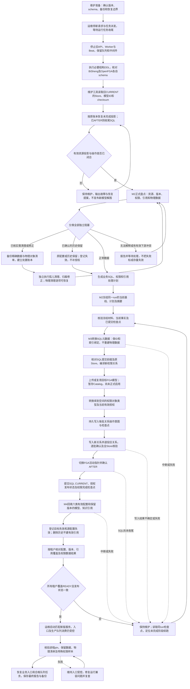

# F118迁移反馈解释、处置方案与完整流程评审

日期：2026-11-12。代码依据为本地发布线当前源码；历史材料依据116最终v6证据包；投影创建时间、OpenFGA二进制及数据库schema于本日重新只读核查。本文件是评审方案，尚未实施本轮新增清理、4757归属纠正或迁移行为调整；前一轮已经完成的数据处置继续按原执行记录认定。

最新未决问题、防旧写覆盖和层级bug核查见[后续核查](f118-recovery-and-open-questions-20261112.md)。用户已确认迁移脚本不检查Celery队列/broker，以下原队列盘点解释只作历史记录，统一修复将移除；停服务由业务/运维保证。

本文对应用户1–37项反馈；重复的空“18、”不另计问题。原编号及处置见[问题清单](f118-migration-blockers-and-fix-assessment-20261112.md)，现场全过程见[执行记录](environment-116-f118-upgrade-20261111.md)。

## 一、先纠正术语和已查明事实

| 原用词 | 实际业务含义 |
| --- | --- |
| 权限mode | 每个资源的一行权限模式：继承/自定义、父资源、版本及投影状态；不是自定义权限模型model |
| level计数 | 文件/文件夹的目录深度；不是文件数量或向量条数 |
| 可见来源历史 | `permission_visible_source_projection`的退休来源索引；不是审计中心操作日志，也不是工作流业务引用 |
| Root记录 | 一份业务对象的主体摘要，如助手A、工作流B；不是Root租户 |
| Source头 | 该对象某个配置/版本的摘要和引用数量；不是HTTP头、消息头或用户业务对象 |
| namespace | FGA对象类型前缀，例如`knowledge_library:4059`改为`knowledge_space:4059`，ID不变 |
| extra owned键 | 实际FGA关系比“从当前SQL编译出的关系”多出的部分；是诊断集合名称，没有对应的新业务需求 |
| 技术marker | FGA用于表达资源启用、自定义/继承模式的技术关系，不是新增角色/用户授权，也不是新增产品功能 |

**本日只读事实：**116 OpenFGA容器为`bisheng-openfga`，镜像标签`cr.dataelem.com/openfga/openfga:latest`，实际二进制v1.14.2 / commit `c8a0e7b553ec322edfaa88948d57ba73bcad8883`，镜像ID `sha256:65c4db264a403bfd62387fed4fe48f1b7cdda694bdac5f493a8f3c5a6460b4ba`。此前SQL授权发布记录中的`openfga_version=1.15.1`不等于实际运行版本。本地`f048_runtime_storage.py`及`catalog_bootstrap.py`的发布版本常量硬编码为1.15.1，并非二进制探测结果，不能据该字段判断存储DDL。

## 二、逐项解释及处理方案

### 1. 数据迁移、新模型发布完成才正式开服

同意。生产服务须同时满足：业务元数据转换完成、权限关系及新Catalog/模型CURRENT一致、引用回填/覆盖完成。OpenFGA接口可用或模型上传成功不等于升级完成。维护工具可以在旧pin下工作；新业务runtime继续拒绝以旧模型正式授权。

### 2. 新模型未发布时，如何恢复旧数据并开展迁移

应使用**离线维护进程中的旧版本投影适配器**：从当前SQL发布记录和待恢复操作读取明确的Store/model ID/checksum，用这个模型重读FGA、恢复同一操作；不先初始化新版业务facade，也不先发布新模型来绕过旧runtime错误。

此前的域投影协议已经支持固定model执行/恢复；首次F048与F118的模型发布也都有专门维护端口。此次失败是官方recover脚本把“恢复投影”绑定到“完整新版业务runtime已能解释旧Catalog”。现场只组装SQL/Redis/FGA投影服务绕开了这层不必要依赖，原账本/资源围栏/原模型checksum都保留。

**正式修复：**把这个最小维护runtime做成recover/reconcile公共入口；允许受控恢复旧CURRENT模型下的原操作，但不让生产runtime进入旧/双模型授权模式。恢复旧操作→盘点/冻结→SQL转换→上传并暂存目标模型→迁移关系→切CURRENT。不要重跑首次RBAC/F048迁移来重建已有授权。

### 3. PENDING创建补偿为什么自动恢复不了，何时创建、影响什么

业务场景是**内置灵思技能创建时初始化权限**：业务行、Grant/主体和可见来源已经准备，FGA写入也已达到AFTER，但SQL收尾没完成。异常补偿把Grant的`projection_state`从PROJECTING改为FAILED_CLOSED；正常finalizer却只挑PROJECTING Grant推进，漏掉这批仍PENDING的Grant/assignee，随后检查可见来源owner发现仍PENDING而报错。

| 操作ID | 资源/租户 | 数据库create_time |
| --- | --- | --- |
| 2341、2343 | 内置技能128、131 / tenant63 | 2026-10-30 20:42:32 |
| 2346、2347、2348 | 内置技能134、135、136 / tenant64 | 2026-10-30 20:42:33 |
| 2731 | 内置技能151 / tenant65 | 2026-11-10 14:49:27 |

影响这些技能的权限初始化/可用性，也会阻塞严格的全局迁移预检。不是本次迁移创建的问题；原始触发异常的完整请求堆栈没有足够证据，不能断言最初一定是网络超时或重启。

自动覆盖缺口有三处：系统内置资源bootstrap只补MISSING，遇NON_CURRENT直接拒绝；前台创建resume目前只支持tool/workflow且FAILED_CLOSED交受控恢复，不覆盖linsight_skill；普通reconcile只列PREPARED/STAGING/COMMIT_UNKNOWN/COMMITTED，FAILED_CLOSED需单独工具。

**正式修复：**创建补偿与finalizer用同一状态机。只有当前资源仍持有原operation围栏、创建版本/业务行/原主体/冻结tuple计划均一致时，推进该操作明确拥有的PENDING Grant/assignee并收尾。FGA已完整AFTER可只finalize；不能把所有FAILED_CLOSED Grant批量改ACTIVE。加入内置技能同一幂等操作重试/定时恢复，并对无法自动恢复的记录告警。

### 4. 其余12个投影为什么没有自动恢复，原因与方案

12个是总数，包含上面的6个技能创建，不是另加12个。其余为：

| 操作 | 场景 | create_time |
| --- | --- | --- |
| 5/6/7 | folder97253、folder95113、file94746移动 | 2026-08-03 11:09:32 / 11:09:58 / 11:10:46 |
| 25/33 | file86941、file94860移动 | 2026-08-03 14:07:46 / 16:23:38 |
| 2470 | file97951创建 | 2026-11-02 20:10:36 |

5条移动和6条技能创建的恢复预检都已读到完整AFTER、所需修正tuple数为0；卡在状态/SQL收尾。2470为STAGING，通过原生reconcile完成。不能把“FGA已写好”误认为“状态机已收尾”。

当前10分钟定时任务检查的是**SQL resource_permission_mode.parent与业务文件路径是否不同**，并非所有未完成操作的通用恢复器，也不逐条扫描FGA多余父边。SQL已一致而FGA仍有多边时，它不会选中；系统bootstrap和前台重试也有上项范围限制。Redis一致性哨兵的自动恢复只恢复缓存围栏，不代替这些业务操作。

**正式修复：**补齐持久投影账本扫描与恢复调度，按同一幂等键重验BEFORE/AFTER；已提交AFTER推进SQL收尾，明确未提交按原计划重试，不确定/围栏变化继续阻断并告警。父目录纠偏仍独立处理。源码里曾修复过“拿两份业务路径相互比较导致永远跳过”的定时任务bug，但不能把它断言为这12条未恢复的唯一原因，更没有完整历史运行日志证明每个周期执行成功。

### 5. 父知识库已不存在的文件，默认保留并跳过会怎样

可以设计为**明确隔离的历史残留**，但不能在循环里简单continue。否则全局完整性、配额、版本、引用覆盖和后续清理仍可能读到这些行，出现漏迁移、计数不一致或永远无法清理的物理对象。

若保留，应输出精确跳过清单，并在有效资源/配额/版本/权限/引用盘点中一致排除；不补父库/权限，不使其可调用。真正无父库且无有效下游时，备份后清理更简单；用户本项是在询问保留方案的影响，尚不把它登记为新的默认隔离政策。116这10条此前已删，本轮不伪造恢复原行。

### 6. 43条租户字段怎么修正的

实际是从错误tenant18分别修正为父库及已有权限镜像共同确认的tenant1/13/14；只修这些精确行，不是全表“文件tenant统一跟空间”。当时逐行验证父库存在且权限mode的tenant与父库一致，没有更改父库、目录、授权主体或实际存储。

通用处理应以父空间为容器归属依据，联查文件、目录链、版本及现有授权；如果权限与父库也冲突，不能仅凭单字段自动决定。本次首批43行按免备份指令执行，缺修改前完整行备份的边界仍保留。

### 7. 文档/版本关联失效具体是什么

关系是：**文档外壳document → 文档版本version → knowledgefile文件记录 → MinIO对象/向量内容**。此次主要检查SQL关联，不是证明磁盘或MinIO文件一定已消失。

- 1,415条document：1,267条父库不存在且关联版本均无有效文件记录；148条父库存在但已无有效文件记录。
- 1,423条version：1,274条关联已失效父库文档且无文件，148条有父库但文件行不存在，另1条version2782指向已不存在document2758。
- 最后一条对应的真实file89579存在，已保留；只清其断裂版本关联。

因此“源文件不存在”在这里主要指**knowledgefile行不存在**；不能据此宣称MinIO或向量数据已无残留。已完成备份后清理SQL关系，物理对象未借本项删除。

### 8. TagLink无有效目标

按确认方案：标签或文件目标不存在，且无其他有效下游/作用时，备份后清理关联。不存在目标不是“所有TagLink都可删”；有效标签和文件本体保留。116对应238条已经处理。

### 9. 已删除空间的成员关联

按确认方案：确认父空间确实不存在，再备份删除成员关联；不改用户本身、其他空间成员或授权。116对应165条已经处理。

### 10. 空权限模型为什么之前F048没有转换

**实际上已经转换了。**yifei在Catalog1就有新结构模型行，create_time为2026-07-31 18:58:58，`legacy_source_key=custom_069ecb78`；后续156份相关模型历史中一直沿用同一个model_key，升级前Catalog198也有该定义。

问题是F048/既有模型策略允许动作空、等级NULL的历史模型保持存在，F118新增预检却拒绝该已有状态；不是该模型漏跑转换。历史某些Catalog曾有动作，不意味着应把历史最大权限恢复到当前。应基于当前Catalog/当前Grant和原有效可见来源迁移，空定义原样保留，不猜等级/动作。

### 11. 为什么还校验首次F048来源，是否应以当前业务状态为准

应以**停服时当前业务行、当前Catalog、当前授权及当前FGA关系**为准，不重放几个月前的F048数据快照。本次读取的也是当前Grant/assignee；“首次F048”指其中某些行仍保留旧writer生成的locator/指纹格式，不是去拿旧导出数据覆盖现在。

原代码用在线新writer格式验证这些当前行，误报不规范；兼容两种格式是协议识别修复。当前来源后来真的改了主体/模型/版本，就按当前行判断。已退休的旧来源不再要求其当前Grant仍存在，见24。

**收敛方案：**校验当前关系的归属、主体、状态、版本与当前FGA一致；按记录真实生成协议识别来源身份，不要求重新满足某次历史迁移输出。旧退休索引不成为有效授权或迁移准入的额外业务条件。

### 12. 动作空集仍有可见权限

是。当前设计把“资源可见”与edit/delete/manage等具体动作分开。已有空动作模型仍可因原ACTIVE来源让相应用户看见/在visible语义入口使用资源，不能因此编辑、删除、分享或管理权限。按你确认的含义保留原可见来源和原作用范围，不自动为新主体制造可见来源。

### 13. 42个旧embedding名称清空

按已确认方案备份后清NULL，116已完成。仍无可靠ID映射时不猜同名、不自动改默认模型；资源和索引保留，用户后续配置合法模型。

### 14. 143个旧索引资源是不是空文档知识库

**只在SQL文件登记层面是空的，物理层不空。**143个资源的knowledgefile计数为0，但它们绑定的74个Milvus集合、26个ES索引中70/15仍有数据；同一物理集合可被多个库引用。

这些旧schema缺新document_id/knowledge_id等字段，不能可靠按新文件身份解释。可能是历史元数据/存储生命周期不同步，现有证据不足以确定每个库的形成原因。方案继续保留原绑定和数据，允许在没有有效文件需要转换的前提下完成元数据迁移；不能把“允许迁移”冒充旧索引已支持新上传或检索，也不换空索引。

### 15. 助手跨租户模型配置不改，用户自行修

按你的决定：model_name等业务配置原值不改，原槽位登记为跨租户失效、运行/发布/预览拒绝；助手配置界面允许选择明确的合法模型修复。改绑配置与引用登记在同事务更新，不移动/共享外国模型、不新增权限。

### 16. 缺创建者的空空间保留user_id

按你的决定：原user_id保留，不补用户、成员或创建者授权。迁移不因这个历史身份缺失阻断，也不以该身份自动获得权限。范围及当前有效文件/权限仍按实际事实盘点。

### 17. 孤儿文件删除，并清理MinIO和向量内容

是已有空间中的孤儿文件：103条FAILED文件，原路径父目录不存在、原SQL权限和FGA关系均无。失败状态本身不是删因；**父目录已不存在且没有有效下游**才是本项处置依据。文件夹删除漏处理后代是需要复现的候选原因，不能仅凭残留断言当前版本删除逻辑必有同一bug。

按你新决定改为清理，不再把这103条永久保留兼容：

1. 重新读取当前103候选，排除期间被用户修复或新增有效引用的文件；锁定原文件/文档/版本/关联。
2. 备份选定SQL原行、精确MinIO对象清单及可定位物理内容，生成可重试删除账本；核对没有存活任务继续写入。
3. 走孤儿维护清理入口：原无权限保持无权限，不为调用普通删除接口临时补授权；清理文档/版本/标签等无效关联。
4. 精确清该文件原对象、解析/预览产物以及ES/Milvus对应切片。**按明确文件ID/可证明来源过滤，不能drop整个集合、索引或桶**，尤其旧库可能共享集合。
5. 每一步可重试且做剩余对象/切片计数核验。旧schema不能可靠定位时保留该项为“物理清理未完成”，不猜删、不报告全清理成功。

当前正式文件夹删除已具备子树展开、版本关联和持久外部清理任务；统一修复要加“失败文件也必须被子树删除覆盖”和“中断清理可恢复”回归，确认具体遗留路径。此处是新计划，尚未在116执行物理删除。

### 18. level错误及额外父边

level是目录深度：空间根目录文件应为0，路径`/目录A`应为1，`/目录A/目录B`应为2。97402实际在根目录却写level1，因此改为0；文件没移动，数量没变。

额外父边是**权限图**里一个文件同时连到两个父资源。SQL业务路径只指一个目录，但FGA还留另一条parent，就可能沿两条路径继承权限；不等于业务界面支持“一文件属于多个目录”。原8条经核实账本删除多余边并修深度，另2条在B35仍按上轮保留政策留下，不能混为同一批。

方案：按当前业务路径和现有合法权限恢复唯一父关系；修正SQL深度与权限镜像/FGA同步，不能只改level掩盖多父关系。多父边最初由哪一次写入产生，缺完整历史写入证据时不归因到某个用户操作。

### 19. 失效Tag本体

按确认方案，父容器不存在/归属失效且无有效TagLink及其他下游的Tag，备份后清理；116对应170条已处理。

### 20. 328个权限mode是否就是自定义模型

不是。`resource_permission_mode`是**每个资源**的权限设置：这个文件/空间是继承还是自定义、父资源是谁、版本及投影状态。328个代表328个已删除资源的残留设置，不是328个自定义权限模型。

自定义/标准模型定义在`permission_model`，升级前CURRENT实际共24个模型。此处方案是清已不存在业务目标的mode及失效Grant/主体/可见索引，不删仍被有效资源使用的模型定义。

### 21. 失效UserRole

按确认方案，角色确实不存在且无有效解释时，备份后删除3条关联；116已处理，不删除用户或补替代角色。

### 22. FAILED文件是否正常

是，解析失败、模型服务错误等都可能正常产生FAILED。**不能因FAILED而认定文件异常或删除。**之前阻塞是版本链校验额外要求“每个document都必须已经有主版本”，而这2个document的4个文件全解析失败，从未成功晋升主版本，所以NULL主指针/全is_primary=0可能是合法生命周期。

方案是按真实主版本晋升规则迁移：全失败、尚未晋升的链保留且可由后续正常重试推进，不擅自选择主版本。成功文件存在但主指针错、版本编号重复等才是独立结构问题；17删除孤儿与这里FAILED无主链必须分开。

### 23. 工作流原跨租户空间引用维持现状

按你的决定保留原workflow配置及空间ID，当前未共享/不合法的引用显示失效，运行受影响版本时拒绝；后续在工作流编辑界面换成合法空间。父Root归属不自动等于已共享，不自动移动或分享空间。

### 24. 资源删了为什么迁移还管审计

你说的操作审计有快照，应按其生命周期保留，不应反过来要求已删资源继续存在。此前称为“审计”的部分实际是**可重建的可见来源索引**，状态RETIRED表示它不再贡献当前权限，不是审计中心日志。迁移因遍历整张权限来源表，把这类历史行也套上当前有效Grant校验，因而错误阻塞。

统一方案：有效授权只校验当前ACTIVE来源；资源已删时清理其权限派生索引/模式/无效授权，持久operation及tuple前后快照保留；资源尚在而旧来源退休，可归档或原样保留，不要求其旧Grant/assignee仍存在，不重建授权，也不为其历史重放整个业务权限。仍持有围栏的未完成操作不能当纯历史直接删。

### 25. “其他领域”“旧类型版本”具体指什么

flow/flowversion是共享历史表。此次原查询把**父flow_type=1的旧技能/旧编排**也按当前type10工作流校验；1,643活/27已删的这类记录不属于当前工作流来源。这里不是工作流节点版本，是整份编排的历史版本行。

另有181个版本的**真实父是type10工作流，但版本自己保留旧flow_type=1标签**。它们依然属于真实工作流，不能与下线旧技能一起忽略。

按你确认旧技能下线：排除真实父为旧技能域的记录；真实type10父下的旧标签版本继续按工作流提取模型/空间引用，不改原标签。也不要把下线旧flow技能与3中的当前`linsight_skill`内置灵思技能混为同一功能。

### 26. 已删除版本保留，不注册有效引用

按你的判断：已删除且父已物理删除的454条版本保留历史，不创建有效引用/授权。来源删除状态、原行摘要用于对账即可，不使历史阻塞有效模型/空间删除。

### 27. 4757改成父工作流的租户

按你新决定，方案从“保留foreign_parent”改为**纠正版本归属**。实际version4757当前tenant60、父workflow是tenant1，create_time为2026-11-09 17:11:23。

备份该行及父流程/来源登记；事务锁定两者，确认没有独立有效权限或已有来源登记，再将该版本tenant_id修为1。重新以父流程的正常来源键提取引用，校验其模型/空间是否有效、维护登记及覆盖；不移动父流程、不新增授权。不能仅裸UPDATE租户后留下旧来源索引/证书问题。

116已经完成旧迁移，修复用新的受控业务/维护事务，不改写原run、baseline或plan，也不重新prepare冒充“当时本就正确”。当前尚未执行这次改归属。

### 28. 旧名称助手保留，用户在界面改模型

按你的决定保留模型名称、提示词、状态、知识关联；用户在助手界面选明确合法模型时，同事务更新配置及引用、解除失效标记。迁移时不猜同名或清空后回退默认模型；原知识关联仍参与删除保护。这里与13由用户批准清空的embedding配置不同。

### 29. INACTIVE Grant的模型已删除

按建议作为正常历史处理：保留不生效Grant，不重建模型、动作或等级，不计为当前授权。若仍有ACTIVE贡献则单独核实，不借“历史”放过有效授权缺模型。

### 30. 历史空动作授权和使用

按你的决定保留历史状态及原可见判断。只沿原作用资源和原继承关系生效；visible语义入口可使用相关资源，但还受该业务状态/有效配置校验约束，不获得edit/delete/share/manage。未生效来源不因迁移自动激活，不能把“保留空动作”变为新增主体可见。

### 31. 全局角色与“事实owner”

你说的是角色可适用的部门范围。我之前用“Root全局角色”解释成租户共享，容易混淆。实际有两件事：Role行存储了tenant_id；角色是否可被某用户/部门使用由role_type、department_id及现有角色策略决定。迁移不应改其业务适用规则。

此前代码修复只是允许子租户盘点流中携带所引用Role的真实记录，**没有把Role.tenant_id改成子租户，也没有给用户新分配角色**。本日查询global角色行目前均存tenant1；这只是存储事实，不是判定global的定义。现有`eligible_role`还单独判断department_id，历史global行中也存在非空department_id；如果产品语义要求全局角色无条件适用全部部门，该差异应由角色模块核对，不能在F118编码时用tenant字段掩盖或擅自改变。

需要收紧的实现：当前codec用`role_fact.exists && tenant_id==1`识别例外，未显式要求role_type=global。应改为按真实`role_type='global'`及既有可分配规则验证，不将“tenant1中所有角色”当全局，也不要求所有全局角色永远存Root。字段保原值，关联所属业务范围按当前用户/部门政策核验；不在F118里另改角色产品含义。

### 32. Root/Source头是什么，什么业务会触发

以旧名称助手A为例：迁移先输出“助手A是谁、创建者196、当前配置摘要”（Root记录），稍后输出“助手A当前配置含几项知识引用、提取器是什么、配置摘要”（Source头），再输出具体知识空间引用。它们是同一业务对象的分批盘点记录，不是新业务操作。

代码每页先发199个对象主体，再发配置头。创建者已不存在的助手是否属于允许保留的旧配置，需要后面的配置头才能判断；原代码看到第一条主体就判失败。修复是等同一助手的精确头到达再判，末尾仍缺头才失败，不给其他对象借用同一创建者豁免。用户业务不需要额外做任何操作；这是纯分页顺序bug。

### 33. Kombu巡检回复是什么

是“巡检**回复**”，不是“巡检恢复”。Kombu是Celery使用的消息库；例如运维执行Celery inspect/ping，Worker通过Redis专用reply队列返回状态。它走消息系统，但不是文件解析/知识入库/工作流执行任务。

迁移为保护排队任务而扫描Redis列表，把一条`reply.celery.pidbox`状态回复当未知业务任务，错误阻断。按原生协议正确分类即可，保留消息、不消费、不清队列；真正解析不了的知识任务仍报告。

### 34. 已存在目标父边是什么操作导致的

实际样例是原图同时有`knowledge_library:4059 → 文件/目录`和`knowledge_space:4059 → 同一文件/目录`。此次要把旧库统一为同ID空间，第二条已经是计划需要的目标父关系；原代码将所有已存在目标端点视为陌生授权而拒绝。17条分布在4059/4062/4063/4094/4156。

已证实双边同时存在、与当前SQL及计划目标父一致；**没有足够完整的历史写入审计确定哪次请求最早写入第二条边**，不能断言某次移动或某轮迁移是唯一成因。

方案：目标边与当前业务父关系完全相同则直接复用，不重复写，删除已退役旧类型父边；错父、无业务对象或额外授权仍按漂移处理。它不同于18那种“两个不同父目录”。

### 35. extra owned键与namespace

一条FGA关系是“主体—关系—对象”，例如`folder:96177 —parent→ knowledge_file:96211`。namespace只是对象类型，如旧`knowledge_library`与新`knowledge_space`；并非新租户或新空间数据副本。

“extra owned”是迁移程序说：这条关系在实际FGA存在，却不在按当前SQL编译的预期关系里。99条中69条工具通用可见本来就允许；其余18 ordinary_assignee、5 grant、5 model、2旧父边，是授权物化/父链与当前SQL偏差，不是99项业务需求。

两条明确旧父是：文件96211的SQL父为folder96179，FGA还留folder96177；文件94710的SQL父为space3727，FGA还留space3209。上轮按保留/抽检指令留下；不能因为schema合法就认定这些关系业务上正确。

**建议统一方案：**当前业务结构决定父链，当前有效Grant/assignee决定具体授权，显式共享/系统可见按各自来源保留。已证明无有效来源的派生残留备份后清；不明关系报告，不在升级中自动认领成新授权。把“保留原FGA所有合法形状的extra键”从默认通用规则收紧为有分类依据的处理，特殊抽检仍可用于最终验收，无需逐人逐资源人工证明。

### 36. 技术marker的业务关联

它们是OpenFGA判断当前权限模式的实现：

- permission_enabled：资源具体动作权限计算的门闩，避免权限投影未准备好就放行动作。
- custom_mode：使用该资源自己的普通授权。
- inherit_mode：从父目录/空间继承普通权限。

例如用户在文件夹A上选择“继承上级权限”，系统写inherit_mode；切自定义则写custom_mode。用户并不直接操作这些tuple。服务账号作为另一种主体也要有对应技术标记，不能理解为新增了服务账号业务授权。

当前模型的直接visible与这些具体动作门闩分开，因此缺permission_enabled不等于一定完全不可见，可能出现“列表看得见但具体动作不可做”。这也是不能只看tuple数量判断效果的原因。

239个缺标记分为198个启用标记及41个服务账号相关标记；涉及35软删、163实际实体缺失、5个旧活资源。**方案：**已删/不存在资源不补标记，随无效派生数据清理；活资源根据当前SQL模式、有效授权及未完成操作恢复标记；不要一律补齐使已删资源恢复，也不要一律保留缺失让活资源持续不可用。原10样本抽检并未替这5个活资源证明全部服务账号动作可用，后续需单列核验。

### 37. OpenFGA默认索引还是116漏升级

结论：**对应版本本来没有这个MySQL组合索引，116不是漏执行已有DDL。**

| 检查对象 | 实测 |
| --- | --- |
| 116实际镜像/二进制 | latest标签，v1.14.2，commit c8a0e7b… |
| 本地仓库v1.14.2 | 与该commit相同；mysql migration001–007无tuple(store,ulid)索引 |
| 本地v1.15.1-dm、当前v1.15.2-dm | mysql migration001–007同样无该组合索引 |
| 116 goose_db_version | 1–7均is_applied=1，记录时间2026-04-26 12:10:24前后 |
| 原tuple索引 | PRIMARY(store,object_type,object_id,relation,_user)、idx_tuple_ulid(ulid)、idx_user_lookup(store,_user,relation,object_type,object_id) |
| 本次追加 | idx_bisheng_store_ulid_read(store,ulid)，支持按store过滤后ulid分页 |

注意changelog表原有PRIMARY(store,ulid,object_type)，不是tuple表索引，不能混读。DM目录另外有读取索引迁移，也不等于MySQL已有本项。

本地源码的读取正是`WHERE store=? AND ulid>=? ORDER BY ulid LIMIT...`；116原执行计划filesort，组合索引后API从约0.8秒/100条降至约5–8毫秒。建议在**本地openfga项目**新增幂等、可回退的MySQL存储migration，兼容116已手工增加的等价索引；不要加到BiSheng业务库Alembic，也不要只升级镜像tag便声称索引已执行。固定镜像版本/digest，发布记录的版本信息改为真实采集。此处只提出方案，未修改本地openfga仓库或发布新tag。

## 三、本轮已确认与仍需评审的边界

已明确采用：1完成后开服；8/9/19/21孤立关联核实及备份后清理；13旧embedding备份清NULL；15/23/28配置原值保留由用户界面修；16保留user_id；17孤儿文件及对应物理内容精确清理；26删除历史保留且不注册有效引用；27版本归属按真实父修正；29/30不生效历史及原可见作用保留。

22中的FAILED作为正常文件状态，不能单独作为数据异常或删除依据。31不借迁移改角色业务语义。35/36提出按当前有效事实分类纠偏，不再将未知原图差异无条件泛化保留；这是本次评审建议，尚不冒充用户已确认全部细节。

## 四、完整迁移流程图（本次收敛方案，待评审）

[可编辑FigJam流程图](https://www.figma.com/board/NZeD2EKXwGUqzyK3jwMgUv/)（本会话图卡提供首次领取入口）；下列Mermaid源码可独立评审和保存。

图中“预处理”属于独立运维处置，不是Alembic数据迁移；“发布目标模型”与“正式切CURRENT”是两个不同阶段。停服/备份/开服由运维编排负责，迁移工具不以端口探活作为数据正确性证明，也不自行启停服务。

阶段写入边界：

| 阶段 | 读取依据 | 允许写入 | 完成条件 |
| --- | --- | --- | --- |
| 旧投影恢复 | 当前旧pin、原未完成operation及冻结tuple账本 | 同一原操作的关系及SQL状态收尾 | 有效范围无未完成围栏/不一致；不重建历史授权 |
| 独立预处理 | 当前业务归属、有效下游和选定备份 | 已批准清理/修正；精确MinIO及切片清理账本 | 处置范围与有效下游核对，未完成物理清理明确报告 |
| M2 | 停服时真实现状 | 盘点artifact、正式run、冻结baseline/plan | 预检分类完成，无未解释阻塞，计划可核验 |
| M3 SQL | 原冻结计划及提交前缀 | 资源/文件/文档/版本等计划元数据 | 计划命令提交且重读一致，ID/绑定不变 |
| M3权限发布 | 当前授权、原FGA、源/目标schema及权限计划 | 目标模型、暂存Catalog、namespace、关系账本与CURRENT切换 | 源/目标pin匹配，关系AFTER及SQL最终状态闭合 |
| M4 | 实际保留配置/版本与冻结来源计划 | 引用集合/明细、失效标记与覆盖证书 | 六来源对账、所有租户READY；不为任务注册独立模型引用 |
| 恢复业务 | 新CURRENT及实际运行进程 | 运维恢复入口/派发 | 新进程一致、抽检通过、失败配置仍明确不可用 |

**已升级116的后续处置不重跑上述全新迁移。**17和27在新维护事务/清理任务中执行并维护当前引用状态；原completed run、baseline/plan和历史发布证据保持不可变。不能重新prepare覆盖已经完成的事实，也不能只改回type或删除新Catalog来伪装回退。

## 五、实现及评审顺序

1. 先确认本流程及35/36的当前事实纠偏原则；将本轮已确认策略归入统一规则，替换针对103孤儿/4757原保留的旧合同，保留执行历史。
2. 正式修复旧pin恢复入口、PENDING补偿与finalizer状态机，补恢复调度和可观测性；不将它们继续留在116运维猴补丁中。
3. 按当前有效业务/授权盘点，协议格式识别与历史审计解耦；旧技能按真实领域排除；角色按role_type及正式角色策略判断；分页处理不依赖记录先后顺序。
4. 数据处置独立：TagLink/成员/Tag/UserRole孤儿、原版本归属纠正、文件夹遗留孤儿与物理清理；默认先报告选定候选、备份、显式执行，不默默删除FAILED文件或猜绑模型。
5. 在openfga项目补存储索引迁移和真实版本采集，验证空库升级、已有等价索引、116已手工增加索引、重跑/回退；DM另按其存储实现测试。
6. 对未升级样本及已升级116分别验证：首次迁移、各阶段中断续跑、用户配置界面修复、删除保护、失败文件重试、孤儿物理清理和角色适用不变化。发布包含修复的正式镜像后再替代现39文件只读覆盖。

证据与代码定位：

- 只读现场证据：`/Users/zhangguoqing/.codex/visualizations/2026/11/11/01a1c875-f593-7ca0-9f54-488dcabc4550/migration-review-20261112/live-probe.jsonl`与`openfga-tag-evidence.json`，只含所选ID/状态/时间、schema索引及版本信息，无业务配置/模型凭据。
- 恢复入口/状态机：`src/backend/scripts/recover_f048_failed_closed_projection.py`、`reconcile_f048_projection_operations.py`；`permission/application/sql_runtime.py:SqlProjectionFinalizer`、`control_state.py:mark_owner_compensation`、`system_resource_reconcile.py`、`runtime.py:resume_created`。
- 父目录自动恢复：`knowledge/domain/services/stale_projection_reconciler.py`及其Celery任务；只比较SQL父镜像与业务路径的候选。
- 当前来源格式/退休历史：`permission/migration/f118_plan.py`；原空模型策略`permission/domain/services/model_policy.py:_custom_model`。
- 角色：`role/application/effective_roles.py:eligible_role`；当前宽例外`knowledge/application/unification_inventory_codec.py:encode_inventory_page`。
- 删除：`knowledge/domain/services/knowledge_space_service.py:delete_folder`、`knowledge_space_direct_delete_service.py`及`knowledge_space_delete_repository.py`；不以是否FAILED决定是否展开子树。
- 流程编排：`scripts/unify_knowledge_spaces.py`、`knowledge/application/unification_permissions.py:run_permissions`、`unification_references.py:run_references`；固定模型维护端口`permission/application/f118_permission_publish.py`。
- 技术marker真实公式：`core/openfga/authorization_model_f048.py:_resource_type`。
- 本地OpenFGA：`/Users/zhangguoqing/works/openfga/assets/migrations/mysql/001_initialize_schema.sql`、`007_collate_object_id.sql`、`pkg/storage/mysql/mysql.go`；按上述三个tag分别读取，不把工作区文件当全部版本的证据。
