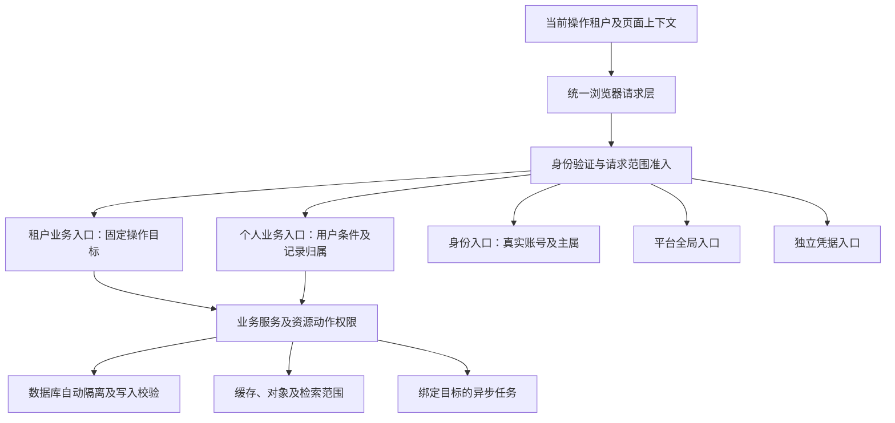

# 租户操作上下文统一方案

日期：2026-11-13（Asia/Taipei）。状态：**用户已授权第一阶段开发；第一阶段已在隔离分支完成本地实现和定向验证，真实环境验收待执行。第二、三阶段未实施，现场配置未修改。**

本地核对基线：`feat/3.1.0-beta1` / `3ce7e7ef3de81a06f57520a7ab74d6b9e253d8fc`。相关实测见[接入抽查报告](management-view-integration-audit-20261113.md)及[两类弹窗排查](tenant-switch-errors-investigation-20261113.md)。这些实测不等于本方案已经实现，也不是现场镜像版本证明。

修订依据：[方案评审](tenant-context-unification-review-20261113.md)及[外部代码核对评审原文](tenant-context-unification-proposal-code-review-20261113.md)。外部评审原样留档，其建议的采纳和校正见 §10，不把文内建议当成已确认的产品规则。

第二轮源码补核基线为 `39c8debc5740bc8ca7fcd2ef0a2bc8fcca397f7b`；网关核对使用本地已有提交 `62399806`，不是网关当前工作区、所有客户分支或已部署版本证明。本轮补个人业务数据分类、网关具体边界、端点级范围入口及新增上传预览、超管撤权约束；前端复用现有整页刷新，交付拆成三阶段。此前补齐的创建者执行身份、写入、异步、初始化及历史预检继续保留；不改 Redis 格式、不新增视图标识、不全局收紧写入钩子。

角色边界对齐[本租户角色与平台共享角色方案](tenant-role-minimal-change-plan-20261113.md)，该文历史绑定修正及部门划租承接仍是独立候选增量。外部评审未核对角色关联文档，不代表两份方案已联合验收；此前评审也不视作本版已获独立复评通过。

## 1. 推荐结论及依据

保留超管切换能力，将“管理视图”明确为“当前操作租户”：**所有租户业务默认使用统一、经服务端验证的当前操作租户；账号身份、平台全局功能、独立凭据执行各有明确边界。**

租户业务不再逐个 URL 接入白名单。使用统一业务路由入口继承范围，少量身份/全局/凭据入口显式声明例外；所有实际入口都必须有来源可追溯的范围策略，未声明或冲突不能通过构建检查。仍须修正下游显式取错租户的代码，不能认为入口统一就自动完成全部改造。

实施拆为缺陷修复、登记与预检、强制检查三个阶段（§7）。下文规则和全链路验收描述最终完成范围，不等于第一阶段全部交付；新增登记规则的观察期不降低已有权限或租户保护。

这是结合毕昇现有架构的建议，依据下列官方架构指导，而不是声称存在一套所有产品完全相同的实现标准：

- [Azure：将请求映射到租户](https://learn.microsoft.com/en-us/azure/architecture/guide/multitenant/considerations/map-requests)：请求需明确租户，租户映射与用户权限是两个问题；可采用路径、域名、请求头或令牌等传递方式。
- [AWS：租户隔离](https://docs.aws.amazon.com/whitepapers/latest/saas-architecture-fundamentals/tenant-isolation.html)：身份认证和一般授权并不自动实现租户隔离；资源访问还需按租户上下文收窄。
- [AWS SaaS Lens：身份与访问管理](https://docs.aws.amazon.com/wellarchitected/latest/saas-lens/identity-and-access-management.html)：租户上下文应作为架构中的一等信息，贯穿服务调用。
- [Azure：多租户控制平面](https://learn.microsoft.com/en-us/azure/architecture/guide/multitenant/considerations/control-planes)：租户开通、平台维护等管理职责与租户业务职责应清楚分开。此处首先做逻辑分离，不据此要求拆成新服务或数据库。
- [Auth0：组织令牌验证](https://auth0.com/docs/manage-users/organizations/using-tokens)：组织标识需要服务端验证，并用于限制数据范围。该产品是令牌传递方式的实例，不代表毕昇必须接入 Auth0 或更换登录令牌。

## 2. 业务规则

### 2.1 谁操作、操作哪里、资源属于哪里分别表达

| 概念 | 推荐语义 | 示例 |
| --- | --- | --- |
| 真实账号 | 登录认证得到的稳定用户 ID | 超管用户 191 |
| 账号主属租户 | 由现有组织及成员事实决定 | Root，租户 1 |
| 当前操作租户 | 本次浏览器租户业务请求的目标 | 测试应用审批，租户 60 |
| 资源所属租户 | 资源隔离、配置、授权和用量归属的边界 | 新建工作流属于租户 60 |
| 定义所属租户 | 角色定义及其菜单配置的归属，与使用者主属分开 | 本租户定义属于目标；共享定义保留权威所有者 |
| 业务归属与存储归属 | 部门挂载等场景中分别由权威领域事实确定 | 部门可能存于 Root，但业务归属租户 60 |

超管在 A 创建资源不会把账号变为 A 的成员；账号姓名、主属、普通角色、个人授权保持独立。当前普通用户及子租户管理员仍只有自身合法租户范围。

### 2.2 请求范围

| 入口类型 | 超管 | 其他用户 |
| --- | --- | --- |
| 租户业务：看板、构建、知识、数据集、模型、评测、标注、租户审计等 | 当前操作租户；Root 也是一个具体目标 | 其权威主属租户，加既有动作权限及更窄组织范围 |
| 租户配置：工作台、模型配置、租户自定义角色、资源授权 | 当前操作租户，保留合法共享定义/默认继承 | 自身租户内按权限管理 |
| 身份：登录、本人资料、主属及个人身份策略 | 真实账号及主属 | 同左 |
| 个人业务数据：本人对话、会话历史、“我的申请”等 | 按下述用户维度及记录归属分别处理，不能等同于账号身份入口 | 同左，并受自身合法租户及资源资格限制 |
| 平台全局：租户开通/停用、平台许可证、部署级设置 | 平台级范围，要求对应资格 | 按现有平台权限拒绝或只读 |
| 独立凭据：桌面端、开放接口、匿名分享、签名回调、工作负载 | 使用其自身已验证身份和目标，不读浏览器选择 | 同左 |

“系统”菜单中混有平台项和租户项，不能整页一刀切；组织挂载和全局账号目录也需按自身业务事实处理。对租户业务统一默认，不等于把所有 HTTP 接口和所有数据表强制改成子租户。

个人业务数据采用以下推荐规则，进入规格时按入口确认；本轮未改既有数据或执行通道。不以 URL 中出现 `me`、`personal` 或 `workstation` 直接推断范围。

| 数据/动作 | 推荐范围及兼容边界 |
| --- | --- |
| 浏览器新建对话、会话与执行任务 | 属于租户业务的，取经验证的操作目标，真实用户另存；执行资格仍按既有通道核验，不因选中子租户就虚构本地成员或新个人账本 |
| 本人的历史对话、会话及产物 | 保留记录原租户；租户内列表按当前合法目标及本人条件筛选，不把历史记录从 Home 搬入子租户，也不默认汇总全部租户。详情/续聊核验记录、目标和参与资格；切换不改原会话归属 |
| “我的申请”、本人待办及撤回等动作 | 个人过滤条件与申请/任务原业务租户同时成立；相关资源授权继续校验。若保留跨租户个人汇总，须单列只读入口及最小展示字段，不据此允许跨范围审批或撤回 |
| 本人个人令牌 `/api/v1/me/api-token` | 属于身份及独立凭据自助，使用本人合法主属及既有令牌规则；不随管理切换签发、迁移或重建令牌。真正人员迁移按原迁移合同处理 |
| 租户令牌台账/设置 `/api/v1/personal-tokens` | 属于租户管理，使用当前操作目标及相应管理资格；不是超管本人的令牌自助 |

现有 `/workstation`、`/linsight`、`/chat/online` 前缀内可能同时包含配置和个人执行，其他会话入口也不能遗漏。第二阶段逐端点核对创建、列表、详情、续聊、导出和删除的实际语义。第一阶段未明确的入口保留既有合法权限并标明未完成，不能擅自整体切为 Home 或目标；第三阶段启用前必须消除这些未决项。

### 2.3 创建人、负责人、授权及人员展示

超管 Root → 在 A 创建工作流：

| 记录 | 归属或引用 |
| --- | --- |
| 工作流、初始版本、相关业务引用 | A |
| 权限模式、授权、授权来源 | A，以资源目标为准 |
| 创建人及创建者来源 | 真实账号 ID；不伪造本地创建人 |
| 审计 | 操作者真实 ID/主属与操作目标 A 分别记录 |

不因创建人属于 Root 就禁止 A 的有权用户看到创建人名称。先验证资源读取权限，再按该资源/授权引用的明确用户 ID 返回姓名等必要展示字段；不开放整个平台人员搜索、密码或无关联系资料。

新增授权候选按 A 的业务规则筛选；已有授权记录按资源及源记录展示；当前真正可使用的人按当前权限和身份资格判断。这三个集合不能复用同一个“当前租户成员”过滤器。查看资源不自动授予查看完整授权清单的资格，后者仍要求 `manage_permission`。

创建者授权继续沿现有权限系统保存。超管资格被撤销后，不得单凭历史创建者记录获得跨租户访问；记录仍保留供追溯。人员停用/删除时显示明确的不可用身份，不能因此隐藏整条资源或授权。需要交给 A 的本地负责人时，用现有授权/转交能力显式处理，不自动把某个本地用户改为创建人。

**创建者还是部分运行链路的执行依据。** 现有工作流知识节点在知识权限开关关闭时用创建者、开启时用运行人；`space_flow_retrieval.abuild_scoped_login_user` 将流程租户传给身份初始化，后者又将其用于预期主属校验。Root 创建者与 A 流程组合存在 `24006` 拒绝路径；助手、工具等同一函数消费者也须检查。此为源码确认，未现场复现，触发依赖具体配置。

触发组合不只跨租户创建者：`workflow/common/knowledge.py` 的旧知识空间过滤及 `tool/domain/langchain/work_knowledge.py` 也会以“运行人＋资源执行租户”构建身份。因此应同时测试“子租户运行人＋Root 流程/知识工具”。先核对该入口原合同及共享/发布规则是否允许运行；允许的组合应正确分离身份与目标，原本禁止的组合仍拒绝。本方案不以修复 24006 为由新增跨租户运行权限，也不声称 Root 流程已经允许所有子租户用户执行。

最小修正分别取得执行人的真实主属和资源执行目标，先核实目标及当前执行资格，再沿现有统一动作权限入口授权。保留知识权限开关语义，不伪造主属、不关闭角色校验、不一律替换为运行人。创建者资格变化后重新校验；无合法执行资格则明确拒绝并提示由有权人员通过既有维护/转交能力处理，不凭旧创建者记录继续跨租户执行，也不自动扩大运行人的检索权限。验收必须包含 A 普通获权用户执行超管在 A 创建的流程。

### 2.4 工作台、模型与配额

- 工作台配置及默认模型按当前目标及已有 Root 继承/覆盖规则读取。公共模型和共享资源通过现有合法共享关系获取，不能把 Root 等同于“所有租户”。
- 既有规格允许超管前台工作台视图随管理选择变化，应保留该能力；当前账号的 `/user/info` 和主属身份不随之改写。
- 将“管理展示/配置”和“个人模型资格/个人额度”分成明确的服务入口。禁止在租户 A 上下文中调用“校验 Root 用户必须是 A 成员”的个人策略函数。
- 既有已支持的管理预览/调试通道保留超管真实身份，修正目标与主属混用，核验目标资源及共享配置；个人独立凭据会话仍按本人主属执行。
- 本批不新增通用管理调试入口及其计量体系。若现有通道依赖同租户个人账本而无法合法支持跨主属调试，明确拒绝并说明原因，不能伪造本地成员、回退 Root 或将成本记入错误租户。将该限制列入功能清单；若验收要求所有调试通道都可用，须先扩大明确范围，不能把拒绝等同于功能已完成。
- **资源数量配额本轮保持现有超管例外及普通用户规则。** 当前 `QuotaService.check_quota` 明确存在超管绕过；不能借统一上下文默默改成超管受所有租户容量限制。资源用量统计仍归实际资源租户。若产品要求超管也受容量限制，作为单独业务决策确认，存储等现有专用规则也不因此被一概改写。
- 不重做桌面端积分结算；管理调试的计量和个人付费消费必须在实施规格中逐通道列明，不能将前台展示正确当作计费已经正确。

### 2.5 与跨租户角色方案的衔接

原稿仅提到合法共享定义，未覆盖普通绑定、兼属人员和行政划分承接，现补齐如下。角色规则的完整候选及变更合同以[角色方案](tenant-role-minimal-change-plan-20261113.md)为入口，不在本方案另建平行规则。

| 对象/行为 | 归属及判定 | 管理切换的影响 |
| --- | --- | --- |
| 本租户角色 `role_type=tenant` | 定义属于一个业务租户；部门按业务挂载事实校验 | 超管在 A 创建时取经验证的 A，不取超管主属；不能因此编辑 B 的私有定义 |
| 平台共享角色 `role_type=global` | 跨租户复用定义；仅平台超管维护，租户有权管理员按资格分配 | 共享可见性走角色领域窄入口，不开放全请求跨租户读取；新定义以 Root 为所有者，旧定义所有者保留 |
| 定义菜单 `WEB_MENU` | 跟随角色定义所有者；既有共享定义不强制搬到 Root | 编辑共享菜单属于平台资格动作；不能因当前选 A 把菜单保存到 A，查重/读取/保存使用同一合法定义范围 |
| 普通人员绑定 `UserRole` | 属于被授予人的唯一当前主属，定义须为该主属本地角色或合法共享角色，并满足部门范围 | 不按操作者当前选择重写绑定；租户 A 人员管理入口不能给主属 B 的兼属人员落 A 的普通绑定 |
| 部门作用域 | 空部门表示“全部部门”，不表示跨租户共享；兼属事实按业务归属判定 | 主属外的兼属部门不使其获得另一个租户的普通角色；作用域失效终止绑定，扩大后不复活 |
| 个人有效菜单、角色配额及动态角色标签 | 通过现有有效角色入口，从真实主属内合法绑定及定义计算；资源动作另行授权 | 不用当前操作租户充当身份校验主属；切换不生成目标租户普通角色，也不改个人菜单或角色集合 |
| 角色额度、租户上限与资源用量 | 普通角色额度保持既有聚合语义；目标租户约束按原规则；用量归实际资源目标 | 不把共享定义当跨租户资源权限，不随切换迁账或清零，不取消既有超管配额例外；DSH 按其现有目标规则执行 |
| 具体资源授权 | 资源授权及来源属于资源目标，使用既有权限运行时 | 与普通角色绑定区分；不能将两者的租户字段统一改成当前操作目标 |

“候选可分配、定义可维护、人员绑定生效、菜单可见、资源可操作”分别校验。平台共享定义即使由非 Root 的历史所有者持有，其菜单仍按该确切所有者读取；普通用户的主属和当前角色不随该定义所有者变化。

现有角色汇总视角若保留，应显式归为有平台资格的汇总入口，只用于其声明的查询/维护目的；Root 具体租户不等于汇总范围。汇总中创建本租户角色仍须选择具体目标，共享创建/维护仍核验平台资格，不能由统一租户入口静默推出全租户访问。

角色创建的最小联合改动采用角色方案第一步：请求显式表达类型，缺省为本租户角色，共享创建需显式选择及平台超管资格；查重、部门校验、定义及菜单归属一致。它改变“超管省略类型即隐式共享”的旧行为，需同步前端/API 及角色方案涉及的 F009 验收变更确认，不能只改 `tenant_id` 后仍误建共享定义。该第一步可独立交付，不依赖历史修数或部门划租承接。

真正人员调岗仍终止旧普通绑定、按目标合法授予，不能自动搬旧共享绑定。角色方案提出的“部门行政划分时按确认映射承接”是只在挂载入口发生的合同增量：先预览，再在同一 SQL 事务中切主属、终止旧绑定、建立本次新授予及更新默认配置；外部兼属人员不迁主属、不承接；不向既有人重发默认角色。管理视图切换绝不能调用这条承接链。

上述行政承接、Root 错位绑定条件修正、Tenant 两个请求字段和必要组织写入锁接线，均属于角色方案后续独立步骤。本次操作范围修复不自动执行这些步骤，也不宣称已解决它们。角色副本改变 ID，审批的 `role_{id}` 和 DSH 目标配置必须另验，不能把角色复制当作政策等价迁移。

## 3. 请求处理架构

本图为建议架构，不是当前已落地的调用链。

### 3.1 路由范围：业务默认继承，例外显式声明

新增统一的租户业务路由构造入口；一组租户业务接口默认继承范围，新增子接口自然生效。身份、平台、凭据入口单独分组；混合组必须在组或端点明确声明，不能靠 URL 片段猜用途。

复用已有开放接口 `@open_api_scope` 的“端点声明、选路后读取、未登记拒绝”做法及可复用检查工具，不直接把该装饰器的凭据权限值当作管理租户范围。管理范围声明沿同一种登记方式表达租户、个人业务、身份、平台及凭据类别，具体命名在技术设计中确定；已有开放接口声明和运行时拒绝继续生效，不做无必要重构。

最终所有注册路由必须能解析出唯一范围策略。分阶段执行：第二阶段开发/持续集成要求登记完整，运行环境对**新增登记规则**先报告未登记/冲突；第三阶段完成门禁后，启动检查及运行准入才强制拒绝。已有认证、开放接口权限、租户隔离和端点业务检查在任何阶段都不得降级为只记录。数据变更语义属于端点契约，不单凭 GET/POST 推断；现有有副作用 GET 应记录并优先调整。

现状不能笼统称为“未接入都默认 Home”或“超管未接入就全租户可见”：超管未覆盖路径的 `visible_tenant_ids=None`，数据库钩子通常仍按当前 ContextVar 租户过滤；浏览器上下文通常来自登录令牌，但显式 bypass、汇总模式及服务内部上下文会改变结果。新增填充与显式提供的租户值也须分别核对。第二阶段记录每个入口旧的实际读写范围，第三阶段统一后再比较列表结果，不能用一个空可见集合标记推导全链路行为。

统一执行点在选路之后、业务查询之前，可采用统一路由包装配合依赖；必须验证认证、范围、权限依赖顺序。当前 `BaseHTTPMiddleware` 的前置阶段不能直接假设已拿到最终路由元数据。逐模块迁移时由一个机制负责上下文，避免旧中间件与新入口重复覆盖。

迁移需同时核对知识空间、处理任务、应用运行审计、审批中心和服务账号的端点/服务范围入口（见 §5）。仅将重复读取选择、比较请求目标及固定上下文的部分接到统一准入；各自的当前身份、部门裁剪、申请参与人、凭据模式及具体资源动作检查继续保留，不能为了“只剩一个机制”删掉业务授权。

无需为本批统一改名全部接口或引入 `/tenant/{id}` 路径。路径式租户也可行，但要求所有调用方同步，且路径本身仍需验证授权。

### 3.2 一次核验，固定本次请求的范围

建议内存上下文包含：真实账号 ID、权威主属租户、入口范围、当前操作租户、请求追踪标识。复用现有 ContextVar 及认证对象，不新增持久上下文模型；业务资源创建必须使用经过核验的操作目标，权限模块仍通过既有公开端口执行具体动作。

权威主属通过用户领域唯一、最窄公开事实端口取得，并遵守现有主属与主部门业务归属一致性规则；不在管理仓储中再派生一套近似 Home 规则，也不将全部角色策略复制进中间件。

服务端必须验证登录状态、当前超管资格或自身成员资格、目标租户存在且可用，以及请求目标与当前选择匹配。请求头只表达目标，不是授权凭证。缓存的超管资格应有撤销失效机制；不能只信客户端字段或将长期正缓存当作即时撤权证明。

现有 `_check_is_global_super` 缓存为 300 秒，`clear_on_role_revoke` 只清管理选择且注释标为未接线；身份判断还有旧 AdminRole 兜底。**本方案不将“等待 300 秒”当作可靠撤权合同。** 第一阶段盘点实际可变更超管资格的业务/运维入口；在权威变更后联动失效超管缓存及管理选择，并按现有身份规则核实 FGA 资格和旧管理员绑定是否仍构成合法来源，不误删合法独立身份。敏感跨租户准入须取得有效资格证明，不能仅据旧正缓存放行。清理或资格重验失败应明确拒绝相关敏感操作并报告未收敛，不能报告撤权完整成功。

不新增撤权产品入口，也不声称已实现所有身份变更的跨系统原子性；若某外部变更入口无法接线或验证，列为启用相关强制覆盖前的阻断项，不能仅调用清理选择钩子就宣称立即撤权已解决。

普通用户缺少管理头时按权威 Home 处理；如果提交不同租户则拒绝，不能静默忽略。超管租户业务请求需要明确目标；缺失或无法核实，不猜 Root 或本人 Home。

### 3.3 页面选择、并发与过期

本批保留现有“一个账号一个管理选择”、`admin_scope:{user_id}` 十进制整数值及 `X-Management-Tenant`，不新增服务端视图标识或更改 Redis 格式。当前选择服务和清理任务都按整数解析，避免本次将旧进程变成不兼容消费者。

1. 初始化先完成本人身份及范围自举，核实默认目标并建立/确认有效选择，再放行租户业务请求。个人身份/平台入口不依赖该就绪状态，避免循环等待；客户端不因工作台配置加载较早而抢先发无目标请求。
2. 公共浏览器请求层统一携带经服务端确认的目标，移除业务 URL 附带白名单。普通用户按真实主属处理；超管租户请求的目标头必须与服务端有效选择相符，读写均不得猜默认租户。
3. 请求准入后固定目标，后续切换不改变在途请求范围。页面在 A、当前选择为 B 的未准入请求应拒绝；已准入 A 操作可在 A 完成并记录 A。切换即撤销所有在途操作需要额外提交围栏，不在本批承诺。
4. **保留平台现有整页刷新。** `controllers/request.ts` 已监听 `bisheng:management-scope-changed` 和 `storage` 事件执行刷新，本批复用它销毁旧页面、表单及内存状态，不另建加载序号、全站请求取消或大范围缓存键改造。仍须验证旧响应不会回填新页，以及浏览器恢复/持久缓存的实际行为。跨标签存储通知可能不可用，不能据此取消服务端目标核验；同账号其他浏览器或设备也不由该事件同步。
5. **本批不保证服务端识别 A→B→A 后的同租户旧表单。** 前端依靠整页刷新失效旧表单，资源自身仍执行已有版本/状态校验；若要彻底拒绝同租户旧请求，另行纳入视图标识及所有解析者/清理任务兼容，不能沿用原稿的更强验收承诺。
6. 首次未选择走显式自举；业务准入发现选择过期、Redis 不可用或目标停用时明确拒绝，不能静默回本人 Home/Root。客户端只有成功重新确认范围后才恢复业务请求。
7. **切换失败后必须重读。** 现有实现先写 Redis 再写 SQL 审计；Redis 写成功即实际选择可能已变化。审计失败或响应丢失时，客户端不假定未切换，暂停业务请求并重新读取确认值；读取仍失败则保持未就绪。服务端明确返回可诊断的失败并记录可用诊断信息，不把未成功持久化的审计报告为成功。重试同一目标不得执行任何资源创建/授权，只沿现有选择及审计路径处理，不引入 Redis/SQL 分布式事务。

本批不承诺选择和 SQL 审计跨存储原子；具体错误码/字段在技术设计中复用既有机制并明确。每会话独立选择、服务端视图标识和完全审计补偿留作后续独立需求。

### 3.4 跨服务、异步、下载和其他存储

- 网关代理与网关自有业务分别处理，具体范围和验证入口见 §3.5。代理保持请求/响应目标头透传，由后端统一准入；2026-11-16用户修订：Java为可选组件，旧版不强制升级；新Java自有接口范围增强保留独立分支，不能作为Python运行依赖。两个旧聊天回写按身份和持久归属处理，首次无会话按真实主属，详见F009 optional-gateway-compat.md。转发原始头不等于验证通过，外部伪造内部身份头不能生效，独立凭据自行解析目标。
- 同源接口请求可以使用请求头；直接下载和原生 WebSocket 优先从已有可验证资源/任务及认证机制恢复范围，必要时才补用途受限短期票据，不建立通用票据平台。必须先验证身份及资源范围，不能仅凭一个对象 ID 取得异租户访问资格，缺失也不能退回 Home。
- WebSocket 的连接、重连、结束以及流式响应的生成、消费、异常和断开均明确上下文生命周期。不能将 HTTP 处理函数返回视为流已结束而提前恢复上下文；复用现有上下文恢复机制，避免污染后续请求。若验收工作流完整链路，这些通道必须一并覆盖。
- 异步作业在提交时冻结操作租户、真实提交人及必要执行依据。逐类列出工作流、复制、导出、回调的“提交入口→持久字段→消息参数→执行/重试入口→缺失处理”，优先使用已有任务或资源事实，缺事实才补最小字段。执行前核对可信持久目标与消息头；两者冲突拒绝并诊断，不能任取其一；从持久事实恢复应早于首次租户查询及执行资格签发，不读取提交人最新 Redis 选择。
- 现有 Celery 生产钩子从 ContextVar 写头，普通缺头消费者会回退 Root，权限/复制任务另有严格规则。本批必须调整所触及链路的生产/消费契约，而非只改任务内部。旧消息有可靠资源/任务事实则据此恢复，缺乏证明的租户任务隔离待处理；真正平台周期任务保留平台语义，不一律禁用所有缺头任务，也不清空旧队列或批量重投。
- 是否按当前授权重验或沿用已批准系统任务资格，由现有作业类型决定，不把所有后台任务统一改为超管执行；角色承接后的外部同步只按当前事实续办，不重放旧绑定或默认授予。
- 已创建的导出任务绑定原目标，切换后不能把它当成新目标任务展示或下载。回调依据任务/签名恢复原范围。
- SQL、缓存、对象存储、检索均需范围约束。优先复用已有按对象或索引隔离的设计；原始 SQL、UNION 子查询、ES/Milvus 查询及跨租户缓存键作为审计重点。只正确设置 SQL ContextVar 不能证明这些通道都已隔离。

### 3.5 网关自有功能的范围及实施落点

2026-11-16当前交付以[可选Gateway兼容修订](../../features/v3.1.0-beta1/009-managed-tenant-consistency/optional-gateway-compat.md)为准。下表涉及Java新增校验均属于独立增强，不要求旧Gateway升级；旧配置按编号存取，直接接口授权缺口另列，不把页面限制当成完整授权。

核对 `bisheng-gateway` 提交 `62399806`：`DshSensitivePolicyController` 接收显式 `tenant_id`，`DshSafetyAdminClient.authorizeIdentity` 回调本人信息、模型审计设置及目标租户状态。该调用链没有比较浏览器 Redis 当前选择；现有认证/目标可管理校验不能替代“本次页面目标一致”校验。旧五组控制器及对应实体未见直接租户字段，仍须追踪资源/组织 ID 的权威归属及服务查询，不能据字段缺失断定全部数据共用或属于平台全局。

| 网关部分 | 推荐规则及具体落点 | 交付边界 |
| --- | --- | --- |
| 反向代理到 Python 的请求 | 保持现有代理；验证请求 `X-Management-Tenant`、响应同名头及必要来源头不被过滤/改写；跨域部署确认浏览器能读取所需响应头。最终校验由 Python 范围入口承担 | 第一阶段验证触及缺陷的代理链；第二阶段列出实际路由/配置；第三阶段覆盖所有启用的入口 |
| `/api/sensitive/dsh` 浏览器设置/能力接口 | 推荐按租户业务处理。`DshSensitivePolicyController` / `DshSafetyAdminClient` 将请求显式目标与后端准入返回的有效选择比较；选 A 请求 B 应拒绝，不能仅验证超管和 B 有效。复用后端范围服务的最窄可信核验契约，具体接口在设计中明确，Java 不直接复制 Redis 解析 | 纳入第二阶段设计及链路核对、第三阶段强制；第一阶段不声称该新检查已交付。已有权限与状态校验始终保留 |
| `/api/sensitive` 旧敏感词功能（不含上行 DSH 子路由） | 追踪 `SensitiveWordsController` 及服务、资源 ID 和存储；确认规则是资源级、租户级还是平台级 | 第二阶段必须分类；若为租户功能，第三阶段接入或明确阻断该功能的租户启用，不直接列成全局例外 |
| `/api/group`、`/api/resource` | 分别追踪 `UserGroupController` / `GroupResourceController`、用户组及组资源的来源和读写链；与 Python 的人员组概念分开核对 | 不因同名合并，也不在未证明归属时默认共享；结论进入功能清单与历史预检 |
| `/api/department-limit`、`/api/block` | 追踪 `DepartmentLimitController` / `BlockRecordController`，核实部门、资源、聊天记录的归属及查询/导出资格 | 与上行同样分类并决定接入；不得仅凭无 tenant 字段认定可跨租户展示 |

如确需平台超管显式跨租户维护，必须单列平台入口、资格、目标及界面提示，不因当前调用者是超管就让普通租户页面静默操作 B。五组旧功能若确认为平台全局，应以业务证据和明确声明提供平台入口；若需要存储改造超出本批，则单独设计并在验收中标为未完成，不能承诺“整个平台都随切换”。本段是推荐契约，不是已部署行为。

## 4. 数据与授权约束

1. 普通租户资源、子记录、初始化版本、具体资源授权及引用使用同一经过核验的业务目标，不直接保存客户端传入的租户字段。角色定义、定义菜单及人员普通绑定按 §2.5 的各自权威归属处理，不能套用“所有记录都写当前目标”。
2. 当前数据库钩子的 SELECT 隔离及 `session.new` 检查不能证明已有对象修改、批量 UPDATE/DELETE 和原始 SQL 都受保护。本批在真实写入口验证父资源与目标，使用既有自动隔离及领域仓储受限写入能力补齐保护；遵守 constitution C3，不在业务层散落手写租户 WHERE 或扩建通用 SQL 框架。若现有基础能力不支持某类写入，在其统一范围入口做最窄适配并验证。暂不将全局错租户警告统一改为拒绝；后续如收紧，先核对合法跨范围写入和历史预检。
3. 部门存储归属、全局角色定义、Root 共享资源读取等合法例外，使用所属领域已验证的窄端口；不向整条请求开放跨租户过滤。
4. **租户范围检查独立于超管权限短路。** 先由资源所属领域证明“资源属于本次操作租户，或属于明确允许的 Root 共享/继承读取”，再进入现有统一动作权限入口。超管选 A 后提交 B 的资源 ID 也必须被范围检查拒绝；不能因为权限运行时具有超管放行，就跳过业务目标资格验证。平台跨租户维护使用平台入口，不伪装成 A 的普通资源操作。这里不重写现有授权内部决策顺序，独立凭据的数据范围限制也保持。
5. Root 共享对象读取不转移所有权，子租户默认只读；继承配置可被合法本地覆盖。取消共享后的原引用按既有失效语义处理，不能静默换模型或自动扩大共享。
6. 人员名称查询只装饰已授权资源引用的人员 ID。无效姓名不得吞掉整条授权；候选资格与当前真实可用权限另行判断。

## 5. 现有代码的落点与缺陷闭环

| 落点 | 本批改动目标 |
| --- | --- |
| `common/middleware/admin_scope.py`、`api/router.py` | 从手工路径分类迁为统一入口策略；保留个人、平台及凭据边界 |
| `open_api/domain/scopes.py`、`open_api/api/dependencies.py` | 复用端点登记/选路后检查模式；独立凭据权限标记不改成浏览器管理范围，原缺失拒绝不降级 |
| `admin/application/tenant_scope.py`、`admin/domain/services/tenant_scope.py` | 统一准入、权威主属来源、过期和切换失败重读；保留整数选择值及清理兼容 |
| `core/context/tenant.py`、实际业务仓储写入口 | 固定执行目标并恢复上下文；覆盖新增、修改、批量更新/删除，不全局收紧数据库钩子 |
| 平台及客户端的公共请求层和切换入口 | 统一目标传递；平台复用现有整页刷新和存储通知，不新增加载序号/大范围缓存框架；client 不新增租户切换能力，其实际请求范围单独验收 |
| `public_endpoints/api/endpoints/guest_link.py` | 已登录访客链接配置继承租户业务范围；保留动作权限；匿名执行独立 |
| `workstation/api/endpoints/config.py`、`dsh/domain/services/model_catalog.py` | 分开管理配置与个人资格计算，修复 24006；全局界面不加载完整运行配置 |
| 工作流知识节点、`space_flow_retrieval` 及同一身份构建函数的助手/工具调用方 | 分离真实主属和资源执行目标，保留知识权限开关和当前资格校验 |
| `knowledge/api/endpoints/knowledge_space.py`、`processing.py` | 合并重复的选择解析/请求目标校验；保留资源、状态、版本及处理权限检查，覆盖前后端现有不同清单 |
| `app_governance/domain/services/runtime_audit_scope.py` | 统一范围准入，保留当前账号/版本、部门裁剪及应用审计动作权限，不将其整体删除 |
| `approval/domain/services/approval_center_service.py` | 区分管理审批和本人申请；保留申请/任务归属、参与资格、状态及资源动作检查 |
| `open_api/domain/services/service_account_scope_service.py` | 消除与新统一准入重复的上下文覆盖；保留原服务账号写目标、身份模式及操作清单校验，兼容旧专用头 |
| `knowledge/api/endpoints/upload_preview.py`、`UploadPreviewService`、`require_upload_container` | 6 个新接口纳入实际入口清单；第一阶段补 4 个写入口目标快照校验，保留容器动作、租户及上传归属校验，见下表 |
| `open_api/api/endpoints/personal_token_self.py` / `personal_token_admin.py`，会话及本人申请入口 | 按 §2.2 分别核对个人凭据与租户管理、记录原归属与当前列表范围，不按 URL 前缀混为一类 |
| 标注、数据集/微调、看板、角色创建 | 补范围与目标写入；角色创建与角色方案第一步联合交付，不把所有者一律写当前目标 |
| 权限人员展示及应用发布可见性摘要 | 保留已有按 ID 名称解析和正确授权查询；仅修候选/历史/有效人员混用，不重写整套列表 |
| 审计、导出、网关、`worker/tenant_context.py` 及各任务入口 | 查询至异步产物目标一致；兼容旧消息，不依赖最新选择 |
| WebSocket、流式响应及直接下载 | 独立核验范围和连接/流生命周期，不假定 HTTP 包装自然覆盖 |
| 网关代理配置、`DshSensitivePolicyController` / `DshSafetyAdminClient`、旧五组控制器及服务/存储 | 按 §3.5 分别完成头透传、显式目标绑定及权威归属核对，不能仅写“网关保持一致” |

新增上传预览入口核对如下。路径公共前缀为 `/api/v1/knowledge/space/{space_id}`，4 个写入口目前不在前后端强制目标头清单中；现有 `require_upload_container` 已验证上传动作和当前上下文与空间租户一致，上传凭据还绑定真实用户及空间。因此这里确认的是**缺少页面目标快照检查**，不是已经证明可以越权上传。

| 方法和相对路径 | 验收重点 |
| --- | --- |
| POST `/uploads` | 目标缺失/与选择不符应拒绝，不留下新暂存凭据或文件；保留原配额和容器检查 |
| GET `/uploads/{upload_id}` | 仍校验空间、真实用户与凭据归属，不能读取其他用户上传状态 |
| POST `/uploads/{upload_id}/previews` | 写目标匹配后才能启动预览；后台解析保留凭据冻结租户 |
| GET `/uploads/{upload_id}/previews/{preview_id}` | 归属、预览 ID 和返回范围一致，不能因超管跳过凭据归属 |
| PUT `/uploads/{upload_id}/previews/{preview_id}/chunks/{chunk_index}` | 写目标与归属双重检查，保留预期修订版本校验 |
| DELETE `/uploads/{upload_id}/previews/{preview_id}/chunks/{chunk_index}` | 与更新同样保护，缺失/错目标时不删除内容 |

租户 60 的模型配置失配单独盘点修复，不随架构上线自动清空、替换或放开共享。角色创建显式类型/目标归属与本方案共用一个实现，禁止两边分别改 `RoleService`。历史绑定修正及部门划租承接仍按角色方案后续步骤确认和交付，不列入本批完成范围；所需 Tenant 两列不属于本次上下文机制的字段需求。

## 6. 防止未来漏接的验收机制

### 6.1 入口完整性

- 自动枚举全部实际启用的 HTTP 路由、WebSocket、挂载服务及对应外部服务入口，生成范围清单；覆盖部署开关组合。
- 复用开放接口端点登记和检查做法，清单同时覆盖已有端点级依赖及网关自有路由；将 `references`、`deletion`、`files/batch`、`files/move` 等现有前后端差异及新增上传预览显式登记。已有细粒度安全检查不是未登记例外的替代物。
- 每个入口必须有唯一策略来源。租户业务组新接口自动继承；裸注册无声明或声明冲突由自动检查阻断。实际写入是否验证正确目标，还需相应读写链路和负向测试证明，不声称元数据检查可自动证明。
- 生成的清单用于评审和前后端检查，不再建立第二份手工路径清单作为真相。元数据覆盖只能证明有声明，不能证明业务归属正确。

### 6.2 业务全链验证

每个后台菜单至少覆盖：列表、详情、创建、初始化和附属配置、候选查询、保存、复制、删除、分页、导出及异步执行；组织和角色等特殊入口按其真实边界另列。

| 验收场景 | 必须观察的结果 |
| --- | --- |
| Root 超管选 A 创建资源 | 父子资源及授权属于 A，创建人真实身份保持；A 的有权用户可正常查看 |
| A 普通获权用户查看上述资源 | 创建人名称可读；完整授权清单仍由管理权限决定；不能查看 B 的资源 |
| A 普通获权用户执行超管创建的流程；知识权限开关开/关 | 真实主属与资源目标分别验证，不误报 24006，不改变开关语义；同一身份函数的助手/工具调用方亦覆盖 |
| 子租户运行人执行 Root 流程或知识工具 | 先按原入口合同和资源资格决定能否运行；合法组合不误报主属不一致，禁止组合仍拒绝，不因修复扩大授权 |
| A 权限管理员查看/编辑授权 | 历史创建者及现有授权不因候选成员筛选消失；新增授权资格不扩大 |
| 未登记的新业务接口 | 检查失败；不能上线后默默按 Home 执行 |
| 普通用户伪造 B 目标、普通身份冒充超管 | 请求被拒绝，持久化无改变 |
| A 表单期间切 B | 当前选择 B 时未准入的 A 目标请求拒绝；已准入请求仅在原固定目标完成；旧响应不覆盖 B |
| A→B→A 的同租户旧表单/响应 | 现有整页刷新销毁旧表单，验证旧响应不回填新页面；不承诺服务端辨识同租户旧视图，已有资源版本检查保留 |
| 两个标签页、存储通知不可用、其他浏览器、旧响应、过期或故障 | 同源标签按已有机制刷新；事件不能覆盖的情况仍由服务端目标核验拒绝错范围，不混入其他租户结果、不退回 Root |
| 首次加载、切换写入后审计失败、响应丢失 | 未确认范围前不发业务请求；失败重读实际选择，读不到就暂停；不因失败另创建资源或假定未切换 |
| 子租户模型继承及引用失效 | 合法共享可读；非法引用仍拒绝执行；配置错误不扩散成无关页面整页 404 |
| 审计各标签、筛选候选、分页和导出 | 目标、组织范围及导出内容一致；不只检查顶部租户提示 |
| 异步导出、工作流、复制及回调 | 执行和产物始终绑定提交时的目标，后续切换无影响 |
| 超管主属在 A、操作 B；撤销超管/人员迁出 | 身份与操作目标不混；当前权限按规则更新，历史身份及记录不丢失 |
| 新增、已有对象修改、批量更新/删除及原始 SQL 入口 | 提交 B 资源 ID 不能因超管选 A 而绕过目标校验；共享定义和部门存储合法例外不误伤 |
| 本地角色创建、显式共享创建、旧共享定义菜单 | 本地定义归目标；共享维护需平台资格；旧定义及菜单按确切所有者读取；旧请求缺省类型变化明确 |
| 主属 A、兼属 B；共享角色候选与绑定 | 不因选 B 或兼属 B 写入 B 普通绑定；菜单/角色额度按真实主属内有效绑定，资源授权独立 |
| 部门范围失效后扩大、真正调岗/回迁 | 旧普通绑定不因切换或扩大范围复活；行政划分承接只有角色方案独立确认后才能执行 |
| WebSocket、流消费/断开、直接下载与旧任务 | 范围恢复先于敏感操作；上下文贯穿实际生命周期；旧消息不猜 Root，平台周期任务仍合法运行 |
| 单租户、Root 用户、子租户管理员及独立凭据 | 原有合法规则保留；桌面端和外部接口不继承浏览器选择 |
| 本人会话/历史/申请、本人令牌与租户令牌台账 | 按 §2.2 确认分类；历史不搬租户、个人条件及业务目标不混淆；本人凭据不因切换重新签发或迁账 |
| 上传预览的 6 个入口 | 4 个写入口核验页面目标；全部保留动作/空间/真实用户/上传归属，错目标无新增或内容变更 |
| 超管资格变更、正缓存及旧 AdminRole 兜底 | 权威资格变化后不再仅靠旧正缓存跨租户操作；缓存/选择失效及合法身份来源核实，失败报告未收敛而非撤权成功 |
| 经网关代理、DSH 显式目标与旧五组功能 | 所需请求/响应头不丢；DSH 选 A 请求 B 拒绝；旧功能有证据支持的明确范围及对应正负向测试，未知项不得冒充平台全局 |
| 第二阶段新增规则观察、第三阶段拒绝 | 观察不关闭原安全检查；未知/冲突登记按阶段报告或拒绝，未完成模块不得称为已统一 |

断言响应业务码、实际资源归属、子记录和授权行、审计及异步产物；HTTP 200、页面可打开或路由已声明均不足以证明完成。数据库外存储和 MySQL/DM8 按项目既有验证层级验收。

## 7. 实施、发布及回退

采用三阶段交付，阶段之间按项目 SDD（规格驱动开发）确认范围和验收，分别记录结果。用户随后已授权第一阶段开发；对应 F009 增量规格、设计、任务、八列测试用例已同步。第一阶段本地实现不是整个平台或现场验收完成的证明。

| 阶段 | 实施与证据 | 完成门禁及未完成边界 |
| --- | --- | --- |
| 第一阶段：缺陷修复 | 修访客链接及错误跳转、工作台身份混用、24006 创建者/运行人调用链、角色创建显式类型、上传预览 4 个写入口目标检查；补所触及写入/异步/连接链路及资格失效保护。复用已有选择、目标头、权限和整页刷新 | 每条业务链独立验收；不以缺陷修复之名放宽授权。角色缺省类型属于合同变化，进入实现前确认 F009 差异并登记到版本 `release-contract.md`。未交付模块、网关自有功能和新强制检查明确未完成 |
| 第二阶段：入口策略登记与只读预检 | 复用端点登记模式覆盖两套前端实际请求、后端路由/依赖、网关自有入口、异步和长连接；消除多份手工清单的事实分叉，生成同一策略来源的检查/前端适配资料。确认个人业务分类、网关五组功能及 DSH 目标契约，完成 §7.1 历史预检 | 开发/持续集成要求登记齐全；运行时仅对新增登记规则观察报告。已有认证、开放接口拒绝、租户过滤、目标头要求及业务权限一律保留。未知范围不能临时按 Home 或平台全局兜底；记录实际旧/新行为差异 |
| 第三阶段：统一准入和强制检查 | 完成下游目标错位及各业务链适配，按已登记的统一范围在启动/运行时拒绝未登记、冲突和目标失配；接入网关自有租户业务、旧页面兼容及所有必需通道 | 入口完整、产品分类及历史影响已确认，前端/网关/Python/Worker 版本组合验证通过，再启用全范围强制。未完成、无法分类或需要额外存储改造的功能须独立解决或明确限制，不能宣称全平台可用 |

模型、构建/工作流/助手、知识、数据集/微调、看板、评测、标注、审计、授权及系统租户项都须有实际菜单到业务链的证据。HTTP 之外的入口不能跳过；清单齐全、观察日志正常或未支持通道明确拒绝，都不等于全功能可用。不为三阶段另建通用操作中心或全平台开关系统。

发布需匹配前端、Python、Worker及相关清理任务版本；2026-11-16修订后网关为可选组件，旧版不强制升级。Redis 格式保持兼容，但新检查可能拒绝缺少目标头的旧页面；发布时更新静态资源并验证首次自举和旧任务消费者。角色创建从超管隐式共享改为显式共享，确需共享的调用方同步传类型。仅回退 Python 不能保证整个版本组合兼容。

回退恢复匹配版本组合，不伪造业务回滚。保留已产生资源和授权；临时选择缓存可按受控步骤重置并要求重新选择，这不等于回滚业务数据。发现错归属行时只读盘点、备份并经独立确认处理，不随版本回退搬迁数据或恢复旧绑定。回退新增登记强制检查也不能顺带关闭此前已有的权限与租户保护。

本批目标为**零新增业务表、无需替换原登录令牌、无需复制账号、无需整体数据迁移**。使用已有字段和存储能力；若具体任务目前没有持久目标或真实操作者字段，应在设计阶段明确最小字段补齐，不能为维持“零字段”承诺而只写不可靠的临时消息头。

### 7.1 历史数据与现有功能预检

“不迁移”不等于“无影响”。上线前只读核对资源父子/版本、授权与来源、模型等引用、任务目标，并单列角色定义所有者、定义菜单、人员主属/普通绑定及默认角色引用。按合法跨范围、可证明异常、无法判断原意分类，输出具体记录及新校验下的可见/可改/可执行差异；未预检不能宣称历史全兼容。

| 对象 | 保留与影响边界 |
| --- | --- |
| 资源在 A、创建者在 Root | 合法，保留资源 ID、目标及真实创建者，不做一致化；补执行身份处理 |
| 既有共享定义、菜单及主属内合法绑定 | 原 ID、所有者、菜单、额度、时间与授予记录保持，不重发；定义所有者不在 Root 也不自动搬迁 |
| Root 共享、默认继承及部门挂载 | 走领域确认的窄例外，不按租户字段不相等一律判坏 |
| 历史父子/授权/配置错归属 | 新校验可能使旧操作失败；不能为兼容继续错读，也不能仅凭创建者主属反推资源目标并批量搬迁 |
| 历史 Root 错位普通绑定 | 本批只读盘点；角色方案规定的逐行确认、条件修正另行执行，不能直接改成当前管理目标或新增授予兜底 |
| 已产生用量、授权稳定键、权限投影及旧队列 | 不清零、不随版本回退自动恢复旧绑定；归属变化须同时考虑稳定键及投影，无法证明的旧任务隔离处理 |
| 未接入管理视图入口的旧列表及个人历史 | 记录实际当前上下文、是否 bypass/汇总、旧可见记录集合及新目标下集合；列表减少不等于删除，不依据 `visible_tenant_ids=None` 推断全租户。历史原归属保留，界面说明当前筛选范围 |
| 网关五组旧功能 | 核对具体资源/部门/用户组/聊天记录的来源和归属链、实际存储与查询；无直接租户字段不是全局共享证据，也不能省略历史影响预检 |

保留单租户、普通用户、子租户管理员及独立凭据的原合法行为，回归本人菜单、额度、默认授予和具体资源权限。真正人员调岗继续沿已确认 F009 不携带/不复活规则；角色方案的行政承接例外未确认前不得替换原合同。

实际修数须另列清单、备份并独立确认，不随服务启动或 schema 迁移批量执行；不修改已发布迁移脚本。租户选择缓存重置不等于业务数据回滚。本轮未连接历史数据库，未取得异常数量，也未验证真实 MySQL/DM8、外部存储或现场全链路。

## 8. 本方案的完成边界

方案完成交付的是可确认的规则、技术方向、影响清单和验收要求；并不表示已开发或通过现场全功能测试。进入开发前，按项目 SDD 流程确认具体范围、验收标准及技术设计；原有已确认规则若需要改变，单独列出变更，不能以“业界主流”替代用户确认。

不新增独立租户数据库、身份提供商、通用操作中心或恢复扫描服务。后续若需要每会话独立视图、租户独立部署或新的计费政策，再按实际需求扩展。

与角色方案的联合边界是“统一操作目标＋显式角色创建及既有绑定规则兼容”，不包含自动历史修数或行政划分角色承接。角色承接的两个 Tenant 请求字段、事务/组织锁和外部后置处理仍按该文独立设计；不得以本方案零新增表为由隐去其字段需求，也不得为了复用普通接口放宽 Home 校验。

方案修订时未提前改写 F009；用户随后授权第一阶段开发，现已同步 F009 的 spec/design/tasks/test-cases、范围及版本合同，仅联合交付角色创建第一步。第一阶段无数据库结构变更或历史修数，原升级材料不新增迁移。只有一套角色创建实现和验收标准；角色第二、三步仍待单独确认和实施。

其中角色缺省类型、个人业务数据分类、网关浏览器显式目标约束属于须写入规格及必要版本合同的行为决策；本方案给出推荐值，不把外部评审或本轮文档修订当成已完成正式 SDD 确认。第三阶段仍有上述未决项时不能启用全范围强制检查。

## 9. 用词说明

- Home：账号唯一当前主属租户，不等于超管当前操作租户。
- `tenant` / `global`：现有角色类型的存储值，界面分别使用“本租户角色 / 平台共享角色”。
- `WEB_MENU`：角色定义的网页菜单配置；与具体资源授权不同。
- Grant：具体资源授权记录；OpenFGA 是现有关系权限系统，DSH 指项目已有模型访问与额度子系统。
- SQL：关系数据库语句；ORM：对象关系映射；Redis：当前租户选择等临时状态的存储。
- HTTP / WebSocket：普通请求响应及长连接通道；JWT 为现有登录令牌，SDD 为项目规格驱动开发流程。
- API：应用接口；CI：持续集成检查；ContextVar：Python 中用于保存本次请求或任务局部范围的上下文机制。

## 10. 第二轮评审意见处理记录

[外部代码核对评审](tenant-context-unification-proposal-code-review-20261113.md)按用户提供的文件原样留档，未改写其结论。本文的采纳与校正如下；它未评审关联角色方案，也未运行现场验证。

| 意见 | 处理与对应章节 |
| --- | --- |
| 未接入路径的实际读写范围 | 采纳核实要求，校正“默认 Home/一定全租户”的概括：空 visible 标记仍进入当前租户解析；按实际上下文、汇总/bypass 及写入方式验证，见 §3.1、§7.1 |
| 前后端清单差异及第三处校验 | 采纳；补全五处端点/服务落点及差异项；只合并重复准入，不删业务安全检查，见 §3.1、§5、§6.1 |
| 24006 不只创建者组合 | 采纳；增加子租户运行人＋Root 流程/工具组合，先确认原合同允许性，不因修复新增授权，见 §2.3、§6.2 |
| 个人业务数据缺失 | 采纳；推荐按本人条件与记录归属处理，需逐入口确认；校正 `/personal-tokens` 为管理台账、`/me/api-token` 才是本人自助，见 §2.2 |
| 前端整页刷新可减少改动 | 采纳机制简化，不采纳删除安全验收；复用现有刷新，不新增加载序号/大范围缓存改造，仍验证旧响应、表单、通知失败及其他浏览器，见 §3.3、§6.2 |
| 开放接口已有端点登记模式 | 采纳复用模式与可用工具；不将开放接口凭据权限值混作租户范围，不降低原未登记拒绝，见 §3.1、§6.1 |
| 超管缓存及撤权钩子 | 采纳；同时处理权威资格、正缓存、旧 AdminRole 兜底与管理选择，不将只清选择或等 300 秒等同可靠撤权，见 §3.2 |
| 新增 6 个上传预览入口 | 已补核：4 个写入口缺目标快照检查，但已有容器动作、空间租户及真实上传归属校验；补首阶段修复和 6 条入口验收，不认定为已证实越权，见 §5、§6.2 |
| 网关无具体落点 | 采纳；代理保持透传并实测，DSH 浏览器显式目标推荐与当前选择一致，旧五组功能按归属证据分类，不自动作为全局例外，见 §3.5 |
| 三阶段交付与合同变更 | 采纳；第一阶段修缺陷、第二阶段登记/预检、第三阶段强制；观察不松绑已有安全检查，合同变化正式确认后同步版本合同，见 §7、§8 |

本轮验证为源码与文档核对、关联一致性和链接检查；未执行历史数据库预检、网关实测、端到端或双库验证。第二轮补核只覆盖列出的源码/网关提交，未证明所有客户分支及现场行为相同。

## 第一阶段本地交付记录

实际实现、验证及限制见[第一阶段交付](../../features/v3.1.0-beta1/009-managed-tenant-consistency/phase1-delivery.md)。敏感入口通过权威资格重验防止旧正缓存放行；现有同步适配器会清超管缓存，但撤权清选择钩子未接通所有外部生产者，不声称跨系统原子撤权或全部撤权操作已完成。第二/三阶段、管理调试计费、历史绑定修正和行政划分承接未交付。

## 2026-11-14 二、三阶段本地实施记录

用户要求继续开发，并明确组织页随所选租户、只管理其挂载子树；网关仍执行敏感词及限流，旧用户组资源不恢复。前文“第二/三阶段未交付”属于第一阶段时点记录，最新源码范围及验证见[第二、三阶段交付](../../features/v3.1.0-beta1/009-managed-tenant-consistency/phase23-delivery.md)和[实现设计](../../features/v3.1.0-beta1/009-managed-tenant-consistency/phase23-design.md)。

本批完成源代码接线、生成检查与本地定向验证；不包含已部署、真实历史预检或现场验收。旧拦截日志平台汇总是显式例外；账号身份不随视图改变。跨租户角色方案的历史修正及行政划分承接仍单列，不因“完成二、三阶段”而宣称已经修数。没有新表列或新的历史迁移。
