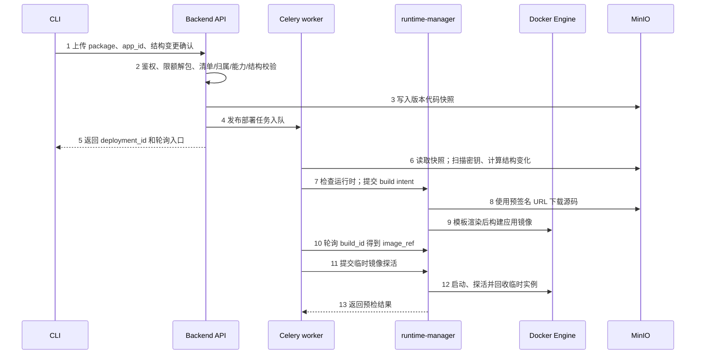
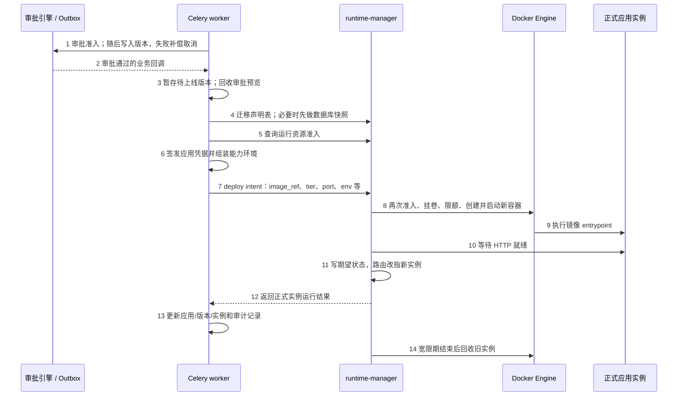
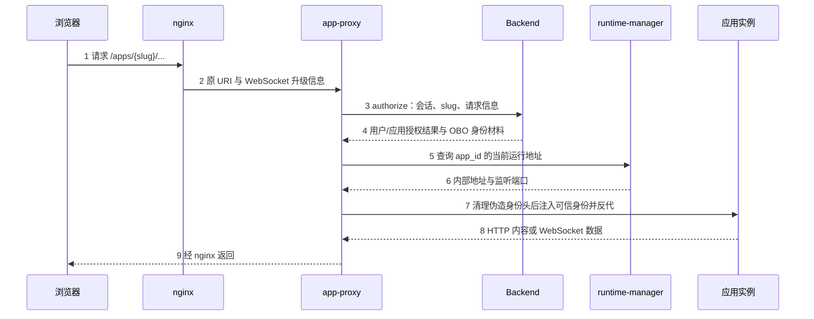
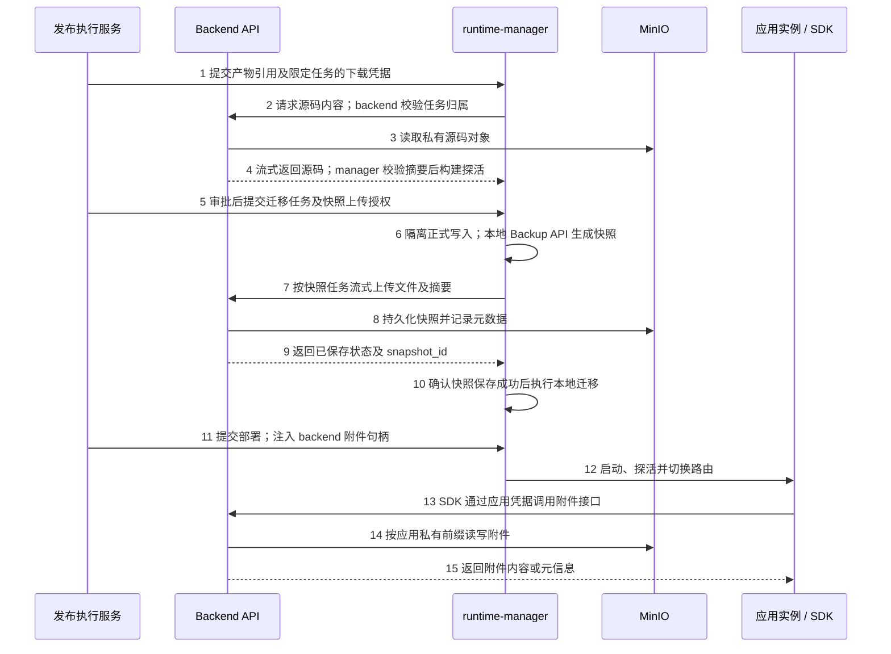
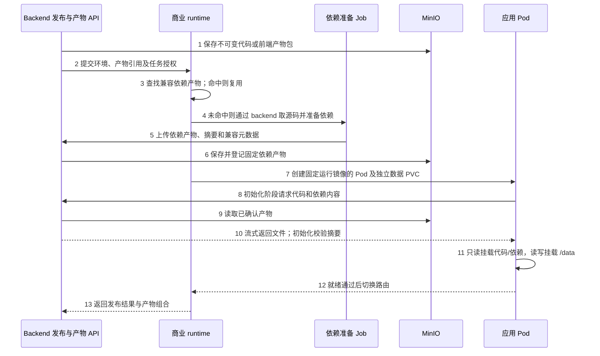
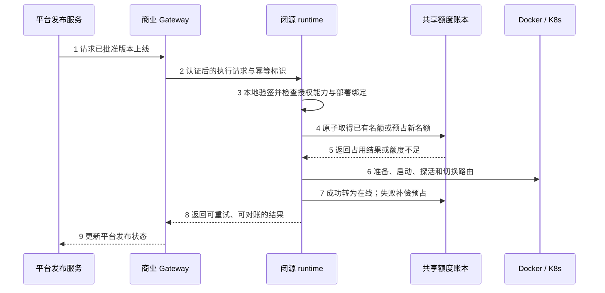

# Vibe 应用托管、发布与商业化技术评审

文档日期：2026-10-15　｜　更新日期：2026-10-16　｜　状态：技术评审稿　｜　读者：架构、研发、交付与商业产品负责人

> **历史参考，已被替代（2026-10-19）：** Vibe 已确定全部按开源实现。本文中的商业授权、“免费同时在线 10 个应用”和闭源 runtime 建议不再作为实施要求；当前有效方案见 [Vibe 应用托管全开源技术方案](vibe-app-open-source-technical-design.html)。下文保留当时的代码核查和讨论记录。

**评审目的：** 说明现有应用托管链路如何工作、现场需要哪些资源，以及哪些能力适合作为商业模块；同时评估“预制运行镜像＋应用包”能否降低离线交付成本。

> **结论口径：** 现有源码发布采用“平台模板构建应用镜像”的 Docker 路线；K8s 仅核实到 F059 规格，不能视为已交付。应用包路线和商业 runtime 均为评审建议。会话已确认“源码包＋完整镜像”双交付意向，以及“免费同时在线 10 个应用、停用释放名额”的商业口径。2026-10-16 进一步确认存储边界：附件接口迁到 backend；manager 保留本地 SQLite 备份、迁移和恢复，通过 backend 接口下载源码、上传快照，不直接访问 MinIO。这些目标能力尚不能按现有代码认定为已实现。

## 阅读导航

- [1. 代码基线、结论与决策状态](#section-1)
- [2. 应用内容、存储与持久化](#section-2)
- [3. 发布上线与访问的实际时序](#section-3)
- [4. 进程职责、接口、参数与环境依赖](#section-4)
- [5. 发布路线与同类产品评审](#section-5)
- [6. 商业化边界与保护方案](#section-6)
- [7. 评审事项、验证场景与实施影响](#section-7)
- [附录 A. 代码证据索引](#appendix-a)
- [附录 B. 官方技术资料](#appendix-b)

<a id="section-1"></a>

## 1. 代码基线、结论与决策状态

### 1.1 本次核查范围

| 对象 | 核查基线 | 使用方式 |
| --- | --- | --- |
| BiSheng 托管实现 | `feat/3.0.0-vibe`，完整提交 `736ef593f3fc6e1634008c842d2604304d6f70a6` | 已用只读远端查询确认分支提交；文中代码链接固定到该提交 |
| 当前工作目录 | `/Users/zhangguoqing/works/bisheng`，工作分支为 `feat/3.0.0-beta3` | 通过 `git show` 读取 vibe 提交，未把 beta3 本地改动当成托管实现 |
| Gateway 授权参考 | 本地 `feat/dsh-access`，提交 `faed249a96ea43a4c65b90765dd4054bf6e55722` | 仅说明所检查源码中的许可证与 DSH 席位机制，不代表远端最新 Gateway |
| 市场与技术资料 | Posit Connect、Modal、Cloud Foundry、Fission、Coolify，以及 Kubernetes、SQLite 官方文档 | 用于解释技术路线与边界，不作为毕昇已经实现这些能力的证据 |

本次完成的是静态源码、部署配置及外部官方资料核查。没有实际运行客户 Docker/K8s 集群、构建离线应用、测试许可证或执行数据恢复。仓库中的部分注释保留早期设计表述，判断以当前调用、参数和部署配置为准。

### 1.2 哪些事实已经成立

| 状态 | 事项 | 对评审的意义 |
| --- | --- | --- |
| 已实现 | CLI 上传源码 `tar.gz`；后端保存 MinIO 快照；Celery 调 manager 构建与探活；审批后发布 | 当前并非“用户给一个镜像就能上线”的接口 [C01] [C06] [C08] |
| 已实现 | manager、app-proxy、egress-proxy、docker-socket-proxy 是四个 Compose 服务 | 逻辑职责、进程和镜像三个概念需区分；egress-proxy 与 manager 使用同一代码镜像的不同入口 [C29] |
| 已实现 | manager 经 socket proxy 访问 Docker Engine API；应用不发布宿主机端口 | manager 镜像不需要 Docker CLI；容器内相同监听端口可以共存 [C10] [C16] [C29] |
| 已实现 | SQLite 位于按应用隔离的宿主机挂载目录；附件和迁移快照可进入 MinIO | 运行数据独立于源码包和应用镜像 [C17] [C21] [C22] |
| 规格约定 | K8s 构建执行体、镜像仓库、RBAC、网络策略、PVC 与离线交付 | 本次未在 runtime 实现中发现对应 K8s 后端；不能直接宣称支持 [C34] |
| 会话已确认 | 同时在线应用数计费；免费 10 个，停用释放；期望支持源码包和完整镜像 | 是目标业务要求，不是当前授权代码事实 |
| 会话已确认，待实现 | 附件接口归 backend；manager 保留本地 SQLite 操作，通过 backend 下载源码、上传快照，不直接访问 MinIO | 存储实现和凭据归平台；目标调用链见 [§3.6](#target-storage)，接口契约仍需设计 |
| 待评审建议 | 默认源码路线改用运行镜像＋应用包；独立闭源 runtime 承担商业编排 | 涉及发布契约、部署执行及授权设计，需评审后再进入实施 |

### 1.3 本文的重点建议

应用形态有限、离线交付普遍时，优先验证“预制运行镜像＋不可变代码包＋可复用依赖环境”，保留用户提供完整应用镜像的模式。复杂系统依赖和高度定制应用仍适合完整镜像。商业价值应落在实际拥有环境准备、部署状态、恢复、路由和配额控制的闭源编排服务，Gateway 提供统一 API 入口。以上均为建议，不替代本次评审决议。

**已确认的存储拆分独立于发布产物路线。** 无论继续构建应用镜像，还是后续采用应用包，backend 都负责附件服务、产物传输和快照存储；manager 只通过平台协议获取源码和提交快照，不持有 MinIO SDK、长期访问密钥、bucket 或对象路径配置。本地 SQLite 一致性备份、结构迁移和恢复仍由 manager 执行；backend 不为此挂载应用磁盘。本文保留基线现状，并将这一目标方案单独标为“已确认，待实现”。

<a id="section-2"></a>

## 2. 应用内容、存储与持久化

### 2.1 当前应用压缩包具体包含什么

应用是可执行的 Web 项目。当前 CLI 把文件制成 `package.tar.gz`，以 multipart 字段 `package` 上传到 `/api/v2/apps/deploy`。包内应包含清单、源码、依赖声明和可解析的启动入口。Python 示例：[C01] [C02] [C03]

```text
leave-helper/
├── bisheng-app.yaml       # 应用元数据、runtime、port、资源档位与能力声明
├── requirements.txt       # Python 依赖，可声明 bisheng-sdk
├── Procfile               # 可选；显式的 web 启动命令
├── main.py                # 应用代码
├── templates/             # 页面模板
└── static/                # 静态资源
```

```yaml
manifest_version: 1
name: 请假知识助手
slug: leave-helper
runtime: python3.11
port: 8080
tier: light
capabilities:
  models: []
  knowledge_bases: []
database:
  tables: []
egress:
  domains: []
```

```text
# Procfile 内容示例；uvicorn 必须在 requirements.txt 中声明
web: uvicorn main:app --host 0.0.0.0 --port $PORT
```

当前清单支持 `manifest_version/name/description/icon/slug/runtime/port/tier/capabilities/database/egress`，未知顶层字段被拒绝；没有用户可直接填写的 `image`、`command`、任意 Dockerfile 或通用环境变量字段。后端接收端支持 `python3.11/node20/static`，异步构建时还会向 manager 复核其模板集合。[C03] [C07]

Node 项目依赖 `package.json` 及实际提供的锁文件；模板安装依赖，存在 build script 时执行 `npm run build`。静态项目提交可直接提供服务的文件，构建时从包根或约定的 `dist/build/public` 中识别包含 `index.html` 的目录。[C09] [C45]

CLI 默认硬排除 `.git`、`node_modules`、虚拟环境和缓存目录；数据库、附件、`dist/build` 默认软排除，可通过 `.bishengignore` 取回需要交付的文件。因此静态项目必须确认构建产物确实进入包；生产 SQLite 数据不应作为源码包交付。打包会规范顺序和元数据，生成可核对的 SHA-256。[C02] [C47]

### 2.2 包大小与安全解包

后端默认限制压缩包 50 MiB、解压后 200 MiB、最多 20,000 个条目；实际值来自部署配置，CLI 通过 `/api/v2/apps/deploy-limits` 获取，不能把默认值当成不可修改的产品限制。后端按流接收和解包，拒绝路径逃逸、链接、设备节点、FIFO 等危险条目。规范包以清单位于根目录为准；后端也兼容仅一层顶级目录的包。[C04] [C05]

### 2.3 六种不同的交付物和运行对象

| 对象 | 例子 | 当前产生方 | 能否直接供浏览器使用 |
| --- | --- | --- | --- |
| 源码归档 | `code.tar.gz` | CLI 打包、后端存储 | 不能；它是构建输入与审批查看依据 |
| 基础运行镜像 | `python:3.11-slim` | 安装交付准备 | 不能；只有语言运行环境，不含具体应用代码 |
| manager 服务镜像 | 包含 `runtime_manager` 的 Python 镜像 | 平台交付 | 运行编排服务，和应用基础镜像不是同一交付物 |
| 完整应用镜像 | `bisheng-app/leave-helper:1-<version前8位>` | manager 通过 Engine 构建 | 要先创建运行容器，再经入口代理访问 |
| 应用容器 | 某个 app/version/generation 的实例 | Docker Engine | 仅内部网络可达，无宿主端口映射 |
| 业务运行数据 | `/data/app.db`、应用附件 | 应用与平台数据服务 | 经应用或受控接口访问，独立于代码版本 |

当前基础镜像映射为 `python:3.11-slim`、`node:20-slim`、`nginx:1.27-alpine`。manager 自身也使用 Python 基础镜像，但不会把自己的编排程序作为用户应用的运行镜像。当前应用镜像标签由 app slug、版本号和版本 ID 派生。[C09] [C16] [C29]

### 2.4 存储位置、访问方与生命周期

**当前基线映射：** 下表描述 `736ef59` 的实际实现；其中 manager 直连对象存储的路径将按后续目标表替换。

| 数据 | 当前位置或路径 | 主要读写进程 | 生命周期与说明 |
| --- | --- | --- | --- |
| 应用、版本、发布尝试、实例、审批元数据 | 平台 MySQL/DM8 对应业务表 | backend、Celery | 保存所有权、权限关联、状态、清单、镜像引用和发布结果；manager 不直接查询这些表 |
| 源码快照 | MinIO 私有桶 `bisheng-apps`：`apps/{app_id}/versions/{version_id}/code.tar.gz` | 后端写入；worker 读取；manager 使用预签名 URL 下载 | 按版本存放；不是浏览器静态站点目录 [C04] |
| 构建工作目录 | `{RTM_DATA_ROOT}/builds/{build_id}` | manager；Engine 消费构建上下文 | 构建结束清理，不是业务数据目录 [C09] [C17] |
| 应用镜像 | manager 连接的 Docker daemon 镜像库 | Docker Engine；manager 发起构建、检查和清理 | 当前单机路径未把应用镜像推入 MinIO 或镜像仓库 [C10] |
| 编排期望状态 | `{RTM_DATA_ROOT}/state/desired-state.json` | manager | JSON 文件，原子替换；包含实例、环境和退休容器信息，不能当普通公开配置分发 [C18] |
| 出站策略 | `{RTM_DATA_ROOT}/egress/` 下策略文件 | manager 写；egress-proxy 读 | 通过文件共享，不通过后端业务表实时查询 [C27] [C28] |
| SQLite 运行库 | 宿主 `{RTM_HOST_DATA_ROOT}/apps/{app_id}/db/` → 容器 `/data` | 应用；manager 的数据库接口与迁移服务 | 数据库为 `/data/app.db`；同时需要目录内 WAL/SHM 等伴随文件可写 [C16] [C17] |
| 数据库迁移快照 | `bisheng-apps`：`apps/{app_id}/db-snapshots/{ts}.tar` | manager | 使用 SQLite backup API 生成一致副本，再打 tar 存储；不是直接复制正在写入的 db 文件 [C21] |
| 应用附件 | `bisheng-apps`：`apps/{app_id}/attachments/{relative_key}` | manager 的附件服务；应用经 SDK 调用 | 应用只持有该 app 的句柄令牌，不拿 MinIO 主凭据 [C22] [C33] |
| 审批预览和预检数据 | 临时容器 `/data` tmpfs | 临时应用进程 | 空的临时数据库，不挂正式库；实例结束即丢弃 [C20] [C44] |

`bisheng-apps` 是所有应用共享、按 app/version/附件前缀隔离的私有桶，不是每个应用一个桶。单独建桶是因为现有平台公共桶存在匿名策略和 nginx 公开转发路径；代码与私有附件不能沿用该暴露面。建桶和访问授权不应依赖“对象路径难猜”。[C04] [C22]

**已确认目标映射，待实现：** 继续复用平台 MinIO 和 `bisheng-apps` 私有桶；bucket 与对象前缀成为 backend 内部实现，不再下发给 manager。当前对象路径可以继续使用；是否调整快照命名和元数据索引在接口设计中确定。

| 数据 | 目标读写链路 | 职责与生命周期 |
| --- | --- | --- |
| 源码及后续代码/依赖产物 | manager 或受控准备任务 → backend 产物接口 → MinIO | backend 校验任务及产物归属、流式返回内容；manager 下载校验摘要后使用，不接收对象存储 URL |
| 应用附件 | 应用 SDK → backend 附件接口 → MinIO | backend 管理应用身份、路径隔离、大小限制、访问审计和数据清理；manager 只注入平台提供的附件句柄 |
| SQLite 迁移快照 | manager 本地 Backup API → backend 快照上传接口 → MinIO | manager 生成一致副本；backend 保存文件和快照元数据，持久化确认后返回 `snapshot_id`；上传未确认则不做破坏性迁移 |
| SQLite 运行库与恢复 | 应用或 manager → 本地数据卷；恢复文件由 backend 接口提供 | `/data/app.db` 及其本地持久化关系保留；backend 不直接打开应用磁盘上的 SQLite 文件 |

停止应用仍保留源码、附件、SQLite 和迁移快照。目标方案的显式删除由 backend 清理或按保留策略处置源码、附件和快照，manager 仅销毁执行体并按明确指令清理本地卷；两侧分别记录结果并重试，存储清理不能成为未受控的跨系统隐式事务。

### 2.5 停用、升级、删除与备份

| 操作 | 代码快照与版本记录 | SQLite | 附件 | 实例 |
| --- | --- | --- | --- | --- |
| 停用应用 | 保留 | 保留 | 保留 | 正式实例停止/回收；后续恢复复用资产 |
| 发布新版本 | 新增冻结快照及版本 | 复用同一应用数据目录，可能执行迁移 | 复用应用附件空间 | 新实例健康后切路由，旧实例宽限退休 |
| 拒绝或撤回发布 | 未上线的发布结果被记录 | 预检/预览临时库不影响正式库 | 不向预览注入正式附件句柄 | 回收相关临时预览 |
| 显式删除应用 | 进入应用删除与发布清理流程 | manager 收到 `purge_volume=true` 才删除应用目录 | manager 清理附件；后端删除钩子负责其他发布资产 | 销毁实例并清理路由/出站主体 |
| 迁移前快照 | 不替代代码快照 | 破坏性迁移前尝试创建一致副本；快照失败则拒绝迁移 | 无直接变化 | 快照本身不是实例 |

删除涉及 backend、发布删除钩子及 manager 的多个动作，不能推断为覆盖数据库、对象存储、磁盘的单一原子事务。失败源码快照另有孤儿清理；镜像保留/清理也有独立规则。恢复程序、保留期限与现场备份策略仍需明确。[C04] [C16] [C21]

上表描述当前行为。按已确认目标，附件和远端快照的保留/删除改由 backend 执行，本地库的备份、迁移、恢复及显式卷清理由 manager 执行；停用释放商业名额不删除任何上述业务数据。

### 2.6 SQLite 在 Docker 与 K8s 中的约束

当前 Docker 形式通过宿主机 bind mount 持久化，不把数据库写入镜像可写层。默认宿主数据根为 `/opt/bisheng/app-data`；manager 容器内一般看到 `/app-data`。`RTM_DATA_ROOT` 是 manager 自身读写视角，`RTM_HOST_DATA_ROOT` 是 Engine 解释 bind mount 的宿主视角，两者必须指向同一份实际数据。[C17] [C29]

**K8s 规格**要求一个应用一个独占数据卷，应用 Pod 重建后复用 PVC。StorageClass 只提供节点本地盘时应标注节点绑定；节点损坏后不能承诺自动无损跨节点恢复。采用可重新挂载的 CSI 块存储、在单节点格式化挂载为文件系统，与把 SQLite 放到 NFS/SMB 共享目录是两回事。SQLite WAL 官方明确不支持网络文件系统上的跨主机协同。[C34] [R07]

**建议**在 CSI 支持时使用 `ReadWriteOncePod`；普通 `ReadWriteOnce` 仅限制节点，同节点仍可能有多个 Pod 同时挂载。SQLite 应用采用受控单活动实例发布，结构迁移时停止或隔离正式写入。审批预览使用临时库或明确生成的副本，不能直接挂正式 PVC。当前 Docker 升级存在新旧容器重叠，不能把建议中的单活动 Pod 当成当前既有保证。[C16] [R08]

代码回滚不会自动逆转数据库 DDL 或恢复已写入的业务行。发布记录需要分别描述代码版本、数据库 schema 版本及快照；恢复生产数据是独立动作，应明确停写、恢复点、数据丢失窗口和操作者。

当前版本记录和镜像保留为诊断、重新上线提供依据，但本次没有据此认定存在完整的任意历史版本一键回滚产品流程。

<a id="section-3"></a>

## 3. 发布上线与访问的实际时序

§3.1—§3.5 保留当前基线的真实调用，§3.6 描述已确认但尚未实现的目标链路；两者不能混读为同一版本的接口。

### 3.1 上传、异步预检与构建

图中 Docker Engine 一列包含经 docker-socket-proxy 转发的 API 调用；proxy 本身不执行业务编排。



| 步骤 | 实际执行方与动作 | 参数或数据 | 失败时的结果 |
| --- | --- | --- | --- |
| 1 | CLI 检查文件、执行排除规则、生成 tar.gz 和摘要，先查部署大小限制 | `package`、可选 `app_id`、`confirm_schema_change` | 本地打包错误不上传；上传前检查不能替代服务端校验 |
| 2 | `/api/v2` 统一密钥鉴权链校验凭据、scope 和模式，再检查 runtime 开关 | 发布接口 scope 为 `app:manage`，模式限定 `S`；资源归属按凭据关联的自然人判断 | 身份、scope、模式、运行层、归属或清单错误在同步请求返回 |
| 3 | 后端按流临时落盘、安全解包；解析清单、资源档位、能力引用和结构变更确认 | 版本 ID 在接收时预分配；冻结 manifest、tier 和快照键 | 校验失败不进入慢构建；跨系统失败需靠清理/补偿处理 |
| 4 | 后端写 MinIO 快照及 `app_deployment`，审计后发送 Celery 默认队列任务 | `deployment_id` 随任务传递；租户上下文随任务链传递 | 入队/worker 故障影响后续进度，CLI 上传成功不代表已构建或上线 |
| 5 | API 返回接收结果，CLI 持续查询发布状态 | `GET /api/v2/apps/deployments/{deployment_id}` | 审批可能长时间等待，不能用一个长 HTTP 请求覆盖全过程 |
| 6 | worker 重新取源码，按当前顺序执行扫描、结构预检、构建、启动预检 | `secret_scan → precheck_schema → precheck_build → precheck_probe` | 某阶段失败记录阶段、原因、日志摘要；未进入审批 |
| 7 | worker 查询 manager 支持 runtime，生成源码短期预签名 URL 并提交构建 | `app_id/version_id/runtime/port/code_url/code_object_key/slug/version_no` | 不可达、runtime 不支持、构建容量不足分别返回可定位原因 |
| 8 | manager 后台线程检查构建资源、下载解包、识别源码特征、渲染平台模板 | 基础镜像由 runtime 映射；依赖源来自 RTM 配置 | 下载失败与模板失败属于不同构建阶段 |
| 9 | manager 经 Engine API 构建，生成版本标签，返回构建日志状态 | Python 安装 requirements；Node 安装并按需 build；静态文件装入 nginx 镜像 | 依赖解析、编译、网络阻断或 Engine 错误使 build 失败 |
| 10 | worker 轮询得到 `image_ref`，再提交独立的镜像探活 | 端口、路径、基路径环境；探活默认路径为 `/` | 临时实例使用 tmpfs，无正式卷；失败时保存日志摘要并清理容器 |

依据：[C01] [C02] [C04] [C06] [C07] [C08] [C09] [C41] [C44]。

### 3.2 审批、版本入库与上线

> **实际顺序修正：** 构建和探活通过后，版本服务先提交审批准入，再插入版本记录；若版本插入失败，会尝试取消刚建立的审批。业务上可合称“记录版本并进入审批”，但实现不是“版本先入库、再发审批”的简单顺序。[C37]



审批及业务状态逻辑主要在平台后端执行，图中“审批引擎 / Outbox”是逻辑角色，不表示额外交付了一个独立审批容器。上线与预检可在 Celery worker 内执行同一套后端领域服务。[C14] [C15]

审批通过首先把版本标记为待上线并回收审批预览。如果应用已经被主动停用，回调只暂存版本，不擅自恢复；以后恢复应用时采用待上线版本并补做迁移。其余上线路径先调用表结构迁移，再做资源准入和启动。资源 tier 来自平台表，传到 manager 后表示为 vCPU 与 MiB。[C14] [C15] [C21]

manager 再次进行容量校验，准备 `/data`、文件所有权、附件令牌和出站策略；随后调用容器 create/start。容器由镜像内 entrypoint 选择业务命令，manager 的 deploy 请求没有单独的 `command` 字段。应用通过就绪检查后，manager 写入新实例期望状态，代理后续路由查询得到新地址；默认 30 秒宽限后退休旧实例。后端收到成功结果后才更新平台应用和版本状态。[C08] [C12] [C13] [C16] [C17]

**需要评审的事务边界：** 数据库迁移早于资源准入和实例启动；迁移已成功但后续容量或启动失败时，数据库可能已经变化。manager 路由切换与后端数据库状态更新也不是同一事务。当前代码没有据此自动承诺数据库回滚、发布全局原子性或零停机，需要设计兼容性迁移与对账。[C14] [C15] [C16]

应用能力凭据也存在切换边界：后端在调用 deploy 前重签应用令牌，凭据服务先撤销旧令牌再签发新令牌。如果候选容器随后启动失败，旧容器保留并不意味着它持有的旧令牌仍能调用平台能力。此处需要验证失败补偿或凭据双阶段切换，不能把“旧实例未删除”写成“旧版本完全不受影响”。[C36] [C48]

### 3.3 不同场景的结果

| 场景 | 当前行为或边界 |
| --- | --- |
| 首次发布 | 建立应用草稿；预检全部通过、审批准入及版本入库后等待审批；审批成功再尝试上线 |
| 在线应用更新 | 使用新镜像启动候选实例，健康后换路由；新实例启动失败时保留旧实例和在线状态，但不能据此断言数据库或能力凭据从未变化 |
| 首次上线资源不足 | 保留待上线版本，进入容量等待结果；人工重试不创建第二轮审批 |
| 已在线应用更新资源不足 | 旧应用保持在线；本次新版本未上线，不能把整个应用描述为停服 |
| 预检失败 | 发布尝试失败、保留可诊断阶段与日志；不进入业务审批 |
| 审批拒绝/撤回/终止 | 新版本不生效，回收对应临时预览；在线旧版本按已有状态继续 |
| 审批通过时应用已停用 | 仅暂存待运行版本，恢复时才启动，不自动占回用户已释放的运行资源 |
| 审批预览 | 独立临时实例、`/data` tmpfs、独立出站主体、无正式附件句柄；当前不是自动复制生产数据库的预览 |
| 停用/恢复 | 停用保留代码、SQLite 和附件；恢复重新检查资源，采用 pending/current 版本 |
| runtime 进程重启 | 读取本地期望状态，结合管理标签接管受管实例；持续对账，避免误清理同机其他容器 |

“商业额度释放”是目标方案，应在确认执行状态与入口失效后完成，不能直接等同于现有后端 `state=stopped` 写入。当前 stop 先写应用状态，再调用 manager，编排 RPC 失败仍可能需要补偿/对账。[C14] [C15] [C19] [C20] [C43]

### 3.4 浏览器访问与身份注入



后端判定运行层是否启用、会话、用户/租户状态、应用状态以及 OpenFGA `app:use` 权限；它不把容器地址作为授权结果返回。app-proxy 独立向 manager 取得路由，分别缓存授权与路由（默认短缓存约 3 秒），并处理入口前缀、可信身份头及 HTTP/WebSocket 转发。WebSocket 不是只握手一次就永久放行，还存在重校验与最大存活时间约束。[C24] [C25] [C26] [C30]

所有应用可监听容器内 `8080`，实际连接目标是各容器内部地址与端口。当前 `PortBindings={}` 且 `PublishAllPorts=false`，不需要每个应用对外分配一个宿主端口；对外仍复用 `/apps/{slug}`。K8s 对应目标是经受控 Service/Pod 网络转发，具体实现尚未落地。[C16] [C34]

### 3.5 应用访问毕昇能力

| 能力 | 应用侧调用与身份 | 平台侧处理方 |
| --- | --- | --- |
| 当前访问者 | `bisheng_sdk.auth.current_user()` 从当前请求上下文读取平台注入头 | app-proxy 注入；后端先完成身份和入口权限判定 |
| 知识检索 | SDK 调 `POST /api/v2/filelib/retrieve`；应用运行凭据＋`X-BiSheng-Access-Token` | 后端根据应用声明和访问者权限共同判定；无访问者不能退化成应用所有者 |
| 模型 | OpenAI 兼容客户端读取 `OPENAI_BASE_URL/OPENAI_API_KEY`；请求按平台能力接线携带访问者信息 | 后端开放模型面及能力策略；模型调用不由 SDK 包装 |
| 附件 | SDK 读取 `BISHENG_APP_STORAGE_ENDPOINT/TOKEN`，调用 manager 的每应用存储 API | manager 校验应用令牌和路径，将请求映射到 MinIO 私有前缀 |
| SQLite | 标准 sqlite 库读取 `BISHENG_APP_DB_PATH/URL` | 应用直接操作挂载的数据文件；不是每次通过后端 HTTP 执行 SQL |
| 出站 HTTP/HTTPS | 使用注入的 HTTP/HTTPS 代理及出站令牌 | egress-proxy 根据 manager 写入的策略校验目标并转发 |

SDK 安装在声明该依赖的应用镜像/环境里；manager 不 import `bisheng-sdk` 执行业务。SDK wheel 从后端 `/api/v1/dev-toolkit/simple/` 分发。manager 只负责构建时接通索引、运行时注入句柄；Java 重写 manager 不意味着必须把应用 Python SDK 也改写为 Java。[C31] [C32] [C33] [C36] [C42]

<a id="target-storage"></a>

### 3.6 已确认目标：通过 backend 传输源码、附件和快照

**状态：2026-10-16 会话确认，待实现；下图是目标时序，不是 `736ef59` 的交付事实。** 上传、扫描、审批和入口鉴权仍承接前述业务流程；与存储有关的执行路径改为下图。图中的“发布执行服务”可运行在 backend/Celery，backend API 接收 manager 的文件请求。



1. **源码下载：** 平台保存不可变源码并建立产物引用；manager 只接收 `artifact_id`、预期摘要、大小和受控 backend 下载入口。backend 返回文件内容，不能以 302 或响应字段把调用者引向 MinIO 预签名地址。源码、后续依赖产物和初始化下载均遵守这一边界。
2. **附件：** SDK 直接调用 backend；backend 从可信应用凭据确定应用和租户，校验操作与相对路径后访问私有对象。manager 不再接收附件流量，也不在本地期望状态中承担附件令牌的权威校验。预览不获得正式附件权限，采用隔离临时空间或保持现有本地临时模式。
3. **本地备份与迁移：** manager 取得该应用的迁移独占权，停止或隔离所有正式写入者，使用 SQLite Backup API 生成一致快照。由 manager 执行本地文件操作，backend 不挂应用数据卷；不能把正在写入的 `app.db` 直接打包代替一致性备份。
4. **持久确认：** manager 通过 backend 上传快照，backend 校验任务、大小及内容摘要，将对象和对应元数据保存成功后才返回“已保存”。破坏性 DDL 必须等到该确认；上传失败或结果不明时先查询任务状态、幂等重试，不推断为成功，也不继续迁移。首次发布且尚无数据库时无需制造空快照，但仍须验证上传通道前置。
5. **部署与恢复：** 快照、迁移与实例启动各自记录结果；快照成功不代表迁移或上线成功。恢复由 backend 完成业务授权并提供指定快照文件，manager 停止写入、下载校验、恢复本地库并验证后再启动。代码回滚不自动触发数据库恢复。

文件上传/下载应采用流式传输与有界缓存；临时快照只在持久化已确认或任务明确取消后清理，异常任务按策略回收。backend 与 manager 通过持久任务状态协调，避免 backend 同步请求占满执行资源后，又等待 manager 回调同一服务上传快照。快照失败不执行破坏性迁移，但隔离写入后的恢复服务和失败补偿仍需明确定义。

该方案将存储实现和长期凭据归入平台，商业 runtime 依赖版本化平台 API；接口可达性、超时、认证与版本兼容仍是部署前置，并非取消所有平台依赖。

<a id="section-4"></a>

## 4. 进程职责、接口、参数与环境依赖

### 4.1 进程与资源访问矩阵

**当前基线：** 本表保留已核查代码的职责；目标方案的资源边界见其后表格。

| 进程或组件 | 负责的业务 | 直接使用的数据/第三方接口 | 主要边界 |
| --- | --- | --- | --- |
| CLI | 本地打包、上传、跟踪发布和日志 | 文件系统、平台 Open API | 不直接创建客户容器；本地可用 git 优化忽略规则，但不是 manager 的运行依赖 |
| Backend API | 鉴权、所有权、清单接收、状态动作、入口授权、数据操作的业务授权 | SQL、Redis、OpenFGA、MinIO、manager HTTP API | 不挂 Docker socket，不直接调用容器编排 SDK |
| Celery worker | 扫描、预检、版本/审批与 outbox 业务执行 | 与后端共享配置及业务数据；MinIO；manager API | 长耗时阶段不放在上传请求内等待 |
| runtime-manager | 构建、资源准入、执行生命周期、对账、路由、预览、日志、附件、SQLite 数据面 | Docker API 经 socket proxy；本地文件/SQLite；MinIO；源码预签名 URL；应用 HTTP 探活 | 不直接读平台 MySQL/DM8 或 OpenFGA；也不读取 backend 的 config.yaml |
| app-proxy | 浏览器应用入口、可信头注入、HTTP/WS 反代 | 后端 authorize API；manager route API；应用 HTTP/WS；本地短缓存 | 不构建镜像、不持编排权限、不直接操作 MinIO/SQLite |
| egress-proxy | 应用与构建网络的 HTTP/CONNECT 目标控制 | 共享策略文件、DNS、允许的目标网络 | 独立入口进程；不提供 manager intent API，不分发业务权限 |
| docker-socket-proxy | 对 Docker API 端点做转发限制 | 宿主 `/var/run/docker.sock` | 当前 Compose 唯一直接持 socket 的组件；不是配额服务，也不理解 app_id |
| 应用容器 | 执行业务代码、提供页面/API、使用 SQLite 和平台能力 | 自身 `/data`；平台 API；附件句柄；受控外部接口 | 不持 MinIO 主凭据、Docker socket 或集群 API 凭据 |
| BiSheng SDK | 应用侧身份上下文、检索及附件 API 封装 | 应用请求头、环境变量、后端检索 API、manager 附件 API | 是应用内库，不是额外常驻服务 |

依据：[C23] [C24] [C27] [C28] [C29] [C31] [C38]。

**已确认目标，待实现：**

| 进程或组件 | 目标职责 | 直接访问的资源 | 配置与权限边界 |
| --- | --- | --- | --- |
| Backend API / Celery | 产物接收与分发、附件服务、快照登记/保存/清理、应用/租户鉴权和审计；发起发布及迁移任务 | 平台数据库、Redis、OpenFGA、MinIO；manager 受控 API | 持有平台存储配置和应用附件凭据的校验规则；不挂应用磁盘或 Docker socket |
| runtime-manager | 构建/依赖准备编排、准入、实例生命周期、路由、自愈；本地 SQLite 备份、迁移和恢复 | Engine API 或后续 K8s API；本地文件/SQLite；backend 产物/快照接口；应用探活 | 不使用 MinIO SDK、长期密钥、bucket 或对象 key；通过任务授权获取/提交文件 |
| 应用 / SDK | 业务代码、SQLite 访问及平台能力调用 | 自身 `/data`；backend 附件/能力接口；受控出站路径 | 附件不经 manager；应用拿应用范围句柄，不拿快照上传授权或存储主凭据 |
| 构建、准备及初始化执行体 | 在限定任务内准备或获取固定产物 | backend 产物接口、批准的包源/工具链、临时卷 | 下载或上传凭据绑定当前任务和产物，不共享 manager 的全局管理凭据，不直连 MinIO |

app-proxy 的入口授权/路由查询、egress-proxy 的出站控制与 socket proxy 的 Engine 转发分别按既有职责接入新边界。它们不接管应用附件或远端快照存储。

### 4.2 manager 的功能与实际前置条件

| 功能 | 当前实现要做的事 | 必要条件 |
| --- | --- | --- |
| 镜像构建 | 检查资源、下载代码、渲染模板、传递 pip/npm/代理参数、调用 Engine build、跟踪日志与结果、清理上下文 | 支持 runtime 的模板、基础镜像、Engine build API、临时磁盘、构建期依赖源 |
| 资源准入 | 检查宿主可用内存减保留量；检查存活实例承诺的 CPU/内存总量 | 可读 `/proc/meminfo`、CPU 信息、本地期望状态；这是资源容量，不是许可证额度 |
| 上线/更新 | 生成实例名、注入环境、准备数据卷、建立出站主体、create/start、探活、更新路由、旧实例退休 | Engine 生命周期 API；应用内部网络；数据目录读写及所有权可用 |
| 停用/删除 | 停止正式/退休实例、更新期望状态；显式清理数据及附件 | 可达 Engine、可写状态目录、删除时可达 MinIO |
| 探活 | 启动临时镜像或检查正式应用；HTTP 就绪、日志读取及回收 | manager 能访问应用 bridge 地址；应用监听 `0.0.0.0` 和声明端口 |
| 对账/自愈 | 重启时从状态与管理标签恢复；修复受管实例、出站漂移、退休和过期预览 | Engine inspect/list；持久状态目录；仅操作平台管理标签范围 |
| 路由/状态/日志 | 从真实实例与期望记录返回当前地址、健康、版本及日志 | manager HTTP API 可达；平台/代理 HMAC 一致；日志受长度和保留限制 |
| 审批预览 | 独立临时实例、空临时数据库、超时回收、禁止正式附件访问 | 镜像已构建；临时资源容量；预览会话/授权由后端提供 |
| 附件服务 | 每应用令牌鉴权、路径校验、大小限制、对象存取和隔离 | MinIO RTM 配置、私有桶；应用可达 manager 的 app-facing 地址 |
| SQLite 管理 | 表/结构/行查询、更新/导出、声明式迁移、破坏性迁移前 backup API 快照 | 可达数据库文件；文件权限/锁可用；快照 MinIO 可用；业务权限由后端先校验 |

依据：[C09] [C16] [C19] [C20] [C21] [C22] [C39] [C46]。

**目标职责调整：** 上表“附件服务”从 manager 移除；“镜像构建”的源码获取改为 backend 下载接口；“SQLite 管理”保留本地执行，但快照保存改为向 backend 上传并等待持久确认。停用/删除只清理执行体、状态和明确要求删除的本地卷，远端附件/产物/快照由 backend 处理。manager 自检相应检查平台文件接口、任务认证和本地备份条件，不再检查 MinIO 账号或 bucket。其余构建、探活和恢复能力仍受 Engine、磁盘、包源及网络条件约束。

### 4.3 关键接口与参数来源

| 接口 | 调用方 → 被调用方 | 关键参数 | 参数归属与校验 |
| --- | --- | --- | --- |
| `POST /api/v2/apps/deploy` | CLI → backend | multipart `package/app_id/confirm_schema_change` | 用户提交；后端按凭据、租户、资源所有权和清单检查 |
| `GET /api/v2/apps/deployments/{id}` | CLI → backend | `deployment_id` | 平台查询发布过程，返回阶段与原因，不等于直接查询 Docker |
| `POST /v1/intents/build` | worker → manager | `app_id/version_id/runtime/code_url/code_object_key/slug/version_no/port/build_args` | ID 与源码 URL 由后端生成；模板和受保护代理参数由 manager 控制 |
| `GET /v1/builds/{id}` | worker → manager | `build_id` | manager 返回 `status/stage/message/tail/image_ref`；构建记录是进程内状态 |
| `POST /v1/intents/probe` | worker → manager | `image_ref` 或 `app_id`、`port/health/env/timeout` | 临时镜像探活和正式应用探活是不同输入形态 |
| `POST /v1/admission` | 后端服务 → manager | `purpose=run/build`、可选 tier | CPU 为 vCPU、mem 为 MiB；输出准入判定和宿主快照 |
| `POST /v1/intents/db-migrate` | 上线领域服务 → manager | `app_id/plan/snapshot` | 后端按清单差异形成迁移；manager 校验操作并执行/快照 |
| `POST /v1/intents/deploy` | 上线领域服务 → manager | `image_ref/tier/port/env/health/platform_api_base/base_path/egress_domains` 等 | 后端提供冻结版本意图；manager 控制容器安全参数和保留环境 |
| `POST /v1/intents/stop`、`/destroy` | 后端 → manager | `app_id`；destroy 增加 `purge_volume` | 应用动作先经后端权限；删除数据必须显式指定 |
| `POST /v1/intents/preview`、`/preview/stop` | 预览服务 → manager | `session_id/app_id/version_id/image_ref/tier/expires_at` 等 | 后端校验审批参与资格；manager 执行临时实例生命周期 |
| `POST /api/v1/internal/app-proxy/authorize` | app-proxy → backend | slug、会话/访问上下文 | 业务鉴权；另有 authorize-preview，不复用一个含糊开关 |
| `GET /v1/apps/{app_id}/route` | app-proxy → manager | `app_id` | manager 返回路由事实；不代替后端 `app:use` 权限 |
| `/v1/apps/{app_id}/storage/...` | 应用 SDK → manager | 应用令牌、相对路径与内容 | 每 app Bearer 句柄，和后端 HMAC 管理接口是两套凭据 |
| `/v1/apps/{app_id}/db/...` | 后端数据服务 → manager | 表、行键、分页/变更 | manager 接口用内部 HMAC；实际用户操作授权在后端 |

以上均为当前已检查接口，不是完整 OpenAPI 文档。manager `/healthz` 是明确的免 HMAC 存活检查；不能由 healthz 成功推断 Docker、MinIO 或部署前置全部可用。[C08] [C23] [C24] [C35] [C38] [C41] [C46]

下面两个 JSON 是**当前基线**中后端向 manager 发送的脱敏意图示例。`code_url` 必须能从 manager 下载；它不是应用运行期间使用的地址。JSON 字段以代码契约为准，示例值不代表现场默认值；其中 MinIO 预签名 URL 和 `code_object_key` 不属于目标存储协议。

```json
{
  "app_id": "app-example",
  "version_id": "a1b2c3d4e5f647809abcdef0123456789",
  "runtime": "python3.11",
  "slug": "leave-helper",
  "version_no": 1,
  "port": 8080,
  "code_object_key": "apps/app-example/versions/a1b2c3d4e5f647809abcdef0123456789/code.tar.gz",
  "code_url": "https://minio.example.internal/bisheng-apps/...<presigned>",
  "build_args": {}
}
```

```json
{
  "app_id": "app-example",
  "slug": "leave-helper",
  "version_id": "a1b2c3d4e5f647809abcdef0123456789",
  "version_no": 1,
  "image_ref": "bisheng-app/leave-helper:1-a1b2c3d4",
  "tier": {"cpu": 0.5, "mem": 1024},
  "port": 8080,
  "env": {"BISHENG_APP_TOKEN": "<redacted>"},
  "health": {"path": "/", "interval": 10, "timeout": 3, "retries": 3},
  "platform_api_base": "https://bisheng.example.internal",
  "base_path": "/apps/leave-helper",
  "egress_domains": []
}
```

**目标接口草案：** 下表路径和字段仅用于表达职责与协议设计范围，尚未实现或冻结；内部传输 API 不直接复用面向自然人会话的登录态。

| 拟议接口 | 调用方 → 被调用方 | 参数产生、校验与消费 |
| --- | --- | --- |
| `GET /api/v1/internal/app-runtime/artifacts/{artifact_id}/content` | manager / 准备任务 → backend | backend 建立产物、预期摘要和大小，签发下载任务授权；backend 验证 app/版本/任务范围；消费方流式下载并校验，不接收 bucket/key 或 MinIO URL |
| `PUT /api/v1/internal/app-runtime/snapshots/{snapshot_id}/content` | manager → backend | backend 分配快照任务及幂等标识；manager 提交一致快照内容、大小及摘要；backend 校验归属和上传范围，持久保存后返回已确认结果 |
| `GET /api/v1/internal/app-runtime/snapshots/{snapshot_id}` | manager / 发布任务 → backend | 通过同一快照 ID 查询 `pending/stored/failed` 等建议状态及摘要；用于响应丢失后的对账，不凭 HTTP 超时判断对象不存在 |
| `GET /api/v1/internal/app-runtime/snapshots/{snapshot_id}/content` | manager → backend | backend 校验已获授权的恢复任务和目标应用；manager 下载、校验摘要后执行受控本地恢复 |
| `/api/v2/apps/{app_id}/storage/...` | 应用 SDK → backend | backend 签发并校验应用范围附件句柄，根据可信应用身份解析租户和相对路径；不能让调用者任意指定 bucket、完整对象 key 或其他应用 |

目标迁移任务可以携带如下产物和上传描述；字段是设计示例，不能当作现有 manager schema 发送。任务授权应通过认证头传递，不置于 URL 查询串，不下发应用容器，也不作为长期期望状态或日志内容保存。

```json
{
  "deployment_id": "dep-example",
  "app_id": "app-example",
  "source": {
    "artifact_id": "artifact-example",
    "download_url": "https://bisheng.example.internal/api/v1/internal/app-runtime/artifacts/artifact-example/content",
    "sha256": "<expected-sha256>",
    "size_bytes": 1048576
  },
  "snapshot_upload": {
    "snapshot_id": "snapshot-example",
    "upload_url": "https://bisheng.example.internal/api/v1/internal/app-runtime/snapshots/snapshot-example/content",
    "idempotency_key": "dep-example:before-migrate"
  }
}
```

认证应同时考虑服务身份与任务授权：manager 调平台文件接口使用受控服务身份，下载/上传权限绑定 app、版本、任务、操作、有效期和幂等键；准备/初始化执行体仅获得最小任务授权。签发方和 backend 校验方属于平台，manager 只消费授权。当前 HMAC 的字段与防重放限制见 §6.5，不能默认原接口已经具备这里的任务约束。

SDK 的 `BISHENG_APP_STORAGE_ENDPOINT/TOKEN` 使用方式应保持兼容，但服务端归属迁到 backend；当前 SDK 解析 manager 错误信封、附件令牌又在 manager 期望状态中校验，因此迁移需提供兼容 API 适配或同步升级 SDK，不能只替换 URL。应用令牌轮换、停用/删除后的拒绝策略和预览隔离由 backend 统一定义并验证。[C22] [C33]

### 4.4 配置归属与应用注入变量

**当前基线配置：**

| 配置组 | 读取进程 | 关键配置和要求 |
| --- | --- | --- |
| 后端运行层 | backend、Celery | `app_runtime.enabled`；`manager_base_url/manager_hmac_secret`；`proxy_hmac_secret`；独立 `obo_secret`；入口地址、包大小、预览 TTL |
| 后端开放能力 | backend、Celery | `open_platform.enabled` 与 Open API scope 可用性；`open_api.public_base_url`、`app_runtime.entry_base_url` 等对外地址应可被应用实际访问 |
| manager 服务 | manager | `RTM_HOST/PORT/HMAC_SECRET`；`RTM_DOCKER_HOST`；`RTM_DATA_ROOT/RTM_HOST_DATA_ROOT`；容量、探活及对账参数 |
| manager 构建 | manager、构建容器 | `RTM_BUILD_INDEX_URL`、可信主机、`RTM_BUILD_NPM_REGISTRY`、`RTM_BUILD_EXTRA_INDEX_URL`；基础镜像和构建代理/网络 |
| manager 对象存储 | manager | `RTM_MINIO_ENDPOINT/ACCESS_KEY/SECRET_KEY`、`RTM_STORAGE_BUCKET`；应用可达的 `RTM_APP_FACING_BASE_URL` |
| app-proxy | app-proxy | `APP_PROXY_BACKEND_BASE/SECRET`、`APP_PROXY_MANAGER_BASE/SECRET`；它们分别对应后端入口授权和 manager 路由 |
| egress | manager 写策略；egress-proxy 读策略 | `RTM_EGRESS_PROXY`、`RTM_PLATFORM_BASE_URL`、构建/运行允许目标、internal 网络和需要的宿主防火墙前置 |

容量、构建源及 manager 数据根不从后端 YAML 自动继承。后端 AppRuntimeConf 对历史遗留同名配置会告警并指出对应 RTM 环境变量。manager 获取源码只需要短期 URL，但附件读写和 SQLite 快照上传由它直接访问 MinIO，因此还要向 manager 进程注入 `RTM_MINIO_ENDPOINT/ACCESS_KEY/SECRET_KEY` 和 `RTM_STORAGE_BUCKET`；这些配置不会从后端配置自动读取。[C05] [C07] [C17] [C21] [C22] [C29]

这里的“单独配置”指进程需要收到连接参数，不要求另建 MinIO 实例，也不要求另建 manager 专用桶。当前 Compose 指向平台已有的 `minio:9000`，使用共享私有桶 `bisheng-apps`；源码、附件和 SQLite 快照按对象前缀区分。它们共用这一私有桶，区别于平台已有的 `bisheng` 公共用途桶。生产环境可为 manager 分配权限受限的独立访问凭据，但“独立凭据”不等于“独立实例或独立桶”，也不是当前代码强制的条件。[C04] [C17] [C21] [C22] [C29]

**已确认目标配置：** 下列变更应随接口迁移落地，不应仅删除环境变量而保留当前直连代码。

| 配置或凭据 | 目标归属 | manager 需要接收的内容 |
| --- | --- | --- |
| MinIO endpoint、TLS、访问密钥、bucket、对象路径与保留策略 | backend / 平台存储模块 | 无；删除 manager 的 `RTM_MINIO_*`、`RTM_STORAGE_BUCKET` 配置和 MinIO SDK 依赖 |
| 平台产物/快照传输入口 | backend 提供，部署配置指定 manager 可达地址 | 平台内部服务基址、TLS 信任、请求超时和受控服务身份；具体新增配置名待设计 |
| 下载与快照上传任务授权 | backend 签发和校验 | 限定任务的短期授权、产物/快照引用、摘要和幂等标识；与应用附件凭据分离 |
| 应用附件 endpoint/token/max file | backend 附件服务与应用凭据模块 | 随受控 deploy intent 传入的应用句柄，manager 注入 `BISHENG_APP_STORAGE_*`；backend 为令牌校验权威 |
| 本地 SQLite 与构建/编排参数 | manager | 数据根、宿主卷路径、备份临时目录、迁移独占控制，以及已有 Engine/容量/探活/构建源配置 |

`RTM_APP_FACING_BASE_URL` 当前用于应用访问 manager 附件接口；附件迁出后需删除这一用途并检查是否仍有其他调用方，再决定移除该变量。内部服务调用的 HMAC/服务身份、应用主体凭据、文件传输任务授权和访问者 OBO 各有作用域，不应复用一把高权限密钥。

下表描述当前变量及来源；目标差异在附件行单独标注。

| 应用可见变量/请求头 | 来源 | 用途与边界 |
| --- | --- | --- |
| `PORT/BISHENG_APP_PORT` | 清单 port 经 manager 注入 | 应用需监听正确端口与 `0.0.0.0` |
| `BISHENG_APP_ID/SLUG/VERSION/VERSION_ID/BASE_PATH` | 后端版本意图＋manager | 识别应用与访问路径；保留变量由平台覆盖 |
| `BISHENG_APP_DB_PATH/URL` | manager | 固定指向 `/data/app.db` 与 SQLite URL |
| `BISHENG_PLATFORM_API_BASE` | 部署意图经 manager 注入 | SDK 平台 API 地址；不能填写构建容器不可达的 localhost |
| `BISHENG_APP_STORAGE_ENDPOINT/TOKEN/MAX_FILE_MB` | 当前 manager 生成；目标由 backend 提供、manager 注入 | 当前指向 manager，目标指向 backend 本 app 附件 API；不暴露 MinIO 主凭据；当前令牌校验不能直接沿用为平台权威 |
| `BISHENG_APP_TOKEN` | 后端能力凭据服务 | 应用主体凭据；更新时可能重签，不应等同于访客登录态 |
| `OPENAI_BASE_URL/OPENAI_API_KEY` | 后端能力注入 | 声明模型能力时设置；地址缺失可能导致容器能启动但模型调用失败 |
| `HTTP_PROXY/HTTPS_PROXY` 等 | manager | 出站路径与主体；依赖客户端应实际使用代理 |
| `X-BiSheng-*`、`X-BiSheng-Access-Token` | app-proxy 按请求注入 | 访问者身份、app_id、请求关联与 OBO；应用不能据自身凭据猜测访客身份 |

当前 Python entrypoint 支持参数、`BISHENG_APP_START`、`Procfile web:`、`main.py/app.py` 的解析优先级，但托管发布没有让开发者设置 `BISHENG_APP_START` 的通路；实际应提交 Procfile 或约定入口。Node 还支持 `package.json` 的 start/main 和默认 JS 文件。静态 runtime 直接运行平台 nginx。入口约定本身也是托管契约，不能只描述“传一个 command”。[C12] [C13] [C31]

### 4.5 Docker 和 K8s 的前置条件比较

| 条件 | 当前 Docker 实现 | K8s 镜像构建路线：规格/待实现 | 应用包路线：评审建议 |
| --- | --- | --- | --- |
| 执行引擎 | 可达的 Docker Engine；socket proxy 放行 build/container/image/network 所需 API | 可用 K8s API、合适容器运行时；不能假设节点有 dockerd | 同样需要 K8s API，但源码发布可免 OCI 镜像构建 |
| Docker CLI | manager 不需要；它使用 Python Docker SDK 调 Engine HTTP API | manager 和节点不必为应用发布安装 docker build 命令 | 不要求；准备依赖/静态资源可由普通受限 Job 完成 |
| 容器镜像构建 | Engine 构建，依赖宿主 daemon | K8s 本身不提供源码转镜像；需额外交付构建器、资源/超时/并发治理 | 一般应用准备代码和依赖包；OS/运行时变化仍要制作运行镜像 |
| 镜像分发 | 构建和启动使用同一 daemon 的镜像库；无需单机应用仓库 | 所有工作节点可拉应用镜像；客户仓库或附带最小 Registry | 少量固定运行/初始化镜像可预装节点或从内网仓库获取；每次应用包发布不必入镜像仓库 |
| 依赖与编译 | Python/npm 源、原生库/编译工具必须满足模板构建 | 构建 Pod 可达的包源、基础镜像、凭据与网络策略 | 依赖准备仍需源或离线包，产物应匹配运行时/ABI/架构 |
| 权限 | manager 控制 Engine API、数据目录；proxy 持 socket | 专用 namespace、ServiceAccount、RBAC；不把集群凭据给应用 | 同左；准备 Job 也不自动挂业务无关集群凭据 |
| 网络 | 默认网、`bisheng-apps` 应用网、`bisheng-build` 构建网、出口代理及实际生效的底层限制 | CNI/NetworkPolicy 可用并验证；构建/应用目标分开控制 | 初始化下载访问 backend 产物接口，任务凭据不扩散给业务代码；manager/准备任务不直连 MinIO |
| SQLite | 宿主按 app bind mount；manager 需文件读写及所有权操作 | 专用 PVC、合适 StorageClass、单实例及迁移隔离 | 数据 PVC 与临时代码/依赖卷分开；Pod 重建重新取固定版本包 |
| 运行层安装 | Compose `app-runtime` profile 和后端开关配套 | Helm/manifests、构建器、仓库接入、网络/存储前置探测 | Helm/manifests 增加包初始化及依赖产物管理，仍需现场验证 |

Compose 服务 `build:` 能在开发机构建，不代表离线现场可直接执行。交付时应预制管理层服务镜像、基础镜像和工具镜像，避免现场构建管理服务再遇到 pip 下载问题。[C29] [C34]

存储拆分适用于 Docker 和后续 K8s 两种执行后端：manager 及其受控准备/初始化任务访问 backend 文件接口，由 backend 访问 MinIO；应用访问 backend 附件接口。网络策略、代理允许目标和部署自检应据此更新。K8s 中 manager 仍需能在受控执行环境访问对应 SQLite 数据卷，具体挂载执行方式待 F059 设计，不能假设远端 PVC 可直接从 manager 进程本机打开。

### 4.6 权限不能只按进程用户或 socket 挂载判断

当前 socket proxy 做端点级白名单，manager 不直挂 socket；不过允许的容器 create/start/build 等 API 仍具有很强的编排能力。端点白名单不等于按 app_id 限权，也不自动验证 bind mount、特权参数和租户边界。manager 必须固定安全容器参数，且编排网络与凭据不能开放给普通应用。Docker 官方也强调 daemon API 对宿主机的权限影响。[C16] [C29] [R10]

因此，“改成 Java”“不安装 Docker CLI”“通过 HTTP API”各自都不能证明权限很小；进程独立、API 权限控制和商业代码保护需要分别论证。K8s 形态可通过 namespace/RBAC 限制资源范围，但还需要准入策略约束可创建 Pod 的安全字段，不能只给 create pods 就认定已完成隔离。

### 4.7 离线交付清单与验收层次

| 层次 | 离线交付必须准备的内容 | 现场验证 |
| --- | --- | --- |
| 管理服务能启动 | manager、代理及所需平台服务的目标架构镜像；配置、密钥注入、网络和目录 | 管理服务存活、内部鉴权、Engine/K8s 可达 |
| 应用运行镜像可用 | 模板所用基础镜像或受控运行镜像，架构与版本固定 | 真正执行构建/拉取的节点或引擎能访问；不是仅在管理员电脑上存在 |
| 应用能准备依赖 | 内网 PyPI/npm、完整离线 wheel/npm 产物、SDK 平台索引、原生工具链 | 新依赖版本、锁文件中的外链、install/build 脚本均不访问公网 |
| 代码/产物能分发 | 平台私有产物存储及 backend 文件接口；镜像路线需要节点可拉的 Registry | 当前源码用预签名 URL；目标应验证 manager/准备任务只从 backend 下载且无对象存储重定向；另验构建推送与节点拉取 |
| 快照能保存与恢复 | manager 本地备份目录、backend 快照接口、平台对象存储和任务认证 | 有界流式传输、摘要、持久确认、超时对账；backend 故障时拒绝破坏性迁移；恢复不要求 backend 挂应用磁盘 |
| 应用能持久运行 | 正式数据卷、权限、容量、日志和退出/重建策略 | SQLite 写入、Pod/容器重建后数据、节点故障条件下恢复能力 |
| 业务能力可调用 | 平台可达地址、模型部署、检索权限、附件句柄、出站目标 | 页面可访问不等于模型、知识检索和附件可用，应分别验证 |

客户没有仓库时，镜像路线的现有 K8s 规格要求随工场附带最小仓库。仓库自身需要先由离线安装流程启动，再灌入其他镜像，不能形成“仓库镜像也只能从尚未启动的仓库拉取”的闭环。仓库需要持久卷、认证与节点可达地址。若所有节点预装固定运行镜像，应用包路线可不因每次发版额外建设应用镜像仓库，但新增节点和镜像升级仍要纳入交付。[C34] [R12]

manager 的 `/v1/runtime/status` 会检查编排后端、应用网络、数据目录、模板、基础镜像、附件/出站相关前置。它不能证明任意应用依赖闭包已完整离线化，也不能代替现场故障恢复测试。[C40]

目标离线包应包含 backend 新增文件/附件接口和兼容 SDK，manager 包不再包含 MinIO 访问配置。平台侧仍要准备 MinIO/私有桶和存储权限；manager 自检转为平台 API、认证、传输与本地备份前置，不能把“不直连 MinIO”理解成客户环境不需要对象存储。

<a id="section-5"></a>

## 5. 发布路线与同类产品评审

### 5.1 市面上并非只有“每次发布生成应用镜像”

| 产品 | 官方描述的交付方式 | 可借鉴内容与适用边界 |
| --- | --- | --- |
| Posit Connect | K8s 使用预制执行环境镜像，挂载代码、已安装依赖等；Python 环境按依赖列表与 Python 版本复用 | 与 Streamlit/Dash/FastAPI 托管接近；其共享存储方案不能直接当作 SQLite 数据卷设计 [R01] [R02] |
| Modal | 环境镜像安装系统/语言依赖；`add_local_dir(copy=False)` 可在容器启动时加载代码，代码修改不必重建环境镜像 | 借鉴环境和代码分离，不据此推断 Modal 可按毕昇方式离线私有化 [R03] |
| Cloud Foundry | staging 生成 droplet 归档，上传 Blobstore；运行容器取包；构建缓存单独保存 | 成熟的“运行包”路线，但整套平台较重，适合借鉴产物模型 [R04] |
| Fission | environment 镜像＋source/deployment archive；无包 Registry 时仍可走存储服务归档路径 | 借鉴 K8s 上代码包与环境分离；函数 specialize 契约不直接等于任意常驻 Web 服务 [R05] |
| Coolify | 源码构建镜像；用户提供镜像时跳过构建，再管理容器和入口 | 当前毕昇路线有成熟参照；通用应用可重复部署和环境封装较直接 [R06] |

以上比较的是可验证的交付机制。是否开源、能否离线、协议限制和商业许可需要按具体产品版本另评估，不能因为技术路线相似就直接引入整套产品。

### 5.2 三条路线的收益和代价

| 维度 | A 当前：源码→应用镜像 | B 建议：运行镜像＋应用包＋依赖环境 | C 目标：用户提供完整镜像 |
| --- | --- | --- | --- |
| 发布产物 | 每个版本的完整应用镜像 | 固定运行镜像＋不可变代码/前端产物包＋依赖产物 | 已构建的应用镜像摘要 |
| 代码小改 | 发起构建；依赖层缓存命中时只更新后续层 | 更新代码包，复用兼容依赖环境 | 由用户 CI 重新产出镜像，毕昇跳过构建 |
| 依赖变化 | 镜像构建重新准备相关依赖层 | 准备新的依赖包/环境，仍需校验和编译 | 由镜像提供方负责 |
| 离线条件 | 基础镜像、构建器/Engine、包源；K8s 还需镜像分发 | 运行镜像、backend 产物接口、平台存储、依赖包或包源；一般源码发版不需推 OCI 镜像 | 镜像必须进入客户可达仓库或预装节点 |
| 对新增 OS 软件的适应 | 可通过平台模板扩展；当前未开放任意 Dockerfile | 超出固定运行环境时需新环境镜像或转 C | 容器内系统库和程序由用户完整封装 |
| 冷启动与缓存 | 镜像分层拉取和节点缓存成熟 | 需要下载/展开代码与依赖包，可增加产物缓存；不能假定始终更快 | 取决于镜像体积与节点缓存 |
| 复现和回滚 | 固定镜像摘要；数据库仍独立 | 必须同时固定运行镜像、依赖、代码摘要和启动契约 | 固定镜像摘要；平台仍应验证入口与运行限制 |
| 平台复杂度 | 镜像构建/推送/清理、仓库、构建缓存 | 依赖准备、ABI 兼容、包校验/分发/清理与缓存 | 少做源码构建，但要做镜像准入和凭据管理 |
| 隔离边界 | 容器/Pod＋资源和网络限制 | 同样可以一应用一容器/Pod；无需共享业务进程 | 容器/Pod；用户镜像也必须遵守平台限制 |

当前每次源码发布都会进入 build 阶段，没有应用级“比较依赖后跳过整次构建”的实现。Docker 模板先复制依赖清单、安装依赖，再复制源码；缓存可用时复用依赖层。`pip --no-cache-dir` 关闭的是 pip 下载缓存，不等于关闭 Docker 层缓存。一次性 K8s 构建 Job 若不显式保留/导入外部构建缓存，不能自动获得上一 Job 的层缓存。[C06] [C09] [C10] [C11] [R11]

### 5.3 应用包路线的建议链路

发布产物路线 B 仍待评审；下图已纳入本次确认的存储边界，准备 Job 和应用初始化均通过 backend 传输产物，不直接访问 MinIO。



**建议的版本单元**是 `运行镜像 digest＋代码包 SHA-256＋依赖产物 SHA-256＋启动/健康契约`。不要在多个在线实例共用的目录中覆盖代码，也不要在每次正常启动时联网执行任意 `pip install/npm install`。依赖准备应在上线前完成，失败不切流；运行初始化只取经过确认的产物。K8s 的 init container＋共享卷可以承接下载和准备步骤，但具体隔离与缓存属于新增实现。[R09]

依赖缓存键至少涵盖目标 OS/CPU 架构、解释器/ABI、运行镜像摘要、锁定的依赖及影响安装的配置。不能把开发机虚拟环境原样搬到任意国产化机器，也不能只依据 `requirements.txt` 文件名判断兼容。Python 原生扩展、Node 原生模块和系统动态库都需要在匹配环境中准备。

TypeScript/前端构建仍然需要执行，输出可保存为应用包；纯静态内容可用固定 nginx 运行镜像承载。常用库可预装，但不建议把所有可能用到的包塞入一个巨大公共环境；应明确预装包版本和可覆盖范围，并保留按应用依赖隔离的能力。

### 5.4 对现有模块的改动影响

| 模块 | 若选择 B，需要评审的变化 |
| --- | --- |
| CLI/清单/版本模型 | 增加可区分的源码包与完整镜像交付描述；源码模式记录环境和代码/依赖产物引用；`image_ref` 单字段不足以表达所有产物 |
| 发布管线 | 把通用“准备运行产物”与“构建 OCI 镜像”区分；保留扫描、依赖准备日志、就绪验证、审批和业务授权 |
| backend 产物/附件服务 | 按已确认边界提供产物下载、快照上传和附件 API；路线 B 再扩展依赖产物登记/分发；MinIO 配置、对象布局及远端清理由平台管理 |
| runtime | 增加依赖产物匹配、准备任务、校验、通过 backend 初始化下载、清理与路由恢复；保留本地 SQLite 备份/迁移并经 backend 上传快照；Docker/K8s 适配分别实现挂载 |
| 数据与预览 | 代码/依赖临时卷独立于 SQLite 正式卷；backend 提供隔离附件空间或继续使用临时本地模式，预览不复用生产库/附件权限 |
| app-proxy / SDK | 延续入口前缀和身份头；附件 endpoint 迁到 backend，令牌权威和错误信封需提供兼容适配或随 SDK 升级 |
| F059 | 现有规格将镜像构建/推送放在源码发布主路径；改路线应先调整需求与设计，不能只替换一个底层客户端就宣称完成 |

推荐先验证 Python Web 应用与静态应用的纵向流程，再评价 Node/原生依赖。是否采用 B、是否同时交付 A 作为备选，以及自定义运行镜像的登记权限，在本次评审后定案。

附件/产物/快照经 backend 的边界已确认，不以是否采用路线 B 为前提；即使保留路线 A，也应按 §3.6 完成同样的存储解耦。

<a id="section-6"></a>

## 6. 商业化边界与保护方案

### 6.1 商业化具体落在哪一层

已确认的计费口径是“**同一授权部署范围内同时在线应用数，免费 10 个，停用释放名额**”。授权部署范围如何绑定实例、集群或客户，需补充产品定义；不能默认“每个 manager 节点都免费 10 个”。资源 CPU/内存准入与商业应用数量额度应分别计算、分别报错。

商业化重点是托管编排业务：运行环境匹配、依赖/镜像准备、上线部署、持久化衔接、探活、切换、恢复、路由与生命周期治理。只在 Gateway 的发布 API 上加一个计数器，而完整可执行 manager 仍开源并可直接调用，不能保护这部分业务价值。

| 层 | 建议归属与边界 | 评审说明 |
| --- | --- | --- |
| 开源平台 backend/worker | 应用元数据、发布材料接收、审批、用户权限、平台能力、SDK 分发；附件 API、源码/产物分发和快照存储 | 存储配置、对象布局、应用/租户隔离、保留清理归平台；通过受控接口请求商业托管能力 |
| 商业 Gateway | 托管部署对外/内部 API 门面、许可证管理、鉴权和路由 | 是调用入口；不能单独作为所有执行路径的额度强制点 |
| 独立闭源 runtime | 托管状态与实际上线控制、配额强制、环境/产物编排、执行后端适配、恢复对账；本地 SQLite 备份和迁移 | 作为重点推荐；通过平台 API 下载源码、上传快照，不含附件服务或 MinIO 配置；可复用 Gateway 工程与授权基础，进程独立 |
| 通用代理 | app-proxy、egress-proxy、Docker socket proxy 可继续独立使用 | 不必为了额度把通用转发都重写为 Java；路由/授权必须接入商业执行事实，避免另留完整开放编排路径 |
| 应用 SDK | 保持应用侧库和接口契约 | SDK 开源本身不等于开放商业编排逻辑；改 manager 语言不要求同步改 SDK 语言 |

**已确认的商业边界：** 附件和远端产物/快照存储归 backend，商业 runtime 保留实际编排、本地 SQLite 一致性备份、迁移及恢复能力。后端数据管理页/MCP 仍经业务授权后调用 manager 的本地数据库操作；不为迁移附件接口而把 SQLite 文件读写搬进 backend。替换现有 Python manager 时仍需承接这些本地数据接口和生命周期行为，不能仅迁移 deploy API 就删除原服务。

商业保护依然落在实际上线、恢复和对账的执行路径。backend 的附件与快照 API 不需要承担免费在线额度校验，也不应提供第二套可绕过商业 runtime 的完整编排入口。存储协议解耦减少商业模块对平台对象存储实现的依赖，但不消除其对平台身份、任务授权和产物接口的依赖。

“免费 10 个应用”与“编排源码公开”是不同的交付决定。可以免费分发同一套闭源 runtime 二进制，在无扩展授权时提供 10 个在线名额。若社区部署原本不包含 Gateway，还要确定免费托管包是否同时附带 Gateway 门面；不能通过另外保留一套无限制开源 manager 来实现免费版，否则商业执行边界重新出现绕行路径。

### 6.2 四种方案的比较

| 方案 | 改造范围 | 代码与额度保护 | 国产化/交付影响 | 建议定位 |
| --- | --- | --- | --- | --- |
| 仅 Gateway 入口限额 | 增加许可检查和计数；原 manager 不变 | 修改/直调开源 manager 可绕过；HMAC 密钥也不等同于商业许可证 | 改造小 | 可做短期流程控制，不作为核心商业保护 |
| 闭源 Python 镜像 | 沿用 manager，内置许可/额度；可选混淆/编译 | 不公开源码增加门槛；镜像仍可提取，普通 pyc/混淆难度有限；编译不提供绝对保护 | 原生编译产物需按架构、ABI 和运行环境验证；多架构打包成本上升 | 可作为快速交付或迁移阶段方案 |
| Java 控制层＋精简执行代理 | 闭源层拥有状态机、许可、配额、准备/部署流程；代理只执行受限操作 | 必须移除代理的完整自主 deploy/reconcile 路径；否则关键流程仍能绕开 | 可分阶段迁移；多进程协议和故障补偿更复杂 | 适合降低一次重写风险 |
| Java 重实现完整 runtime | 重写托管编排、本地 SQLite 备份/迁移及数据操作、平台传输客户端和执行后端适配；附件/MinIO 服务留在 backend | 商业控制点清楚；JAR 可反编译，需配合签名授权及工程加固 | 依赖目标架构可用 JVM、基础镜像和本地文件语义；并非“Java 天然兼容所有信创机器” | 长期重点候选，实施成本最高 |

分进程主要解决权限、资源占用、故障和升级边界；代码闭源与许可证强制是另一个维度。把编排放在 Gateway JVM 内并非技术上不可能，但会把构建任务、数据目录、SQLite 和编排权限带进网关进程。本会话已倾向独立进程，建议保持这一部署边界，语言选择仍列为评审事项。

### 6.3 离线授权与最终执行控制

**建议机制：** 由厂商签发包含能力、额度、有效期和部署绑定信息的非对称签名授权；厂商私钥不随客户交付。商业 runtime 通过内置受信公钥本地验证，免费基线由商业实现提供，不依赖每次发布联网回连厂商。字段格式、绑定规则、时钟回拨和证书轮换在正式设计中定义，本文不把示例名称冒充现有接口。

Gateway 可先做同样校验以给用户及时反馈；最终执行上线、恢复或收养实例的闭源 runtime 必须基于受验证的授权和共享额度账本决策。若使用短期执行许可，它应绑定 app、操作、部署、幂等键和有效期并防重放；只给现有 HMAC 加一个布尔 `licensed=true` 不构成授权保护。



图示是目标方案，不是现有 API 时序。是否把额度账本放在 Gateway 数据库还是商业 runtime 的持久状态中，需要结合多副本与灾备设计确定；必须只有一个权威口径，不能各进程独立累计。

### 6.4 “免费 10 个在线应用”的一致性要求

| 情况 | 建议规则 | 需保护的边界 |
| --- | --- | --- |
| 首次上线 | 原子校验 `在线占用＋未完成预占 < 有效上限`，按 app_id 唯一预占 | 防并发请求各自看到第 10 个空位，实际启动到 11 个 |
| 同一请求重试 | 相同业务幂等标识复用同一操作与名额 | 网络超时不代表执行失败，不能重复扣名额或重复创建 |
| 已在线应用升级 | 复用该 app 的已有名额；候选容器不额外算一个应用 | 计费对象是应用，不是发布版本、容器数量或退休窗口 |
| 构建/准备/审批 | 建议不占“在线应用”正式名额；单独限制临时资源和并发 | 防止借免费预览无限运行；预览口径仍需产品确认 |
| 启动失败 | 确认路由和候选执行体已回收，再释放首次上线预占 | 不能只因后端超时就释放一个可能已经在线的 app |
| 停用 | 入口失效且执行状态收敛后释放；数据卷保留 | 后端状态、路由和容器/Pod 三者须对账 |
| 删除 | 释放名额与删除业务数据分别记录，均可幂等重试 | 数据删除失败不能靠重复执行造成错误计费 |
| 进程重启 | 重建账本与执行事实的对应关系；异常占用需有恢复规则 | 不能因本地缓存/JSON 清空而重新获得 10 个免费名额 |
| 自动恢复/收养实例 | 恢复已占名额的同一应用；未知实例需验证归属与合法占用 | 不能只在手动 API 限额、自动对账却无限创建 |
| 多 manager/多副本 | 共享部署范围、持久账本和并发控制 | 进程内锁、每宿主容器数都不能代表客户总额度 |
| SQLite 应用 | 名额与数据 PVC 生命周期独立 | 停用释放额度不等于删除数据库，恢复不能新建空库替代旧库 |

当前 manager 的 `AdmissionService` 只检查 CPU/内存，`DesiredStateStore` 是本地 JSON＋进程内锁；它们不是商业额度的全局事务实现。必须新增商业账本或等效的受控单写权威，并明确故障补偿和对账。[C18] [C39]

### 6.5 各种保护手段能解决什么

| 手段 | 能解决的问题 | 不能承诺的事情 |
| --- | --- | --- |
| 当前内部 HMAC | 共享密钥下的调用方认证、方法/路径/请求体完整性 | 不是厂商许可证；当前签名串没有时间戳和 nonce，不自带操作级防重放 [C35] |
| 网络隔离、最小权限 | 减少应用直接访问编排 API、数据和宿主的机会 | 不能阻止有宿主管理员权限的人重配网络、替换服务 |
| 许可证非对称签名 | 防止未持厂商私钥者任意修改授权额度，支持离线验签 | 不能防止攻击者替换为一个完全不验签的实现 |
| 闭源交付、Java 编译、混淆 | 增加理解、修改和移除校验的成本，保护持续维护的商业实现 | 不等于不可提取、不可反编译或绝对防破解 |
| 授权校验与执行状态绑定 | 阻止正常调用路径绕过额度，覆盖重试、恢复和多副本 | 前提是没有另一套可自由执行的完整开源控制面 |
| 审计与支持边界 | 记录授权、上线/停用、异常实例、覆盖和补偿事实 | 审计本身不代替执行校验，也不能保证管理员不能篡改本地环境 |

如果已有完整 manager 源码对外发布，后续闭源不能消除既有副本。客户控制宿主机时也可以自行搭建其他编排实现。实际目标应是保护官方商业实现和后续能力、提高绕过成本，并让标准交付路径中的额度可信，而不是承诺“拥有 root 的客户绝对无法绕过”。

### 6.6 Gateway 已有机制与需要新增的能力

所检查 Gateway 提交中存在 `dsh_entitlement` 的 RS256 签名校验；DSH 的 `DshLicenseState` 有内置 10 席位，并在签名无效/过期时计算其有效授权。它控制 DSH 席位，**不是托管应用上线数量**；不能直接复用该 audience、能力字段或过期回收策略来控制应用。[G01] [G02]

可参考受信公钥、签名授权解析、有效授权状态和审计表达方式。托管模块仍需独立的能力标识、授权绑定、在线应用账本和执行校验；在本次检查的 Gateway 源码中未发现完整 app-hosting runtime 或相应在线应用额度实现。现有许可证状态接口也不能单独证明托管授权存在。[G03]

<a id="section-7"></a>

## 7. 评审事项、验证场景与实施影响

### 7.1 应在定案前回答的事项

| 编号 | 待决事项 | 本文建议 | 决策影响 |
| --- | --- | --- | --- |
| D01 | 源码发布默认采用应用镜像还是应用包 | 优先验证应用包，完整镜像作为另一交付方式 | 决定构建器、应用仓库与依赖产物管理投入 |
| D02 | 商业 runtime 选择 Java 全量重写、渐进迁移还是闭源 Python | 独立进程；优先按关键状态/执行边界评估 Java 路线 | 决定迁移范围和多架构维护成本，不仅是编译器选择 |
| D03 | 谁可以登记自定义基础/运行镜像 | 建议管理员登记受控环境，完整应用镜像另行准入 | 关系到运行契约、系统库、UID、只读文件系统和供应链 |
| D04 | 授权范围如何绑定 | 建议一个客户授权部署范围共享额度，显式支持多执行节点 | 防止“每个节点各有免费 10 个” |
| D05 | 许可证过期或额度下降时，如何处理已在线超额应用 | 倾向阻止新增并显式提示，避免未经说明自动停生产应用；最终须产品确认 | 恢复、升级、停用后重启与存量 grandfather 规则需统一 |
| D06 | 预览是否计费、可运行多久 | 建议不计正式在线数，另设数量/TTL/资源限制 | 防止预览通道被当成免费正式运行环境 |
| D07 | SQLite 升级的停写与恢复策略 | 单活动实例、迁移前快照、兼容变更优先；独立审批数据恢复 | 影响停机窗口、代码回滚可用性和数据损失风险 |
| D08 | 离线依赖管理允许到什么范围 | 明确支持包目录、架构与版本，提供缺包诊断与补充包流程 | “任意第三方依赖完全离线可用”不能靠预装常用库保证 |
| D09 | 已确认存储边界下的接口版本、任务授权与切换策略 | backend 接管附件/远端存储，manager 保留本地 SQLite；定稿流式传输、持久确认和 SDK 兼容契约 | 职责归属已确认；待评审的是协议细节、旧令牌/运行实例切换和迁移验收 |
| D10 | 免费托管组件是否要求同时安装 Gateway | 同一闭源 runtime 提供免费基线；明确门面和许可证组件的最小交付组合 | 影响社区安装体验、额外进程数量和商业控制边界 |

这些是技术评审仍需裁决的事项，不是文档作者自行确定的产品承诺。会话已确认的免费额度、双交付意向，以及“附件归 backend、manager 本地 SQLite＋平台文件 API、不直连 MinIO”的职责边界不在此重新询问；D09 仅保留协议和切换细节。

### 7.2 验证场景与通过标准

下表是实施后应执行的验收集合，**本次只形成检查项，没有执行结果**。

| 类别 | 场景 | 通过标准 |
| --- | --- | --- |
| 包与租户隔离 | 超限、路径逃逸、特殊 tar 条目、跨应用/租户发布 | 在正确阶段拒绝；没有跨目录/资产写入；错误可定位 |
| 存储网络边界 | 禁止 manager、准备/初始化执行体直连 MinIO，正常发布和附件读写 | 源码/依赖经 backend 返回文件内容；没有 MinIO URL/302 跳转，无存储 SDK/长期密钥/bucket 配置；附件不经 manager |
| 附件接口迁移 | 新旧 SDK、错误信封、令牌轮换/吊销、跨应用/租户请求、预览上传 | 应用使用方式兼容；backend 作为鉴权权威；预览不读写正式附件，manager 退出附件数据路径 |
| 快照上传确认 | 上传中断、摘要错误、对象已保存但响应丢失、元数据写入失败、重复请求 | 同一任务幂等对账；只有对象和元数据均已确认时才迁移；失败/未知状态不得执行破坏性 DDL |
| SQLite 本地执行 | 备份期间写入隔离、迁移独占、指定快照恢复、backend 不挂应用盘 | 使用一致性备份；受控停写/恢复；业务权限在平台、本地操作在 manager；恢复点和数据损失窗口明确 |
| 正常首次发布 | 上传→扫描→准备→探活→审批→上线→浏览器访问 | 版本、审批、运行引用和路由一致；仅授权用户可访问 |
| 启动入口 | Python Procfile、默认入口、Node start/main、静态包 | 监听正确地址/端口；基路径、资源 URL 和 WebSocket 可用 |
| 失败补偿 | 审批创建成功但版本写入失败；启动成功但响应丢失 | 可取消或对账；没有无法追踪的审批、容器或重复名额 |
| 更新与迁移 | 代码更新、破坏性 DDL、迁移或凭据重签后启动失败 | 旧版本兼容性、平台能力凭据及数据恢复符合明确策略，不声称旧容器保留即完全无影响 |
| SQLite 持久化 | 停用恢复、容器/Pod 重建、节点故障、磁盘满 | 正式数据保留；本地卷故障边界清楚；预览不触碰生产库 |
| 完全离线 | 阻断公网，验证所有镜像/依赖/SDK/产物与运行接口 | 不靠公网 fallback；缺失时报告具体阶段和资源 |
| K8s 权限和仓库 | 无 Docker CLI、无节点 socket、无客户 Registry | 所选方案下可运行；镜像路线附带仓库能完成自举；每工作节点可拉 |
| 应用包路线 | 仅代码变化、依赖变化、运行镜像变化、架构变化 | 复用准确；错误 ABI 不进入正式运行；缓存丢失可从持久产物恢复 |
| 授权并发 | 免费第 10/11 个、并行上线、请求重试、滚动候选 | 上限按唯一 app_id 保证；升级不重复占用；临时资源另计 |
| 授权故障恢复 | manager/Gateway 重启、多副本、账本不可用、过期授权 | 不因缓存重置增额；已有/新增操作行为符合产品决议 |
| 通道绕过 | 直调执行 API、自动重建、预览、未知实例收养 | 同一受控授权边界覆盖全部正式上线路径 |
| SDK 与能力 | 身份、模型、检索、附件、令牌更新和过期 | 应用与访问者身份正确；无 MinIO/编排主凭据泄漏 |

### 7.3 评审后的实施次序建议

先落定已确认存储边界的接口和迁移设计：backend 提供附件及产物/快照 API，兼容 SDK 句柄和错误信封；manager 保留本地 SQLite 操作，改走平台下载/上传协议，更新认证、自检、网络策略及部署配置，并验证在拒绝其直连 MinIO 时仍能完整发布。旧在线实例持有的附件地址和令牌需有切换方案；过渡适配的期限与退出条件应明确，最终状态不得保留 manager 附件服务或 MinIO 旁路。

再根据发布产物路线和商业语言方案的评审结果更新清单/版本契约与 F059 规格；用一个 Python＋SQLite 应用完成离线准备、发布、更新、停用恢复和故障对账的纵向验证。其后验证静态/Node、用户完整镜像、多架构以及多节点。商业额度应随实际执行状态设计，不能等编排重写结束后再外挂一个 Gateway 计数器。

当前仓库中存在的构建、代理、存储、凭据和迁移能力都有既有调用方；迁移应以接口兼容和逐项替换为单位。本文只交付评审材料，没有修改发布接口、容器行为、授权或数据库。

<a id="appendix-a"></a>

## 附录 A. 代码证据索引

以下链接固定到核查提交。Gateway 为私有仓库，读取需要相应访问权限。证据采用“可执行调用及配置优先”的口径；早期注释中的“本轮暂不支持”等表述不单独作为交付状态依据。

| 编号 | 固定提交中的代码入口 | 核查内容 |
| --- | --- | --- |
| [C01] | `src/bisheng-cli/bisheng_cli/commands/deploy.py:54` | CLI 上传与轮询 |
| [C02] | `src/bisheng-cli/bisheng_cli/packaging.py:110` | 可重复打包与 SHA-256 |
| [C03] | `src/backend/bisheng/app_publish/domain/schemas/app_manifest.py:147` | 应用清单字段 |
| [C04] | `src/backend/bisheng/app_publish/domain/services/package_service.py:61` | 私有桶、解包与代码快照 |
| [C05] | `src/backend/bisheng/core/config/app_runtime.py:45` | 后端配置及包限制 |
| [C06] | `src/backend/bisheng/app_publish/domain/services/publish_pipeline_service.py:92` | 异步发布阶段与接收入口 |
| [C07] | `src/backend/bisheng/app_publish/domain/services/precheck_service.py:156` | 构建、预签名下载与临时探活 |
| [C08] | `src/runtime-manager/runtime_manager/api/schemas.py:37` | 编排 API 参数模型 |
| [C09] | `src/runtime-manager/runtime_manager/builder.py:76` | 模板、基础镜像和构建流程 |
| [C10] | `src/runtime-manager/runtime_manager/docker_backend.py:124` | Docker API 协议与真实实现 |
| [C11] | `src/runtime-manager/runtime_manager/templates/python3.11/Dockerfile.j2:42` | 依赖层与源码层 |
| [C12] | `src/runtime-manager/runtime_manager/templates/python3.11/entrypoint.sh.j2:27` | Python 启动入口 |
| [C13] | `src/runtime-manager/runtime_manager/templates/node20/entrypoint.sh.j2:44` | Node 启动入口 |
| [C14] | `src/backend/bisheng/app_publish/domain/services/publish_online_service.py:110` | 审批通过、停用分支与迁移顺序 |
| [C15] | `src/backend/bisheng/app_runtime/domain/services/app_state_service.py:283` | 应用状态与上线意图 |
| [C16] | `src/runtime-manager/runtime_manager/lifecycle.py:209` | 容器参数、部署、路由切换与删除 |
| [C17] | `src/runtime-manager/runtime_manager/config.py:57` | RTM 配置、路径和超时默认值 |
| [C18] | `src/runtime-manager/runtime_manager/desired_state.py:229` | 本地期望状态持久化 |
| [C19] | `src/runtime-manager/runtime_manager/reconciler.py:192` | 重启接管、修复及孤儿清理 |
| [C20] | `src/runtime-manager/runtime_manager/preview.py:18` | 审批预览的数据库隔离 |
| [C21] | `src/runtime-manager/runtime_manager/appdb.py:509` | SQLite 数据面、迁移和一致性快照 |
| [C22] | `src/runtime-manager/runtime_manager/storage.py:147` | MinIO 附件句柄和应用隔离 |
| [C23] | `src/runtime-manager/runtime_manager/main.py:79` | manager 入口与路由注册 |
| [C24] | `src/app-proxy/app_proxy/clients.py:177` | 入口鉴权和路由的双 RPC |
| [C25] | `src/backend/bisheng/app_runtime/domain/services/entry_authz_service.py:88` | 入口权限及 OBO |
| [C26] | `src/app-proxy/app_proxy/headers.py:29` | 身份头清理与注入 |
| [C27] | `src/runtime-manager/runtime_manager/egress.py:444` | 出站策略持久化和运行配置 |
| [C28] | `src/runtime-manager/runtime_manager/egress_proxy.py:171` | 独立出站转发进程 |
| [C29] | `docker/docker-compose.yml:277` | 四进程部署、网络、挂载和配置 |
| [C30] | `docker/nginx/conf.d/default.conf:80` | 浏览器入口反向代理 |
| [C31] | `src/bisheng-sdk/README.md:1` | SDK 的运行位置与三类功能 |
| [C32] | `src/bisheng-sdk/bisheng_sdk/retrieve.py:40` | 检索 API 与双重身份 |
| [C33] | `src/bisheng-sdk/bisheng_sdk/_storage_remote.py:3` | SDK 附件服务地址 |
| [C34] | `features/v3.0.0/059-k8s-runtime-backend/spec.md:108` | K8s 构建、仓库和 PVC 规格 |
| [C35] | `src/runtime-manager/runtime_manager/auth.py:42` | 内部 HMAC 的当前实现 |
| [C36] | `src/backend/bisheng/app_publish/domain/services/capability_bus_service.py:384` | 应用凭据和模型地址注入 |
| [C37] | `src/backend/bisheng/app_publish/domain/services/version_service.py:138` | 冻结版本与镜像引用 |
| [C38] | `src/backend/bisheng/app_runtime/domain/services/orchestrator_client.py:134` | 后端编排 RPC 客户端 |
| [C39] | `src/runtime-manager/runtime_manager/admission.py:137` | 资源容量准入 |
| [C40] | `src/runtime-manager/runtime_manager/api/readonly.py:245` | 运行环境自检 |
| [C41] | `src/backend/bisheng/app_publish/api/endpoints/deploy.py:128` | 发布 HTTP 接口及鉴权依赖 |
| [C42] | `src/backend/bisheng/dev_toolkit/api/endpoints/distribution.py:271` | SDK 的平台内分发 |
| [C43] | `src/backend/bisheng/app_publish/domain/services/preview_instance_service.py:440` | 预览参数与回收 |
| [C44] | `src/runtime-manager/runtime_manager/probe.py:126` | 临时镜像探活与回收 |
| [C45] | `src/runtime-manager/runtime_manager/templates/node20/Dockerfile.j2:46` | Node 依赖和前端编译 |
| [C46] | `src/runtime-manager/runtime_manager/api/appdb.py:27` | SQLite 数据管理接口 |
| [C47] | `src/bisheng-cli/bisheng_cli/ignore.py:42` | CLI 默认排除规则 |
| [C48] | `src/backend/bisheng/app_publish/domain/services/app_credential_service.py:134` | 应用凭据重签与撤销顺序 |
| [G01] | `src/main/java/com/dataelem/gateway/dsh/service/DshEntitlementService.java:39` | DSH 签名校验 |
| [G02] | `src/main/java/com/dataelem/gateway/dsh/service/DshLicenseState.java:13` | DSH 免费席位基线 |
| [G03] | `src/main/java/com/dataelem/gateway/config/LicenseStatusHolder.java:19` | Gateway 许可证状态 |

<a id="appendix-b"></a>

## 附录 B. 官方技术资料

| 编号 | 资料 | 本文使用范围 |
| --- | --- | --- |
| R01 | [Posit Connect：K8s off-host 架构][R01] | 执行镜像与代码/依赖挂载分离 |
| R02 | [Posit Connect：Python 包与环境管理][R02] | 相同依赖列表与 Python 版本复用环境 |
| R03 | [Modal：Image 接口][R03] | 默认 copy=False 的代码加载与镜像层区分 |
| R04 | [Cloud Foundry：应用 staging][R04] | droplet、Blobstore 与 buildpack 缓存 |
| R05 | [Fission：Packages and builds][R05] | runtime 环境与部署归档包，存储服务路径 |
| R06 | [Coolify：Applications][R06] | 源码构建镜像与现有镜像交付 |
| R07 | [SQLite：Write-Ahead Logging][R07] | WAL 的同主机共享内存及网络文件系统限制 |
| R08 | [Kubernetes：ReadWriteOncePod][R08] | 单节点 RWO 与单 Pod RWOP 的差异 |
| R09 | [Kubernetes：Init Container 共享卷][R09] | 应用包初始化的实现原语 |
| R10 | [Docker：Engine security][R10] | 编排 API 与宿主权限边界 |
| R11 | [Docker：外部构建缓存][R11] | 一次性构建器跨任务复用需要显式缓存 |
| R12 | [CNCF Distribution：Registry][R12] | 内网仓库的镜像存储、TLS/认证及隔离网络分发 |

外部产品资料用于技术路线对照，本文未进行这些产品的安装和性能测试。浏览器打开官方链接需要网络；本 HTML 的正文、表格和流程图均可离线阅读。

[C01]: https://github.com/dataelement/bisheng/blob/736ef593f3fc6e1634008c842d2604304d6f70a6/src/bisheng-cli/bisheng_cli/commands/deploy.py#L54
[C02]: https://github.com/dataelement/bisheng/blob/736ef593f3fc6e1634008c842d2604304d6f70a6/src/bisheng-cli/bisheng_cli/packaging.py#L110
[C03]: https://github.com/dataelement/bisheng/blob/736ef593f3fc6e1634008c842d2604304d6f70a6/src/backend/bisheng/app_publish/domain/schemas/app_manifest.py#L147
[C04]: https://github.com/dataelement/bisheng/blob/736ef593f3fc6e1634008c842d2604304d6f70a6/src/backend/bisheng/app_publish/domain/services/package_service.py#L61
[C05]: https://github.com/dataelement/bisheng/blob/736ef593f3fc6e1634008c842d2604304d6f70a6/src/backend/bisheng/core/config/app_runtime.py#L45
[C06]: https://github.com/dataelement/bisheng/blob/736ef593f3fc6e1634008c842d2604304d6f70a6/src/backend/bisheng/app_publish/domain/services/publish_pipeline_service.py#L92
[C07]: https://github.com/dataelement/bisheng/blob/736ef593f3fc6e1634008c842d2604304d6f70a6/src/backend/bisheng/app_publish/domain/services/precheck_service.py#L156
[C08]: https://github.com/dataelement/bisheng/blob/736ef593f3fc6e1634008c842d2604304d6f70a6/src/runtime-manager/runtime_manager/api/schemas.py#L37
[C09]: https://github.com/dataelement/bisheng/blob/736ef593f3fc6e1634008c842d2604304d6f70a6/src/runtime-manager/runtime_manager/builder.py#L76
[C10]: https://github.com/dataelement/bisheng/blob/736ef593f3fc6e1634008c842d2604304d6f70a6/src/runtime-manager/runtime_manager/docker_backend.py#L124
[C11]: https://github.com/dataelement/bisheng/blob/736ef593f3fc6e1634008c842d2604304d6f70a6/src/runtime-manager/runtime_manager/templates/python3.11/Dockerfile.j2#L42
[C12]: https://github.com/dataelement/bisheng/blob/736ef593f3fc6e1634008c842d2604304d6f70a6/src/runtime-manager/runtime_manager/templates/python3.11/entrypoint.sh.j2#L27
[C13]: https://github.com/dataelement/bisheng/blob/736ef593f3fc6e1634008c842d2604304d6f70a6/src/runtime-manager/runtime_manager/templates/node20/entrypoint.sh.j2#L44
[C14]: https://github.com/dataelement/bisheng/blob/736ef593f3fc6e1634008c842d2604304d6f70a6/src/backend/bisheng/app_publish/domain/services/publish_online_service.py#L110
[C15]: https://github.com/dataelement/bisheng/blob/736ef593f3fc6e1634008c842d2604304d6f70a6/src/backend/bisheng/app_runtime/domain/services/app_state_service.py#L283
[C16]: https://github.com/dataelement/bisheng/blob/736ef593f3fc6e1634008c842d2604304d6f70a6/src/runtime-manager/runtime_manager/lifecycle.py#L209
[C17]: https://github.com/dataelement/bisheng/blob/736ef593f3fc6e1634008c842d2604304d6f70a6/src/runtime-manager/runtime_manager/config.py#L57
[C18]: https://github.com/dataelement/bisheng/blob/736ef593f3fc6e1634008c842d2604304d6f70a6/src/runtime-manager/runtime_manager/desired_state.py#L229
[C19]: https://github.com/dataelement/bisheng/blob/736ef593f3fc6e1634008c842d2604304d6f70a6/src/runtime-manager/runtime_manager/reconciler.py#L192
[C20]: https://github.com/dataelement/bisheng/blob/736ef593f3fc6e1634008c842d2604304d6f70a6/src/runtime-manager/runtime_manager/preview.py#L18
[C21]: https://github.com/dataelement/bisheng/blob/736ef593f3fc6e1634008c842d2604304d6f70a6/src/runtime-manager/runtime_manager/appdb.py#L509
[C22]: https://github.com/dataelement/bisheng/blob/736ef593f3fc6e1634008c842d2604304d6f70a6/src/runtime-manager/runtime_manager/storage.py#L147
[C23]: https://github.com/dataelement/bisheng/blob/736ef593f3fc6e1634008c842d2604304d6f70a6/src/runtime-manager/runtime_manager/main.py#L79
[C24]: https://github.com/dataelement/bisheng/blob/736ef593f3fc6e1634008c842d2604304d6f70a6/src/app-proxy/app_proxy/clients.py#L177
[C25]: https://github.com/dataelement/bisheng/blob/736ef593f3fc6e1634008c842d2604304d6f70a6/src/backend/bisheng/app_runtime/domain/services/entry_authz_service.py#L88
[C26]: https://github.com/dataelement/bisheng/blob/736ef593f3fc6e1634008c842d2604304d6f70a6/src/app-proxy/app_proxy/headers.py#L29
[C27]: https://github.com/dataelement/bisheng/blob/736ef593f3fc6e1634008c842d2604304d6f70a6/src/runtime-manager/runtime_manager/egress.py#L444
[C28]: https://github.com/dataelement/bisheng/blob/736ef593f3fc6e1634008c842d2604304d6f70a6/src/runtime-manager/runtime_manager/egress_proxy.py#L171
[C29]: https://github.com/dataelement/bisheng/blob/736ef593f3fc6e1634008c842d2604304d6f70a6/docker/docker-compose.yml#L277
[C30]: https://github.com/dataelement/bisheng/blob/736ef593f3fc6e1634008c842d2604304d6f70a6/docker/nginx/conf.d/default.conf#L80
[C31]: https://github.com/dataelement/bisheng/blob/736ef593f3fc6e1634008c842d2604304d6f70a6/src/bisheng-sdk/README.md#L1
[C32]: https://github.com/dataelement/bisheng/blob/736ef593f3fc6e1634008c842d2604304d6f70a6/src/bisheng-sdk/bisheng_sdk/retrieve.py#L40
[C33]: https://github.com/dataelement/bisheng/blob/736ef593f3fc6e1634008c842d2604304d6f70a6/src/bisheng-sdk/bisheng_sdk/_storage_remote.py#L3
[C34]: https://github.com/dataelement/bisheng/blob/736ef593f3fc6e1634008c842d2604304d6f70a6/features/v3.0.0/059-k8s-runtime-backend/spec.md#L108
[C35]: https://github.com/dataelement/bisheng/blob/736ef593f3fc6e1634008c842d2604304d6f70a6/src/runtime-manager/runtime_manager/auth.py#L42
[C36]: https://github.com/dataelement/bisheng/blob/736ef593f3fc6e1634008c842d2604304d6f70a6/src/backend/bisheng/app_publish/domain/services/capability_bus_service.py#L384
[C37]: https://github.com/dataelement/bisheng/blob/736ef593f3fc6e1634008c842d2604304d6f70a6/src/backend/bisheng/app_publish/domain/services/version_service.py#L138
[C38]: https://github.com/dataelement/bisheng/blob/736ef593f3fc6e1634008c842d2604304d6f70a6/src/backend/bisheng/app_runtime/domain/services/orchestrator_client.py#L134
[C39]: https://github.com/dataelement/bisheng/blob/736ef593f3fc6e1634008c842d2604304d6f70a6/src/runtime-manager/runtime_manager/admission.py#L137
[C40]: https://github.com/dataelement/bisheng/blob/736ef593f3fc6e1634008c842d2604304d6f70a6/src/runtime-manager/runtime_manager/api/readonly.py#L245
[C41]: https://github.com/dataelement/bisheng/blob/736ef593f3fc6e1634008c842d2604304d6f70a6/src/backend/bisheng/app_publish/api/endpoints/deploy.py#L128
[C42]: https://github.com/dataelement/bisheng/blob/736ef593f3fc6e1634008c842d2604304d6f70a6/src/backend/bisheng/dev_toolkit/api/endpoints/distribution.py#L271
[C43]: https://github.com/dataelement/bisheng/blob/736ef593f3fc6e1634008c842d2604304d6f70a6/src/backend/bisheng/app_publish/domain/services/preview_instance_service.py#L440
[C44]: https://github.com/dataelement/bisheng/blob/736ef593f3fc6e1634008c842d2604304d6f70a6/src/runtime-manager/runtime_manager/probe.py#L126
[C45]: https://github.com/dataelement/bisheng/blob/736ef593f3fc6e1634008c842d2604304d6f70a6/src/runtime-manager/runtime_manager/templates/node20/Dockerfile.j2#L46
[C46]: https://github.com/dataelement/bisheng/blob/736ef593f3fc6e1634008c842d2604304d6f70a6/src/runtime-manager/runtime_manager/api/appdb.py#L27
[C47]: https://github.com/dataelement/bisheng/blob/736ef593f3fc6e1634008c842d2604304d6f70a6/src/bisheng-cli/bisheng_cli/ignore.py#L42
[C48]: https://github.com/dataelement/bisheng/blob/736ef593f3fc6e1634008c842d2604304d6f70a6/src/backend/bisheng/app_publish/domain/services/app_credential_service.py#L134
[G01]: https://github.com/dataelement/bisheng-gateway/blob/faed249a96ea43a4c65b90765dd4054bf6e55722/src/main/java/com/dataelem/gateway/dsh/service/DshEntitlementService.java#L39
[G02]: https://github.com/dataelement/bisheng-gateway/blob/faed249a96ea43a4c65b90765dd4054bf6e55722/src/main/java/com/dataelem/gateway/dsh/service/DshLicenseState.java#L13
[G03]: https://github.com/dataelement/bisheng-gateway/blob/faed249a96ea43a4c65b90765dd4054bf6e55722/src/main/java/com/dataelem/gateway/config/LicenseStatusHolder.java#L19
[R01]: https://docs.posit.co/connect/admin/appendix/off-host/arch-overview/
[R02]: https://docs.posit.co/connect/admin/python/package-management/index.html
[R03]: https://modal.com/docs/sdk/py/latest/Image#add_local_dir
[R04]: https://docs.cloudfoundry.org/concepts/how-applications-are-staged.html
[R05]: https://fission.io/docs/concepts/packages-and-builds/
[R06]: https://coolify.io/docs/applications/
[R07]: https://www.sqlite.org/wal.html
[R08]: https://kubernetes.io/docs/tasks/administer-cluster/change-pv-access-mode-readwriteoncepod/
[R09]: https://kubernetes.io/docs/tasks/configure-pod-container/configure-pod-initialization/
[R10]: https://docs.docker.com/engine/security/
[R11]: https://docs.docker.com/build/cache/backends/
[R12]: https://distribution.github.io/distribution/about/
