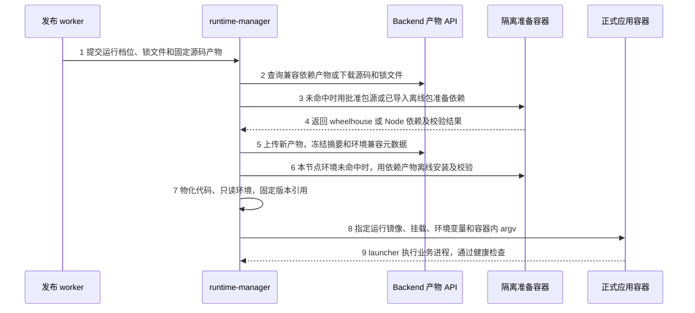
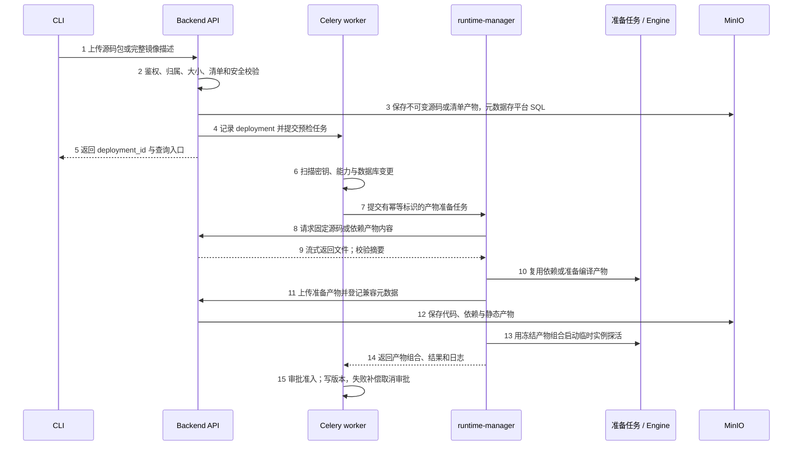
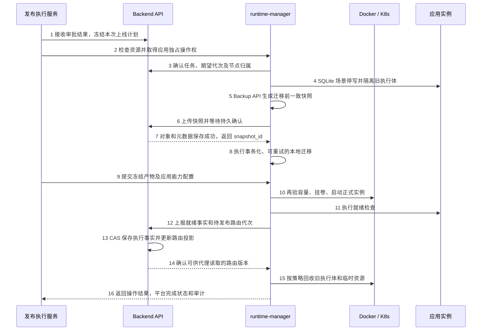
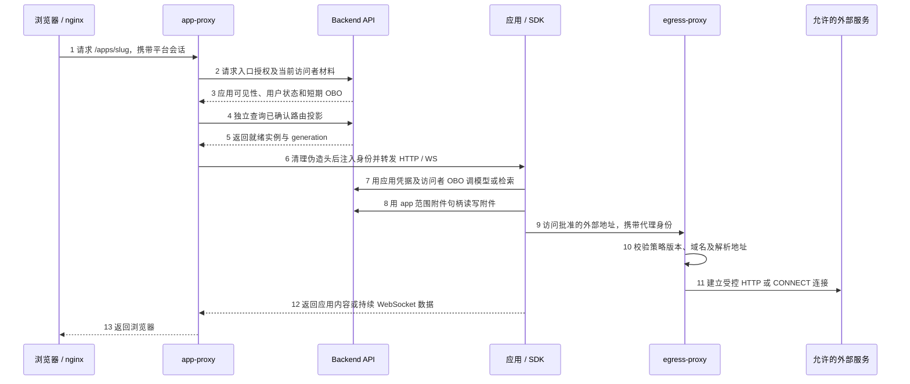

# Vibe 应用托管全开源技术方案

日期：2026-10-19　｜　更新：2026-10-20　｜　状态：待技术评审　｜　范围：应用交付、发布、运行、存储、权限、离线部署与实施阶段

Vibe 应用托管作为毕昇开源功能，在 `bisheng` 仓库内继续开发和交付。复用现有 Python runtime-manager、app-proxy、egress-proxy、CLI 和 SDK，保留独立进程的权限及故障边界。应用通过平台统一发布和访问，编排服务通过 backend 获取产物、上传快照，平台统一管理附件和对象存储。

**本轮决定：全部开源，不设置商业授权和固定上线数量额度。** 原“免费同时在线 10 个应用”、闭源 runtime、Java 重写以保护代码、迁入 `bisheng-gateway` 等方案退出实施范围。上线仍受 CPU、内存、磁盘、临时任务并发等资源约束；平台现有用户、租户和应用权限继续生效。既有商业网关可按部署环境继续转发平台请求，但不是 Vibe 功能的安装或授权前置。

**推荐发布路线：** 以“预制运行镜像＋版本化应用包＋可复用依赖产物”为源码应用的目标默认路线，同时支持用户提交完整应用镜像；现有源码构建应用镜像的路线作为迁移基线及兼容方式保留。应用包、完整镜像和 K8s 的具体契约均为待开发能力，不按已有代码认定为已交付。

**服务镜像交付已确认：** runtime-manager 仿照 backend，由项目 CI/CD 构建并推送 Docker Hub，正式 Compose 引用已发布镜像；客户安装时拉取或离线导入镜像。应用基础运行镜像另行维护，不能用 runtime-manager 服务镜像运行用户应用。实现细节见 §3.4—§3.8，发布交付见 §9.4。

2026-10-20 补充：纯离线依赖来源、补包闭环及失败行为见 [§9.5 离线依赖准备与补包](#offline-dependencies)；现有基础镜像位置和目标运行环境配置、替换步骤见 [§9.6 基础运行镜像配置](#runtime-image-config)。运行环境清单导入与离线依赖导入均为待开发能力。

本方案替代此前商业化评审和 Gateway 归仓实施方案中的产品与架构选择。2026-10-16 确认的存储边界继续有效：附件 API 迁到 backend；manager 保留本地 SQLite 备份、迁移和恢复，经 backend 下载源码、上传快照，不直接访问 MinIO。

## 阅读导航

- [1 评审基线与方案决策](#section-1)
- [2 开源仓库与运行架构](#section-2)
- [3 应用交付与运行契约](#section-3)
- [4 存储与共享状态](#section-4)
- [5 平台与 runtime 接口](#section-5)
- [6 发布上线流程](#section-6)
- [7 应用访问与平台能力](#section-7)
- [8 SQLite 持久化与恢复](#section-8)
- [9 Docker 与 K8s 交付](#section-9)
- [10 权限隔离与运行可靠性](#section-10)
- [11 实施阶段与验收](#section-11)
- [12 待评审事项与代码证据](#section-12)

<a id="section-1"></a>

## 1 评审基线与方案决策

### 1.1 代码基线

2026-10-19 只读核对远端 `feat/3.0.0-vibe`，提交仍为 `736ef593f3fc6e1634008c842d2604304d6f70a6`。源码事实均以该固定提交为准；当前工作目录检出的是另一版本分支，本文通过 `git show` 核查，不把工作目录中的其他改动作为 Vibe 实现。

本轮完成静态核查和技术方案，尚未执行应用部署、离线安装、K8s 适配或故障恢复实测。下文按“当前基线”“目标方案”“后续扩展”标注能力状态。

| 事项 | 当前基线 | 本方案目标 |
| --- | --- | --- |
| 代码与语言 | Python manager、两个 Python 代理位于 BiSheng 仓库 | 全部继续开源，沿用 Python；不增加 Gateway 代码归仓或 Maven 重组任务 |
| 源码发布 | tar.gz → 平台模板构建应用镜像 → 探活 → 审批 → 上线 | 应用包＋运行镜像作为目标默认；镜像构建兼容；用户完整镜像另有准入契约 |
| 运行后端 | Docker Engine API 经 socket proxy；K8s 仅有规格 | Docker 先完成可交付闭环；K8s 使用同一产物和生命周期协议另行适配 |
| 对象存储 | manager 预签名下载源码，直连 MinIO 处理附件/SQLite 快照 | manager 只经 backend 文件 API；SDK 附件直达 backend |
| 控制状态 | manager 本地 JSON、容器标签；出站策略使用共享本地文件 | 平台 SQL 持久化控制状态，Redis 做投影/缓存，本地只作可重建缓存 |
| 路由 | app-proxy 查询 manager，短缓存约 3 秒 | manager 上报真实就绪事实；backend 提供独立路由投影读接口，去掉请求对 manager 存活的依赖 |
| 上线数量 | 已查代码中的 Admission 检查 CPU/内存，不是商业授权 | 无商业上线名额；管理员按运行资源及任务并发设置容量策略 |

依据：[C01] [C06] [C07] [C18] [C27] [C29] [C34] [C39] [A05]。

### 1.2 推荐决策

1. **保留三个服务进程。** manager 负责有编排能力的控制面，app-proxy 和 egress-proxy 负责流量转发；socket proxy 为额外的 Docker 基础组件。
2. **平台统一存储和业务授权。** backend 管理附件、产物、快照、应用/租户权限及审计；manager 不读 backend 配置文件或平台业务数据库，不持 MinIO 主凭据。
3. **共享控制状态落平台。** 遵守 constitution C8；跨进程读取的路由、出站策略、任务和期望状态不能依赖某台机器上的 JSON 文件。[A03]
4. **运行环境与应用版本分离。** 版本固定运行镜像 digest、代码包摘要、依赖产物摘要、启动/健康契约；代码小改可以复用依赖，不要求每次生成 OCI 应用镜像。
5. **SQLite 保持单活动写入。** 升级前停写、必要时备份并等待平台持久确认；不承诺 SQLite 结构变更零停机。
6. **按可验证阶段交付。** 先补齐 Docker 当前链路和存储/状态边界，再上线应用包及完整镜像方式；K8s 不与首轮 Docker 修整混为同一个完成标记。

### 1.3 功能范围

开源交付保留应用清单与版本、部署预检、审批和临时预览、上线/停用/恢复、统一访问入口、SDK 能力、附件、SQLite 数据管理、运行日志及环境自检。本文主要调整运行实现和可靠性；既有业务权限继续由 backend 判定。[C15] [C25] [C40] [C43] [C46]

SQLite 数据页与 MCP 数据工具仍经 backend 完成 owner 收窄和审计，再调用 manager 的表清单、结构、分页行读取、单行修改及导出接口；不接受任意 SQL，也不让 backend 挂卷或直开数据库。目标 bundle/image 模式都要说明是否支持该数据契约，不将任意用户镜像中的数据库自动识别为平台可管理数据。[C46]

托管层继续允许按部署开关选装。未安装时隐藏相关入口，既有平台功能应正常启动；这属于部署形态，不是许可证判定。`app_runtime.enabled` 与开放能力层开关保持独立，CLI/SDK 所需开放接口由安装自检明确核对。[C05] [A02]

<a id="section-2"></a>

## 2 开源仓库与运行架构

### 2.1 目录组织

```text
bisheng/                             # 现有 Git 仓库
├── src/backend/bisheng/
│   ├── app_publish/                 # 接收、预检、审批、版本、上线协调
│   └── app_runtime/                 # 状态、权限、运行事实、数据及文件接口
├── src/runtime-manager/
│   ├── runtime_manager/             # Python 编排、执行适配、SQLite 本地操作
│   ├── Dockerfile                   # manager 服务镜像
│   └── Dockerfile.egress            # 目标：代理专用精简构建入口
├── src/app-proxy/                   # 应用 HTTP/WS 入口，独立服务镜像
├── src/app-runtime-images/          # 目标：Python/Node/static 运行环境和准备镜像
├── src/bisheng-cli/                 # 打包、部署、状态和日志
├── src/bisheng-sdk/                 # 应用内身份、检索及附件句柄
├── docker/                         # Compose、nginx、网络及安装材料
│   └── runtime-profiles.yaml        # 目标：管理员导入 backend 的运行环境清单
└── features/v3.0.0/                 # F054/F055/F059 等规格与设计
```

上述业务目录已存在；`src/app-runtime-images/`、`docker/runtime-profiles.yaml`、`Dockerfile.egress` 及平台状态/产物接口为目标增量。首轮不为开源交付重排整个仓库，也不强制新建共享 Python 工程；代理依赖可按需抽取最小配置与策略读取模块，避免拖入全部编排依赖。

### 2.2 进程职责

| 服务或组件 | 负责内容 | 资源访问边界 |
| --- | --- | --- |
| backend / Celery | 元数据、用户权限、审批、版本、附件、产物传输、快照保存；运行期望与事实投影 | 平台 SQL、Redis、MinIO、统一权限模块；调用 manager，不调用 Docker/K8s SDK，不挂应用数据卷 |
| runtime-manager | 准备产物、容量判断、容器/Pod 生命周期、探活、对账、自愈、预览、日志、SQLite 数据管理与备份/迁移/恢复 | Engine API 或 K8s API、受控数据卷、backend 内部接口；不直连 MinIO 或平台 SQL |
| app-proxy | 会话授权结果消费、可信头注入、HTTP/WS 转发、预览和拒绝页面 | backend 授权和路由读接口、应用网络；无 Engine 管理身份 |
| egress-proxy | HTTP/CONNECT、应用出站身份、目标域名和解析地址校验、连接限制 | backend 策略只读接口、允许的出口；不提供编排接口，不持 manager 管理密钥 |
| docker-socket-proxy | 限制并转发 Docker Engine API | 持 Docker socket；只在专用控制网络可达，不开放宿主端口 |
| 应用容器 | 执行业务、页面/API、SQLite、SDK/模型能力 | 本 app 数据卷、平台应用 API、受控出站；不接触控制面密钥和其他应用卷 |
| CLI / SDK | CLI 调平台部署 API；SDK 运行在应用内部 | 仅获得对应用户/应用/访问者权限，无宿主或集群管理能力 |

app-proxy、egress-proxy 不因开源而必须合并，也不因开源就失去进程隔离价值。manager 升级和构建任务不应直接带走应用入口/出口连接；原 F054 AC-22、AC-60 已定义相应的重启及独立启停目标。[A01] [A02]

egress 可以继续与 manager 共用源码工程，但使用独立入口和镜像，且只读自己的策略缓存，不挂整个应用数据根目录。独立镜像用于缩小依赖和运行权限；本方案不以隐藏源码作为安全手段。

### 2.3 网络与权限

Docker 目标至少区分入口/平台网络、应用受限网络、构建网络和 Engine 控制网络。manager 与 socket proxy 使用控制网络，backend 和两个代理不因共享默认网络而自动获得 Engine API 可达性。应用之间的可达性也需要网络规则限制，不能仅凭“没有 publish 宿主端口”宣称绝对不可直连。[C16] [C29]

对外复用平台 nginx 的 `/apps/{slug}/`，不为每个应用开放宿主机端口。所有应用可以监听容器内部相同端口，通过各自内部地址区分。管理 API 只供已认证平台服务使用；egress 监听端口只用于正向代理协议，不能混入 intent API。

<a id="section-3"></a>

## 3 应用交付与运行契约

### 3.1 当前源码包

```text
leave-helper/
├── bisheng-app.yaml
├── requirements.txt                # 可声明 bisheng-sdk
├── Procfile                        # 可选，指定 web 启动命令
├── main.py
├── templates/
└── static/
```

CLI 当前生成 tar.gz，以 multipart `package` 上传 `/api/v2/apps/deploy`；支持 `python3.11`、`node20`、`static`。源码包默认上限 50 MiB、展开 200 MiB、20,000 条目，实际值由平台配置及 deploy-limits 接口决定；拒绝路径逃逸、链接和特殊设备条目。当前 manifest 没有完整镜像或通用 command 字段。[C01] [C02] [C03] [C04] [C05]

SDK 是应用依赖，不是另一台服务；应用框架、第三方包、前端资源由项目及构建产物提供。`Procfile`、Python/Node 约定入口和平台 entrypoint 共同确定启动方式，不要求用户以 manager 服务镜像作为应用镜像。[C09] [C12] [C13] [C31]

### 3.2 三种发布路线

| 路线 | 发布和启动方式 | 定位 |
| --- | --- | --- |
| 运行镜像＋应用包 | 预制运行镜像；平台准备不可变代码/前端产物及兼容依赖包，启动时只物化已确认产物 | 目标默认源码路线；免去每次代码发布生成 OCI 镜像，但仍管理依赖和编译 |
| 用户完整应用镜像 | 提交镜像 digest、容器内启动/健康/端口契约；跳过平台源码构建 | 目标支持方式；适合复杂系统库和用户已有 CI，仍须遵守资源、UID、网络及卷限制 |
| 当前源码构建应用镜像 | 平台 Dockerfile 模板安装依赖、复制代码并生成应用镜像 | 当前已实现；迁移基线和兼容方式，复杂环境仍可使用 |

运行镜像中可以预装常用库，但版本必须明确。新增 OS 软件或不兼容解释器时需新的运行镜像/环境档位，或改用完整镜像；不能通过预装“常用库”保证任意应用离线运行。

应用包路线下，依赖变更会触发依赖准备；纯代码变更可复用已验证依赖。缓存键至少覆盖 OS/CPU、解释器与 ABI、运行镜像 digest、锁定依赖和安装配置。Python 原生扩展、Node native 模块必须在匹配环境中准备，不能直接复用开发机虚拟环境。

TypeScript/Vite 等前端编译仍需执行并保存输出，静态站点可使用固定 nginx 运行镜像。准备任务不得等到每次应用正常启动时再访问公网安装依赖。当前实现只有 Docker 分层缓存，没有应用级“比较依赖后跳过整次构建”的完整功能。[C09] [C11] [C45]

### 3.3 目标 manifest 与版本模型

建议保持 v1 兼容，新增显式的 v2 执行描述。下例仅为协议设计草案，字段不能直接用于当前 v1 接口。

```yaml
manifest_version: 2
name: 请假知识助手
slug: leave-helper
runtime: python3.11
port: 8080
tier: light
execution:
  type: bundle
  runtime_profile: python311-standard-v1
  command: [python, -m, uvicorn, main:app, --host, 0.0.0.0, --port, "8080"]
data_mode: sqlite
health:
  path: /healthz
```

`runtime_profile` 指向管理员登记的运行环境及镜像 digest；用户自定义运行镜像通过同一登记/验证流程接入。完整镜像模式使用 `execution.type=image` 和镜像 digest，默认采用镜像 entrypoint，也可按契约覆盖容器内 argv。所有命令只在受限应用容器内执行，不转成任意宿主 shell。

版本记录需要冻结：源码/前端产物摘要、依赖产物格式/摘要与完整锁定结果、运行镜像 digest 或完整镜像 digest、启动 argv、端口、健康契约、资源档位、能力声明、数据库 schema 及出站声明。`image_ref` 一个字段不足以表达应用包版本。完整镜像不上传 MinIO；平台保存其引用和运行契约。

源码包继续采用严格安全解包。依赖产物是平台在受控环境产出的专门归档，需要校验路径和链接目标；不能直接接受任意用户虚拟环境 tar 包，也不能无条件沿用源码包拒绝所有链接的规则，导致 Node 等依赖布局被破坏。

### 3.4 应用包路线的实现分层

每个应用版本由“运行镜像＋代码产物＋依赖产物＋启动契约”组成。manager 调用 Engine API 创建准备容器和业务容器，不把应用代码安装进自己的 Python 环境，不为每次代码修改提交一个新镜像。

| 层次 | 内容与发布者 | 更新频率与存储 |
| --- | --- | --- |
| manager 服务镜像 | 平台编排 Python 代码及其服务依赖；项目 CI 发布 | 随平台版本发布到 Docker Hub，Compose 引用；不包含用户应用 |
| 应用运行镜像 | Python/Node/nginx、固定系统库、非特权用户和平台 launcher；项目 CI 发布或管理员登记 | 环境升级时发布，冻结实际 CPU 架构对应的镜像 digest；执行节点提前加载/拉取 |
| 准备镜像 | 与运行环境匹配的解释器、包工具、必要编译器/头文件 | 平台发布并固定 digest；只用于隔离准备任务，不将工具链带入普通应用容器 |
| 代码产物 | 安全解包后的源码、必要的前端编译输出、冻结清单 | 每版本不可变，经 backend 存 MinIO、下载至执行节点 |
| 依赖产物 | Python wheelhouse 与安装锁文件，或匹配环境的 Node 依赖归档及元数据 | 兼容键命中时复用，经 backend 持久化；本机安装环境是可重建缓存 |

应用运行镜像可以携带常用 wheel 文件，帮助离线依赖准备；Python 默认独立 venv 不继承基础解释器的全局 site-packages。不能一边隔离依赖，一边假定基础镜像中 `pip install` 的全局包会自动出现在每个应用环境中。建议把常用包做成版本明确的离线 wheel 集合，由依赖准备过程选用；经验证的固定环境档位也可以直接命中同一依赖组合。[R05]

目标执行顺序：



这是单次准备与启动的内部细化图，预检、审批和正式上线的外层顺序仍按第 6 节执行。缓存命中可跳过对应准备步骤；跨节点第一次运行需要下载产物并建立节点缓存，不依赖另一个 manager 的本地目录。

### 3.5 Python 依赖的安装与复用

**第一层：可持久复用的 wheel 产物。** 推荐应用提交锁定依赖及完整传递依赖；只提交 `requirements.txt` 时，平台首次准备需生成并冻结解析结果，后续复用必须引用该固定结果。显式刷新依赖才重新解析，不能让同一个已批准版本随包源变化得到另一套库。

隔离准备容器在匹配目标 OS/CPU、Python ABI 和系统库的环境中下载或构建 wheels。纯 Python wheel 也记录目标兼容性；原生扩展要在匹配工具链中构建，并在目标运行镜像中验证导入和动态库。wheelhouse 包含整个运行依赖闭包、`bisheng-sdk`、安装清单和各文件摘要，缺少任意依赖不得退回公网补装。[R06]

以下是联网准备机或可访问内网包源的准备容器中的示意命令；工具版本、包源、锁文件和网络权限由平台准备计划指定，不在 manager 服务容器执行。纯离线现场必须先具备相应包文件和构建依赖，不能通过该命令凭空取得新包，来源与导入过程见 §9.5：

```sh
python -m pip wheel --wheel-dir /out/wheelhouse -r /input/requirements.resolved.lock
```

源码构建出的 wheel 与原始源码归档的摘要可能不同。平台应据最终 wheel 内容生成 `requirements.runtime.lock`，固定全部包版本及 wheel 哈希，并记录构建来源；不能把源码包的哈希直接当成新 wheel 的哈希。SDK 按固定版本从平台指定分发源取得并核对摘要，不依赖公共源中恰好出现同名包。

**第二层：执行节点的已安装环境缓存。** manager 为 `env_key` 分配临时目录，挂载进一次性准备容器的 `/opt/venv`；在与正式应用相同的运行镜像中创建环境并离线安装。这里不需要编译器：所有需要的 wheel 已在第一层准备完毕。

```sh
python -m venv /opt/venv
/opt/venv/bin/python -m pip install --no-index --find-links=/deps/wheelhouse --only-binary=:all: --require-hashes -r /deps/requirements.runtime.lock
/opt/venv/bin/python -m pip check
```

`--no-index` 配合本地 wheelhouse 完成安装，运行锁文件禁止残留 VCS、外网 URL 和开发机绝对路径；需要本地项目依赖时，先做成 wheel 并计入内容摘要。准备容器同时验证关键 import，最终用真实应用预检验证启动；`pip check` 通过不等于整个应用就绪。[R07]

验证成功后以原子方式发布节点缓存完成标记。正式容器把该目录只读挂到相同的 `/opt/venv`，设置 `PATH` 并执行其 Python；不再运行 pip。Python 官方指出 venv 通常不可移动，本方案因此持久保存 wheel 及锁文件，节点丢缓存时就地重建 venv，不把开发机或其他节点的 venv 打包搬运。[R05]

`env_key` 至少包含租户缓存范围、平台解析结果/依赖哈希、目标架构、运行镜像实际 digest、Python ABI、准备镜像/工具版本和安装策略。同租户多个应用依赖完全一致时可只读共用；不同依赖或镜像得到不同目录。默认不跨租户共享私有依赖产物和命中信息。

并发准备同一个 key 时只能有一个有效发布结果，失败临时目录不标完成；运行中的缓存不允许原地 `pip install` 或升级。`PYTHONDONTWRITEBYTECODE=1` 避免把字节码写回共享环境，需要运行缓存的库使用 app 自己的 `/tmp` 或指定数据子目录。

### 3.6 Node 与静态应用的依赖处理

Node 使用固定 Node/npm 版本，基于 `package.json`、`package-lock.json` 和影响安装的配置执行 `npm ci`。该命令按锁文件安装且不改锁文件；锁文件不匹配时拒绝，而不是现场自动修正。[R08]

平台准备并验证对应架构的依赖归档。运行依赖只读挂到 `/workspace/app/node_modules`，代码挂到 `/workspace/app`，保留正常 Node/ESM 相对解析路径；不能仅依赖 `NODE_PATH` 将所有依赖放在任意外部目录。代码物化时由平台预留依赖挂载点，不能使用用户传入的宿主路径或不可信链接。

需要 TypeScript/Vite 构建时，在私有可写准备工作区安装构建依赖、执行构建并保存输出；不能写入正在被其他应用使用的依赖缓存。运行版本只保留实际所需依赖和输出。若安装脚本、workspace、本地依赖或原生模块构建读取应用源码，相关源码摘要也必须计入 key；此时“锁文件没变”并不足以跳过准备。

静态应用将已生成的 HTML/CSS/JS 产物挂到固定 nginx 运行镜像的站点目录，按约定端口提供服务。无需 Node 运行时的静态站点不启动 Node；纯静态资源没有依赖时也不生成空的依赖环境。特殊系统库或不能满足只读契约的应用使用登记过的自定义运行环境或完整镜像模式。

### 3.7 代码挂载和启动契约

Docker 首轮采用宿主内容目录＋只读 bind mount。manager 通过 backend 流式下载代码包到临时目录，验证 app/version 归属、大小和摘要，再安全解包并原子发布；被运行容器使用的版本目录不做原地覆盖。文件大小写、可执行位、依赖链接及 UID/GID 一并校验。

以当前默认数据根为例，目标布局如下；`cache/` 下全部可从平台产物重建，SQLite 目录按独立持久化策略管理：

```text
宿主机 /opt/bisheng/app-data/             manager 容器内 /app-data/
├── cache/releases/{app_id}/{version_id}/app/    # 代码、前端输出
├── cache/envs/{tenant_scope}/{env_key}/venv/    # 本节点安装好的 Python 环境
├── cache/node-deps/{tenant_scope}/{env_key}/node_modules/
└── apps/{app_id}/data/                         # 目标 SQLite 持久目录
```

manager 看见的路径与交给宿主 Engine 的路径必须按配置根映射；本例 `RTM_DATA_ROOT=/app-data`，`RTM_HOST_DATA_ROOT=/opt/bisheng/app-data`。不能把仅存在 manager 镜像可写层中的目录当作应用 bind 源。Docker bind 的源路径由 daemon 所在主机解释，因此首轮要求 manager 对应同机 Engine；远程 Engine 须先提供该执行节点自己的产物物化机制。[C17] [R09]

Python 应用实例的关键 Engine 参数示例如下。它是目标 DTO 示意，并非完整安全配置；实际创建仍须包含资源、应用网络、日志、只读、卷及可信标签约束：

```json
{
  "Image": "dataelement/bisheng-app-python@sha256:<runtime-arch-digest>",
  "WorkingDir": "/workspace/app",
  "Entrypoint": ["/usr/local/bin/bisheng-launch"],
  "Cmd": ["python", "-m", "uvicorn", "main:app", "--host", "0.0.0.0", "--port", "8080"],
  "User": "10001:10001",
  "Env": [
    "PATH=/opt/venv/bin:/usr/local/bin:/usr/bin:/bin",
    "VIRTUAL_ENV=/opt/venv",
    "PYTHONDONTWRITEBYTECODE=1",
    "PORT=8080"
  ],
  "HostConfig": {
    "ReadonlyRootfs": true,
    "Binds": [
      "/opt/bisheng/app-data/cache/releases/app-example/version-example/app:/workspace/app:ro",
      "/opt/bisheng/app-data/cache/envs/tenant-example/env-example/venv:/opt/venv:ro",
      "/opt/bisheng/app-data/apps/app-example/data:/data:rw"
    ],
    "Tmpfs": {"/tmp": "rw,nosuid,nodev,size=67108864"}
  }
}
```

`bisheng-launch` 是目标运行镜像内的平台启动入口：校验必需目录和版本材料、设置有限环境后用 `exec` 启动 `Cmd` 对应业务进程，使其接收停止信号。它不联网安装依赖、不运行宿主命令、不启动 manager。manifest 显式 argv 优先；兼容的 `Procfile` 和语言默认入口在发布准备阶段解析成冻结启动契约，再由运行镜像消费。

应用在容器内监听 `0.0.0.0:8080`；不同容器可重复使用该端口，不配置每应用宿主 `PortBindings`，app-proxy 使用内部地址访问。`/data` 的所有权由受控维护步骤准备，普通应用不能获得整棵缓存或其他应用数据。重启复用同版本目录；新版本使用新目录和新实例，数据兼容与切换按第 6、8 节处理。

### 3.8 何时重装、复用与清理

| 事件 | 依赖和代码处理 |
| --- | --- |
| 仅普通业务代码变化 | 创建新代码版本；完整兼容 key 不变则复用依赖产物和本节点环境；仍执行必要前端编译和应用探活 |
| 依赖锁定结果/安装相关源码变化 | 新依赖 key；准备新产物及新环境，旧环境保持不可变 |
| 同一版本应用重启 | 有效本地缓存直接挂载，不执行 pip/npm 安装，不重新解析依赖 |
| 切到新节点或删除缓存 | 从 backend 下载冻结产物；Python 用 wheelhouse 离线重建环境，Node 按验证契约物化依赖；再启动 |
| 切换基础镜像、架构或 ABI | 按新兼容 key 重新准备与验证，不能凭 `requirements.txt` 相同跨架构复用 |
| 更新 runtime-manager 服务镜像 | 只升级编排服务；已有应用版本的运行镜像、依赖和代码引用不随之变化 |
| 清理与回退 | 按当前实例、审批、运行操作及回退窗口引用回收；节点缓存可重建，平台不可变产物保留策略单独管理 |

这一方案省去的是每次发布的 OCI 应用镜像构建/推送。首次安装、新依赖和新节点仍有依赖准备成本；命中的是经验证的完整环境组合，不能把 package manager 的下载缓存命中等同于应用运行环境已经可用。

<a id="section-4"></a>

## 4 存储与共享状态

### 4.1 数据归属

| 数据 | 权威存储及目标访问方 | 本地用途 |
| --- | --- | --- |
| 应用、租户归属、权限关联、版本和审批 | 平台 MySQL/DM8；backend/Celery 经领域服务和仓储读写 | manager 不复制平台用户/权限模型 |
| 发布/运行操作、期望版本、节点归属、阶段和幂等结果 | 平台 SQL；manager 通过内部接口接收任务和上报结果 | 本地任务缓存可重建，不是另一份可独立修改的权威 |
| 执行事实、就绪版本和路由投影 | manager 产生真实事实，backend 经归属/generation 校验持久化；Redis 加速读取 | app-proxy 内存缓存可在有效期内使用，不共享宿主 JSON |
| 出站策略及策略代次 | 平台 SQL 保存确认后的声明与派生策略，Redis 投影；egress 经只读 API 获取 | 代理缓存版本化快照，重启可重新获取；不以共享文件为唯一来源 |
| 运行环境档位及默认映射 | 管理员从清单导入，backend 校验并存平台 SQL；执行计划冻结具体修订与镜像 | YAML 是配置导入材料，manager 不以某台机器的文件作为档位权威 |
| 源码和代码/依赖产物 | MinIO 私有 `bisheng-apps`；backend 存取和分发 | manager/准备任务按内容摘要下载到受控缓存，挂载给应用只读 |
| 附件 | 同一私有桶；应用 SDK → backend → MinIO | 应用不拿 MinIO 账号；manager 不经过附件数据流 |
| SQLite 快照 | 同一私有桶及平台快照元数据；manager 本地生成后上传 backend | 临时一致副本、tar 和导出文件；持久确认后清理 |
| 应用 SQLite | 应用专属持久卷，单活动应用使用；manager 在受控环境执行备份/迁移 | Docker 本机 bind 或 K8s PVC，是显式的应用数据持久化，不是平台跨服务控制状态 |

constitution C8 要求跨进程共享状态的权威放在 SQL、Redis 或 MinIO。[A03] 当前 manager 的 `desired-state.json` 和 egress 策略文件是单机实现，应迁移为节点可重建缓存；本方案不继续把共享本地文件扩展为多节点控制协议。[C18] [C27]

应用 SQLite 延续原规格的单应用持久卷约束，不承接平台路由、权限、任务或跨节点共识。它的数据恢复与节点绑定需在 F054/F059 设计中明确，不能将该局部存储方式推广到平台业务控制状态。

### 4.2 对象路径与生命周期

可继续使用现有私有桶和对象布局；无需新建 MinIO 实例或每应用一个桶。目标接口对 manager 隐藏 bucket/key，以下路径只由 backend 内部管理。[C04] [C21] [C22]

```text
bisheng-apps/
└── apps/{app_id}/
    ├── versions/{version_id}/code.tar.gz
    ├── attachments/{relative_key}
    ├── db-snapshots/{snapshot_id}.tar
    └── artifacts/{artifact_id}/...          # 目标扩展
```

当前 SQLite 快照使用时间戳文件名；目标建议由平台分配快照 ID 并关联任务，避免并发或重试依赖秒级命名。旧路径可按元数据兼容读取；内容摘要、大小和产物归属应独立记录。

| 动作 | 代码/镜像与产物 | SQLite 和附件 | 运行状态 |
| --- | --- | --- | --- |
| 停用 | 保留版本与可恢复产物 | 保留 | 平台禁止入口，停止执行并撤销出站主体；失败可重试 |
| 更新 | 新增不可变版本，复用兼容依赖缓存 | 沿用本 app 数据，必要时迁移；附件命名空间保持 | 新版本就绪后发布路由事实，旧版本按发布策略回收 |
| 审批预览 | 使用冻结版本，临时执行 | 临时空库/隔离附件，不挂生产数据 | 独立 session、策略、TTL 和并发限制 |
| 删除 | backend 清理或按策略保留远端资产；共享依赖按引用回收 | manager 仅按明确指令清本地卷；backend 清附件和快照 | 先停用并作删除标记，再幂等清理；不是跨系统单一原子事务 |
| 代码回滚 | 选定仍可用的历史产物组合 | 不自动恢复数据库 | 先检查数据库兼容性；数据恢复是独立受控动作 |

缓存、临时任务和孤儿对象定期清理；被在用、回退窗口或审批引用的产物不得回收。大包采用流式传输和有界临时空间；源码、依赖产物、附件、快照分别设置大小和保留策略，不能把源码 50 MiB 默认值套到所有产物。

<a id="section-5"></a>

## 5 平台与 runtime 接口

### 5.1 三组内部协议

| 协议 | 调用方 | 主要内容 | 校验方与副作用 |
| --- | --- | --- | --- |
| 运行意图与操作查询 | backend/Celery → manager | 准备、部署、停止、销毁、探活、预览、SQLite 操作；operation ID、app/version、generation | manager 验服务身份、任务归属、重复请求和节点所有权；操作 Engine/数据卷并上报事实 |
| 产物与快照 | manager/准备任务 → backend | 内容下载、摘要校验、快照上传/状态查询/恢复下载 | backend 校验任务授权和范围，访问 MinIO；不返回 MinIO URL 或 302 跳转 |
| 控制状态与只读投影 | manager → backend 上报；两个代理 → backend 读取 | 任务、期望、心跳、实例、路由、出站策略及撤销代次 | backend 用 SQL CAS/幂等记录和 Redis 投影；代理只读，不获得编排身份 |

现有 `/v1/intents/*`、构建查询、route、db、logs 接口可以作为兼容入口，但目标字段通过显式协议版本演进。当前 build 使用 `code_url/code_object_key`，后续改为平台产物描述；当前 deploy 只含 `image_ref`，后续需要执行产物组合。不得直接改变返回形态而不升级 CLI/worker/代理调用者。[C08] [C38] [C41]

建议的内部接口能力如下，路径和 DTO 在设计评审后冻结，当前代码尚未提供这些目标接口：

| 接口能力 | 关键参数的产生与消费 |
| --- | --- |
| `artifacts/{id}/content` 下载 | backend 建立 artifact ID、大小、摘要与任务授权；manager 或准备任务消费并校验 |
| `snapshots/{id}/content` 上传/恢复下载 | backend 分配 snapshot ID 和目的；manager 提交一致副本或在恢复任务中下载；backend 校验摘要并持久确认 |
| 运行操作创建/查询及期望读取 | backend 创建操作和冻结计划；manager 取得所分配节点/应用任务；重试使用相同 operation ID 和 payload hash |
| 执行事实与路由发布 | manager 上报真实就绪版本、可达地址、generation、owner epoch；backend 校验并形成路由投影 |
| 代理路由和策略快照读取 | backend 提供节点/应用范围内的已确认结果及代次；代理持专用只读身份，按版本刷新 |
| 应用附件 API | SDK 使用 app 范围 endpoint/token；backend 判断应用、租户及相对路径，返回内容和元信息 |

### 5.2 产物和运行意图示例

以下 JSON 为目标协议示例，不可原样发送到当前 manager schema；摘要和镜像值均为占位符。

```json
{
  "protocol_version": 2,
  "operation_id": "op-example",
  "app_id": "app-example",
  "version_id": "version-example",
  "node_id": "runtime-node-a",
  "generation": 7,
  "execution": {
    "type": "bundle",
    "runtime_image": "bisheng/app-python@sha256:<digest>",
    "code": {"artifact_id": "code-example", "sha256": "<sha256>"},
    "dependencies": {"artifact_id": "deps-example", "format": "python-wheelhouse-v1", "sha256": "<sha256>"},
    "command": ["python", "main.py"],
    "port": 8080
  },
  "resources": {"cpu": 0.5, "memory_mb": 1024},
  "data_mode": "sqlite"
}
```

backend 提供应用附件句柄、平台能力地址和短期任务授权，manager 负责受保护环境变量覆盖及注入。服务管理密钥和文件传输任务授权不进入应用环境、普通日志或公开版本记录。

### 5.3 认证与传输

内部 HMAC/服务认证用于确认服务身份和请求完整性，继续保留，与商业许可证无关。新协议增加时间窗口、nonce 或等效防重放机制，以及 app/任务/动作范围；文件传输按可信内容摘要签署并在接收时验证，不为了签名将大文件全部读入内存。原 HMAC 只覆盖方法、路径和 raw body，不能按已有代码宣称具备这些新增约束。[C35]

应用运行凭据代表应用；OBO 凭据代表本次访问者；附件句柄仅对应应用附件空间；构建/快照任务授权仅对应某个操作。四者不可互换，代理读权限也不能调用 runtime intent。

SDK 附件 API 保持应用使用方式，但需处理地址、令牌校验权威、响应 envelope 和错误语义的兼容。当前 SDK 按 manager 的错误信封解析，不能仅改 endpoint 就宣布迁移完成。[C22] [C33]

<a id="section-6"></a>

## 6 发布上线流程

### 6.1 上传与预检



这是目标流程：应用包模式准备代码/依赖，镜像兼容模式在第 10 步构建应用镜像，完整镜像模式检查镜像契约并跳过源码依赖准备。三者均执行相应扫描/准入及启动预检，不能用“用户提供镜像”跳过运行约束。

当前实现已具有源码接收、扫描、模板构建和临时探活；使用短期 MinIO 预签名 URL 下载源码，附件/快照直连也尚未迁移。版本写入的真实顺序是先提交审批准入，再插入版本，失败时尝试取消审批；本方案继续保持这一已查明语义。[C06] [C07] [C37] [C44]

### 6.2 审批后上线与迁移



迁移快照和产物的 MinIO 存取均由 backend 执行，图中第 7 步的确认包含对象内容及平台 SQL 元数据。首次发布尚无数据库、或无需快照的兼容性迁移，可以按明确策略跳过第 5—7 步，不生成无意义空快照。

| 阶段 | 执行方及关键输入 | 状态/存储副作用 | 失败处理 |
| --- | --- | --- | --- |
| 接收 | CLI → backend；package/清单、可选 app ID、结构变更确认 | 源码快照、deployment、审计 | 同步拒绝越权/危险归档；大文件临时空间受限 |
| 预检 | worker 调 manager；固定版本/产物及资源 | 分阶段结果、依赖产物、临时探活日志 | 失败不进入审批，清理临时执行体；保留可诊断日志 |
| 审批与预览 | 平台审批服务、预览参与资格、冻结版本 | 审批和版本记录、临时 preview session | 拒绝/撤回回收预览；生产数据不被预览修改 |
| 上线准入 | backend 协调，manager 检查资源、任务和独占权 | 上线 operation、节点归属/代次 | 资源不足保留待上线版本，旧在线版本按其状态继续；不重复建审批 |
| SQLite 迁移 | manager、本地卷、冻结迁移计划及快照任务 | 快照文件/元数据、DDL 结果 | 快照失败/状态不明则不做破坏性 DDL；停写后的恢复动作明确记录 |
| 正式启动 | manager、Engine、运行镜像/代码/依赖、env、卷、资源 | 候选执行体和探活结果 | 失败不发布候选路由，按是否已经迁移判断旧版本可否恢复 |
| 路由发布 | manager 上报事实；backend 验 generation 和所有权 | SQL 事实、Redis 投影、路由代次 | 投影未确认不退休旧版本；通过 outbox/重试修复，不回报虚假上线 |
| 停用/删除 | backend 权限与入口状态；manager 执行停止/销毁 | 路由和策略撤销、本地卷显式清理、远端资产由 backend 处理 | 幂等重试和对账；数据清理不靠重复动作猜测是否完成 |

### 6.3 更新方式和异常边界

无持久写入或已确认数据兼容的应用可采用候选探活后切路由；声明 SQLite 或存在不能并发运行的数据写入者时，采用单活动发布：隔离旧写入、备份/迁移、启动新实例。后者允许短维护窗口，不能同时承诺任意 schema 变更零停机。[C16] [C21]

当前实现先迁移，再执行部分资源准入/启动；并存在 deploy 前先撤销旧应用能力凭据再重签的路径。新方案将资源预检前移，并把凭据切换设计成候选可用、正式切换后再失效旧凭据的受控阶段。数据库迁移和容器启动仍不是同一事务，启动失败不能自动推断旧版本数据及凭据未变化。[C14] [C15] [C36] [C48]

同一个 app 的发布、迁移、恢复、停用按持久操作和 generation 串行协调；重复 operation ID 复用结果，ID 相同但参数摘要不同则拒绝。后台对账同样读取有效期望与执行所有权，不按本地过期缓存擅自重建已停用应用。

<a id="section-7"></a>

## 7 应用访问与平台能力

### 7.1 目标访问链路



这是目标链路，路由读接口改到 backend 投影；当前仍由 app-proxy 查询 manager。后端的授权结果和路由读取继续保持不同语义、不同缓存，不把“有路由”当作“有访问权限”。[C24] [C25] [A05]

### 7.2 路由与策略的可用性

manager 是真实就绪和执行地址的生产者，backend 只接收已认证、归属正确且代次有效的事实，形成持久只读投影。平台不通过 `exec_ref` 猜容器地址，也不复制 Docker 操作逻辑。代理读取该投影，因此 manager 短暂重启时不会因 3 秒路由缓存到期就必须连 manager 才能接收新请求。

出站策略采用相同原则：批准的声明和派生策略存平台，egress 经专用只读 API 获取版本化快照。旧 JSON/共享文件仅作为迁移输入或缓存；代理重启可从平台恢复，不要求与 manager 在同一机器共享目录。该变化修正原 D5.1 和文件策略的单机依赖，需要更新相应设计与契约。[C18] [C27] [A03]

缓存必须有应用、版本、generation、有效期及撤销语义，刷新采用轮询/版本查询，推送仅作加速。停止/删除/撤权由 backend 使授权失效并更新投影，必要时通知代理关闭既有连接。权限或策略状态无法确认时拒绝新授权；不得为了 manager 故障容错而无限保留已撤销权限。平台自身不可用与 manager 重启是不同故障，不承诺权限服务长期不可用时仍绕过校验。

### 7.3 身份与出站控制

app-proxy 继续处理可信头规范化、前缀剥离和重定向修复，转发 HTTP/WebSocket，并定期重校验长连接。backend 通过统一权限运行时验证用户/租户状态和 `app:use`。检索和需要访问者身份的模型能力按“应用声明范围与访问者权限共同约束”判断，缺少访问者不能退化为应用 owner 权限。[C25] [C26] [C31] [C32] [C36]

egress 检查代理令牌、允许域名/端口和 DNS 解析地址，防止将出口变成访问内部数据库的跳板。CONNECT 只在建连前校验目标，不解密 TLS。代理配置不能独自阻止不遵循 HTTP_PROXY 的应用，仍需实际生效的网络和 TCP/UDP 兜底规则；构建期允许包源，运行期不自动获得包源权限。[C27] [C28]

<a id="section-8"></a>

## 8 SQLite 持久化与恢复

### 8.1 数据卷与预览

Docker 沿用按 app 隔离的宿主数据目录，挂载到 `/data`，数据库为 `/data/app.db`。`RTM_DATA_ROOT` 是 manager 视角，`RTM_HOST_DATA_ROOT` 是 Engine 解释 bind mount 的宿主视角，必须对应同一数据。代理不挂整棵应用数据根，backend 不直接打开 SQLite。[C16] [C17] [C29]

K8s 使用每应用独占 PVC 和单活动执行策略。在 CSI/集群支持时优先 `ReadWriteOncePod`；普通 `ReadWriteOnce` 只限制单节点，仍可能被同节点多个 Pod 使用。SQLite WAL 需要本机共享内存，不可让跨主机进程把 NFS/SMB 上的数据库当作共享运行库。[R02] [R03]

审批预览默认空临时库和临时附件空间，结束后清理。若需要生产数据副本，必须另行授权生成隔离副本，不能直接挂正式 PVC 或注入生产附件凭据。当前 preview 使用 tmpfs，目标延续隔离原则。[C20] [C43]

### 8.2 备份与迁移

manager 在操作独占和写入隔离下执行 SQLite Backup API，得到一致副本，再通过 backend 上传。快照元数据至少包含 app、来源版本、schema、operation、大小、摘要、创建时间和状态；backend 确认文件和元数据都已持久化后，才能执行破坏性 DDL。[C21] [R01]

上传超时可能发生在文件已经保存之后，因此以同一 snapshot/operation ID 查询和重试；不能重复产生不可关联的快照，也不能将“本地备份完成”当作“平台备份完成”。事务化 DDL 只保证数据库内部事务，不覆盖上传、启动和路由切换。

应用包和历史镜像回退只恢复代码/环境。数据库恢复需要停写、明确恢复点和数据损失窗口，下载并校验对应快照、验证完整性、恢复文件所有权，再探活并恢复路由。启动失败后不能自动恢复旧快照而覆盖可能已产生的新业务数据。

### 8.3 节点故障边界

Docker 本机盘不能承诺节点损坏后自动无损迁移；应通过平台快照和现场备份策略恢复。K8s 跨节点恢复取决于 CSI/PVC 的实际能力。manager 在 K8s 下不能假定远端 PVC 在自己本机可读，应编排挂载同一 PVC 的受控维护执行体，保证业务写入者已经停止，再进行备份/迁移/恢复。

这种执行体是编排服务的受控操作手段，不是新的常驻业务服务；不能以任意远程 SQL 或任意宿主路径作为接口输入。各平台支持矩阵需覆盖 Python/SQLite 动态库、文件锁、文件所有权及目标 CPU 架构。

<a id="section-9"></a>

## 9 Docker 与 K8s 交付

**本节实施摘要：**

1. **无外网且无可用内网包源时，提前交付离线依赖包。** 首次发布使用已导入的基础依赖集合；新增依赖缺失时，在可取得依赖的环境制作补充包，经 backend 导入和验证后再发布。缺包在预检阶段明确报错，不回退公网。
2. **离线包包含完整依赖闭包。** 固定锁文件、传递依赖、SDK、目标平台信息及文件摘要；不能仅拷贝顶层库，也不能把开发机 venv 当作通用交付物。manager 经 backend 获取 wheelhouse，在执行节点离线建立并缓存环境。
3. **应用基础镜像通过运行环境清单配置。** 目标新增 `docker/runtime-profiles.yaml`，由管理员导入 backend 后统一持久化；应用使用 `execution.runtime_profile` 选择版本化档位。当前代码仍是 `BASE_IMAGES` 常量，该配置入口需要实施。
4. **manager 镜像与应用基础镜像分别更新。** Compose 的 `runtime-manager.image` 只更新编排服务；替换应用运行环境需要新档位、依赖兼容验证及正常发布，不能使已冻结版本随默认配置变化。

操作流程与配置示例分别见 [离线依赖准备与补包](#offline-dependencies)、[基础运行镜像配置](#runtime-image-config)。

### 9.1 前置条件

| 条件 | Docker 首轮交付 | K8s 后续适配 |
| --- | --- | --- |
| 执行接口 | Docker Engine HTTP API，经 socket proxy；manager 不需要 Docker CLI | K8s API、专用 namespace、ServiceAccount/RBAC；不要求节点安装 dockerd |
| 应用包 | manager 从 backend 下载并校验，物化到受控内容寻址缓存，以只读方式供应用使用 | init/准备执行体通过 backend 下载到受控卷，校验后供主容器只读使用 |
| 依赖准备 | 匹配运行环境的隔离准备任务；限制网络、CPU、内存和临时磁盘 | 同类受限 Job，记录结果/日志/产物；不是默认每次生成 OCI 镜像 |
| 镜像构建兼容 | 已有 Engine build 和平台模板 | 若启用该路线，另配构建器、推送凭据、镜像分发与缓存；集群本身不提供源码构建能力 |
| 运行镜像 | 预制且固定版本/digest，目标 Engine 可加载或拉取 | 所有可调度节点可以取得对应架构的运行/初始化镜像 |
| SQLite | 单应用本机 bind，明确路径与权限 | 独占 PVC、合适 StorageClass、单活动策略及维护执行体 |
| 路由与策略 | backend 持久投影/读接口，代理缓存 | 同一接口可用；应用地址由执行适配器产生，可使用稳定 Service |
| 资源与身份 | 编排能力仅给 manager；代理只读身份 | 最小 RBAC 和 Pod 安全准入；应用不挂集群控制凭据 |

当前 Docker manager 和模板已经存在；K8s 行为属于目标适配。应用包路线只减少应用镜像构建步骤，不会取消集群 API、镜像分发、卷和网络前置。[C09] [C10] [C34]

### 9.2 无外网和无内网镜像仓库

| 层次 | 离线材料 | 必须验证 |
| --- | --- | --- |
| 平台/管理服务 | backend、worker、manager、代理和基础组件的目标架构镜像、配置与数据迁移 | 完整安装和内部认证，不仅是容器存活 |
| 应用运行环境 | 固定运行镜像、初始化/维护镜像、常用环境档位 | 在实际执行引擎/节点存在，摘要与架构一致 |
| 依赖与编译 | 完整 wheel/npm 产物或内网包源、系统库、工具链、SDK 平台索引 | 锁文件外链、安装脚本和前端编译都不访问公网 |
| 产物与数据服务 | 平台私有桶、backend 文件接口、共享 SQL/Redis、数据卷和容量 | manager 被禁止直连 MinIO 时仍能准备源码、保存和恢复快照 |
| 应用运行能力 | 模型、检索、附件和明确允许的业务接口 | 页面可打开不等于平台能力可调用；外部 SaaS 不会因离线镜像自动可用 |

Docker 单机没有仓库时，可随安装包导入固定服务/运行镜像到同一个 Engine；应用包放平台对象存储，后续代码发布不必新增应用 OCI 镜像。完整镜像模式需要用户将对应镜像导入目标 Engine 或提供可访问仓库。

K8s 推荐客户内网仓库或附带最小 Registry。若不建设仓库，可以在可控的全部目标节点预装固定镜像，并配置与现场策略相符的 `IfNotPresent/Never`；新增/替换节点必须先完成镜像准备再承载应用。Kubernetes 官方明确说明预拉取方式依赖可控节点和一致的镜像准备，`Never` 缺图时直接启动失败；还须按目标集群版本核对本地镜像的凭据验证策略。[R04]

无仓库方式不适合不受控的自动节点替换。离线包应有镜像 digest/架构清单、产物摘要、导入顺序、补包流程及缺依赖诊断；Registry 自身若随包交付，要能在其他镜像尚未导入前启动。

### 9.3 配置归属

| 配置 | 读取方与归属 |
| --- | --- |
| backend `app_runtime` | backend/worker 读取部署开关、manager 地址、内部认证、包限制及发布配置；不把 manager 容量参数复制进此处 |
| manager `RTM_*` | manager 自己读取 Engine/集群连接、数据根、资源预留、包源、超时和目标平台内部客户端配置；不读取 backend 的 `config.yaml` |
| app-proxy / egress 配置 | 各进程读取监听地址、平台只读接口及自己的服务身份、缓存/连接限制；不继承 manager 管理凭据 |
| MinIO / 平台 SQL | 只由平台存储及领域服务使用；目标 manager 不再配置 MinIO 地址、bucket、访问密钥 |
| 应用注入变量 | backend 产生业务能力和访问句柄，manager 按冻结版本注入；运行镜像/入口消费，用户不能覆盖平台保留项 |
| 运行环境目录（目标新增） | 管理员用 `docker/runtime-profiles.yaml` 导入 backend；SQL 保存不可变档位与默认映射。worker 从平台目录冻结执行计划，manager 不直接读取该 YAML，见 §9.6 |

当前容量、数据根和包源已经由 manager 的环境变量读取，不能仅修改 backend 配置就预期生效。[C05] [C17] 新增内部客户端和策略 API 配置属于本次目标增量，应提供各进程独立配置样例和缺项诊断。

### 9.4 runtime-manager 的 CI/CD 与 Compose 交付

**确定采用：与 backend 相同的预构建镜像交付方式。** 已检查的 backend 流程在 `v*` tag 推送时构建并推送 amd64/arm64 镜像到 Docker Hub，release 流程聚合版本 manifest。runtime-manager 应加入对应构建和发布阶段；当前源码基线尚未接入该发布作业，Compose 的 manager 服务仍使用本地 `build:`。[A06] [A07] [C29]

| 环节 | 目标实施 |
| --- | --- |
| 镜像构建入口 | 复用 `src/runtime-manager/Dockerfile` 及该目录构建上下文，依赖锁文件安装服务自身依赖；新功能开发后同步调整依赖并修正旧 socket/root 注释 |
| CI 作业 | 在现有 `ci.yml` 增加 manager 的 amd64/arm64 构建、必要测试与镜像启动检查；使用仓库 Docker Hub secrets，不在 Compose 或镜像层放推送凭据 |
| 镜像命名 | 建议 `dataelement/bisheng-runtime-manager:<platform-version>-amd64/-arm64`；版本名示意，尚未声明这些仓库/tag 已存在 |
| 正式发布 | `release.yml` 聚合同一源码提交且构建成功的架构镜像为版本 tag；核验各 digest/提交标签存在后再发布，不能只因 release 事件触发就认定 tag CI 已完成 |
| Compose | 正式文件用 `image:` 引用已发布版本，不带 manager `build:`；本地源码开发可在开发 override 中启用构建 |
| 其他镜像 | app-proxy、egress-proxy 同样纳入各自预构建交付；应用运行/准备镜像有独立环境版本和兼容清单，不跟随每次应用代码发布重建 |
| 离线与架构 | 安装材料包含所需架构的服务、运行及准备镜像和 digest 清单；国产化平台逐项验证，amd64/arm64 覆盖不等于支持所有 CPU/系统库组合 |

现有 manager Dockerfile 是服务构建入口，不是应用运行基础；其中关于“直接挂 socket、因此必须 root”的旧注释与当前 Compose 的 socket proxy 方式不一致，发布前应按实际访问链路修正。服务镜像是否以非 root 运行还需核对本地数据目录、chown 与维护操作，不能只改 `USER` 就宣布权限适配完成。[A08] [C29]

正式 Compose 的关键配置片段如下。它表达目标交付方式，不是完整可直接替换的 Compose；backend 新内部 API 身份、容量、网络、就绪和出站规则需与全文件一起配置：

```yaml
services:
  runtime-manager:
    image: ${BISHENG_IMAGE_NAMESPACE:-dataelement}/bisheng-runtime-manager:${BISHENG_VERSION:?set BISHENG_VERSION}
    profiles: [app-runtime]
    environment:
      RTM_HOST: "0.0.0.0"
      RTM_PORT: "8091"
      RTM_HMAC_SECRET: ${BISHENG_RTM_HMAC_SECRET:?set BISHENG_RTM_HMAC_SECRET}
      RTM_DOCKER_HOST: tcp://docker-socket-proxy:2375
      RTM_PLATFORM_BASE_URL: http://backend:7860
      RTM_EGRESS_PROXY: egress-proxy:3128
      RTM_DATA_ROOT: /app-data
      RTM_HOST_DATA_ROOT: ${BISHENG_APP_DATA_ROOT:-/opt/bisheng/app-data}
    volumes:
      - type: bind
        source: ${BISHENG_APP_DATA_ROOT:-/opt/bisheng/app-data}
        target: /app-data
        bind:
          create_host_path: false
    networks: [default, bisheng-apps, runtime-control]
    depends_on: [docker-socket-proxy]
    restart: on-failure
```

安装器先创建绝对数据根并设置权限；socket proxy 只加入受控的 `runtime-control` 网络，backend/代理不加入该控制网。此片段不挂 Docker socket、不配置 MinIO、不开放 manager 宿主端口；生产 image 固定发布版本，交付清单另记录 digest，不能默认依赖 `latest`。[R10]

在线安装时 Compose 拉取 manager 镜像；离线安装时事先导入与引用一致的镜像并采用现场拉取策略。manager 和应用运行镜像的 Engine API 获取权限分别配置；CI 中用于构建镜像的 Docker/Buildx 工具不成为 manager 运行容器必须安装 Docker CLI 的理由。

平台升级 manager 镜像后，仍按旧应用版本记录使用原运行镜像、代码和依赖；运行环境档位升级应显式产生新的应用执行组合并预检。这样平台服务升级与应用环境升级有各自的回退边界。

<a id="offline-dependencies"></a>

### 9.5 断外网时，wheelhouse 从哪里获取

**纯离线环境必须提前获得依赖文件。** wheelhouse 是已下载或已构建 wheel 的集合，不能自己产生一个现场不存在的包。首次发布不一定需要临时搬包：若随安装包提供的依赖集合已经覆盖应用，可以直接准备；新增依赖不在已导入集合或内网源中时，必须先补包，再继续发布。

| 现场条件 | 首次发布及新增依赖的来源 | 未满足时的行为 |
| --- | --- | --- |
| 无公网，有完整内网 PyPI/制品源 | 在受限准备任务中从批准的内网源获取锁定依赖，产出 wheelhouse | 内网源未同步目标版本、只会转发公网请求时，不能认为依赖可用；报告缺包 |
| 无公网、无内网包源 | 从平台离线安装包的基础依赖集合，或预先导入的应用专用离线包选取 | 缺少目标包/版本/架构时，预检失败，不生成审批、不尝试公网回退 |
| 已有同兼容键的依赖产物 | 经 backend 下载冻结 wheelhouse；节点环境命中则直接复用 | 产物不完整或摘要/运行环境不匹配则拒绝，不能借用另一 ABI 的缓存 |

建议随平台离线交付一份**有明确版本清单的基础依赖集合**，覆盖 SDK 和官方样例的依赖。它是有限集合，不能承诺包含所有 Python 库及所有版本；业务新增包通过增量离线包交付。预制运行镜像、wheel 集合和 SDK 版本分别登记，镜像中携带常用 wheels 也要进入同样的完整性及兼容检查。

**离线包制作在可取得依赖的环境完成。** 推荐在与客户目标运行环境匹配的准备镜像/CPU 上，使用固定锁文件下载或构建完整传递依赖，必要时从项目交付物取得指定 SDK wheel，然后在目标运行镜像中断网执行安装和探活验证。已有兼容 wheel 时可用下列命令收集；只能在联网准备机或可达完整包源处运行：[R11]

```sh
python -m pip download --only-binary=:all: --dest /out/wheelhouse -r /input/requirements.runtime.lock
```

需要源码构建的包按 §3.5 制作目标 wheel，再生成最终 wheel 哈希锁文件；在 x86/macOS 开发机直接下载出来的包不能默认适配客户 ARM/其他国产 CPU。若使用 pip 的跨平台下载参数，须完整指定目标解释器/ABI/平台并另做目标验证；跨平台下载选项不等于交叉编译能力。[R11]

应用专用离线包建议包含以下内容。目录是目标交付格式草案，非现有 CLI 自动生成能力：

```text
app-offline-deps.tar.gz
├── manifest.json                   # 格式、目标环境/平台、来源、锁文件和文件摘要
├── requirements.runtime.lock       # 全部运行包的固定版本及最终 wheel 哈希
├── wheelhouse/
│   └── *.whl                       # 包含传递依赖和对应 SDK
├── checksums.sha256
└── validation.json                 # 制作环境、目标镜像与断网安装验证记录
```

系统动态库、Python 解释器和工具链不由 wheelhouse 自动解决。应用需要新增 OS 库时，应交付相容的新运行/准备镜像及其离线镜像材料，或完整应用镜像；仅搬入 `.whl` 可能仍不能导入或运行。离线现场仍要从平台存储和数据卷读取产物，只是不访问公网。

**导入和增量补包闭环：**

1. 管理员或获授权交付人员提交离线包到 backend 产物导入接口；接口/工具为本方案新增项，不要求 manager 访问 MinIO。
2. backend 校验身份、归属、大小、安全归档、清单及摘要，把内容存私有对象存储并保存 SQL 元数据，先标为待验证；文件哈希仅证明一致性，信任来源仍由导入权限及供应方验证决定。
3. backend 调 manager 启动受限准备任务，以目标镜像、明确禁公网网络和任务范围的文件访问取得离线材料，完成安装、关键 import 和应用预检；失败不把产物标为可复用。
4. 验证通过后登记依赖产物及兼容键，发布计划引用该 artifact ID；执行节点从 backend 下载后按需要重建本地 venv。
5. 新增依赖时输出可复核的缺失清单，包含可确定的包/版本约束、目标架构/ABI、镜像和阶段。外部补齐完整依赖闭包或可合并的增量包，重新验证后复用/重试发布；不能仅上传一个顶层库就跳过其传递依赖检查。

无内网包源的首轮交付优先采用“平台基础离线集合＋按应用补包”。应用持续增加大量依赖时再建设内网 PyPI/制品源，减少人工转运；源里的内容仍需预先同步。Node 的 npm 包、安装脚本下载件和前端构建工具也遵循同一离线闭包原则。

<a id="runtime-image-config"></a>

### 9.6 预置应用基础运行镜像的配置与替换

**当前代码：基础镜像写在 `src/runtime-manager/runtime_manager/builder.py` 的 `BASE_IMAGES`，还没有可直接修改的部署配置项。** `python3.11` 对应 `python:3.11-slim`，`node20` 对应 `node:20-slim`，`static` 对应 `nginx:1.27-alpine`，模板使用 `FROM {{ base_image }}`。现有构建调用没有从配置接收基础镜像的入口；修改这些默认值需要改代码并重建 manager 服务镜像。[A09]

`RTM_IMAGE_PREFIX` 是构建后应用镜像的命名前缀，`RTM_BUILD_INDEX_URL`/`RTM_BUILD_NPM_REGISTRY` 是包源，Compose 的 manager `image:` 是编排服务镜像；都不能用来替换应用基础运行镜像。[C17] [A09]

**目标方案：新增 `docker/runtime-profiles.yaml` 运行环境清单，由管理员导入 backend 的运行环境目录。** 导入后的不可变档位、默认映射和修订记录存 SQL，worker/API 都从平台目录读取；YAML 是安装/变更的输入，不是各服务共享读取的本地状态。manager 只接收已冻结的档位、实际镜像摘要和执行契约，不读取 backend 配置或该 YAML。

以下配置仅为新增格式草案，当前代码不能直接读取；镜像和摘要均为占位示意：

```yaml
schema_version: 1
profiles:
  - id: python311-standard-v2
    runtime: python3.11
    runtime_image: "registry.intra/bisheng/app-python:py311-v2@sha256:<runtime-manifest-digest>"
    prepare_image: "registry.intra/bisheng/app-python-prepare:py311-v2@sha256:<prepare-manifest-digest>"
    platforms: [linux/amd64, linux/arm64]
    launcher: /usr/local/bin/bisheng-launch
    default_port: 8080
defaults:
  python3.11: python311-standard-v2
```

镜像内容需要符合 bundle 运行契约：解释器、launcher、非特权用户、挂载目录、系统库及准备环境匹配。不能仅把任意 `python` 官方镜像地址填进档位就预期它具备平台 launcher。镜像内容在目标新增的 `src/app-runtime-images/` Dockerfile 中维护并经 CI 发布，清单登记已发布/已导入的结果。

| 想修改的对象 | 目标修改入口 | 生效范围 |
| --- | --- | --- |
| 应用的基础运行/准备镜像 | 新建运行档位，修改 `runtime-profiles.yaml` 对应引用，导入 backend | 新发布/显式升级的应用版本，且必须重验依赖兼容性 |
| 新应用默认使用哪个档位 | 清单 `defaults` 映射，经 backend 校验后持久化 | 后续未显式选择档位的发布；版本一旦冻结，不随默认值变化 |
| 某个应用选择哪个环境 | 应用 `bisheng-app.yaml` 的 `execution.runtime_profile` | 该应用新版本；示例 `python311-standard-v2` |
| runtime-manager 自身升级 | 正式 Compose 的 `runtime-manager.image` | 编排服务，不替换已上线应用的基础镜像 |
| 应用完全自带镜像 | `execution.type=image` 及批准的完整镜像引用 | 走完整镜像契约，不再给该镜像叠加 bundle 基础运行镜像 |

替换步骤是：发布或导入新镜像 → 新建档位清单并导入平台 → 执行环境自检与依赖验证 → 修改默认档位或应用的档位选择 → 正常发布预检、审批及上线。旧档位 ID 的镜像内容不可原地改写；旧版本和回退窗口仍引用原组合。镜像地址转到内网仓库时，也必须验证内容与登记摘要一致。

多架构镜像的清单摘要在执行计划中进一步解析为目标平台的实际镜像摘要，参与依赖兼容键。无仓库离线导入须验证目标 Engine 能使用内容一致的执行引用，不能只检查同名 tag 存在。拉取凭据保留在节点/集群的受控配置，不写入应用包、清单公开内容或用户应用环境。

该运行环境目录、导入接口、默认选择、v2 manifest 与 manager 执行协议需要一起实现；本轮只补齐评审设计，不声称已有对应配置文件或管理命令。

<a id="section-10"></a>

## 10 权限隔离与运行可靠性

### 10.1 编排权限

全部开源不降低运行权限要求。manager 经 Engine API 仍能创建/删除容器及控制挂载；socket proxy 的端点白名单不能自动限制请求中的特权、hostPath 或 bind 参数。manager 必须生成固定安全参数并限制受管标签范围；普通应用和代理不能访问控制网络或持有同一把全能力管理密钥。[C16] [C29]

镜像和容器使用只读根文件系统、明确可写目录、非特权用户和资源限制；用户完整镜像也必须遵循。镜像来源和自定义运行环境的登记属于平台管理权限，不是商业能力开关。

### 10.2 状态一致性与节点所有权

建议扩展平台现有 app/version/deployment/instance 元数据，补充运行操作、节点归属、owner epoch、generation、心跳及路由/策略投影。新增表和索引须支持 MySQL/DM8，使用仓库双方言类型，业务权限走统一应用层接口，不让 runtime 直接写平台表。

一个 app 同时只有一个有效执行所有者。首轮 Docker 按明确节点分配，禁止多 manager 自动争抢同一应用；跨节点迁移和多活动控制面另行验证旧 owner 失效规则。租约超时本身不能保证旧进程已经停止操作 Engine，失联时先隔离和对账，不盲目在另一节点启动第二个 SQLite 写入者。

平台操作持久化后再投递，worker 重放使用相同幂等 ID；manager 重启从平台期望和真实执行体标签恢复，本地缓存可删除重建。原 JSON 状态和策略文件需要受控导入，不能在迁移后与平台状态同时作为权威。

### 10.3 故障处理

| 场景 | 目标处理 |
| --- | --- |
| manager 重启/升级 | 已运行容器和两个代理继续运行；路由/策略从平台投影读取，恢复后先对账再变更 |
| backend/权限服务不可达 | 新业务授权和任务不放行；代理对已持有的短期权限按契约处理，到期/撤销不能无限容错 |
| Redis 故障 | 通过可控 SQL 读取/投影重建或明确不可用处理，不以本地跨服务文件替代权威 |
| 元数据已保存但响应丢失 | 用 operation/generation 查询确定结果，不能仅按调用超时重复创建或清理 |
| 快照上传失败 | 保留可诊断状态，禁止破坏性迁移；按维护策略恢复旧服务或等待重试 |
| 路由投影失败 | 不宣布候选对外上线，不过早退休旧实例；投影修复与事实对账可重试 |
| 单应用退出/不健康 | 资源范围内进行有界重启和探活，持续失败进入可见故障状态，避免无限高速重建 |
| 磁盘不足 | 准入检查及缓存回收；不能删除在用数据卷或未完成确认的唯一备份 |

日志包含 operation、app/version、阶段、节点与错误原因，过滤已知注入的敏感值；构建日志和运行日志有大小/保留限制。健康分为进程存活、依赖就绪和应用业务就绪，不以 `/healthz` 成功代替全部前置验证。[C40]

<a id="section-11"></a>

## 11 实施阶段与验收

### 11.1 实施顺序

| 阶段 | 变更内容 | 完成标准 |
| --- | --- | --- |
| P0 契约与样例 | 更新 F054/F055/F059 设计；冻结交付描述、运行档位清单/导入、离线依赖格式、状态与文件接口；建立 Python/Node/static 样例 | 明确已实现与增量；Docker 全流程基线及故障点可重现；不以商业方案为开发前提 |
| P1 平台存储和控制状态 | backend 附件、源码/产物/快照 API；任务/期望/执行事实持久化、路由与策略投影；manager/代理协议迁移 | 无 manager MinIO 配置；禁止共享本地文件作为控制权威；多 API/worker 节点可读同一状态 |
| P2 生命周期和数据可靠性 | 独占任务、快照确认、SQLite 单活动发布、凭据分阶段切换、重启对账、代理最小权限和镜像 | manager 重启不直接关闭代理连接，新请求无需 manager 路由 RPC；失败不越权、不误迁移或误删数据 |
| P3 应用包与完整镜像 | 运行档位目录与默认选择、运行/准备镜像、离线包导入验证、Python wheelhouse/venv、Node 依赖、只读挂载和 launcher；完整镜像准入 | 普通代码更新复用兼容依赖；缺包明确拒绝且补包后可重试；新节点可离线重建，v1 镜像路线兼容 |
| P4 开源交付与升级 | manager/代理/运行镜像 CI 发布，Compose image 引用、一键安装/自检、离线清单、SDK/CLI 兼容、旧状态导入和运维文档 | 无需现场构建 manager 服务镜像；完成真实安装、发布、升级、停用恢复和故障演练 |
| P5 K8s 适配 | Python K8s 执行后端、Job/init、Service、RBAC、PVC、网络/镜像前置、维护执行体 | 不改平台业务语义，分别验证 bundle 和完整镜像模式；将集群验证结果与 Docker 区分 |

P1 和 P2 是应用包默认发布前的基础。P3 中依赖管理与完整镜像可分别开发，但必须共用运行/数据契约；P5 作为独立交付阶段。是否先开放当前镜像路线的稳定版本、再开放应用包默认路线，由本次评审确认，不能把后续能力提前计入交付。

P4 中的 manager 镜像构建与发布作业可以提前接入，首个对客户交付的版本即应提供预构建镜像；阶段编号不表示先要求客户自行构建，再补正式镜像。

### 11.2 代码改动映射

| 模块 | 主要增量 |
| --- | --- |
| backend `app_publish` | 产物准备抽象、版本组合、兼容 manifest、预检/审批与上线计划、凭据切换、阶段结果及补偿 |
| backend `app_runtime` | 文件/附件、离线产物导入、运行环境目录与默认映射、任务和事实、节点/所有权、路由/策略读接口、数据授权和审计 |
| 平台模型/迁移 | 产物/快照引用和摘要、操作/generation/节点、只读投影元数据；MySQL/DM8 双方言 |
| manager | 平台文件/状态客户端、两级依赖准备/缓存、挂载路径映射、执行适配、幂等生命周期、SQLite 维护和事实上报；删除 MinIO 与附件服务依赖 |
| `src/app-runtime-images` | Python/Node/static 运行镜像、匹配准备镜像、launcher、固定 UID/目录与兼容清单；该目录为目标新增 |
| app-proxy | 路由源迁至平台投影、读身份和缓存/撤销处理；保留授权、头规范化、HTTP/WS 行为 |
| egress-proxy | 独立精简镜像、平台策略读取、版本缓存、连接/目标限制；不依赖同机共享目录或 manager 存活 |
| CLI / SDK | v2 交付描述和状态跟踪；保持 SDK 存储语义，适配 backend envelope/身份和预览隔离 |
| `.github/workflows/ci.yml` / `release.yml` | manager 及代理多架构构建、Docker Hub 推送、版本聚合、提交/digest 核验；应用运行镜像的环境版本发布 |
| Compose / 后续 K8s 材料 | 正式 image 引用、开发 build override、控制网络、只读/专用卷、凭据、运行档位清单、离线基础依赖/补包和健康检查 |

### 11.3 验收集合

| 类别 | 必须覆盖的场景 | 通过标准 |
| --- | --- | --- |
| 开源安装 | 不安装商业 Gateway、不提供许可证 | 可完整发布和使用；没有固定 10 个上线名额检查，实际资源足够时第 11 个应用不因授权被拒绝 |
| 包与隔离 | 超限、路径逃逸、跨应用/租户文件、伪造任务和越权镜像档位 | 在正确阶段拒绝，无跨路径写入/读取；新字段有明确版本 |
| 正常发布 | 上传、扫描、准备、探活、审批、上线、浏览器/WS | 平台版本、执行事实和路由一致；临时资源回收 |
| 依赖与镜像 | 纯代码修改、锁文件/安装脚本变化、原生依赖、基础镜像/架构变化、自定义环境、完整镜像 | 环境 key 包含全部输入；变更正确失效；不会修改其他应用使用中的环境 |
| 挂载与启动 | manager 容器路径和宿主路径不同、重启、缓存清空、新节点、Node ESM 和只读目录 | 代码、venv/node_modules 和数据各挂正确路径；有缓存不安装；缓存丢失从平台产物离线重建 |
| 服务镜像交付 | CI 两架构构建、release 聚合、正式 Compose 与离线镜像包 | 固定版本/提交/digest 一致，正式配置没有 manager build；平台服务升级不悄然更换应用环境 |
| 断外网 | 目标架构镜像、依赖、SDK、源码及快照接口 | 新装和新增依赖均按离线闭包验证，不依赖开发机已有缓存 |
| 离线补包 | 首次发布依赖命中/缺失、传递依赖遗漏、错误架构、内网源未同步、增量包导入 | 缺包不入审批、不回退公网；导入且目标验证后可重试，manager 无 MinIO 连接 |
| 运行镜像配置 | 新档位导入、改默认、旧 ID 修改、应用选择、新镜像缺 launcher 或不兼容 | 仅授权变更生效；冻结版本不漂移；错误环境不放行，换镜像使依赖 key 正确失效 |
| 状态与多进程 | 删除本地缓存、不同 API/worker 主机、重复任务、旧 generation | 从平台恢复一致状态，不依赖共享本地盘，不发生多次创建或过期覆盖 |
| manager 故障 | 超过原路由短缓存时间的 manager 重启/不可达 | 已有代理连接不被 manager 退出直接关闭，新请求按平台权限及有效路由继续处理；独立测平台故障 |
| SQLite | 停写、Backup API、上传响应丢失、DDL 失败、指定恢复、预览 | 保存确认前不破坏性迁移；无两个活动写入者；生产数据不被预览或回退误覆盖 |
| 凭据 | 候选失败、版本切换、撤权/停用、伪造头和 OBO 缺失 | 老版本能力按切换契约处理，不能因旧容器存在就忽略旧令牌已被撤销的问题 |
| 网络与权限 | 绕代理、UDP/IP 直连、私网解析、代理调用 intent、控制网络扫描 | 安全规则实际生效；代理和应用无 Engine 管理能力 |
| K8s 独立验证 | PVC 单写、维护任务、节点替换、预装镜像/仓库、RBAC | 在支持矩阵内真实验证；Docker 结果不代替集群交付 |

上表是实施后的验收要求，本次没有执行结果。文档阶段仅检查源码依据、方案一致性及离线 HTML 布局；正式开发按仓库 SDD 流程评审 spec/design/tasks，再实施和验证。

<a id="section-12"></a>

## 12 待评审事项与代码证据

### 12.1 需要定案的技术选择

| 编号 | 事项 | 本方案建议 |
| --- | --- | --- |
| D01 | 交付阶段 | 先补齐 Docker 存储/状态和数据可靠性，随后将应用包作为默认，镜像兼容及完整镜像并存 |
| D02 | 进程组合 | 保留 manager、入口和出口三个进程；部署通过 Compose 简化，不以合并 PID 为目标 |
| D03 | 控制状态演进 | 平台 SQL＋Redis 投影，经 API 读写；明确修改原 manager 本地路由/策略权威的设计 |
| D04 | 应用 v2 描述与环境配置 | 明确 bundle/image、运行档位清单导入、默认选择、自定义镜像准入、argv、data_mode 及版本组合；兼容 v1 |
| D05 | SQLite 升级 | 单活动维护窗口；备份持久确认；恢复需明确恢复点与停写策略，不承诺任意 DDL 零停机 |
| D06 | 预览与清理 | 默认临时空库及隔离附件，TTL/并发由资源策略控制；生产副本另行授权 |
| D07 | K8s 首发范围 | 在独立阶段适配 bundle 和完整镜像；构建 OCI 只作为显式启用的兼容路线 |
| D08 | 离线支持矩阵与补包 | 明确 OS/CPU、运行镜像、SQLite/原生库和依赖闭包；提供基础离线集合＋补包导入，无仓库模式限定可控节点 |

全部开源、取消商业上线额度、留在 BiSheng 仓库、backend 存储边界，以及 manager 经 CI/CD 发布镜像并由正式 Compose 引用，是确定方向。技术评审只对上表及具体依赖/启动契约等实现细节作决策。

### 12.2 固定提交代码证据

| 编号 | 固定提交中的位置 | 核查内容 |
| --- | --- | --- |
| [C01] | `src/bisheng-cli/bisheng_cli/commands/deploy.py:54` | CLI 上传与轮询 |
| [C02] | `src/bisheng-cli/bisheng_cli/packaging.py:110` | 可重复打包与 SHA-256 |
| [C03] | `src/backend/bisheng/app_publish/domain/schemas/app_manifest.py:147` | 应用清单字段 |
| [C04] | `src/backend/bisheng/app_publish/domain/services/package_service.py:61` | 私有桶、解包与代码快照 |
| [C05] | `src/backend/bisheng/core/config/app_runtime.py:45` | 后端配置及包限制 |
| [C06] | `src/backend/bisheng/app_publish/domain/services/publish_pipeline_service.py:92` | 异步发布阶段与接收入口 |
| [C07] | `src/backend/bisheng/app_publish/domain/services/precheck_service.py:156` | 构建、预签名下载与临时探活 |
| [C08] | `src/runtime-manager/runtime_manager/api/schemas.py:37` | 编排 API 参数模型 |
| [C09] | `src/runtime-manager/runtime_manager/builder.py:76` | 模板、基础镜像和构建流程 |
| [C10] | `src/runtime-manager/runtime_manager/docker_backend.py:124` | Docker API 协议与真实实现 |
| [C11] | `src/runtime-manager/runtime_manager/templates/python3.11/Dockerfile.j2:42` | 依赖层与源码层 |
| [C12] | `src/runtime-manager/runtime_manager/templates/python3.11/entrypoint.sh.j2:27` | Python 启动入口 |
| [C13] | `src/runtime-manager/runtime_manager/templates/node20/entrypoint.sh.j2:44` | Node 启动入口 |
| [C14] | `src/backend/bisheng/app_publish/domain/services/publish_online_service.py:110` | 审批通过、停用分支与迁移顺序 |
| [C15] | `src/backend/bisheng/app_runtime/domain/services/app_state_service.py:283` | 应用状态与上线意图 |
| [C16] | `src/runtime-manager/runtime_manager/lifecycle.py:209` | 容器参数、部署、路由切换与删除 |
| [C17] | `src/runtime-manager/runtime_manager/config.py:57` | RTM 配置、路径和超时默认值 |
| [C18] | `src/runtime-manager/runtime_manager/desired_state.py:229` | 本地期望状态持久化 |
| [C20] | `src/runtime-manager/runtime_manager/preview.py:18` | 审批预览的数据库隔离 |
| [C21] | `src/runtime-manager/runtime_manager/appdb.py:509` | SQLite 数据面、迁移和一致性快照 |
| [C22] | `src/runtime-manager/runtime_manager/storage.py:147` | MinIO 附件句柄和应用隔离 |
| [C24] | `src/app-proxy/app_proxy/clients.py:177` | 入口鉴权和路由的双 RPC |
| [C25] | `src/backend/bisheng/app_runtime/domain/services/entry_authz_service.py:88` | 入口权限及 OBO |
| [C26] | `src/app-proxy/app_proxy/headers.py:29` | 身份头清理与注入 |
| [C27] | `src/runtime-manager/runtime_manager/egress.py:444` | 出站策略持久化和运行配置 |
| [C28] | `src/runtime-manager/runtime_manager/egress_proxy.py:171` | 独立出站转发进程 |
| [C29] | `docker/docker-compose.yml:277` | 四进程部署、网络、挂载和配置 |
| [C31] | `src/bisheng-sdk/README.md:1` | SDK 的运行位置与三类功能 |
| [C32] | `src/bisheng-sdk/bisheng_sdk/retrieve.py:40` | 检索 API 与双重身份 |
| [C33] | `src/bisheng-sdk/bisheng_sdk/_storage_remote.py:3` | SDK 附件服务地址 |
| [C34] | `features/v3.0.0/059-k8s-runtime-backend/spec.md:108` | K8s 构建、仓库和 PVC 规格 |
| [C35] | `src/runtime-manager/runtime_manager/auth.py:42` | 内部 HMAC 的当前实现 |
| [C36] | `src/backend/bisheng/app_publish/domain/services/capability_bus_service.py:384` | 应用凭据和模型地址注入 |
| [C37] | `src/backend/bisheng/app_publish/domain/services/version_service.py:138` | 冻结版本与镜像引用 |
| [C38] | `src/backend/bisheng/app_runtime/domain/services/orchestrator_client.py:134` | 后端编排 RPC 客户端 |
| [C39] | `src/runtime-manager/runtime_manager/admission.py:137` | 资源容量准入 |
| [C40] | `src/runtime-manager/runtime_manager/api/readonly.py:245` | 运行环境自检 |
| [C41] | `src/backend/bisheng/app_publish/api/endpoints/deploy.py:128` | 发布 HTTP 接口及鉴权依赖 |
| [C43] | `src/backend/bisheng/app_publish/domain/services/preview_instance_service.py:440` | 预览参数与回收 |
| [C44] | `src/runtime-manager/runtime_manager/probe.py:126` | 临时镜像探活与回收 |
| [C45] | `src/runtime-manager/runtime_manager/templates/node20/Dockerfile.j2:46` | Node 依赖和前端编译 |
| [C46] | `src/runtime-manager/runtime_manager/api/appdb.py:27` | SQLite 数据管理接口 |
| [C48] | `src/backend/bisheng/app_publish/domain/services/app_credential_service.py:134` | 应用凭据重签与撤销顺序 |
| [A01] | `features/v3.0.0/054-app-domain-runtime/spec.md:L88-L97` | F054 AC-14、AC-22：编排权限与运行服务重启目标 |
| [A02] | `features/v3.0.0/054-app-domain-runtime/spec.md:L148-L153` | F054 AC-59、AC-60、AC-61：选装与独立启停 |
| [A03] | `docs/constitution.md:L156-L180` | C8：多节点默认与共享控制状态持久化 |
| [A05] | `src/app-proxy/app_proxy/clients.py:L281-L307` | 当前路由缓存与 manager RPC 依赖 |
| [A06] | `.github/workflows/ci.yml:L3-L54` | tag 构建触发、Docker Hub 认证、backend 构建入口；arm64 见同文件 L108 |
| [A07] | `.github/workflows/release.yml:L3-L45` | release 触发和 backend 多架构版本聚合 |
| [A08] | `src/runtime-manager/Dockerfile:L1-L25` | manager 自身依赖、服务启动入口及待修正的 socket/root 注释 |
| [A09] | `src/runtime-manager/runtime_manager/builder.py:L76-L80` | 现有基础镜像常量；渲染读取见 L129-L148，实际调用见 L404 |

### 12.3 官方资料

| 编号 | 资料 | 使用范围 |
| --- | --- | --- |
| [R01] | SQLite Backup API | 在线一致备份和错误处理；本方案另加迁移前停写与持久确认 |
| [R02] | SQLite WAL | 单写入者与跨主机/网络文件系统限制 |
| [R03] | Kubernetes Persistent Volumes | RWO/RWOP、CSI 和实际挂载约束 |
| [R04] | Kubernetes Images | 镜像拉取策略、预装节点与版本相关的凭据验证 |
| [R05] | Python 3.11 venv | 默认环境隔离、可执行脚本路径及不可通用搬运的限制 |
| [R06] | pip wheel | 从锁定输入准备可安装 wheel 产物 |
| [R07] | pip install | 本地 wheelhouse、无索引安装、二进制与哈希约束 |
| [R08] | npm ci | 锁文件一致性、冻结安装和安装参数约束 |
| [R09] | Docker bind mounts | daemon 主机路径语义与只读挂载 |
| [R10] | Docker Compose services | 已发布镜像引用及服务配置；本文片段仍是待实现目标 |
| [R11] | pip download | 离线收集包、目标平台参数及只能下载已有目标二进制的边界 |

历史参考：[原商业化评审](vibe-app-hosting-commercialization-review.md)、[原 Gateway 归仓方案](bisheng-gateway-runtime-manager-implementation-plan.md)。它们的商业化及 Gateway 迁移建议已经被本方案替代，历史代码核查结论可按固定提交追溯。

[C01]: https://github.com/dataelement/bisheng/blob/736ef593f3fc6e1634008c842d2604304d6f70a6/src/bisheng-cli/bisheng_cli/commands/deploy.py#L54
[C02]: https://github.com/dataelement/bisheng/blob/736ef593f3fc6e1634008c842d2604304d6f70a6/src/bisheng-cli/bisheng_cli/packaging.py#L110
[C03]: https://github.com/dataelement/bisheng/blob/736ef593f3fc6e1634008c842d2604304d6f70a6/src/backend/bisheng/app_publish/domain/schemas/app_manifest.py#L147
[C04]: https://github.com/dataelement/bisheng/blob/736ef593f3fc6e1634008c842d2604304d6f70a6/src/backend/bisheng/app_publish/domain/services/package_service.py#L61
[C05]: https://github.com/dataelement/bisheng/blob/736ef593f3fc6e1634008c842d2604304d6f70a6/src/backend/bisheng/core/config/app_runtime.py#L45
[C06]: https://github.com/dataelement/bisheng/blob/736ef593f3fc6e1634008c842d2604304d6f70a6/src/backend/bisheng/app_publish/domain/services/publish_pipeline_service.py#L92
[C07]: https://github.com/dataelement/bisheng/blob/736ef593f3fc6e1634008c842d2604304d6f70a6/src/backend/bisheng/app_publish/domain/services/precheck_service.py#L156
[C08]: https://github.com/dataelement/bisheng/blob/736ef593f3fc6e1634008c842d2604304d6f70a6/src/runtime-manager/runtime_manager/api/schemas.py#L37
[C09]: https://github.com/dataelement/bisheng/blob/736ef593f3fc6e1634008c842d2604304d6f70a6/src/runtime-manager/runtime_manager/builder.py#L76
[C10]: https://github.com/dataelement/bisheng/blob/736ef593f3fc6e1634008c842d2604304d6f70a6/src/runtime-manager/runtime_manager/docker_backend.py#L124
[C11]: https://github.com/dataelement/bisheng/blob/736ef593f3fc6e1634008c842d2604304d6f70a6/src/runtime-manager/runtime_manager/templates/python3.11/Dockerfile.j2#L42
[C12]: https://github.com/dataelement/bisheng/blob/736ef593f3fc6e1634008c842d2604304d6f70a6/src/runtime-manager/runtime_manager/templates/python3.11/entrypoint.sh.j2#L27
[C13]: https://github.com/dataelement/bisheng/blob/736ef593f3fc6e1634008c842d2604304d6f70a6/src/runtime-manager/runtime_manager/templates/node20/entrypoint.sh.j2#L44
[C14]: https://github.com/dataelement/bisheng/blob/736ef593f3fc6e1634008c842d2604304d6f70a6/src/backend/bisheng/app_publish/domain/services/publish_online_service.py#L110
[C15]: https://github.com/dataelement/bisheng/blob/736ef593f3fc6e1634008c842d2604304d6f70a6/src/backend/bisheng/app_runtime/domain/services/app_state_service.py#L283
[C16]: https://github.com/dataelement/bisheng/blob/736ef593f3fc6e1634008c842d2604304d6f70a6/src/runtime-manager/runtime_manager/lifecycle.py#L209
[C17]: https://github.com/dataelement/bisheng/blob/736ef593f3fc6e1634008c842d2604304d6f70a6/src/runtime-manager/runtime_manager/config.py#L57
[C18]: https://github.com/dataelement/bisheng/blob/736ef593f3fc6e1634008c842d2604304d6f70a6/src/runtime-manager/runtime_manager/desired_state.py#L229
[C20]: https://github.com/dataelement/bisheng/blob/736ef593f3fc6e1634008c842d2604304d6f70a6/src/runtime-manager/runtime_manager/preview.py#L18
[C21]: https://github.com/dataelement/bisheng/blob/736ef593f3fc6e1634008c842d2604304d6f70a6/src/runtime-manager/runtime_manager/appdb.py#L509
[C22]: https://github.com/dataelement/bisheng/blob/736ef593f3fc6e1634008c842d2604304d6f70a6/src/runtime-manager/runtime_manager/storage.py#L147
[C24]: https://github.com/dataelement/bisheng/blob/736ef593f3fc6e1634008c842d2604304d6f70a6/src/app-proxy/app_proxy/clients.py#L177
[C25]: https://github.com/dataelement/bisheng/blob/736ef593f3fc6e1634008c842d2604304d6f70a6/src/backend/bisheng/app_runtime/domain/services/entry_authz_service.py#L88
[C26]: https://github.com/dataelement/bisheng/blob/736ef593f3fc6e1634008c842d2604304d6f70a6/src/app-proxy/app_proxy/headers.py#L29
[C27]: https://github.com/dataelement/bisheng/blob/736ef593f3fc6e1634008c842d2604304d6f70a6/src/runtime-manager/runtime_manager/egress.py#L444
[C28]: https://github.com/dataelement/bisheng/blob/736ef593f3fc6e1634008c842d2604304d6f70a6/src/runtime-manager/runtime_manager/egress_proxy.py#L171
[C29]: https://github.com/dataelement/bisheng/blob/736ef593f3fc6e1634008c842d2604304d6f70a6/docker/docker-compose.yml#L277
[C31]: https://github.com/dataelement/bisheng/blob/736ef593f3fc6e1634008c842d2604304d6f70a6/src/bisheng-sdk/README.md#L1
[C32]: https://github.com/dataelement/bisheng/blob/736ef593f3fc6e1634008c842d2604304d6f70a6/src/bisheng-sdk/bisheng_sdk/retrieve.py#L40
[C33]: https://github.com/dataelement/bisheng/blob/736ef593f3fc6e1634008c842d2604304d6f70a6/src/bisheng-sdk/bisheng_sdk/_storage_remote.py#L3
[C34]: https://github.com/dataelement/bisheng/blob/736ef593f3fc6e1634008c842d2604304d6f70a6/features/v3.0.0/059-k8s-runtime-backend/spec.md#L108
[C35]: https://github.com/dataelement/bisheng/blob/736ef593f3fc6e1634008c842d2604304d6f70a6/src/runtime-manager/runtime_manager/auth.py#L42
[C36]: https://github.com/dataelement/bisheng/blob/736ef593f3fc6e1634008c842d2604304d6f70a6/src/backend/bisheng/app_publish/domain/services/capability_bus_service.py#L384
[C37]: https://github.com/dataelement/bisheng/blob/736ef593f3fc6e1634008c842d2604304d6f70a6/src/backend/bisheng/app_publish/domain/services/version_service.py#L138
[C38]: https://github.com/dataelement/bisheng/blob/736ef593f3fc6e1634008c842d2604304d6f70a6/src/backend/bisheng/app_runtime/domain/services/orchestrator_client.py#L134
[C39]: https://github.com/dataelement/bisheng/blob/736ef593f3fc6e1634008c842d2604304d6f70a6/src/runtime-manager/runtime_manager/admission.py#L137
[C40]: https://github.com/dataelement/bisheng/blob/736ef593f3fc6e1634008c842d2604304d6f70a6/src/runtime-manager/runtime_manager/api/readonly.py#L245
[C41]: https://github.com/dataelement/bisheng/blob/736ef593f3fc6e1634008c842d2604304d6f70a6/src/backend/bisheng/app_publish/api/endpoints/deploy.py#L128
[C43]: https://github.com/dataelement/bisheng/blob/736ef593f3fc6e1634008c842d2604304d6f70a6/src/backend/bisheng/app_publish/domain/services/preview_instance_service.py#L440
[C44]: https://github.com/dataelement/bisheng/blob/736ef593f3fc6e1634008c842d2604304d6f70a6/src/runtime-manager/runtime_manager/probe.py#L126
[C45]: https://github.com/dataelement/bisheng/blob/736ef593f3fc6e1634008c842d2604304d6f70a6/src/runtime-manager/runtime_manager/templates/node20/Dockerfile.j2#L46
[C46]: https://github.com/dataelement/bisheng/blob/736ef593f3fc6e1634008c842d2604304d6f70a6/src/runtime-manager/runtime_manager/api/appdb.py#L27
[C48]: https://github.com/dataelement/bisheng/blob/736ef593f3fc6e1634008c842d2604304d6f70a6/src/backend/bisheng/app_publish/domain/services/app_credential_service.py#L134
[A01]: https://github.com/dataelement/bisheng/blob/736ef593f3fc6e1634008c842d2604304d6f70a6/features/v3.0.0/054-app-domain-runtime/spec.md#L88-L97
[A02]: https://github.com/dataelement/bisheng/blob/736ef593f3fc6e1634008c842d2604304d6f70a6/features/v3.0.0/054-app-domain-runtime/spec.md#L148-L153
[A03]: https://github.com/dataelement/bisheng/blob/736ef593f3fc6e1634008c842d2604304d6f70a6/docs/constitution.md#L156-L180
[A05]: https://github.com/dataelement/bisheng/blob/736ef593f3fc6e1634008c842d2604304d6f70a6/src/app-proxy/app_proxy/clients.py#L281-L307
[A06]: https://github.com/dataelement/bisheng/blob/736ef593f3fc6e1634008c842d2604304d6f70a6/.github/workflows/ci.yml#L3-L54
[A07]: https://github.com/dataelement/bisheng/blob/736ef593f3fc6e1634008c842d2604304d6f70a6/.github/workflows/release.yml#L3-L45
[A08]: https://github.com/dataelement/bisheng/blob/736ef593f3fc6e1634008c842d2604304d6f70a6/src/runtime-manager/Dockerfile#L1-L25
[A09]: https://github.com/dataelement/bisheng/blob/736ef593f3fc6e1634008c842d2604304d6f70a6/src/runtime-manager/runtime_manager/builder.py#L76-L80
[R01]: https://sqlite.org/backup.html
[R02]: https://sqlite.org/wal.html
[R03]: https://kubernetes.io/docs/concepts/storage/persistent-volumes/
[R04]: https://kubernetes.io/docs/concepts/containers/images/
[R05]: https://docs.python.org/3.11/library/venv.html
[R06]: https://pip.pypa.io/en/stable/cli/pip_wheel/
[R07]: https://pip.pypa.io/en/stable/cli/pip_install/
[R08]: https://docs.npmjs.com/cli/v11/commands/npm-ci/
[R09]: https://docs.docker.com/engine/storage/bind-mounts/
[R10]: https://docs.docker.com/reference/compose-file/services/
[R11]: https://pip.pypa.io/en/stable/cli/pip_download/
