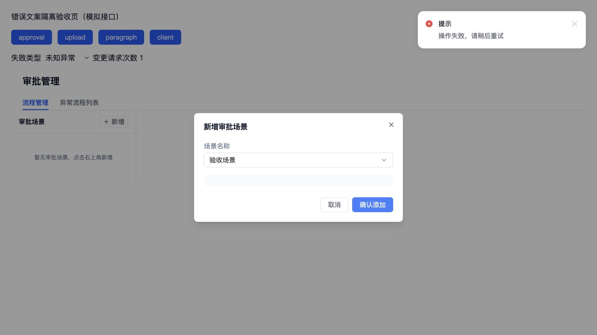

# 错误提示文案修复：验证与验收

2026-10-22；基线 `2844b274b`；隔离开发分支 `codex/user-facing-error-messages`。已实现并完成技术验证，未合并、未推送。实施计划见 [plan](2026-10-22-user-facing-error-messages.md)。

## 改动结果

- 两端请求失败只采用本地登记的业务文案或通用兜底；网络与超时使用三语言提示。原始异常、对象、未知后端串不再作为兜底展示。
- 18 个既有错误码模板删除技术异常插值，保留具体失败场景及文件名、模型名、配额等业务参数。后端数据只填充占位符，不再作为翻译配置传入。
- 保留 ApiError 身份、原始 cause/response/status_message/data、错误码恢复分支、取消/静默与提示去重行为；已标准化的错误也不会绕过文案收口。
- 上传摘要、异步解析详情和预校验异常同步收口；唯一的本地 Excel 预校验返回文案仍保留，非法对象不会转成字符串。
- 两端失败文件状态独立保留诊断证据；client 的 failureEvidence 不复用重复文件 `_raw`。删除 platform 原有全量 files 调试日志，避免自动输出新增证据。
- 2FA 仅删除 5 个未被调用的错误回调及 Props；实际认证请求的本地化失败处理不变。
- 触及文件中的旧敏感内容提示已提取三语言；未修改页面视觉和后端接口。

## 验证结果

| 检查 | 结果 |
| --- | --- |
| 共享错误包 | 13 项测试通过；lint / 类型检查通过 |
| platform 请求、审批、段落元数据、上传 | 43 项测试通过，单 worker |
| client 请求、业务错误转换、知识库与上传 | 70 项测试通过，单进程 |
| 修改文件 ESLint | 两端通过；suppression 仅收缩，未新增 strict-ignore |
| 类型检查 | client 全部通过；platform 保留原有 1 处测试错误 |
| i18n / locales 生成一致性 | 通过，无新增漂移 |
| architecture guard / git diff --check | 通过 |
| 生产构建 | platform 23.73s、client 51.72s，串行通过 |
| 独立 review | PASS；诊断证据遗漏及全量日志问题均已修复 |

完整 lint 仍有实施前已存在的问题：platform 85 errors，client 29 errors / 2 warnings。平台类型基线为 `clientVoiceDraft.test.tsx:47` 参数数量错误。本次修改文件无新增违规，没有为了通过检查放宽规则。

测试经过 RED → GREEN：普通/循环对象与原始异常、技术模板插值、翻译参数覆盖、已标准化静默错误、上传原始串与映射证据均先复现后修复。回归保留已知业务码、配额早停、原有一次重试预算、重命名元数据与敏感词提示。

## 浏览器验证及边界

本机临时 Vite 夹具使用真实组件、真实两端请求适配器、现有样式和模拟接口，不连接业务后端、不写入环境数据。通知显示时间仅在夹具延长，生产实现未修改。

- 真实 ApprovalPage 新增弹窗：未知异常、业务冲突 26130、网络失败分别验证。每次只显示一条对应提示，弹窗与选择内容保留，没有误显示成功。
- 真实 FileUploadStep4：未知 remark 显示“解析失败”，失败行不暴露原始串。重复轮询去重和诊断证据另有组件测试验证。
- client 真实错误出口：普通异常显示中文兜底，超时显示中文超时提示。
- 真实段落删除 API 配合测试表单：未知、业务冲突、网络失败三类均单次提示，输入保留、按钮恢复。此项没有挂载完整 Paragraphs 页面，不能称为完整页面验收。

浏览器仍观察到既有上传组件的嵌套 p 和 updater 中触发通知的 React 开发警告；相关写法本轮未改，不称为控制台全绿。临时验收页自身的首次路径/语法问题已修正后复测。临时浏览器页与服务已关闭。

## 真实业务验收（待执行）

- [ ] 审批新增/编辑失败：只提示一次，保留输入，不误关闭或显示成功；配额/冲突等具体业务原因仍可读。
- [ ] 完整知识库段落页：删除/编辑失败后回滚与重载正常，未知异常不展示对象或技术串。
- [ ] 上传：本地 Excel 校验仍具体，网络/解析失败可读；ASR 配置类错误仍有操作指引；重试与批量配额早停正常。
- [ ] 切换中/英/日语言检查提示；真实后端 2FA 流程未验收，不以死回调清理代替认证验收。

验收后再由用户决定是否合并、推送；本轮不自动同步 release。
