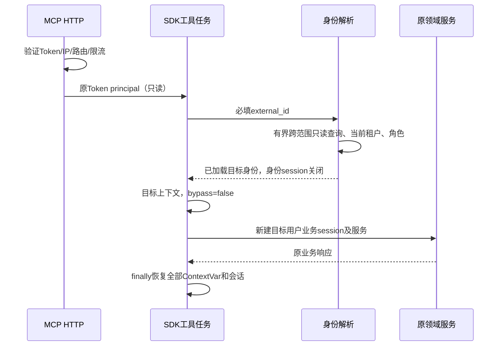

# F081：身份执行设计

- Feature ID: `081-mcp-external-user-identity`
- Status: `IMPLEMENTED_LOCAL`
- Created: `2026-10-22`
- Related: [spec.md](spec.md)、[requirements.md](requirements.md)。本文记录已确认设计；实际实现、验证状态见 tasks.md 与 verification.md。

## D-01 公共身份参数及两条入口（REQ-001/002/007/010）

新增 `mcp_server/domain/schemas/identity.py`：

- `ExternalAccount`：严格 string，前后去空白，长度 1～255；保留前导零，不转数字、不替换字段。
- `McpIdentityRequest`：继承现有 StrictRequest 的 extra=forbid、hide_input_in_errors=true，增加必填 external_id。
- `McpExecutionIdentity`：仅调用内使用的不可变 DTO，包含实际 `UserPayload`、目标 tenant_id 与审计需要的 Token ID/原绑定 user_id/原租户；不回写 Token principal、不向客户端回显。

将 `StrictRequest` 定义放到 identity.py，在 browse.py 保留原导入路径；它仍是不含身份的通用模型基类，仅十个工具的顶层请求（含原 `McpSearchRequest`）接入公共身份基类，覆盖 browse/content/ingestion 与两种检索名称。所有十个注册函数的签名也用相同必填别名；不能只改 DTO，遗漏 tools/list 或 SDK 前置校验。请求响应 DTO 分开：不能给 McpPage/FileDetailResponse/FileSourceResponse/WriteResponse 等响应，或 FolderScope 等嵌套业务对象强加 external_id。

九工具 runtime 消费 `params.external_id` 后，对领域调用使用 `model_dump(exclude={"external_id"})`。旧 search_knowledge 同样先解析身份，构造 RetrieveReq 时排除 external_id，防止业务工厂收到未知参数或再触发 REST 代理。

HTTP Token 校验、初始化、列表、405、CORS/体积限制不变。ASGI request.state 中的原 `mcp_principal` 只读，不能写入每次 tools/call 的目标用户。工厂可注入身份服务依赖，测试应替换该边界而非伪造全局当前用户。

## D-02 账号和当前租户解析（REQ-003/004/011）

新增 `McpUserContextService`，使用现有 UserRepository 和新增 TenantMembershipRepository，只读解析：

1. 请求模型先拒绝缺参、非字符串和空/超长值；使用规范化账号查询全部有效候选。用 Python 字符串精确比较复核 `candidate.external_id`，避免数据库大小写/尾空格排序规则造成误匹配，再判断候选数量等于 1。
2. 不按 `source`、是否有权限、Token 用户或成员关系来消除重复；零/多候选统一拒绝。无外部代码/用户名回退。
3. 按现有 `settings.multi_tenant.enabled` 读取运行模式，无法读取/解释配置时失败，不用默认 false 掩盖错误。
4. 多租户：仓储返回该用户所有 `is_active=1` 关系，包含状态字段但不先过滤 enabled/status、不通过 inner join 丢掉缺失租户的关系；数量非一拒绝。唯一关系需 status=active，然后按 PK 读取 Tenant，要求存在且 active。
5. 单租户：跳过关系选择，按 PK 校验默认租户 1 有效；不回写缺失的关系。
6. 在受控的身份查询范围内调用 `UserPayload.init_login_user` 构造目标角色、名字、token_version、管理员身份。任何角色/FGA/数据库异常必须失败；不返回空角色默认权限，不调用登录租户同步、自动注册、主部门推断或个人库创建。
7. 每调用重新解析，身份查询使用独立受管理 session；完成加载后关闭该 session，再启动业务 session。返回只含已加载的标量和 UserPayload，不把未加载 ORM 关系带出作用域。

新增 tenant 仓储接口继承 `BaseRepository[UserTenant, int] + ABC`，实现继承 BaseRepositoryImpl 与接口。拟定方法：

| 方法 | 返回 | 边界 |
|---|---|---|
| `list_current_by_user(user_id)` | list[UserTenant]，当前关系全部候选 | 用户条件与 is_active 条件在 Repository；禁止 first() 掩盖冲突 |
| `find_tenant(tenant_id)` | Tenant 或 None | PK 查询，不将 tenant FK 查询误写成业务隔离过滤 |

复用 `UserRepositoryImpl.list_active_by_external_id`，不修改其其他使用方语义。新仓储不引入 Service ORM、新 DAO、原生 SQL/JSON 方言函数或手写租户隔离 WHERE；身份级跨范围读取以现有上下文机制限定，业务 SQL 继续自动过滤。

## D-03 实际 SDK 任务的上下文（REQ-004/005/006）

新增身份服务工厂和共享调用上下文，在实际执行 tools/call 的 task 内建立，不在 HTTP task 跨 task 重用 reset token。

身份解析可临时设置 visible_tenant_ids=None 并使用现有 bypass，但其作用域不包含业务 factory/operation。解析后目标执行上下文设置：

| ContextVar | 业务值 |
|---|---|
| current_tenant_id | 目标 tenant_id |
| visible_tenant_ids | frozenset({目标 tenant_id})，沿用原 MCP 业务范围 |
| _bypass_tenant_filter | False |
| _admin_scope_tenant_id | None |
| _is_management_api | False |
| _strict_tenant_filter | False，保留既有 MCP 行为 |

保存并按逆序 reset 所有 ContextVar，不允许仅恢复 current_tenant_id。继承的 JWT、管理 scope、全局 super 可见集或 bypass 不得影响业务过滤。目标用户本身的管理员能力从正常身份构造取得，通过既有 PermissionService 路径生效，不复制 Token 能力，也不显式强制清空目标管理员标记。

即使 Token A 与目标 B 跨租户，也不是“让 A 查询 B 的所有数据”，而是由 B 的 identity 对资源执行现有授权；知识空间/入口/物理内容的租户及 Owner 检查保持。角色/成员变更的强一致即时撤权不在本次承诺中，调用内不重新切换身份，下一调用重新解析。

## D-04 九工具与旧检索及写入（REQ-001/005/007/008/010）

`McpToolRuntime.invoke` 和 `McpSearchService.search` 共享同一个 `McpUserContextService` 装配/作用域入口；分别保留其业务工厂和响应。`McpAuthService.use_identity` 必须明确接收执行身份，不能在业务中再次用原 principal 覆盖目标租户。直接内部调用缺少外部账号同样拒绝，没有测试专用绑定用户 fallback。

`build_tool_services`、`build_search_service` 接收目标 UserPayload，原知识 Owner/PermissionService/Repository/current canonical 链路不变。对两个写工具：

- `_require_target`、目录归属、目标上传权、配额与重复检查使用目标身份；Token 用户可写不能替目标用户放行。
- 原 Owner 写入 uploader/owner、资源授权与补偿仍由既有创建流程执行；MCP 不另行覆盖文件字段或创建权限元组。
- 原始上传归属字段、遥测、解析优先级、tenant headers 和异步投递均从目标业务服务/上下文继承，不新增 Worker 分支。
- 保留 F078 上传取消、入队前后及投递不确定处理；身份阶段失败不写临时对象，已进入写入流程的失败按既有恢复语义处理，不因“代理身份调用失败”删除已受理文件。

## D-05 失败、预算、审计与一致性（REQ-006/009/011）

账号或租户不可用统一抛既有 UnAuthorizedError，在 MCP 边界映射安全工具错误，不透出候选用户/tenant ID 或具体存在性。内部审计原因仅枚举，如 user_unavailable、user_ambiguous、tenant_unavailable、membership_ambiguous、identity_error；禁止异常文本携带账号、连接信息或签名返回客户端。

身份解析设置最多 30 秒预算。九工具将身份解析、角色构造、业务装配和操作纳入现有读 30 秒/写 120 秒总时限；旧检索保留原 service.timeout_seconds 的检索/来源预算，其前置身份阶段最多额外 30 秒。数据库 driver/session 自身失败立即传播为安全错误。取消不捕获为成功，不做会继续写入的 shield 重试。

审计始终记录 Token ID、绑定用户 ID/原租户 ID、执行用户 ID/执行租户 ID、工具、trace、outcome、elapsed。执行身份未解析时目标字段为空；不要以 Token 用户冒充实际执行用户。默认不记录 external_id、Token 明文、输入正文、Base64、候选名称或签名地址。九工具和原检索的日志都要更新，不能只改一条链路。协议层 AuditedMcpServer 还覆盖 SDK 在业务函数前的缺参/类型/未知工具拒绝，执行目标字段为空；用调用 task-local 标记避免业务审计重复，最终恢复该标记。未知工具只记固定标签，不记录任意输入名称或原始参数。

身份解析每调用只做用户候选、关系、租户及现有角色加载，不长期缓存代理结果。没有新表或新数据写入，也不保证跨数据库/FGA/存储/队列的全局事务；已受理写入的身份信息按原任务快照传播。

## D-06 文件清单、验证与交付（REQ-010/012）

### 计划新建

| 文件（相对 src/backend，文档除外） | 目的 |
|---|---|
| `bisheng/mcp_server/domain/schemas/identity.py` | 公共账号请求类型、执行身份 DTO |
| `bisheng/mcp_server/domain/services/user_context_service.py` | 账号/租户解析、共享业务作用域 |
| `bisheng/tenant/domain/repositories/interfaces/tenant_membership_repository.py` | 只读成员/租户查询契约 |
| `bisheng/tenant/domain/repositories/implementations/tenant_membership_repository_impl.py` | ORM 读取实现；新目录补必要 __init__.py |
| `test/mcp_server/test_mcp_user_context_service.py` | 身份与生命周期主要契约 |
| `test/tenant/test_tenant_membership_repository.py` | 真实 ORM 成员关系/租户读取边界 |
| 本特性 tasks.md、verification.md、code-review.md | 规格确认后形成任务和实施证据 |

### 计划修改

| 文件/范围 | 变更 |
|---|---|
| `mcp_server/domain/schemas/{browse,search,content,ingestion}.py` | 请求与响应分离，十工具请求接入身份；保留 FolderId |
| `mcp_server/api/endpoints/{tools,query_tools,content_tools,write_tools}.py` | 必填函数签名与参数构造；不向原领域请求透传账号 |
| `mcp_server/domain/services/{auth_service,tool_runtime,search_service,factory}.py` | 接入/执行身份分离、共用上下文、目标工厂、审计 |
| `mcp_server/api/router.py` | 装配可注入身份服务工厂，保留 HTTP 鉴权与传输 |
| `test/mcp_server/{test_mcp_server,test_mcp_tools,test_mcp_knowledge_flow,test_search_factory,test_main_integration}.py` | 原用例显式提供业务账号/身份依赖，补 schema/权限/跨租户及端到端 |
| `docs/api/mcp-usage.md`，F070/F078 当前规格/usage/设计相关身份说明 | 明确新参数、旧策略被覆盖、可信后端示例、升级与回退 |

其中上表省略的 `bisheng/` 前缀仅为排版简化，均指 `src/backend/bisheng/mcp_server/...`。不修改 developer_token 共享鉴权、REST 代理、知识 Owner、权限实现或 Worker 来绕过目标身份；若发现必须修改其生产行为，先记录设计偏差，范围实质变化时重新确认。

### 验证批次

1. V-IDENTITY：测试先行，账号/成员/租户/角色失败、精确字符串与无副作用；仓储用现有 SQLite fixture，MySQL/DM8 另外标记真实环境验收。
2. V-PROTOCOL/V-AUTHORITY：真实 SDK 检查十定义、两执行链路、Token A / 用户 B 的正反权限，HTTP 鉴权先于身份解析；业务服务采用现有真实实现与受控外部端口。
3. V-FLOW/V-ISOLATION：两租户并发及取消，创建/上传/回查，审计、会话和 ContextVar 恢复；复用已有 E2E，不构建第二套大型 harness。
4. V-REGRESSION/V-DOC：运行 MCP、Token、受影响 REST/检索/来源与知识权限回归、Ruff/架构/文档检查。发现存量失败时对照未改 HEAD，不能隐藏或用旧通过数替代新契约验证。

同一代码状态复用证据，按风险批次执行，不按每个参数/工具重复跑全套。实际行为验证以 verification.md 为准；可信后端的真实账号绑定与跨租户权限必须部署环境另验。

### 后续任务分组与门禁

规格确认后按身份仓储/服务、参数注册、两条 runtime 接入、端到端与文档交付拆正式 tasks，每个实现任务引用 REQ/AC 并配测试，按项目 tasks-checklist 自审。用户已确认完整规格并授权实施，正式任务已落于 tasks.md。

回退按局部应用代码执行，不回退或删除已创建业务数据。切换前可信后端完成账号注入和工具清单刷新；本轮不提交、推送或部署。
