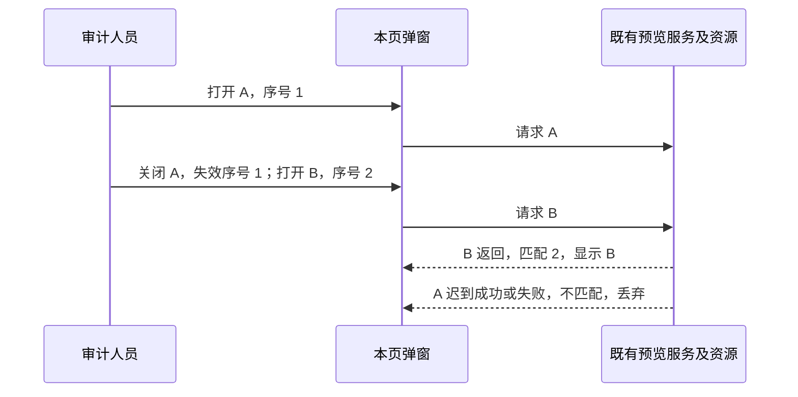

# 审计异常文件 · 文件名弹窗预览设计

F086 · v2.5.0-sg · 设计 v1 · 2026-11-23 · **设计就绪，待确认**。依据：[需求 v1](spec.md) REQ-01 / AC-01 至 AC-04；源码基线 `f881c236bb`。本文是方案，不是已实现行为或验收报告。

## 1. 摘要与范围

审计人员点击文件名时，在原列表上方查看所点文件；关闭后继续原来的筛选、分页和勾选。**列表可见不代表正文可读**。每次打开都按当前身份向现有文件预览服务申请地址；被拒、没有可显示内容或读取失败，弹窗给出反馈，绝不改走下载。仅影响管理端异常文件页，不改变门户、文件状态、权限、对外接口、公共组件、数据库、配置或依赖。

## 2. 现状、修改位置与理由

| 位置 | 已核实的现状 | 必要增量及影响 |
|---|---|---|
| [异常文件列表](../../../src/frontend/platform/src/pages/LogPage/abnormalUpload/AbnormalFilesTab.tsx#L446-L468) | `row.file_id` 标识一条记录，文件名是纯文本，复选框和操作按钮独立。重新 `load` 会清空勾选。 | 仅该列复用现有表格单元格、截断样式、全文提示，内置原生 `button type="button"`；保留列宽、键盘激活及可辨认焦点。打开/关闭只更新预览选择，不触碰列表状态或调用 `load`。不改全局截断单元格。 |
| [异常文件请求模块](../../../src/frontend/platform/src/controllers/API/abnormalUpload.ts) | 列表提供 `knowledge_id`、`file_id`、`file_name`，没有正文地址。 | 增加仅供此页使用的类型化 GET 包装；无后端变动。只传当前行两个 ID；同名不按名称查找。 |
| 异常文件同目录内的私有预览弹窗（拟新增） | 既有[知识库渲染分派](../../../src/frontend/platform/src/pages/KnowledgePage/components/PreviewFile.tsx)与切片编辑状态耦合；[引用抽屉](../../../src/frontend/platform/src/components/bs-comp/chatComponent/CitationDocumentPreviewDrawer.tsx)按引用模型取数且有下载操作。 | 复用管理端 `bs-ui` Dialog 和适用的单格式渲染能力；只维护本次打开的标题、状态和临时地址。避免更改公共组件签名或让审计页承担引用、编辑和下载行为。显示文字优先用既有翻译，不足才补该页所需词条。 |

## 3. 读取契约与权限边界

1. 点击才调用 `GET /api/v1/knowledge/space/{knowledge_id}/files/{file_id}/preview`。`knowledge_id` 映射路由的 `space_id`，文件名仅作标题与格式提示。授权以服务端实际文件记录及其空间为准；[接口](../../../src/backend/bisheng/knowledge/api/endpoints/knowledge_space.py#L955-L962)与[服务](../../../src/backend/bisheng/knowledge/domain/services/knowledge_space_service.py#L18798-L18862)处理预览能力、文件关系与查看权限，并解析条目对应的实际文档版本。前端不自行认定管理员有权，不新增预检，不借其他端点兜底。`can_download` 不是预览准入条件。
2. 复用[平台请求封装](../../../src/frontend/platform/src/controllers/request.ts#L142-L249)，成功封套 `status_code=200` 已解包到 `data`。本调用选择已有的 `silent: true`、可取消信号和有限请求超时；否则部分 GET 业务 403/404 会触发整页跳转。局部静默只改变本请求的错误呈现，不绕过鉴权：业务错误可能拒绝为封套，非 2xx 可能拒绝为 HTTP 错误对象；不将异常当成详情，不写 403 特判。优先使用平台已登记的本地化业务错误，未知错误用弹窗内通用不可用文案；不回显原始 URL、堆栈或任意错误正文。401 登录失效及统一限流仍按全局规则处理，不承诺会话失效后保留列表。
3. 成功不是正文已经可读。[已有详情字段](../../../src/backend/bisheng/knowledge/domain/services/knowledge_service.py#L2421-L2463)包含 `pdf_preview_url`、`preview_url`、`original_url` 和可选网页快照 `html_preview_url`。只用这次成功返回且属于文件服务的资源，经既有文件代理映射保留路径和签名查询串；拒绝其他协议、非文件代理路径、外部网页来源 `source_url/final_url`。不推导存储路径，不转发登录令牌给资源域；拒绝、超时和资源加载失败均不尝试下载或其他读取途径。成功时仅在没有适用预览产物、且原格式本来可安全内嵌时允许用返回的 `original_url` 作**显示源**，不是访问下载接口。
4. 首选已有 PDF 表示；其次选择类型可辨识的既有预览表示；不能把未知文件武断当作 PDF。已知 PDF 字段可不带扩展名；原文件格式可从原名判断。图片使用图片元素及错误反馈，文字用[文本查看器](../../../src/frontend/platform/src/pages/KnowledgePage/components/TxtFileViewer.tsx)的纯文本模式（含 Markdown / HTML 源文本，不执行活动内容）；表格复用[表格查看器](../../../src/frontend/platform/src/pages/KnowledgePage/components/ExcelPreview.tsx)。DOCX 如无 PDF，可复用既有 Mammoth 提取纯文本并作为 React 文本展示，避免将异常文件生成的 HTML 注入页面。音视频按已支持的媒体类型以内嵌控件读取，不自动播放；网页仅使用服务端给出的快照／文本，不导航到源站。原生 DOC/PPT 等没有能渲染的表示则提示不可用。不新增服务端转换，不承诺所有异常文件都有正文。

## 4. 渲染、切换与恢复

**PDF 的特别取舍。** [现有 FileView](../../../src/frontend/platform/src/components/bs-comp/FileView.tsx#L295-L324)异步写模块共享页缓存；只换 React `key` 会隔离组件状态，但不会隔离这份缓存。建议私有弹窗用平台已安装的 `pdfjs-dist` 自带逐次实例化的只读 `PDFViewer`（复用现有 worker 与 cmaps 路径，容器仅含阅读区），每次打开独立文档加载任务、页视图及容器。完成前校验打开序号；关闭时解除文档并销毁加载任务。拒用将任意对象地址直接塞入 iframe 的方案：响应带附件头时可能触发浏览器下载，不符合 AC-03。若未来计划统一 FileView 缓存，应独立评估其他使用方；本次不修改公共组件。

**图 1：为什么 A 的错误也不会覆盖 B（AC-04）。** 序号指一次打开，不是文件 ID；再次打开同一文件也视为新请求。

| 状态或事件 | 弹窗保证 | 副作用边界 |
|---|---|---|
| 打开／重新打开 | 同步清掉旧内容和错误，以当前文件名显示加载中；按本次序号重新挂载查看器。 | 列表渲染不预取。只请求当前选择，不跨次缓存签名地址。 |
| 得到授权及可用表示 | 交给对应只读渲染器；只有当前序号可提交加载、成功和失败。正文加载也须有结束条件；网络失败、解码失败及超时显示不可用，不留永久加载。 | 读取资源字节不等于浏览器保存文件。无下载链接、`window.open` 或启动编辑／重新处理。 |
| 无权限、缺失、未知类型、空地址或请求失败 | 不挂载未授权查看器；提示后仍可关闭，再次点击可重新申请。已有单格式查看器若不能反馈实际读取超时，弹窗对该次读取施加可取消的有限等待，必要时本地读入后再交给查看器，避免双重取数。 | 不自动轮询、不重试、不展示上一个文件。共享请求层仍可处理会话过期。 |
| 关闭、重选或页签卸载 | 先使本次序号失效，取消可取消的详情/正文请求、超时计时和 PDF 加载；卸载查看器，释放临时对象地址。迟到的成功、失败、finally 及媒体事件均不得更新新实例或重新打开。 | 不操作 `selected`、`page`、筛选或 `busy`。后端已产生的预览审计／阅读遥测不撤销；不新增审计事件。 |

## 5. 验证、发布与恢复

以[研发测试用例](test-cases.md)为依据；以下为验证安排，不是执行结果。

| REQ-01 验收条件 | 开发期：管理端 `test/` 非 UI 隔离验证 | 独立测试岗位：真实环境待验收 |
|---|---|---|
| AC-01 正常读取 | 驱动真实详情消费及资源选择，用外部 HTTP 替身分别返回 PDF 表示、可内嵌原件和缺字段数据。断言同名行取所点 ID。 | 可读账户点击两份同名不同正文的异常文件；验证标题和实际页内标记。 |
| AC-02 权限与不可用 | 输入业务拒绝、非 2xx、空地址、未知类型、过期资源、解析失败与超时；断言失败终态且未尝试下载，成功获取地址不冒充渲染成功。 | 真实权限只可见列表不可读正文；真实缺失及损坏样本不泄露正文；验证文件代理及受支持格式。 |
| AC-03 保留列表 | 监测预览链不调列表刷新、重试、删除或下载，业务请求与审计副作用分开。 | 非首页带筛选和勾选打开关闭，观察下载事件、新窗口及列表快照；实际核对列宽、提示、键盘和关闭后焦点。 |
| AC-04 快速切换 | 两个可控异步结果覆盖乱序成功、失败、重开同一文件、资源读取中关闭及卸载；验证仅最后一次可提交并释放旧资源。 | 分别延迟详情及 PDF 资源返回，让 A 在 B 后到；比较 B 第一页及后续页，关闭后不得回弹。 |

发布只需管理端构建，依赖现行预览授权、对象存储代理及平台已打包的 PDF worker；无数据库迁移、后台任务或配置上线顺序。发现串读、越权显示或下载则撤回局部入口及其私有逻辑，无数据回填，既有阅读日志保留。上线时间未定。若实施发现必须变更公共渲染器、配置或对外契约，应停止扩大修改，先说明风险与替代方案再对齐。

**评审状态：** 2026-11-23 初稿。已对照源码、REQ-01 及四项 AC 核对契约、错误路径与竞争窗口；以上为静态调查及设计，不是浏览器渲染、真实权限或 PDF worker 已运行的证据。待用户确认该设计，未进入编码。