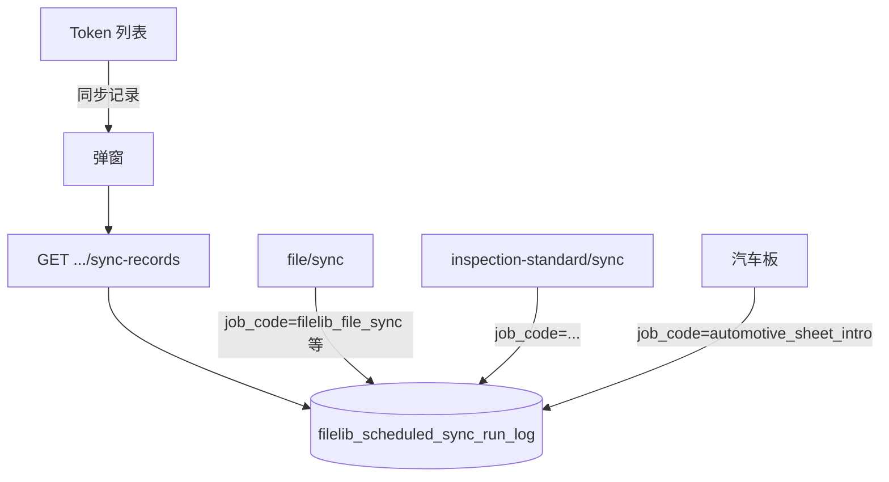

# 开发者 Token 同步记录与错误详情 — 技术设计

| 项 | 值 |
|---|---|
| 文档版本 | `0.3.0` |
| 作者 | AI（sdd-design） |
| 更新日期 | `2026-11-24` |
| 状态 | `实施中` |
| 需求依据 | `requirements.md` v0.2.0（Q2=A） |

> **做什么**：Token「同步记录」弹窗统一展示同步/入库类执行；完整错误 ≤16KB 可复制；去掉汽车板配置区最近执行表。

> **为什么**：需求 v0.2.0；存储复用已有汽车板 run 表，避免重复建表与历史迁移。

> **影响谁**：管理员；同步调用方契约不变；汽车板 UI 收敛。

> **关键选择（已决定）**：**不新建表**，复用并扩展 `filelib_scheduled_sync_run_log`；同步服务收尾显式写入；错误列扩容 + 应用层 16KB 截断。

> **失败后怎么办**：写记录 best-effort，不阻断同步响应。

> **当前进度**：设计已确认可编码；实施中。

## 阅读导航

1. [方案摘要](#1-方案摘要)
2. [依据与范围](#2-依据与范围)
3. [现状及目标架构](#3-现状及目标架构)
4. [核心流程与状态](#4-核心流程与状态)
5. [关键决策](#5-关键决策)
6. [详细契约](#6-详细契约)
7. [影响与依赖](#7-影响与依赖)
8. [验证安排](#8-验证安排)
9. [发布与恢复](#9-发布与恢复)
10. [待决事项及变更记录](#10-待决事项及变更记录)

## 1. 方案摘要

管理员在 Token 行打开「同步记录」，按 `developer_token_id` 分页查询 `filelib_scheduled_sync_run_log`。`job_code`（及展示映射）区分 file/sync、检化验 sync、汽车板；`file/sync` 与检化验在业务收尾写入同表；汽车板继续写同表。错误字段改为可存长文本，应用截断 16KB。配置区删除最近执行 UI。汽车板历史行已在表中，**无需 backfill**。

> **方案结论与状态**：复用旧表 — **已决定**（2026-11-24 用户同意）。整体编码授权仍待一句确认。

## 2. 依据与范围

| 依据 | 版本 | 确认 |
|---|---|---|
| 需求 | v0.2.0 REQ-001～006，AC-01～06 | Q2=A |
| 设计决策 | 复用 `filelib_scheduled_sync_run_log` | 2026-11-24 用户「同意」 |
| 代码 | 现有 ORM / 汽车板 run 仓储 / FilelibSyncService | 源码观察 |

| 改变 | 不做 | 沿用 |
|---|---|---|
| 扩 `error_message`（LargeText）；按 token 列表 API；同步路径显式写入；Platform 弹窗；删汽车板 runs UI | 新表；MCP/retrieve 记账；全局中间件；历史 backfill；一期清理 | 表名、汽车板既有写入、租户字段、`job_code` 区分任务 |

### 概念映射

| 概念 | 存储 | 展示 |
|---|---|---|
| 同步记录 | `filelib_scheduled_sync_run_log` 行 | 「同步记录」弹窗 |
| 接口 | `job_code`（映射为可读名或 METHOD path） | 「接口」列 |
| 触发 | `trigger_type` | manual / scheduled / api |

### 2.1 正确性约束

| ID | 规则 | 机制 |
|---|---|---|
| INV-1 | 仅白名单同步写入 | file/sync、检化验、汽车板显式 `record`；其它 API 不写 |
| INV-2 | 按 `developer_token_id` + 租户隔离 | list API 校验 Token 归属 |
| INV-3 | 错误 ≤16KB；无 Token 明文 | 扩列 + truncate/redact |
| INV-4 | 写失败不改同步结果 | best-effort |
| INV-5 | 汽车板历史与新记录同表可见；配置区无 runs 表 | 查询同表；前端删 UI |

## 3. 现状及目标架构

| 模块 | 现状 | 目标 |
|---|---|---|
| `filelib_scheduled_sync_run_log` | 汽车板专用写入；error 500 字 | 同步类共用；error 扩容；按 token 查询 |
| Platform | 汽车板内嵌 runs | Token「同步记录」；删内嵌表 |
| MCP / retrieve | — | 不写入 |

## 4. 核心流程与状态

### 4.1 开放同步 HTTP（trigger=`api`）

`FilelibSyncService` / 检化验同步成功或失败收尾 → insert（`developer_token_id`、`job_code`、`file_name`、状态、耗时、错误）。

### 4.2 汽车板（manual/scheduled）

维持现有 insert/update 路径（可抽到统一 helper）；保证 `developer_token_id` 有值。

### 4.3 管理端查询

`GET /api/v1/admin/developer-tokens/{token_id}/sync-records?page&limit`  
`WHERE developer_token_id=:id AND tenant_id=:tid` 按 `id`/`start_time` 降序。  
`job_code` → 前端「接口」展示文案（常量表）。

### 4.4 状态

沿用 running / success / failed / skipped。

## 5. 关键决策

### D1 存储 — **已决定：复用旧表**

| 选项 | 结论 |
|---|---|
| 新建 `developer_token_sync_record` | 否决（Q2=A 下重复） |
| **扩展 `filelib_scheduled_sync_run_log`** | **采用**（用户 2026-11-24 同意） |

附带：`error_message` 改为 `dialect_helpers.LargeText`（或等价长文本）；应用层截断 16384 字节；可选 `error_truncated` 布尔列，或截断时在文末追加标记（实现选一种并单测锁定）。

### D2 写入方式 — 同步服务显式写入（维持）

无全局中间件。

### D3 历史数据 — **无需 backfill**

汽车板历史已在同表；list 按 `developer_token_id` 即可看见。  
注意：历史上 `developer_token_id` 为空的行不会出现在任一 Token 下（如实接受，或运维另修，非本期必做）。

### D4 一期不清理 — 维持

## 6. 详细契约

### 6.1 表变更（逻辑）

| 变更 | 说明 |
|---|---|
| `error_message` | `String(500)` → `LargeText`（双库） |
| 索引 | 建议 `(developer_token_id, id)` 或 `(developer_token_id, start_time)` 便于 Token 侧分页 |
| `job_code` 约定 | `automotive_sheet_intro`（已有）；新增如 `filelib_file_sync`、`filelib_inspection_standard_sync`（实现时常量锁定） |

`file/sync` 写入时 `developer_token_id` 取当前鉴权 Token id；`trigger_type='api'`。

### 6.2 管理 API

同前：`GET .../developer-tokens/{token_id}/sync-records`。  
响应字段对齐弹窗列：id、interface（由 job_code 映射）、trigger_type、status、file_name、start_time、duration_ms、error_message、error_truncated（若有）。

### 6.3 内部写入

`FilelibScheduledSyncRunLog` 仓储增加/复用 insert·update；统一 `finalize_sync_record(...)` helper 供三处调用，内含 truncate/redact。

### 6.4 前端

Token 表「同步记录」弹窗；错误详情+复制；汽车板删最近执行；hint 可选。

## 7. 影响与依赖

| 影响 | 说明 |
|---|---|
| 迁移 | 改列类型 + 索引；无新表 |
| 汽车板旧 API `/runs` | 前端停用；后端可保留兼容 |
| 写入量 | 仅同步类，可控 |
| 双库 | LargeText / 索引按 dialect_helpers |

## 8. 验证安排

| AC | 开发期 | 说明 |
|---|---|---|
| AC-01～03 | pytest + 可选 vitest | |
| AC-04 | file/sync 写、retrieve 不写 | |
| AC-05 | 同表已有/新写汽车板行按 token 可查 | 无 backfill 任务 |
| AC-06 | 前端无 runs 区块 | |
| AC-07 | 不适用 | |

## 9. 发布与恢复

1. Alembic 扩 `error_message` + 索引。  
2. 后端写入与 list API。  
3. Platform。  
4. 回滚代码；列类型回滚按迁移策略（长文本回短需谨慎，发布说明写明）。

## 10. 待决与变更

| ID | 事项 | 状态 |
|---|---|---|
| O-1 新表 vs 旧表 | 复用旧表 | **已决定** |
| O-2 backfill | 不做 | **已决定** |
| O-3 可进入编码 | 是 | **已决定**（2026-11-24） |

| 版本 | 变更 |
|---|---|
| 0.1.0 | 新表 + 中间件（Q2=B） |
| 0.2.0 | Q2=A；显式写入；仍建议新表 |
| 0.3.0 | **改为复用 `filelib_scheduled_sync_run_log`**；取消 backfill |

### 请确认

**本设计（复用旧表）是否可以进入计划与编码？** 是 / 否  
