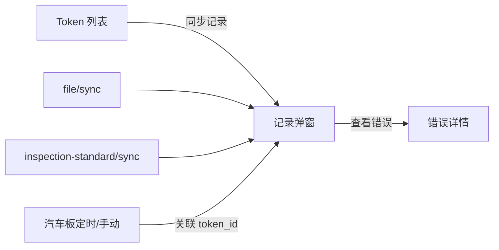

# 开发者 Token 同步记录与错误详情

| 项 | 值 |
|---|---|
| Feature ID | `086-developer-token-sync-records` |
| 文档版本 | `0.2.0` |
| 日期 | `2026-11-24` |
| 状态 | `需求已闭环（范围变更后）` |
| 来源 | 用户口头需求 + grilling；2026-11-24 变更 Q2=A |
| 适用 | Platform 系统管理 → 开发者 Token；文件库同步类开放接口与汽车板同步 |
| 确认依据 | 原确认 + 用户明示「需求变更 Q2 问题我选 A」；① 接口列仍保留；② 成败都记；③ 一期只写入不清理 |

## 目录

1. 背景与问题
2. 目标与指标
3. 范围（含不做）
4. 用户场景与流程
5. 功能需求
6. 非功能与依赖
7. 数据与埋点
8. 验收标准
9. 风险与灰度回滚
10. 变更记录

---

## 1. 背景与问题

**谁 / 场景**：系统管理员在「系统管理 → 开发者 Token」排查**文件同步类**对接失败（含 `file/sync`、检化验同步、汽车板介绍定时/手动同步等）。

**现状（源码观察）**：鉴权成功仅更新 `last_used`；汽车板配置区有截断 500 字的「最近执行」；无 Token 侧统一同步记录与完整错误详情。

**影响**：同步失败与汽车板入口分裂，错误不便完整查看。

**本次必要性**：Token 侧「同步记录」统一查看同步类执行与完整错误；汽车板记录归关联 Token。

## 2. 目标与指标

| 名称 | 定义／口径 | 基线 | 目标 | 观察周期 | 数据来源 | 负责方 |
|---|---|---|---|---|---|---|
| 同步失败可定位 | 在关联 Token「同步记录」中找到同步类失败并打开完整错误（≤16KB） | 无统一入口；汽车板 500 字截断 | AC 通过 | 上线验收 | 验收用例 | 产品 + QA |
| 入口统一 | 汽车板执行仅通过关联 Token「同步记录」查看 | 配置区自带表格 | 配置区无该表 | 上线验收 | UI 验收 | 产品 + QA |

## 3. 范围（含不做）

### 包含（一期）— Q2=A

- Token 列表「编辑」旁「同步记录」弹窗；列与汽车板最近执行对齐，并含「接口」列。
- **仅同步/入库类**写入记录（成败都记）：
  - `POST /api/v2/filelib/file/sync`（该 Token 鉴权通过后）
  - `POST /api/v2/filelib/inspection-standard/sync`（同上）
  - 汽车板介绍同步（配置 `developer_token_id` = 本 Token 的定时/手动）
- 错误列截断；「查看」详情弹窗 + 复制；存储上限 16KB。
- 删除汽车板配置区「最近执行」表；测试同步 toast 保留。

### 排除 / 不做（一期）

- **MCP**（按次请求头 Token，非同步入库类）。
- **非同步开放 API**（如 retrieve、list、detail、source_url 等）不写入同步记录。
- 鉴权失败、伪造 Token 不入账。
- 一期不做自动清理；不改开放 API 对调用方的错误契约。
- 不上线前非汽车板的历史同步回填（无统一表则无法回填）；汽车板已有 run log 可见性见 REQ-004。

### 角色与边界

- 权限与租户：与现有开发者 Token 页一致。
- 汽车板记录仅出现在其**关联 Token** 的「同步记录」。
- `file/sync` / 检化验同步记录出现在**实际请求所用 Token** 下。

### 术语

| 规范名 | 含义 | 状态 |
|---|---|---|
| 同步记录 | Token「同步记录」弹窗中的同步/入库类执行记录 | 已确认（随 Q2=A 收窄含义） |

## 4. 用户场景与流程

### S1 查看同步记录

管理员 → Token 行「同步记录」→ 分页列表（倒序）→ 关闭。

### S2 查看完整错误

失败行 → 查看 → 详情全文（≤16KB）→ 复制。

### S3 汽车板归关联 Token

汽车板关联 T 失败 → T 的同步记录可见；配置区无最近执行表。

### S4 开放文件同步失败

用 Token T 调 `file/sync` 失败 → T 的同步记录可见；`retrieve` 等失败**不出现**。

## 5. 功能需求

### REQ-001 入口与权限（P0）

「编辑」旁「同步记录」；权限与编辑同权；跨租户拒绝。

### REQ-002 列表字段与分页（P0）

| 字段 | 说明 |
|---|---|
| id | 记录 ID |
| interface | 接口：如 `POST /api/v2/filelib/file/sync`、`POST /api/v2/filelib/inspection-standard/sync`、汽车板固定名「汽车板介绍同步」 |
| trigger | `api`（开放同步 HTTP）/ `manual` / `scheduled` |
| status | `running` / `success` / `failed` / `skipped` |
| file_name | 可空，无则 `-` |
| start_time / duration_ms / error_message | 同汽车板展示习惯；错误列表截断 |

分页默认 limit=5；`start_time` 降序，同时间 `id` 降序。

### REQ-003 错误详情（P0）

列表截断 → 详情全文 + 复制；UTF-8 ≤16384 字节，超出截断并注明；脱敏 Token 明文。

### REQ-004 记录写入范围（P0）— Q2=A

| 来源 | 写入 | trigger |
|---|---|---|
| `POST .../file/sync`（鉴权通过） | 是 | `api` |
| `POST .../inspection-standard/sync`（鉴权通过） | 是 | `api` |
| 汽车板介绍同步（关联本 Token） | 是 | `manual` / `scheduled` |
| MCP / retrieve / list / detail 等 | **否** | — |
| 鉴权失败 / 伪造 Token | 否 | — |

汽车板历史：带 `developer_token_id` 的旧 run 在关联 Token 同步记录中可见（backfill 或查询映射，设计选定）。

### REQ-005 汽车板 UI 收敛（P0）

删除配置区最近执行表与刷新；保留配置与测试；可加 hint 指向 Token「同步记录」。

### REQ-006 接口列（P0）

保留「接口」列，用于区分 file/sync、检化验同步、汽车板。

## 6. 非功能与依赖

| 类别 | 要求 |
|---|---|
| 性能 | 同步路径 best-effort 写记录，失败不阻断同步响应 |
| 安全 | 管理员权限；租户隔离；错误无 Token 明文 |
| 存储 | 错误 ≤16KB；一期不清理 |
| 双库 | 新表/迁移 MySQL + DM8 |

**依赖**：`FilelibSyncService` / 检化验同步 / 汽车板同步；开发者 Token 鉴权。

## 7. 数据与埋点

同步记录归属 Token+租户；含 interface、trigger、status、文件名、时间、耗时、错误。一期不强制产品埋点。

## 8. 验收标准

| ID | REQ | 预期 |
|---|---|---|
| AC-01 | REQ-001 | 点「同步记录」打开仅该 Token 的列表 |
| AC-02 | REQ-002/006 | file/sync 与汽车板（或检化验）至少两种 interface 可区分 |
| AC-03 | REQ-003 | 详情完整可复制；&gt;16KB 注明已截断 |
| AC-04 | REQ-004 | T 调 file/sync 失败入账；同 T 调 retrieve 失败**不入账**；伪造 Token 不入 T |
| AC-05 | REQ-004 | 汽车板关联 T 手动失败可见，trigger=manual |
| AC-06 | REQ-005 | 汽车板配置区无最近执行表 |
| AC-07 | — | **取消**（原 MCP；改范围后不适用） |

## 9. 风险与灰度回滚

| 风险 | 应对 |
|---|---|
| 漏接新同步接口 | 白名单式写入点；新增同步接口须显式接入（设计列出挂钩点） |
| 敏感信息进错误 | 脱敏 + 16KB |
| 汽车板双入口 | AC-06 |

回滚：回退代码；不自动删已落库记录。

## 10. 变更记录

| 版本 | 日期 | 变更 | 依据 |
|---|---|---|---|
| 0.1.0 | 2026-11-24 | 初稿 Q2=B | grilling |
| 0.1.1 | 2026-11-24 | 需求闭环 | 用户「确认」 |
| 0.2.0 | 2026-11-24 | **Q2 改为 A**：仅同步类；排除 MCP 与非同步 API；AC-07 取消；术语收窄 | 用户「需求变更 Q2 选 A」 |

## 四维结论（变更后）

| 维 | 结论 |
|---|---|
| 合理 | 成立：与「同步记录」命名一致，写入量可控 |
| 闭环 | 成立 |
| 边界 | 成立：明确同步白名单 vs MCP/检索类 |
| 可验收 | 成立：AC-01～06；AC-07 废止 |

**残留**：设计需随本变更重确认（去掉全局中间件/MCP，改为同步服务显式写入）。
