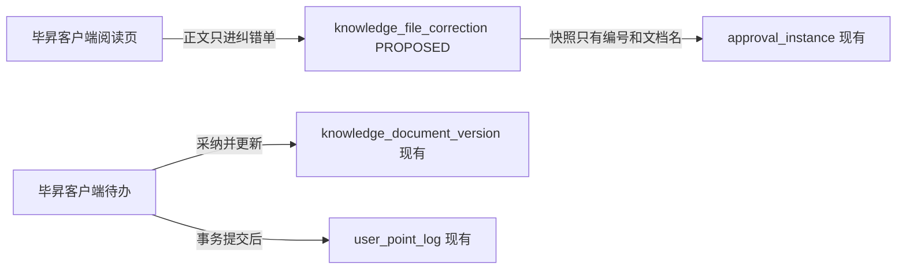
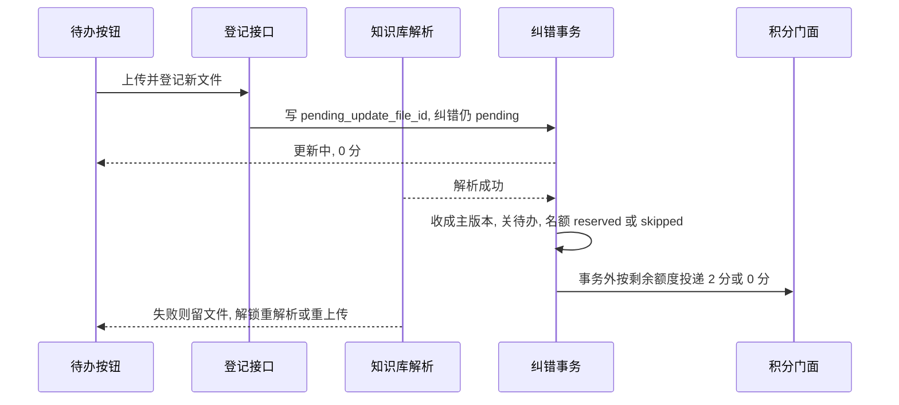
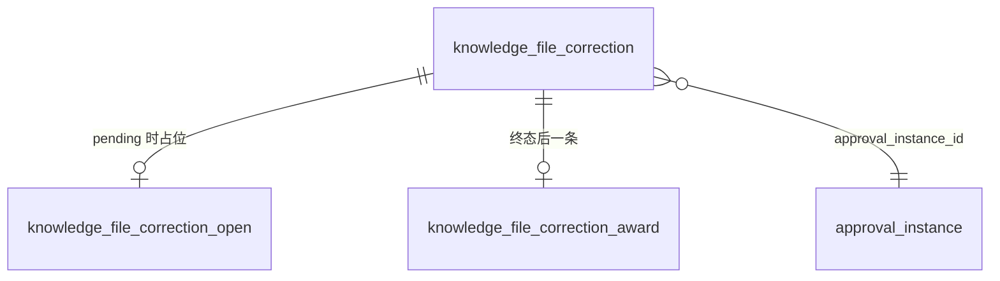
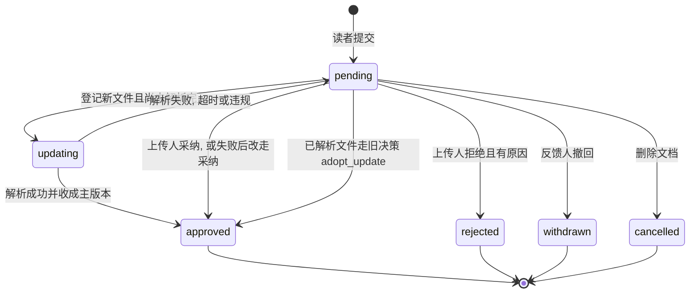
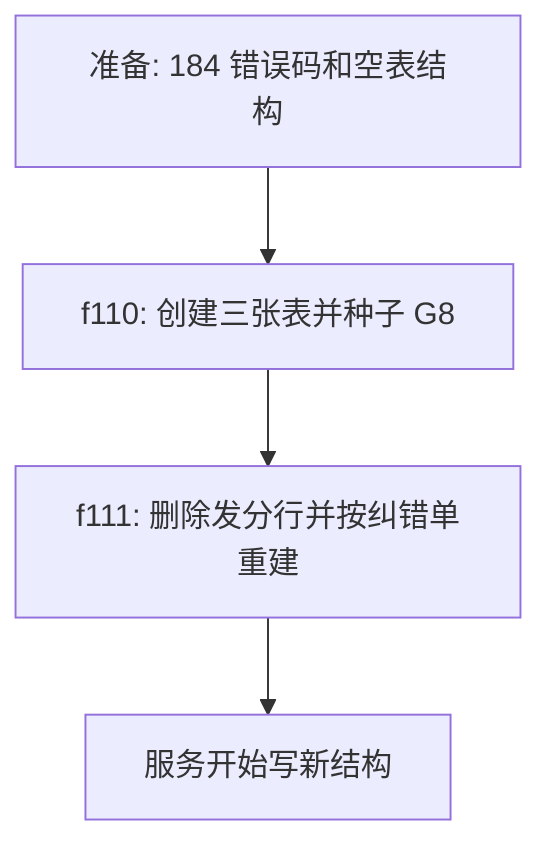

# RFC: 文档纠错进入现有待办，并按动作写入积分账本

- 状态：使用中。实现契约见 [spec.md](./spec.md)。本文继续负责取舍、失败停点和迁移。
- 主要设计类型：产品功能。附带发分行迁移。
- 档位：RFC。触发原因：`f111` 会删除已存在的 `knowledge_file_correction_award` 再重建，这一步不可逆；纠错正文只允许反馈人和冻结上传人读取；处理入口改的是现有审批决策契约。
- 作者/责任人：本次对话起草
- 决策人：产品规则已在 2026-10-13 对话确认。技术选型在本文选定，待同一位决策人接受或退回。
- 评审团队：积分系统 F070
- 目标决策日期：2026-10-13 起保留本文，不替换成 SPEC，也不再以 `design.md` 为设计权威。
- 基线：毕昇 `/Users/lkk/workplace/bisheng`，分支 `feat-2.5.0-sg-lkk-1010`，`HEAD 90e30d7bd`。门户 `/Users/lkk/workplace/shougang-group-knowledge-portal`，分支 `feat-sg-1010`，`HEAD 9721270`。2026-10-14 补充覆盖工作区已落地的登记上传路径。
- 输入依据：[prd.md](./prd.md)；2026-10-14 已确认验证报告（Q1–Q5）

## 1. 执行摘要

读者对已能查看的知识库文档提交一条文字纠错。处理人在提交时冻结为该文件上传人，任务进入现有审批待办。上传人三选一：采纳、采纳并更新、拒绝。采纳并更新先登记新文件，解析成功后再收成当前主版本、关闭待办并发分。事务提交后，按动作给反馈人记入现有积分账本：采纳 1 分且同一人同一文档每个上海自然日最多入账一次，采纳并更新每条 2 分，同一反馈人每个上海自然日合计最高 10 分。

推荐沿用审批中心和积分门面，不新建审批产品，也不新建积分账户。最大代价是发分行迁移不可逆，以及积分投递发生在纠错事务之外，失败时纠错已结束、名额行停在 `reserved`。

## 2. 背景与问题证据

现有待办能把任务派给指定人，但通用提交门在申请人和审批人是同一人时会自动通过。证据：`ApprovalCenterService.auto_approve_self_tasks`，注释常量 `SELF_APPROVAL_COMMENT = "发起人与审批人为同一人，自动通过"`，出处 `bisheng:src/backend/bisheng/approval/domain/services/approval_center_service.py`。纠错的申请人和上传人通常不是同一人，这条自动通过不是主路径；真正要避开的是后面的管理员短路：`decide_task` 在场景分支之后才判断 `operator_is_admin`。若纠错走这条短路，平台管理员可以代批，这和已确认 PRD 相反。

版本链已有 `knowledge_document` 与 `knowledge_document_version`。把文件收成主版本的现成入口是 `KnowledgeVersionService.link_file_to_document`，出处 `bisheng:src/backend/bisheng/knowledge/domain/services/knowledge_version_service.py`。该入口还要求版本管理开关、解析成功后的权限和收藏通知。纠错只要求同一知识库、解析成功、新文件成为主版本。

积分账本已有规则、幂等键和 `daily_cap`。G1–G7 的日上限是「超限整笔不发」。若把采纳并更新也放进这条日上限，同一天的多笔 2 分会被账本吃掉。积分错误码模块 182 已用于调分、规则和公司根，出处 `bisheng:src/backend/bisheng/common/errcode/points.py` 与 `features/v2.6.0/release-contract.md`。

相对 `d2c3ae1b7`，在 `knowledge_file_correction`、`file-corrections`、`award_kind` 这些名字上未发现已发布实现。未提交工作区里已有一份实现。生产库是否已经跑过工作区里的 `f110`，本次调查没有连上生产库，不能写成「没有旧发分行」。

## 3. 目标、约束、不变量与非目标

- 目标和成功条件：以 [prd.md](./prd.md) 的 AC-01 至 AC-18 为准。本文不改这些句子。
- 业务不变量：一条纠错只有一个终态；同一人同一文档同时只有一条 `pending`；正文不进审批快照；积分只进现有账户；更新未成为主版本则不发分、不关待办、纠错保持 `pending`；同一反馈人每个上海自然日采纳并更新入账合计不超过 10 分。
- 技术不变量：纠错单、占位、审批实例和版本主标记在同一数据库事务；积分流水在该事务提交之后；幂等键 `earn:G8:{award_kind}:{correction_id}`；租户条件继续由现有注入完成，业务查询不手写租户过滤。
- 安全约束：正文的权威授权点在纠错读取服务，只比较当前用户是不是反馈人或冻结上传人。审批快照不含正文。18405 与 18020 分开：不能查看文档时不说文件不存在。
- 明确不做：个人库、收藏、专家问答、对话点踩、管理员代批、纠错反馈、第二套积分账户、按差异大小计分、完整版本服务的收藏通知。
- 输入残留风险：失败的更新文件会暂时留在知识库，供重新解析；未成为当前版本前，库列表可能把它当成独立文件。库管在库列表重解析或删除只当旁路。这版不做「取消更新」。登记成功暂不通知已采纳。

## 4. 现网、边界与影响面

### 现网证据

| 对象或边界 | 状态 | 证据 | 所有者 | 本设计角色 |
|---|---|---|---|---|
| 审批实例与任务 | 现有 | `bisheng:src/backend/bisheng/approval/domain/models/approval_instance.py` `ApprovalInstance` / `ApprovalTask` | approval | 写待办。纠错在 `decide_task` 管理员短路之前返回 |
| 决策 HTTP | 现有，契约加法 | `bisheng:src/backend/bisheng/approval/api/endpoints/approval_user.py` `ApprovalTaskDecisionReq` | approval | 增加可选 `new_file_id`；`action` 增加 `adopt`、`adopt_update`。旧值 `approve` 在纠错场景视同 `adopt` |
| 版本链 | 现有 | `knowledge_document`、`knowledge_document_version` | knowledge | 采纳并更新时写主版本。不调用 `link_file_to_document` |
| 文件查看权 | 现有 | `PermissionService.check(..., "view_file", "knowledge_file", ...)` | permission | 提交前的查看强制点。管理员短路仍可能放行查看，代批由纠错分支另拒 |
| 积分规则与流水 | 现有 | `point_rule`、`user_point_log`；门面 `PointsAwardFacade` | points | G8 只作展示和启停。实发金额由事件带入，`daily_cap=None` |
| 积分错误码 182 | 现有 | `common/errcode/points.py` | points | 不复用 |
| 纠错单、占位、发分行 | `PROPOSED` | 命名依据：同库 `knowledge_file` 与 `point_favorite_tier_award` 的「一业务一结果行」。不复用发分行按人加文档当主键，因为采纳并更新要多行 | knowledge 写纠错，points 只写流水 | 相对 `d2c3ae1b7` 未发布 |
| 纠错错误码 184 | `PROPOSED` | `features/v2.6.0/release-contract.md` 已登记 184 未被 182 占用 | knowledge | 18400–18410 |
| 门户 G8 展示 | 现有展示位 | 门户 `frontend/src/pages/admin/pointsAdminUtils.ts` | 门户只读默认值 | 改种子展示，不建纠错页 |
| 门户 BFF 纠错规则 | 未发现 | 在门户 `HEAD 30d0c6c` 的 `backend/app` 内未发现纠错路由。未核实已部署环境是否有手工配置 | 无 | 不新增 |

近邻及不选原因：问答采纳走 G4，对象是回答不是文件。库间分享走 G7，对象是分享单。部门文件查看审批是另一条固定审批人流程。用户已指定纠错走消息中心待办，处理人是上传人。本文不把这三条合成一条。

### 调用方、消费者、数据责任和未覆盖范围

毕昇客户端是提交、读正文和待办按钮的消费者。门户把客户端嵌进来，积分管理页只消费 G8 的名称、分值和空的每日上限。未覆盖：达梦库、已登录页面点击、生产库里有没有 `f110` 留下的发分行。

### 当前结构图

要回答的问题：纠错正文、待办和积分分别停在哪个模块，正文有没有穿过审批快照。

关键结论：审批模块看得到任务，看不到纠错正文。积分模块只接收已经结束的发分事件。

## 5. 候选方案

### 方案 A：纠错服务写自己的事务，积分门面事后入账

- 核心机制：提交时冻结上传人并占住待处理位。决策在纠错事务内改纠错单、审批任务和版本。提交成功后再投递 G8。
- 优点：代批和自动通过都进不了这条分支。版本失败不会发分。
- 缺点：积分与纠错不是同一个事务。投递失败时纠错已经是终态。
- 风险：`f111` 删表。小版本更新刷分已由产品接受。
- 成本：多三张表，每次更新多一个版本和一次解析。
- 可逆性：代码可回滚。表和流水留下。`f111` 不可逆。

### 方案 B：调用完整 `link_file_to_document`，金额读 G8 分值，日上限用账本

- 核心机制：更新走版本服务；1 分和 2 分都写成规则分值；日上限用 `point_rule.daily_cap`。
- 优点：版本通知和权限与普通上传一致。运营改一个分值就改金额。
- 缺点：版本开关没开时更新会失败。一个分值字段不能同时表示 1 和 2。账本日上限会把同一天的多笔 2 分整笔丢掉。
- 风险：和已确认的「每条真实更新都给 2 分」相反。
- 成本：要先打开版本管理，并改积分规则模型才能存两档金额。
- 可逆性：不改表时比 A 容易回滚，但产品结果不对。

### 方案 C：维持现状

不加纠错。读者只能用现有渠道反映错误，没有待办，也没有 G8。已确认需求无法验收。

### 对比

| 维度 | 方案 A | 方案 B | 方案 C |
|---|---|---|---|
| 正确性 | 符合 PRD 的三动作和 1/2 分 | 日上限和单分值会改写 PRD | 没有这条能力 |
| 兼容性 | 决策接口只加字段和动作 | 可能强迫打开版本开关 | 无变化 |
| 安全与合规 | 正文不出审批快照 | 版本服务还会发收藏通知 | 无变化 |
| 可用性与性能 | 更新跟随文件解析 | 同上，再加通知 | 无变化 |
| 迁移与回滚 | `f111` 不可逆 | 可不建发分行 | 无迁移 |
| 实施与运行成本 | 三张表加一次解析 | 改版本开关和规则模型 | 无 |

## 6. 推荐决策

- 选定方案：A。2026-10-14 在 A 上补充：登记成功不关单；解析成功后再关单发分；更新日上限 10 分写在纠错服务，不写进 G8 账本 `daily_cap`。
- 决策归属：三动作、处理人、1 分和 2 分、每人每日采纳并更新最高 10 分、失败留文件并解锁、只有冻结上传人能重解析/重上传是产品决策，已确认。事务边界、不调用完整版本服务、错误码 184、发分行按纠错单唯一、10 分按当天 `award_kind=update` 且 `reserved`/`awarded` 的行数乘 2 是技术决策。
- 选择理由与接受的代价：A 把「版本没成为主版本就不发分」放在同一个纠错事务里。接受积分滞后和 `f111` 不可逆。账本 `daily_cap` 仍为空，避免连采纳一起卡住。
- 被否决方案及原因：B 会用账本日上限吃掉 2 分和 1 分。C 没有待办。失败自动采纳/自动拒绝/失败也留分已否决。反馈人重解析/重上传已否决。通用 `approve` 仍保留为 `adopt` 的别名。
- 允许推翻的条件：产品要求收藏通知或版本开关一并生效时，更新改为调用 `link_file_to_document`。产品把两档金额改成可配置时，才读取 `score_expr` 来算 10 分封顶。

## 7. 目标设计

### 目标结构图

要回答的问题：一次采纳并更新里，哪些写在提交响应之前，哪一笔在响应之后。

关键结论：用户看到「已采纳并更新」时，版本已经是主版本。登记成功不是关单点。积分可能仍是 `reserved`。客户端不把积分余额当作这次操作的成功条件。

### 前端、BFF 与服务端职责

客户端负责按钮是否出现、500 字计数和解析未完成时记住文件号。按钮隐藏不是授权。门户 BFF 不复制规则。服务端是资格、状态和发分的强制点。

### 数据模型与 ER 图

要回答的问题：一条纠错、一个待处理位、一条发分结果如何对应，正文放在哪。

`knowledge_file_correction` [PROPOSED]。每个字段带中文注释：

| 字段 | 约束 | 注释 |
|---|---|---|
| id | 主键 | 主键 |
| tenant_id | 非空 | 租户ID |
| file_id | 非空 | 知识库文件ID |
| knowledge_id | 非空 | 知识库ID |
| applicant_user_id | 非空 | 反馈人用户ID |
| applicant_user_name | 非空 | 反馈人姓名快照 |
| uploader_user_id | 非空 | 提交时冻结的上传人用户ID |
| uploader_user_name | 非空 | 上传人姓名快照 |
| file_name | 非空 | 文档名快照 |
| content | 最长 500 | 纠错说明，最多500字 |
| status | 非空 | pending、approved、rejected、withdrawn、cancelled |
| approval_instance_id | 可空 | 审批实例ID |
| create_time / update_time | 非空 | 创建时间、更新时间 |

`knowledge_file_correction_open` [PROPOSED]。主键是 `tenant_id + file_id + applicant_user_id`，另有 `correction_id`。注释写明这是待处理占位。并发第二次插入撞主键，返回 18406，不产生第二张待处理单。

`knowledge_file_correction_award` [PROPOSED]。`correction_id` 唯一。`award_kind` 为 `adopt` 或 `update`。`award_state` 为 `reserved`、`awarded`、`skipped`。回写必须按 `correction_id`，不能按人加文档取第一行。

### 业务流程或状态机

要回答的问题：哪些终态还能回到待处理。

`updating` 不是独立库字段, 由 `status=pending` 且 `pending_update_file_id` 指向等待/解析中/重建中/已成功尚未收版本的文件推导。失败后仍是 `pending`, 指针保留。关键结论：没有从终态回到 `pending` 的边。更新中不能采纳、拒绝、再登记、撤回。拒绝不写发分行。已发积分不因删除而追回。

### 关键时序、事务和一致性

提交事务写入纠错单、审批实例、审批任务和占位。采纳并更新在同一事务内把原版本降为历史、新版本标成主版本，再把纠错标成 `approved` 并插入 `reserved` 发分行，然后提交。积分门面在提交之后调用。幂等键存在 `user_point_log`。重复投递同一键不再加第二笔。采纳的每日一次不靠这个键，而靠当天已有 `award_kind=adopt` 且 `award_state=awarded` 的发分行。

自然日按 Asia/Shanghai。比较用上海零点。若实现使用无时区的 `datetime.now()`，只有服务器时区是东八区时才和这条规则一致。这是未知项，不是已接受的产品改口。

### 契约、生产者和消费者

| 契约 | 生产者 | 消费者 | 当前行为 | 目标变化 | 发布顺序 |
|---|---|---|---|---|---|
| `POST /api/v1/knowledge/files/{file_id}/corrections` | 纠错接口 [PROPOSED] | 毕昇客户端 | `d2c3ae1b7` 无此路径 | 新接口。登录用户。失败码 18400–18406 | 先迁移后服务 |
| `GET /api/v1/knowledge/file-corrections/{id}` | 纠错接口 [PROPOSED] | 待办详情 | 无 | 当事人得正文。其他人 18407，响应不含正文 | 与提交接口一起 |
| `POST /api/v1/approval/tasks/{id}/decision` | 现有审批接口 | 客户端待办 | `action` 为通过或拒绝 | 纠错任务接受 `adopt`、`adopt_update`、`reject`；更新要 `new_file_id`。未知字段对只发旧 body 的客户端无影响 | 服务与客户端一起发。只发服务时，旧「通过」仍视同采纳 |
| G8 事件 | 纠错服务 | `PointsAwardFacade.on_file_correction_adopted` | G1–G7 不读这个事件 | 新事件。`delta` 与 `award_kind` 由调用方传入 | 门面与纠错服务同一版本 |

认证沿用登录用户。租户沿用注入。无权限与不存在：查看失败用 18405，文件不存在用 18020，正文不可见用 18407。184 不能复用 182，因为 18201–18208 已是积分文案。

### 权限、信任边界与数据安全

提交强制点是 `view_file` 加上库层级、非收藏、非本人、上传人可用。决策强制点是任务审批人等于冻结上传人，平台管理员在这条分支没有例外。正文列只在纠错表。审批 `payload_snapshot` 只有纠错单号、文件号、文档名、知识库号。审计沿用 `approval_action_log`，动作为通过或拒绝，明细带纠错单号，不带正文。

没有新的加密和保留期限。滥用面是同一对人反复更新刷 2 分，产品已接受，技术上不另做限流。

### 性能、容量、可用性与成本

没有 QPS 承诺。容量假设：纠错量远小于文件上传。主要成本是采纳并更新带来的对象存储、解析和版本行，随被接受的更新次数增长。积分门面不可用时纠错仍成功，发分行留在 `reserved`，用同一幂等键再投。不新增告警阈值。现有异常日志是唯一信号，不足以单独作为回滚阈值。

## 8. 失败模型与恢复

| 失败点 | 已提交状态 | 用户结果 | 自动恢复 | 人工恢复 | 责任人 | 验证 |
|---|---|---|---|---|---|---|
| 并发第二次提交 | 只有一条占位和一条 pending | 18406 | 无 | 无 | 纠错服务 | 171 上双请求，一行 pending |
| 新文件未解析成功 | 纠错仍 pending, 指针保留, 无发分行 | 更新中返回 18411; 旧决策未解析返回 18409 | 失败后重解析或重上传 | 库管旁路删文件后回到无指针 | 上传人 | 登记后读纠错单仍 pending, 积分为 0 |
| 解析失败/超时/违规 | 纠错仍 pending, 失败文件保留 | 待办恢复四选一 | 重解析入队或重上传换文件 | 无 | 冻结上传人 | 失败后重解析文件号不变; 重上传旧文件删除 |
| 更新中撤回或采纳 | 无写入 | 18411 | 无 | 等解析结束 | 纠错服务 | 待办与占位不变 |
| 更新写到一半失败 | 事务回滚 | 错误，待办仍在 | 无 | 重新决策 | 纠错服务 | 注入版本写失败后行数不变 |
| 事务已提交、积分投递失败 | 纠错 approved，发分 reserved，无流水或流水未完成 | 待办已结束 | 同一幂等键再投 | 看日志后重放该事件 | 积分门面 | 第一次投递抛错，重放后流水仍为一笔 |
| 客户端超时但服务已提交 | 服务端已是终态 | 客户端未知 | 重开待办读详情 | 无 | 客户端 | 重放决策得到 18102 |
| 待处理期间删除文档 | 纠错 cancelled，审批取消，无发分 | 待办消失 | 无 | 无 | 删除文件路径 | 删除后 pending 行变为 cancelled |
| 非上传人决策 | 无写入 | 18408 | 无 | 无 | 纠错分支 | 管理员请求后状态仍为 pending |

## 9. 迁移、灰度与回滚

### 迁移阶段图

要回答的问题：哪一步之后旧发分行回不来。

| 阶段 | 读路径 | 写路径 | 真相源 | 进入条件 | 观测 | 回滚 | 不可逆点 |
|---|---|---|---|---|---|---|---|
| f110 | 无读者 | 建表 | 新表 | 库上没有这三张表 | 表存在且 G8 一行 | 删表只在确认没有业务行时 | 已有纠错行之后不能靠降级脚本删数据 |
| f111 | 无旧发分读者 | 删掉发分行再按 `correction_id` 建表 | 新发分行 | 确认旧发分行可以丢，或该表仍为空 | 唯一约束在 `correction_id` | 降级脚本是空操作，恢复不了旧行 | 执行 `DROP TABLE` 之时 |
| 服务 | 客户端新按钮 | 纠错事务加事后入账 | 纠错单 | 两步迁移已在目标库执行 | 决策 200 且发分状态与流水一致 | 回滚代码。表和流水保留 | 已入账流水不删 |

本地 171 若已执行工作区里的 `f111`，那次删除已经发生。生产未在本次调查中执行。

- 上线前置条件：目标库迁移完成；确认没有需要保留的旧发分行；客户端带新按钮。
- 灰度：无独立开关。G8 `status=disabled` 或积分总开关关闭时，处理成功但不入账。
- 成功指标：抽样纠错单状态与发分行、流水一致。没有数值阈值。
- 停止条件：出现管理员能够代批，或未解析文件也被收成主版本。立即停用入口。
- 回滚演练：本次没有做。

## 10. 验证与上线判据

| 成功条件或风险 | 验证方式 | 环境/数据 | 通过证据 | 失败动作 |
|---|---|---|---|---|
| AC-01–AC-18 的写路径 | 接口到库再请求一次 | 171 MySQL | `test/knowledge/test_file_correction_flow.py` 在改 184 之前 6 条通过；改码后拒绝、代批、并发 3 条通过 | 不发布 |
| 采纳并更新两笔 2 分且两条发分都是 awarded | 同上 | 171 | 改码前那条用例通过。改码没有改这条断言，本文起草时没有重跑 | 发布前重跑 |
| 达梦方言 | 未做 | 未跑 | 无 | 上线到达梦前补跑 |
| 已登录页面 | 未做 | 无 | 无 | 不把页面当验收 |

## 11. 假设、未知项与验证性实验

| 未知项 | 影响 | 实验 | 截止 | 责任人 | 结果如何改变决策 |
|---|---|---|---|---|---|
| 服务器时区不是东八区时，采纳日切是否仍是上海零点 | 可能把第二天的 1 分算进当天 | 把容器时区设为 UTC 后同一文档跨上海零点采纳两次 | 发布前 | 纠错服务 | 失败则改为用上海时区的当前时间比较，不改产品规则 |
| 生产是否已有 f110 旧发分行 | `f111` 会丢掉这些行 | 在目标库数 `knowledge_file_correction_award` | 执行 f111 前 | 发布人 | 有需要保留的行则先导出。没有行才执行删除重建 |

## 12. 风险、待确认与决策记录

### 残留风险

失败更新文件会短暂出现在库列表。积分投递失败时用户已看到采纳成功。没有新告警。每人每日 10 分仍允许换版本刷存储和解析。

### 需要谁确认什么

2026-10-14 产品规则已拍板。无需再确认才能实现。

### 决策记录

| 日期 | 决策 | 决策人 | 依据 | 影响章节 |
|---|---|---|---|---|
| 2026-10-13 | 纠错归积分系统，文档放在 F070 子目录 | 用户 | 对话 | 全文位置 |
| 2026-10-13 | 三动作、1 分有日上限、2 分无日上限、无纠错反馈 | 用户 | [prd.md](./prd.md) | 已被 2026-10-14 覆盖日上限 |
| 2026-10-13 | 纠错错误码用 184，182 留给积分 | 用户要求修改冲突后已改工作区 | `points.py` 与 `file_correction.py` | 第 4、7 节 |
| 2026-10-14 | 每人每日采纳并更新最高 10 分, 不含采纳 1 分; 超限仍更新这次 0 分 | 用户 | 验证报告 Q1–Q3 | 第 3、6、13 节 |
| 2026-10-14 | 登记不加分不关单; 解析成功再关单发分; 失败留文件解锁; 只有冻结上传人重解析/重上传 | 用户 | 验证报告 Q4–Q5 | 第 7、8、13 节 |

## 13. 2026-10-14 补充：解析成功后再关单，更新日上限 10 分

主要设计类型：产品功能。档位：标准。理由：改审批待办何时结束、G8 更新发分时机和日上限，并增加失败后重解析。无新表，无权限扩大到反馈人。

### 13.1 目标设计

| 对象 | 状态 | 出处 | 本设计角色 |
|---|---|---|---|
| `register_update_file` | 现有 | `knowledge_file_correction_service.py` | 改为只写指针, 不关单不发分 |
| `promote_parsed_update_file` | 现有 | 同上; `knowledge_imp.py` 解析成功调用 | 对仍 pending 的单: 收版本 + 关单 + 按额度发分。对已 approved 的旧路径: 只收版本 |
| `POST /file-corrections/{id}/retry-update-file` | `PROPOSED` | 命名依据现有登记接口 | 冻结上传人对失败文件走知识库重试 |
| `GET /file-corrections/{id}` | 现有加法 | 纠错读正文 | 增加 `pending_update_file_id` `update_file_status` `update_phase` |
| 18411 / 18412 | `PROPOSED` | 续 184 模块 | 更新中其他动作; 没有失败文件却重解析 |
| G8 账本 `daily_cap` | 现有 | `point_rule` | 仍为空。10 分不写进这个字段 |

`update_phase`：`idle` 无指针；`updating` 指针文件为等待/解析中/重建中/成功尚未收版本；`failed` 指针文件为失败/超时/违规。

写所有权仍在纠错服务。知识库只回调解析结果并提供重试入队。积分门面只在关单事务提交后入账。门户只改 G8 展示文案。

10 分统计：同一 `applicant_user_id`，`award_kind=update` 且 `award_state` 为 `reserved` 或 `awarded`，`create_time` 大于等于当天上海零点，行数乘 2。计入 `reserved` 是为了两笔同时关单时不会都看到未满额。`used + 2 > 10` 则本条 `skipped`，版本和待办仍结束。不按 `file_id`，不读账本 `daily_cap`。

### 13.2 前端

待办仍 pending 时：`updating` 只留置灰「更新中」，隐藏采纳、拒绝、原因框和反馈人撤回；`failed` 显示「新文件解析失败，可重新解析或重新上传」，动作为重新解析、重新上传、采纳、拒绝；`idle` 沿用采纳 / 采纳并更新 / 拒绝。刷新后以 GET 纠错的 `update_phase` 为准，并在 `updating` 时轮询直到 approved 或 failed。

### 13.3 失败与兼容

旁路：库管重解析成功仍走 `promote_parsed_update_file`；库管删除失败文件后清空指针，待办回到 `idle`。旧客户端若在登记后立刻当已处理，服务端待办仍 pending，重开可见「更新中」。`decide adopt_update` 且新文件已是成功：仍可当场关单，并走 10 分封顶。存量「登记时已 approved、指针未清」的单，解析成功只收版本，不再发第二次分。

无 DDL。回滚代码后，进行中的更新单仍 pending；已按新规则入账的 0 分/2 分不追回。
