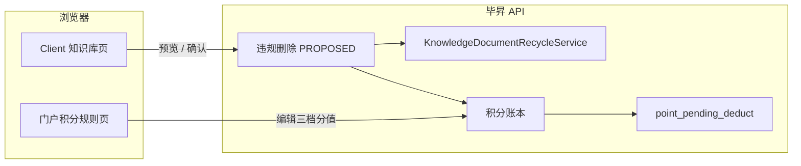
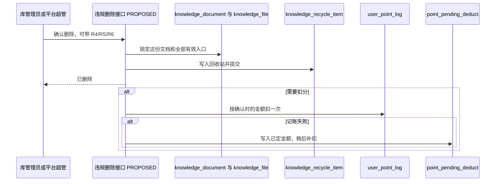
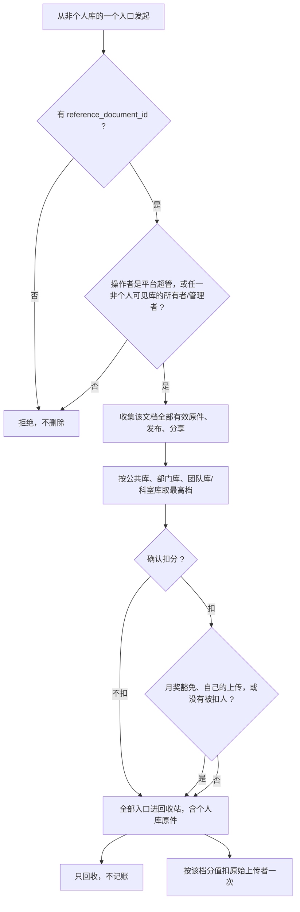

# RFC: 知识文档违规删除并按影响范围扣分

- 状态：已接受。2026-10-15 要求落盘并进入验收用例。确认前不写业务代码。
- 主要设计类型：产品功能
- 档位：RFC。触发原因：库管理员可以一次删掉其他库里的副本和个人库原件，并写积分账本
- 作者/责任人：方案草稿
- 决策人：需求与本 RFC 的技术取舍已在 2026-10-15 对话确认
- 评审团队：毕昇知识库与积分、门户积分规则页
- 目标决策日期：2026-10-15
- 基线：毕昇仓库 `feat-2.5.0-sg-lkk-1010` @ `7fe5e2676`；门户仓库 `feat-sg-1010` @ `9a05faf`。调查了两仓当前分支的删除、分发和积分扣分路径
- 输入依据：已通过的需求验证，加上「违规删除连原件一起删」

## 1. 执行摘要

知识库里新增单独的「违规删除」。操作者选定三种违规之一后，系统按删除前的最高影响范围算出扣分，并确认扣或不扣。确认后，同一份业务文档在各库的原件、发布副本、分享副本全部进入回收站，个人库里的原件也进。普通删除保持不扣分。

扣分复用现有账本和补扣队列。三条新规则用新的分值结构，分别配置公共库、部门库、团队库（科室库用团队库这一档）。专家问答继续用 R1、R2、R3。

已选定的技术取舍：没有文档身份的旧文件拒绝违规删除；扣分金额在操作者确认时定死，补扣不再按删完后的可见范围重算；第一次选择不扣，不占掉以后补扣的那一次。

## 2. 背景与问题证据

- 当前系统与业务背景：专家问答违规删除在 `ModerateDeleteService.moderate_delete`，只有平台超管，可选 R1、R2、R3，先删内容再扣分，失败写入 `point_pending_deduct`。知识库普通删除不扣分。一份业务文档的多个入口共用 `knowledge_file.reference_document_id`，入口类型是原件 `manager`、发布 `publish`、分享 `share`。
- 问题证据和基线：`PointsPendingDeductService.deduct_or_enqueue` 只读 `score_expr.score` 这一个数字，幂等键还带规则编码。知识文档要按库档位取分，并且同一份文档只扣成功一次，现有方法不能直接套。`KnowledgeDocumentRecycleService.recycle` 能把传入的入口写入 `knowledge_recycle_item` 并标记文档已回收。
- 为什么现在处理：平台超管不再逐个翻全库文件，库管理员要能处理敏感文档并扣原始上传者的分。
- 不处理的后果：敏感文档删不干净，或者误把普通删除做成扣分。

## 3. 目标、约束、不变量与非目标

- 目标和成功条件：见第 10 节对照表。操作者看到的扣分、实际入账、删除范围三者一致。
- 业务不变量：
  - 普通删除、回收站清理、批量删除、删文件夹不扣分。
  - 个人库不能作为发起入口。
  - 影响范围从高到低：公共库、部门库、团队库和科室库。用最高一档上配置的分值，不取数字更大的那一档。
  - 默认分值：公共库 3、部门库 2、团队库和科室库 1。
  - 月奖豁免、自己删自己的上传、找不到被扣人：照样删除，不记账。
  - 同一份文档扣分成功后，恢复再删也不再扣。
- 技术不变量：租户仍由现有会话注入。扣分只由积分账本写 `user_point_account` 和 `user_point_log`。知识库不自记一套分。
- 安全/合规/成本/SLO 约束：授权以服务端为准。无单独 QPS 承诺，按单文档入口数量设计，不扫全表。
- 明确不做：不改专家问答 R1、R2、R3；不自动扫敏感词；不退回历史上的上传加分；不追改已入账的扣分；不新做通知文案；门户 BFF 不改。

## 4. 现网、边界与影响面

### 现网证据

| 对象或边界 | 状态 | 出处 | 所有者 | 本设计角色 |
|---|---|---|---|---|
| 专家问答违规删除 | 现有 | 毕昇 `qa_expert/domain/moderate_delete_service.py` `ModerateDeleteService` | 专家问答 | 只作扣分顺序的参照，不改 |
| 扣分与补扣 | 现有 | `points/domain/services/points_pending_deduct_service.py` | 积分 | 调用，并扩展补扣快照 |
| 积分规则 | 现有 | `point_rule`，`points/domain/models/points.py` `PointRule` | 积分 | 新增三条规则，扩展 `score_expr` |
| 规则编辑 | 现有 | 门户 `frontend/src/pages/admin/PointsRuleEditModal.tsx`，直连毕昇 `PUT /api/v1/points/admin/rules/{rule_id}` | 门户前端 | 三种档位输入 |
| 文档身份 | 现有 | `knowledge_document`；`knowledge_file.reference_document_id` | 知识库 | 同一份文档的边界 |
| 跨库入口查询 | 现有 | `KnowledgeFileRepositoryImpl.find_active_entries_for_documents_any_space` | 知识库 | 读 |
| 文档回收 | 现有 | `KnowledgeDocumentRecycleService.recycle` | 知识库 | 写回收 |
| 库等级 | 现有 | `knowledge_space_scope.level` | 知识库 | 读 |
| 库所有者/管理者 | 现有 | `points/domain/services/space_fga_roles.py` `read_space_owner_manager_ids` | 权限 | 读 |
| 月奖身份 | 现有 | `points/domain/constants/monthly_reward_rules.py` `MONTHLY_RULE_MATCHERS` | 积分 | 读，用来判断豁免 |
| 收藏是否还能打开 | 现有 | `knowledge_space_service.py` 收藏列表：`deleted_at` 为空才算有效 | 知识库 | 旁路，不另删收藏行 |
| 知识库违规删除接口 | PROPOSED | 命名依据：知识空间路由前缀 `/knowledge/space`。不复用普通 `deleteFileApi`，避免普通删除带上扣分 | 知识库 | 新入口 |
| 规则编码 R4、R5、R6 | PROPOSED | 命名依据：扣减规则已用 R1–R3。不复用 R1–R3，专家问答仍占用它们 | 积分 | 新种子 |
| `score_expr.mode=library_scope` | PROPOSED | 命名依据：已有 `fixed`、`tier`、`file_correction`。不复用 `fixed`，一个数字表达不了三档 | 积分 | 新结构 |
| `point_pending_deduct.scope_tier`、`score_snapshot` | PROPOSED | 现有补扣表没有扣分金额。删完后可见范围没了，不能重算 | 积分 | 加列 |

### 调用方、消费者、数据责任和未覆盖范围

- 门户积分规则页直连毕昇 `/api/v1/points/*`，不经门户 BFF。
- Client 知识库页面直连毕昇知识库接口。违规删除按钮加在非个人库、且当前用户角色是创建者或管理者的文件操作上。`SpaceRole.CREATOR` / `ADMIN` 只决定按钮显隐，服务端再用 OpenFGA 重查。
- 未覆盖：库外脚本、离线任务有没有调用普通删除。普通删除契约不变，这些调用方行为不变。
- 平台管理员（`can_platform_operate`）不等于平台超管。违规删除只认平台超管，或该文档当前可见的非个人库所有者/管理者。

### 当前结构图

要回答的问题：违规删除从哪个页面进来，谁写删除，谁写账。

关键结论：门户只改规则展示和编辑。删除和扣分的权威都在毕昇。

## 5. 候选方案

### 方案 A：独立违规删除命令

- 核心机制：新接口先按 `reference_document_id` 收集全部有效入口，回收这些入口，再按确认时算出的金额扣一次。
- 优点：普通删除零行为变化；删除范围和扣分用同一份文档身份。
- 缺点：要补扣分快照列；旧文件没有文档身份时不能做。
- 风险：库管理员会删到自己库以外的原件和更高库副本。这是已确认的产品结果。
- 成本：毕昇一条迁移、一个小服务、Client 一个弹窗、门户规则编辑三档输入。
- 可逆性：关闭开关后新请求拒绝。已回收的文档和已入账的扣分留在库里。

### 方案 B：给普通删除加扣分参数

- 核心机制：现有删除接口增加「是否扣分」和规则编码。
- 优点：少一个接口。
- 缺点：所有现有删除调用方都要保证不传这个参数；批量删除和文件夹删除容易误扣。
- 风险：高。
- 成本：要审计全部删除调用方。
- 可逆性：参数一旦被旧客户端误传，账已经写出。

### 方案 C：维持现状

- 核心机制：继续只在专家问答扣 R1–R3，知识库只普通删除。
- 优点：没有权限扩大。
- 缺点：不满足已确认需求。
- 风险：敏感文档继续留在公共库或个人库原件上。
- 成本：零。
- 可逆性：不适用。

### 对比

| 维度 | 方案 A | 方案 B | 方案 C |
|---|---|---|---|
| 正确性 | 删除范围和扣分绑在同一份文档上 | 容易误伤普通删除 | 不满足需求 |
| 兼容性 | 普通删除契约不变 | 旧调用方必须逐个核对 | 无变化 |
| 安全与合规 | 服务端重查身份，错误不带正文 | 参数放错就扣分 | 无新权限 |
| 可用性与性能 | 按文档主键查入口，有现成索引 | 与现有删除相同 | 无变化 |
| 迁移与回滚 | 加可空列和三条规则，可关开关 | 回滚要防旧参数 | 无 |
| 实施与运行成本 | 两仓前端加毕昇 | 调用方审计更大 | 零 |

## 6. 推荐决策

- 选定方案：方案 A。
- 决策归属：删除范围、扣分档位、豁免是产品决策，已经确认。独立接口、文档身份、扣分快照、幂等键不带规则编码，是技术决策。
- 选择理由与接受的代价：普通删除保持原样。代价是没有 `reference_document_id` 的旧文件不能走违规删除，操作者改用普通删除，且不扣分。
- 被否决方案及原因：方案 B 会把扣分绑到所有删除入口。方案 C 不覆盖知识文档。
- 允许推翻的条件：若必须让无文档身份的旧文件也违规删除，只能退化为只删当前这一条，并在弹窗写明「无法确认其他库副本」。在那之前不这么做。

## 7. 目标设计

### 目标结构图

要回答的问题：确认扣分时，删除和记账谁先成功，失败后停在哪。

关键结论：回收先提交。扣分失败不把文档从回收站捞回来。补扣使用确认当时的金额。

### 前端、BFF 与服务端职责

- Client：非个人库且当前用户是该库创建者或管理者时，文件操作增加「违规删除」。弹窗展示预览接口返回的影响档位、扣分、将删除的库、豁免或找不到被扣人的原因。文案不锁字。个人库不显示该按钮。
- 门户积分规则页：R4、R5、R6 编辑三个正整数。保存时提交 `library_scope`。其他规则仍是原来的单分值或阶梯。
- 门户 BFF：不改。
- 毕昇：预览和确认都在服务端重查身份、可见范围、豁免和金额。前端传来的分值不作数。

预览 `POST /api/v1/knowledge/space/files/{file_id}/violation-delete/preview` [PROPOSED]。确认 `POST /api/v1/knowledge/space/files/{file_id}/violation-delete` [PROPOSED]。确认体：`rule_code` 可空，空表示只删不扣；`remark` 最长 200，与专家问答相同。

### 数据模型与涉及的数据表

无新表。

| 表 | 角色 | 字段 |
|---|---|---|
| `knowledge_file` | 读，写 | 读 `reference_document_id`、`entry_type`、`entry_status`、`knowledge_id`、`original_uploader_id`、`user_id`、`deleted_at`。写 `deleted_at`、`entry_status`。无 DDL |
| `knowledge_document` | 读，写 | 读 `id`、`lifecycle_status`、`knowledge_id`。写 `lifecycle_status=recycled`。无 DDL |
| `knowledge_document_version` | 读 | 回收服务现有版本链校验。无 DDL |
| `knowledge_recycle_item` | 写 | 每个被删入口一行，沿用回收服务。无 DDL |
| `knowledge_space_scope` | 读 | `space_id`、`level`。无 DDL |
| `knowledge` | 读 | 空间名称，只用于回收路径快照。无 DDL |
| `point_rule` | 读，写 | 新增 R4、R5、R6 行。`score_expr` 改为 `{"mode":"library_scope","public":3,"department":2,"team":1}`。无新列 |
| `user_point_account` | 写 | 扣减余额，允许负数。无 DDL |
| `user_point_log` | 写 | 一条扣分流水。`biz_type=knowledge_document`，`biz_id` 为文档 id。无 DDL |
| `point_pending_deduct` | 写 | 新增可空列 `scope_tier`（档位 public/department/team，专家问答为空）、`score_snapshot`（确认时的扣分绝对值，空则仍按规则当前单一分值）。两列都有中文 comment |
| `inbox_message` | 旁路写 | 扣分成功后沿用 `deduct_admin` 模板。无 DDL |

R4 展示名「知识文档色情低俗/暴力违法」，R5「知识文档不当言论」，R6「知识文档其他违反规范」。默认启用。

### 业务流程

关键结论：个人库原件在收集范围内，但不作为发起入口，也不参与影响范围和月奖豁免。收藏行不删；源文件进入回收站后，现有收藏列表把它标成 `source_deleted`。

月奖豁免的判定：删除当时，非个人可见库里至少有一个库，原始上传者在该库的身份命中「当前启用且分值大于 0」的月奖规则。默认只有公共库所有者、部门库管理者、科室库管理者。停用的月奖身份不免。不看钱是否到账。

被扣人：管理入口上的 `original_uploader_id`；没有则用该入口的 `user_id`。再没有就只回收、不扣，并在预览里说明找不到被扣人。

### 关键时序、事务和一致性

1. 预览只读，不加锁，不写库。
2. 确认时锁定 `knowledge_document` 和该文档全部门户入口。有 `preparing` 入口则整单拒绝，错误码 18054，避免删到一半。
3. 在这一事务里调用 `KnowledgeDocumentRecycleService.recycle`，提交回收。
4. 事务提交后，若本次要扣分，调用补扣服务。幂等键为 `deduct:knowledge_document:{document_id}`，不带规则编码。账本唯一约束保证两次确认只有一条流水。
5. 记账失败则插入 `point_pending_deduct`，`scope_tier` 和 `score_snapshot` 用确认时的值。Beat 现有任务重试时用快照金额，不再查可见库。
6. 两人同时确认：后拿到锁的一方看到文档已回收，删除结果为已删除；扣分由幂等键合并为一次。

第一次选择不扣，不写幂等键。之后再次违规删除仍可扣成功一次。已经扣成功的，恢复后再删，命中同一幂等键，不再扣。

### 契约、生产者和消费者

| 契约 | 生产者 | 消费者 | 当前行为 | 目标变化 | 发布顺序 |
|---|---|---|---|---|---|
| `PUT /api/v1/points/admin/rules/{rule_id}` | 毕昇积分 | 门户规则编辑页 | `score_expr` 为单分值或阶梯 | R4–R6 只接受 `library_scope` 的三个正整数 | 先后端校验，再发门户编辑页。旧页面若把 R4 存成单分值，接口用 18203 拒绝 |
| 违规删除预览/确认 | 毕昇知识库 | Client 知识库页 | 无此接口 | 新接口 | 与 Client 按钮同一发布 |
| 普通删除 | 毕昇知识库 | Client 及现有调用方 | 不扣分 | 不改 | 无顺序要求 |
| 专家问答 `moderate-delete` | 毕昇专家问答 | 门户专家问答页 | R1–R3 | 不改 | 无顺序要求 |

新错误码，放在 `knowledge_space.py`，避开已占用的 18000–18099 和审批 18100 起：

| 码 | 名称 [PROPOSED] | 含义 |
|---|---|---|
| 18052 | `KnowledgeViolationDeleteForbiddenError` | 无权，或从个人库发起。文案不包含文件正文 |
| 18053 | `KnowledgeViolationDocumentIdentityMissingError` | 没有文档身份，未删除 |
| 18054 | `KnowledgeViolationDocumentBusyError` | 有准备中的发布或分享，未删除 |

规则停用沿用 18204。分值不合法沿用 18203。文件不存在沿用 18020。

开关 [PROPOSED]：`points.knowledge_violation_delete_enabled`，默认 true。设为 false 时预览和确认返回 18052，按钮不展示。自动加分开关 `points.enabled` 不控制这次手动扣分。

### 权限、信任边界与数据安全

- 身份来自现有登录态。
- 最终强制点在违规删除服务：平台超管用 `is_platform_super_admin`；库身份用 `read_space_owner_manager_ids`。只拥有 `delete_file` 的成员拒绝。
- 只删除该 `reference_document_id` 下的有效原件、发布、分享。不删除别的文档，不删除收藏库里的引用行。
- 预览可以列出将移除的库名称和档位，供操作者确认。错误响应不返回文档正文。
- 审计：回收行上的 `deleted_by`，扣分流水上的 `operator_id`、`rule_code`、`biz_id`。不新建审计表。

### 性能、容量、可用性与成本

一份文档的入口是各库的原件、发布和分享，数量是库的个数而不是全文页数。查询走 `idx_kfile_document_type_status`。没有新队列。补扣沿用现有 Beat。OpenFGA 只读这次涉及的可见库。

### 可观测性和运行责任

日志打文档 id、操作者、档位、是否扣分、是否进入补扣，不打文件正文。看两类数：违规删除成功次数，以及 `point_pending_deduct` 里 `biz_type=knowledge_document` 且状态长期 pending 的条数。积压由现有积分补扣任务的负责人处理。

## 8. 失败模型与恢复

| 失败点 | 已提交状态 | 用户结果 | 自动恢复 | 人工恢复 | 验证 |
|---|---|---|---|---|---|
| 无文档身份、无权限、个人库发起、发布准备中 | 无写 | 对应 18053 / 18052 / 18054，文档还在 | 无 | 准备中的发布结束后再点 | 接口测试，断言回收表和流水都无新行 |
| 回收提交成功，记账失败 | 文档已在回收站 | 响应 `deleted=true`、`pending_deduct=true` | Beat 按 `score_snapshot` 补扣 | 补扣 10 次后变 dead，沿用现有队列处理 | 注入记账失败，查 `point_pending_deduct.score_snapshot` |
| 客户端超时，服务端已回收并已扣 | 回收站和流水都已有 | 用户不确定 | 再次确认命中同一幂等键 | 看回收站和「我的积分」 | 重复提交只一条 `user_point_log` |
| 两人同时确认扣分 | 一份回收，一条流水 | 两人都看到已删除；扣分只一次 | 行锁加唯一幂等键 | 无 | 并发测试 |
| 规则在确认后被改分 | 快照已写入补扣或流水 | 已确认的那次仍是弹窗上的金额 | 快照不再读新分值 | 无 | 改分后重试补扣，金额不变 |
| OpenFGA 不可用 | 无写 | 拒绝，不删除 | 无 | 恢复 OpenFGA 后再操作 | 身份读取失败不回退成「允许」 |

## 9. 迁移、灰度与回滚

单次发布，没有双写。

| 阶段 | 读路径 | 写路径 | 真相源 | 进入条件 | 观测 | 回滚 | 不可逆点 |
|---|---|---|---|---|---|---|---|
| 上线 | 新预览接口；旧删除仍走原接口 | 迁移插入 R4–R6；确认时写回收和账本 | `knowledge_document` 与 `user_point_log` | 毕昇迁移完成，门户编辑页和 Client 按钮一起发 | 补扣队列无持续增长 | 配置 `knowledge_violation_delete_enabled=false` | 已经回收的文档和已经入账的扣分不自动撤销 |

回滚代码后，新列留在 `point_pending_deduct`，空值不影响专家问答。R4–R6 可停用。已回收文档仍在回收站，按现有回收站还原。已扣的分留在账上。

## 10. 验证与上线判据

验收走毕昇真实接口和 171 MySQL，查表，不靠页面显隐代替。

| 成功条件 | 强制点 | 验证 |
|---|---|---|
| 公共库和部门库都可见，公共库分值 3 | 服务端按最高影响档 | 确认后 `user_point_log.delta=-3`，且只一条 |
| 公共库配成 1、部门库配成 5，两边都可见 | 服务端用公共库这一档 | 流水为 -1 |
| 只在团队库或科室库 | 用 `team` 分值 | 流水为默认 -1 |
| 原件在个人库，副本在公共库 | 回收全部入口 | `knowledge_file.deleted_at` 覆盖原件和副本，`knowledge_document.lifecycle_status=recycled` |
| 科室库管理者月奖启用，文件同时在该科室库和公共库 | 不写流水，仍回收 | 流水 0 行，回收行存在 |
| 科室库管理者的文件只在公共库 | 按公共库扣 | 流水为公共库分值 |
| 选择不扣、删自己的上传、找不到被扣人 | 不写流水 | 回收成功，流水 0 行 |
| 同一文档再扣，含恢复后再删 | 幂等键 | 第二次流水仍是 1 条 |
| 无权限、个人库发起 | 18052，无写 | 回收表和流水都无新行 |
| 普通删除 | 原删除接口 | 不写 `user_point_log` |
| 专家问答 R1 | 原接口 | 仍按 R1 的单分值扣，不受 R4 影响 |

- 上线前置条件：迁移在 MySQL 和达梦都能加可空列并种入 R4–R6；OpenFGA 可用。
- 灰度范围和观察窗口：与本次发版一起开，观察一个工作日的补扣积压。
- 成功指标：抽一笔公共库违规删除，回收范围与预览一致，流水金额与预览一致。
- 停止/回滚阈值：补扣进入 dead，或抽查发现删到了另一份 `reference_document_id`。
- 回滚演练：关掉开关后，预览返回 18052，普通删除仍可用。

## 11. 假设、未知项与验证性实验

| 未知项 | 影响 | 实验 | 结果如何改变决策 |
|---|---|---|---|
| `KnowledgeDocumentRecycleService.recycle` 对跨库入口是否都写入回收站 | 个人库原件或公共库副本可能漏回收 | 用一份跨个人库和公共库的文档做接口测试，逐条对 `knowledge_file.id` | 若漏库，在调用回收前补齐入口列表；仍漏则停止上线 |
| 收藏列表之外是否还有入口能打开已回收正文 | 删了仍能看 | 回收后用收藏和原预览地址再读 | 若仍能打开正文，先补关闭路径再上线 |

## 12. 风险、待确认与决策记录

### 残留风险

- 弹窗和「找不到被扣人」的具体用词不锁。
- 扣分站内信沿用现有「管理员为您扣减」模板。
- 三档分值只要求正整数，没有另设上限。
- 文件只要还在上传者有月奖身份的库里可见，即使同时在公共库，整次不扣。
- 违规删除进的是回收站。有还原权限的人仍可还原，敏感内容会重新可见；已扣过的分不会再扣。
- 没有文档身份的旧文件不能违规删除。
- 收藏记录还在，状态变为源文件已删除。

### 需要谁确认什么

无未决产品项。实现以本文为准。

### 决策记录

| 日期 | 决策 | 决策人 | 依据 | 影响章节 |
|---|---|---|---|---|
| 2026-10-15 | 按影响范围取档，公共库最大；举例中公共库 1 分、部门库 5 分时扣 1 分 | 用户 | Q1 | 第 3、7 节 |
| 2026-10-15 | 删除范围、发起人、月奖豁免、失败出口按建议 | 用户 | Q2–Q4 | 第 3、7、8 节 |
| 2026-10-15 | 违规删除连原件一起删，含个人库原件 | 用户 | 补充口径 | 第 7 节 |
| 2026-10-15 | 独立接口、文档身份、扣分快照、幂等键按文档只成功一次 | 技术草稿，用户要求落盘后沿用 | 本 RFC 方案 A | 第 6、7 节 |
