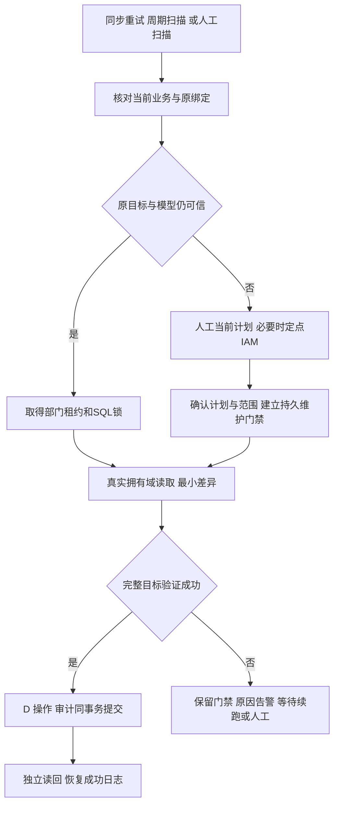

# F086 部门投影恢复设计

R3，2026-11-16。R1规格/设计已由用户确认；R2记录实现细化及用户新增告警要求，R3按用户要求修复评审发现的正常流程/并发回归。原开发基线cofco-1111 / 00720a9c697f55f19086fc7c7ad111986a95f4ac，本次修正基线cofco-1118 / a58ab1c2cb。本文记录源码与本地测试结果，不代表部署或生产验收。无新表、列、索引、迁移或数据库状态。

## 1. 现状与根因

交付分支调整（2026-11-16）：按用户要求，cofco-1111使用revert撤销原提交，修复单独迁至cofco-1118。原开发基线和设计确认记录保留，功能、模型和schema边界不变；迁移验证见validation.md。

原同步先提交业务部门及last_sync_ts，再执行FGA。提交后失败留下PROJECTING/FAILED_CLOSED；后续同父级upsert不产生新拓扑投影，原恢复只处理PROJECTING。时间戳守卫对旧消息短路，对相同ts的有效upsert仍APPLY；不能把相同ts一概写成SKIP。本次在守卫之前恢复原绑定义务，保留原时间戳决策。

原SSO upsert只更新本节点path，未沿真实parent图更新后代；旧path已陈旧时不能用path前缀查子树。原部门finalize与operation FINALIZED分别提交，还存在历史CURRENT/目标版本+COMMITTED窗口。SSO外层bypass优先于strict，必须在单部门执行时显式取消bypass。

F015 provider-pull已退役，不作为本修复的调度入口。新增部门投影任务实际注册于Worker与CeleryConf，不改变Gateway同步业务决策。

## 2. 目标与边界

自动使用原操作、原模型/Store和当前绑定；原目标必须仍符合当前合法业务事实，全部拥有域差异只能属于原操作效果。自动不查IAM、不重挂、不归档、不跨模型或Store迁移。业务不合法、未知效果、错绑或维护type转人工。正常业务执行保持原有delta及后续清理合同，自动失败恢复才要求完整拥有域证明。

人工按当前业务与当前生效且受支持的F048模型编译；只有SQL无法证明的候选及必要直接父级查IAM。默认只读，动态扫描而非固定历史6个ID。无全Store tuple遍历、全租户成员导出或健康后代FGA扩展；祖先门禁影响数不等于这些后代已关系审计。

## 3. 关键决策

### 3.1 同SQL事务收口

DepartmentProjectionExecutor取得共享每部门Redis租约，锁Catalog、D及operation，锁定/重证祖先和成员。permission repository与Department scope通过ContextVar借用同一AsyncSession；D CURRENT/版本、operation FINALIZED及成功审计同提交，独立读回后才报成功。resource恢复资格不扩围。新提交的同步业务操作保持原delta与后续清理职责，在共享UOW内执行原投影；失败原意图的恢复才使用完整拥有域资格。正常归档不被“清理已经完成”的恢复前置条件反向阻塞，PROJECTED仅证明原投影提交，不代表成员/角色清理完成。

FGA不参与SQL事务。FGA已AFTER而SQL失败时保留持久D门禁，续跑重新证明而不盲写。SQL故障后的独立失败事务只按同tenant/D/op/expected-version关闭原PROJECTING，不修改后继绑定。失租在写前及收口前远端核验；Redis不是FGA服务端CAS，SQL锁/CAS与全部写入者同版是必要前提。

R1细化：原FAILED恢复已有持久业务门禁与原ledger，不再额外提交一份自动T1。PROJECTING切换仅在执行UOW内，事务失败恢复原FAILED；成功一次收口。人工业务重挂/归档仍使用持久T1与T2，因其业务目标必须先封存并建立新维护门禁。

### 3.2 读取范围与成本

R3发布屏障：正常部门、恢复及普通资源授撤权的Catalog只读校验统一使用共享屏障，不再持有全局排他NOWAIT锁。MySQL为共享行读取；锁定的dmSQLAlchemy 2.0.12忽略read=True，故DM显式对permission_catalog_release及authorization_model_release两张小配置表取SHARE表锁，再读取版本；普通资源校验只需Catalog屏障。锁持续到所属SQL事务结束，多读者兼容，模型/Catalog发布的写入被排斥；不锁部门业务表或所有资源，不改变部门租约、D/op CAS和发布fenced校验。DM SQL依据[官方并发文档](https://eco.dameng.com/document/dm/zh-cn/pm/consistency-concurrency.html)，需中央DM多连接验收，不能把MySQL实测当DM实测。

R3路径维护：仅拟发生parent/path改变时，业务Owner委托SyncedDepartmentTreeRepository，在同事务按主键锁定当前父链、验证祖先path并从真实parent图更新后代。传入的parent_path是快照提示，不是写入事实；批次缓存或另一请求的旧快照不能覆盖已修正路径。健康改名不增加父链/子树查询。合法单层挂载可以随子树移动，tenant_id/is_tenant_root/mounted_tenant_id原样保留；各分支跟踪已解释租户和挂载，只拒绝循环、真正的嵌套挂载、无挂载解释的租户穿越或坏挂载标记。失败全事务回滚；分页500、节点50000、深度100边界保留。

正常新业务投影不使用恢复专用2 QPS写限速，也不逐操作探测FGA模型列表；在锁定SQL Catalog后核对运行时已验证的Store/model与原计划。失效原操作的恢复仍刷新当前模型、核对完整目标并保留读写限速。两条路径保留同一SQL UOW、租约和版本校验；自动任务开关不回退同步业务路径。

手动活跃来源及自动资格检查使用四个单status等值ID查询，每状态最多33，跨状态并集超过32拒绝；不使用status-IN+排序+LOB分页。完整operation按主键读取，原部门tuple上限90。自动存在其他活跃operation时不接管。

SQL薄字段分页500、上限200000；外部祖先仅定点parent回溯。直属成员只按所选D读取，最多10000。拥有域为本D parent、以本D为user的child镜像和直属member；归档及已归档投影清理另含admin。关系读分页有界，diff最多90，证据每项1MiB。人工预算校验在门禁前拒绝最低请求间隔已无法适配15秒事务的项；不能以complete/all_repairable推断十分钟完成。

自动读完整拥有域，复用该次观察计算原效果内最小修正，不为每条delta再次做无关精确查询；写后仍真实重证全目标。祖先/proof缓存只在一个锁定UOW或单次proof内有效。

## 4. 模块与流程

| 路径（src/backend下） | 职责 |
| --- | --- |
| department/domain/services/department_service.py | 同步前恢复义务；真实parent图更新子树路径并同业务事务回滚 |
| department/domain/services/department_projection_scope.py | bind/reserve/fail/finalize、ContextVar session、注入执行器工厂 |
| department/domain/services/department_projection_recovery.py | 原意图资格、租约/SQL锁、原子D/op收口、失败保护 |
| department/domain/repositories/*recovery*、current_repair_repository.py | 业务薄字段、祖先/挂载/成员证明及CAS |
| department/domain/{services,repositories}/iam_* | 精确IAM事实、叶子重挂与归档、严格关联before/cleanup |
| permission/domain/services/projection_service.py | 部门原意图专用恢复；通用入口提前拒绝维护type；资源行为不扩围 |
| permission/application/department_recovery*.py | 权限基础设施、限速、只读当前模型发现及公开Owner协议 |
| permission/application/{current_department_repair,department_batch_repair}.py | 封存计划、依赖排序、全批预检、T1/T2及重入 |
| permission/domain/repositories/current_department_repair_repository.py | 现有operation/tuple/AuditLog中的专用维护协议 |
| api/services/*department*runtime.py | Owner/权限/Role组合；常驻自动运行与CLI复用同一执行租约 |
| worker/department/projection_recovery.py | 定点恢复提示、周期公平扫描、退避与轮预算 |
| scripts/reconcile_department_projections.py | 默认scan，显式apply、确认、续跑和证据；IAM采集只读 |
| permission/domain/services/projection_diagnostics.py | 固定告警JSON与原因码、脱敏差异 |
| department/domain/services/permission_context.py | 既有拒绝点即时诊断，不增加查询、不改变权限判断 |

### 4.1 自动状态与重入

设原版本V、原op O，始终要求本D原绑定与模型/pin可信。

| D状态/版本 | O状态 | 动作与结束状态 |
| --- | --- | --- |
| PROJECTING或FAILED/V | PREPARED/STAGING/COMMIT_UNKNOWN/FAILED | 验证业务及全拥有域；仅原效果内最小差异；AFTER后同事务D CURRENT/V+1、O FINALIZED |
| PROJECTING或FAILED/V | COMMITTED | 仅AFTER可收口，不补写第三态 |
| CURRENT/V+1 | COMMITTED | AFTER则仅补元数据，不再增V；同pin/归属可信但AFTER缺失时CAS关闭D并转人工 |
| FAILED/V+1 | COMMITTED | 仅在完整AFTER已重新证实后补元数据，版本仍V+1 |
| CURRENT/V+1 | FINALIZED | 周期不展开健康FGA；显式重复入口幂等 |
| 其他版本/绑定、未知状态、维护type、非法业务或目标变化 | 任意 | 拒绝接管并报告；不假称CURRENT已天然失败关闭 |

| 中断点 | 下次动作 |
| --- | --- |
| 只prepare、业务未bind | scope不拥有原op，不能写FGA |
| 业务门禁已提交，未完成FGA | 同租约/锁重新证明原目标 |
| FGA已AFTER，SQL回滚 | 原门禁保留，核实AFTER后只收口 |
| SQL成功，调用方未收到 | 独立读回/共享ledger幂等，不重复增V |
| Redis失租或后继绑定 | 停止写入，不能凭租约过期断言旧执行者已退出 |

### 4.2 自动调度

DepartmentProjectionRecoveryConf默认enabled=true、interval_seconds=300、batch_limit=20、page_size=500、max_scan_rows=50000、run_budget_seconds=120、max_fga_qps=2。仅OpenFGA启用且运行时就绪执行；用户显式beat条目优先。

失败提示按5/15/60/300秒最多4次、15分钟计数TTL派发；派发失败不影响原SQL门禁，由周期兜底。周期从D薄字段发现，绑定op只批量读主键元数据，不扫描operation历史。Redis保存循环部门与租户游标；处理或业务阻塞均推进，局部失败冷却15分钟。批额是尝试上限（包含已识别阻塞），另受扫描/时间上限约束；基础设施错误中断本轮。

### 4.3 人工持久协议

外层格式cofco.department-recovery.v1；item格式cofco.department-recovery.item.v1，algorithm=f086-current-v1。checksum覆盖环境、范围、业务/来源、O0/T、依赖与顺序；recovery_id由确认摘要派生UUIDv5。新operation_type=DEPARTMENT_RECONCILE、key=f086:current:{R}，只是新操作类型，不新增数据库状态。空diff维护请求受专用协议支持，不进入通用restore。

AuditLog沿用permission.department.recovery.prepared/finalized/failed/superseded命名，target_type=department_projection。人工保存prepared/finalized及superseded来源；自动成功及保护性失败保存稳定证据。失败尝试的外部日志不能代替共享提交记录。

| 人工已有状态 | 重入处理 |
| --- | --- |
| 未prepared，D/来源/FGA仍before | T1锁后再验，创建sealed op与审计，业务重挂/归档和D FAILED同提交 |
| prepared且D FAILED/V/本R，FGA O0 | T2真实读，最小原子diff、全目标核验、清理及D/op/audit同SQL提交 |
| 同上，FGA已T | 不再写FGA，只完成剩余SQL及收口 |
| D CURRENT/V+1、O FINALIZED且共享证据匹配 | 核验目标后ALREADY_DONE；停服不重复T1/T2 |
| 模型、业务、绑定、版本、窗口或FGA第三态变化 | 拒绝旧计划，保持门禁并重新预览 |

T1来源不伪标成功；FAILED及被停止的活跃来源保留原请求/pin，追加superseded。当前维护源必须有匹配sealed记录；已知旧DEPARTMENT_CURRENT_REPAIR仅在v2 sealed证据精确匹配时允许重新形成当前计划，未知协议阻塞。旧F078 v5计划不作为新格式授权。

### 4.4 IAM与归档

仅业务无法证明的候选才查IAM，source/external_id及直接父级精确映射，不按名称猜测。重挂要求本部门/新父级enable=1、本地唯一且合法祖先、真实叶子（同时检查真实parent与包含完整本D ID段的path，不能让陈旧前缀藏起孤儿后代）、非根/挂载、无空间绑定。父级仅投影失败可成为先修依赖。

仅本部门HTTP200+errcode数字/字符串1+errmsg精确“部门不存在！”是删除证明；父级缺失、成功空列表、其他错误不是删除依据。归档封存UserDepartment、DepartmentAdminGrant、Role、UserRole、RoleAccess各类至多1000行；阻塞空间绑定、全局/内置角色及跨租户引用。只清本D关联，不删除用户、不迁人、不改独立资源Grant。保留parent/path/last_sync_ts。active+deleted冲突或物理缺失只报告。

UserDepartment和DepartmentAdminGrant没有tenant_id列，清理通过已锁定D及带tenant条件的D子查询限定拥有范围，不杜撰列；角色关联有tenant列，显式限定。已archived投影清理只在既有关联义务为空时允许；不通过“成功扫描”冒充已清理。

### 4.5 停服、备份与初始化

普通CLI最大5QPS，停服显式apply+offline-maintenance+confirm-writers-idle可20QPS，始终串行。停服完成项核对共享证明与一次当前目标；未完成项T1不再读FGA，T2仍真实写前/写后验证；末尾SQL批验结合逐项FGA证据，verification_mode=offline_per_item_fga_and_receipt_then_sql_final。普通模式保留整批/逐项预检。

只读初始化仅database与只读FGA/IAM客户端，allow_bootstrap=false，不启动Catalog种子、Store/model写、Redis锁/marker/heartbeat或DDL；apply再初始化Redis并要求marker已就绪。pyproject不做字节门禁。已有业务库+FGA备份可用confirm-backups-completed登记，可附真实引用，不要求重新出JSON/虚构演练。续跑仍核对原窗口与共享确认。

## 5. 消费者兼容

成员加入/移除/换部门沿用既有部门级门禁：绑定提交至收口期间D为PROJECTING，SQL/FGA核验后才CURRENT，失败保持关闭。该部门其他普通成员及依赖其祖先链的后代在加载部门上下文时也会拒绝；健康无关部门不应受其影响。此行为并非单用户隔离，本次不改变它；修改昵称等非成员关系字段不触发这条投影。修改部门成员本身也会按业务规则影响该部门在多资源上的继承权限，这与A资源授撤权不得误改/阻塞无关B资源授权不同。

| 消费者 | 兼容要求/验证 |
| --- | --- |
| SSO upsert/旧消息重推 | 原义务在ts守卫前；健康批量元数据，不逐项查历史 |
| 部门/成员/relink正常写 | 同Owner执行器；已有读会话先结束再跨UOW恢复，之后refresh |
| 普通ProjectionService/resource恢复 | 原resource合同不变；维护type在空tuple/FINALIZED快返前拒绝；部门执行走Owner适配器 |
| API/Worker进程 | 同版composition注入工厂、共用每部门锁；滚动混合旧写入者不受支持 |
| 请求时权限上下文 | 拒绝逻辑保留；只在原拒绝点增加结构化诊断 |
| 人工CLI/旧包 | 新格式重新scan；旧文件保留归档，不覆盖旧执行现场 |
| AuditLog保留策略 | prepared/finalized/superseded续跑材料需要保留；清理临时文件不回滚数据 |

## 6. 告警与阶段可观测

固定前缀PERMISSION_PROJECTION_ALERT，schema_version=1，包含event/severity/alert_key、tenant/scope/op、reason_code及白名单details。FAILED、INCONSISTENT、MANUAL_REQUIRED、CONTEXT_REJECTED用于故障检测；RECOVERED只在SQL提交读回后发出。新业务原投影成功用INFO PROJECTED，不能当作整项归档清理完成。请求PROJECTING为WARNING，需持续阈值；FAILED_CLOSED及失效祖先为ERROR。

有界拓扑样例、缺失/多余/成员计数、当前/原版本和模型、失效祖先ID可解释断点；不记录用户名单、凭据、原始HTTP正文或SQL绑定。contained=null表示未证明门禁提交，不可当作安全收口。告警规则与排查顺序见[ALERTING.md](./ALERTING.md)。

before_saved只表示证据文件已写；recovery_gate_committed才表示人工T1提交；fga_write_started/fga_verified、sql_finalized/sql_readback_verified与item_result分别有明确含义。ContextVar SQL统计记录请求、耗时和慢查询指纹；PERMISSION_PROJECTION_RUN记录自动执行耗时。dry-run提供实测只读成本、请求间隔下界及write_path_unmeasured，不承诺维护完成时限。

## 7. 验证边界

本地单元、实际SQLite repository/UOW、真实HMAC HTTP路由、Worker注册及依赖边界检查不等于真实MySQL/DM锁、FGA未知提交、多节点Redis和Beat执行。完整隔离部署及普通用户允许/拒绝仍待验收，见validation.md和e2e-checklist.md。没有生产速度或十分钟目标的实测证明。

## 8. 修订与未纳入范围

R1用户确认规格/设计；R2在不扩大自动业务决策范围的前提下落实同UOW、租户精确上下文、专用当前协议、预算及用户要求的告警。自动复用原门禁而不另写自动T1是实现细化；人工仍双阶段持久协议。未新增HTTP/UI、模型发布、全Store/IAM遍历、在线inverse补偿或整库恢复。

R3（2026-11-16）：修复共享Catalog屏障、合法挂载路径及过期parent_path覆盖；同步普通资源只读Catalog校验，避免A/B授权误阻塞。新增确定性双库SQL调度、隔离MySQL多连接、正常混合批次、回滚、门禁范围等测试；QA新增Q25–Q28。没有新增自动业务决策或改为单用户门禁。

实现补记：恢复后refresh的ORM对象以数据库为准，若后继绑定/版本改变则拒绝旧outcome，不autoflush旧版本；SSO在行锁内再次核对ts/remove-wins。停服扫描可以显式声明writers-idle解除近期PROJECTING的保守处理中分类，执行仍须租约/锁/来源证明，不能靠等待年龄取得执行权。
