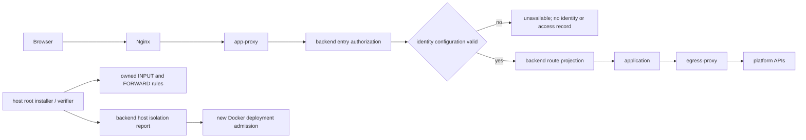

# Design: 托管应用运行时与安全收尾

> **2026-10-24 用户确认修订设计，进入任务拆解与编码。** 规格已确认；实现/验证状态见本轮任务记录。
> 现状基线：`5f2541f4bc483c24624fede9031c88c4ec6f58f4`；增量规格确认提交：`dda16a6502908ba8d58cff61dc350c0213b86c19`。旧版 D1–D15 编号保留，内容按当前代码刷新；历史任务的行号、坑编号和 MVP 后置说法不作为当前实现状态。
>
> What：[spec.md](./spec.md)（73 条 AC）；流水账：[tasks.md](./tasks.md)；不变量：[release-contract.md](../release-contract.md)。本轮只补 AC-66、AC-67、AC-68、AC-69、AC-70、AC-71、AC-72、AC-73，对应历史 T098 / T099，不重开 F059 / F086 验收。

## 1. 目标与非目标

保持统一应用入口、平台身份注入、持久化数据和独立编排边界，补齐 Docker 应用访问宿主服务的隔离，以及 OBO 配置不完整时的入口拒绝。为 F055 用户确认的配置重建提供现有部署执行与受限运行环境只读协议。

非目标：商业授权、重写 manager、重新实现 F059 Kubernetes、扩大第三方 egress 白名单、密钥管理页面或运行记录查询（分别归 F055 / F056）；不在 backend 中运行防火墙命令或容器 SDK。

## 2. 关键约束

- 领域真相由 backend 数据库持有；manager 经内部认证下载代码/上传快照，不直连 MinIO。附件已迁 backend。源码、依赖、启动参数由已冻结交付描述决定；本轮不改镜像构建路线。
- Docker Engine 仅由 manager 经 socket proxy 访问；K8s 由独立 manager 使用受限 ServiceAccount 操作。没有挂 socket 不意味着编排 API 权限很小。
- Docker 隔离规则必须在 **Docker 宿主网络命名空间**生效。manager 容器中执行 iptables 或检查容器自己的 INPUT，不能证明宿主已隔离。
- 原生 nftables 与 iptables 是两种支持路径；本轮 Docker 托管网络只声明支持 IPv4。发现 IPv6、未识别网络后端、无法证明实际隔离时，拒绝新部署，不假装支持。
- 宿主规则变更只操作自有链/表，不能清空 INPUT/FORWARD/DOCKER-USER，也不能修改其他网络的全局默认策略。
- Constitution Check：遵守 [constitution.md](../../../docs/constitution.md) C1–C8。新增隔离报告由 Repository 落库（C1/C8）；租户对象、权限入口沿用 C3/C4；新字段/迁移用通用类型（C2），错误码沿用 161 段（C5）；HMAC 与 OBO 分开配置（C6）。本轮无铁律例外。

## 3. 方案对比与选定

### D1：独立 manager + backend 持久意图

保留独立进程；选用 F086 的持久 RuntimeOperation、执行事实与路由投影，而非 backend 直接控制 Docker。证据是 `runtime_operation_service.py`、`runtime_delivery_repository.py` 的租约/代次/操作围栏；仅 HTTP 一次性命令无法恢复响应丢失。若执行协议整体升级再评估，不增加并列状态机。

### D2：Docker 经 socket proxy，K8s 经受限 API

当前 Docker 配置已经是 socket proxy，不再采用旧设计的“先直挂 docker.sock”。通用代理限制 API 面但不是业务授权器；manager 仍持有高权限编排面。拒绝把三种代理与 backend 合并来省进程。只有权限模型改变且验证隔离等价时重议。

### D3：交付模式服从 F086 / F059

当前有 bundle、完整 image、source-image，支持 Python 3.11 / Node 20 / static，不再是首发 Python 模板单一路线。选用已冻结 delivery/profile/digest；拒绝运行中重新选择可变默认镜像。依赖缓存、离线交付和 K8s 组装的详细契约分别见 [F086 design](../086-vibe-runtime-delivery/design.md)、[F059 design](../059-k8s-runtime-backend/design.md)。新增运行时时再评估。

### D4：自愈与切流复用现有围栏

探活成功才提交路由；旧写入者确认停止才允许新的 SQLite 写入者；恢复沿用原操作、deadline、资源 UID，不以重启为理由无限延长。禁止只用容器名判定安全。底座证据见 F059 既有验收；本轮用户确认重建只复用这些机制。引入多实例数据模型时重议。

### D5：app-proxy 保持独立入口

nginx → app-proxy → backend 授权与路由投影 → 应用，支持 HTTP/WebSocket；不改为代理向 manager 查路由。proxy 持有 entry 只读角色，不持编排或数据库凭据。若统一入口基础设施替换再评估。

### D6：OBO 配置失效时 fail closed（本轮变更）

选用现有 `unavailable` 决策并新增 `reason=identity_config_incomplete`，不增加可放行的“匿名降级”。`entry_authz_service` 提供同一 `obo_configuration_status()` 校验器：值缺失、全空白、与 JWT secret 相同均无效；**校验不 trim 后再签名**，实际有效值原样用于签名与验证。正式入口完成登录、应用存在、租户、可见范围、下线/维护判定后，在 `_identity_material` 前检查；预览完成会话、预览归属与应用/租户核验后同样检查。任一无效返回拒绝，不生成身份头、OBO、allow 访问记录。

app-proxy 的 `BackendAuthzClient` / preview 授权客户端不再缓存含身份材料的 allow 决策：每个新的 HTTP 请求和 WebSocket 握手到 backend 重新判定，避免 backend 配置失效后旧 allow 缓存继续放行。路由缓存与拒绝缓存维持独立；已经建立的 WebSocket 不承诺逐帧重鉴权。此取舍增加授权 RPC，定向验证请求数与延迟，不把“保留有效配置行为”理解为继续缓存旧身份。若未来有可信配置 epoch 推送协议，再评估恢复 allow 缓存。

签发器自身再防御性校验并返回显式失败，调用者不可把失败当缺省可选值；验证器亦拒绝无效配置。请求期间以同一配置快照完成检查/签发，避免动态刷新间隙。应用运行时开启时，FastAPI lifespan 输出一次脱敏 ERROR（字段名和失败原因，不含值），**不终止整个平台进程**，入口保持拒绝；开关关闭不产生“已启用”或误报。选择此方案而非整站启动失败，因为 spec 要求关闭运行时/其他平台能力不被连带停用。若未来 OBO 采用非对称签名，再重新审查发行/验证契约。

### D7：拒绝页面沿用既有契约

app-proxy 对 `unavailable` 保留既有不可用页与状态码；当 backend 已完成原登录、对象存在、租户、访问权限和运行层开关判定后，消费可信 `reason=identity_config_incomplete`，正式/预览均显示 **“本环境配置不完整，请联系平台管理员”**（三语同义）。该提示不显示配置值、字段值、内部 URL 或真实应用环境；无权者仍得到原来的登录/不存在/无权限等决策，不靠浏览器参数切换到此提示。无需新视觉模式；沿用不可用页模板只增加此原因对应文案。新增状态码需先检查 nginx error_page 合同。

### D8：领域与列表投影保持兼容

App / AppVersion / AppInstance 继续分别表达业务状态、冻结版本、运行观察；构建/广场列表通过既有 UNION 第三支表达 `flow_type=35`、`app_state`，不为新安全项改列表含义。若新增状态，需同时审查两个 SPA 的白名单。

### D9：权限走已验证业务目标

应用身份、owner、租户与资源状态先由业务服务核实，业务动作走 F048 统一入口；manager 与代理不自行查 OpenFGA。管理员的通用 shortcut 不能扩大 F055 的 natural owner-only 密钥写权限。新增管理动作时重审 Catalog，而非手写 role_access。

### D10：SQLite 与平台存储解耦

Docker 绑定本地持久目录，K8s 用已验收独占 PVC；manager 执行本地 backup/迁移，经 backend 存取快照。应用附件走 backend 存储接口；manager 不读平台 MinIO 配置，也不需要独立 MinIO 实例/新桶。升级代码不等于恢复数据库；恢复必须显式选快照。存储拓扑变化时重议单写入者证明。

### D11：容量与资源档位

沿用平台档位与持久 reservation；释放依赖停止证据，不以超时自动当作已停。用户确认的配置重建依然需要执行资源预算，不绕过准入。并发拓扑改变时重审预算。

### D12：宿主 INPUT + FORWARD 的同源隔离（本轮变更）

**否决**仅补 DOCKER-USER（不覆盖 INPUT）、只看 `--internal`（不证明宿主入口关闭）、在 manager 容器里加 NET_ADMIN（作用域错误且扩大权限）、允许整个 backend 端口给附件（附件也应经 egress）。选定：保留 egress 唯一出口，安装侧 root 工具维护宿主自有规则，backend 持有短时有效的独立隔离证明，新部署消费证明。

现有 `runtime_manager.egress` 已有规则渲染和 CLI，扩展同一规则模型，不另写两套白名单。具体安装、报告和准入合同见 §4.4。已建立连接也不能用宽泛 `ESTABLISHED` 一律放过，必须区分应用响应与应用主动发起。真实宿主配对探测是依据，命令存在不等于隔离成立。若后续采用经过验证的 eBPF/专用网络插件，可替换证明生产方，不能取消拒绝边界。

### D13：详情页扩展点

保留发布 / 版本 / 数据 / 日志页壳与命名 slot。F055 密钥管理放既有 settingsSlot，不为安全项新增管理菜单。壳变更时需检查三个 Feature 消费者。

### D14：运行日志与访问记录分开

stdout/stderr 是调试日志；backend 入口 allow 产生合并窗口访问记录；F056 的读接口不创造新访问事件。保留既有合并窗口实现/配置，本轮不改频率。安全拒绝不计成功访问；日志包含配置原因但不含身份材料。若审计语义变更，应先改规格。

### D15：收尾边界与交付声明

旧 MVP “后置”不再表示未实现：F086、F059 已有实现/证据，本轮只修改与安全/密钥刷新直接相关的接口。历史未完成验收不自动勾选，ARM、完整离线安装和正式镜像发行不冒充本轮完成。只在本轮 AC 定向证据成立后更新相应任务。

## 4. 系统现状（接手必读）

### 4.1 数据流与实现状态

**已实现**：backend 保存应用/版本/操作/路由/存储绑定；Celery 调发布管线；manager 拉取持久计划、编排 Docker/K8s、上报事实；app-proxy/egress 只读投影。`RuntimeDeliveryCoordinator.inject_environment` 使用加密 sealed_env 保存可恢复执行环境；K8s 已用操作专属 Secret + `secretKeyRef`，并非把平台 token 放 ConfigMap。

**尚未实现的本轮安全增量**：INPUT 规则与可信证明、OBO 无效时拒绝。F055 用户确认重建与运行快照公共适配已在 `a5c7722b9` 编码并完成定向本地检查，尚未真实部署验收。现有 `egress.firewall_rules` 仅渲染 FORWARD/DOCKER-USER 规则；`_firewall_check` 主要检测后端存在。现有 `_issue_obo_token` 返回空时两个入口仍允许，是 T099 真缺口。

### 4.2 既有公共合同（保留原编号语义）

**① runtime-manager 意图 RPC**：旧 `POST /v1/intents/{build,deploy,stop}` 兼容通道与当前持久 v2 通道不可混淆。当前 backend `RuntimeDeliveryCoordinator` 创建 RuntimeOperation、wake manager；manager 以 node/role HMAC 从 `/api/v1/internal/app-runtime/v2/nodes/plan`、`operations/{id}` 拉取并 claim、上报 facts。冻结字段见 F086/F059，public caller 不可注入 sealed_env/runtime_env。旧 code_object_key 直读 MinIO 的设计不再使用。

**② backend 状态动作 / 读口**：`AppStateService.{publish,manual_publish,stop,resume,delete,stage_version}` 仍是 F055 的领域入口；`GET /api/v1/apps`、`/{id}`、`/{id}/instance`、`/{id}/versions`、`/{id}/logs`，PATCH 元信息与 actions 路由保持。版本列表只读，不提供绕过审批的直接切版本；`AppMetaService.update_meta` 为管线与页面共用。runtime-status 只供有权管理员；owner/租户范围由读服务决定，不拿 UI can 标志当后端权限。

**③ app-proxy 注入头**：`X-BiSheng-User-Id/User-Name/Tenant-Id/Dept-Id/Dept-Name/Dept-Path/Subject-Kind/App-Id/Access-Token/Request-Id`；姓名/部门等非 ASCII 值用现有 percent-encoding；入站 header lower + 下划线→连字符归一后剥离整个 x-bisheng 等价类。X-Forwarded-Prefix/Proto/Host 由 proxy 覆盖，不信客户端。OBO 现已有消费者，不能继续引用旧“可无 token 放行”例外。

**④ manifest 消费**：形态归 F055；runtime/port/tier/database/egress/delivery/startup 由当前 schema 冻结后进入执行，见 F055 design §4.2③。新增业务 secret 名仅消费可信 formal 环境，不允许任何运行形态覆盖保留名。

**⑤ 环境变量**：`BISHENG_APP_DB_URL`、应用 base path、平台/模型/storage endpoint 与 operation-bound 凭据仍按 F086/F059 注入；本轮不改已有公开 SDK 变量名。正式、preview、probe 的身份/数据空间不可混用，构建进程不取得正式环境。

**⑥ SQLite / 日志**：DB URL 指向运行实例的 `/data/app.db`；Docker bind 与 K8s 独占 PVC 的宿主/集群映射由执行层持有。日志 `tail/since/keyword`、状态和数据动作先验 owner/租户；backend 只传意图，manager 执行备份/数据维护，经 backend 传快照。

### 4.3 关键模块职责

| 模块 / 落点 | 做什么 | 不做什么 |
|---|---|---|
| `app_runtime/domain/services/entry_authz_service.py` | 统一 OBO 配置检查与正式/预览判定 | 不接触容器、不匿名降级 |
| `bisheng/main.py:lifespan` | 运行时开启时输出脱敏启动诊断 | 不因此阻塞整个平台 |
| `runtime_manager/egress.py` + 新 host verifier CLI / unit | 同源渲染、宿主安装、只读验证、配对 canary 报告 | 不持有应用真实密钥，不清全局防火墙 |
| `app_runtime` 新 host isolation Repository/Service/Endpoint | 验证独立角色、保存证明、节点准入读取 | 不执行宿主命令、不访问 Engine |
| `RuntimeOperationService` / `RuntimeDeliveryCoordinator` | 部署、恢复、用户确认重建准入和原有围栏 | 不拥有 F055 密钥配置资产 |
| app-proxy / egress-proxy | 入口/出口数据面、受限投影；入口 allow 不缓存身份 | 不签 OBO、不自行上线 |
| `app_storage_service` / backend 对象存储适配 | 源码/附件/快照传输授权 | 不替 manager 执行 SQLite 迁移 |

### 4.4 本轮增量字段与接口合同（拟实现）

**① 入口**：正式 `/apps/{slug}`、预览 `/apps/_preview/{session}/...` 保留现有 app-proxy → backend 内部 HMAC 协议；拒绝体仅 `decision=unavailable, reason=identity_config_incomplete` 与已允许返回的最小上下文；不得带 `inject_headers`、`obo_token`、`obo_expires_at` 或 target。登录/不存在/跨租户/无权限/停用仍先返回对应旧决策，不因配置错误暴露对象存在。

**② 操作与身份**：RuntimeOperation 的 `scope_key/idempotency_key/generation/owner_epoch/deadline` 继续约束生命周期；K8s 额外 controller epoch、UID 与数据 writer 围栏。内部 HMAC 角色按 manager / entry / egress 隔离，传输受 TLS/受控网络保护；HMAC 只认证请求，不提供加密。F055 手动重建语义见其设计 §4.4③：保存不创建操作；rebuild_current 复用既有 deploy，running_environment_snapshot 只向受限内部调用提供当前正式环境 DTO；不写 F055 配置或 applied 状态。

**③ 宿主规则合同（拟新增）**：

| 路径 | 规则与验证 |
|---|---|
| iptables | 自有 `BISHENG_APP_INPUT` / `BISHENG_APP_FORWARD` 链。宿主 INPUT 在其他宽泛 accept 之前跳转；FORWARD 由 DOCKER-USER 首部跳转。跳转匹配实际 app bridge 与源子网；自有链内只允许固定 egress IP/3128 的 ORIGINAL，以及源 app、`ctdir REPLY`、ESTABLISHED 的合法入口/探活响应，其余 DROP。`RELATED` 不宽泛放行 |
| nftables | 自有 `inet bisheng_egress`，同时具有 input / forward hook，优先级先于普通 filter 接受；匹配 bridge/源子网，允许条件与 iptables 同源生成。nft accept 仍需通过后续链，不能承诺绕过已有宿主拒绝策略 |
| 更新 | root 安装工具获取独占锁，先构建新规则并 dry-run 校验，再以 iptables-restore `--noflush` 或 nft 单事务切换；初始化跳转失败保持/恢复拒绝态，不先删全部规则再逐条添加。重跑不重复，卸载只移除有标识的跳转/自有链表 |
| 动态地址 | installer 通过 Engine 网络检查冻结 network ID / bridge / 子网 / egress IP、端口、宿主网关/发布地址。代理 IP 变化立即使旧配置证明不匹配，重新安装校验；不在 L3 中放行 hostname 或不受限端口 |
| 不支持 | IPv6/未知 family、Docker rootless/不可确认 bridge、不可识别防火墙后端先报告缺能力；不静默省略一部分网络。K8s 使用 F059 的 CNI 证明，不套用宿主 Docker 规则 |

**④ 隔离证明与持续收敛（拟新增）**：安装工具与 systemd oneshot/timer 位于宿主，30 秒刷新，60 秒过期；首次安装、宿主重启、dockerd 重启后先验证再放行新部署。定时 unit 不仅验证：发现自有规则漂移后，在同一宿主独占锁下重建自有规则、读回并执行允许/拒绝 canary 配对；仅完全通过才重新签发 pass。恢复失败时由宿主工具针对该 node/network 的受管应用执行网络隔离；不能确认隔离时，通过受控 Engine API 停止这些应用执行体并读回状态，报告失败及资源 ID。禁止扩大到无本模块标签的业务容器，禁止因停止请求已发出就记录停止证明。backend 消费失败证明阻止新执行/路由，manager 沿原生命周期协议确认已停止或隔离的旧实例；未知 writer 不释放容量或删除 PVC/数据。manager 不获得 root/NET_ADMIN，宿主修复不运行在 backend。工具复用现有 Python Engine HTTP 客户端；需要宿主 root、相应 iptables/nft 二进制与受控 Engine API，不要求 docker CLI。

新增 `RuntimeHostIsolationReport`（F054 所有，平台级节点表）：`id,node_id,engine_id,network_id,config_digest,rule_digest,revision,checked_at,valid_until,status,checks`，通用 JsonType；checks 仅结构与探测结果，不能含环境/用户流量。`POST /api/v1/internal/app-runtime/host-isolation-reports` 只接受独立、限定 node 的 `host-isolation` 服务角色；manager/entry/egress 无上报权。服务端分配接收时间、限制 TTL、递增 revision/nonce、验证节点与 engine/config 绑定，不信客户端自报无限有效期；重放/倒退拒绝。独立报告表避免 manager heartbeat 覆盖证明；不改 F059 现有摘要算法。

生产方为 root 安装脚本，信任边界是客户宿主管理员；不声称防住 root 伪造。报告只在**规则读回匹配 + 实际 canary 允许/拒绝配对**均成功后标 pass：无业务凭据/PVC 的受限 canary 在 app 网络，测试直连宿主网关、宿主服务地址、published address 被拒绝，同时入口 HTTP/WS/探活响应与经 egress 的平台 API 可达。所有探测端点由管理员固定，拒绝把请求参数当任意扫描目标；canary 有 UID/ID、期限和自有标签，未知资源不强删。

backend 在新 prepare/probe/preview/deploy/restore（含恢复和 F055 用户确认重建）的 create/claim/提交服务路由前验证新鲜证明及冻结配置一致性；失败给缺能力原因。stop/destroy/清理仍允许，既有应用不强制删除；其持续隔离由上述宿主 unit 恢复/隔离闭环负责，不能仅拒绝新部署却让存量实例继续直连宿主。证明过期时在途操作不发布新路由，可恢复地等待至原 deadline；不能绕过旧 writer 停止确认。安装报告通过不代替实际业务 API 的权限检查。

## 5. 已知坑 / 反直觉事实

| 坑 | 后果 | 处理位置 |
|---|---|---|
| DOCKER-USER 不覆盖宿主 INPUT；internal 网络仍需实际验证 | 应用绕过代理直连数据库或管理端口 | `egress.py` INPUT+FORWARD 与 host verifier |
| 容器内 iptables 成功不等于宿主规则生效 | 假阳性准入 | 宿主 CLI / 独立报告角色 |
| 应用发出的入口响应源地址仍是应用子网 | 无 REPLY 例外会把正常 HTTP/WS/探活阻断 | 同源规则模型和真实配对测试 |
| 宽泛 ESTABLISHED 也包含以前建立的恶意 ORIGINAL | 新规则看似生效、既有绕过仍通 | ctdir 与连接方向断言 |
| `_issue_obo_token` 当前返回空仍 allow；现在已有 OBO 消费者 | 登录身份失效但请求被放行 | 正式/预览统一检查和签发器兜底 |
| 身份材料先生成后才拒绝 | 即使未转发也可能留下不应产生的头/日志 | 在 `_identity_material` 前检查 |
| manager API 编排权限仍高于普通服务 | 合并进程扩大入侵面 | socket proxy / RBAC / 角色隔离 |
| 版本回滚不等于 SQLite 回滚 | 旧代码运行新 schema 或误覆盖数据 | F055/F059 显式快照恢复 |
| 旧任务完成与真实环境验收不同 | 把静态/模拟误当上线证据 | 任务证据类型与固定 SHA/digest |

旧坑编号的历史引用按 `dda16a6` 的本文件读取；不把其中过期的“尚无 OBO 消费者/manager 直连 MinIO”继续当现状。

## 6. 对外契约与依赖

### 6.1 我提供给别人的（Outgoing）

| 提供 | 消费者 | 破坏风险 |
|---|---|---|
| 现有 App 状态动作、内部路由/entry 协议 | F055/F056、app-proxy | 改状态/错误决策会破坏显示和转发 |
| OBO 合法配置才签发；TTL/aud/app/tenant 绑定维持现有值 | F051 模型面、F055 能力总线、SDK | 放宽空 token 或共享 JWT secret 会破坏身份边界 |
| 持久操作围栏 + F055 用户确认重建/受限运行快照 | F055、Docker/K8s manager | generation/operation payload 缺失时应显式拒绝，不能旧版静默忽略 |
| 独立宿主隔离报告与节点能力原因 | 部署/运维/状态查询 | 把 manager heartbeat 当隔离证明会扩大信任面 |

### 6.2 我依赖别人的（Incoming）

| 依赖 | 形式 | 风险 |
|---|---|---|
| F086 持久操作 / F059 controller 与 writer 围栏 | HTTP、DB 与执行事实 | 旧 manager 不支持确认重建/敏感输出协议时拒绝 |
| Docker Engine / socket proxy；宿主 iptables-restore 或 nft；systemd timer | 宿主安装条件 | 无法证明 INPUT 或 family 时阻止新部署 |
| Redis nonce；平台 DB；部署密钥与 OBO 独立配置 | 基础服务 | 不可达或配置失效不能新发身份/伪造 pass |
| F048 PermissionService 统一授权入口 | Python application protocol | 不绕过 verified target 或复刻 OpenFGA |
| F055 密钥版本/注入契约；F056 审计读侧 | 领域协议 | 本模块只消费，不复制密钥表/查询规则 |

## 7. 测试与可观测

- 单元/模拟只覆盖变化：INPUT/FORWARD 双后端渲染、方向、幂等、失败恢复、未知 family；证明角色/过期/重放/配置改变与部署拒绝配对；正式/预览三种坏配置与有效配置的决策、无身份/无成功访问副作用；proxy 曾获 allow 后 backend 改坏配置的下一次请求/WS 握手拒绝，route 缓存不干扰此 Gate。
- 集成只验证新表/租户无关节点范围、迁移单 head、manager 用户确认重建复用围栏。DM8 仅类型/约束/迁移静态审查，不写成 DM8 真测。
- 真实 E2E：在授权专用 Docker 环境先保存自有规则前后差异，执行 canary 直连宿主拒绝 + HTTP/WebSocket/探活 + 经 egress SDK/模型/附件允许；重跑、重启、精确卸载对其他网络无影响。OBO 使用已授权自然人 owner/可见非 owner/不可见/跨租户配对，正式与审批预览都验证。不得把失败的 TCP 连接当“防火墙拒绝”而不先证明目标监听可达。
- 定向命令（编码后按实际文件名执行）：`cd src/runtime-manager && uv run pytest tests/test_egress.py`；`cd src/backend && uv run pytest test/app_runtime/test_entry_authz.py`（补充测试以最终任务命名为准）。手动入口 `/apps/{slug}` 与 `/apps/_preview/{session}/`，运维 `python -m runtime_manager.egress firewall --print` 先看差异，再由 root 在专用宿主安装；未确认设计前不执行变更。
- 可观测：`identity_config_incomplete`、`host_isolation_missing/stale/mismatch/failed`、node/operation/canary ID、规则 revision；不记录密钥、token、会话或完整环境。失效不刷屏，状态面保留当前失败原因。

## 8. 后续改进 / 不打算做的事

本轮不支持 Docker IPv6/rootless 网络；检测即拒绝，不默认为安全。不新增通用宿主防火墙产品；验证工具只覆盖托管子网。K8s CNI/跨节点/ARM 扩展留在原 Feature 的待验清单，不借安全收尾宣称全部通过。完整设计确认后拆增量任务，保留 T098/T099 原证据与关联。

## 修订历史

| 日期 | 变化 | 依据 |
|---|---|---|
| 2026-10-23（二次修订） | 按 AC-70 修正 OBO 配置不完整提示；保持原授权顺序和正式/预览同源 | 用户要求修订后复审，尚待设计确认 |
| 2026-10-23（简化协议同步） | F055保存不重启；消费用户确认重建与当前运行快照协议，不增加F055结果双写 | 用户已确认F055修订规格；F054自身设计未确认，B1仍待修 |
| 2026-10-23 | 刷新 F086/F059 后的当前快照；补 INPUT 隔离证明、OBO 拒绝设计；保持 D1–D15 与 §1–§8 编号 | 用户确认增量规格；静态核对基线代码，尚未实现/部署 |
| 2026-08-17～18 | 初版与早期 MVP 修订 | 历史正文见 `dda16a6`；历史测试不充当本轮证据 |

### 2026-10-24 剩余设计问题复审

F054-B1 修订：宿主 unit 为规则漂移的实际消费者，先修复并配对验证，失败则仅隔离/停止受管执行体并上报；backend 不承担宿主 root 行为，也不把网络隔离冒充 SQLite writer 停止证明。长尾的多防火墙外部重载竞态、不可识别防火墙后端和非支持网络形态列入提测限制，不能标 pass 或静默放行。F055 用户确认重建与运行快照已编码，当前尚未进行真实部署验证；本设计的宿主隔离/OBO 安全增量仍待单独确认。

### 2026-10-24 实现状态与交付合同补记

- 已确认设计进入实现。OBO 使用 `identity_config_incomplete`，同一 `_OBOSigningConfig` 快照完成检查/签发；验证器拒绝空白配置。正式/预览 allow 不缓存，拒绝与路由缓存保留。无尾斜线入口的规范化重定向是第二个 HTTP 请求，因而也重新判定。
- 新增宿主报告、独立 HMAC role、Docker create/admit/claim/ready/route 门禁，legacy Engine create/start/build、路由和自检也读取证明；停止/清理不要求有效证明。K8s 沿用 F059。
- `RuntimeHostIsolationReport.id` 直接使用 node_id 作主键（不再存重复 node_id 列），每节点只保存当前证明；接收时间与 60 秒 TTL 由服务器分配，revision 为 BigInteger。独立报告不随 manager 心跳续期。
- 宿主实现位于 `runtime_manager/host_isolation.py`，安装材料在仓根 `deploy/runtime-manager/`；规则与 canary 必须运行在 Docker 宿主。安装示例覆盖 Compose 的 apps/build 两个网络，原默认 bridge 构建被拒绝。卸载先作废服务器证明，再确认本模块实例停止，然后移除自有规则。每个 Engine 仅一个宿主隔离单元。
- 实现代码与本地定向验证已到位；宿主真实 iptables/nftables、失效收敛与 Docker/K8s 本次组合部署仍待提测。具体证据及边界见 closeout-validation.md，不据此宣称最终交付通过。
