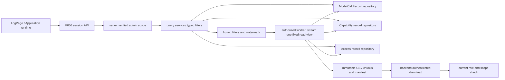

# Design: 应用广场、治理与运行记录查询

> **2026-10-24 用户确认修订设计，进入任务拆解与编码。** 现状基线 `5f2541f4bc483c24624fede9031c88c4ec6f58f4`；规格确认提交 `dda16a6502908ba8d58cff61dc350c0213b86c19`。保留 D1–D11 与 §1–§8 编号，新增 D12–D15；历史 MVP“查询全后置”已不适用于现有操作审计。
>
> [spec.md](./spec.md)（61 条 AC）· [tasks.md](./tasks.md) · [release-contract.md](../release-contract.md)。本次新增 AC-46 至 AC-61，修订 AC-26、AC-34；不接管模型/能力/访问记录的业务写入者。

## 1. 目标与非目标

保留应用广场和统一授权交互，在现有“审计日志”页增加“应用运行”页签，查询/导出模型调用、能力调用和应用访问三类既有数据；让现有操作审计能够按应用找到密钥变更与凭据签发/撤销事件。

非目标：计费结算、全链路 tracing 产品、日志全文搜索、把 runtime stdout 当审计、重算历史身份/Token、为每次页面查询生成业务访问事件、给 owner 或开放 API 凭据授予管理员日志读取能力。

## 2. 关键约束

- 管理员级运行记录只接受自然人平台会话：租户管理员只查有效当前租户；全局超管无 admin-scope 时可明确选全局/目标租户，有 scope 时锁定该租户。部门管理员/只有 log 菜单的角色/应用 owner 不能因此取得此新读面。
- 现有系统操作审计拥有更宽的菜单/管理范围规则，**不直接复用其 `_resolve_audit_groups` 当新接口权限**；保留旧接口行为。
- 三类记录并不等于三类成功操作：无 app_id 的服务账号模型调用仍应显示；访问记录是入口 allow 合并窗口，不能展示为每个 HTTP 请求；缺历史字段用 ID/未知，不回填当前无关名称/用户。
- 列表默认最近 7 天，可选择任意合法自定义区间或全部已留存时间；UTC ISO8601 带时区传输/规范化，start≤end；limit 1–100。**不设 90 天查询或 10,000 行导出总量上限**，导出覆盖所选条件下全部受授权记录。内部每批例如 500 行、worker 并发/租约和按字节输出分块仅控制资源，不变成用户可导出总量限制。
- Constitution Check：遵守 [constitution.md](../../../docs/constitution.md) C1–C8。新读侧 Model/Repository/Service/Endpoint 分层；租户自动上下文不手拼通用 tenant 条件；全局超管进入显式审计 scope；通用索引/类型无 JSON_EXTRACT；模块错误码 163 段登记后使用；导出在受限对象存储不放 API 本地盘；无铁律例外。

## 3. 方案对比与选定

### D1：广场继续现有 UNION 与批量权限

不新建平行应用列表后在前端拼接。托管应用 `flow_type=35`、slug/app_state 已随列表下发，批量可见性继续走 F048；单卡补拉权限造成 N+1 且越过通用策略。新资源类型/统一列表协议改变时再议。

### D2：卡片整页访问稳定入口

保留跳转 `/apps/{slug}`，不嵌 iframe、不拼 client `/workspace` base；统一登录/WS/身份均在入口。切换域名模型时再评审链接生成。

### D3：广场动作与可见范围仍由通用权限驱动

`app` 适用动作集与广场 use 筛选保留，不把“能看到卡片”作为运行记录管理员权限。二者属于不同业务目标。动作 Catalog 改变时审查消费者。

### D4：管理权限仍复用 PermissionDialog

构建卡片与发布页 VisibilityScopeSection 用同一交互/API；不为了审计页再建授权入口。当前 request 拒绝错误已需 catch，异步失败不能留 loading。组件契约变更时复核两个入口。

### D5：仅 owner 可见继续按 protected grant 区分

非 protected 授权行为空才表示无额外放行；默认 owner 行不应算外部授权。不从空列表误推断“无人有权限”。权限返回 schema 改变时重审。

### D6：可见范围变更由真实写路径审计

仍在统一授权 mutation 后按资源回调写 `app.visibility_change`，不从前端补写。查询/导出仅消费事实。新增授权写入口时必须核对回调是否覆盖。

### D7：访问记录写 F054、读 F056

`entry_authz_service` 已写合并窗口访问事实，不再“写读一起顺延”。保留既有合并窗口及其测试，本轮只补稳定读/导出适配，不按请求量补记历史访问。日后产品需要 PV/会话分析另立语义。

### D8：runtime 关闭明确隐藏与拒绝

新页签和新列表/候选/导出接口都读取实际 `app_runtime_enabled`；关闭时后端给部署开关错误，不把空列表当安全机制。旧系统操作审计照常可用。开关语义变更时再议。

### D9：下线应用仍可进广场

广场对托管应用白名单保持 online/stopped，不带草稿/待上线/删除；历史日志则不能以这组存活状态过滤，否则删除后记录消失。是否显示已删除资源是两个读面的不同合同。

### D10：广场名称搜索与日志候选分开

不拿可见应用广场列表当审计候选；它缺已删除资源、范围也不同。日志名称搜索基于受限审计记录/可信历史映射，只在当前管理员 scope 生效。若统一搜索服务支持历史治理数据再替换。

### D11：当前查询交付范围

现有 `api/v1/audit.py` 与 `api/services/audit_log.py` 已有系统操作审计、target_app_id 与导出；LogPage 仍只有“应用使用/系统操作”两页签。本轮加第三页签与三子视图，不重做旧审计或重写广场。真正已落地必须以实际调用点而非 tasks 计数判断。

### D12：三专表适配成管理员读服务（新增）

否决运行期高频记录塞普通 AuditLog、查日志文本推导、另造统一大表/回写历史。选定 F056 的 `RuntimeAuditQueryService` 调三个 Repository 适配器：现有 ModelCallRecordRepository（F051 写）、AppCapabilityCallRecord（F055 写）、AppAccessLog（F054 写）。现有模型读库有 bypass+手动 tenant 模式，新入口改用明确 `AuthorizedRuntimeAuditScope`，旧调用兼容由 owner 控制，不向客户端暴露 `tenant_id=None` 作为全局授权。

共享过滤/分页/导出规格，但不同视图字段保留语义；服务账号模型调用不强制 inner join App。证据是现有三种表字段不一致，只有模型表已有 cursor/export，能力表只有 insert，访问表已有旧 page DAO。新建读 Repository，不加新 DAO 入口或让 Service 写 SQL。未来跨类型关联检索成为真实需求才考虑物化统一索引。

### D13：稳定列表与一次导出的固定读取视图（修订）

否决仅按秒级时间排序、offset 翻页、开放式追随新日志的无限导出，以及把 10,000 行/90 天预算当产品限制。列表采用 `(event_time DESC,id DESC)` keyset，首次查询固定 filter/scope 摘要、upper_time 与当前可见最大 id 的 watermark，cursor 绑定该选择条件；未知时间单独排序并以 id 决胜，不能在 NULL 比较上丢页；all 保留未知时间行，recent7d/custom 不能判入区间的未知时间行不伪造时间，筛选语义明确说明。新请求严格校验 cursor，不把解码失败当第一页。

列表只保存短时 `RuntimeAuditQuerySnapshot` **条件元数据**并返回第一页；不为了列表先收集所有 ID，不依赖 MinIO 才能看数据。刷新/改变条件重新选择范围。列表与随后导出共享冻结的条件、watermark 和权限；并发写入下不额外承诺两个不同读取时点的数据库成员集合完全相等。导出会展示其实际选取时点及最终行数，不把导出完成数冒充此前列表的即时统计。

**完整导出在后台的一次受权读取视图中完成**：任务受理时冻结 QuerySnapshot 的过滤/范围，source-owner Repository 在 worker 开始扫描时打开一条、范围有界的 ORM SELECT 只读一致游标，按稳定顺序流式输出全部匹配记录。该语句的读视图固定、watermark 固定；后续新增/回填提交不能把本次扫描变成无限流。每批最多 500 行处理/输出，但一直扫描至该读取视图 EOF，不能达到某行数后拒绝或截断。无资格/跨租户条件在源 SELECT 构造/执行时仍走自动租户过滤或显式授权的全局 Repository，而不是把多租户约束留给 CSV 写入端。

source Repository 提供 `stream_export(scope, frozen_filter, watermark, batch_size)`，持有只读 source session/游标至本 attempt 扫描结束；任务进度写入用另一短事务 session，不在源读取事务中写状态。底层必须采用真正流式/受限 fetchmany，不用 `all()/fetchall()` 把整表搬进内存；MySQL/DM8 由各 source-owner 适配其固定读视图游标/事务，定向检查驱动的实际缓冲和语句范围，不能仅设置 yield_per 就宣称有界。占用一个后台读连接/读视图至扫描结束是此方案的显式成本，以导出 worker 并发、可观测持续时间及运维取消控制，不在 HTTP 请求保持长事务，也不转成 90 天/行数硬门槛。

worker 崩溃后无法恢复数据库游标读视图，因此未 ready 的 attempt **整次只读重建**，不拿旧游标偏移接新视图造成漏/重；同一冻结条件与 watermark 下重新开启读视图，显示新的 selection_started_at。旧 attempt 从未交付字节，只保留待清理私有分块；只有一次完整扫描的 manifest 才能原子发布为 ready。ready 后的文件成员与字节固定，重复下载不会重新查事实表。若历史清理/读取故障导致不能完整输出，显式失败，不标空文件或部分文件成功。

### D14：受权异步导出与不可变分块产物（修订）

否决公开 presigned URL、前端只导当前页、提交时授权永久放行。选用后台固定读取视图 → 标准 CSV → MinIO 私有不可变分块 + 有序 manifest；backend 认证下载按 manifest 依次流式拼接为一个 CSV，不暴露对象 URL。CSV 标题/BOM 只在首块，每个分块在完整行边界收束。任务状态为 pending/running/ready/failed/expired；总记录数不设产品上限。

任务通过 DB 租约/epoch 取得单一输出权；对象 key 绑定 job/attempt/epoch/part_no，上传确认后短事务登记分块及累计行数。ready 的 CAS 必须同时校验当前 lease/epoch、同一 source read-view attempt 已 EOF、全部分块已确认且 manifest 有序/完整。旧 worker 只能遗留未引用的私有对象，不能覆盖新 attempt 或把任务标 ready；响应丢失重查持久 ready/manifest，不能追加重复 CSV 行。失败或重启按 D13 从头读取新 attempt，不拼接不同读视图的分块。

受理、worker 开始/每批和 ready 发布、状态读取、下载开始/受限块之间都核验当前自然人管理员资格与保存的 scope。失权或无法确认即取消交付/停止任务，不使用提交时缓存永久授权；已交付字节无法收回。条件快照未被任务引用时 10 分钟过期；任务受理后其冻结条件由任务持有，不因排队/扫描超过 10 分钟被清理。**下载保留期从 ready_at 开始计算 10 分钟**，未完成 attempt 由租约/取消和终态 GC 管理，不能用该保留期限制记录总量或扫描时长。

CSV 仅白名单字段；危险公式文本前置单引号后按标准 CSV 转义，测试空白/控制字符绕过、逗号、引号、换行与 Unicode；数值按数值，null 不替成其他主体。对象/worker/source 不可用时明确失败，GC 只删没有活跃 lease/ready manifest 引用的本任务对象；就绪产物到期/取消清理有 durable 状态，不依赖本地盘。未来确需更高吞吐再独立调度，不改变完整导出的规格。

### D15：可信应用关联的操作审计（新增）

F055 负责写 app.secret.*；凭据 owner 在签发/撤销时从持久 `ApiCredential.subject_kind/subject_id` 与可信 hosted-app 归属映射计算 target_app_id，不取查看者传的 app_id；SAK/PAT 的资源 owner 不等于 app 归属，不能把该人的所有 key 自动关联给某应用。

现有 CredentialService._audit 只写 credential_id/subject/scopes/key_mask，需要补可信关联。补充实际生产者：正式切换和候选终结当前在 RuntimeProjectionService 中将 binding 从 staged/active 改为 revoked，并不经过 _audit。改由凭据 Owner 的公开 `revoke_runtime_binding(session, binding, operation, reason)` 协议，在调用者原事务中锁定 binding、只在真实状态改变时撤销并追加 `open_api.api_key.revoke` 审计。应用关联从绑定的 app/credential 与 hosted-app 主体映射交叉核验获得，不接受查询者提供的归属；审计带 app_id、credential_id、operation_id、reason，事件不带业务环境变量值。以同一 binding 的状态转移作为去重围栏，重复切换/终结不重复记事件；失败回滚状态与审计，不新增审计补偿服务或独立数据库提交。切换撤旧、停止/删除、失败候选清理都调用该协议；签发使用已新增的显式 session 入口，签发审计也带可信 app 关联。

历史记录只能在原始可信字段足以确定时通过只读关联查询；不补写历史“现在属于”。不增加第三方业务密钥末位/长度，API key 原有前缀/末位 mask 继续保留。若普通凭据没有可信 app 绑定，明确不相关，不硬凑。后续新 credential owner 需提供同一审计关联协议。

## 4. 系统现状（接手必读）

### 4.1 数据流与实现状态

**已实现**：广场第三类型、两处权限 UI、可见范围审计、系统操作日志查询与应用筛选；模型表/能力表/访问表真实写入路径。**本轮已接线（2026-10-24，本地定向验证）**：管理员 RuntimeAuditQueryService、v1 查询/候选/异步导出、第三页签、可信凭据关联及实际 binding 回收审计、访问名称快照。真实环境验收与最终 L2 仍待完成。

### 4.2 既有公共合同（保留原广场/审计语义）

| 字段 / 入口 | 当前约定 |
|---|---|
| 广场列表 `flow_type/slug/app_state/can_share/user_name` | 托管类型 35；slug 为稳定 `/apps/{slug}` 入口；应用态仅 online/stopped；can_share=false；owner 显示沿用既有列表投影 |
| GET `/api/v1/chat/online` | 现有 page/keyword/tag/type 等筛选；服务端收窄 app 状态和 use 动作，不信客户端 action 扩权 |
| PermissionDialog | resourceType=app，resourceId=内部 app.id；两入口共用，protected owner grant 不算额外放行 |
| app.visibility_change | 变更人在真实授权 mutation 后回调记录；app/slug/added/removed 元数据；不由查询写入 |
| 事件登记 | 后端可见 action/namespace、领域 action、前端 log.ts、三语事件名保持 lockstep |
| 现有系统操作审计 | `/api/v1/audit` 和 `/audit/export/data` 已支持 target_app_id/tenant 筛选；不因新增 runtime 读面改变旧菜单/管理范围语义 |

### 4.3 关键模块职责

| 模块 / 新增落点 | 做什么 | 不做什么 |
|---|---|---|
| `app_governance` F056 读侧（按既有领域目录落点核对后实施）Endpoint/Service/Repository | 受权过滤、分页、候选、snapshot/export | 不重新写模型/能力/访问事件，不查 OpenFGA 原始 client |
| 三个 source-owner Repository 读适配协议 | 返回白名单列表页与固定读视图流式 export；持有源只读 session，保持事件语义 | 不从通用 Service 跨层 ORM 查询，不 fetchall，不在源事务写任务状态 |
| `open_api/.../credential_service.py:_audit` 与其可信 app resolver | 签发/撤销时写 app 关联 | 不由 viewer 参数、owner 人员关系猜 app |
| `app_runtime/.../app_access_log_service.py` | 新事件可选 app 名称快照，合并窗口不变 | 不回填历史事实、不记录拒绝为成功 |
| `pages/LogPage/runtime/`、API/hook（新增） | 三视图、filters/table/export、错误和过期状态 | 不含秘密列，不读凭据明文接口 |
| `AuditLogService` 与现有 systemLog | 查 app.secret 与可信凭据事件 | 不把 runtime 高频事件塞操作审计 |

实施前确认 F056 现有代码归属：当前主要在 `api/services/audit_log.py` 与通用列表模块，新增读服务**拟建立** `bisheng/app_governance/{api,domain}`，仅管理本 Feature 读侧，不迁移旧广场/权限代码，不重构通用审计。名称不代表新 feature/domain owner；release-contract 仍由 F056 认领。

### 4.4 本轮增量字段与接口合同（拟实现）

**① 拟新增会话 API**：挂 F056 路由 `/api/v1/app-runtime-audit`；读取者必须通过平台 session dependency，不能走 `/api/v2`。

| 接口 | 参数 / 响应 | 校验 |
|---|---|---|
| GET `/records/{kind}` | kind=model/capability/access；time_range=recent7d/custom/all（默认 recent7d）；custom 提供 start_time/end_time；app_id/visitor_id，model 额外 credential_id；tenant_id 只缩小 scope；cursor/limit；响应 `{items,next_cursor,snapshot_id,matched_count}` | custom 范围无 90 天上限；all 对已留存时间不加下界；非法/不适用筛选明确拒绝。统计仅在受权范围，尚未计算可为 null，不用 10001 冒充总量；无因记录数而不可导出的标志 |
| GET `/candidates/{kind}` | app/visitor/credential，按当前 kind/time/scope 的历史事实给 `{id,label,deleted_or_revoked}` 候选，分页/搜索有界 | 同查询管理员门禁；credential 只给 mask，无私密 name/value；跨租户对象请求拒绝 |
| POST `/exports` | `{snapshot_id,request_id}` → `{export_id,status}` | 条件快照属于同一调用者/当前合法 scope、未过期，复制条件到任务；不因行数/历史跨度拒绝；幂等 request_id |
| GET `/exports/{id}` | status + safe_reason、attempt、selection_started_at、processed_rows、ready_at/expires_at、ready 后 final_count | 重验资格与 scope；processed_rows 是当前 attempt 进度而非精确总量，重试从 0 开始，不报告部分成功 |
| GET `/exports/{id}/download` | 认证后返回 CSV 流；Cache-Control: no-store | 不返回公开 object key/URL，失权/跨 scope 拒绝；下载开始与每个受限 chunk 之间重验，取消后停止继续交付 |

列表/候选只读，下载一次不新增访问事实；业务错误遵循现有 envelope，前端使用包裹 request 的 rejected Promise 处理。新增错误码从 163 段核对占用后分配并同步三语，不重用历史退休编号。

**② 三视图字段**：event_time 为查询统一排序别名，原始字段语义不变。

| kind / 来源 | 响应白名单 | 历史缺项 |
|---|---|---|
| model / `ModelCallRecord` | id、create_time、app_id、actor_kind/id/name、subject_kind/id、credential_id/mask、model_id/name、prompt/completion/total_tokens、result/error_code/http_status、latency/ttft、request_id | app_id 可空（服务账号调用）；subject 未知不冒充 owner；Token 空不填 0；无当时 app 名只显示 ID |
| capability / `AppCapabilityCallRecord` | id、create_time、app_id/app_name、credential_id、subject_kind/subject_user_id、capability、result/error_code、chunk_count、latency_ms、version_id | credential mask 仅经受限凭据投影能找到时补；无 actor 快照只表达 app 这个 actor，不虚构用户 |
| access / `AppAccessLog` | id、entry_time、app_id、app_name_snapshot（新增可空）、user_id/user_name、request_id | 老行 app_name_snapshot 空显示 ID；访问为 allow 合并事件，不显示为 HTTP 成功率/逐请求响应 |

不输出 model prompt/completion、检索 chunks/正文/targets 原始 payload、secret/env/cookies/OBO/token/任意 metadata。仅为新 access 记录新增 app_name_snapshot（128 字符 nullable）与写入参数，不重写合并窗口；历史不从当前名称回填。模型表已有 actor_name/model_name 快照，能力表已有 app_name；不为方便前端用 mandatory live join 丢掉已删除/撤销记录。

**③ QuerySnapshot / RuntimeAuditExport（拟新增）**：仍为两个申请者私有实体，不新增永久审计大表或全量 ID 选集副本。`RuntimeAuditQuerySnapshot` 保存 UUID、tenant_id（默认 None/NOT NULL/索引）、creator_user_id、scope_mode/scope_tenant_id、kind、normalized_filter JsonType、filter_digest、watermark、created_at/expires_at；只含条件，不含事实正文或完整 ID 集。tenant_id 取服务端确认的申请者有效工作租户，global 是经超管核验的过滤范围，不以 NULL tenant 绕过自动过滤。

`RuntimeAuditExport` 保存同样的申请者/租户/scope、复制的冻结条件和 watermark、snapshot_id、request_id、status、attempt/selection_started_at、lease_holder/epoch/until、processed_rows、final_count、manifest_object_key/digest、ready_at/download_expires_at、safe_failure；唯一 `(creator_user_id,request_id)`。分块对象包含 part_no/行数/字节数/hash，由最终不可变 manifest 收束；任务进度是可重建状态，不需要另建一张事实记录表。对象 key 全部服务端生成，客户端不能指定。

worker 按持久任务 tenant_execution_scope 初始化租户过滤，只有源数据读取在已授权的 global source Repository 中 bypass；后台每批重验申请者当前资格，不能只信任务里旧角色。源只读扫描与任务短写事务分开；领取/重试/ready/GC 以数据库 CAS 和租约处理多进程。未引用条件快照 10 分钟清理，受理后由 job 保留冻结条件，下载到期从 ready 算起；失败/取消且无活跃 lease 的孤儿块可回收，活跃扫描不删。

**④ Scope / Cursor 安全**：

- `AuthorizedRuntimeAuditScope` 仅由服务端权限适配生成；自然人角色来自可信登录态与权限 application 协议当前核验，不信请求角色/租户。旧审计允许 log-menu 的逻辑不复用到此处。
- 普通租户 Repo 在 tenant_execution_scope 下自动过滤；全局超管 Repo 仅在明确授权 scope 下 bypass；客户端 tenant_id 只允许进一步收窄。跨租户 app/visitor/credential ID（含历史 tombstone）在限权解析器中验证，拒绝与未知 ID 对外同样不泄漏详情，不把 foreign ID 默默当“查无”。候选从事实表/可信删除保留信息产生，不能凭当前用户/应用列表扩范围。
- cursor 是服务端签名/摘要校验的 `{version,kind,scope_digest,filter_digest,snapshot_id,last_event_time,last_id,expires_at}`，不包含明文凭据。切租户/视图/筛选不能重用；解码/签名/过期错明确拒绝而非回第一页。
- 每次 list/candidates/export/status/download 都重验角色/范围；后台任务实际执行时再验提交者资格。无法确认权限 fail closed；不是仅靠 JWT 缓存角色永久允许。已交付字节不可收回，失权后不开始新下载或继续交付后续 chunk；不承诺撤回浏览器已收到的文件。

## 5. 已知坑 / 反直觉事实

| 坑 | 后果 | 处理位置 |
|---|---|---|
| 旧 AuditLogService 允许 log 菜单/部门管理者 | 直接复用会放大新 runtime 数据权限 | 新 Scope resolver |
| ModelCallRecordRepository tenant_id=None 是全局 bypass | 漏传租户变成全局数据泄漏 | typed scope + 专用普通/全局 Repo 适配 |
| 同秒 create_time 常相同，旧 cursor 错误会被忽略 | 翻页重复/漏行/跳回首页 | 严格签名 cursor + time,id 全序 |
| 写入有 write-behind，event_time 不等于提交时间 | 列表与随后导出不同读时点不一定同成员；恢复旧游标会混读视图 | 固定条件/watermark，导出单一读视图，崩溃 attempt 从头只读重建，ready 才发布 |
| live app/credential 内连接会丢删除/撤销行 | 历史审计证据消失 | 以事实为主，可选显示投影/未知 |
| SAK 资源 owner 是人，不代表那人的某个 app | app 筛选错误归因其他 key 的行为 | credential owner 可信 subject_ref 解析 |
| 下载公开 MinIO URL 可绕过后来失权 | 撤权后继续新下载 | 认证代理下载/按块重验 |
| CSV 双引号不是公式防护 | 表格软件执行攻击字段 | 类型白名单 + 首有效危险字符处理 |
| MySQL INSERT 不回传服务器默认时间字段，普通 SQLite 默认会回传 | 同事务签发后构建凭据 DTO 触发隐式异步 IO / MissingGreenlet，审批执行失败 | CredentialRepository.create_in_transaction 在 flush 后显式 await refresh，不提交事务；定向测试禁用 INSERT RETURNING 并验证 rollback |
| HTTP 失败不是空结果 | 用户误以为无人访问/导出成功 | 独立 error/loading/empty 状态 |
| 应用 allow 访问按窗口合并 | 错读为 PV/逐次网络请求 | UI 字段提示与 F054 同语义 |

历史坑编号见 `dda16a6` 本文件；旧 300/1800 秒勘误不覆盖当前代码配置，本轮不改窗口。

## 6. 对外契约与依赖

### 6.1 我提供给别人的（Outgoing）

| 契约 | 消费者 | 风险 |
|---|---|---|
| 现有广场/授权交互与操作审计 | client/platform、管理员 | 不改变卡片状态与既有日志范围 |
| 三运行视图列表/候选/snapshot/export 会话 API | LogPage 新第三页签 | runtime 关闭/失权返回拒绝，不假空 |
| 按 app 查 secret 变更/可信凭据事件 | 系统操作日志页 | 审计登记四处 lockstep 与三语必须齐 |
| 白名单响应与 CSV schema version=1 | UI/管理员导出工具 | 字段语义与缺失值约定不可悄改 |

### 6.2 我依赖别人的（Incoming）

| 依赖 | 形式 | 风险 |
|---|---|---|
| F051 ModelCallRecord、F055 capability record、F054 access log | Repository/Python 数据契约 | 写方列名/追加策略/删除留存改变会破坏快照 |
| F048 可信身份/权限 application，F019 admin-scope | 当前会话+Python | 原始请求 tenant/admin 标志不可当授权 |
| 平台 DB、私有 MinIO、Celery/既有周期清理 | 后台任务/对象 | 不能只存在 writer 本地盘；过期必须回收自有对象 |
| F055 secret 审计与 credential owner 的可信关联 | 元数据 | 不读/存密钥明文；关联不足就未知 |
| 现有 LogPage/Tabs 与共享 UI/包裹 request/locales | TS | 不新增库/样式，Select 未 done 时跟随现存筛选实现 |

## 7. 测试与可观测

- 数据/权限定向：三表正常与空 app_id、null Token/subject；同秒/跨页/晚到写入/删除快照失效；租户 admin/超管 scoped 与 unscoped 允许，owner/log 菜单/部门 admin/审批人/SAK/PAT/foreign filter 拒绝；候选、导出、下载同样配对，角色变化后失败。
- 导出定向：超过 10,000 行、超过 90 天和全部已留存时间都完整导出；同一成功读取视图的结果和文件完全一致，后台新增/回填不把扫描变无限流；进度批次/内存有界；重复 request_id 不创建重复任务。源扫描中崩溃从头新 attempt、不拼接混合读视图；ready 提交丢响应不重复追加；旧 epoch 不发布，GC 不删活跃对象。权限在提交/执行/下载/分块间撤销；MinIO/source 失败不交付部分文件；下载 TTL 从 ready 起；CSV 注入/Unicode/引号/换行负向验证。
- 前端：保留两个旧页签，新第三页签里三子视图；选择器无空 ID；filter/kind/tenant 改变 reset cursor，query key 含 scope/type/filter，AbortController/请求序号丢弃旧结果；新错误态与空态分离；导出绑定当前 snapshot 并清楚显示范围/行数，失败结束等待、不显示“已下载”。
- UI 取当前共享 docs 的 Input/Button/Tabs 等 status=done 组件，表格/筛选沿用当前 `LogPage/systemLog` 及其选择器模式。filter 在窄屏换行、表格横向滚动，不引入新视觉模式/库；多端、字体/色彩按当前规范，三语同交付，不手改生成的 api_errors。
- E2E 走新会话 API + 实际 LogPage 人工清单：授权测试租户 A/B、tenant admin、global super、ordinary owner；产生模型/能力/allow 记录，按同一受权条件查/导，明确显示实际导出时点/最终数；大于 10,000 行和 90 天范围不被硬拒绝；删除测试 app/撤销 key 后仍查历史；验证 secret 审计没值、无 app 的 SA 模型记录不消失。runtime 关闭新面拒绝，旧系统操作仍可查。
- 编码后定向命令：`cd src/backend && uv run pytest test/app_governance/test_runtime_audit_query.py test/app_governance/test_runtime_audit_export.py`（拟新增）；只跑 `LogPage/runtime` 对应 Jest 文件。复用旧 audit 测试中修改路径的最小集合，不全量重跑；必要 Ruff/arch-guard/迁移 head 单独验证。DM8 仅静态。
- 指标/日志：query kind、规范筛选摘要、scope、actor、行数、导出状态/过期/失败码；不记原始秘密/URL token/body。查询不伪造模型/能力/访问业务事实。

## 8. 后续改进 / 不打算做的事

不补造历史 app 名/subject/凭据关联；不建立日志仓库或计费模型；只实现当前审计条件下的完整异步导出，以批次/并发/租约控制资源，不设置 90 天或 10,000 行产品门槛。长导出的一致读视图占用和驱动缓冲必须在定向检查中量化，不以本地临时文件绕过多节点。原 ARM/跨节点/正式镜像发行验收仍保留，不宣称新列表测试证明这些能力。

## 修订历史

| 日期 | 变化 | 依据 |
|---|---|---|
| 2026-10-23（二次修订） | 去除导出总量/时间硬限制；条件元数据与后台单一读取视图分离；私有分块 ready 原子发布、重启从头只读重建 | 用户要求修订并复审；规格 AC 未变，尚未编码 |
| 2026-10-23 | 刷新已实现广场/操作审计；新增 D12–D15、三视图/稳定导出/权限合同 | 用户确认规格，静态代码核查；未实现/部署 |
| 2026-08-17 起 | 早期广场与治理设计 | 旧正文见 `dda16a6`；历史任务证据不改写 |

### 2026-10-24 剩余设计问题复审

F056-S1 修订：运行绑定的真实撤销生产者由凭据 Owner 公共协议消费，同 session 状态转移与审计，以状态 CAS/行锁去重；查询层不能补造历史事实。保留列表/异步导出的主链路，低概率的外部存储瞬断与 worker 任意指令点崩溃组合列为后续故障验收；权限失效、跨租户拒绝、CSV 安全和完整导出仍属于主功能，不因缩减测试而放宽。实现尚未开始，仍待单独确认本修订设计。

### 2026-10-24 实现状态与交付合同补记

- 新读域落 `bisheng/app_governance/{api,domain}`；三个事实表以白名单列读取，不 live join App，不改模型/能力的业务写入者。列表快照只保存条件，`scope_tenant_id=None` 表示已经核验的 global，申请者 tenant_id 保持非空；未额外存冗余 scope_mode。
- `runtime_audit_source_timezone` 默认使用 `BISHENG_RUNTIME_AUDIT_SOURCE_TIMEZONE`，空时取进程 TZ，再取 UTC。它必须与事实表无时区时间的既有写入约定一致；查询条件/输出规范化 UTC，源时区冻结进快照。不补写历史时间或用户身份。
- 导出任务在默认 Celery 队列注册，Beat 每 30 秒恢复过期租约并 GC。每次新 attempt 从源 SELECT 开头重新流式扫描，独立进度事务；已确认上传的不可变分块收束为 EOF manifest，ready CAS 受 epoch/holder/租约约束。申请工作租户的短事务领取限制并发；实际跨进程资源负载仍待部署测量。
- 下载保留期从 ready 算 10 分钟，backend 认证代理下载，验证 manifest/hash/每块、设置固定 Content-Length，拒绝把中断当完整文件；每块前再核验当前身份/管理视图。新增 `POST /exports/{id}/cancel` 供用户和运维中止，GC 完成状态持久记录，终态快照可独立清理。
- 管理视图通过 `admin.application.tenant_scope.current_admin_scope` 重新读取，worker 不依赖 HTTP middleware 的上下文或失败回退；不改变旧操作审计的权限语义。
- UI 使用现有 LogPage 第三页签、三子视图、稳定翻页、历史候选搜索/分页和异步导出；切类别/租户隔离状态。菜单与原两个页签保留，错误码 16301–16304 和文案三语同提交。`LogPage` 改为命名导出，原惰性路由通过 then adapter 接入。
- SQLite 本地定向结果不代替 MySQL/DM8 驱动或真实 MinIO/worker/FGA 验收。DM8 按用户口径仅检查模型/DDL 静态兼容。提测与低概率组合清单见 closeout-validation.md。

2026-10-25 部署热修：运行凭据事务写入后显式加载服务器默认字段，修复 MySQL 上 KeyItem 读取 create_time 的 MissingGreenlet；不改变授权、API 或事务提交边界。
