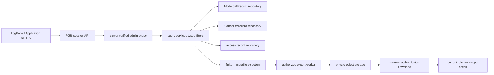

# Design: 应用广场、治理与运行记录查询

> **2026-10-23 增量设计评审稿，待用户确认，未编码。** 现状基线 `5f2541f4bc483c24624fede9031c88c4ec6f58f4`；规格确认提交 `dda16a6502908ba8d58cff61dc350c0213b86c19`。保留 D1–D11 与 §1–§8 编号，新增 D12–D15；历史 MVP“查询全后置”已不适用于现有操作审计。
>
> [spec.md](./spec.md)（61 条 AC）· [tasks.md](./tasks.md) · [release-contract.md](../release-contract.md)。本次新增 AC-46 至 AC-61，修订 AC-26、AC-34；不接管模型/能力/访问记录的业务写入者。

## 1. 目标与非目标

保留应用广场和统一授权交互，在现有“审计日志”页增加“应用运行”页签，查询/导出模型调用、能力调用和应用访问三类既有数据；让现有操作审计能够按应用找到密钥变更与凭据签发/撤销事件。

非目标：计费结算、全链路 tracing 产品、日志全文搜索、把 runtime stdout 当审计、重算历史身份/Token、为每次页面查询生成业务访问事件、给 owner 或开放 API 凭据授予管理员日志读取能力。

## 2. 关键约束

- 管理员级运行记录只接受自然人平台会话：租户管理员只查有效当前租户；全局超管无 admin-scope 时可明确选全局/目标租户，有 scope 时锁定该租户。部门管理员/只有 log 菜单的角色/应用 owner 不能因此取得此新读面。
- 现有系统操作审计拥有更宽的菜单/管理范围规则，**不直接复用其 `_resolve_audit_groups` 当新接口权限**；保留旧接口行为。
- 三类记录并不等于三类成功操作：无 app_id 的服务账号模型调用仍应显示；访问记录是入口 allow 合并窗口，不能展示为每个 HTTP 请求；缺历史字段用 ID/未知，不回填当前无关名称/用户。
- 列表默认最近 7 天，UTC ISO8601 带时区传输/规范化，start≤end、最大查询区间 90 天（可缩小筛选）；limit 1–100；导出最多 10,000 行，超出明确拒绝要求缩小筛选，禁止静默截断。窗口/上限是实现资源预算，不更改持久留存。
- Constitution Check：遵守 [constitution.md](../../../docs/constitution.md) C1–C8。新读侧 Model/Repository/Service/Endpoint 分层；租户自动上下文不手拼通用 tenant 条件；全局超管进入显式审计 scope；通用索引/类型无 JSON_EXTRACT；模块错误码 163 段登记后使用；导出在受限对象存储不放 API 本地盘；无铁律例外。

## 3. 方案对比与选定

### D1：广场继续现有 UNION 与批量权限

不新建平行应用列表后在前端拼接。托管应用 `flow_type=35`、slug/app_state 已随列表下发，批量可见性继续走 F048；单卡补拉权限造成 N+1 且越过通用策略。新资源类型/统一列表协议改变时再议。

### D2：卡片整页访问稳定入口

保留跳转 `/apps/{slug}`，不嵌 iframe、不拼 client `/workspace` base；统一登录/WS/身份均在入口。切换域名模型时再评审链接生成。

### D3：广场动作与可见范围仍由通用权限驱动

`app` 适用动作集与广场 use 筛选保留，不把“能看到卡片”作为运行记录管理员权限。二者属于不同业务目标。动作 Catalog 改变时审查消费者。

### D4：管理权限仍复用 PermissionDialog

构建卡片与发布页 VisibilityScopeSection 用同一交互/API；不为了审计页再建授权入口。当前 request 拒绝错误已需 catch，异步失败不能留 loading。组件契约变更时复核两个入口。

### D5：仅 owner 可见继续按 protected grant 区分

非 protected 授权行为空才表示无额外放行；默认 owner 行不应算外部授权。不从空列表误推断“无人有权限”。权限返回 schema 改变时重审。

### D6：可见范围变更由真实写路径审计

仍在统一授权 mutation 后按资源回调写 `app.visibility_change`，不从前端补写。查询/导出仅消费事实。新增授权写入口时必须核对回调是否覆盖。

### D7：访问记录写 F054、读 F056

`entry_authz_service` 已写合并窗口访问事实，不再“写读一起顺延”。保留既有合并窗口及其测试，本轮只补稳定读/导出适配，不按请求量补记历史访问。日后产品需要 PV/会话分析另立语义。

### D8：runtime 关闭明确隐藏与拒绝

新页签和新列表/候选/导出接口都读取实际 `app_runtime_enabled`；关闭时后端给部署开关错误，不把空列表当安全机制。旧系统操作审计照常可用。开关语义变更时再议。

### D9：下线应用仍可进广场

广场对托管应用白名单保持 online/stopped，不带草稿/待上线/删除；历史日志则不能以这组存活状态过滤，否则删除后记录消失。是否显示已删除资源是两个读面的不同合同。

### D10：广场名称搜索与日志候选分开

不拿可见应用广场列表当审计候选；它缺已删除资源、范围也不同。日志名称搜索基于受限审计记录/可信历史映射，只在当前管理员 scope 生效。若统一搜索服务支持历史治理数据再替换。

### D11：当前查询交付范围

现有 `api/v1/audit.py` 与 `api/services/audit_log.py` 已有系统操作审计、target_app_id 与导出；LogPage 仍只有“应用使用/系统操作”两页签。本轮加第三页签与三子视图，不重做旧审计或重写广场。真正已落地必须以实际调用点而非 tasks 计数判断。

### D12：三专表适配成管理员读服务（新增）

否决运行期高频记录塞普通 AuditLog、查日志文本推导、另造统一大表/回写历史。选定 F056 的 `RuntimeAuditQueryService` 调三个 Repository 适配器：现有 ModelCallRecordRepository（F051 写）、AppCapabilityCallRecord（F055 写）、AppAccessLog（F054 写）。现有模型读库有 bypass+手动 tenant 模式，新入口改用明确 `AuthorizedRuntimeAuditScope`，旧调用兼容由 owner 控制，不向客户端暴露 `tenant_id=None` 作为全局授权。

共享过滤/分页/导出规格，但不同视图字段保留语义；服务账号模型调用不强制 inner join App。证据是现有三种表字段不一致，只有模型表已有 cursor/export，能力表只有 insert，访问表已有旧 page DAO。新建读 Repository，不加新 DAO 入口或让 Service 写 SQL。未来跨类型关联检索成为真实需求才考虑物化统一索引。

### D13：固定查询快照与游标（新增）

否决仅按秒级 create_time 排序、offset 导出、无上界无限扫描。选 `(event_time DESC,id DESC)` keyset + 首次查询冻结 watermark_id / upper_time；所有页与导出共享过滤摘要、scope、snapshot。每页/导出都重新验证管理员资格。既有裸 base64 cursor 解码失败会被忽略，新接口必须显式拒绝。

为并发追加与回填得到精确有限集合，首次查询采用 Repository 的短只读一致性事务按该范围取 **有序 ID 选择集**：最多 10,001 个，超过则标 `exportable=false`，列表仍可按 watermark keyset 查看；可导出的选择集上限 10,000。选择集写 backend 私有对象存储，数据库 QuerySnapshot 保存 digest/筛选/scope/过期时间；Redis 可做缓存，不能是唯一权威。可导出的分页按冻结 ID 集读取，不会混入查询后提交、旧时间戳或乱序写入的新记录。超过 10,000 的普通列表只能承诺 watermark 范围全序 keyset，导出先缩小条件重新建精确集合；UI 明示，不声称无限大小数据库快照。

选择有限 ID 集而非跨 HTTP 长事务，是为了避免占连接/事务并支持多副本；现有表为追加事实，写方不就地修改，读取不反向写。历史清理删除时，结果明确提示快照失效，不能静默缺行。90 天仍过大时用户缩小时间；不做全租户永久报表。未来超过该预算有确定需求，再做专用异步分析仓储。

### D14：受权导出产物（新增）

否决公开 presigned URL、前端只导当前页、异步任务用提交时权限永久放行。采用有限快照生成 CSV 文件、DB 任务状态、MinIO 私有对象；创建、执行、交付均重验当前会话角色/scope，下载经认证 backend 流式返回，永不返回绕过权限的对象 URL。10 分钟过期并回收对象/快照。

导出请求只传 snapshot_id，服务端从不可变选择集取行，不接受一组可扩权的重新过滤。CSV 仅白名单字段，字符串移除危险控制前缀后，如首有效字符为 `= + - @` 或 tab/CR/LF，前置单引号，再标准 CSV 转义；数字列按数值输出，null 显示空/未知；测试逗号、引号、换行、空白绕过公式与 Unicode。CSV 逃逸不能当秘密过滤器。对象存储/worker 不可用时任务失败，不制造空文件成功。未来超大导出再审任务资源池。

### D15：可信应用关联的操作审计（新增）

F055 负责写 app.secret.*；凭据 owner 在签发/撤销时从持久 `ApiCredential.subject_kind/subject_id` 与可信 hosted-app 归属映射计算 target_app_id，不取查看者传的 app_id；SAK/PAT 的资源 owner 不等于 app 归属，不能把该人的所有 key 自动关联给某应用。

现有 CredentialService._audit 只写 credential_id/subject/scopes/key_mask，需要补可信关联；历史记录只能在原始可信字段足以确定时通过只读关联查询，不补写历史“现在属于”。不增加第三方业务密钥末位/长度，API key 原有前缀/末位 mask 继续保留。若普通凭据没有可信 app 绑定，明确不相关，不硬凑。后续新 credential owner 需提供同一审计关联协议。

## 4. 系统现状（接手必读）

### 4.1 数据流与实现状态

**已实现**：广场第三类型、两处权限 UI、可见范围审计、系统操作日志查询与应用筛选；模型表/能力表/访问表真实写入路径。**本轮未实现**：管理员 RuntimeAuditQueryService、新 endpoint/候选/稳定导出、新第三页签、可信凭据关联补齐、访问 app 名称快照。

### 4.2 既有公共合同（保留原广场/审计语义）

| 字段 / 入口 | 当前约定 |
|---|---|
| 广场列表 `flow_type/slug/app_state/can_share/user_name` | 托管类型 35；slug 为稳定 `/apps/{slug}` 入口；应用态仅 online/stopped；can_share=false；owner 显示沿用既有列表投影 |
| GET `/api/v1/chat/online` | 现有 page/keyword/tag/type 等筛选；服务端收窄 app 状态和 use 动作，不信客户端 action 扩权 |
| PermissionDialog | resourceType=app，resourceId=内部 app.id；两入口共用，protected owner grant 不算额外放行 |
| app.visibility_change | 变更人在真实授权 mutation 后回调记录；app/slug/added/removed 元数据；不由查询写入 |
| 事件登记 | 后端可见 action/namespace、领域 action、前端 log.ts、三语事件名保持 lockstep |
| 现有系统操作审计 | `/api/v1/audit` 和 `/audit/export/data` 已支持 target_app_id/tenant 筛选；不因新增 runtime 读面改变旧菜单/管理范围语义 |

### 4.3 关键模块职责

| 模块 / 新增落点 | 做什么 | 不做什么 |
|---|---|---|
| `app_governance` F056 读侧（按既有领域目录落点核对后实施）Endpoint/Service/Repository | 受权过滤、分页、候选、snapshot/export | 不重新写模型/能力/访问事件，不查 OpenFGA 原始 client |
| 三个 source-owner Repository 读适配协议 | 返回白名单快照/ID 选择集，保持事件语义 | 不从通用 Service 跨层 ORM 查询 |
| `open_api/.../credential_service.py:_audit` 与其可信 app resolver | 签发/撤销时写 app 关联 | 不由 viewer 参数、owner 人员关系猜 app |
| `app_runtime/.../app_access_log_service.py` | 新事件可选 app 名称快照，合并窗口不变 | 不回填历史事实、不记录拒绝为成功 |
| `pages/LogPage/runtime/`、API/hook（新增） | 三视图、filters/table/export、错误和过期状态 | 不含秘密列，不读凭据明文接口 |
| `AuditLogService` 与现有 systemLog | 查 app.secret 与可信凭据事件 | 不把 runtime 高频事件塞操作审计 |

实施前确认 F056 现有代码归属：当前主要在 `api/services/audit_log.py` 与通用列表模块，新增读服务**拟建立** `bisheng/app_governance/{api,domain}`，仅管理本 Feature 读侧，不迁移旧广场/权限代码，不重构通用审计。名称不代表新 feature/domain owner；release-contract 仍由 F056 认领。

### 4.4 本轮增量字段与接口合同（拟实现）

**① 拟新增会话 API**：挂 F056 路由 `/api/v1/app-runtime-audit`；读取者必须通过平台 session dependency，不能走 `/api/v2`。

| 接口 | 参数 / 响应 | 校验 |
|---|---|---|
| GET `/records/{kind}` | kind=model/capability/access；start_time/end_time/app_id/visitor_id；model 额外 credential_id；tenant_id 仅缩小可信 scope；cursor/limit；响应 `{items,next_cursor,snapshot_id,matched_count,matched_count_lower_bound,exportable}` | 参数 extra/非法范围/不支持筛选报错，不静默忽略；有限精确集合 matched_count=count；超上限 matched_count=null/lower_bound=10001，页面显示超过上限而非伪造精确计数；均在 scope 下，不泄漏全局总量 |
| GET `/candidates/{kind}` | app/visitor/credential，按当前 kind/time/scope 的历史事实给 `{id,label,deleted_or_revoked}` 候选，分页/搜索有界 | 同查询管理员门禁；credential 只给 mask，无私密 name/value；跨租户对象请求拒绝 |
| POST `/exports` | `{snapshot_id,request_id}` → `{export_id,status}` | 快照属于同一调用者/有效 scope、未过期、可完整导出；幂等 request_id |
| GET `/exports/{id}` | pending/running/ready/failed/expired + safe_reason | 重验权限、任务属于当前调用者且 scope 仍合法 |
| GET `/exports/{id}/download` | 认证后返回 CSV 流；Cache-Control: no-store | 不返回公开 object key/URL，失权/跨 scope 拒绝；下载开始与每个受限 chunk 之间重验，取消后停止继续交付 |

列表/候选只读，下载一次不新增访问事实；业务错误遵循现有 envelope，前端使用包裹 request 的 rejected Promise 处理。新增错误码从 163 段核对占用后分配并同步三语，不重用历史退休编号。

**② 三视图字段**：event_time 为查询统一排序别名，原始字段语义不变。

| kind / 来源 | 响应白名单 | 历史缺项 |
|---|---|---|
| model / `ModelCallRecord` | id、create_time、app_id、actor_kind/id/name、subject_kind/id、credential_id/mask、model_id/name、prompt/completion/total_tokens、result/error_code/http_status、latency/ttft、request_id | app_id 可空（服务账号调用）；subject 未知不冒充 owner；Token 空不填 0；无当时 app 名只显示 ID |
| capability / `AppCapabilityCallRecord` | id、create_time、app_id/app_name、credential_id、subject_kind/subject_user_id、capability、result/error_code、chunk_count、latency_ms、version_id | credential mask 仅经受限凭据投影能找到时补；无 actor 快照只表达 app 这个 actor，不虚构用户 |
| access / `AppAccessLog` | id、entry_time、app_id、app_name_snapshot（新增可空）、user_id/user_name、request_id | 老行 app_name_snapshot 空显示 ID；访问为 allow 合并事件，不显示为 HTTP 成功率/逐请求响应 |

不输出 model prompt/completion、检索 chunks/正文/targets 原始 payload、secret/env/cookies/OBO/token/任意 metadata。仅为新 access 记录新增 app_name_snapshot（128 字符 nullable）与写入参数，不重写合并窗口；历史不从当前名称回填。模型表已有 actor_name/model_name 快照，能力表已有 app_name；不为方便前端用 mandatory live join 丢掉已删除/撤销记录。

**③ QuerySnapshot / RuntimeAuditExport（拟新增）**：两个申请者私有、可清理的实体：`RuntimeAuditQuerySnapshot` / `RuntimeAuditExport`。UUID；tenant_id 默认 None/NOT NULL/索引，取服务端确认的申请者当前有效工作租户，**不把被查询的全局 scope 当作 NULL tenant_id**；creator_user_id、scope_mode（tenant/global）/scope_tenant_id、kind、normalized_filter JsonType、filter_digest、watermark、selection_object_key/digest/count、status、expires_at；export 另含 snapshot_id、request_id、output_object_key、safe_failure，唯一 `(creator_user_id,request_id)`。global 是经超管核验的过滤范围，不是共享导出对象；每次读取仍要求申请者本人、作业 tenant 上下文及当前 scope 合法。worker 按持久作业的 tenant_execution_scope 注册租户过滤，读取跨租户原始事实时才进入授权的全局 source Repository；不能用 nullable tenant 绕过自动注入。对象键由后端随机 ID 生成，客户端不能提交 key。

普通 list 即使不可导出也有短时 query token（filter/scope/watermark），不无限落地大选择集。可导出快照、任务、内容均 10 分钟期限，重复生成以 request_id 和唯一约束去重，失败/过期按定时清理账本删自有对象；worker 崩溃可从 DB 状态与租约恢复，不依赖本地文件。

**④ Scope / Cursor 安全**：

- `AuthorizedRuntimeAuditScope` 仅由服务端权限适配生成；自然人角色来自可信登录态与权限 application 协议当前核验，不信请求角色/租户。旧审计允许 log-menu 的逻辑不复用到此处。
- 普通租户 Repo 在 tenant_execution_scope 下自动过滤；全局超管 Repo 仅在明确授权 scope 下 bypass；客户端 tenant_id 只允许进一步收窄。跨租户 app/visitor/credential ID（含历史 tombstone）在限权解析器中验证，拒绝与未知 ID 对外同样不泄漏详情，不把 foreign ID 默默当“查无”。候选从事实表/可信删除保留信息产生，不能凭当前用户/应用列表扩范围。
- cursor 是服务端签名/摘要校验的 `{version,kind,scope_digest,filter_digest,snapshot_id,last_event_time,last_id,expires_at}`，不包含明文凭据。切租户/视图/筛选不能重用；解码/签名/过期错明确拒绝而非回第一页。
- 每次 list/candidates/export/status/download 都重验角色/范围；后台任务实际执行时再验提交者资格。无法确认权限 fail closed；不是仅靠 JWT 缓存角色永久允许。已交付字节不可收回，失权后不开始新下载或继续交付后续 chunk；不承诺撤回浏览器已收到的文件。

## 5. 已知坑 / 反直觉事实

| 坑 | 后果 | 处理位置 |
|---|---|---|
| 旧 AuditLogService 允许 log 菜单/部门管理者 | 直接复用会放大新 runtime 数据权限 | 新 Scope resolver |
| ModelCallRecordRepository tenant_id=None 是全局 bypass | 漏传租户变成全局数据泄漏 | typed scope + 专用普通/全局 Repo 适配 |
| 同秒 create_time 常相同，旧 cursor 错误会被忽略 | 翻页重复/漏行/跳回首页 | 严格签名 cursor + time,id 全序 |
| 写入有 write-behind，event_time 不等于插入完成时间 | 时间上界不能独立保证精确导出 | 有界快照 ID 集 |
| live app/credential 内连接会丢删除/撤销行 | 历史审计证据消失 | 以事实为主，可选显示投影/未知 |
| SAK 资源 owner 是人，不代表那人的某个 app | app 筛选错误归因其他 key 的行为 | credential owner 可信 subject_ref 解析 |
| 下载公开 MinIO URL 可绕过后来失权 | 撤权后继续新下载 | 认证代理下载/按块重验 |
| CSV 双引号不是公式防护 | 表格软件执行攻击字段 | 类型白名单 + 首有效危险字符处理 |
| HTTP 失败不是空结果 | 用户误以为无人访问/导出成功 | 独立 error/loading/empty 状态 |
| 应用 allow 访问按窗口合并 | 错读为 PV/逐次网络请求 | UI 字段提示与 F054 同语义 |

历史坑编号见 `dda16a6` 本文件；旧 300/1800 秒勘误不覆盖当前代码配置，本轮不改窗口。

## 6. 对外契约与依赖

### 6.1 我提供给别人的（Outgoing）

| 契约 | 消费者 | 风险 |
|---|---|---|
| 现有广场/授权交互与操作审计 | client/platform、管理员 | 不改变卡片状态与既有日志范围 |
| 三运行视图列表/候选/snapshot/export 会话 API | LogPage 新第三页签 | runtime 关闭/失权返回拒绝，不假空 |
| 按 app 查 secret 变更/可信凭据事件 | 系统操作日志页 | 审计登记四处 lockstep 与三语必须齐 |
| 白名单响应与 CSV schema version=1 | UI/管理员导出工具 | 字段语义与缺失值约定不可悄改 |

### 6.2 我依赖别人的（Incoming）

| 依赖 | 形式 | 风险 |
|---|---|---|
| F051 ModelCallRecord、F055 capability record、F054 access log | Repository/Python 数据契约 | 写方列名/追加策略/删除留存改变会破坏快照 |
| F048 可信身份/权限 application，F019 admin-scope | 当前会话+Python | 原始请求 tenant/admin 标志不可当授权 |
| 平台 DB、私有 MinIO、Celery/既有周期清理 | 后台任务/对象 | 不能只存在 writer 本地盘；过期必须回收自有对象 |
| F055 secret 审计与 credential owner 的可信关联 | 元数据 | 不读/存密钥明文；关联不足就未知 |
| 现有 LogPage/Tabs 与共享 UI/包裹 request/locales | TS | 不新增库/样式，Select 未 done 时跟随现存筛选实现 |

## 7. 测试与可观测

- 数据/权限定向：三表正常与空 app_id、null Token/subject；同秒/跨页/晚到写入/删除快照失效；租户 admin/超管 scoped 与 unscoped 允许，owner/log 菜单/部门 admin/审批人/SAK/PAT/foreign filter 拒绝；候选、导出、下载同样配对，角色变化后失败。
- 导出定向：同 snapshot 列表/导出集合完全一致，超过上限明确拒绝，重复 request_id 不创建重复任务；权限在提交/执行/下载/流式块间撤销；worker 重启、MinIO 失败、过期、CSV 注入/Unicode/引号/换行；任何错误不返回成功文件。
- 前端：保留两个旧页签，新第三页签里三子视图；选择器无空 ID；filter/kind/tenant 改变 reset cursor，query key 含 scope/type/filter，AbortController/请求序号丢弃旧结果；新错误态与空态分离；导出绑定当前 snapshot 并清楚显示范围/行数，失败结束等待、不显示“已下载”。
- UI 取当前共享 docs 的 Input/Button/Tabs 等 status=done 组件，表格/筛选沿用当前 `LogPage/systemLog` 及其选择器模式。filter 在窄屏换行、表格横向滚动，不引入新视觉模式/库；多端、字体/色彩按当前规范，三语同交付，不手改生成的 api_errors。
- E2E 走新会话 API + 实际 LogPage 人工清单：授权测试租户 A/B、tenant admin、global super、ordinary owner；产生模型/能力/allow 记录，选同一 snapshot 查/导；删除测试 app/撤销 key 后仍查历史；验证 secret 审计没值、无 app 的 SA 模型记录不消失。runtime 关闭新面拒绝，旧系统操作仍可查。
- 编码后定向命令：`cd src/backend && uv run pytest test/app_governance/test_runtime_audit_query.py test/app_governance/test_runtime_audit_export.py`（拟新增）；只跑 `LogPage/runtime` 对应 Jest 文件。复用旧 audit 测试中修改路径的最小集合，不全量重跑；必要 Ruff/arch-guard/迁移 head 单独验证。DM8 仅静态。
- 指标/日志：query kind、规范筛选摘要、scope、actor、行数、导出状态/过期/失败码；不记原始秘密/URL token/body。查询不伪造模型/能力/访问业务事实。

## 8. 后续改进 / 不打算做的事

不补造历史 app 名/subject/凭据关联；不在本轮建立日志仓库或计费数据模型。90 天筛选与 10,000 行导出限制明确提示，后续有真实大规模需求再专门设计异步分析，不用本地 CSV 临时文件绕过多节点。原 ARM/跨节点/正式镜像发行验收仍保留，不宣称新列表测试证明这些能力。

## 修订历史

| 日期 | 变化 | 依据 |
|---|---|---|
| 2026-10-23 | 刷新已实现广场/操作审计；新增 D12–D15、三视图/稳定导出/权限合同 | 用户确认规格，静态代码核查；未实现/部署 |
| 2026-08-17 起 | 早期广场与治理设计 | 旧正文见 `dda16a6`；历史任务证据不改写 |
