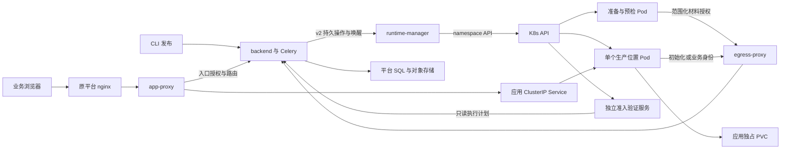

# Design: F059 K8s 应用托管执行后端

> **状态：设计已由用户确认，R-D1、R-D2、R-D3 复审通过；进入任务拆解/实施，尚未交付。** spec 已由用户明确回复“确认规格，进入设计”。本文区分基线代码和拟实施设计；不能据本文件宣称 K8s 交付完成。

**关联**：[spec.md](./spec.md) · [tasks.md](./tasks.md) · [规格评审](./review-evidence.md) · [设计评审](./design-review.md) · [189 盘点](./cluster-preflight.md) · [版本契约](../release-contract.md)

**版本**：v3.0.0；**最后更新**：2026-10-21；**代码基线**：`755d4456e50c015a3fa88da0c0c35ab53bbd1650`。

## 1. 目标与非目标

实现 F086 运行操作合同的 K8s 执行后端，复用现有发布、审批、权限、SDK、入口和出站流程。应用包在执行节点准备和物化，生产 SQLite 使用独立 PVC，平台材料继续经 backend 保存及授权。

本轮设计不改变平台核心的部署方式，不实现多副本、HPA、跨集群、Docker/K8s 迁移、商业额度、新业务管理页面、任意 SQL、任意宿主命令或用户任意 Dockerfile 构建。旧源码构建兼容模式仍产出 OCI 应用镜像；默认应用包不产出应用镜像。

## 2. 关键约束与 Constitution Check

遵循 [constitution.md](../../../docs/constitution.md) C1–C8，不在本文复制铁律。Owner 和不变量以 [release-contract.md](../release-contract.md) 为准。

| 本功能约束 | 对设计的影响 |
| --- | --- |
| spec 55 条有效 AC 已确认，AC-38 退役 | 设计不得通过实现便利删减交付模式或放松隔离；偏差需重新确认 |
| 189 是 K8s 1.28.15、amd64、单节点、Docker CRI、CentOS 7 内核 3.10 | 资源使用 1.28 稳定 API；不依赖原生 sidecar、1.30 CEL GA、CSI/RWOP 已安装或 rootless 用户命名空间可用 |
| 无 StorageClass、PV、CSI、RuntimeClass | 验收先预置有节点绑定的专用 local PV/PVC；不得宣称动态供应或跨节点存储恢复已验证 |
| manager 不挂 Docker socket、不读平台存储凭据 | K8s HTTP API 和范围化 backend HTTP API 是执行层控制边界；CLI 不是运行依赖 |
| 默认发布不构建 OCI 应用镜像 | 代码、依赖锁及 wheel/tarball/编译产物由平台保存；venv 在运行镜像中按固定路径物化 |
| 一个正式应用、一个生产写入执行位置 | 应用、迁移、恢复及停用数据会话共用同名生产 Pod 位置；终止未确认时不补第二个写入者 |
| 必需隔离不能配置覆盖 | 既有实例继续服务的前提仍是隔离成立；更强沙箱只能回退到满足基线隔离的默认档 |
| manager 停机不能切断现有访问 | 路由、策略、材料初始化授权由 backend 持久投影提供；业务请求不查询 manager |

### 2.1 Constitution Check

| 条款 | 本设计落点 | 门禁结论 |
| --- | --- | --- |
| C1 | K8s 客户端只在 `src/runtime-manager/`；backend 通过 Service/Repository 管理操作、材料及投影 | 无设计冲突 |
| C2 | 计划新增执行资源/材料授权模型及迁移均用平台既有方言工具；SQLite 工作库不与平台库混淆 | 设计遵循；实现仍需静态检查，真实 DM8 按会话口径由中央回归承担 |
| C3 | 授权范围从已验证应用与操作取得；服务跨租户读仅在现有内部作用域中进行 | 不引入请求自报租户作为权威 |
| C4 | owner、审批人、管理员和服务账号边界仍由原业务 Owner 经既有权限运行时验证 | 不增加 K8s 专用授权旁路 |
| C5 | 业务失败映射到既有 161/162 行为；确需 K8s 运维错误时在已分配 164 段登记 | 不将 Pod 状态直接变成新业务状态 |
| C6 | 服务密钥、材料初始化私钥、拉取凭据分开；业务容器不得挂载管理或材料凭据 | 不硬编码、输出或复制主凭据 |
| C7 | 无前端改动 | 不适用新增实现 |
| C8 | SQL/对象存储为权威；manager 磁盘和 Pod emptyDir 仅为可重建缓存 | 生产工作数据在独立持久卷，不能放 emptyDir |

## 3. 方案对比与选定

### D1：按运行能力抽象执行器

- **备选**：模拟 Docker Engine API；只加 `kubernetes_backend.py`；抽象准备、启动、停止、日志、数据维护和执行事实。
- **选定**：第三种。`OperationExecutor` 保留通用操作状态机，调用新的 `RuntimeExecutor`；`DockerExecutor` 适配当前实现，`KubernetesExecutor` 生成明确的受限资源。
- **原因**：当前 `operations.py`、`bundle_preparer.py`、`bundle_launch.py`、`DataExecutor` 和只读 API 均直接操作 Docker 或本机目录，原 `DockerBackend` Protocol 不是完整接缝。仅更换客户端会把 HostConfig/Binds 和本地备份路径带进 K8s。
- **重新考虑条件**：有第三种执行平台时扩展能力接口；不向平台业务层暴露 PodSpec。

### D2：生产使用平台直接管理的 Pod，不使用自动补副本控制器

- **备选**：每应用 Deployment/Recreate；StatefulSet 单副本；平台管理固定名称的生产 Pod。
- **选定**：第三种。每应用在运行命名空间只有一个生产位置 `app-<app-id>`，用途可以是 `serve`、`migrate`、`restore` 或停用时的 `data` 会话；`data` 不启动业务应用、不改变应用停用态。进程故障由 kubelet 重启，整个 Pod 缺失由 manager 对账恢复。准备/预检也用命名确定、有期限的临时 Pod，不引入 Job 自动重试者。
- **原因**：副本数为 1 不足以保证分区、强删或迁移窗口内只有一个数据库写入者。固定 API 资源名称限制并发创建，backend 的 UID 账本和停止确认处理删除后的未知旧进程。平台本来就有持久操作及对账机制，不再让另一控制器自行跨越维护闸口。
- **重新考虑条件**：引入经过验证的存储 fencing 和有维护协议的专用控制器后，可替换为 StatefulSet/Operator；不能只改 replicas。
- **代价**：manager 长期不可用时，已存在 Pod 的容器可重启，整个 Pod 丢失不会由 Deployment 自动补起；符合本次“既有服务保持、manager 恢复后对账”的边界，不能宣传控制面完全无依赖。

### D3：固定材料＋Pod 内物化环境

- **备选**：共享 manager 目录或 hostPath；把开发机 venv 上传为运行环境；固定依赖材料＋运行节点物化。
- **选定**：第三种。源/编译包及依赖产物保存在 backend；准备 Pod 在 scratch PVC 工作；正式 Pod 用 emptyDir 接收代码和依赖，Python 在 `/opt/venv` 物化，再给业务容器只读挂载。
- **原因**：当前 venv 的路径固定、存在解释器及 ABI 假设。不能把 manager 本地目录用于另一个节点，也不能把编译产物等同于任意平台可搬运 venv。Pod 内容器重启保留 emptyDir，整个 Pod 重建从冻结材料恢复。[initContainer 官方说明](https://kubernetes.io/docs/concepts/workloads/pods/init-containers/)
- **重新考虑条件**：实测物化成本超出恢复预算时，增加按租户/应用/环境键隔离的可丢弃环境缓存；不能把缓存升级为唯一真身。

### D4：任务身份与部署初始化身份分开

- **备选**：给所有 Pod manager HMAC；永久延长准备操作；独立范围化材料授权。
- **选定**：第三种。任务身份随有效操作失效；正式初始化身份绑定当前有效部署和冻结引用，预览仍绑定有效预览操作及审批期限。所有材料凭据仅在受信的传输容器中，业务容器没有这些挂载。可信传输、打包、OCI 组装和数据 helper 均以固定命令、固定工作目录启动，不从应用目录/PYTHONPATH 加载用户模块；确需 Python 时使用隔离模式，防止执行用户脚本前泄露其独有凭据。
- **原因**：现有 `RuntimeArtifactService.operation()` 拒绝已完成或过期操作；直接复用会导致批准版本日后无法重建。给应用 manager 密钥或无限延期会扩大控制权限。
- **重新考虑条件**：平台统一工作负载身份服务落地后可替换底层证明方式，但仍需保留动作、材料、归属、代次及撤销范围。

### D5：SQLite 的固定生产位置＋终止确认

- **备选**：只依赖 RWO/RWOP；SQL 租约过期即接管；Pod UID、finalizer、生产位置及停止事实共同约束。
- **选定**：第三种。RWO/可用的 RWOP 只是附加约束。旧写入者停止未确认时保留占用，不接管、不强删。迁移、恢复及停用数据会话占用与正式服务相同的生产位置，前后都必须完成停止确认。停止事实分为未绑定节点、受来源约束的 kubelet 终态和未知三类（4.5）；不要求从未创建的容器具有 container ID。
- **原因**：RWO 可允许同节点多个 Pod；API 对象删除不证明节点进程死亡。终态 Pod phase 也可能由节点丢失处理产生，不能单独作为证据。安装的无副作用 status 验证规则限定终态的写入来源，再结合 UID、删除事实和新鲜 API 读取判定；不能依赖 manager 自报来源或 managedFields 中的名称。[访问模式](https://kubernetes.io/docs/concepts/storage/persistent-volumes/#access-modes)、[强删风险](https://kubernetes.io/docs/tasks/run-application/force-delete-stateful-set-pod/)
- **重新考虑条件**：客户存储提供可验证的节点/卷 fencing 后，单独增加其证明适配器及故障验收；首轮不提供手动布尔开关绕过停止确认。

### D6：不可覆盖的准入基线＋代理出站

- **备选**：只检查模板；RBAC＋可覆盖 NetworkPolicy；固定准入策略、实测隔离及 backend 授权的出口。
- **选定**：第三种。安装者设置命名空间 PSA Restricted 和独立验证 webhook；manager 无权改这些基线。应用只向 egress-proxy 出站，平台和外部域名均由代理访问；入站限 app-proxy 和受控健康/数据管理流量。
- **原因**：RBAC 不能限制 PodSpec 字段；NetworkPolicy 是 Pod 级，不按 init/main 容器区分，且创建对象不等于 CNI 生效。材料身份与业务身份必须叠加接口授权，不能依赖同 Pod 不同容器获得不同网络策略。[PSS](https://kubernetes.io/docs/concepts/security/pod-security-standards/)、[NetworkPolicy](https://kubernetes.io/docs/concepts/services-networking/network-policies/)
- **重新考虑条件**：客户已有等价准入引擎时可复用，但必须通过同一允许/拒绝测试；不能降级为仅告警。

### D7：兼容源码模式使用受限 OCI 组装

- **备选**：节点 Docker socket/DinD；容器内通用 rootless BuildKit；准备好应用内容后追加 OCI 层。
- **选定**：第三种，保持 `source-image` 交付模式及实际应用镜像输出。复用平台的语言准备规则、入口模板与冻结环境，在受限 Pod 完成安装和编译后，可信组装 Pod 把代码、venv/Node 产物和入口文件加入冻结基础镜像，配置既有启动语义并推送；不能执行用户 Dockerfile。组装器只接受固定路径布局，拒绝路径逃逸、设备、setuid、外部硬链接和用户 whiteout；仅允许受信工具链定义的镜像内符号链接，不能把用户 tar 直接追加到镜像根。
- **原因**：平台现有 Dockerfile 是固定 Python/Node/static 模板，不开放任意 Dockerfile。OCI 层追加本身不需运行容器守护进程；普通代码发布仍走 bundle，不调用此组件。[crane append](https://github.com/google/go-containerregistry/blob/main/cmd/crane/doc/crane_append.md)、[crane mutate](https://github.com/google/go-containerregistry/blob/main/cmd/crane/doc/crane_mutate.md)。BuildKit 的官方 rootless 容器示例需要额外系统调用/进程沙箱条件，不能假定在 189 或 Restricted 基线下直接成立。[rootless 前置](https://github.com/moby/buildkit/blob/master/docs/rootless.md)
- **重新考虑条件**：产品将来批准任意 Dockerfile 或系统包安装时，重新设计构建沙箱；不通过临时放开 privileged、提权、宿主挂载或内核配置实现。
- **兼容验收门**：Python 的 Procfile/默认入口、Node install/build/prune、static 输出选择和 SDK 必须与 Docker 原兼容路径逐项比较；不能只验证“镜像能启动”。依赖或系统库超出冻结 profile 时，审批前明确拒绝并指向新环境或完整镜像。

### D8：namespace 内运行权限与安装权限分开

- **备选**：manager cluster-admin；manager 动态部署自己的 RBAC/准入；安装者管理集群基线，manager 只操作预置运行命名空间。
- **选定**：第三种。安装者供应 Namespace、PV/StorageClass、PSA、WebhookConfiguration、Role/RoleBinding 及只读部署描述；运行时不改变它们。K8s 1.28 使用稳定的 validating webhook，不以 CEL 新特性为前置。
- **原因**：可以创建 Pod 仍是强权限，不能因“没有 root/socket”判断其权限小。独立的无集群身份准入进程限定 manager 的可创建资源；宿主盘目录创建由安装者完成，不交给 manager。
- **重新考虑条件**：集群统一平台已有相同策略及供应服务时替换安装物，不扩大运行账号权限。

## 4. 系统现状与拟实施结构

### 4.1 基线已实现和缺口

| 基线位置 | 已有代码 | F059 改动 |
| --- | --- | --- |
| `runtime_manager/main.py`、`api/operations.py` | v2 HTTP 唤醒、平台对账循环、内部鉴权 | 按配置选择 executor；K8s 形态不初始化 Docker 客户端或 v1 本地循环 |
| `operations.py` | prepare/probe/preview/deploy/stop/destroy/migrate/restore；事实上报 | 保留通用状态机，移出 Docker 枚举、目录和镜像操作 |
| `bundle_preparer.py`、`bundle_launch.py`、`container_runner.py` | Docker 本地下载、构建、venv、bind mount 和容器运行 | 抽出共享输入/启动规则；K8s 在 Pod/卷内执行，不模拟宿主路径 |
| `appdb.py`、`data_executor.py`、`api/platform_data.py` | 一致备份/迁移与受控数据查询，Docker 单应用挂载 helper | 复用 SQL 和数据格式，增加同 Pod 数据 helper、停用数据会话及独占维护执行体 |
| backend `runtime_delivery.py`、`runtime_operation_service.py` | v2 服务鉴权、操作/事实、归属、容量、产物传输、路由/策略 | 增加 K8s 资源账本、控制器租约、内部数据操作和材料初始化授权；不加入 K8s SDK |
| backend `runtime_kubernetes_service.py` | 已实现控制器claim/renew、资源意图预提交、UID/停止事实和只读准入投影；34项Service合同与16项账本回归通过 | T019已接入HTTP路由；manager执行调用仍待后续任务 |
| app-proxy、`platform_egress.py` | backend 路由/策略投影，不依赖 manager 提供路由 | 保留授权、HTTP/WS/CONNECT；增加材料用途的范围化策略 |
| `.github/workflows/runtime-images.yml` | tag `v*` 和 workflow_dispatch；原生双架构镜像、目录产物 | 同版本发布执行 helper/OCI 组装器；增加 K8s 清单和契约测试 |

本基线尚无 K8s executor、部署 Chart 或真实运行验收。该历史基线未包含原F086多租户启动及BIGINT修复。实施中已从F086单一来源继承Vibe专有BIGINT并显式汇合迁移；公共租户启动修复已按2026-10-22用户授权进入发布线9d156f261c，F059普通合并98fbba032继承，未复制权限分叉；新增空迁移汇合保持原父链。详见 [prerequisites.md](./prerequisites.md)。

**F059 实施进展（尚未交付）**：核心执行器、资源/材料账本、owner数据票据、SQLite维护、安全purge、能力探测、Chart、helper/assembler及业务验收工具均已有实现。主agent与三个独立工作树按文件归属合入；L1与本地集成见[task-reviews.md](./task-reviews.md)。189已完成专用MySQL扩展迁移、backend/Celery及四运行服务安装；仍在修复真实CREATE默认对象兼容并执行隔离探测，尚无业务部署通过结论。109已真实完成三语言离线应用包、代码升级/依赖复用、前端hook/native wheel及SQLite的Engine级回归；未代替完整平台审批/权限验收。正式双架构发行、故障升级和L2仍待完成。

### 4.2 拟实施拓扑与流程



准入验证服务是安装支撑进程，使用 manager 镜像的独立命令，不持集群凭据、manager 控制密钥或对象存储凭据；不是新业务编排入口。manager/app-proxy/egress-proxy 继续独立运行。应用不直连 backend、MinIO、平台数据库或 K8s API。

平台核心在集群外时，nginx 必须能到达共享 app-proxy，backend 必须能到达共享 manager API；不能把 ClusterIP 当作可由外部主机访问的地址。安装者可选择私网 LoadBalancer、受保护的单一 NodePort 或已有私网路由，分别发布共享入口和控制端点；默认不自动对外开放，控制端点限制 backend 来源且保留 HMAC。只有安装者在系统命名空间创建这两个共享暴露，manager 不能创建应用 NodePort/LoadBalancer。189 使用专用私网端点并验证实际源地址/转发后的 ACL；应用与材料 Pod 出站到外部平台 URL 仍经 egress。

### 4.3 发布、访问及数据流程

1. CLI、backend 同步校验、代码快照、Celery 扫描沿用 F055/F086。backend 校验运行时能力与冻结 profile，并创建 `RuntimeOperation`、预占及任务材料授权。
2. manager 获取操作，验证本进程控制器租约，准备 scratch PVC；可信传输 Pod 下载源码/离线材料或既有依赖产物。包大小、条目和解包边界沿用 F086。
3. 有依赖变化且允许内网/受控包源时，download Pod 经 build 用途 egress 下载完整材料。resolve/install/compile Pod 不持材料或出口凭据，不挂生产卷，不能访问公网。各阶段结束并确认停止后才能交接 scratch 卷。
4. 上传 Pod 验证结果、计算摘要、经 backend 上传并 finalize，形成冻结 `RuntimeDelivery`。只改业务代码时复用已验证依赖产物，仍执行本次编译及启动预检。
5. probe 使用独立数据卷/临时数据；成功后回收并提交 stopped/cleanup 事实。任意预检容量/材料/启动失败均原地结束，无新审批单和正式版本；容量恢复后重新发布。
6. F055 写正式版本、发审批；预览按需创建独立临时 Pod 和数据库/附件空间。每次预览绑定会话、使用者、版本及审批期限，终态/回收立即撤销授权，超期由平台与 manager 对账清理。
7. 审批后 backend 原子准入所选档位及 helper/任务开销。不足保留审批和版本，进入原待上线状态；不启动无限 Pending 候选。初始化和启动仍有实际调度验证。
8. SQLite 更新先将路由置 maintenance 并确认 backend 已提交，再关闭生产位置；按 4.5 确认旧 UID 停止（含尚未启动的容器）后，用同名生产位置运行维护 Pod。先一致备份、上传并确认内容及关联记录，再 DDL；完成后维护 Pod 必须停止确认。
9. 创建正式 Pod、材料授权及 Service；初始化物化代码/依赖，业务容器只读挂载。manager 验证 Pod UID、镜像、健康及 Service 就绪端点，提交 ready。backend 原业务服务校验预期版本/归属并提交路由、凭据、AppInstance 和 serving 事实。
10. manager 收到 serving 后回收旧 Service、短期授权和 scratch。响应丢失查询持久事实及 UID 账本再续办，不重复产生版本、迁移或快照。
11. 浏览器仍经 nginx → app-proxy → backend 入口授权/路由 → 当前 Service。应用 HTTP/WS 访问与 SDK/模型/附件请求仍使用原访问者 OBO 及应用凭据，经 egress 到平台。附件内容全程归 backend。

更新失败按阶段区分：容量准入或准备失败且未维护旧库时不破坏旧实例；DDL 已执行则保留维护状态和快照，不自动恢复数据库。停用先撤销入口/出站/初始化授权，再停止生产位置；不删 PVC。恢复只能由自然人 owner 通过既有流程明确确认。owner 数据查看/编辑/导出在停用后仍保留：经 4.8 的独占 `data` 会话执行，不为此恢复业务应用或正式路由。

### 4.4 执行资源与持久化映射

| 内容 | 存放位置 | 生命周期 / 访问 |
| --- | --- | --- |
| source、dependencies、compiled、offline、snapshot | backend 对象存储＋SQL 记录 | 复用 `RuntimeArtifact`；执行层只经平台内容接口 |
| 当前操作、归属、容量、路由、策略 | 平台 SQL；Redis 通知/短缓存 | 保留 F086 权威；不用 manager 本地 JSON 接管 |
| 下载、解析、编译工作区 | 专用 scratch PVC，按操作独占分配 | 动态供应或预置池；阶段交接按 UID 确认，完整产物确认后可删 |
| 已批准应用代码/环境 | 生产 Pod 的独立 emptyDir | 只读给业务容器；容器重启复用，Pod 消失则从固定材料重建 |
| 生产 `/data/app.db` 及 WAL/SHM | 每应用独占 PVC | 无 Pod ownerReference；保留策略 Retain，停用/升级/卸载不删 |
| 迁移前尚未确认的备份 | 生产 PVC 的平台保留子目录 | 平台确认前不清理；不能只存维护 Pod emptyDir |
| 预检/预览工作数据库 | 独立 scratch/preview PVC 或 emptyDir | 初始按批准结构建空库，不挂生产 PVC；会话结束清理 |
| 材料私钥、业务应用/出站凭据、拉取凭据、受控数据票据 | 独立 Kubernetes Secret，仅指定容器引用 | 不写应用包、共享 scratch、日志或业务容器环境；拉取凭据只供 kubelet或可信组装器 |

生产 PVC 固定划分 `business/` 和 `platform/`：业务容器只把 `business/` 以 subPath 挂到 `/data`，维护/数据 helper 可访问对应平台保留目录；快照、停止/迁移记录和数据请求结果不暴露给业务容器。目录由受信初始化步骤按冻结 UID/GID 建立，不解释用户提供的 subPath。

生产卷首轮支持经锁、同步和故障验证的 local PV 或块设备文件系统 CSI 卷。拒绝将 NFS/SMB 文件系统用于现行 SQLite WAL 合同。local PV 带节点亲和，管理进程不创建宿主目录；安装者预置 UID/GID 权限。需要跨节点恢复时必须另验存储与停止证明，不能以 RWO 字样替代。[SQLite WAL 限制](https://sqlite.org/wal.html)

预置卷无默认 StorageClass 也可用：安装者创建 `storageClassName: ""` 的 PV/PVC 绑定并登记；manager 只消费已授权 PVC。动态供应模式只创建指定类的 PVC，不操作 PV 或 StorageClass。PVC 不归属于 Helm 可级联删除的工作负载；应用显式删除时先安全擦除数据、记录完成，再依供应策略释放/回收，Retain 的集群 PV 由安装者处理，不把“PVC 删除”当作磁盘已擦除。

### 4.5 生产位置、UID 与停止确认

- 生产 Pod 名称由应用 ID 单向构造并截断到 63 字符，保留足够散列避免碰撞；namespace、名称、Pod UID、generation、owner_epoch 和模板摘要存入资源账本。正式服务、维护和停用数据会话共用这个固定名称。
- 只有此位置允许挂该应用生产 PVC；准入拒绝从另一个 Pod、Job 模板或预览资源挂载它。业务容器和数据 sidecar 是同一正式位置内的进程，不是两个正式实例。
- 创建前在 SQL 预记并提交资源意图，随后才调用 K8s API；不得持数据库事务锁等待会回读 backend 的准入 webhook，避免循环等待。创建后按 UID 确认；创建响应丢失，读取同名资源核对标签、模板摘要和账本，不能仅按名字领养。所有删除和替换带 UID precondition，更新带 resourceVersion。
- 所有需要停止确认的受管执行 Pod（生产、data、准备、预检、维护及预览）均带 `runtime.bisheng.io/stop-confirmed` finalizer；临时 Pod 也不能在 manager 断连时丢失唯一终止证据。停止请求先记账，再发有宽限期的 DELETE；finalizer 保留可查对象，便于 manager 观察并持久化该 UID 的终止证据。
- **停止证明**按下表分类，检查从 API server 新鲜读取的同一 UID、删除事实、准入基线版本和容器诊断；不把“从未启动”强行转换成“必须有 container ID”。Watch 缓存仅用于唤醒，不能作为释放依据。
- 证据成立后先上报 stopped，由 backend 解除写入归属/预占，再移除 finalizer。若无法证明，保持 `cleanup_pending/writer_stop_unconfirmed`，保留卷和预占；没有强删超时后自动接管路径。
- 外部管理员强删或同名替换后，旧 UID 在账本中仍未确认；新资源不获准启动为生产写入者。遇永久节点故障，默认阻塞至恢复或客户提供经评审的物理 fencing 方案；本轮不内置此证明适配器。
- manager 多进程使用平台 SQL 控制器租约，失去租约即停止提交变更。租约只限制控制器行为，**不**用它证明数据库写入者死亡。固定名称、准入检查与 UID 账本共同处理陈旧请求的竞争窗口。

| 分类 | 必须具备的证据 | 结果 |
| --- | --- | --- |
| `never_scheduled` | 同一 UID 已进入删除，最新对象的 `spec.nodeName` 仍为空；模板禁止用户指定节点，绑定 API 不允许给删除中的 Pod 新增节点归属；没有同名异 UID 或早期已绑定事实 | 从未交给 kubelet，无容器终止记录也可确认该 UID 不会成为写入者 |
| `kubelet_terminal` | 同一 UID 已进入删除；Pod 从创建起受当前 status 基线保护；`Succeeded/Failed` 是该绑定节点 kubelet 通过受控 status 更新写入的终态，且无仍运行的容器记录；终态不可回到活动态 | 接受 kubelet 对整个 Pod 已结束的确认；Waiting、缺失 ID 或从未启动的 init 后缀作为诊断保留，不因此永久阻塞 |
| `unknown` | 只有 DELETE 已受理、404、NodeLost/Unknown、租约超时、来源未受保护的 Failed、过期缓存、对象消失或同名替换等事实 | 保持 held/cleanup_pending；不释放卷或创建第二生产写入者 |

`never_scheduled` 不是仅凭“查不到状态”：必须保留带删除时间和空 nodeName 的同 UID API 对象。绑定和终态来源的允许/拒绝测试属于安装硬门；不满足时不能启用该证明类型。已绑定但 init 拉取失败/材料拒绝时，先 DELETE，再等待 `kubelet_terminal`；不能根据 PodInitializing 或状态缺失直接释放。

**终态来源约束**：独立验证器新增 `UPDATE pods/status` 规则，只覆盖本安装专用执行命名空间。使用 API server 提供的 `AdmissionReview.request.userInfo` 与 old/new Object：只有 `system:nodes` 中、用户名严格等于 `system:node:<spec.nodeName>` 的绑定节点身份可引入终态或变更终态容器记录；拒绝其它控制器合成终态，拒绝终态恢复活动。普通调度条件更新不需要 backend 或资源计划查询。manager 的 Role 不含 `pods/status`，不能冒充 kubelet；创建 Pod 时拒绝预填终态，冻结 `status_policy_revision`，不领养基线启用前的 Pod。规则 `sideEffects: None`、`failurePolicy: Fail`，不写停止事实、不调用 backend，因此不形成 status→backend→删除的循环。该设计信任受认证 kubelet，不声称防御被接管的节点或集群管理员。

停止事实在平台保存 `evidence_kind`、resource UID、nodeName、删除时间、API resourceVersion、status 摘要、policy revision 和 observed_at。仅当它们与当前资源/归属匹配，backend 才允许释放；finalizer 保留失败可重试，已确认停止的旧 UID 不因重复通知重新占用。对象一旦强删且没有已持久确认的证据，仍按 unknown。资源账本中的收尾计划保留到 finalizer、Service、Secret 和 scratch 清理确认，不因业务操作先进入终态就从 admission 的只读计划中消失；它只授权同 UID 的停止/删除收尾，不再授权创建或重新取得生产归属。

K8s 1.28 不保证未启动容器都有终止记录；其 kubelet 延迟终态转换直到不再可能运行容器。本设计据此组合来源约束与 UID/删除事实，而非只看 phase。[TerminatePod](https://github.com/kubernetes/kubernetes/blob/v1.28.15/pkg/kubelet/status/status_manager.go#L380-L486)、[mergePodStatus](https://github.com/kubernetes/kubernetes/blob/v1.28.15/pkg/kubelet/status/status_manager.go#L965-L1029)、[删除中 Pod 的绑定校验](https://github.com/kubernetes/kubernetes/blob/v1.28.15/pkg/registry/core/pod/storage/storage.go#L221-L232)、[AdmissionReview 与子资源规则](https://kubernetes.io/docs/reference/access-authn-authz/extensible-admission-controllers/#request)；这些是静态依据，未替代 189 实测。

固定生产名称可在一个操作中顺序经历备份、迁移和运行。每阶段使用独立resource_ref及UID行；原operation/kind/name唯一约束由f059_resource_phases移除。新阶段须所有历史生产Pod停止确认且cleanup complete，旧证据不覆盖。ref主键及真实UID唯一约束保留；降级前运维确认无历史重名，DDL不清历史。

### 4.6 准备、初始化及依赖复用

**准备阶段**：scratch PVC 按操作唯一分配，可信传输 → download → resolve/install/build → 可信上传是独立的临时 Pod；每阶段网络身份不同。临时准备/预检/维护 Pod 用 `restartPolicy: Never`、`activeDeadlineSeconds`，manager 决定重试，不使用 Job 控制器自动补 Pod。预览 Pod 从创建起设置由会话 expires_at 推导的总期限，启动/物化仍各有 90 秒阶段限制；不把短启动期限事后调大为 7 天。正式 Pod 无整生命周期 deadline，初始化进程使用自身固定阶段期限，manager 对账负责停止超时未上线候选。K8s 1.28 只允许减少已设 Pod activeDeadlineSeconds，不能设计成 ready 后延长或清空。[1.28 更新校验](https://github.com/kubernetes/kubernetes/blob/v1.28.15/pkg/apis/core/validation/validation.go#L4391-L4409)无动态供应器时使用安装者预置的 scratch 池；池容量不足返回准备资源不足，不借生产卷。

**正式 bundle Pod**：

| 容器 | 镜像 / 动作 | 挂载与身份 |
| --- | --- | --- |
| `material-fetch` init | 固定执行 helper；取冻结 compiled/dependencies 并安全解包 | 材料授权 Secret 只给此容器；不挂生产 PVC，不执行源码/安装脚本 |
| `environment` init | 固定 runtime 镜像；Python 在 `/opt/venv` 建环境、`--no-index --require-hashes` 安装、pip check/SDK 验证；Node 检查批准 node_modules；static 检查入口 | 只有代码/材料/环境卷，没有材料、业务或出口凭据，没有生产卷；网络层仅有需认证的 egress 端点，实际无出站授权 |
| `app` | 批准 runtime image＋冻结 command；`/workspace/app`、`PATH=/opt/venv/bin:...` | 代码和环境只读，生产 `/data` 可写，tmp 有界；仅业务应用/OBO/egress 变量 |
| `data-helper` | 固定 helper image；受控表/schema/行编辑/导出 | 同一生产 PVC，只有本应用数据动作验证材料，不持 manager/service/MinIO/集群密钥 |

初始化阶段使用相同 Pod 网络，不能声称 init/main 有独立 NetworkPolicy。材料取回经受控 egress，物化容器没有代理身份；业务容器只获得 runtime 用途身份。访问 backend 内容接口本身还需材料授权，普通应用凭据不能调用它。

环境键复用 F086 的 profile、运行镜像/ABI、目标架构、完整依赖锁、离线材料摘要和 install_inputs；包含租户与应用作用域。代码变化仅在不影响安装输入时复用 dependency artifact。Python venv 不跨任意路径/镜像迁移；Node 的原生模块随 profile/platform 冻结；任何来源、SDK、系统库、架构或安装输入变化都重新验证。

完整镜像模式不复制源码或重装依赖；只注入既有启动/健康/资源/网络/数据合同。兼容源码模式安装和编译完成后由可信 OCI 组装器构造 `/app`、依赖环境和既有 entrypoint；固定基础镜像已含用户/目录及必要运行工具，组装器不执行 RUN，不处理任意 Dockerfile。将来增加系统包必须发布新 profile 或完整镜像。Docker 旧 builder 路径保留，跨形态测试逐项证明启动语义相同。

准备阶段结果写入既有 preparing 事实的 detail.prepare_progress，按 inputs/resolve/install/upload 保存资源引用和结果，写入确认后才停止并清理该阶段 Pod。响应丢失先查询已提交事实，不盲目重跑安装。重试沿用资源账本中首次批准的 activeDeadlineSeconds，阶段总截止仍由冻结操作和材料授权限制。scratch PVC 复用首次绑定的 UID；清理需全部相关 Pod 已确认停止，正式数据 PVC 不随普通清理删除。新控制器申请清理时更新资源的 controller_epoch，仅更新清理权限，不改变 UID、停止证据或连续保护标记。

本地实现补充：K8s源码兼容模式由backend同样冻结profile；无凭据安装Pod把Python环境写到scratch的environment子目录并固定挂载为/opt/venv，Node产物在编译后裁剪开发依赖。可信组装Pod只读scratch，用crane mutate追加/app代码与/opt/venv及既有语言入口模板，不执行RUN；registry配置只挂组装器。完整镜像不复制源码或安装依赖。实际CRI/registry与双架构镜像仍须后续真实验收。

### 4.7 材料授权与续期（Service已实现，尚未集群验收）

期限实现：`RuntimeMaterialDelegation.expires_at`在operation/预览中分别是操作/会话的最晚期限；正式deployment-init可为NULL，表示每次重新检查当前归属、批准版本、冻结delivery和同UID，不是永久通行。300秒传输票据仍有独立期限，不能独立续期。该新表尚未在客户环境交付；模型声明可空，不改已发布迁移或做数据回填。

manager 通过现有服务 HMAC 在 backend 创建材料授权；后台从已验证的操作、部署/预览和 delivery 计算范围，不接受调用方任意指定材料、租户或应用。

1. 授权区分 `operation` 与 `deployment-init`。前者有效期不超过操作 deadline，终态/取消即失效；后者绑定当前 generation/owner_epoch 和已登记生产 Pod UID。它在准备正式候选时要求当前归属仍是该有效 deploy/recover 操作、版本已批准且 delivery 已验证；切换后要求仍是当前 serving 归属，可在原 deploy 操作 completed 后继续初始化。不能要求候选在取材料前已经进入正式路由，也不能让已被替代的旧代次续期。
2. 每个受信传输容器使用独立 Ed25519 密钥对：私钥仅挂该容器 Secret，backend 保存公钥、用途和撤销信息。资源登记先在manager端将Secret内容及Pod环境值投影为摘要，backend不接收私钥或持久保存明文环境；准入对实际资源执行同一投影再比较。业务凭据通过独立Secret引用只注入app，材料Secret只给传输容器。业务容器无挂载；不用 manager HMAC 作签名 key。manager 使用独立、持久且只读挂载的32字节材料根种子，按资源 UUID 通过 HKDF-SHA256 派生不同 Ed25519 子密钥；重启恢复同一资源身份，不将根种子或子私钥写入 SQL。安装升级必须保留该种子，不能每次渲染随机覆盖。manager 创建 Pod 后提交 UID 绑定事实，绑定前初始化请求等待，不接受自报 UID 建立授权。
3. 交换请求包含授权 ID、Pod UID、时间戳、nonce、目标材料；签名输入、头、动作和传输格式固定为 6.2.1 的 `material-v1`，不得另行猜测或复用服务 HMAC。请求签名与当前后台归属共同校验。时间偏差上界 60 秒，nonce 窗口 120 秒，Redis/授权不可确认时拒绝。签名证明持钥，UID 权威仍是 manager 已登记事实，不能由字段本身证明。
4. backend 对下载发 300 秒、单材料、只读传输票据；上传票据另限有效操作和获批输出类型，ticket 仅存哈希。过期票据直接拒绝；续取须重新签名并核验当前有效归属和冻结引用，不能只用旧票据。上传只授予有效准备/数据维护操作，部署初始化绝不取得上传、快照恢复或控制权限。
5. 预览初始化绑定当前有效预览操作、会话使用者和审批期限；回收/审批终态即撤销，不能借正式部署身份取得生产材料或生产附件。
6. 停用、删除、部署代次切换、预览结束在原业务事务中撤销授权。backend 提供 material 用途 egress 的短投影，依当前授权持续生成有效期，不能仍由原准备操作的 deadline 决定。
7. 重建新 Pod 必须由 manager 新建 UID 绑定；manager 不在线时，已绑定但尚未取完材料的 Pod 可继续或续取，容器重启复用 emptyDir。没有声称 manager 停机时可凭旧 Secret 任意创建新 Pod。
8. 内容传输仍以 backend 为唯一网关，沿用内容摘要/大小/安全解包及 finalize 确认；不发 MinIO 直链。部署配置提供可信 TLS/CA，不能用关闭证书校验解决内部地址问题。manager 的 RTM_PLATFORM_CA_FILE 同时供控制客户端和受信 helper 的只读 ca.crt 使用；材料根种子路径为 RTM_MATERIAL_ISSUER_KEY_FILE，不能沿用服务 HMAC。

实现接线补充：准备先由可信下载Pod只取源码并计算input_key，manager调用既有dependency-plans；backend在当前操作行锁下持久化dependency_resolution。下一下载Pod使用新公钥授权，backend复查选中计划、同应用/profile/架构与verified材料后允许取缓存；缺缓存才在可信下载阶段解析纯wheel/ignore-scripts npm材料。无身份install Pod只挂source/output可写、original/materials/tools只读，使用固定预制工具链；缓存命中跳过install hooks，仅重新编译代码。上传Pod不运行应用代码，确认产物后由manager继续提交结果。正式bundle的material-fetch准备可信environment.sh，Python在运行镜像内以/opt/venv离线安装；Node/static无需在runtime镜像安装Python。所有可信Python helper使用-I且发行镜像必须将模块放入可信site-packages，不能只依赖/app工作目录。

材料去重与生产声明分开：Artifact 按内容身份保留原始元数据，每个材料委托另存不可变 upload_declarations，包含该授权上传的 kind/hash/size/platform/metadata。不同合法操作可复用相同内容，不能修改同一授权已经冻结的上传声明。依赖输入变化但解析产物字节相同时，只有同应用、平台、profile 的持久 dependency plan、产生操作的冻结选择及已确认上传记录共同证明，才允许新的输入键关联原产物；不能仅凭调用者传入 artifact_id 扩大读取范围。

### 4.8 数据维护及在线、停用数据接口

复用 `appdb.py` 的白名单 SQL、schema plan、`sqlite3.Connection.backup()`、integrity check 和 owner-only 流程。普通数据查看/单行编辑/导出保留现有 backend → manager `/v2/apps/{app_id}/db/*` 的外部业务合同：在线定位当前 UID 的 data-helper，停用或未成功启动但已分配数据卷时使用下述独占 `data` 会话。不在 manager 容器挂全量 PVC，也不让 backend 执行 SQLite。

在线 helper 与应用在同一 Pod/节点，避免 RWOP 卷不能再挂到第二个 helper Pod；正常行编辑由 SQLite 锁管理，单活动正式实例约束不禁止该实例内合法数据连接。数据票据只由 backend 原数据业务 Service 在验证当前自然人及应用权限后签发，包含 app_id、当前 exec_ref/UID、动作、参数摘要、5 秒签发有效期及 request_id/nonce（仅约束受理时刻，已受理的工作上限仍为 60 秒）；manager 只转交，不能凭自己的管理身份签票。helper 只持 backend 签名公钥，不持签名私钥；公钥带 key_id，轮转只保留覆盖票据有效期的前代公钥；公开验证键不构成业务容器的管理能力。helper 在业务容器看不到的 `platform/` 目录中先持久登记请求为 started，再执行白名单数据动作并记 done 及结果；同 request_id 同摘要可返回已确认结果，不同摘要拒绝。started 但没有 done 时返回结果未知，不自动重做写操作；这避免把 SQLite 更新与平台 SQL 当作跨库原子事务。票据重放、未知结果和过期返回沿用受控数据错误呈现，要求重读。导出流式返回，经理端临时文件只能作短缓存。

**数据请求的统一受理**：原 `AppDataService` 完成存在性、租户、owner 和编辑确认后，创建限时内部 `RuntimeOperation(kind="data")`，记录 request_id、动作/参数摘要、actor 及原 generation/owner_epoch。`data` 是新增内部操作类型，不开放用户任意构造；不得改变 App 状态、批准版本或 serving 代次。操作在同一 Repository 事务中取得每应用数据/维护互斥，提交后再通过原 `/v2/operations` 唤醒/等待 manager；与迁移、恢复、停用、删除及部署提交互斥。在线数据连接仍属于现有正式实例内部，保留运行实例的写入归属，不创建第二资源。

| 场景 | 执行路径 | 安全及回收边界 |
| --- | --- | --- |
| 正常在线且 helper 可用 | 复用同 UID 的 data-helper，不增挂生产 PVC | backend 在确认当前 exec_ref/UID 后签发动作票据；同一应用数据请求串行 |
| 已停用，或启动失败后生产位置可安全回收 | 确认旧 UID stopped 或从未分配生产执行体，取得空生产位置和 helper 开销预占；仅启动固定 helper 镜像的 `purpose=data` Pod | 共用 `app-<id>` 和原 PVC，restartPolicy Never、有界 deadline；不启动 app、不挂代码/业务/材料身份、不创建正式入口 Service，不把应用变回在线 |
| Pod 尚在停止、写入状态未知、迁移/恢复占用，或在线 helper 损坏但主容器仍可能写入 | 返回既有数据忙/维护中原因 | 不回退为第二个挂卷 Pod；可由原生命周期流程安全停止后重试 |
| 尚无工作库/卷，或数据资源已被显式删除 | 沿用原数据空态/错误 | 不自动启动业务应用，不为查看请求创建业务表结构 |

manager 只提交 helper ready 的 UID/内部目标事实；backend 重新检查原 actor 权限、当前互斥归属与请求剩余期限，再签 5 秒票据并转交原数据动作。冷启动所需调度/拉镜像也计入单请求 60 秒总期限，不能另加无限等待；超限返回原数据错误，触发清理。manager 不因掌握编排身份获得 owner 数据票据签发权。

请求完成、取消或超时后先停止离线 data Pod，按 4.5 证明停止，提交 cleanup 后释放数据会话互斥和 helper 预占，保留 PVC、数据库及操作结果记录；未知时阻塞同应用后续生产/维护执行。在线请求只结束该 helper 内的动作，不停止正式 Pod。60 秒约束动作与响应，失败残留按正常 900 秒清理预算对账；不得把超时响应当作清理完成。内部 data 操作的结果未知时查询原 request_id 的卷内 journal：查询使用新的只读 request_id，并以 target_request_id 和原动作摘要指向旧记录，不改写旧幂等键；backend 重新验证 owner 后签发只读查询票据，不能续活过期写票据、把查询解释成原编辑或换 request_id 自动重做编辑；重读确认后由用户明确再次编辑继续沿用原二次确认与审计。停用数据会话不授予材料上传/下载权限，不产生应用实例或发布额度概念。

迁移/恢复必须停掉包含在线 helper 的整个生产 Pod，禁止新的数据请求。维护 Pod 占用同一生产位置，挂 PVC；备份保存在保留目录并上传 backend，收到 verified＋摘要＋关联记录确认后才 DDL。维护日志记录 plan digest 和已完成阶段，重复调用先查平台事实及卷内 `platform/` 维护记录，不重复执行结构变更。相应布局由执行 adapter 映射到现有 appdb 路径接口，业务环境变量仍是 `/data/app.db`，不能把 manager 宿主路径传入该接口。

恢复先保护当前数据库并确认其快照，再下载目标快照、校验、离线替换，fsync 后提交事实。启动失败保留 data_may_have_changed 和维护状态；不自动用旧备份覆盖新数据。预检和预览只初始化独立空库。

数据helper本地实现补充：data-v1签名输入为固定域`BISHENG-RUNTIME-DATA-V1\n`加canonical JSON（key_id和claims），claims精确绑定version/operation_id/request_id/app_id/exec_ref/pod_uid/actor_ref/action/parameters_sha256/nonce/issued_at/not_after/deadline；受理窗口最长5秒，总deadline不超过签发后60秒且仍受原数据操作期限限制。独立受信helper只加载公钥。卷内跨进程flock串行，started先fsync再创建有界SQLite子进程，子进程完成但done落盘失败仍保留未知；新只读请求查询原ID，不重放写操作。导出在platform目录生成文件、校验摘要后流式返回，不把CSV塞入journal或一次性读入内存。helper本地/HTTP、backend签发与会话、Pod模板与运输已通过本地合同；真实集群尚未验收。

数据会话底层互斥已接线：Repository按node→assignment顺序，对节点内跨租户会话只做聚合计数并发上限2，在同一事务建立data_operation_id和离线helper 128MiB/25m预占；不改serving active_operation_id/generation/owner_epoch。生命周期提交和claim双向检查该归属，期限过期或结果未知不释放。仅terminal且cleanup_complete的同一data操作才能释放互斥。K8s正式serve Pod的128MiB/25m sidecar加入应用预占，Docker预算保持原值。平台存储、Pod接线及自然人授权仍由后续Service/执行器任务实现。

原AppDataService入口已接选择分发：Docker保持既有RPC；K8s在原owner/参数校验之后，由RuntimeDataSessionService提交内部会话、等待同UID helper就绪、调用后端签发接口并转交X-Runtime-Data-Grant。后台不跨SQL事务等待网络。在线固定原exec_ref/UID，不另起挂卷写入者；离线冷启动与调用共用60秒。manager唤醒响应丢失以已提交状态查询恢复，数据HTTP结果未知不重发。T049已接默认backend签发实现，T045已接Pod运输/清理；实际集群E2E尚未执行。

数据Pod运输已本地接线：正式Pod的data-helper与离线purpose=data使用固定`runtime_manager.k8s_data_helper`入口，公钥只投射到helper，Pod UID来自Downward API；准入只允许安装者指定的公钥ConfigMap。在线按原UID复用，helper不可用不回退到第二挂卷Pod；离线先复用已登记PVC并确认旧写入者已停止，不为查看数据创建新卷或Service。调用目标只能是安装描述的pod_cidrs内、同一资源UID的8092端口。v2数据API转交owner票据，使用后台持久互斥和卷内flock，不再抢操作线程持有的本地app锁。

管理面`/execution-state`只返回空闲位，不返回SQLite或journal结果；未知/取消动作须等旧票据受理窗口结束并确认helper空闲，再释放在线会话。无法确认则保留互斥；离线仍需整个同UID Pod停止证据。业务数据结果查询始终需要新的backend owner票据。导出经理端只存短缓存并验证长度/摘要，丢失回调的过期缓存按既有清理周期回收，不清业务PVC。

维护实现补充：受信maintenance Pod只持该阶段材料私钥，使用k8s_appdb适配既有PlatformAppDb到business/app.db与platform私有备份。卷内maintenance记录按操作/动作及参数摘要持久缓存结果，SQLite迁移journal保持DDL幂等。manager先将maintenance_progress提交平台，再按同UID停止、清理Pod与临时Secret，正式PVC保留；重启从确认结果续办。备份平台内容和SQL关联未确认则不进入DDL；恢复先保护当前库，不自动回滚。当前通过真实本地SQLite与模拟集群交互验证，未宣称189实测。

签发与结果查询接线：backend从BISHENG_RUNTIME_DATA_SIGNING_KEY_FILE读取独立keyring（active_key_id/private_keys），仅其本地业务Service持私钥；manager内部GET data-public-keys只返回验证公钥，没有签发API。签发前重查当前自然人owner、data mutex、generation/epoch、Pod UID/执行域及投射key_id；先提交5秒受理截止，再发票据。轮转先投射验证公钥并确认helper可见，再切backend active_key_id，旧公钥至少覆盖已发票据受理窗口。

未知结果通过登录owner业务GET `/api/v1/apps/{app_id}/data/operations/{operation_id}/result`查询。原data操作未确认清理时拒绝新会话；其后创建独立result只读操作、新request_id与当前UID授权，引用原request_id/参数摘要，绝不重复原update。导出由helper→manager→backend分块校验长度/摘要并落私有短缓存，FileResponse结束回收；backend过期缓存下次导出清理，进程崩溃不会清业务PVC。原Docker bytes与原审计入口保持。

启动接线：PORT、BISHENG_APP_PORT、SQLite路径、base path等由平台覆盖，业务令牌与runtime egress变量只进应用Secret；helper使用自己的材料身份。预检/预览schema-init仅接独立空库。启动失败先抓有界脱敏日志再清理，同UID应用重启日志可读previous+current；实际启动验收仍未执行。

实施补充：owner显式删除时，先确认全部旧writer停止并清理，再在同一固定生产位置启动purpose=purge的无应用/材料凭据helper，独占擦除business和platform备份；SQL先持久化purge结果，再停止helper并以UID/RV删除原PVC。只为128MiB/25m helper原子预占，不借用应用档位或在结果未知时释放。重启从维护进度续办；Retain PV由安装者在确认写入停止后处理。

准备/启动参数继续从operation冻结：source_limits逐phase深拷贝；v2环境同时保留兼容变量与SDK0.1.1实际读取的BISHENG_PLATFORM_API_BASE。Node/static bundle保留固定launcher语义，完整image仍用其入口。已有Pod intent的RuntimeClass（含缺省）和deadline从同操作/应用/执行域资源记录恢复，不随可选sandbox探测刷新改变；其余模板仍严格比对。

### 4.9 网络、准入和资源治理

**网络**：运行命名空间预置默认 deny ingress/egress；应用只接收 app-proxy 到应用端口、manager 的健康/受控数据端口流量。Pod 不开放 NodePort、LoadBalancer、hostPort 或单应用 Ingress；每执行位置的 ClusterIP Service 按执行标签选择，未批准前不进入正式路由。

业务/初始化/准备 Pod 只可连接 egress-proxy 的指定地址/端口，不直接放行 backend、MinIO、平台库、K8s API 或其它应用；默认不放行应用 UDP/DNS。代理地址以已验证的 ClusterIP 注入，外部域名由代理按策略解析，客户端需遵循现有 HTTP_PROXY/HTTPS_PROXY 合同。代理自身有受控 DNS 和平台连通性；镜像拉取由节点 CRI 完成，Pod 网络策略不能约束该路径，节点镜像端点由安装者配置。

NetworkPolicy 检查含同节点、跨命名空间、IP/UDP、平台内网及跨应用直连；域名、私网解析和重绑定继续用既有 egress 检查。可信节点/cluster-admin 不在应用隔离威胁边界内；若现场允许不可信 hostNetwork 工作负载，需要客户 CNI 提供等价主机策略并通过探测，否则拒绝安装，不能把标准 NetworkPolicy 的限制算作通过。

**准入**：安装独立验证服务，命名空间选择器只覆盖本安装专用命名空间，`failurePolicy: Fail`。资源模板规则与 4.5 的 `pods/status` 来源规则分开；后者仅检查 AdmissionReview，不回读 backend，也不把 kube-system 纳入作用域。PSA 固定 `restricted:v1.28`，manager 不可改标签/配置。验证服务自身无集群 token，通过独立只读 admission 身份读取 backend 的已批准执行模板/资源计划；失联拒绝新的创建，已有 Pod 不被重建。

验证 CREATE/UPDATE/DELETE 的 namespace、申请者、资源所有者、模板摘要、UID、代次；拒绝 privileged、提权、hostPath/host namespaces/hostPort、额外 capabilities、SA token/projected token、越界 Secret/PVC、资源缺限、错误 RuntimeClass、任意镜像/命令替换、生产卷挂到非固定生产位置及不安全强删/移除保护 finalizer。读取不到当前计划时不信任可伪造标签。manager 不能更改该验证器、PSA、网络基线、ServiceAccount 或 RBAC。删除保护允许 manager 在 stopped 已持久确认后移除 finalizer；允许绑定 kubelet 对已具有效终态且带删除时间的同 UID 收紧删除宽限期，但不移除 finalizer。status 规则不可用会暂缓本执行命名空间的 API 状态更新与清理确认，不代替或阻止 kubelet 本地停止进程；恢复后重试。安装必须实测调度、init 失败清理和正常终止，不能只用 webhook dry-run 判通过。

CREATE兼容仅接受API正常默认的Pending及按正常/init容器资源计算的QoS，不接受任何附加终态/容器状态；PVC空status、Service空loadBalancer和Pod空env的omitempty与缺省等价。来源依据固定[Kubernetes v1.28.15 Pod strategy](https://github.com/kubernetes/kubernetes/blob/v1.28.15/pkg/registry/core/pod/strategy.go#L82)，保持UPDATE/status来源与冻结模板边界。Calico指定注解只由配置的认证CNI身份写入；manager同UID更新仅可保留旧值，不能伪造或删改。

**容量**：每个 K8s 逻辑执行域固定一个架构及部署预算，复用 RuntimeNode/Reservation。混合架构集群按预配置架构域注册不同逻辑 node_id，共用集群但每应用冻结一个域；manager 启动选择一次，不在运行期自动迁移 profile。budget 来自安装者配置的可用工场预算/namespace quota/只读集群描述，不声称能无权限读取全节点实时剩余；scheduler 的真实结果必须有界验证。

应用主容器 requests/limits 等于冻结档位；data-helper 等平台开销单列预占，不从用户主容器额度暗扣。设置 namespace ResourceQuota、LimitRange 和并发上限；镜像、材料、准入和卷错误不归类容量。无法满足拓扑/配额/资源的调度失败按 AC-08 分阶段处理。

| 初始执行参数（拟定默认值） | 值 / 用途 |
| --- | --- |
| heartbeat / reconcile | 10 秒 / 15 秒；控制器租约 30 秒，每 10 秒续约 |
| prepare / source-image | 1800 秒上限；预设并发 2，CPU/内存 1 核/2 GiB，可部署配置收紧 |
| 调度/卷就绪等待 | 90 秒；达到后明确阶段归因，不把 ImagePullBackOff 算资源不足 |
| startup/probe | 90 秒；readiness/liveness 10 秒周期、失败阈值 3；不健康检测＋恢复预算合计不超过 300 秒 |
| graceful stop / cleanup | 宽限 30 秒；控制面和 manager 可达时正常清理 900 秒内；失联期间保留 held/pending，恢复后 900 秒内续办；未知写入者保留阻塞与证据，不强行清卷 |
| 单数据请求 / 数据并发 | 60 秒（含冷启动及响应）/ 全域 2、单应用 1；清理另外受 900 秒预算约束，超限拒绝 |
| app-proxy / egress | 沿用入口鉴权/路由短缓存和 WS 合同；出站策略失效仍按既有 5 秒上界，不因 manager 停机延长 |
| 临时存储 | emptyDir sizeLimit 与 ephemeral-storage request/limit 同时设置；scratch/preview PVC 显式容量及回收归属 |
| helper 开销 | 默认 25m CPU/128 MiB request=limit，单列容量预算；不足时审批前或上线准入阶段按原合同拒绝，不改变主容器档位 |

实际 image/pull/初始化耗时计入恢复预算；manager 将持续不健康的起点持久化，30 秒后仍未恢复或进入不断增加的 CrashLoopBackOff 时执行安全停止与同版本重建，不无限等待 kubelet 的退避窗口。反复失败时限制重建频率、保留“应用恢复中”并报告超过 300 秒，不宣称错误代码一定能恢复。预检测得固定材料冷重建无法满足时报告不满足恢复前置，不以修改 5 分钟承诺代替优化或供应条件。

### 4.10 安装、离线、升级与卸载

已实现 `deploy/kubernetes/app-runtime/` Helm Chart、受限基础清单、values.schema，以及 `scripts/verify_k8s_runtime.py` 安装探测工具；代码交付不代表现场探测已通过。Chart 不安装整个平台或默认修改现有 kube-system；安装过程分安装者权限与常驻 manager 权限。

安装引导使用只读installer canary ConfigMap，计划最长1小时、固定helper/命令/镜像、无业务凭据或生产卷，避免节点未ready不能执行自身探测的循环。

恢复使用逐Pod namespace/name/UID/deletionTimestamp绑定证据；未调度删除中Pod须由外部installer真实POST binding得到being deleted拒绝并再次读取，不能复用全局布尔值。已绑定Pod仍需可信终态，finalizer移除前再读一次停止状态。仅接管自然过期计划；丢失计划或同名替换不自动接管。

Helm升级查验同release/namespace和UID/RV后原样保留canary plans.json及profile_images；旧无installation label对象额外校验同release descriptor安装范围再补标识。缺对象或错归属/非法数据拒绝升级，初装禁止values预置活跃计划。保留镜像列表不隐式授权新profile，新供应须由installer核对。descriptor.cni_username与admission ENV同源，CNI身份改变使旧报告失效。
外部安装者真实验证15项基线、可选registry/沙箱后，CAS发布绑定descriptor摘要的24小时报告；每6小时刷新。失败/过期拒绝新工作；manager不能签发ready。

生产与scratch写入前，可信init只读验证ext4/xfs、实际有界容量及namespace/installation marker；普通目录或loop未挂载不能通过。预检真实验证SQLite锁/fsync。helper由同版本manager、Node与Python preparer产物组合，固定prepare.py、原生Node库、SDK及wheelhouse/许可证；在禁网最终镜像中实际执行Python/uv/Node/static解析，不能以import或runtime已装包替代完整材料。离线新增依赖仍须匹配架构/ABI并提前供应。

| 身份 / 资源 | 权限与职责 |
| --- | --- |
| 安装者 | 创建专用命名空间、PSA、准入配置/证书、Role/RoleBinding、配额、网络基线；供应 PV/StorageClass、节点镜像和只读部署描述 |
| manager ServiceAccount | 仅目标执行命名空间 Pod CRUD/watch、Pod logs、Service CRUD、Endpoints/EndpointSlice get/list/watch、PVC 按供应模式创建/读取/受控删除、受限 Secret CRUD、Event 读取；不授予 pods/status、pods/exec、attach、portforward、Node/PV/SC/RuntimeClass、RBAC、Namespace 或 webhook 修改权 |
| manager 所在系统命名空间 | 运行账号无权修改自己的 Deployment、准入服务、系统 Secret 或基线策略；由安装者升级 |
| app-proxy、egress、准入、业务/任务/数据执行体 | automountServiceAccountToken=false，不投射集群身份；仅 manager 挂 namespace 作用域 token |
| 只读集群描述 | 安装者生成并保护的节点架构/RuntimeClass/存储类型/拓扑及预算描述；变更后重新签收探测结果，manager 不自己扩大 API 权限 |

manager 的 token 自动轮转文件按请求刷新，TLS 使用集群 CA，不以 host root、`kubectl`、Docker CLI 或 socket 为前置。验证服务的 API server TLS 证书由安装者供应和轮转；manager 不创建 CSR 或授予自己权限。安装只在专用命名空间启用 status 来源规则并验证节点认证用户名，不修改现有 kube-system/节点服务；不符合认证合同的环境阻断安装。升级保持 policy revision 连续，不能卸掉保护后领养旧 Pod。目标 K8s 版本首轮验证 1.28.15，未测版本不声称兼容。

离线包包括：manager/app-proxy/egress（复用 manager 镜像的独立命令）、helper、准入、OCI assembler 的精确双架构镜像清单，profile/manifest/config 摘要，基础镜像、SDK wheel、完整 wheelhouse/npm tarballs/系统库环境、Chart、依赖与许可证清单、校验工具及平台内部 URL/CA/服务身份配置。所有二进制在 CI 原生构建或验证，不在客户现场下载。Ed25519/密码实现使用维护中的密码库（backend 既有 cryptography；manager/helper 如需生成则显式加入锁与镜像清单），不自行实现曲线算法；OCI 工具与新增依赖完成许可证检查。

镜像供应可选冻结 digest 可在 CRI 中解析的预灌，或内网分发端点。**docker load 成功不是 CRI 按该引用可启动的证明**；预灌引用必须逐个在目标 CRI 创建探测 Pod，核对平台/镜像身份。若现场 Docker 导入不能保留 digest 引用，提供随安装包的可选只读内网基础镜像分发服务；这不是默认应用包必须推送应用镜像的仓库。source-image 模式需要可推送的受控仓库；没有时只拒绝该模式。不得把 profile 的 config digest、manifest digest 和 tag 混为同一字段。

升级先只读检查 SQL/协议兼容和未完成维护，旧版本备份配置；执行扩展式模型迁移，滚动升级系统服务。manager 不删除正式 Pod、不重绑 PVC、不改变冻结运行组合。入口/出口升级设置停止接新连接、排空和既有强制寿命，不能承诺强杀不掉 TCP。回退受数据库 schema/协议兼容范围约束，不自动回滚应用工作库。

卸载先关闭业务运行时开关，撤销入口/材料/出口并有界停止执行体，确认终止后移除系统服务及本安装的控制资源。生产卷、未确认保护备份及平台产物保留；namespace/PV 不纳入默认 Helm 删除，不执行 `kubectl delete namespace`。有未知写入者时卸载报告未完成并保留必需的保护记录，不能删 finalizer 假装成功。


现场兼容细化（T164–T174）：

- `execution.storageControllerUsernames` 是显式可信控制器用户名列表；admission 的 `RTM_STORAGE_CONTROLLER_USERNAMES` 与 descriptor.storage_controller_usernames 同源。更换它使旧报告摘要失效；不增加任何 RBAC。189 的真实 PVC binder/protection 使用各自 kube-system ServiceAccount，不能假设为 controller-manager 用户名。
- `kubectl auth can-i` 使用资源 TYPE 与 `--subresource=exec/status`；`pods/exec` 会按 TYPE/NAME 解析，不能作为 exec 权限证据。
- Core API 对从未绑定的 Pending Pod 将 DELETE 宽限规范化为 0。仅同 UID/RV、无 nodeName、无运行状态历史、无 PodScheduled=True、无 Unknown/NodeLost 时兼容；绑定或写入状态不确定仍拒绝强删。finalizer 释放仍需本资源停止证据与 fresh reread。
- PSA 负例使用 schema 有效的 privileged=True / allowPrivilegeEscalation=True，只接受真实 PodSecurity 拒绝；dry-run 的 UID=None 计划在 finally 撤销，撤销失败和探测失败均以安全原因保留。旧版本留下的 UID=None 计划不自动收养或伪造 UID。
- 网络白名单须覆盖平台实际数据路径。189 平台经 Docker published port 转发，Calico 看到的目标端口为 DNAT 后 443/7860；只放行宿主入口 5444/17860 会阻断 manager heartbeat。部署值修正不能替代应用出站隔离测试。
- 原生发行 smoke 的 hostile CWD 显式0755、poison 文件0644，UID10001先实际读取候选再验证 `-I` 只导入可信包，避免因不可读目录导致假阳性。该修复只影响验收脚本。


终态删除与Docker回归补充：Core也会将已结束Pod删除宽限归0。manager仍先核对计划/actor/scope/UID及非空RV，再以API oldObject确认受保护、已绑定、Succeeded/Failed及所有容器停止；现存containerID无terminated、畸形状态或Unknown/NodeLost均拒绝。该兼容不写停止事实或释放finalizer，kubelet仍需双向节点身份。

Docker诊断通过既有 `PlatformClient.node_snapshot()` 读取权威capacity，平台失败不可使用本地值。Docker保持原公开字段（无K8s专属ready/executor_kind）；E2E按已知Docker合同要求v2、可读账本、运行时和全部预检成功，K8s继续检查显式executor_kind/ready。native SQLite验收在v1后经HTTP写随机nonce，v2不携带该值；同时核对/data bind与目录/DB inode、真实helper rows及下载备份的nonce，拒绝重建或换卷假阳性。


验收批次与产品审计分离：删除后的全局slug继续保留。bootstrap增加显式可选`--application-suffix`（1–16小写字母/数字及单连字符分段，最终slug≤64），manifest/name/scenarios一致；suite marker与私有env冻结同一后缀，改后缀或漏参不重写旧批。重跑使用新suite-dir与新journal，仅复用已核对的自然身份/租户/key，旧批按其精确账本清理，不清SQL/FGA。Docker --env-file须从可信解析器读取shell格式env并写私有字面值文件，防止引号进入真实密码。

## 5. 已知坑与处理位置

- Kubernetes ObjectMeta.finalizers 使用omitempty；API移除最后一个finalizer时可省略字段。准入仅将该空数组与省略等价，仍先核对停止已确认和同UID；额外非空finalizer不放宽。189真实dry-run复现，配对测试先红2后绿198。
- ScopedRuntimeRecord以None默认等待真实before_flush租户注入，存储仍非空有索引；模型测试用局部Session子类注册真实hook，避免向后续审批测试泄漏进程级监听器。完整backend组合已复验。


| 反直觉事实 | 如果不知道会怎样 | 在哪处理 |
| --- | --- | --- |
| 原 Protocol 是 Docker API 形状，目录逻辑散落在多个模块 | 加 K8s 文件后仍然访问 manager 本机路径或 Docker | 新 `executors/`；原 operations/preparer/data API 统一依赖能力接口 |
| RWO 是单节点挂载，不是单 Pod 或进程写锁 | 同节点新旧应用或维护并发写生产库 | `kubernetes_executor.py`、资源账本、停止确认及固定生产位置准入 |
| ClusterIP 不能默认由集群外平台主机访问 | 平台与 Pod 均健康，发布唤醒/应用访问却超时 | 安装 values 的共享 entry/control 私网接入及端到端连通性探测 |
| finalizer 保留对象，普通 Failed/404 不证明停止；从未启动的容器也可能没有 ID | init 镜像/材料失败后永久卡住，或节点分区后误释放 | `k8s_lifecycle.py` 分 never_scheduled/kubelet_terminal/unknown；status 来源准入，无 ID 不单独阻塞也不单独放行 |
| Deployment/Job 控制器可以自主补 Pod | manager 停止旧实例做迁移时，旧实例又出现 | 本轮用直接管理 Pod；正式/维护共用固定名称 |
| init 与业务容器共享 Pod 网络 | “只给 init 放行 backend”实际也给了业务容器网络通路 | 只放代理端点，容器凭据分离，backend 动作鉴权 |
| 准入 webhook 会反向读取 backend 的资源计划 | 创建事务持锁并同步等 K8s API 时会相互等待、超时拒绝 | 先提交资源意图，后请求 K8s；webhook 只读已提交计划 |
| workload 签名若未绑定动作、偏移、请求体与票据，无法建立可互操作的传输合同 | 实现各自验签，重试可能错位或越权 | `runtime_material_auth.py`、材料 client 使用 6.2.1 的唯一 canonical 格式和固定向量（均待实现） |
| 操作完成会使现有材料接口拒绝下载 | 日后 Pod 重建失败，而在线版本曾经成功 | 新材料授权路径；不能延长原操作或给业务容器服务密钥 |
| venv 固定路径与镜像 ABI 相关 | 打包开发机环境在节点无法运行 | profile＋锁/材料＋`/opt/venv` 物化，跨架构产物隔离 |
| 离线镜像、wheelhouse 和平台能力是三个条件 | 页面健康却缺 SDK/依赖或无法调用模型 | 安装报告分项、原生离线 prepare/SDK E2E |
| Node/Python 安装脚本可执行用户代码 | 准备任务盗用上传/管理凭据 | 传输与安装 Pod 分开，安装/编译无传输身份、无生产卷 |
| Pod activeDeadlineSeconds 不能从短启动期限调大或清空 | 预览 ready 后延长期限被 API 拒绝或正式实例到期被杀 | `k8s_templates.py` 区分任务、预览与正式期限；初始化自带阶段限制 |
| RWOP 不允许再开第二个在线数据 helper Pod；停用后又没有在线 sidecar | 在线挂卷一直 Pending，或停用后保留库无法查改导出 | 在线 helper 同 Pod；停用 data 会话先取得空生产位置，确认停止后释放 |
| Helm 卸载或 ownerReference 能级联删除 PVC | 不经 owner 删除就丢业务数据 | 保留命名空间/PVC，禁止生产卷依附短命执行体 |
| rootless 不等于任意老内核无权限可构建 | 在 189 现场为构建打开 privileged、系统调用或宿主 socket | 默认 bundle；兼容模式受限 OCI 组装，缺前置审批前拒绝 |

## 6. 对外契约与依赖

### 6.1 执行能力与现有 HTTP 合同

以下 Python 能力接口已有本地实现与合同验证；data 的K8s运输层仍待后续任务接线，不从 backend import manager 包；DTO JSON 是进程间合同：

```python
class RuntimeExecutor(Protocol):
    def capabilities(self) -> dict: ...
    def prepare(self, operation: dict) -> dict: ...
    def launch(self, operation: dict, *, preview: bool = False) -> dict: ...
    def observe(self, exec_ref: str) -> dict: ...
    def request_stop(self, exec_ref: str, operation: dict) -> dict: ...
    def confirm_stopped(self, exec_ref: str) -> dict: ...
    def cleanup(self, operation: dict) -> dict: ...
    def logs(self, exec_ref: str, *, since: int | None, tail: int) -> str: ...
    def data(self, operation: dict, action: str, parameters: dict) -> object: ...
```

`confirm_stopped` 返回 stopped/unknown 及 `evidence_kind`/证据引用，不能将 unknown 转 bool(false) 后当可清理。操作上层统一决定事实和业务状态。K8s create/patch/delete、流式日志、超时/watch 重连仅由 adapter 实现。传输使用现有 httpx 库调用稳定 REST API，新增 `k8s_client.py` 统一 TLS、token 轮转、label selector、分页与 410 relist；不在业务模块拼接任意 API 路径，也不调用 kubectl。

| 既有 HTTP 合同 | 调用者 / 消费者 | 兼容规则 |
| --- | --- | --- |
| manager `POST /v2/operations`，仅 operation_id | backend 唤醒 | 保留 202；操作内容从 backend 拉，不能由调用者附带 PodSpec/路径 |
| manager `GET /v2/apps/{app_id}/status`、`/logs`、`/db/*` | backend/CLI/MCP 的现有封装 | 业务数据形状、过滤、脱敏保持；exec_ref 改为后端透明标识 |
| backend `/internal/app-runtime/v2/nodes/heartbeat`、`/nodes/plan` | manager | node_id 表示配置固定的执行域，不等于物理 K8s nodeName |
| backend `/operations/{id}`、`/claim`、`/facts` | manager | generation、owner_epoch、sequence 与幂等规则保留，扩展控制器租约校验 |
| backend `/routes/apps/{id}`、`/routes/previews/{id}` | app-proxy entry 身份 | host 继续是私有 IP，使用已登记 Service ClusterIP，不传 DNS 破坏当前校验 |
| backend `/egress-policies` | egress 专用只读身份 | 加 material 用途投影；不依赖 manager 的本地策略文件 |
| backend `/transfers`、`/downloads`、`/transfers/{id}/content` | manager 现有路径 | v2 manager HMAC 语义保留；不把工作负载票据塞进 manager 身份 |

现有服务签名保留 `X-Runtime-Key-Id/Timestamp/Nonce/Signature` 和 v2 canonical message，窗口 60 秒、nonce 120 秒；manager、platform、entry、egress 和新增 admission 角色互不冒用。工作负载材料接口使用自己的校验依赖，不落到现有 `role("manager")` 路由。

### 6.2 新增内部数据与接口（提案，尚未交付）

| 对象 / 扩展 | 关键字段 | 权威与风险 |
| --- | --- | --- |
| `RuntimeExecutionResource` | id(UUID)、tenant_id/app_id、operation_id/node_id、cluster_id、namespace/name/uid、kind/purpose、generation/owner_epoch、spec_digest、status_policy_revision、observed_state（仅Service观察IP/port）、stop_state、stop_evidence(evidence_kind/RV/digest/node/删除时间)、observed_at | backend Repository；资源身份不只靠标签/名字。exec_ref 使用 UUID，避免现有 128 字符字段容不下组合 URI |
| `RuntimeMaterialDelegation` | id、scope_kind、tenant/app/version/delivery、operation_id、generation/owner_epoch、exec_ref/Pod UID、public_key、allowed_artifacts/actions、proxy_credential_hash、expires_at、revoked_at | 只存公钥/哈希，不保存 workload 私钥；服务根据归属计算允许材料，不能用户自填白名单 |
| `RuntimeNode` 扩展 | executor_kind、capabilities、controller_holder、controller_epoch、lease_until、probe_report | 保留旧 Docker 字段与默认值；历史 JSON capabilities/probe_report 为 NULL 时按未验证处理，不以内联数据迁移填充；逻辑域预算不是实时全节点余额 |
| `RuntimeTransfer` 扩展 | authorization_kind、authorization_id | 历史 authorization_id 暂可为 NULL，独立运维回填 operation/id；新旧 ORM 插入默认沿 operation_id 生成授权范围。复合唯一约束改为授权范围＋材料＋动作；deployment-init 不再强制检查 completed 操作；原 operation 分支保持终态拒绝 |
| `RuntimeAssignment` 扩展 | data_operation_id | 在同一应用行锁下持久互斥；数据会话不占用 serving active_operation_id、generation 和路由 |
| `RuntimeOperation` 内部扩展 | kind=data、request_id、action/parameters_digest、actor_ref、target_exec_ref/UID、deadline、result/cleanup 状态 | 原业务 Service 授权创建；每应用数据/维护互斥，不改 serving 代次，不向 CLI 暴露新业务动作 |
| 操作事实 detail 扩展 | resource_ref、UID/namespace、镜像身份、stopped 证据、failure stage | 通过已鉴权 manager 提交；不接收业务容器自报成功 |

节点心跳兼容扩展executor_kind/capabilities/probe_report，node plan返回控制器快照；K8s facts的detail.controller必须匹配当前holder/epoch及未过期租约。ready引用同操作/代次的Pod/Service UID，目标等于受限observed_state；stopped必须账本停止证据，事实/终态/容量释放在同一SQL事务。硬前置失效阻断入口和新建，仍可取清理租约；状态/绑定保护断档不可事后抹除。

manager可GET资源脱敏读模型及按操作列举资源，重启不依赖本地记录；相同未创建意图可由新租约恢复controller_epoch。活跃操作中间阶段停止不释放整笔容量，终态仍要求所有相关Pod的同UID停止证据。

控制Service只提交SQL资源意图，返回时事务已结束；manager随后才调用K8s API。Node.engine_id固定为`cluster_id/namespace`，注册时校验冻结域、镜像和profile、资源标签/代次、摘要与租约；Secret和env仅接受脱敏投影。控制路由经现有外层`/api/v1`挂载；材料内容接口仍严格使用6.2.1冻结的根路径，不增加该前缀。

新增路由位于 backend app_runtime API → Service → Repository：

| 新合同 | 认证 / 参数 | 输出及拒绝条件 |
| --- | --- | --- |
| `/internal/app-runtime/v2/controllers/claim`、`/renew` | manager HMAC，holder_id/node_id/expected_epoch | 有界租约；陈旧 epoch 不得提交资源变更或事实 |
| `/internal/app-runtime/v2/resources`、`/{id}/observations` | manager HMAC，操作与 canonical resource digest；绑定 UID | 预记/确认资源及停止事实；错范围、同名异 UID 或过期控制器拒绝 |
| `/internal/app-runtime/v2/material-delegations`、`/{id}/bind` | manager HMAC，operation/exec_ref、公钥与 UID | 后端推导只读/上传范围；仅在当前操作/归属允许时创建或绑定 |
| `POST /internal/app-runtime/v2/material-access/exchange` | 6.2.1 material-v1 签名，下载 artifact_id 或获准上传声明 | 单材料/单动作会话和 300 秒票据，续期重新授权；精确字段、拒绝与重试见 6.2.1 |
| `GET/PUT /internal/app-runtime/v2/material-access/transfers/{id}[/content]`、`POST .../finalize` | material-v1 签名＋范围票据 | 方法、偏移、请求体、票据均受签名覆盖；6.2.1 冻结全部请求、响应和失败语义 |
| backend 原数据 Service 的 `RuntimeDataGrantService.issue()`（新增内部调用） | 原业务 Owner 验证的 actor/目标、当前 exec_ref/UID、有效 data 操作、动作和参数摘要 | backend 私钥签发 5 秒受理窗口的一次性票据，helper 仅持公钥；manager 无签发接口 |
| `/internal/app-runtime/v2/admission/plans/{resource_ref}` | admission 专用只读服务身份 | 当前已批准模板/资源归属/UID及写入阻塞条件；没有创建操作权限 |
| manager `/v2/runtime/capabilities` | platform 控制 HMAC | 安装能力/前置逐项报告、时间及原因；由既有运行环境状态接口聚合，不新增业务页面 |

操作结果示例；以下是提案数据，不是真实资源或凭据：

```json
{
  "exec_ref": "<resource-uuid>",
  "target": {"host": "10.96.12.34", "port": 8080},
  "ready": true,
  "resource": {"namespace": "bisheng-runtime-apps", "name": "app-<id>", "uid": "<pod-uid>"},
  "generation": 3,
  "writers_stopped": true
}
```

Service UID、Pod UID 及其映射同时入账；ready 前确认 selector 对应本 UID、EndpointSlice/Endpoints 已就绪。backend 仍用 App 状态、审批及冻结版本判断能否切路由，不能只信 ready=true。

扩展迁移只改本 Feature 所需模型，保留旧表语义与跨库工具；历史 Docker transfer/operation 不被误认为 deployment-init。`RuntimeRoute.target` 的 host/port 保留，更多 K8s 字段只进入运维记录。所有新字段及租户登记、删除保留、索引上限和 DM8 约束须在任务评审逐项检查。

### 6.2.1 material-v1：工作负载材料协议（编码/Service/HTTP已本地验证）

这是 backend 与可信材料 client 的唯一 wire contract；独立于 manager 的 HMAC，不接受应用/OBO 凭据或 MinIO 直链。以下 `P` 固定为 `/internal/app-runtime/v2/material-access`，所有接口仅允许 TLS，禁止客户端自动重定向；代理不得重写签名路径或请求体。实施注册在 backend main 的独立根路由，不能沿用 app_runtime 聚合路由的 `/api/v1` 前缀，否则会改变已确认签名字节；T026/T027须验证真实注册路径。

**类型与编码**：新授权/传输 ID、Pod UID 为小写带连字符 UUID；artifact_id 继续使用原材料 ID。所有摘要为 64 个小写十六进制字符，size/offset/length 为非负 JSON 整数或无前导零的十进制查询值，拒绝布尔冒充整数。JSON 是 UTF-8 对象，拒绝重复键、未知字段和无效数值；控制请求体上限 64 KiB，上传 chunk 上限沿用 16 MiB。签名覆盖实际发送字节，不依赖不同语言的 JSON 重排结果。

| 请求头 | 精确格式与来源 |
| --- | --- |
| `X-Material-Delegation` | backend 授权 UUID；只定位公钥/范围，不能建立 UID 归属 |
| `X-Material-Key-Id` | 授权内登记的公钥版本，ASCII `[A-Za-z0-9_-]{1,64}`；不接受 URL 或调用方附加的公钥 |
| `X-Material-Pod-Uid` | manager 已绑定的 Pod UID，必须与授权一致 |
| `X-Material-Timestamp` | UTC Unix 秒整数字符串；服务端接受时间差绝对值严格小于 60 秒 |
| `X-Material-Nonce` | 每次 HTTP 请求重新生成的 128-bit 随机数，32 个小写 hex 字符；不复用用于幂等 |
| `X-Material-Content-Sha256` | 实际原始请求体的 SHA-256；GET/空体使用空字节摘要 |
| `X-Material-Ticket` | exchange 不发送；其余请求必填 backend 发放的随机 ASCII token，仅存哈希、禁止日志记录 |
| `X-Material-Signature` | Ed25519 对下述 UTF-8 输入的 64-byte 签名，编码为 128 个小写 hex 字符；不用 Ed25519ph，也不先对 canonical message 另做预哈希再签 |

每个认证头只能出现一次，拒绝 CR/LF、重复/歧义编码和同时传入服务 HMAC 身份。验签依赖只从固定请求头取身份；URL/body 的 tenant/app/Pod 字段不能覆盖权威范围。

**签名输入**：按以下顺序组成 **11 行**，用单字节 LF 分隔、无 BOM、无末尾换行。`path` 是完整固定路由，不含 query；路径 UUID 必须规范化，拒绝转义路径、重复斜杠及尾斜杠。query 只允许下表指定的 offset/length；按键名排序后 `key=value` 以 `&` 连接，禁止重复/未知键。空 query 保留空行。最后一行是 ticket 的 UTF-8 SHA-256，exchange 对空字节取摘要。

```text
BISHENG-RUNTIME-MATERIAL-V1
<delegation_id>
<key_id>
<pod_uid>
<timestamp>
<nonce>
<METHOD_IN_UPPERCASE>
<path>
<canonical_query_or_empty>
<sha256_of_raw_body>
<sha256_of_ticket_or_empty>
```

backend 先做格式/大小和公钥定位，再验签并核对实际 body 摘要，校验 ticket 哈希和当前归属/动作/材料；随后 Redis 对 `(delegation_id, nonce)` 做 SET NX、保留 120 秒，重复拒绝，Redis 不可达拒绝。随机 nonce 是防重放；操作/传输 ID 和持久 offset 才是幂等键。上传按有界临时文件增量算摘要，通过前不推进平台 offset；提交 SQL/最终关联前再次校验归属与有效期，撤销和并发状态变化不能被验签时刻掩盖。

| HTTP 合同 | 输入（除认证头外） | 成功响应及持久语义 |
| --- | --- | --- |
| `POST P/exchange` 下载 | 无 query；JSON `{"action":"download","artifact_id":"<id>"}` | 200 会话 JSON；只能指向授权中冻结且 verified 的材料 |
| `POST P/exchange` 上传 | 无 query；JSON `{"action":"upload","kind":"compiled","sha256":"<hex>","size_bytes":123,"platform":"linux/amd64","metadata":{}}` | 200 会话 JSON；仅有效任务允许的输出类型，kind/digest/大小/platform 持久绑定，deployment-init 永不允许上传 |
| `GET P/transfers/{id}` | 空 body、无 query | 200 状态 JSON：同授权/材料/动作的 transfer_id、artifact_id、action、state、offset、sha256、size_bytes；不返回新 ticket |
| `GET P/transfers/{id}/content` | 空 body；必须有 offset、length，`1 <= length <= 16777216`，offset 不超过材料大小 | 非空返回 206 字节流及 Content-Range、Content-Length；上限截到材料结尾。空材料 offset=0 返回 200 空体；非空末尾 offset=size 返回 416。每块独立鉴权，最后核对整个材料摘要 |
| `PUT P/transfers/{id}/content` | 仅 offset query；body 为 1 至 16 MiB 原始字节 | 200 `{"transfer_id":"<id>","offset":<next>,"state":"open"}`；持久记录 offset/长度/chunk sha 后推进。旧偏移且已确认同字节返回当前 offset；不同字节或跳过偏移返回 409，不覆盖 |
| `POST P/transfers/{id}/finalize` | 无 query；JSON `{"sha256":"<hex>","size_bytes":123}` 必须与会话声明一致 | 200 既有材料公开字段，state=verified、confirmed_at 非空；验证全量内容并持久保存后才返回。重复 finalize 返回同一已确认材料；snapshot 仍须 4.8 的 SQL 关联确认后才允许 DDL |

上传 metadata 在workload路径采用固定白名单：compiled仅source_artifact_id/dependency_artifact_id，dependencies仅input_key/profile_id/profile_digest，snapshot仅format/integrity_result；引用必须匹配冻结操作，值为不超过512字符的字符串。原manager路径不扩展授权。不能控制对象路径、关联其它应用或扩大允许动作；每类材料总大小和安全解包规则沿用既有限制。GET content 只适用于 download 会话；PUT/finalize 只适用于 upload 会话。空材料上传不发 PUT，直接 finalize。

会话 JSON 固定为 `transfer_id:UUID`、`artifact_id:str`、`action:download/upload`、`state:open/confirmed`、`offset:int`、`sha256:str`、`size_bytes:int`、`kind:str`、`platform:str`、`ticket:str`、`expires_at:int`（UTC Unix 秒）；原公开材料字段保持不变。下载 offset 的初值为 0，由 client 管理本地连续已验证块；状态接口的 offset 不被解释成 client 已收到的字节。

**续期、重试与失败**：

- 授权仍有效时，新的 exchange 请求用新 nonce/签名查同一 `(authorization_id, artifact_id, action)` 会话并轮换 ticket，保留已提交上传 offset；旧 ticket 立即失效。不能凭旧 ticket 单独续期，不能为过期操作签新票。上传声明变化须拒绝，不偷偷续接旧内容。
- 响应丢失，client 用新 nonce 读状态，再按已确认 offset 继续；同字节重发不重复追加。nonce 重放拒绝不代表前一次请求未执行。finalize 响应丢失同样读已确认事实后恢复。下载半块响应失败丢弃该未完整块，重新请求该 offset；完整材料摘要校验前不得解包或执行。
- 每个内容响应最多 16 MiB，内容请求至多 60 秒且不超过 ticket/操作剩余期限；控制和 finalize 请求受 ticket 剩余时间及操作总 deadline 约束，不能把大材料完整校验错套成数据 helper 的 60 秒执行窗口。流式阶段最迟每 5 秒及提交前复核有效归属，失效立即结束，不允许凭请求开始时的票据无限续传。累计材料传输仍受整个阶段 deadline 约束。
- 400 表示格式/编码/非法参数，413 表示大小限制；401 表示签名/ticket/时间失效，403 表示越界/撤销/UID 不符，409 表示 nonce 重放、内容/offset 冲突、未绑定或 finalize 不完整；429 表示并发限制，503 表示授权/nonce 服务不可确认。只返回安全 reason，业务端映射原 Owner 错误。401 可以重新 exchange，但仍须有效私钥和归属；403 不自动重试；409 查状态后决定；429/503 在原 deadline 内退避，不续长任务。

**固定编码向量（T020/T021两端编码与互验已通过，材料授权/传输尚待接入）**：对下列假数据，ticket 的实际测试值为 `example-ticket`，请求体为空；canonical message 末尾没有换行。helper/backend 的契约测试必须对相同输入产生这些字节，再用测试专用 Ed25519 key 做互验。这里只发布假 token 和摘要，不发布生产密钥。

```text
BISHENG-RUNTIME-MATERIAL-V1
11111111-1111-4111-8111-111111111111
material-v1-01
22222222-2222-4222-8222-222222222222
1792531200
000102030405060708090a0b0c0d0e0f
GET
/internal/app-runtime/v2/material-access/transfers/33333333-3333-4333-8333-333333333333/content
length=1048576&offset=0
e3b0c44298fc1c149afbf4c8996fb92427ae41e4649b934ca495991b7852b855
ce8ed3a5d85ad3633d8ee0394e7d91600f0adc33de14d0a33622c67aceed383a
```

该输入共 **414 bytes**，其 SHA-256 为 `206cf7e08bc12e23245980c45989fe8165233183e18bed03b99a8c17c6050167`。这只是核对 canonical 编码的金样，不把该摘要替代 Ed25519 的原始签名输入。反例至少覆盖：改 method/path、偏移/length、原始 body、ticket、Pod UID、nonce，重复认证头、query 重排/重复键、过期和 Redis 失联，均须拒绝或按规定重新规范化后由 client 重签；服务端不默默接受非规范线格式。

材料下载使用backend存储适配器的MinIO get_object offset/length原生Range，并始终关闭/释放连接；不从对象开头扫描跳读。分块期间继续检查当前授权，内容最终摘要合同不变。

### 6.3 配置合同

以下未有的配置均标为**新增提案**，不假定现代码已经读取：

| 配置入口 | 现有 / 新增 | 读取者与用途 |
| --- | --- | --- |
| backend `app_runtime.enabled`、protocol_version、服务身份、profile/档位 | 现有 | 业务开关及平台授权；不放 K8s token、hostPath 或 MinIO 第二套凭据 |
| `RTM_EXECUTOR`（`docker`/`kubernetes`） | 新增 | manager composition root；默认 docker，K8s 要求 protocol v2；不提供运行期切换 |
| `RTM_K8S_NAMESPACE`、cluster_id、逻辑 node_id/平台 | 新增及既有 node_id | manager；白名单执行域，安装者静态登记，不能由发布请求覆盖 |
| `RTM_K8S_DEPLOYMENT_DESCRIPTOR` | 新增，挂只读文件 | 经安装者管理的架构/预算/存储/沙箱与基线版本；不含平台存储账号 |
| 集群 SA token 与 CA | 标准 Pod 注入，仅 manager | HTTP client，重新读取轮转 token，CA 校验；测试 client 可注入 mock transport |
| `RTM_K8S_STORAGE_MODE`、scratch 池、data/scratch/preview 大小 | 新增 | manager；仅消费被授权卷；生产保留与物理清理分开 |
| `RTM_K8S_SANDBOX` 和 RuntimeClass 映射 | 新增 | 安装者配置，能力实测；默认档/推荐/加固实际值可查询 |
| `RTM_*` 服务身份、超时、egress 地址、profile 镜像 | 既有或分组扩展 | manager/egress 分别读取自己的身份；K8s 不读取 Docker socket 配置作为回退 |
| `services.entry/control.exposure` 及私网地址/来源 ACL | 新增 Chart 配置 | 安装者；平台在集群外时的共享 nginx→app-proxy、backend→manager 接入，禁止按应用开放节点端口 |
| `APP_PROXY_PROTOCOL_VERSION=2`、backend/entry 身份 | 现有 | app-proxy 查询 backend 投影；不持 K8s 凭据，不依赖 manager 短路由 |
| 应用 PORT、BISHENG_APP_DB_URL、base path、业务应用/OBO 变量 | 既有 | 仅业务容器；`sqlite:////data/app.db` 不改变 |

Chart values 分 `platform`、`services`、`execution`、`storage`、`network`、`admission`、`images`、`offline`，有 schema 校验；K8s 配置不新加到 backend 未登记的 YAML 顶层。镜像 profile 仍通过既有超管接口导入版本化目录，不能用改 manager 镜像或 values 默认值替换已批准版本。

### 6.4 依赖与破坏面

| 依赖 | 使用方式 | 变化风险 |
| --- | --- | --- |
| F054/F055/F086 | App 状态、审批、冻结版本、持久操作/投影及安全数据动作 | 更改状态/归属或 stage 顺序会破坏上线/续期；不能在 K8s adapter 另造业务规则 |
| backend 材料接口 | 平台中介传输、摘要和 SQL 确认 | 当前仅 manager＋有效操作，必须实现新授权路径，不能用旧路径冒充 |
| K8s Core/Discovery API 1.28 | Pod/Service/PVC/Secret/Events、Endpoints/EndpointSlice 只读 | watch 过期 410 要 relist；429/5xx 退避；状态来源与 UID 必须保留 |
| 独立准入与 PSA/CNI | 模板边界、status 终态来源、生产位置限制、网络允许/拒绝 | status 规则不查询 backend；缺失/失联/策略失效阻断新执行和无来源的停止确认，既有本地停止仍由 kubelet 执行 |
| 存储 | local PV 或已验证块存储文件系统 | 锁、fsync、拓扑、回收策略不同会破坏单写或持久化 |
| profile/runtime/preparer/helper | 固定路径、语言/SDK/工具链与 ABI | 同 tag 不代表同内容；必须冻结精确引用与平台 |
| OCI 组装器与仓库 | 固定 CI 版本的 crane/OCI 工具、基础 manifest、层追加与推送 | 新 CPU/系统、仓库认证/CA和离线内容缺失只阻断相应模式 |
| 代理 | 既有授权、撤权与缓存期限 | IP/Service 更新不能绕过后端授权；material 策略不能泄露 manager 控制身份 |
| CI/CD | 原生 amd64/arm64 构建与库存/profile输出 | 新 helper 和二进制必须进入同版本清单与离线包；不能仅发 manager |

## 7. 测试、部署验收与可观测

### 7.1 分层策略与 AC 追溯

| 层 | 验证目标 |
| --- | --- |
| 无集群单元/契约 | 同一执行器协议的 Docker/K8s 行为；material-v1 固定编码向量、验签/篡改/nonce及分块重试，停止证据三分类，data 操作互斥与过期查询，UID/RV、陈旧代次、错误映射、模型约束；mock 只证明控制逻辑 |
| 真实 K8s 设施 | 正反准入、跨应用/namespace网络、实际镜像/CRI、Pod 生命周期、PVC锁/同步/保留、资源限制及日志 |
| 真实平台 E2E | 使用真实 backend/Celery/审批/CLI/SDK，验证应用包、完整镜像、兼容模式、预览、持久数据、授权、升级、停用/恢复/删除 |
| 故障矩阵 | 响应丢失、manager SIGKILL/重启、多控制器竞争、应用不健康/OOM、材料/镜像损坏、离线缺包/补包、迁移/快照失败、同名异 UID 与旧写入者未知 |
| Docker 回归 | 原业务及三交付模式回归；共享抽象不能把原 Docker 路径改为 K8s 特例 |

| 设计位置 | 全部有效 AC 覆盖 |
| --- | --- |
| D1、4.1、4.10、6.1 | AC-01、AC-02、AC-03、AC-04、AC-39、AC-40、AC-41、AC-56 |
| D2、D5、4.3、4.5、4.9 | AC-05、AC-06、AC-07、AC-08、AC-09、AC-11、AC-17、AC-18、AC-43、AC-48、AC-49、AC-52 |
| D6、D8、4.9、4.10、6.3 | AC-12、AC-13、AC-14、AC-15、AC-16、AC-19、AC-20、AC-21、AC-22、AC-23、AC-30、AC-31、AC-32、AC-53 |
| D3、D7、4.4、4.6、4.7、4.10 | AC-24、AC-25、AC-26、AC-27、AC-28、AC-29、AC-42、AC-44、AC-45、AC-46、AC-47、AC-54 |
| D5、4.4、4.8 | AC-33、AC-34、AC-35、AC-50、AC-51 |
| 6.1、7.1、7.2 | AC-10、AC-36、AC-37、AC-55 |

AC-38 保留退役。tasks 拆解时每个实现/拒绝路径引用完整 AC ID，不能只依赖此汇总表宣称已测试。

### 7.2 189 验收步骤（实施中，尚未完成）

1. 保存只读盘点资源 UID；使用 `e2e-f059-*` 专用命名空间、卷目录、测试账号和应用前缀。准备专用 local PV/PVC、镜像和必要的独立平台测试实例；不升级或改动现有 kube-system。
2. 安装者运行新交付的预检工具，分别验证入/出站拒绝、PSA/webhook、权限、材料 URL/CA、存储锁/fsync、镜像引用、包源和资源。危险 PodSpec 使用 API server dry-run 取得实际拒绝结果，允许路径用无特权探测 Pod 真实执行；不能在验证失败时留下实际特权 Pod。探测失败只运行诊断，不部署业务应用。
3. 安装系统服务，先用真实 runtime profile 执行 Python/Node/static bundle 首发、审批、SDK能力及附件，再测完整镜像和受限 source-image。没有可推送仓库时 source-image 记录“前置阻断”，不能将该模式写为验收通过。
4. 记录代码变化复用 dependency artifact、加依赖失效缓存、缺包拒绝/补包成功、禁公网 resolve/compile、Pod 重建恢复固定材料；manager 停机超过 3 秒仍有新 HTTP/WS 请求及材料续取的证据。
5. SQLite 写入业务数据后测正常容器重启/Pod 替换、停用后的 owner 查表/编辑/导出和审计、停用数据会话结束后仍停用且 PVC 未变、恢复、v1→v2 结构升级、快照上传失败、DDL 后启动失败、owner 恢复及非 owner 拒绝；每一步记录生产 PVC UID 与数据内容。
6. 验证未调度取消、首个 init 镜像拉取失败、material-fetch 拒绝、environment 初始化失败（app/helper 从未启动）均能回收预占/finalizer 后重试；验证非 kubelet 合成终态被拒、真实 kubelet 正常状态与终止通过、status 保护中断不误释放；再测优雅停止、manager 响应丢失/重启、同名新 UID 不误认、并发控制器、未知停止事实不得启动第二生产位置。节点失联/跨节点卷恢复在另一独立可控环境执行；189 不通过关闭单节点集群冒充该项。
7. 升级 manager/代理后确认正式 Pod UID 和 PVC 未变，应用组合未漂移；卸载运行时保留 PVC、平台材料和其它业务资源；仅明确 owner 删除用例清理测试应用资产。
8. 留原始请求/响应脱敏记录、阶段时刻、Pod/Service/PVC UID、镜像身份、SQL操作与快照确认、数据摘要及清理结果；与初始资源集合比较。所有未测 CPU、强沙箱、DM8、跨节点/物理故障项逐项记录限制。

拟实现工具命令示意，**这些脚本当前不存在，不能作为已执行证据**：

```sh
python scripts/verify_k8s_runtime.py --context <test-context> --namespace e2e-f059-apps --read-only
helm template e2e-f059 deploy/kubernetes/app-runtime -f <test-values.yaml>
helm upgrade --install e2e-f059 deploy/kubernetes/app-runtime -f <test-values.yaml>
python scripts/e2e_k8s_runtime.py --namespace e2e-f059-apps --base-url "$BISHENG_TEST_BASE_URL" --app-prefix e2e-f059
```

实际凭据通过安全环境变量/主机配置提供，不写脚本参数示例或报告。业务访问验证使用原 `/apps/{slug}`、CLI deploy/logs、原审批和数据接口；不能以只发 manager 内部请求代替整条平台链路。

### 7.3 可观测与故障归因

结构化日志带 operation_id、app_id、version_id、generation、owner_epoch、controller_epoch、resource_ref/UID、stage、safe_reason、duration、cleanup_status；不输出服务密钥、材料签名私钥、票据或完整注入环境。应用日志范围和脱敏沿用原合同；日志固定读取 app 容器，不混入材料/数据 helper 输出；支持原 since/tail/时间戳筛选，容器重启可读该 UID 的 previous 日志。删除旧 Pod 前将脱敏、有界诊断尾部保存到既有 operation 诊断记录，再按保留期限清理；不能承诺仅凭旧 UID 取回已经被集群删除的完整日志。当前应用日志与历史诊断入口保持各自原有语义。

关键指标包括：调度/镜像/材料/物化/探活耗时，依赖命中率，初始化票据拒绝，写入者停止未知，预占与 quota，cleanup 超期，Service endpoint/route epoch 滞后，材料/策略过期及自愈总时长。manager /healthz 只说明进程存活；运行环境状态按前置逐项 ready/degraded/blocked 呈现。权限、TLS、image pull、材料 hash、PVC 不兼容与 CPU/内存调度不足分别保留阶段和原因。

## 8. 后续改进与实施门

- 当前设计覆盖约定的三交付路径；无源码任意 Dockerfile、安装系统包或任意命令远程执行能力。新增语言/工具链通过新 profile 和独立评审扩展。
- 当前选择不自动接管失联节点的数据库写入者；多节点已确认停止后的重调度可实现，但节点分区的物理 fencing 需要另验，不能据单节点上线成功宣传 HA。
- 默认 Pod emptyDir 环境缓存足够支撑同 Pod 容器重启；跨 Pod 物化耗时需实测。若超恢复预算，先优化离线材料和可丢弃缓存，不降低冻结与单写要求。
- 运行时新增的材料身份、资源账本及准入是必要交付，不能裁成“只有 Kubernetes create/delete”。完整 CI、离线物料和文档要随同版本交付。
- design 经评审与用户单独确认后才拆 tasks。实施顺序为执行能力抽象/保持 Docker → backend 资源与材料合同 → K8s Pod/卷/准入与网络 → 三交付模式/数据/访问 → 安装 CI/离线 → 真实平台故障与升级验收；具体纵向切片由 tasks 承载。

## 修订历史

| 日期 | 改动 | 触发原因 |
| --- | --- | --- |
| 2026-10-21 | 设计草案初版；明确代码基线、Pod 执行、材料身份、单写、准入、离线与验收边界 | 用户确认 F059 spec，授权进入设计；尚未实现 |
| 2026-10-21 | 修订 R-D1、R-D2、R-D3：停止证据分类及 status 来源保护、停用数据会话、材料 HTTP/签名/分块合同；同步故障验收 | 用户要求“修订并复审”；尚未编码或部署 |
| 2026-10-21 | 登记用户设计确认；T001 配置和 T006 客户端测试先行，K8s 运行接线尚待实施 | 用户授权继续 SDD，未变更 D1–D8 |
| 2026-10-21 | T007 namespace REST 客户端及 T009 固定资源模板本地通过；执行接线仍待后续任务 | 实施进展登记，D1–D8不变 |
| 2026-10-21 | T002–T004模型/DDL/密码依赖、T011停止证据完成本地验证；补记数据互斥字段与历史NULL/运维回填；T012准入红阶段 | 按现有租户发现和DDL-only规范实施，未改变架构决策 |
| 2026-10-21 | T013准入HTTPS入口及T015事务账本完成本地验证；收尾计划不依赖业务操作终态，模板补齐默认NoExecute容忍 | 记录实施和API默认值兼容，部署尚待验收 |
| 2026-10-21 | T021两端material-v1编码/验签及真实互验完成；固定wire不变，授权/传输层仍待实现 | 本地阶段进展 |
| 2026-10-21 | 继承F086专有BIGINT并显式merge迁移；T009/T013补业务Secret引用和无明文资源投影；公共启动修复仍等发布线授权 | 保留源迁移历史与凭据边界，未改变D1–D8 |

| 2026-10-22 | T005继承已推送发布线9d156f261c；T074显式汇合迁移；逐文件保留审批/审计业务并适配共享组件，回归无新增质量错误 | 用户明确授权；D1–D8与spec不变，189仍未部署 |

| 2026-10-22 | T016/T017控制Service合同和实现完成；34项Service及16项账本用例通过，畸形输入与bool epoch安全拒绝 | API和集群接线仍待后续任务，D1–D8不变 |

| 2026-10-22 | T018/T019内部控制HTTP接入，严格请求及独立manager/admission角色；64项HTTP/Service/账本组合验证通过 | 材料接口与执行器仍待开发，无真实部署结论 |

| 2026-10-22 | T023材料公钥/UID/当前归属授权及T025范围化传输Service完成本地验证；旧manager操作鉴权保持独立 | 133项授权组合、30项新旧材料传输；非集群/MinIO验收 |

| 2026-10-22 | T026/T027材料HTTP根路由及T075/T076多租户中间件接入完成；manager登记公钥/UID与workload材料身份独立 | 15项HTTP、3项中间件通过；客户端/helper/集群尚待实施 |

| 2026-10-22 | T029独立材料客户端与manager控制client完成：可信TLS/CA、固定签名、分块校验/丢块恢复、票据轮换与阶段deadline不变 | 26项client、完整runtime623 passed/10 skipped；材料/控制197 passed；尚未部署 |

| 2026-10-22 | T077/T078持久缓存选择、T030/T031材料helper与隔离install、T009模板接线完成；固定输入/材料与进程身份边界保持 | runtime645 passed/10 skipped，backend定向213 passed；无真实镜像/集群结论 |

| 2026-10-22 | 补齐资源恢复GET、相同待创建意图的控制器接续、阶段日志容器白名单；修正中间stop容量释放时机 | 控制68项、client/Core/lifecycle82项；执行器仍待接入 |

| 2026-10-22 | T079/T080心跳/控制事实接线、受限Service观察端点与保护断档记录完成；硬前置失败复用16121而非容量等待 | 定向106项；全模块785通过、18跳过、3项旧夹具待修；未部署 |

| 2026-10-22 | 材料去重来源、独立根种子及 TLS CA 接线细化；未改变 D1–D8 | 材料组合99 passed，runtime配置完整648 passed/10 skipped，模板准入91 passed；尚未集群验收 |

| 2026-10-22 | Kubernetes 执行器能力接线：持久准备进度、UID 恢复、Service 端点、停止及清理闸口 | 执行器16项，完整runtime665 passed/10 skipped；平台资源61 passed；共同状态机/数据能力与189仍待完成 |

| 2026-10-22 | T034–T039：Docker能力抽离、共用阶段/事实、K8s不初始化Docker、v2状态日志及能力查询、K8s不注册v1/upgrade路由 | 完整runtime689 passed/10 skipped；尚未189部署，完整隔离探测和数据维护继续后续任务 |

日志窗口保持公开epoch/相对格式含义，K8s适配器转换RFC3339 sinceTime，只读业务容器且限1000行/1MiB。Core客户端拒绝同时传sinceSeconds和sinceTime；依据[Kubernetes 1.28官方PodLogOptions定义](https://github.com/kubernetes/api/blob/v0.28.15/core/v1/types.go#L5492-L5528)。能力报告包含冻结cluster/namespace及当前namespace API可达性；API不可达时心跳ready=false，不将静态安装报告作为当前API健康证据。完整网络/存储/准入允许与拒绝探测仍由T054/T055交付。

| 2026-10-22 | T040/T041 公钥数据票据、持久journal、限时SQLite子进程及流式导出 | 18 passed，真实SQLite与本地HTTP；无189部署结论 |

| 2026-10-22 | T081/T082补齐数据会话账本及K8s真实sidecar资源预占；已有字段不是已实现互斥的证据 | 新旧SQL及节点/资源107 passed；尚未数据Service/189验收 |

| 2026-10-22 | T042/T043 owner数据会话与既有业务入口选择分发 | 新会话及原owner/审计/账本41 passed；签发默认实现、Pod运输与真实验收仍待后续 |

| 2026-10-22 | T044/T045数据运输/固定数据位置/owner票据转交，以及T009/T011/T033/T037/T041接线复审；UTC期限及短缓存回收 | data执行14项、helper控制20项、模板准入74项；完整runtime结果见validation；仍无默认签票与189部署结论 |

| 2026-10-22 | T081/T082补充跨租户/多manager数据并发上限，不能仅靠进程内锁 | 新增用例先失败；数据Repository＋会话24 passed，无跨租户明细加载 |

| 2026-10-22 | T083–T087顺序资源历史及原生Range，T046/T047独占SQLite维护接线 | 账本/Range/迁移图97 passed；维护及数据/模板90 passed；未部署 |

| 2026-10-22 | T048–T053与T088–T093：签发/数据恢复/CSV流、交付接线与OCI组装 | backend64 passed；runtime744 passed/10 skipped（OCI加入前）；OCI及交付129 passed，解释器链接10 passed；真实部署/CI待验收 |

| 2026-10-22 | 并行合入安装/发行/验收工具、安全purge、canary引导/刷新、scratch写入前guard、OCI端点与准入、launcher/SDK/源码限制及重试冻结；记录189真实安装和109原生回归 | D1–D8未变；隔离探测仍在修复，业务E2E/双架构发行/L2未完成，不将本地或镜像烟测记为完整交付 |

| 2026-10-22 | T158–T174：故障CLI与真实安装兼容修复完成本地L1；runtime1129/10skip、安装组合263、业务harness69/4skip；新增原生权限合同31项 | 189私有镜像a5f3f259、正式15项重测中；109专用平台初始化中，业务/故障/正式CI/L2仍未完成 |
