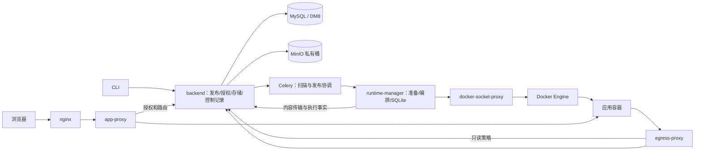
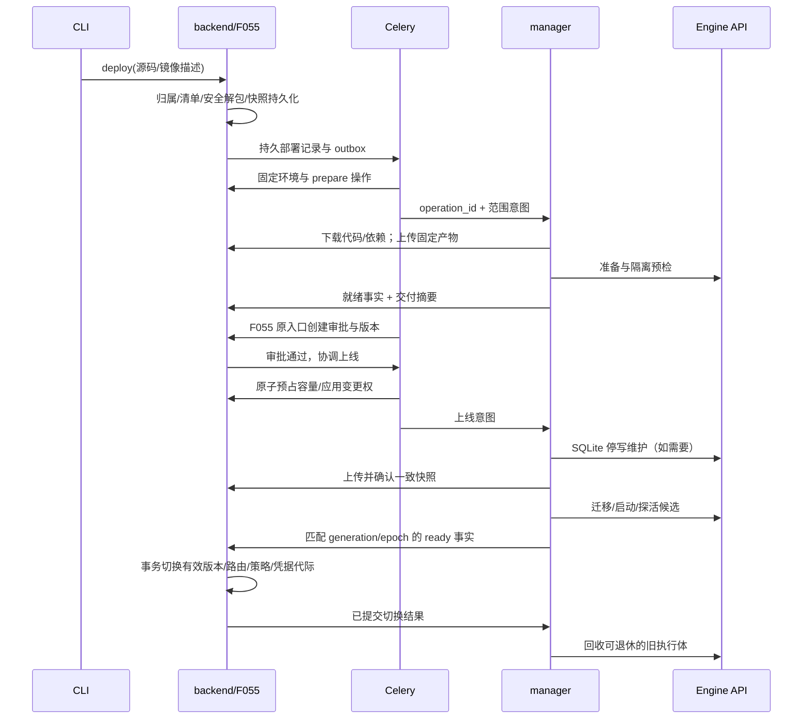

# Design：F086 Vibe 开源托管与应用交付演进

**关联**：[spec.md](./spec.md) · [Discovery](./discovery.md) · [版本合同](../release-contract.md)。[tasks.md](./tasks.md) 已拆解并自审通过。

**版本/日期**：v3.0.0 / 2026-10-23。**状态**：设计已确认，Docker 实现已完成并与 F059 开发代码整合；完整交付验收未结束。已执行和未执行的检查以 validation.json、task-reviews.md、code-review.md 为准。

**代码基线**：`origin/feat/3.0.0-vibe@4aa9ce69b2830b81162fe631b9c801057c40ee8b`；工作分支 `codex/086-vibe-runtime-delivery`。§4.1 的“基线”指该提交；其余合同已按本工作树实现同步。基础镜像最初拉取失败，用户提供代理后已完成Docker主链路、MySQL同步竞争和amd64/arm64原生镜像/禁网容器验证；DM8按用户确认仅做模型静态审查；旧测试 Tag `v3.0.0-test-vibe@755d4456e5` 已实际发行且有 109 启动证据；完整离线平台新装、剩余故障组合及包含后续 F059 修复的当前版本正式发行未完成。K8s 实现由 F059 承担并已在本次开发整合继承，详见其 design.md。真实结果见[live-validation.md](./live-validation.md)。

**规格门**：第二轮 spec 自审通过，用户“修复这4个问题，更新spec并重新评审，通过后继续推进SDD流程”的条件授权已满足。design 已另获用户“确认”；后续不重复请求已完成阶段的确认。

## 1. 目标与非目标

以独立的开源 Python runtime-manager 执行应用准备、部署和数据库维护；平台负责存储、授权、发布事实和跨进程读模型。新增默认“预制运行镜像＋应用包”，保留完整镜像和显式 legacy 构建，实现 Docker 在线与纯离线的可重复交付。

本轮不实现 K8s 执行器、商业授权、新管理页面、多副本、自动跨机数据迁移、任意宿主命令或任意 SQL。K8s 后续归 F059；应用代码重新发布继续审批，数据库恢复是 owner 明确确认的独立维护动作。

## 2. 关键约束与 Constitution Check

遵循 [constitution.md](../../../docs/constitution.md) C1–C8 和版本合同 INV-27 至 INV-43；本节只补充本功能的实施落点。

| 检查 | 本设计落点 | 评审判据 |
| --- | --- | --- |
| C1 | backend 新增业务 Service/Repository；Engine API 只在独立 manager | backend 不新增容器 SDK、socket 或宿主编排命令；存储迁移不把编排迁入 backend |
| C2 | 新模型用 JsonType/LargeText 和共享时间默认；DDL-only Alembic；业务数据另走运维导入 | MySQL 与 DM8 同合同；macOS 静态通过不充当 DM8 回归 |
| C3 | app/tenant 范围由平台已验证目标和租户 Context 建立 | 新 Repository 纳入自动租户过滤；变更用已加载实体；跨租户全局目录仅显式平台范围访问 |
| C4 | 复用 permission.application；F054 先执行 owner-only 业务前置 | 非 owner 超管/租管不能恢复数据或导入私有包；不直接调用 OpenFGA |
| C5 | 保留既有码段和公开信封；新增 reason 进入所属业务错误 details | 不复用其他 Feature 的码位；新增数字码需在实施时同步注册表、三语及测试 |
| C6 | 服务身份分组，密钥用现有安全配置和注入流程 | 不把配置主密钥、文件传输票据或镜像拉取凭据下发应用 |
| C7 | 本轮无新前端 HTTP/状态逻辑 | 原前端 API/错误语义保持；新增管理面使用 API/工具 |
| C8 | 平台 SQL 为操作/归属/路由/策略权威，Redis 为加速/通知，MinIO 为内容 | 本地 JSON 不再作跨进程权威；缓存丢失可重建，生产 SQLite 是应用独有持久数据卷 |

特殊约束：首轮 manager 绑定同一 Docker Engine 与宿主磁盘，单 Engine 一个活动控制进程；发布必审；正式 SQLite 单写入者；必须交付 linux/amd64、linux/arm64 服务及官方运行/准备镜像。宿主无仓库可用 `docker load`，平台和应用运行接口仍需在内网可达。

## 3. 方案对比与选定

### 3.1 应用准备路线

- **备选**：A 每次源码发布构建 OCI 应用镜像，复用当前 builder，依赖 Docker 构建、基础层和构建缓存；B 预制运行镜像＋版本化代码/依赖产物，按变化准备依赖和编译；C 所有开发者必须自行提供完整镜像。
- **选定**：新版源码描述默认 B；C 为显式 `image`；A 为显式 `source-image`，旧描述继续 A。
- **原因**：当前 `builder.py` 在每次预检执行 Engine build，并把结果写入 `AppVersion.image_ref`。B 才满足 AC-11 的平台侧不逐次 build/push；C 单独使用会把打包和离线供应链成本转嫁给普通开发者。
- **重新考虑条件**：需要任意系统软件安装、多种 OS 或强容器镜像签名供应链时优先完整镜像；若后续需多节点分发，增加 bundle 分发适配而非把 Docker 本地目录当集群共享存储。

### 3.2 存储与状态归属

- **备选**：A manager 继续直连 MinIO、保留本地 desired-state/egress 文件；B backend 保存所有内容与执行合同，manager 经范围化 API 传输；C 给 manager 平台 SQL/Redis 账号。
- **选定**：B。manager 仍做本地 SQLite 一致备份、迁移、恢复与受控数据查询。
- **原因**：用户已确认平台存储解耦；现状路由缓存只有约 3 秒，本地 JSON 会使跨主机代理失效，违反 C8。C 使平台模型和租户实现泄漏到执行服务。
- **重新考虑条件**：大文件传输成为可测瓶颈时，在同一 backend 授权合同内增加专用传输服务；不退回应用/manager 持有 MinIO 主账号。

### 3.3 进程与权限

- **备选**：A manager、入口、出口合为一个进程；B 独立进程，同仓库复用纯函数与镜像；C 融入商业 Gateway JVM。
- **选定**：B。egress 继续使用 manager 镜像的独立入口；app-proxy 独立镜像；socket-proxy 独占 docker.sock。
- **原因**：入口/出口处理不可信流量，编排 API 可创建挂载及执行体，能力仍接近宿主控制面；没有 root 或没有挂 socket 不会降低 Engine API 的实际权限。C 已取消且违反本轮开源边界。
- **重新考虑条件**：将来执行器远程托管并强制细粒度操作授权时，可评估减少服务数量；先保留现有权限边界。

### 3.4 依赖复用与离线材料

- **备选**：A 搬运开发机 venv/node_modules；B 保存锁和目标平台依赖产物，在匹配镜像里一次性物化；C 每次启动访问源安装。
- **选定**：B；Python 保存 wheels＋哈希锁，节点在固定 `/opt/venv` 构造；Node 保存锁、包缓存及经验证的产物，处理源码相关安装脚本。
- **原因**：venv 有路径、解释器及原生 ABI 假设，不能声明为任意机器可搬运；C 无法通过 AC-19、AC-22、AC-28。镜像预装“常见库”也不能证明依赖闭包齐备。
- **重新考虑条件**：新的语言或二进制依赖需要新的 profile/preparer 合同；自定义系统库优先新增运行环境或完整镜像。

### 3.5 SQLite 发布与所有权

- **备选**：A 新旧版本共用同一 DB 并蓝绿迁移；B 结构变更停写维护、平台确认快照后迁移；C 数据库改为外置多租户关系库。
- **选定**：B；无持久写入的应用仍可候选就绪后切换。普通 SQLite 写入应用即使无 DDL，也先停止旧写入者再启动共享生产卷的新实例；预检用隔离副本。
- **原因**：F054 单实例与 F055 数据安全约束要求单写入；现状“迁移在前、容量检查在后”会改变仍服务中的数据库。C 是新的产品与数据迁移范围。
- **重新考虑条件**：用户明确要求高可用/多副本且愿意调整数据库合同后，另立 Feature。

## 4. 系统现状与目标实施结构

### 4.1 基线真实调用链

1. `bisheng deploy` → backend `POST /api/v2/apps/deploy`：包校验、归属及代码快照，由 F055 接收，Celery 接续扫描/预检。
2. `precheck_service.precheck_build()` 生成短效 MinIO `code_url`，调用 manager build；`builder.BuildService` 解包、渲染语言模板并调用 Docker Engine build；`precheck_probe()` 拉起隔离临时容器探活。
3. `VersionService.record_version()` **先提交审批，再插入版本**，插入失败补偿撤销审批；不能把静态图上的“先版本后审批”当实际事务顺序。
4. 审批回调 → `publish_online_service._settle()` 先调用 schema migration，再经 F054 action 进行上线；现状容量时序与凭据切换需按 §4.7 修改。
5. 浏览器 → nginx → app-proxy → backend 授权 → manager route → 应用容器；manager 的 desired-state 与 egress 策略保存本地文件。
6. SDK 附件直达 manager 的 storage API；manager 通过 `MinioObjectStore` 保存附件及 SQLite 快照。egress-proxy 是 `runtime_manager.egress_proxy` 的独立进程，当前没有 `src/egress-proxy/` 独立项目。

| 代码锚点 | 当前事实与本轮影响 |
| --- | --- |
| [precheck_service.py](../../../src/backend/bisheng/app_publish/domain/services/precheck_service.py) `precheck_build/precheck_probe` | 协议1保留；协议2在 PublishPipelineService 分支进入 RuntimeDeliveryCoordinator，不经过旧 code_url |
| [builder.py](../../../src/runtime-manager/runtime_manager/builder.py) `BASE_IMAGES/BuildService` | 固定 python3.11、node20、static 模板；保留 legacy，新增 bundle preparer |
| [publish_online_service.py](../../../src/backend/bisheng/app_publish/domain/services/publish_online_service.py) `_settle` | 调整容量、维护、快照、凭据及切换时序 |
| [version_service.py](../../../src/backend/bisheng/app_publish/domain/services/version_service.py) `record_version/_insert_version` | 保留审批失败补偿和既有版本 Owner，新增不可变 delivery 绑定 |
| [desired_state.py](../../../src/runtime-manager/runtime_manager/desired_state.py) `DesiredStateStore` | 移为仅本地观测缓存，权威操作和节点归属改平台 API |
| [clients.py](../../../src/app-proxy/app_proxy/clients.py) `RouteClient` | 路由改读 backend 持久投影，入口不再需要 manager 管理密钥 |
| [egress.py](../../../src/runtime-manager/runtime_manager/egress.py) `EgressPolicyStore` | 策略文件改成可失效本地缓存，权威来自平台策略 API |
| [storage.py](../../../src/runtime-manager/runtime_manager/storage.py) `AppStorageService`、[appdb.py](../../../src/runtime-manager/runtime_manager/appdb.py) | 前者移入 backend 存储适配；后者保留本地 DB 执行，远程内容走 backend |
| [app_data_service.py](../../../src/backend/bisheng/app_runtime/domain/services/app_data_service.py) `_require_owner` | 已有 owner-only 业务前置；新增私有补包/恢复沿用该主体边界 |
| [docker-compose.yml](../../../docker/docker-compose.yml)、[CI](../../../.github/workflows/ci.yml)、[Release](../../../.github/workflows/release.yml) | 当前 manager/egress/app-proxy 为现场 build；改成正式镜像，CI 延续 backend 的双架构发布方式 |

### 4.2 目标进程及数据流



| 进程 | 承担职责 | 资源及接口范围 |
| --- | --- | --- |
| backend | 文件/快照传输、附件、环境目录、操作/容量账本、路由/策略投影、原授权 | SQL、Redis、MinIO、F048/F049/F054/F055；无 Engine API |
| Celery | 扫描、预检、发布/恢复协调及补偿 | backend 领域 Service/Repository 和 manager 意图接口；无本地应用卷、无 Engine 权限 |
| manager | 下载固定产物、依赖物化、编译/探活、执行准入、容器生命周期、SQLite、对账/清理 | backend 范围 API、socket-proxy Engine API、专属宿主数据根；无平台 SQL/MinIO 账号 |
| app-proxy | HTTP/WS、身份头清洗、OBO 注入、授权和路由读取、长连接撤销 | backend 授权/路由 API、应用网络；无 manager 写密钥/Engine 权限 |
| egress-proxy | HTTP CONNECT/普通代理、目标和身份限制、连接撤销 | backend 只读策略 API、批准目标；无 manager 管理密钥/MinIO/应用卷 |
| socket-proxy | 允许的 Engine API 转发 | 唯一 docker.sock 挂载者；仅 manager 控制网络可达，应用和通用代理网络不可达 |
| 应用与 SDK | 按冻结启动约定提供业务，调用模型/检索/附件 | 仅应用范围凭据、当前 OBO、隔离 DB 卷；依赖和代码只读，无文件任务票据 |

### 4.3 新增平台对象与持久化

以下为实现字段。15 张新表统一由 `domain/models/runtime_delivery.py` 定义并注册；采用 SQLModelSerializable、JsonType 和共享时间默认。应用数据带 tenant_id，RuntimeProfile/Default/Node 是无租户列的全局目录/物理节点。JSON 仅作为载荷，不使用数据库 JSON 查询。

| 表 | 关键字段和唯一约束 | 作用 |
| --- | --- | --- |
| `runtime_profile` | code/revision 唯一；language、contract_version、definition、content_digest、created_by、status | 不可变环境。id 为规范内容 SHA-256 前32位，便于出厂离线包跨安装定位；definition 内有 platforms 及 child/config digest |
| `runtime_profile_default` | language 唯一；profile_id、generation | 超管 CAS 默认映射，仅影响未冻结发布 |
| `runtime_artifact` | scope_key/kind/sha256 唯一；tenant/app、visibility、size_bytes、object_key、platform、producer_operation_id、state、confirmed_at、retained_until、metadata_ | source/dependencies/compiled/offline/snapshot 内容；confirmed 后才能消费；snapshot 元数据记录 integrity/操作关联 |
| `runtime_delivery` | version_id 唯一；execution_mode、profile_id、resolved_platform、delivery_digest、content | 版本独立不可变绑定，源码/依赖/编译产物/启动命令在 content，原 AppVersion 四要素不改写 |
| `runtime_operation` | scope_key/idempotency_key 唯一；request_digest、deployment/version/node、kind、generation、owner_epoch、stage/status/deadline/diagnostics_until、cleanup_status、payload/failure | 持久控制事实；秘密仅以 sealed_env 保存，读取执行计划时解密；外部没有通用建意图 HTTP 入口 |
| `runtime_assignment` | app_id 唯一；node、generation、owner_epoch、active_operation_id | 单应用正式执行归属，未知旧实例不自动接管 |
| `runtime_node` | engine_id 唯一；platform、memory/cpu budget、heartbeat_at、generation、status | 同一物理 Engine 不得多节点重复登记；预算行锁串行化全租户准入 |
| `runtime_capacity_reservation` | operation_id 唯一；node、purpose、memory_mb、cpu_millicores、state | held/active/released；确认停止才释放，替换候选预占不提前借用旧实例名额 |
| `runtime_execution_fact` | operation_id/sequence 唯一；node、generation、owner_epoch、exec_ref、phase、detail | 阶段事实和 ready target；相同事实重复ACK幂等，终态迟到清理仅当前归属可确认 |
| `runtime_route` | route_key 唯一；operation/version/node/exec_ref、generation、owner_epoch、route_epoch、status、target | app:{app} 或 preview:{session}；与应用原 Owner 状态事务切换 |
| `runtime_egress_policy` | principal_id 唯一；operation/version、phase、destinations、credential_hash、policy_epoch、not_after、revoked_at | 只读网络投影；凭据按部署 key 和 phase/op 派生，重试稳定，仅保存 hash；UTC epoch 输出 |
| `runtime_transfer` | operation/artifact/action 唯一；node、ticket_hash、expires_at、offset、parts、state | 8 MiB 客户端分块，服务端16 MiB分块限额；SQL确认和丢响应恢复 |
| `runtime_storage_binding` | credential_hash 唯一；operation/version、namespace、object_prefix、state、expires_at | 生产 staged→active，预览独立有期限；当前 route operation 共同校验 |
| `runtime_dependency_plan` | scope_key/input_key 唯一；operation_id、artifact_id、state | 首次解析别名，锁定 materials_ready/verified，不随包源变化重解析 |
| `runtime_credential_binding` | operation_id 唯一；version_id、credential_id、state | 绑定 F049 原凭据；候选 staged 不能用于正式能力，切换后旧代拒绝 |

Repository 唯一承担新增 ORM 查询和 UoW；创建操作以 savepoint 处理竞争唯一键，准入汇总在节点锁下执行，route/实例/版本终态通过原 AppStateService/VersionService 在同一平台事务提交。node plan 在 SQL 过滤历史终态，不能先截取一万行历史再在 Python 过滤，否则新任务会饿死。

遵循 backend AGENTS 的新表 model discovery 建表合同，不为整张新表另写create-table revision。对已有F086表的size_bytes/offset扩容则用f086_runtime_byte_counters revision，由INTEGER改BIGINT，以匹配2GiB材料/10GiB快照；新库直接建立BIGINT，旧库DDL-only扩容，downgrade保留宽类型避免截断。MySQL并发已验；用户确认DM8本轮只核对模型/约束，真实验证留中央回归，不作为当前Feature门。数据导入使用 dry-run 工具，不进入 migration 或 API lifespan；回退先停止协议2写入并保留新表/产物，不能 drop 后直接重启旧控制器争抢生产卷。

### 4.4 发布描述、运行组合与环境配置

旧 `manifest_version: 1` 保持当前 schema/模板构建。新版 `manifest_version: 2` 新增 `delivery`，按判别联合分别验证；未知字段拒绝，旧平台收到新版时返回明确不兼容错误。新版 CLI 的 init 默认生成 v2，CLI 发 v1 不静默升级。

```yaml
manifest_version: 2
name: example-app
slug: example-app
runtime: python3.11
port: 8080
delivery:
  mode: bundle
  profile: python311-standard@1
  dependencies:
    lock: runtime.lock
    offline_artifacts: []
  startup:
    command: ["uvicorn", "main:app", "--host", "0.0.0.0", "--port", "8080"]
```

v2 没有 delivery.mode 时为 bundle；没写 profile 时由 backend SQL 默认映射解析，再冻结确切修订和目标平台。完整镜像为 `delivery.mode: image`，含 `image` 的 digest 或经平台导入验证的本地镜像对象引用；禁止只冻结可变 tag。该模式可沿用镜像 Entrypoint/Cmd 或指定 command，不叠加平台 pip/npm 安装；其 runtime 仅作语言标记，不走源码模板的 SUPPORTED_RUNTIMES 闸口，而由获准镜像的 OS/架构、端口、启动、数据及身份契约验收，不能因不是 Python/Node 源码模板就被误拒。兼容构建为 `mode: source-image`，保留旧模板与约定。Procfile 只在未显式 command 且该 profile 契约支持时解析；冲突、路径不存在或端口不符在预检拒绝。完整镜像仍交付最小发布描述及能力声明。

实际安装输入是 CI 生成的 **runtime-profiles.json**，不提交带假 digest 的默认目录。工具只读取 JSON（可作为 YAML 子集），每项 profile 形如：

```json
{
  "code": "python311-standard",
  "revision": 1,
  "language": "python3.11",
  "contract_version": 1,
  "official": true,
  "platforms": {
    "linux/amd64": {
      "runtime_image": "dataelement/bisheng-app-python@sha256:<child-manifest>",
      "runtime_digest": "sha256:<child-manifest>",
      "runtime_image_id": "sha256:<image-config>",
      "preparer_image": "dataelement/bisheng-app-python-preparer@sha256:<child-manifest>",
      "preparer_digest": "sha256:<child-manifest>",
      "preparer_image_id": "sha256:<image-config>",
      "abi": "cp311", "toolchain": {"python": "3.11", "pip": "base-image"},
      "uid": 10001, "gid": 10001
    }
  }
}
```

这是字段说明，`<...>` 为非可导入占位值，official=true 还必须提供 linux/arm64 同结构项。真实目录由双架构 inventory 产生，导入 API 不解析可变 tag、不会自动联系仓库验证完整运行契约：它校验主体、修订、平台及摘要元数据；实际兼容性由发行 CI 和发布预检验证。`import-profile --set-defaults` 先导入不可变修订，再 GET 默认 generation 并 PUT CAS；省略该开关只导入，不影响新发布默认。

替换基础镜像需要创建 revision 2 再改 SQL 默认映射或应用 delivery.profile，不修改 RTM_IMAGE_PREFIX，不覆盖历史修订。客户自定义环境同样提供 runtime/preparer 配置 ID、ABI、UID/GID，且自行完成原生兼容测试。

离线 docker load 可能没有 RepoDigest。manager 先按目录的配置 Image ID 查 Engine，并核对 OS/架构和配置 ID；有网允许缺失时仅按冻结仓库 digest 拉取。完整镜像也在 prepare 冻结实际 image_id，重试不靠同名 tag。配置 ID 是目录信任的本地映射，不等于 manager 重新证明发布者的供应链。默认 pull=never；不存在或平台不符就失败。

### 4.5 产物布局、传输与应用启动

**平台内容**继续使用现有私有 `bisheng-apps` 桶和同一 MinIO 实例；业务不要求第二套实例或 manager 专用桶。新写入对象统一规范命名：

| 内容 | 对象路径 | 持久性和清理 |
| --- | --- | --- |
| 代码包 | `tenants/{tenant}/apps/{app}/artifacts/source/{sha256}.tar.gz` | 被版本引用期间保留 |
| wheels/Node 包、锁与编译产物 | `tenants/{tenant}/apps/{app}/artifacts/{kind}/{sha256}.tar.gz` | 按 scope/平台校验；引用计数为零且过保留期后回收 |
| 全局公开基础材料 | `runtime/public/{profile}/{platform}/{sha256}.tar.gz` | 超管导入，无私有凭据或客户包；应用只读引用 |
| 数据快照 | `tenants/{tenant}/apps/{app}/snapshots/{operation}/{snapshot}.sqlite` | 独立限额/保留策略，owner 显式维护；唯一未确认备份受保护 |
| 附件 | `tenants/{tenant}/apps/{app}/attachments/{key}` | SDK 相对 key 不变；生产停用/更新保留，显式单附件删除或 owner 整体删除清理 |
| 预览内容 | `tenants/{tenant}/apps/{app}/previews/{session}/...` | 独立临时 DB/附件命名空间，到期清理 |

旧对象路径不强制搬运：保留旧路径引用，backend 根据已有平台 app 归属映射访问，不能从用户给出的 key 推断租户；后续迁移双读校验但只有平台单写。删除 AppVersion 的引用或停用应用均不直接删除生产 DB。

源码默认保持现有 50 MiB 压缩、200 MiB 展开、20,000 文件限制，均可配置；依赖与 SQLite 快照分别限额，不能沿用源码小包上限。上传/下载流式限额，校验实际字节、哈希及规范化路径。源码拒绝符号链接/硬链接/设备文件/绝对路径/逃逸；依赖产物中 Node `.bin` 等必要内部符号链接只允许落在同一解包根，拒绝外链、链接链逃逸及后续覆盖链接写出根目录。提取先入任务临时目录，验证后原子 rename 为不可变目录。

节点目录由 manager 独占管理：

```text
{data_root}/
  artifacts/{tenant}/{app}/{artifact_id}/        # 可丢弃的已验证材料缓存
  envs/{tenant}/{app}/{environment_key}/    # 可丢弃的依赖物化缓存
  tasks/{operation_id}/                    # 编译/预检临时目录
  apps/{app_id}/db/app.db                  # 生产持久数据，独立备份
  previews/{operation_id}/apps/{app_id}/db/app.db           # 隔离临时数据库
  protected-backups/{app_id}/{operation_id}.sqlite        # 尚未获平台确认的本地备份
```

manager 容器内 `RTM_DATA_ROOT=/app-data`，宿主对应 `RTM_HOST_DATA_ROOT=${BISHENG_APP_DATA_ROOT}`；交给 Engine 的 bind 源必须使用宿主路径，不能使用 manager 容器内路径。正式应用固定挂载 `代码/本次编译产物 → /workspace/app:ro`、`依赖环境 → /opt/venv:ro` 或 `/workspace/app/node_modules:ro`、`应用 DB 目录 → /data:rw`，工作目录 `/workspace/app`。容器只读 rootfs、非 root app UID、cap_drop ALL、no-new-privileges、限制 CPU/内存/PID/日志、独立 tmpfs，无宿主端口映射。应用 UID/目录属主在安装自检与预备阶段核验；默认应用 UID/GID 为10001。正式manager容器沿用root进程以便交还专属挂载目录属主，不使用privileged或挂载宿主根；systemd/自定义非root进程需预置匹配UID与目录权限。不同profile UID无法满足时失败，不临时扩大宿主权限。通过Engine API持有的编排权限仍按高权限隔离。

Python 启动器设置 `PATH=/opt/venv/bin:...`、禁写 pyc、`BISHENG_APP_DB_URL=sqlite:////data/app.db`，按冻结的 argv 启动。不在启动脚本 pip install。静态 profile 用固定 nginx 配置服务 `/workspace/app`，支持统一路径前缀；Node 保持标准模块解析目录。自定义 command 只在受限容器中执行，接口不接受 host bind、privileged、设备或 Docker 参数。

### 4.6 依赖准备、缓存与离线补包

**固定输入**：环境 key 至少含 scope（私有包含 tenant＋app）、目标 OS/arch、运行镜像 child digest、preparer digest、解释器/ABI、工具链版本、规范化依赖锁完整哈希、安装策略版本及安装输入摘要。Python 从 requirements/pyproject 解析依赖时产生 `runtime.lock`，含所有传递依赖、wheel 文件哈希及解释器约束；同一版本重试用第一次冻结结果。若安装脚本读取源码，key 加对应源码摘要；无法证明输入边界时保守使用全部源码摘要。公共基础集合可以共享原始公开 wheel，私有产物和命中反馈不跨应用暴露。

Python 流程：

1. backend 建立 prepare 操作，manager 通过文件 API 下载代码、已验证基础集合及 app 补包；源凭据留在 manager/受控下载阶段，安装钩子拿不到平台文件票据。
2. 在匹配的 preparer 镜像解析/下载或编译 wheel；预备工具链在镜像内，不依赖宿主 Python/gcc。联网仅限批准包源，使用受控 build egress 身份。锁定并上传 wheelhouse 和 lock 到 backend，平台校验持久化后标记 verified。
3. 在确切运行镜像内 `python -m venv --system-site-packages /opt/venv`；挂载待建 env 目录，执行 `pip install --no-index --find-links=/wheelhouse --require-hashes -r /inputs/runtime.lock`。SDK 也必须在冻结锁或明确镜像自带固定清单中，不能启动时从公网补。
4. 以 `--network none` 完成 import/启动预检，确保依赖已经物化；完整应用启动探活可单独启用批准的平台/业务接口，但不允许包源安装。成功后写完整性标记并原子发布 env 目录，运行时只读复用。
5. 节点 cache 丢失时只下载已确认的 wheels/lock，在该运行镜像重新物化，不重新解析当前包源。原生 wheel 与 glibc/架构不匹配即拒绝，不能用“py3-none-any”下载参数替代编译。

Node 流程：冻结 package-lock 和 Node/npm 版本；prepare 用 npm ci 及批准源/离线 npm cache，执行必要 install/postinstall 和 build，产物含完整 npm 包文件/缓存、锁、编译输出及兼容元数据。联网下载阶段与无网络安装验证分开；含源码钩子的安装结果按源码失效。保存的 node_modules 仅能在精确匹配 profile/平台及安装根中复用，节点丢失时从固定包文件离线 npm ci，不能靠开发机目录。缺少缓存 tarball、git 依赖或外部安装脚本资源则列出缺项并拒绝，不承诺 npm --offline 自行补齐。

**离线材料**为 tar.gz，包含 `offline.json` 和相对路径文件；清单实际字段为 `schema_version:1, profile_id, profile_digest, platform, abi, files:{path:{sha256,size}}`。清单摘要及内容校验只证明完整性；来源通过已认证导入者、批准环境及断网验证确认，不把任意自签名当官方信任。

| 现场条件 | 材料获取与失败语义 |
| --- | --- |
| 可访问批准公网源 | prepare 下载/锁定，再做断网依赖物化验证；下载失败不产生可复用半成品 |
| 仅有完整内网包源 | 显式配置内网源及 CA，关闭公共 fallback；首次/新增依赖均从该源获取 |
| 无源且完全断网 | 超管先导入公开基础集合；owner 用联网准备机上的匹配 preparer 制作应用补包，经 backend 导入；现场断网验证后复用 |
| 新依赖缺失 | 返回具体包/版本/平台/系统库/缺文件；不进入审批，补齐后用同一固定计划重试 |
| 无镜像仓库 | `docker save/load` 交付 runtime/preparer/服务镜像并建立本地验证映射；依赖补包仍单独准备 |

下载与安装脚本分阶段执行：npm下载阶段禁用install脚本，sdist/PEP517所需构建依赖也先收集固定；离线编译和安装钩子阶段撤去包源凭据及传输票据，缺少构建后端或额外资源即列明缺项。不能把带私有npmrc的联网npm ci与执行任意postinstall合为一条不受控命令。

工具 `src/runtime-manager/tools/runtime_materials.py` 提供 `catalog`、`export-profile`、`prepare-offline`、`pack-offline`、`verify-offline`、`import-profile`、`import-base`、`import-app-pack`。`export-profile` 从发行目录离线计算相同内容ID，不需要访问客户平台。prepare-offline 在有网准备机调用本地 Docker CLI 运行目标 preparer；这属于制作工具前置，**manager 服务自身只用 Engine HTTP API，不需要 docker 命令**。跨架构必须有对应原生构建机或经过验证的模拟构建环境，最终两种原生运行节点各验收。

补包工具先联网下载，再在临时输出副本禁网安装验证；打包原下载材料，不混入源码相关 install-overlay/node_modules。导入 verified 表示内容及兼容元数据已核验，具体应用仍必须通过 prepare 的禁网物化、编译及探活。联网 Python 阶段仅 wheel、拒绝 direct URL/VCS/任意 pip 选项；requirements 的 -r/-c 必须在源码根内，含这些间接输入时保守使用全部源码 digest。Node 拒绝 VCS 和外部 file/link 依赖，按固定锁/cache 禁网安装；安装钩子需额外网络资源则失败。

owner 导入私包即授权绑定该 app/profile/平台，后续发布自动纳入匹配材料；普通 SAK 发布可消费 owner 已授权绑定，不能自行选择或修改。PATCH enabled 只改变未来准备；历史 delivery 继续引用原材料。显式 manifest.offline_artifacts 选择私包仍需 owner。新增权限不改变 SAK 原有普通发布资格。

### 4.7 发布、审批和上线状态机



**准备/预检**：F055 deployment ID 提前建立；预检 version_id 是预分配引用，不表示正式版本已经插入。任务状态 `queued → resolving → preparing → verifying → ready`，失败/取消/超时进入终态并回收；只有 verified 内容可被 F055 `record_version` 冻结并进入原审批入口。保留原“审批提交后版本插入、失败撤销审批”补偿合同，不重写 F025 引擎。

**上线操作**：`queued → admitted → maintenance? → snapshot_confirmed? → migrating? → starting → ready → committing → serving → retiring → completed`。失败保留 stage、DB 是否已变更、旧服务是否可用及是否需要 owner 维护；状态机中的原子提交由 backend 事务完成，Engine 外部副作用靠事实/幂等和恢复推进，不能假装跨 HTTP/Engine/SQL 有分布式事务。

| 场景 | 明确动作与失败结果 |
| --- | --- |
| 首次发布 | 预检和审批后正式容量预占、首次 DB 初始化、启动；失败无有效路由，版本保留待上线/失败原因 |
| 无持久写入的更新 | 候选使用本版本代码/环境先就绪；事务切换后旧实例 grace 回收，候选失败保持旧有效版本 |
| SQLite 普通更新 | 先容量预占，再维护停写并停止旧写入者；生产卷只给一个新执行体。预检永远用隔离 DB |
| SQLite 结构变更 | F055 计算迁移计划/破坏性确认；维护、停止写入、一致快照获平台确认后执行受控计划，再启动 |
| 容量不足 | 在停旧服务或 DDL 前拒绝；待上线原因是资源不足，保留审批结果供手动重试，不建重复审批 |
| 审批预览 | session 专属卷和附件；采用冻结交付，运行身份按 F055 owner 能力例外，审计记录审批访问者；到期清理 |
| 迁移/启动失败 | DDL 未执行可恢复旧兼容服务；已执行则展示维护/数据变化，未经 owner 确认不得回写旧 DB |
| 停用 | 先持久化 stopped 意图和撤销入口/能力/出站，通知关闭 WS/CONNECT，再停止实例；未知状态记录并重试，不自愈拉起 |
| 恢复已停用应用 | 走既有权限/状态入口，以已批准固定交付重新准入启动；不因此创建新审批或恢复历史 DB |
| owner 数据恢复 | 单独 restore 操作，校验 owner 和 snapshot；维护停写、先保护当前数据，再替换验证和启动；代码版本不自动改变 |

维护时先由平台持久化 maintenance 路由并拒绝新访问、通知关闭相关 WS，再由 manager 停止旧执行体并 inspect 确认；owner 数据写入 RPC 也与维护互斥。应用后台任务的停写靠执行体确实停止，不能只用网页维护提示代替写入隔离。

**凭据代际**：旧有效版本凭据保持到候选切换；候选预检只获隔离 preview/test 凭据，正式候选凭据在 serving epoch 生效前不具备生产数据或平台能力。提交时更新当前 serving epoch/版本及旧凭据撤销状态；模型、检索、附件和 egress 在既有上界（应用撤销 ≤5秒）内拒绝旧版本。切换响应丢失先查询 operation 的 commit 状态，禁止重签/撤销另一代。外部即时撤权独立执行，不等待发布成功；网络抖动不能延长权限有效期。

### 4.8 准入、执行归属、幂等和回收

MySQL 竞争实现：重复幂等插入在 savepoint 失败后以共享当前读取得已提交的同摘要操作，避免 REPEATABLE READ 旧快照和独占锁升级死锁。固定节点下首次执行归属创建先锁 RuntimeNode，再锁/创建 RuntimeAssignment；不能只锁不存在的归属记录。外层业务事务仍统一提交/回滚。

**原子准入**：manager 报告节点 Engine ID、CPU/内存预算和真实占用；backend 在节点预算汇总行锁/乐观版本事务中分配 reservation。现有 reserve/overcommit 参数保留，预算以配置保留值和观测的非托管占用计算；已纳入账本的 managed 实例不能再从剩余量重复扣除。节点事实过期默认 15 秒拒绝新增准入，运行应用继续走有效投影。预检/构建也占独立 purpose 资源，终态释放与 AC-63 一致；无商业数量计数。

**执行归属**：平台 app assignment CAS＋generation/owner_epoch＋manager 每 app 串行锁；manager 一个活动进程控制一个 Engine，禁用多 uvicorn worker。每个敏感阶段向平台确认当前操作、deadline 与 epoch 后执行，丢失平台联系停止新的破坏性动作。不能仅靠租约自动转移所有权：旧进程可能已开始 Engine 调用，SQL CAS 阻止不了它。首轮 app 固定 node，接管前必须证明旧进程已停止且旧 Engine 任务/写入者已终止；无法确认则保持维护，不在另一节点启动第二写入者。

**幂等**：客户端生成 UUID idempotency key，backend 绑定规范化 request digest；相同 key/不同内容拒绝，相同内容返回同一 operation。执行体标签含 platform instance ID、tenant/app/operation、generation、epoch、phase，名称从 operation 派生；创建超时后查标签/实例事实，存在即接续。SQLite migration 记录 plan digest、前后 schema digest 和已执行步骤；ddl 是否提交不明时只检查事实，不盲目重跑。上传以 snapshot ID/sha256 查询已确认状态；控制 RPC 无响应先 GET 操作，禁止无条件重发 write。

**回收默认值（可配置）**：任务 deadline 默认 30 分钟；协议2每轮完成后等待5秒再对账，节点预算事实15秒过期；容量采样最多8路并发，单次只读内存统计，采样耗时也计入心跳间隔；任务终态后临时执行体和 scratch 目标 5 分钟内清理，最长正常回收期限 15 分钟；终态诊断日志保留 7 天，限制每任务大小。对未知存活的 Engine 对象，标记 cleanup_pending，保留对应 reservation、报警并重试，不能释放账本假装完成。取消先持久化 cancel_requested，再停止/kill、inspect 确认，最后 release；manager 重启扫描 SQL 未完成操作和本平台标签，进行同一补偿。

扫描只处理明确归属本平台/当前节点的资源。回收白名单仅任务 scratch、临时镜像层引用和预检/准备容器；生产卷、被任意版本引用的产物和 protected-backups 必须排除。env 用完整性标记＋原子目录完成可见，失效缓存先标记隔离；同 key 并发准备只有一个获准提交。取消/超时的写入者未结束，任何节点都不能接管同 app 的 DB 操作。

旧模板 Engine build 在调用前持久标记 started，只有读到完整结束流才记 finished。中断且不能确认 daemon build 已退出时，报告 legacy_build_stop_unconfirmed 并保留容量，不因容器列表为空就清理/重建。该状态需要专门维护窗口核对并停止未知构建；不能仅通过 owner cancel 或修改缓存让资源重新可用。原生构建中断与恢复仍须在专用 Engine 故障验收中验证。

依赖失败的 diagnostic_tail 先在manager按包源/代理/密钥及URL参数脱敏，再由backend限制16KiB写入operation/fact；临时容器回收后仍可定位缺失包。backend app_runtime.runtime_diagnostic_days默认7天，过期终态在下一轮node plan按100条批量清除诊断尾部，保留阶段/归属/摘要等控制事实。manager离线时顺延至恢复对账；未声明固定日历时刻必定擦除SQL。任务deadline通过BISHENG_RUNTIME_TASK_TIMEOUT_SECONDS同时提供给backend和manager；nonce120秒及严格小于60秒窗口是协议常量，不另设无效配置副本。

### 4.9 SQLite 一致备份、恢复及数据界面

manager 的 appdb 继续执行受控表清单/模式/分页/单行编辑/CSV 导出。backend AppDataService 做 owner-only 和审计，manager 不接收任意 SQL/文件路径；数据写与迁移/恢复使用同 app 执行互斥和短连接。

快照用 SQLite Backup API 得到一致副本，不直接 `cp app.db` 遗漏 WAL。破坏性迁移前，停止业务写入者及后台受控写任务，核验执行事实，再 backup、integrity_check、计算摘要；通过 backend 文件上传流发送。只有 backend 记录 `confirmed_at`、真实内容 hash/bytes 和关联记录后才继续 DDL。MinIO PUT 成功但 SQL finalize 失败时状态仍 uploading，使用同 snapshot ID 重试查询/完成，不进行迁移。

恢复由当前自然人 owner 发起 `snapshot_id + expected_current_generation + acknowledge_data_loss:true`，平台复核归属和范围并审计；manager 下载已确认快照至临时文件、校验摘要/schema/integrity，先保护当前一致状态，再在写入隔离下原子替换，处理原 WAL/SHM，重启并探活。恢复失败保留保护副本和维护状态；不擅自改代码版本、不把旧代码一定能读取新 schema 当保证。物理节点损坏按最后 confirmed snapshot 的 RPO 恢复。

数据卷要求本机支持锁和持久化的文件系统；默认 SQLite WAL，不把 NFS/SMB 多节点共享盘视为可写生产部署。K8s 后续由 F059 定义 PVC/调度单写合同，RWO 不等于应用多 Pod 单写，需验证 CSI 与 SQLite 锁语义；本轮不做 PVC 交付承诺。

数据界面调用仍经 backend owner/权限检查，但 manager 不在宿主进程打开运行中应用可控的 SQLite 链接：通过同一个 manager 镜像启动短命禁网 helper，只挂目标 app 的 DB 和一次性导出目录；readonly 根、cap-drop、非 root、每个128 MiB/100mCPU、最多两个、30秒期限，GC按节点标签回收。不是新增常驻进程或额外镜像；RTM_DATA_HELPER_IMAGE 必须本地可用，系统保留资源≥256 MiB。辅助进程的导入链保持轻量：共享异常使用 Starlette HTTPException，执行错误放入独立 execution_errors 模块，不经 appdb 导入 FastAPI/Pydantic 或 Docker 编排模块。数据页对同一页面的读取串行化，首次取表结构后复用到翻页/排序；切表与显式刷新重新取结构。锁竞争仍返回 data_busy，不再把普通并发读描述为维护。备份/迁移在停写后仍本地执行，检查 app.db 与 WAL/SHM/journal 链接，restore 后按冻结 UID/GID 交还目录。

### 4.10 访问、策略及服务配置

app-proxy 保留现有 backend authorization、会话校验、身份头清洗、路径前缀、OBO、WS close。RouteClient 改为 backend 的 route read API，返回已提交 `route_epoch/generation` 及平台验证的 target。manager 正常重启不改变 serving 路由；新请求超过旧 3 秒缓存仍可从 backend SQL/Redis 读到目标。连接失败触发一次路由刷新，失联超出既有恢复预算由平台/manager 健康事实使应用进入 F054 过渡状态；不让旧 ready 永久掩盖死实例。

egress-proxy 以独立只读身份拉取 policy revision/增量，内存缓存有 `not_after`，最长授权有效期不超过既有撤销上界；撤销通知用于加速，Redis 通知丢失仍靠硬到期复核，不永久沿用本地文件。已有 CONNECT 在身份撤销时主动关闭。manager 重启不删除有效策略；backend 授权不可达并超期时关闭，而不是失效开放。

运行网络分开：控制网仅 manager/socket-proxy；应用 internal 网仅入口、应用、egress；准备网仅 prepare 执行体/egress；平台网络按必要 API 访问。L3/UDP/DNS 规则继续覆盖绕 HTTP_PROXY 的直连、RFC1918/元数据地址、DNS 重绑定；部署工具校验 DOCKER-USER/nftables 的宿主规则实际生效，普通 manager 镜像不因此获得宿主 CAP_NET_ADMIN。特定宿主防火墙规则需部署侧受控安装，只有 internal network 和代理环境变量不构成完整出站隔离。egress 的平台目标限制为应用 API，不开放 internal runtime 文件/管理路径。

| 配置组 | 读取方与建议变更 | 对已有应用的影响 |
| --- | --- | --- |
| backend `app_runtime` | 保留启用开关、manager 地址/控制身份，新增内部服务身份、产物/快照限额及 GC/任务参数 | 运行环境默认以 SQL 目录为准，配置不开第二份环境权威 |
| backend 现有对象存储配置 | backend 文件 Repository 复用；私有桶配置在平台 | manager 删除 RTM_MINIO_*、RTM_STORAGE_BUCKET 和 minio 依赖 |
| manager `RTM_*` | Docker host、数据根、固定 node_id、platform base、受控传输/事实身份、Engine 网络、准备源/超时/资源保留 | RTM_IMAGE_PREFIX 仍仅 legacy 输出镜像前缀；不是基础运行镜像配置 |
| app-proxy 配置 | 授权/路由均指 backend，保留独立只读/授权服务身份 | 去除 APP_PROXY_MANAGER_SECRET；不持有写意图身份 |
| egress 配置 | backend policy URL、独立只读身份、监听及 TTL | 不挂载应用数据根，不继承 RTM_HMAC_SECRET/Engine 地址 |
| 应用注入 | 保留 BISHENG_APP_TOKEN、模型 base、DB URL、base path、SDK storage 三变量及可信 OBO | backend 生成 scope 限定 storage endpoint/token；不注入 MinIO、内部任务票据、镜像凭据 |

同域 `/apps/{slug}` 保留现有产品行为。服务端清洗请求头不等同于浏览器源隔离，批准的应用前端仍运行在平台源下；不把该机制宣传为可安全承载任意恶意前端的浏览器沙箱。独立应用域/Cookie 策略属于后续安全增强，若客户要求运行不可信第三方前端需单独完成该门禁。

Compose 的 Engine 控制网络为 internal 的 `runtime-control`，只有 manager 与 socket-proxy 加入；backend、入口、出口和应用不能直接连接2375。manager 同时通过 default 接收平台签名 RPC，并加入应用网络探活。v2 运行状态接口保留 backend_available/supported_runtimes/capacity/preflight 合同；容量读平台 SQL，失联时不以本地旧 desired_state 补充权威。

出站策略用生成环境中的平台/模型/附件 URL 建可信目标，而非只放行一个 backend 主机名。重试用相同 phase/op 凭据，生产策略按 route.operation_id 拒绝旧代，恢复后继续有效；候选仅在当前 assignment/deadline 内放行。缓存最多5秒，失联到期关闭。UTC-naive SQL 时间转 epoch 时显式标 UTC；旧预览 local datetime 先转 UTC，避免容器 TZ 导致所有策略提前8小时过期。

## 5. 已知坑与处理位置

| 事实 | 忽略后的结果 | 本轮处理位置 |
| --- | --- | --- |
| Actor DTO 的tenant_id不绑定SQL过滤ContextVar；启动/首管理员回调没有HTTP tenant middleware | 新库多租户启动或首管理员投影失败；继承超管override还会使SQL作用域错误 | core.context.tenant.tenant_execution_scope；system_resource_reconcile与preset_dashboard_bootstrap逐资源绑定并恢复全部租户ContextVar |
| Engine 的 bind 路径在宿主解释 | manager /app-data 有代码但应用看到空目录，SQLite 初始化到错误盘 | manager config/launch adapter 与安装自检；§4.5 |
| 没挂 socket 仍能经 proxy 创建高权限容器 | 把 manager 当普通低权限 API，与入口合并后扩大宿主攻击面 | socket-proxy 控制网与 payload 白名单；§3.3、§4.10 |
| manager 重启不停止容器，但路由现状仍依赖它 | 3秒后新请求失败，声称“应用不受重启影响”不成立 | app-proxy RouteClient、platform route Repository；§4.10 |
| 本地 policy.json 在同机 Compose 看似可共享 | 代理跨机器或清空目录后无法授权/错用旧策略 | egress policy client＋SQL 投影；§4.3、§4.10 |
| SQL epoch/Redis 锁不能撤销已发出的 Engine 请求 | 超时自动接管后旧进程仍创建容器，SQLite 双写 | runtime_assignment、manager executor；§4.8，禁止不确定接管 |
| wheel 通用名/venv 路径不证明 ABI 可移植 | arm64、glibc 或 shebang 不匹配，运行时失败 | profile 验证与 dependency preparer；§4.4、§4.6 |
| Node install 脚本可能读业务代码 | 只按 package-lock 缓存会运行旧生成代码 | source-input digest/preparer；§4.6 |
| SQLite WAL、结构变更和普通蓝绿不能混用 | cp 得到不一致快照，或两个版本写入不兼容 schema | appdb backup API＋维护状态；§4.7、§4.9 |
| 上传响应丢失与上传失败不是同一状态 | 重复快照或没有备份就执行 DDL | artifact finalize/status，snapshot ID；§4.9、§6.2 |
| Docker load 未必保留 RepoDigest | 断网仍尝试拉取 digest，或按可变 tag 启错镜像 | image inventory mapping；§4.4 |
| owner-only 不能靠超管可短路的普通权限检查表达 | 管理员未经 owner 允许恢复生产数据 | app_data owner business guard；§6.3 |
| 清理本地“缓存根”可能顺带删生产 DB | 缓存失效变成数据丢失 | 目录分区、标签校验和保护引用 GC；§4.5、§4.8 |
| socket-proxy 与 backend 共享 default 网络 | backend 可绕过 manager 直接访问2375 | 独立 runtime-control 及 Compose 检查 |
| datetime.utcnow().timestamp() 会按本机时区解释 | TZ=Asia/Shanghai 的 policy 在签发时已过期 | policy epoch 显式 UTC，时区回归测试 |
| 只按 version_id 允许网络凭据 | 同版本重建时旧 operation 凭据复活 | operation+当前归属/route fencing |
| node plan 先 limit 再过滤历史 | 发布多次后新操作不再被发现 | Repository 在 SQL 过滤活跃/待清理/当前归属 |
| 数据行接口只校验主文件路径 | 运行中应用切换 SQLite 链接访问其他目录 | 单应用挂载的数据 helper；停写维护检查所有 sidecar |
| 数据 helper 导入控制面，且 UI 并发读取 schema/rows | 100m CPU 下启动耗时十余秒，并发请求被误报维护 | 轻量异常模块、按页面排队和表结构复用；§4.9 |


## 6. 对外契约与依赖

### 6.1 内部传输、鉴权和错误

新服务间协议版本 2。管理意图、节点事实、文件传输、route/authz、egress policy 使用不同 service identity/密钥及允许动作，不能把同一密钥分发给所有代理。平台业务主体验证先于生成执行意图，manager 仅执行已签且 scope 匹配的意图。

签名串为 `v2\nMETHOD\ncanonical_path_and_query\nsha256(body)\ntimestamp\nnonce\nkey_id`；path 使用 UTF-8 percent-encoding 规范化规则和共享测试向量，query 排序保留重复键，禁止 v1 的“query 不签名”用于敏感动作。接受严格小于60秒的时钟偏差（使120秒nonce覆盖完整窗口）；nonce 在平台 Redis SET NX EX 120秒，变更操作还须 SQL 幂等记录，Redis 不可用拒绝新敏感请求。manager 验签通过后向 backend 认领同 operation/nonce，获得有期限的执行许可；已消费 nonce 拒绝，新 nonce＋同操作内容可安全查询/接续。不能仅在 manager 进程内保存 nonce，重启就失去防重放。

大文件先创建范围 upload/download session，backend 返回短效、绑定服务身份/operation/artifact/动作/大小/hash 的票据；它不进入应用。上传 streaming 到临时对象，校验后 finalize，超时 GET session 确认。下载只接平台 artifact ID，不接受任意 URL；服务身份还须匹配 assignment 和操作。读传输的可续传 session 可多次范围读取，上传 chunk 带单调 offset/摘要；它的“可续传”不等同于允许重放迁移/部署命令。对外 TLS 由部署终止，管理网仍需访问控制，内部跨主机传输配置 TLS/mTLS。

新协议响应：`{operation_id, status, stage, generation, result, error:{reason,message,details}}`；接受异步操作 202，查询 200，冲突 409，过期/权限 403，范围不匹配隐藏对象存在性。此信封仅内部 v2；现有 UI v1、OpenAPI v2 和 SDK 维持各自原信封及 HTTP 语义，不将协议名混同为平台 API 版本。

已有 16121 编排不可达、16122 构建失败、16123 runtime 不支持、16124 探活失败、16125 容量不足、16162 数据无权、16221 清单错误、16222 发布清单 runtime 不支持及 16259 迁移失败，由现有适配按真实来源映射。新增 artifact/profile/operation 失败先用所属领域既有错误＋`details.reason`（例如 `dependency_missing`、`profile_incompatible`、`operation_conflict`、`cleanup_pending`）；不能把 backend 维护人员错误当应用用户 401，也不能把 manager 内部 HMAC 失败当用户退出登录。实施若需新数字码，先重新扫描实际 registry，遵守所属161/162码段保留规则，补三语并检查生成工件；本设计不占用 164 K8s 段。

### 6.2 已实现 HTTP 合同

下表为工作树接线，不代表已部署实测。`I` = `/api/v1/internal/app-runtime/v2`；普通管理接口使用登录会话和业务错误信封，内部接口使用独立服务 HMAC 原始 JSON。

| 接口 | 调用者 → 处理方 | 参数/副作用与校验 |
| --- | --- | --- |
| `POST /api/v2/apps/deploy` | CLI → F055 | 原 multipart 包/鉴权；v1旧模板语义，v2默认bundle；后端保存 source，Celery prepare/probe 后沿原审批入口 |
| `GET/POST /api/v1/runtime/profiles` | 已认证读取/超管导入 → backend | POST RuntimeProfileDefinition；不可变 code/revision、双平台 official；普通owner/SAK不能写 |
| `GET /api/v1/runtime/profiles/defaults`、`PUT /api/v1/runtime/profiles/default` | 已认证读取/超管写 → backend | language、profile_id、expected_generation；CAS，改变后续解析 |
| `GET /api/v1/runtime/profiles/{reference}/{os}/{arch}?language=...` | 工具 → backend | 输出精确 frozen profile，用于离线制作 |
| `POST /api/v1/runtime/materials/public?profile=...&platform=...&sha256=...` | 超管 → backend | 原始 tar.gz 流，公开基础集合；scope=public |
| `POST /api/v1/apps/{app}/runtime/materials?...`、`PATCH .../materials/{artifact}` | 自然人owner → backend | 私包流/启停绑定 enabled；校验 app/tenant/profile/hash/ABI/文件；不改变冻结版本 |
| `GET /api/v1/apps/{app}/runtime/state` | 自然人owner → backend | 读取当前generation、代码版本和操作ID供恢复CAS使用；无v2归属为0；非owner拒绝，不暴露节点/凭据 |
| `GET /api/v1/apps/{app}/runtime/snapshots`、`POST .../restore` | 自然人owner → backend | 恢复含 snapshot_id、expected_current_generation、acknowledge_data_loss、idempotency_key；审计后202，停用应用不自动上线 |
| `GET .../runtime/operations/{id}`、`POST .../{id}/cancel` | 自然人owner → backend | 只返回阶段、状态、failure、期限；不返回 sealed_env/内部执行密钥；已serving不能取消 |
| `POST .../runtime/upgrade`、`POST .../upgrade/rebind` | 原应用operator → backend | 导入严格对照签名实时 inventory，需maintenance确认；rebind只用current已批准版本，不自动上线pending |
| `POST /v2/operations` | backend → manager | 仅 operation_id 唤醒；无 env/命令/plan；manager向backend读取权威意图 |
| `GET I/operations/{id}`、`POST .../{id}/claim`、`POST .../{id}/facts` | manager → backend | operationID、command_nonce或sequence/node/gen/epoch/phase；节点scope、代际、幂等和ready target校验。没有外部POST I/operations |
| `POST I/nodes/heartbeat`、`GET I/nodes/plan` | manager → backend | Engine/platform/预算；返回可执行/待清理/当前归属操作及SQL容量，不依赖本地状态文件 |
| `POST I/transfers`、`PUT .../{id}/content?offset=`、`POST .../finalize`、`GET .../{id}` | manager → backend | upload kind/hash/size/platform；范围票据；分块去重及SQL内容确认；取消/过期拒绝 |
| `POST I/downloads`、`GET I/transfers/{id}/content` | manager → backend | operation/artifact；backend读MinIO返回字节，manager验证hash/大小；不重定向到MinIO |
| `POST I/nonces`、`POST I/dependency-plans` | manager → backend | Redis NX/EX防重放；输入key对应第一次固定依赖产物，跨app/平台拒绝 |
| `GET I/routes/apps/{app}`、`GET I/routes/previews/{session}` | app-proxy → backend | entry只读身份；只输出当前持久route/transition；业务授权仍走原独立HMAC入口 |
| `POST I/egress-bindings`、`GET I/egress-policies` | manager申请/egress只读 → backend | operation/phase及受控包源；只读投影为hash+destinations+UTC期限，不含平台主密钥 |
| `GET I/apps/{app}/execution`、`POST I/observations` | manager → backend | 当前node绑定；观测绑定operation/exec_ref/generation/route_epoch，有限自愈由backend原Owner协调 |
| `/api/v1/apps/{app}/storage/*` | 原SDK → backend | 相对objects/meta协议及20MiB默认上限；当前代绑定token，backend独占MinIO |
| `GET /v2/upgrade/inventory` | backend control → manager | 兼容协议1也可读；无容器env，后台核对真实Engine/标签/版本/原bucket |
| `/v2/apps/{app}/db/*`、`.../status`、`.../logs`、`/v2/runtime/status` | backend → manager | 独立control HMAC；AppDataService/原日志授权不变；数据helper无任意SQL、命令、路径；日志脱敏 |

新增 profile 等静态路由在动态 apps 路由前注册。协议2拒绝旧写意图/旧storage接口，协议1兼容旧进程语义；不保留可绕开新业务校验的通用远程创建操作入口。

实际请求示例：

```json
{"operation_id":"operation-uuid"}
```

这是backend→manager的全部唤醒体。manager GET平台operation后得到 `{operation_id,app_id,version_id,node_id,generation,owner_epoch,kind,deadline,payload,result,fact_sequence,...}`；payload含 frozen `resolved_delivery`、tier、port、health、tenant_id 和仅供执行的解密 runtime_env，生产容器只接收应用允许变量。平台 operation_id/node/generation 来自SQL，执行事实来自manager，最终App状态/route提交仍由AppStateService校验批准版本、预期state/current/pending和冻结delivery。

nginx 对两个离线材料POST路径单独配置2GiB限额、关闭请求缓冲和1800秒代理超时，避免一般API的1GiB限制使backend的2GiB合同不可达；后端大tar校验在线程中执行，实际Nginx检查随原生镜像CI。内部传输仍分8MiB请求，不扩大其他接口上限。

### 6.3 业务授权与跨 Feature 接口

新增动作严格采用 spec §2.11 矩阵。身份校验走 permission.application 的既有身份/业务授权协议；加载 app 后先检查自然人和 owner、tenant、状态，再调用需要的原领域动作，不用 `is_super_admin` 作为应用私有数据的豁免。service-account resource_owner 仍用于原发布归属，不因此伪装成人类 owner 调新增管理接口。

| 内部接口（已实现） | 提供方 → 消费方 | 合同与变更风险 |
| --- | --- | --- |
| `RuntimeArtifactService.create_upload/create_download/finalize/content` | app_runtime → F055、manager传输endpoint | 只处理已验证scope和内容；跨事务要幂等，不直接修改AppVersion |
| `RuntimeProfileService.resolve/import_revision/set_default` | app_runtime → F055校验/安装工具 | 默认只在冻结前解析；同revision不可漂移 |
| `RuntimeOperationService.create/claim/fact` + Repository/admission/projection | app_runtime → F055发布协调及内部endpoint | 先账本再Engine，最终提交与F054实例状态原入口协调 |
| `RuntimeManagementService.restore` | F054 → owner维护endpoint | 与已有数据动作共享owner guard及audit，不能加非owner管理后门 |
| `RuntimeDeliveryCoordinator.prepare/probe` | manager client → F055 | 返回可冻结delivery，legacy也映射此流程；不能只返回image_ref而丢bundle引用 |
| `VersionService.record_version/mark_runtime_online` 保留原入口 | F055 → 发布pipeline | 原四要素保持不可变；审批/version插入补偿不丢 |
| `SchemaEvolutionService` 原受控计划 | F055 → manager | 破坏性确认/表声明规则保持，不把远端SQL字符串当计划 |
| `AppRuntimeCredentialService.stage` + credential binding | F055/F049 → F054与代理 | 发布失败不早撤旧凭据；外部撤销仍≤5秒；不能新增第二凭据引擎 |

owner 的运行环境列表只读公开描述，镜像拉取 secret 和全局维护接口不开放。owner 私有补包与production restore仅现有应用/已建归属草稿，避免用上传接口替代发布创建授权。

### 6.4 SDK、CLI 与存量迁移

| 消费者 | 基线/目标兼容策略 | 必须验证 |
| --- | --- | --- |
| SDK Python 0.1.1 | `BISHENG_APP_STORAGE_ENDPOINT/TOKEN/MAX_FILE_MB` 保持；backend实现原 relative objects/meta API、attachment metadata、错误detail和分页 | 原测试针对backend适配重跑，不能把FastAPI平台信封误发给旧RemoteBackend |
| CLI 3.0.0 的v1清单 | deploy路径/认证/轮询保留，仍legacy | 旧CLI无需删除未知键或改Procfile才能继续发布 |
| 新CLI v2清单 | schema/协议能力检查；init默认bundle | 平台不支持v2则明确版本错误，不静默回落 |
| 原manager内部v1 RPC | 升级窗口停止新写任务，协调替换backend/worker/manager/代理到v2 | 升级完成关闭旧无nonce管理写入口；不长期保留可重放旁路 |
| 已运行旧应用 | 保留代码、镜像、能力、审批和AppVersion快照；按原应用实例运维重建绑定新storage endpoint | 无源码重提/新审批；平台内部端点/临时凭据属于部署绑定，不修改已冻结业务注入配置 |

升级步骤：备份平台DB/对象和应用卷 → 暂停新发布/维护任务 → dry-run盘点旧desired-state、env中的storage token引用、egress、Engine标签和版本，出差异报告 → 通过受限迁移API幂等导入assignment/facts/route/legacy delivery关联 → 将旧注入中属于端点/临时凭据的运行绑定映射为单独deployment binding，不改历史版本记录 → 协调升级控制协议并禁旧写API → 每应用按固定旧镜像和已有业务配置重建实例，更换backend storage endpoint/受限token → 核验后恢复发布。

该次系统升级需要维护窗口，SQLite应用逐个停写重建；不是承诺升级时完全无中断。普通manager以后单独重启不重建应用。不能通过保留manager永久转发附件来掩盖未完成迁移；协议2不再承载附件API，默认服务镜像不装MinIO且不提供账号；旧模块只为协议1迁移兼容，legacy-storage为显式可选依赖。旧资产读兼容留在backend。只导入经过DB归属/平台标签验证的对象，遇到不一致先报告，不盲目收养其他容器。业务数据导入独立于Alembic，执行工具需符合脚本AGENTS及审计要求。

回退：新发布任务未启用前可回退控制进程并恢复旧配置/状态备份；已有bundle版本后旧manager不认识其合同，不能直接回退二进制声称可运行，应先停止变更并保留现有执行体，使用兼容版本恢复管理。数据库DDL的回退仍须owner确认独立restore，不随系统回退自动覆盖。

### 6.5 外部前置与发行清单

| 依赖 | Docker首轮所需 | 风险和替换方式 |
| --- | --- | --- |
| Docker Engine API | manager通过socket-proxy HTTP；安装侧Docker/Compose CLI | 开放create/build接口仍高权限；daemon远程磁盘与本地路径不一致则首轮拒绝 |
| 基础/服务镜像 | manager、app-proxy、egress、socket-proxy及Python/Node/static runtime/preparer双架构发行组合 | 有网拉取或离线load，版本/digest/平台匹配；不用manager镜像启动用户应用 |
| Python/Node包 | 完整批准源或固定离线基础＋应用补包 | 无源不能凭空获取新依赖；系统库/编译器在profile镜像 |
| 平台服务 | backend API/worker、业务DB、Redis、MinIO、权限、审批和必要模型/检索接口 | 镜像可用、依赖可用、运行能力可用分别检查；TLS/CA/时钟也影响鉴权 |
| 宿主磁盘/网络 | 映射一致、容量/UID、文件锁、应用/准备/控制网、宿主防火墙 | 重启后仍持久；安装工具证明绕代理直连和UDP被拒，不能仅看proxy日志 |
| K8s后续 | F059需ServiceAccount/RBAC、executor、镜像可用性/分发、PVC/StorageClass、网络策略 | K8s API不自带构建器；legacy构建需另有builder和分发仓库/等价机制；bundle需节点材料投递适配，本轮未实现 |

CI 使用新增 `.github/workflows/runtime-images.yml`，复用现有发行的Docker Hub账号方式，不改 backend 的既有构建脚本：

- `dataelement/bisheng-runtime-manager:{version}`；egress用同镜像、`python -m runtime_manager.egress_proxy` 独立command。
- `dataelement/bisheng-app-proxy:{version}`。
- `dataelement/bisheng-app-python:3.11-r{revision}` 与 `...-preparer:3.11-r{revision}`；Node20与static同类固定修订镜像。首轮官方目录为当前已支持的三运行时，不扩展任意语言。
- 每种镜像先构建 `{tag}-amd64`、`{tag}-arm64`，各自验证启动/依赖物化/ABI和运行契约，再发布multiarch index及版本清单；清单关联源码SHA、配置/child/index digest、SDK/工具链版本和测试证据。QEMU构建成功不代替双架构运行验证。
- 正式 `docker/docker-compose.yml` 改 `image: dataelement/bisheng-runtime-manager:${BISHENG_RUNTIME_VERSION}` 等，无build；开发现场build放独立override，不成为安装前置。`app-runtime` profile仍可选装；只改镜像变量不会修改SQL中历史应用运行环境。
- 离线发行物含双架构服务/runtime/preparer/socket-proxy镜像归档与SHA清单、profiles输入、公开基础依赖集合、SDK/CLI离线安装材料、必要包源/CA/网络/目录配置、安装检查与升级工具、备份恢复手册。应用新增私有依赖仍由owner准备补包，不宣称基础包覆盖任意应用。

## 7. 验证与可观测

### 7.1 分层证据与 AC 追踪

| 层 | 覆盖的风险与方法 | 证据性质 |
| --- | --- | --- |
| 纯单元/合同 | 清单v1/v2默认、角色拒绝矩阵、缓存输入、哈希与解包、状态/幂等、nonce、快照确认、阶段错误映射 | 可无middleware，不能证明Engine/断网/DM8 |
| MySQL/DM8与并发集成 | 唯一约束、CAS/预算预占、多worker、outbox、权限/租户、上传PUT后SQL失败 | 两DB分别验，DM8中央Linux回归 |
| Docker集成 | bind实际路径/UID、环境复用、单写卷、prepare回收、网络直连拒绝、离线image ID | 在amd64和arm64原生节点分别执行 |
| API E2E（必选） | CLI真实包→扫描预检→审批→上线→HTTP/WS/SDK→停用/恢复/数据恢复；非管理员及跨租户反例 | SDD后续使用e2e-test，保存请求/事实/资产校验记录 |
| 故障注入 | 每个阶段崩溃/丢响应、manager超过3秒重启、旧owner未知、依赖缺失、平台授权失联、DB变更后启动失败 | 断言真实副作用与状态一致，不能只断言HTTP200 |

| AC | 主要设计位置 |
| --- | --- |
| AC-01、AC-02、AC-03、AC-04 | §2、§3.3、§4.2、§4.8、§6.5 |
| AC-05、AC-06、AC-07、AC-08、AC-09、AC-10 | §4.3、§4.5、§4.7、§6.1、§6.2、§6.4 |
| AC-11、AC-12、AC-13、AC-14、AC-15、AC-16、AC-17、AC-18 | §3.1、§4.4、§4.5、§4.10、§6.3 |
| AC-19、AC-20、AC-21、AC-22、AC-23、AC-24、AC-25、AC-26 | §4.5、§4.6、§4.8 |
| AC-27、AC-28、AC-29、AC-30、AC-31、AC-32 | §4.6、§6.3、§6.5 |
| AC-33、AC-34、AC-35、AC-36、AC-37、AC-38、AC-39、AC-40 | §4.7、§4.8、§4.10 |
| AC-41、AC-42、AC-43、AC-44、AC-45、AC-46、AC-47 | §3.5、§4.7、§4.9、§6.3 |
| AC-48、AC-49、AC-50、AC-51、AC-52、AC-53 | §4.3、§4.7、§4.10、§6.1 |
| AC-54、AC-55、AC-56、AC-57、AC-58、AC-59 | §4.4、§6.4、§6.5 |
| AC-60、AC-61、AC-62、AC-63 | §4.3、§4.8、§6.4、§7 |

### 7.2 可操作验证入口

以下为可执行入口；具体本次结果见 validation.json。单元/合同及配置验证已执行，真实部署/故障测试仍需专用环境。

现有项目测试入口，分别从项目根运行（需已有uv依赖和对应配置）：

```bash
cd src/runtime-manager
uv run pytest tests
```

```bash
cd src/app-proxy
uv run pytest tests
```

```bash
cd src/bisheng-sdk
uv run pytest tests
```

```bash
cd src/backend
uv run alembic heads
uv run pytest test/database/test_alembic_single_head.py test/app_runtime test/app_publish
```

架构静态门：仓库根 `bash scripts/arch-guard.sh`；Compose当前校验 `bash docker/verify-app-runtime-compose.sh` 需随新image/配置同步，旧脚本的现场build提示不能当新安装手册。

工具与安装示例见 [OPERATIONS.md](../../../src/runtime-manager/OPERATIONS.md)。`verify-offline --profile profile.json --file app-offline.tar.gz` 验包；`prepare-offline` 执行联网下载加禁网安装验证；`import-profile --base-url ... --file runtime-profiles.json --set-defaults` 导入后设置默认。CI 容器集成入口为 `scripts/smoke_runtime_delivery.py`，在manager镜像内执行、真实Engine、内存产物端口，不等同于完整平台E2E。

安装后由交付人员使用既有超管、两个不同租户的普通owner及非owner账号，凭据从现场安全环境注入，不写进文档。既有CLI在测试项目执行 `bisheng deploy`；平台审批页完成审批，浏览器访问 `/apps/{slug}/` 并验证WS、附件、模型/检索。管理API的完整路径见 §6.2。

验收必须留存以下可对照记录：

1. v2源码只改业务代码再次发布，Engine事件没有build/push；依赖缓存key不变；v1仍有legacy build；完整镜像没有pip/npm安装。
2. 断开公网，现场先load镜像，发布一个已有依赖的应用；加未导入依赖必须在审批前失败；owner导入匹配架构补包后重试成功。用错误架构/篡改哈希/跨app引用验证拒绝。
3. 不重启app-proxy/egress，只 `docker compose -f docker/docker-compose.yml --profile app-runtime restart runtime-manager`；持续请求超过3秒、保留WS/CONNECT，观察入口仍可从平台取得路由。另使授权服务失联验证超期关闭，二者不能混成一个用例。
4. 在准备成功/失败/超时/取消后和运行中杀manager，记录标签容器、scratch、reservation；15分钟回收上界内核对已确认停止后的释放，未知执行体仍占资源并报警。生产DB/已引用产物hash不变。
5. SQLite写入后执行schema升级，在快照PUT成功/SQL确认前注入失败，必须无DDL；确认后再在DDL完成/新实例启动前失败，必须显示维护与schema变化，不自动覆盖DB。owner指定快照恢复；非owner超管/租管/服务账号及其他租户都拒绝。
6. 两个并发上线争抢最后一份资源、重复相同操作和响应丢失重试，核对只有一个有效assignment/正式写入者、没有重复迁移/快照/预占。模拟旧manager无法确认退出，禁止自动接管。
7. 原SDK0.1.1对backend附件适配实测上传/分页/删除/超限/撤销；存量应用不重提代码完成系统升级；平台API/worker/代理分主机运行，清空本地控制缓存后仍保持一致。
8. amd64与arm64各执行镜像启动、Python原生wheel、Node安装钩子、static入口及离线物化用例；保存镜像digest、源码SHA、节点平台、实际结果，未测平台保持未验证。

日志统一关联 tenant/app/version/deployment/operation/node/generation/epoch/phase，脱敏签名、OBO、应用token、包源账号及临时文件票据；准备日志限额保留。关键指标：prepare/cache重建耗时、阶段失败、容量held/cleanup_pending、未确认快照、route/policy epoch滞后、nonce拒绝、owner拒绝、执行归属冲突、自愈预算。出现未知写入者/唯一备份未确认/清理超期必须可定位并报警，不自动删除证据。

## 8. 后续事项与实施门

- K8s 的 executor、Pod 内材料物化、PVC/准入/网络策略现由 F059 实现；不是本 F086 的 Docker 验收证据。不假设客户集群自带构建器或仓库。
- 首轮单Engine固定节点，没有自动HA或跨机迁移；宿主盘损坏按快照RPO恢复。需要集群调度时单独设计存储和硬fencing。
- 同源应用前端浏览器隔离尚未增强；不扩张现有受审批信任边界。独立应用域方案需后续产品/安全评审。
- 不新建管理页面；profile、补包和恢复通过明确权限的API/工具交付，防止UI范围扩大拖延首轮。
- 若依赖包体积导致backend传输成为瓶颈，先根据指标评估独立流式传输实现，仍保持平台授权与内容确认合同。

**实施顺序建议**：平台对象/存储合同 → manager操作与bundle准备 → F055上线/SQLite/凭据切换 → 代理读投影 → 存量迁移及CI/离线交付 → 双架构与失败E2E。具体任务、补充范围、AC追踪和当前证据已写 tasks.md / task-reviews.md；未满足的部署门仍保留未完成。

**本轮评审**：按sdd-review design-checklist及C1–C8自审通过，严格结果见 [design-review.md](./design-review.md)，过程与证据见 [design-review-evidence.md](./design-review-evidence.md)。这不是独立评审或运行验证。用户已确认design并完成本地实施；最终验收仍须真实中间件、原生双架构和故障E2E。

## 修订历史

| 日期 | 改动 | 触发原因 |
| --- | --- | --- |
| 2026-10-20 | 首版设计评审稿；区分基线与目标，落实默认应用包、明确主体、双架构、回收及存储解耦 | 用户要求修复四项spec问题，复审通过后继续SDD；尚未实现 |
| 2026-10-20 | 同步实际表/接口/模块、生成目录、owner材料绑定、短命数据helper、控制网、UTC策略和CI；代码进入集成验收 | 用户确认design后继续SDD；不把本地测试当部署证明 |

### 2026-10-20 运行验收修订

预检及预览在启动前保存starting事实；失败映射保留发布业务阶段，details包含operation_id、reason、runtime_stage、maintenance与data_may_have_changed，不用终态failed覆盖precheck_probe。Docker完整镜像、v1兼容构建和错端口拒绝已补验；正式发行与剩余运行门见live-validation.md。

### 2026-10-21 多租户启动修订

新增tenant_execution_scope只绑定经过业务验证的目标租户，不提供授权豁免。系统资源与预置dashboard投影保留F048 facade授权入口，SQL会话显式采用单租户可见集，并清除继承的管理范围/bypass；异常、嵌套及async任务完成后恢复原值。组合56项回归与109全新多租户环境启动、首管理员注册和子租户发布已通过。完整剩余验收以live-validation及后续证据为准；通用修复的release-line落地尚待提交阶段处理。

2026-10-21真实验收补充：安装/编译/探活中断、快照SQL确认屏障、DDL后数据风险、代理硬期限与manager独立性、原协议1升级/导入前回退/幂等导入/rebind均已执行；历史AppVersion、approved pending及SDK0.1.1旧附件保留。明确App.state旧版本online不能替代maintenance路由/operation/真实入口检查。细节与未验组合统一见live-validation §8。

2026-10-21模型审查修订：15表类型/共享默认/发现/租户/唯一约束及索引静态通过；字节计数改BigInteger并补单head守卫迁移。该变更不改变API或存储上限，修复既有合同的可表示范围。参见model-review.md；新增revision仅静态验证，未执行真实DB升级。

### CI runner可移植性补充（2026-10-21）

GitHub原生runner不保证安装ripgrep；镜像存在性及服务索引的错误识别使用系统grep -Eqi。缺标签允许构建；已有标签拒绝覆盖；认证或网络错误继续失败，不将其当成缺标签。v3.0.0-test-vibe实跑关闭发行验证门；完整平台离线安装与目录导入另行验收。

### 2026-10-23 开发整合

公共租户修复已先进入发布线并由 F059 继承；BIGINT 修复保留原迁移并显式汇合父链，保留 K8s 后续 tenant=None/资源 UID 约束。manager/app-proxy/egress-proxy 及 SDK/平台存储合同保持。测试 Tag 只证明旧 F086 版本发行，不证明当前 F059 镜像已发行；新完整验收门仍在。当前七维代码合入审查见 code-review.md。

### 2026-10-29 数据页延迟修复

在不变更 helper 128 MiB/100m CPU、禁网、非 root、单应用挂载及互斥语义的前提下精简导入链；页面读取排队并复用表结构，16167 使用现有三语文案。116 原镜像与修复临时镜像的单次只读对比见 [定向验证记录](../../../docs/reviews/vibe-data-latency-fix-2026-10-29.md)。临时镜像实验不等于正式服务更新，也不证明 K8s 性能。
