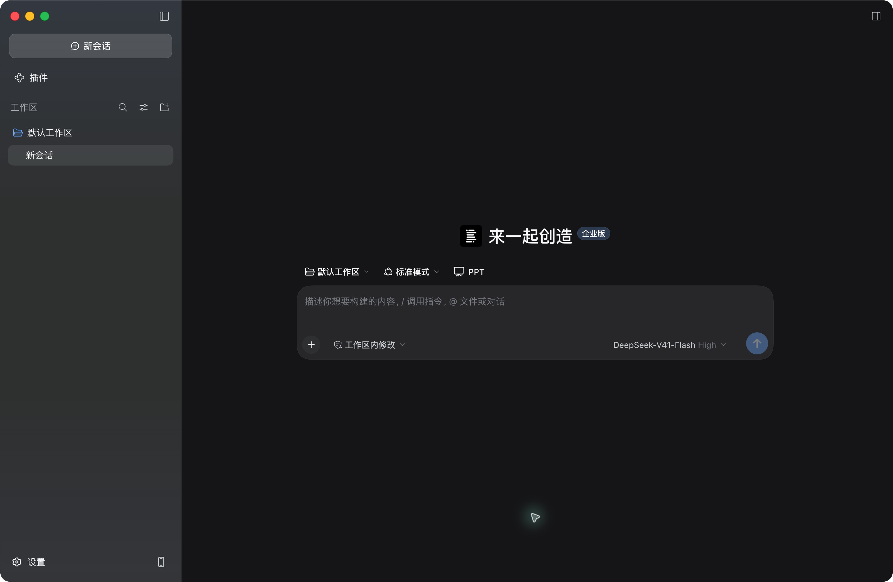

# 109 无 Gateway 端到端联调

2026-10-20，目标环境 `http://192.168.106.109:13001`。结论：本次要求的登录、模型调用、个人优先、部门继承、成员独立计量和模型审计均通过真实环境验证。使用真实 MySQL、Redis、OpenFGA、MinIO 和现有模型供应商，没有模拟 Gateway 或模型响应。

## 版本与部署

| 项目 | 实际版本 |
| --- | --- |
| 服务端分支 | `feat/bisheng-work-110`，镜像业务代码对应 `84c267da294e9c033d632cd1d7054b0f3c8ff24d`，另附本次迁移兼容修复 |
| API / Worker 镜像 | `cr.dataelem.com/dataelement/bisheng-backend:feat_bisheng-work-110` |
| Backend manifest | `sha256:ea133b2caca7bbbd00d46c074fc681e68f5e632babc99cb54de76029d6db5142` |
| Backend image ID | `sha256:19ddc91b037d4d6ba26d1a59bf89948b584bb7ff395204cc6e888ebb65ae27f5` |
| 前端镜像 | `cr.dataelem.com/dataelement/bisheng-frontend:feat_bisheng-work-110` |
| Frontend manifest | `sha256:55fc658516d4fb10bee2baaf17d0c56c1eacbd00a419e5ceb4ef1b653be4bf42` |
| 客户端分支 | `codex/dsh-without-gateway`，`9600d6c25c82d747d298439f1dfa9450bf8fbb45` |
| 客户端基线 | 创建时 `origin/V1.1.0 = 5ee11bddf915a29af6d9252ead9b3f8343dba544` |
| 数据库迁移 head | `work110_merge_legacy_audit` |

用户确认 IP 仓库与 `cr.dataelem.com` 是同一存储；保留部署现有域名，只切换 tag。原前端仍调用已删除的席位和 License API，因此同步升级同分支前端镜像。

部署路径 `/opt/server/dsh/bisheng`，Compose project `dsh-bisheng`。仅调整该环境的 `backend`、`backend_worker`、`frontend` 和独立容器 `dsh-gateway`，未操作其他端口环境。

- `dsh-gateway` 已停止，测试期间始终未运行。
- Nginx `/api` 及 `/workspace/api` 直接代理到 `http://backend:7860`。
- API / Worker 的 `BISHENG_PRO=false`，`dsh.gateway_internal_url` 未配置，`sso_sync.gateway_hmac_secret` 为空。
- 保留原审计加密密钥、账期时区和独立额度 Redis 配置；未降低审计模式。
- 运行时 `multi_tenant.enabled=false`。本次采用专用测试部门和前缀隔离，未为了测试改变全环境租户模式；不构成真实跨租户验收。

备份位于 `/opt/server/dsh/backups/work110-20261020-145341`，包含原 Compose、配置、entrypoint、Nginx 和 `bisheng` / `openfga` 数据库，SQL 约 119 MiB，权限 600。

## 真实业务证据

| 检查 | 实际结果 |
| --- | --- |
| 原生平台登录 | 使用提供的毕昇账号经 `/user/login` 登录成功；不使用 Gateway 登录 |
| 桌面登录 | 独立 Electron 客户端发起 PKCE，浏览器确认授权，经 IPv4 loopback 回调换取本地会话，日志出现 `login_committed` |
| 真实客户端模型请求 | 客户端 Harness 界面选择 `volces / deepseek-v4-1-flash-260910`，返回 `DSH110_CLIENT_OK`；同一会话也在原生 Electron 窗口显示 |
| 个人配置优先 | 部门 100,000，成员 61 单独 10,000；有效额度为 10,000，成功消费 132，余额 9,868 |
| 部门继承 | 成员 62 无个人配置；额度为 100,000，成功 SSE 调用消费 81，余额 99,919 |
| 成员独立计量 | 成员 61 的消费不扣成员 62 的额度；取消个人配置后两人各有 100,000，累计分别为 266 / 81，余额 99,734 / 99,919 |
| 降低个人额度 | 已用 132 时将个人限额降为 100，返回 HTTP 429、`monthly_token_limit_exceeded`，未回退使用部门余额 |
| 个人零额度 | 成员 63 显式配置 enabled=true、限额 0，模型列表为空，调用 HTTP 403、`model_not_allowed` |
| 取消个人配置 | enabled=false 后立即继承部门 100,000，原用量 132 不变；再调用成功，新增 134，累计 266 |
| 审计正文 | CONTENT 模式；原始请求、响应可解密，包含本次合成测试文本；状态 COMPLETE / NORMAL，模型成功且用量已结算 |
| 客户端审计来源 | 本次 chat 和 session-title 均为 main、message_sources_status=AVAILABLE，正文及来源可读取 |
| 权限拒绝 | 普通成员访问 DSH 管理设置业务码 403；读取审计正文业务码 19801，未返回正文 |
| 会话退出 / 停用 | 自动化套件 logout 后旧 access Token 返回 401；手工测试账号停用后旧 Token 也返回 401 |

本次桌面会话 ID：`9658a035-db2c-4067-ba67-1a97f00ab6a1`。

| 请求 | request_id | 用量 |
| --- | --- | --- |
| 客户端 chat | `54b1b452-95b8-4f07-b0de-ecddb3780d00` | 8,811 |
| 客户端 session-title | `7db9ee1e-eaca-42d4-accf-f2f320309dc1` | 217 |
| 个人额度 API 调用 | `721c85ee-3d03-4913-adba-3a7019870ca8` | 132 |
| 部门继承 SSE 调用 | `3e003b26-c45f-4e7f-bc49-1985d9a6a4a8` | 81 |
| 取消个人配置后调用 | `803a61d8-319e-42ac-96aa-b85f5fdcb23c` | 134 |

客户端使用临时独立资料目录 `/tmp/dsh110-client-ui/bisheng-dev` 和独立应用标识，保留原工作区客户端。为避免已有进程占用固定端口，仅在临时启动器中将移动桥端口改为 49342；未修改客户端分支代码。浏览器 Harness 与 Electron 连接同一本地客户端进程、凭据代理及会话。



[Harness 对话截图](./evidence/109-harness-chat.png)。凭据、Token 和审计密钥不写入报告或代码。

## 升级兼容修复

初次启动失败：数据库当前版本为 `f062_dsh_audit_tree`，指定新镜像只有重新命名后的 `f062_work110_*` 审计迁移，Alembic 无法识别已部署历史。

修复恢复旧镜像的 8 个原始迁移文件及其父依赖，并新增合并节点 `work110_merge_legacy_audit`，连接旧审计 head 与 `work110_dsh_local_sessions`。未修改已发布迁移的 revision / down_revision，未手工 stamp，未跳过 DDL。

109 在指定镜像上只读挂载这 9 个迁移文件，路径为备份目录下 `migration-compat/`；API / Worker 挂载相同文件。实际 `alembic upgrade head` 成功，新会话表存在，历史 seat/grant 字段已可空。

**后续重建该 tag 时应包含本次分支修复，再移除这 9 个挂载并重建 API / Worker。镜像未包含修复前不能先移除挂载，否则数据库新 head 无法被识别。**

升级前后、尚未开始新测试请求时核对：原 2,116 条调用、901 条审计请求、82,730 条正文片段均保留；23 条月用量记录累计仍为 155,248,233。原 9 条 USAGE_UNKNOWN 保留，没有用备份覆盖新增用量。原有启用 ROLE 策略和待处理管理员 / 部门操作均为 0，无需执行角色或退休操作迁移。

## 可复跑自动化

新增 `test/e2e/test_e2e_dsh_no_gateway.py`，复用认证 helpers，新建 `helpers/dsh.py` 提供真实 PKCE 换证。迁移图与两个已部署起点的升级回归位于 `test/database/test_alembic_dsh_deployed_upgrade.py`。

```bash
cd src/backend
export E2E_API_BASE=http://192.168.106.109:13001/api/v1
# 由操作者通过受限环境变量提供 E2E_ADMIN_TOKEN 或 E2E_ADMIN_USERNAME / E2E_ADMIN_PASSWORD。
export DSH_E2E_MODEL_ID=7
export DSH_E2E_ROOT_DEPARTMENT_ID=1
export DSH_E2E_ALLOW_SINGLE_TENANT=1
python -m pytest --noconftest \
  test/database/test_alembic_single_head.py \
  test/database/test_alembic_dsh_deployed_upgrade.py \
  test/e2e/test_e2e_dsh_no_gateway.py -q
```

`--noconftest` 使线上 HTTP 验证不加载本地 mock 服务配置。套件仅在显式指定目标、已有模型和测试模式时运行。审计模式须为 CONTENT。测试等待审计正文和 SQL 用量投影均完成，不把 Redis 已结算误当成 SQL 明细已可见。

最终执行结果：**4 passed**（147.84 秒）；其中 3 项为迁移图 / 真实历史起点回归，1 项为串行真实 E2E 综合场景。重复运行已覆盖前一次停用数据的 setup 清理。后续完整迁移集合另有 **6 passed**，包含新旧表结构的重复 DDL 和历史事实保留；与真实 E2E 场景合计覆盖 7 个不同测试。新增及修改 Python 文件 Ruff 与架构守卫均通过。[JUnit 结果](./evidence/109-pytest-results.xml)。

测试创建 `e2e-dsh110-live-m7-` 前缀的专用部门及普通成员；setup / teardown 仅处理该前缀数据，逐一核验成员归属，停用账号和额度而保留用量、审计。手工验证前缀为 `e2e-dsh110-20261020`，成员 61、62、63 同样已停用。最终核对所有本轮前缀成员共 9 人均停用，4 条测试部门额度均为 disabled / 0，无 PENDING / PROCESSING 管理员操作；API、Worker、Frontend 均 running 且 RestartCount=0。

## 证据边界

本轮覆盖本次用户要求及 AC-01、AC-05、AC-06、AC-07、AC-08 的对应真实流程，并补验 refresh / logout、账号停用和无 Gateway 部署路径。DM 行锁 / 升级、refresh 并发重放、多租户转移、旧安装包、第 11 名成员、SSE 异常中断、USAGE_UNKNOWN 人工恢复和新发起的父子会话不在本次实际执行范围。原全仓前端门禁遗留问题见 validation.md，未以本次通过替代。
