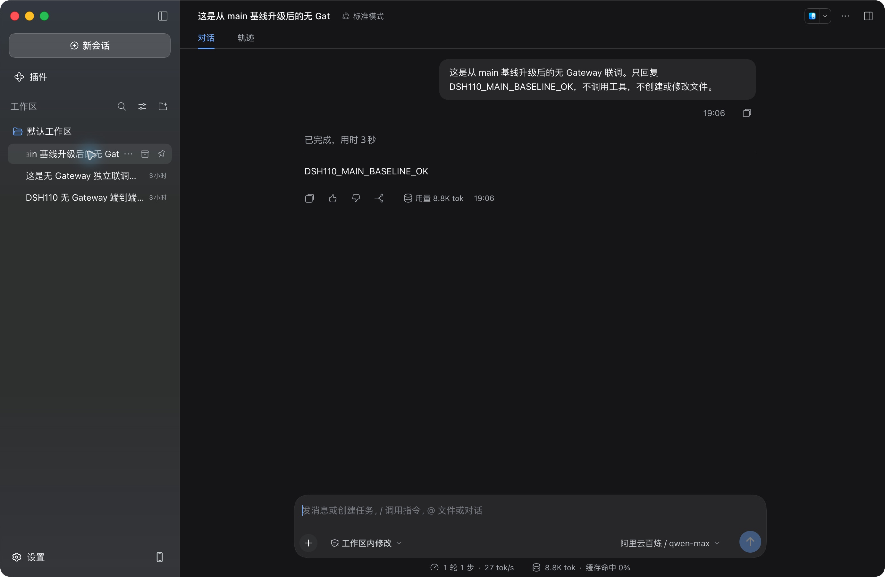

# 109 main 基线恢复与迁移范围修正

日期：2026-10-20。目标：先归档 109 原库，在新测试库建立 main 基线，再升级 feat/bisheng-work-110。本轮已完成归档、main 基线启动、升级与无 Gateway 联调。

## 原因与范围

109 原环境的审计功能来自 feat/3.0.0 版本线，而 work-110 来自 main。此前为识别原库 head `f062_dsh_audit_tree` 恢复 8 个旧迁移并增加 merge 的处理，将测试环境的特殊历史误当成目标版本必须支持的升级历史。
实际从 main 升级时，这会额外执行 `f068_knowledge_chat_entry`，给 `message_session` 增加与本功能无关的 `entry_flow_id` 及索引；同一批审计列/索引还会经过两套不同 revision 的 DDL。

修正保留 main 提交 `4218ba7c138a90764a304681c3d8a5875b2c9c1a` 的 83 个迁移文件原样，删除 8 个旧历史文件、1 个兼容 merge 以及 4 个冗余审计增量，最终只新增一条 revision：

`f065_dsh_install_policy_default_off → work110_dsh_local_sessions`

| 相对 main 的差异 | 处理方式 |
| --- | --- |
| dsh_model_call.seat_id、grant_version 从必填改为可空，版本检查允许无商业版本 | 唯一新增 Alembic revision，保留其他约束和既有数据 |
| 13 张审计表、2 张原生会话表 | 模型发现与 create_missing_model_tables 创建完整定义，无需迁入旧审计分支的逐列历史 |
| message_session.entry_flow_id 和外来 merge/审计 revision | 不属于目标差异，不进入本分支 |
| Gateway 的席位、Token 和会话数据 | 不导入新本地认证表 |

数据库回退和旧审计数据归档属于运维过程，不进入 revision；不能仅 stamp main 版本号，也不能靠本分支的非破坏性 downgrade 恢复 main。

## 已确认的恢复方案

用户选择：完整归档现有库，用新测试库建立 main 基线再升级。原业务库、Redis 旧逻辑库和原授权 Store 保留，不执行删库或伪造 seat_id。

归档前检查：原库 head 为 work110_merge_legacy_audit；模型调用 2132 条，其中 16 条无席位；审计请求 917 条；message_session 已包含 entry_flow_id。没有 RUNNING 调用，10 条 USAGE_UNKNOWN 记录保留为事实。

已归档目录：`/opt/server/dsh/backups/work110-main-baseline-20261020-183655`。
MySQL 全库备份 132234804 字节，SHA-256 `0181f1211b1afc501bbd499536db922ba3eaf79486aa046f7626246778fefb14`；同时保存 Compose、config、entrypoint、Nginx 和各相关容器 inspect，备份目录限 root 访问。

1. 以精确 main 提交源码建立并核验基线镜像；不能把不完全等同 main 的缓存 work-103 镜像作为基线。已核对该旧镜像有 3 个文件缺失、6 个文件内容不同。
2. 使用新的测试数据库、Redis 命名空间和 OpenFGA Store，运行 main 标准迁移和初始化，记录真实 head、表结构与 main 关键接口。
3. 使用修正后的 work-110 镜像升级同一新测试库，核验只有目标 DDL 及新增表，重复 upgrade 无额外变化。
4. 验证客户端原生登录、模型调用、个人优先/部门继承的独立额度计量以及模型审计；原库和归档保持可追溯。

## 当前验证

- 迁移历史/模型建表专项：14 passed、1 skipped。包括 83 个 main 文件的 SHA-256 不变、唯一 head、main 到目标只有一条 revision、MySQL/DM 大小写反射、15 张表完整建表及重复建表不改已有事实。
- 本地 DSH 回归：529 passed、107 skipped、54 deselected，不包含未提供前置条件的外部存储用例。
- 109 实际 MySQL：main 标准启动至 `f065_dsh_install_policy_default_off`，升级至 `work110_dsh_local_sessions`；重复 `alembic upgrade head` 成功，前后结构快照完全一致。
- 迁移检查与真实服务组合测试：7 passed（6 个迁移检查 + 1 个覆盖登录、额度、调用和审计的端到端场景），11.04 秒。见 [JUnit 结果](./evidence/109-main-baseline-results.xml)。
- 本地 Electron 原生登录、qwen-max 调用及审计正文解密复测通过。

## main 基线与隔离配置

原 `bisheng` 库完整保留；归档后、客户端复测后均为 2132 条模型调用、917 条审计请求。16 条历史无席位调用继续留在原库，没有删除、改写或填造席位。

| 项目 | 本轮使用值 / 结果 |
| --- | --- |
| 新测试库 | `dsh_test_work110_main_20261020` |
| 应用 Redis / Celery broker | 独立 DB 12 / DB 13；原 DB 0 / DB 1 保留 |
| OpenFGA | 新 Store `dsh-work110-main-20261020`；原 Store 保留 |
| main 源码 | `4218ba7c138a90764a304681c3d8a5875b2c9c1a` |
| main 镜像 | `dataelement/bisheng-backend:work110-main-baseline-4218ba7c1`，ID `3dc6ca958297` |
| 功能镜像源码 | `fdb9ae81b254e4ecdda785f247e119560fc4fd78` |
| 功能镜像 | `cr.dataelem.com/dataelement/bisheng-backend:feat_bisheng-work-110`，ID `c63324c8b0f8` |
| 功能镜像 digest | `sha256:869488b0ec5152fc3ed9ac02165d839503396782724c112ae3d92516e3ad839b` |
| 13001 最终状态 | API 与 worker 均为功能镜像，running、restarts=0；API healthy；Gateway exited |

没有将缓存的 work-103 镜像当作 main。使用精确 main 后端源码构建基线镜像，依赖层与本轮功能版本的 pyproject.toml/uv.lock 一致；逐文件核验 main 的 1453 个 Python/alembic.ini 文件、功能镜像的 1501 个文件，均无缺失、变化或额外文件。详见 [镜像源码核验](./evidence/109-main-image-verification.json)。

main 通过标准 `entrypoint.sh api` 启动到 109 的临时本地端口 17861，先在新库上执行真实迁移和初始化。确认 128 张表、正确 head、无 15 张新表、无 `message_session.entry_flow_id`，并完成 main 原生账号注册、登录和用户信息接口验证后停止该临时实例。新库管理员通过标准注册产生；仅复用原环境模型 2 的加密连接配置，以及原测试环境的 `use_captcha=false` 配置。验证码功能不在本轮验收范围内。

main 的数据库完整快照保存为归档目录下的 `main-test-baseline.sql`，SHA-256 为 `bbf570d9c19a7b4f313569718a5c99c54fa3fee61bf5f0b95b1e1eec1a6db341`。
随后切换 13001 的 API/worker 配置到新库及独立缓存，用正式功能镜像的标准启动流程完成升级；没有使用 stamp，也没有修改 `alembic_version` 伪造基线。临时 main 容器在日志归档后删除，基线镜像和源码构建目录保留。

## 实际数据库差异

全库反射对比列类型、可空性、默认值、索引、检查约束和唯一约束：128 → 143 张表，新增 15 张、删除 0 张；原有 128 张表中只有 `dsh_model_call` 变化，其余 127 张完全相同。
变化仅为 `seat_id` / `grant_version` 可空，以及 `ck_dsh_call_versions` 允许 `grant_version IS NULL`；event_version、quota_epoch、policy_version 的正值检查继续保留，其他三个检查约束不变。

[结构对比明细](./evidence/109-main-schema-diff.json) 记录了完整新增表清单和两个快照的 SHA-256；原始结构快照同时保存到服务器归档目录的 `work110-mainbase-schema.json` / `work110-feature-schema.json`。重复 upgrade 后再次反射，结果与首次升级完全相同。

## 无 Gateway 联调结果

实际请求均经 109:13001 → Python，Gateway 保持停止。新测试库使用真实 MySQL、Redis 和 OpenFGA，qwen-max 为真实模型调用。

| 场景 | 实测结果 |
| --- | --- |
| 原生登录 | 浏览器使用毕昇账号密码登录，确认授权，PKCE 回调进入本地 Electron；当前账号为 dsh109-admin |
| 模型调用 | API 非流式/SSE 均得到预期回复；本地 Electron 收到 `DSH110_MAIN_BASELINE_OK` |
| 个人配置优先 | 部门 100000、个人 10000，个人生效；低个人额度没有被部门更高额度覆盖 |
| 部门继承与独立计量 | 无个人配置的成员继承部门 100000；两名成员分别消耗 30 Token，各自计量；取消个人配置后使用部门额度，已用 30 不归零 |
| 拒绝语义 | 个人额度降至 29 后 429；个人显式零额度 403；停用个人配置后恢复部门继承 |
| 模型审计 | 调用及客户端会话对应请求均为 NORMAL / COMPLETE / SETTLED；授权读取并解密正文，包含预期模型回复 |
| 权限与退出 | 普通成员访问管理设置和审计正文被拒绝；API 场景退出后旧凭证返回 401 |

API 场景创建的两个测试成员及部门策略已停用，调用和审计记录保留。管理员个人模型 2 额度为 100000，保留供已登录的本地客户端继续使用。

原生客户端请求 `a5595c70-2bc3-4963-bc60-e6a1ca12e7c5`，会话 `9d130b60-1aa3-42d5-99c9-3aa2d2c85be8`：输入 8825、输出 9、合计 8834 Token，调用 SUCCEEDED，审计正文包含预期回复。见 [审计核验](./evidence/109-main-native-audit.json)；其中 message_sources_status 是详情 API 未返回该平铺字段，不能据此认定数据库缺失采集。

[浏览器 Harness 同一轮结果](./evidence/109-main-harness-client.png) 另行保留。客户端为 `codex/dsh-without-gateway` 的本地开发进程；Electron 运行时版本号不作为源码分支版本的证据。

## 归档与回退边界

原库的历史 revision 不属于新分支可直接升级的起点。归档用于追溯与恢复旧环境；当前新测试库从真实 main 建立。若恢复旧环境，需要一并恢复原配置、原库及对应镜像，不能让当前可变 feature tag 连接旧库。
旧运行镜像已额外保留本地标签 `dataelement/bisheng-backend:work110-archived-20261020`，ID `b553a9544e32`；原 Compose/config/inspect 及 main 临时容器日志保存在上述 root 专用归档中。

本轮验证的是 109 的 MySQL 和当前客户端指定链路；DM 实库升级、并发 refresh、其他发布检查及全仓既有前端门禁问题仍未宣称通过。
