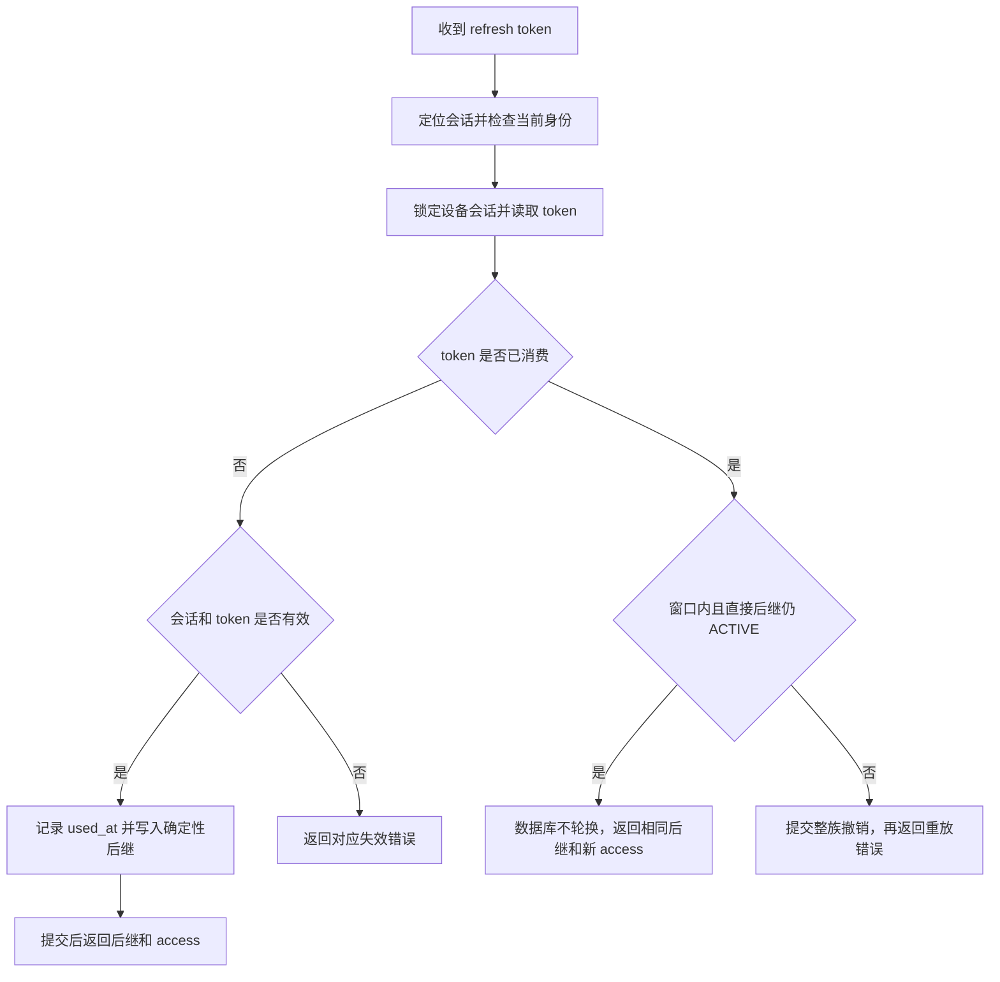

# DSH 频繁掉线治理方案

日期：2026-11-05。状态：已有服务端修复已本地合并；下述客户端改造和新增观测项是待评审方案，尚未实施。未推送、未部署、未修改生产配置或数据。

## 1. 基线、范围与结论

| 项目 | 本次核对基线 |
| --- | --- |
| 服务端目标分支 | `feat/bisheng-work-130`，合并前 `9fe40a4f21753f792a363ad1294eb79b405747ca` |
| 已合入来源 | `fix/bisheng-work-130-dsh-refresh-grace@0b2845d0742f1cad83be1ae99b5b895b5acf4476`，包含其前序修复 |
| 服务端合并提交 | `202c9ae21`；包含集成所需的迁移 head 合并与现状设计同步 |
| 客户端 | 已重新 fetch 的 `bisheng-work origin/main@8c33cac5dfb7baac18c135d5acd180716ebeec07`，不是该仓库当前检出的 V1.1.0 |
| 事故证据 | 此前对附件 `harness.log`、43.134.27.153 日志和获授权会话元数据的只读排查；这里复用既有证据，没有重新查询生产 |

本次目标是降低传输异常引发的真实会话撤销，防止客户端连续重试放大故障，并让界面区分登录失效与通信失败。浏览器自动回调、登录结果轮询、SSO 改造不在本方案范围。

服务端确定性后继是核心恢复能力；客户端负责有序使用凭据、停止无效业务请求、共享重试节奏。休眠控制用于减少异常请求，不替代服务端恢复。仍不能保证任意代理、任意网络中断下请求成功，也不承诺无条件保持 30 天登录。

## 2. 证据与故障分类

### 2.1 真实会话提前撤销

此前 11 月 5 日 UTC+8 的两组证据一致：

- 14:39：服务端 token 接口先 200、后 401；客户端先 `refresh_degraded`，再 `refresh_invalid` 和会话已变更。
- 15:02–15:03：服务端 15:02:08 完成刷新并返回 200，客户端同时段连续刷新失败；稍后再次提交得到 401，会话提前撤销。
- 对应 SQL 会话原定到期时间仍在 30 天之后，排除这些会话因正常到期退出。

这与旧实现“服务器已消费 R0，客户端未确认 R1，重复 R0 触发整族撤销”高度吻合。服务端 200 只证明服务端处理/发送，不证明客户端收到并保存。现有日志不能确定首次失败来自代理、普通网络还是底层自动重投，不能把代理认定为已证实根因。

### 2.2 客户端可确定的重试放大

最新 main 的隔离控制流验证已证明：

| 场景 | 结果 |
| --- | --- |
| 5 个同时调用 refresh | 合并为 1 个 token POST，已有 single-flight 有效 |
| 失败后连续调用 3 次 refresh | 3 个不同请求 ID，串行提交同一旧 token |
| 1 次 webSession，所有 refresh 均传输失败 | 3 个 token POST、2 个 web-session POST；并发峰值仍为 1 |

原因是 `refreshLocked()` 的可恢复失败返回降级快照，`ensureAccess()` 随后仍返回已过期 access；`webSession()` 收到 401 又执行刷新和 ensureAccess。问题是失败后的串行放大，不是已经证明存在多个应用刷新同时提交，也不需要假设 Chromium 自动重投。

### 2.3 与会话撤销分开处理

- 附件中 114 次 `Enterprise login is not available yet.` 分别紧随 110 次本地 Broker 请求长度不匹配、4 次响应头超时，不能统计成 114 次掉线。
- 同一客户端来源的 Work MCP 请求通过登录鉴权后，因内部 Host 转发错误被拒绝为 421。修复其转发链，不能关闭 MCP 的 Host/Origin 安全校验。
- 模型响应超时与登录撤销分别记录；不能因模型超时就清理登录。

## 3. 合并后的服务端能力

### 3.1 决策流程



后继派生保持 43 字符 base64url 格式：

```text
K_refresh = HMAC-SHA256(master, "bisheng:dsh:refresh-successor:v1")
R_next = base64url_without_padding(HMAC-SHA256(K_refresh, R_old))
```

首次登录仍随机签发 refresh，SQL 仅存 SHA-256 摘要。refresh 派生用途与 access JWT 签名用途隔离。多副本使用同一个持久化主密钥；不新增客户端固定密钥。

| 条件 | 当前合并结果 |
| --- | --- |
| ACTIVE token 首次刷新 | 标记 USED、记录 used_at、创建唯一后继 |
| USED token 在窗口内，直接后继 ACTIVE，身份/会话/有效期均通过 | 返回同一后继，新签 access，不修改 token 行 |
| 直接后继已经消费 | 整族撤销，返回 refresh_token_reused |
| 超过窗口、历史 used_at 为空或后继不匹配 | 保持严格重放处理 |
| 尚未消费的 token 离线超过 24 小时 | 不受恢复窗口限制；仍受身份和会话绝对有效期限制 |

`dsh.refresh_reuse_grace_seconds` 默认 86400，上限 604800，0 关闭恢复。access 默认 300 秒，会话默认绝对 2592000 秒；刷新不延长会话到期时间。窗口从 used_at 起算，重复领取不会续期。

### 3.2 迁移与兼容

1. 来源分支新增 nullable `dsh_refresh_token.used_at`，通过 `work110_dsh_refresh_used_at` 迁移支持升级；不是“无需迁移”。旧历史行不猜测回填。
2. 来源已有迁移合并点只收敛旧 f111 与 refresh 分支；本次与当前 F114 集成后出现两个 head，已新增空合并迁移 `merge_f114_dsh_refresh`，不修改已有 revision。
3. 本地单 head 测试通过；MySQL、DM8 实际 DDL 和并发事务仍需隔离环境验证。
4. 升级前未消费的旧 token 可以进入新轮换链；已经被撤销的会话不会自动复活。历史已消费旧 token 的丢响应事故可能仍需重新登录一次。

服务端实现入口：`src/backend/bisheng/dsh/domain/services/local_session.py`、`domain/repositories/local_session.py`、`infrastructure/token_keys.py`、`core/config/dsh.py`。现状设计见 [design.md](./design.md)。

## 4. 客户端完善方案（待实施）

### 4.1 一处负责刷新与重试

保留现有 single-flight 和会话修改队列，在 enterprise service 中统一协调刷新。`webSession`、聊天、审计、工作台和目录请求都经过同一协调器，调用方不再叠加自己的 refresh → ensureAccess → refresh 循环。

建议内部约定刷新明确区分：成功、临时不可用、会话确定失效、账号切换/取消。需要可用 access 的方法只返回确实可用的 token；其他结果抛出类型化错误或返回显式失败，不能把降级快照视为刷新成功。

具体规则：

1. 排队后、发送前再次检查 account epoch、凭据版本及是否仍需刷新；前一请求已经提交新凭据时，后面的排队任务复用结果。
2. 同一账号和凭据版本仅有一个在途刷新，其余调用者等待该结果。临时失败后仍保留旧 refresh，等待恢复机会。
3. 自动请求共享退避和 `nextRetryAt`。建议起始 5 秒，指数增长到 60 秒，增加抖动；429 尊重有上限的 Retry-After。参数作为初始设计，需通过故障注入调整。
4. 一次前台操作最多发起一次主动刷新；失败后返回可重试错误，不继续发送已过期 access。聊天正文请求不因恢复登录而自动重发，避免重复生成和副作用。
5. 前台操作可发起按需刷新，但也不能无条件绕过正在执行的刷新或同凭据的失败冷却。用户明确点“立即重试”可重新尝试一次，仍须合并并发点击。
6. 如果旧 access 尚在有效期，提前刷新失败不必立即判为退出；是否可继续使用由 access 的实际有效期决定。已过期则停止本次业务请求。

### 4.2 凭据提交与迟到结果

- 以 token 响应解析成功且 vault CAS 持久化成功作为刷新提交点，随后发布新凭据版本。目录、模型和用量同步失败不能倒退已提交的 token。
- 成功提交后清除该凭据版本的退避；旧账号、旧 epoch 的迟到响应不能覆盖新会话。
- 业务请求使用的 access 已被更新时，旧请求的 401 不能直接清理新登录；先检查请求所属 epoch/版本，必要时用当前有效 access 重试一次允许安全重试的请求。
- vault 失败单独报告存储故障，停止继续使用不确定的内存凭据，不伪装成网络失败或循环提交旧 token。恢复/重新登录按照现有安全存储约束处理。

### 4.3 只有明确的认证终态才进入重新登录

| 结果 | 处理 |
| --- | --- |
| timeout、断网、连接重置、5xx、429 | 保留会话，停止本次依赖操作，按策略等待重试 |
| 响应体读取失败、非 JSON、协议解析失败 | 凭据状态可能不确定；保留原凭据并报告传输/协议故障，禁止当作明确退出 |
| token 接口明确返回 invalid_refresh_token、refresh_token_reused、session_expired、session_revoked | 按现有会话终态处理，提示重新登录 |
| 明确账号停用、租户不可用 | 显示对应不可用原因，停止自动尝试；不显示成普通网络超时 |
| 普通业务 401 或未知网关 401 | 不直接等同 refresh 失效；先按接口、错误码和请求凭据版本判断 |
| 用户退出、切换企业/账号 | 立即取消原账号排队任务与定时器，旧结果不能写回 |

`enterprise-request.ts` 的错误边界需同时覆盖 fetch、响应体读取和解析。保留本次 request ID、错误类别和有限的底层错误码；不能只依赖主进程 console，因为本次提供的 harness.log 不包含完整主进程网络错误。

### 4.4 休眠与唤醒

最新 main 已移除旧的固定模型轮询，不能再把“停掉五分钟模型定时器”列作主要修复。仍需覆盖 `chat-view.ts` 的内嵌工作区 cookie 续期及其恢复定时器、其他实际存在的后台任务。

- 主进程集中订阅系统 suspend/resume。suspend 设置后台暂停标志并停止后台定时调度；对已经发出的请求只能尽力取消，不能假设服务器没有消费 token。
- resume 后默认等待 10 秒再恢复后台任务，加入少量抖动；等待期间用户操作走统一按需刷新，不等待后台窗口。
- 唤醒后的网络可达性没有保证；10 秒到达仍失败时继续共享退避，不能一口气补发休眠期间错过的任务。
- 保留与用户实际操作相关的在途聊天，后台暂停不主动终止用户聊天。恢复只安排一次续期，禁止恢复事件创建多个 timer。
- 退出或账号切换清除等待唤醒任务，避免旧账号任务在 10 秒后重新启动。

### 4.5 入口定位

下列路径均指客户端仓库上述 origin/main 基线，不是其当前检出分支：

| 路径 | 改造职责 |
| --- | --- |
| src/main/enterprise/enterprise-service.ts | 刷新结果语义、共享退避、ensureAccess、webSession 和其他重试调用方 |
| src/main/enterprise/enterprise-request.ts | 完整响应生命周期的错误分类、请求关联和超时 |
| src/main/enterprise/chat-view.ts | cookie 自动续期接入后台暂停、统一退避和恢复 |
| src/main/index.ts | 系统电源事件接入、统一生命周期清理 |
| packages/dsh-desktop-enterprise | Broker 错误映射和现有契约的兼容验证 |

正式实施前按客户端仓库 AGENTS 和 SDD 规则确认具体改动。不要直接修改它当前 V1.1.0 工作树。

## 5. 剩余风险与不采用的做法

1. **跨代迟到请求仍可能撤销。** R0 已换成 R1，R1 又消费生成 R2 后，迟到 R0 仍按重放撤销。客户端顺序控制可减少应用层来源，但不能证明能消除网络栈或代理迟到重投。若上线后仍出现，需有请求关联证据再单独评审策略，不能声称当前修复覆盖所有 Chromium 重投。
2. **窗口和绝对有效期是上限。** 丢响应后休眠超过 24 小时、或会话超过 30 天，仍可能需要重新登录；未消费 refresh 离线 29 天正常，不代表从任意时刻都再有 30 天。
3. **恢复窗口有安全取舍。** 窃取已用旧 token 者在直接后继未消费时也可能领取相同后继；新后继一旦消费，旧 token 再使用即撤销。不要把撤销检测描述为能够识别哪一方是攻击者。
4. **混用算法与密钥会破坏恢复。** 随机旧节点、不同主密钥、严格旧版本与新版本同时处理同一会话，会造成不一致。主密钥必须持久化且跨副本一致；不通过更换 JWT 主密钥“修复掉线”。
5. **不改为长期固定 refresh、不关闭重放检测、不无限延长窗口、不自动反复登录。** 这些会扩大凭据失窃或副作用风险，不能替代有边界的恢复。
6. **代理直连只能是排障选项。** 未确认客户端实际代理模式和规则，不在代码中强制绕开企业代理，也不把关闭代理列为用户必须遵守的条件。

## 6. 其他报错的后续处理

这部分与真实会话撤销分开验收：

- Work MCP 的 421：核对外部 HTTPS 入口、Gateway、Python 的 Host/Origin 传递，在正确一层保留合法目标 Host；不信任任意客户端 Forwarded 头，不扩大为通配白名单。
- Broker 请求长度不匹配：用实际 main 的打包依赖、Undici 补丁和运行时重现，再决定修复 body/headers/adapter 哪一层。此前下载的代理依赖镜像包完整性校验未通过，不能用它作为已验证根因证据。
- 错误展示：网络故障显示网络问题，模型超时显示模型超时，仅认证终态提示登录失效。保留原始可定位错误码，不能统一改成“企业登录尚不可用”。

## 7. 观测方案（待实施）

客户端记录刷新触发来源（前台、cookie 续期、其他后台）、logical attempt ID、每次 HTTP request ID、epoch/本地凭据版本、耗时、响应状态、退避时间、结果及系统电源状态。网络失败也必须保留 request ID。字段严格白名单，禁止记录 token、token 摘要、密码、密钥、Authorization/Cookie、带票据 URL 和完整代理认证配置。

服务端将 X-Request-ID 与现有 X-Trace-ID 关联，记录首次轮换、恢复返回和拒绝原因；区分窗口超时、后继已用、历史时间缺失、会话过期。通过请求上下文传递关联信息，不能让 Repository 依赖 FastAPI Request。

会话标识只用于受控诊断日志，不作为指标标签；指标采用有限类别，避免高基数。比较恢复命中数、重放撤销数、传输失败数、真实重新登录次数及后台刷新频率，不用 UI 通用报错次数代替掉线率。日志只证明所观测阶段，不把“服务端响应发送完毕”标注为“客户端已保存”。

## 8. 测试和验收

### 8.1 本次已完成的本地验证

| 检查 | 结果及边界 |
| --- | --- |
| test_native_access.py + test_foundation.py | 40 passed、1 optional skipped；SQLite + 确定性 Redis 边界，不依赖生产 |
| 使用最新 main 导出包补跑跨仓 parser | 1 passed，补齐上面的 optional skip；没有修改客户端工作树 |
| test_alembic_single_head.py | 1 passed；单 head 为 merge_f114_dsh_refresh，不连接数据库 |
| 隔夜/绝对有效期补充验证 | 6 passed；8/23/24 小时分别重试 18 次同后继且 token 行不变；24 小时 +1 秒重放拒绝；未消费 token 29 天可刷新；30 天 +1 秒过期 |
| Ruff | 合并涉及 Python 文件及新迁移通过 |
| arch-guard / diff 检查 | 12 个 Python 文件无输出告警；diff --check 通过 |

补充验证脚本位于本机临时目录 `/private/tmp/dsh_refresh_merge_boundaries_test.py`，使用合成账号、固定时钟和显式 86400 秒窗口，不是已提交回归测试，也不是休眠/代理真实 E2E。正式实施时应将必要场景纳入各仓库维护的测试。

### 8.2 后续必须补齐

| 场景 | 验收结果 |
| --- | --- |
| 服务端提交刷新后主动丢弃响应，再重试 | 同一后继、无新增代数、会话保持 ACTIVE |
| 两个副本同时接收同一旧 token | 行锁串行化，均拿相同后继，无多条后继；MySQL、DM8 分别验证 |
| 消费后继后再重放祖先 | 整族撤销且提交，不把安全规则回归为任意放行 |
| 同一客户端五个并发入口 | 只有一次刷新，成功后共享新凭据 |
| 单个 webSession 刷新传输失败 | 本次最多一个 token POST，零次携带过期 access 的 web-session POST |
| 连续不同入口失败 | 共用 nextRetryAt，冷却期不新增后台 token POST |
| 成功刷新后目录同步失败 | 新 refresh 已保存，后续不退回旧 token |
| 账号切换、退出、迟到 401、迟到 200 | 不覆盖或清除新账号/新凭据 |
| body 读取中断、非 JSON、429、网关未知 401、vault 写失败 | 对应类型化结果，只有明确认证终态进入重新登录 |
| 合盖 8 小时、重复系统唤醒、网络恢复晚于 10 秒 | 暂停期间无后台补发；恢复一次，失败继续退避；前台按需请求仍可触发 |
| 实际开启代理、直连、网络切换 | 分别记录是否收到响应、是否持久化，不仅检查 HTTP 状态 |
| 旧客户端 + 新服务端；新客户端 + 旧服务端 | 前者验证服务端恢复；后者不能宣称已具备丢响应恢复能力 |
| 新旧库升级、已有 used_at、重复升级、回退后再升级 | DDL 可重复、迁移单 head；不丢失时间证据 |

## 9. 发布、回退与实施顺序

### 第一批：已有服务端修复

1. 先评审本次合并与空合并迁移，在隔离 MySQL/DM8 环境完成升级、并发和丢响应验证。
2. 核对部署实际使用的配置来源和默认值，保持 86400 秒窗口，确认所有副本持久化主密钥一致；不打印密钥。
3. 数据库先完成兼容的 used_at 迁移。发布时对 token 路由排空旧版本在途请求并统一切换新副本，避免随机/确定性两种算法混跑；不能只等镜像滚动完成就假定一致。
4. 记录镜像 digest、迁移 head、有效窗口和节点一致性，再做真实客户端刷新/响应丢失恢复验收。没有这一步，本地合并不能称为线上已解决。
5. 不撤销全部现有会话，不修改用户数据。历史已撤销或无法恢复的会话明确提示重新登录一次。

### 第二批：客户端修复

1. 先完成刷新失败结果语义和共享协调器，再处理所有重试调用方。
2. 再接入 chat-view 后台续期和电源事件，补齐诊断日志及错误展示。
3. 使用最新 main 的独立工作树实施，按项目流程确认方案与验收，再发布包含这些提交的安装包。版本号相同不能作为安装了修复的证据。
4. 用问题 Mac 验证休眠、代理和恢复，比较真实认证终态次数，而不是只观察“不再弹通用错误”。

### 第三批：独立通信问题

修复 Work MCP Host 转发和 Broker 长度错误，分别发布、分别验证，避免将它们的改善归功于 refresh 修复。

回退原则：保留 nullable used_at 和新增迁移历史，不删除或伪造既有数据。服务端代码回退到严格旧版本会失去丢响应恢复，已轮换请求的重试仍可能退出；必须排空 token 请求并明确这个影响。回退不能通过切换主密钥执行。客户端回退不应破坏已有 vault 格式，新增协调状态尽量只驻留内存。

## 10. 评审结论

本次合入的现有修复按边界、认证、并发、泄漏、测试、风格和文档进行了检查：恢复条件保留身份、绝对过期、直接后继状态检查；仍使用原会话事务行锁；日志不输出凭据；已有测试覆盖恢复和安全拒绝。发现的迁移双 head 已通过新的空迁移收敛。真实 MySQL/DM8 行锁与实际客户端网络/休眠尚未验收，不把本地通过扩大为生产通过。

后续实施以第 4 节为核心，先确认客户端错误语义、退避参数和发布策略，再进入正式 spec/design/tasks 与对应评审。当前文档是可评审方案，不表示这些客户端改动已经获得实施或生产发布批准。
