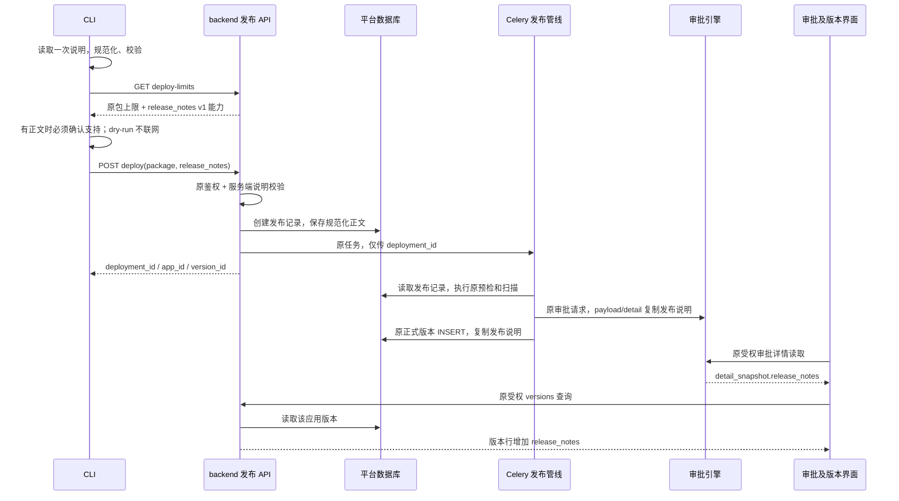

# Design: 应用发布说明

**关联**：[spec.md](./spec.md)（AC-01 至 AC-20 已确认）· [discovery.md](./discovery.md)
**版本**：v3.0.0；基线 `feat/3.0.0@e890280afb35cda0d78f6ec06b2e41af6856f7f9`
**最后更新**：2026-10-27
**状态**：2026-10-27 用户已确认设计（“确认设计，继续开发”）；确认时 SHA-256 为 `6061d8f6d5ccfe105a0ccb6a71d71196fc38f31b8d776d1c01f45ac81101e4b9`。实现与本地定向验证完成，真实部署 E2E 待执行；下述新增合同不作为已验收声明，验证证据以 tasks.md 和 verification.md 为准。

## 1. 目标与非目标

开发者在 CLI 提交本次发布的功能说明，平台冻结保存，在申请人/审批人的审批详情以及应用版本记录中展示。同一发布的异步处理与重试使用同一内容，历史版本保持原文。

不新增发布入口、历史编辑、富文本、公告推送、公开日志或运行时能力；不改变现有审批和部署状态机。

## 2. 关键约束

- 遵循 [constitution.md](../../../docs/constitution.md) C1–C8、[release-contract.md](../release-contract.md) 及各目录 AGENTS.md；不复制或改写这些全局规范。
- CLI 可选说明、直接文本/UTF-8 文件互斥、规范化后最多 2,000 个 Unicode 码点、提交后不可修改，均为已确认产品要求。
- CLI 是独立安装包，不能 import backend；两端各有一个短小纯函数，使用相同测试向量验证规范化和长度。
- 现有 `deploy-limits` 是包体大小的软检查，查询失败原本可降级；携带说明的兼容检查必须有明确的支持声明，否则不得上传。
- `VersionService.record_version()` 当前先创建审批再插入正式版本，并在插入失败时补偿取消审批。F112 不调整顺序或补偿；审批不能从尚不存在的版本读取说明。
- AppDeployment 是异步发布的持久载体；AppVersion 是只增不改的版本事实；审批引擎已有 payload/detail 快照。说明不进入 manifest、源码包、依赖指纹、manager RPC、容器环境或运行路由。
- 所有说明读取复用原发布、审批、版本入口权限，不新增匿名或独立说明查询接口。真实验证只覆盖本功能，不以 Docker/K8s 全量重跑作为门禁。

## 3. 方案对比与选定

### 决策 1：说明作为发布输入，不写进应用声明或介绍

- **备选**：A. 复用 `description`；B. 放入 `bisheng-app.yaml`；C. deploy 独立可选输入。
- **选定**：C，CLI 参数 `--release-notes TEXT` / `--release-notes-file FILE`，HTTP 表单字段 `release_notes`。
- **原因**：应用介绍描述长期用途，现有发布会同步应用元信息；YAML 是 F055 校验的运行合同，未知字段被拒绝。独立输入可让同一源码发布带不同文案，不改变包摘要、运行依赖或镜像缓存语义。文件可承载多行正文，不增加交互式必答问题。
- **重新考虑条件**：未来 PRD-2 需要界面编辑发布草稿时，沿用同一服务端输入合同增加入口，不改历史版本说明。

### 决策 2：现有两张业务表各增加一个字段，复用审批快照

- **备选**：A. 新建说明表；B. 仅写审批快照或版本表；C. AppDeployment 与 AppVersion 各一个 nullable 文本列，审批快照复制原文。
- **选定**：C，不新增表或发布说明管理服务。
- **原因**：AppDeployment 先落库，API 与 Celery 不共享进程；正式版本只在预检成功后建立；审批快照又先于版本插入。两处字段分别表达“本次提交内容”和“正式版本内容”，而不是两个可独立编辑的主数据。只有 receive 初始化及版本 INSERT 可以写说明；审批只从该发布记录构建快照。仅写版本会在审批创建时无源可读，仅写审批会将版本读取耦合到审批引擎。
- **重新考虑条件**：需要说明编辑历史、草稿协作或多语言人工文案时，再评估独立领域对象；本期不预建这些结构。

### 决策 3：复用一次 deploy-limits 请求，分开处理软限额与强兼容

- **备选**：A. 根据平台版本号猜测；B. 上传后再看是否接收；C. 扩展现有能力响应，带说明时先确认支持。
- **选定**：C，明确版本化说明合同，缺失声明即不支持。
- **原因**：`/api/v1/env` 的版本不是可靠能力依据；旧 FastAPI 表单可能忽略未知字段，因此“上传成功”不能证明说明被接收。已有 CLI 上传前查询 deploy-limits，可复用，无需新增 endpoint 或 manager 探测。
- **重新考虑条件**：平台有统一能力协商面时迁移能力来源，同时保留这里的版本化说明合同与上传前拒绝行为。

### 决策 4：展示全文，沿用既有业务布局

- **备选**：A. Markdown 渲染；B. 新详情弹窗或可展开卡片；C. 既有审批分区和版本表中的纯文本区域。
- **选定**：C；审批增加一个既有样式的说明分区，两处版本表各版本后增加对应的全文说明行。
- **原因**：上限为 2,000 码点，用户需要全文审读；已有 client `SectionTitle`/正文和 platform 版本表足以承载。独立说明行不增加横向列宽，不引入渲染依赖、弹窗状态或新的设计系统组件。
- **重新考虑条件**：设计师确认新的版本详情交互后可调整呈现方式；原说明读取与冻结合同保持不变。

## 4. 系统数据流与实现合同

### 4.1 基线链路（实施前核对）

`CLI run → _check_size → _upload/_post_package → POST deploy → PublishPipelineService.accept → AppDeployment → Celery → VersionService.record_version → ApprovalPort.submit → _build_payload / handler.build_detail → AppVersion INSERT`

- 基线未含发布说明；本次已实现 §4.2 至 §4.7 的输入、持久化、快照及展示。
- 当前审批详情由 client 的 `AppPublishDetailPanel` 读取 `detail_snapshot`；payload_snapshot 含内部字段，业务 UI 不从那里取值。
- platform 的发布页 `VersionListCard` 与版本页 `VersionsTab` 均在 `hostedApp/index.tsx` 中实际挂载，都读取 `/api/v1/apps/{app_id}/versions`。分页和非分页响应共用 `AppQueryService.list_versions()` 映射。
- CLI 下载件由 backend 的 `dev_toolkit/artifacts` 提供，源目录 `src/bisheng-cli` 不在 backend 镜像构建上下文中。

### 4.2 已实现流程（真实部署验收待执行）



上图是成功路径，`dry-run` 在 CLI 本地校验和打包后即退出，不执行其后的 GET/POST。预检失败仍不生成正式版本；审批创建失败、版本 INSERT 失败及其补偿继续使用原管线。仅填写说明不触发额外的发布、重建或审批操作。

### 4.3 内容规范化与输入校验

两端使用同一逻辑合同：`None → None`；字符串依次执行 CRLF→LF、CR→LF、Unicode `strip()`；空结果→`None`；否则 Python `len()` ≤2,000。计数是 Unicode 码点，不是 UTF-8 字节、UTF-16 单元或可见字素簇；组合 emoji 按多个码点计数。不更改正文内部缩进与空白，不做 Unicode NFC/NFKC 归一化。

- argparse 互斥组提供两个参数，默认均 `None`。冲突使用现有用法错误退出码 2。
- `--release-notes-file` 相对当前命令工作目录解析，不相对应用根目录。先确认普通文件，再严格 UTF-8 解码；文件错误、非法编码与超长使用现有 `EXIT_LOCAL_INVALID=6`。不接受 stdin、目录、管道或文件上传表单替代文本。
- CLI 在打包/联网前解析一次，将规范化后的不可变字符串传给 `_upload` 及 `_post_package`。结构变更确认引起的第二次上传重用这个值，不能再次读取已可能被改动的文件。
- `--dry-run` 执行同一校验，不做服务端能力检查。JSON 摘要只增加 `has_release_notes` 与 `release_notes_codepoints`，不打印全文。
- backend `PublishPipelineService.accept(..., release_notes: str | None = None)` 在创建草稿、存包、发布记录或排队之前规范化并校验。endpoint 只转交表单；不把 `max_length=2000` 加在规范化之前，避免拒绝首尾空白较多但正文合法的输入。
- 后端只接收文本；框架对非文本类型的拒绝沿用现有参数验证响应。正文超长用 `AppReleaseNotesInvalidError`，不在错误 details 或日志回显正文。

### 4.4 数据保存与迁移

| 位置 | 新增内容 | 唯一写入时机 / 读取方 |
|---|---|---|
| `app_deployment.release_notes` | `str | None`，`Column(LargeText, nullable=True)`，无默认正文、无索引 | receive 在创建发布记录时赋值；Celery、版本构建、审批快照读取 |
| `app_version.release_notes` | 同上 | 原 `_insert_version()` 从 deployment 复制；原版本查询返回；不增加通用 UPDATE |
| 审批 payload_snapshot | `release_notes: str | null` | `_build_payload()` 从 deployment 复制；回调不消费该字段 |
| 审批 detail_snapshot | `release_notes: str | null` | `AppPublishScenarioHandler.build_detail()` 明确白名单复制；client 仅从此处展示 |

`LargeText` 使用既有 dialect_helpers，MySQL 为 LONGTEXT、DM8 为 CLOB。2,000 码点上限由业务校验保证；不引入数据库字符集假设或 JSON 内容检索。

迁移采用一个可读 revision `f112_release_notes`，`down_revision` 以实施时实际单 head 为准。只对两张既有表幂等增加 nullable 列，使用 `table_exists/column_exists` 共享 DDL 守卫；兼容先执行 create_all 的安装路径；不回填历史、不更改旧 revision、不做数据清理。历史值保持 SQL NULL。降级会丢弃新增列中的说明，执行前须备份；正常代码回滚保留列，不运行 downgrade。

同一任务重试从原发布记录读值，不从本地文件、当前应用介绍或最新提交推导。版本及审批已复制的说明后续不回写。终态、停用、恢复、档位和密钥操作均不修改它。

### 4.5 能力响应与 CLI 兼容

`GET /api/v2/apps/deploy-limits` 保持原 scope、enabled 校验和 UnifiedResponse 包装；仅在 endpoint 的 data 合并以下内容，不把非整数内容塞入供包体服务内部使用的 `package_service.deploy_limits()`：

```json
{
  "max_package_mb": 50,
  "max_unpacked_mb": 200,
  "max_package_entries": 20000,
  "features": {
    "release_notes": {"version": 1, "max_codepoints": 2000}
  }
}
```

包体三项是部署配置值，示例不改变配置默认。说明 version=1 定义本设计的规范化及保存合同。

- `packaging.Limits` 增加带默认值的说明能力元数据；旧 positional/keyword 调用保持兼容。`fetch_limits(..., require_release_notes=False)` 默认维持现有软检查；传 True 时查询异常沿用原 CliError，不吞成限额降级。响应畸形、缺少/不支持 version、缺少合法上限，不得视为支持；version 和上限须为真正整数，不把布尔值或字符串当作整数支持声明。
- `_check_size` 返回本次 Limits 供调用者使用；不额外发第二次 GET。规范化说明非空时要求 `version == 1`、声明上限为正整数且能接受正文，并同时遵守本地 2,000 上限。缺少支持或版本不匹配以 `EXIT_PLATFORM_TOO_OLD=9` 退出，提示升级平台或显式移除说明后重试；不静默删除说明。
- 没有说明、显式空字符串或纯空白说明按未填写处理：不要求新能力，multipart 不发该字段，保留原失败降级。旧 CLI 忽略 features 的新增键。
- 连接失败等非兼容错误保留原错误与下一步指引；dry-run 不把远端不可达误当作本地失败。
- 本设计不支持发布期间旧/新 API 或 worker 混合提供能力。升级前暂停发布入口并排空在途任务；迁移后更新所有 API/worker，最后恢复发布与新版 CLI 分发。只升级 API 会让旧 worker 丢弃新增 ORM 字段，不能作为合格安装。

### 4.6 两处前端与文案

**client 审批详情**：在 `AppPublishDetailPanel` 的基本信息与能力区域之间增加“发布说明”分区，复用既有分区布局。只从 `detail.detail_snapshot.release_notes` 读取 string；缺失/空值显示空态，不查询当前版本，不从 payload_snapshot 补取。审批人 task 与申请人 instance 共用面板，因此不分叉实现。

**platform 版本记录**：`HostedAppVersion` 增加可选 `release_notes?: string | null` 兼容旧后端；`AppQueryService.list_versions()` 一处增加映射，使分页和非分页一致。`VersionListCard` 与 `VersionsTab` 各版本元信息行后紧跟一个带“发布说明”标签的正文行，React Fragment 以 version_id 作 key，列合并覆盖原表头。全文展开，不加新列、不截断，不新增弹窗或折叠状态。仅空态使用本地化文本。

两处都用 React 文本节点，不用 Markdown、`dangerouslySetInnerHTML`、自动链接或 HTML 模板。正文 `whitespace-pre-wrap` + 可打断长词，容器 `min-w-0`；复用既有分区/表格，不改设计 token、字体值、颜色或公共组件样式。新增正文用语义字号和颜色。受影响版本读取需清理过期请求，避免切换应用后旧响应覆盖新应用；不重构无关列表逻辑。

UI 依据：当前 `packages/ui/docs/index.md`、组件总览、字体/色彩规范和多端适配原则，正文宽窄屏行为需实际检查。没有独立发布说明设计系统组件需求，沿用已存在的业务分区模式。

| 文案 | platform 键（bs 命名空间） | client 键 | en / ja |
|---|---|---|---|
| 发布说明 | `hostedApp.releaseNotes.title` | `approval.app_release_notes.title` | Release notes / リリースノート |
| 未填写发布说明 | `hostedApp.releaseNotes.empty` | `approval.app_release_notes.empty` | No release notes provided / リリースノートは未入力です |

三语言同时提交。后端 16233 的文案只维护 `packages/locales/src/api_errors/{zh-Hans,en,ja}.json` 并运行既有生成器，不手改两端生成文件。CLI 当前是中文输出（既有合同），新增该功能的提示与帮助在 `bisheng_cli/release_notes.py` 内使用小型三语言消息字典，根据进程 locale 选择 zh/en/ja，未知 locale 回退英文；复用 Python 标准库，不新增全局语言开关、翻译框架或全 CLI 国际化迁移。命令行选项名保持不变。

### 4.7 模块修改职责

| 模块 / 文件 | 本次职责 | 不承担 |
|---|---|---|
| `bisheng_cli/cli.py`、`commands/deploy.py`、新增 `release_notes.py` | 参数、解析一次、校验、能力检查、表单与重传 | 访问数据库、导入 backend、改 manifest |
| `bisheng_cli/packaging.py` | 在现有一次限额响应中解析说明能力 | 推断服务器版本、默默降级说明 |
| `app_publish/api/endpoints/deploy.py` | 增加表单透传与能力声明 | ORM、版本写入、运行编排 |
| `app_publish/domain/release_notes.py` | 内容规范化与验证，统一上限 | 文件 I/O、数据库读写、身份推导 |
| `publish_pipeline_service.py`、`domain/models/app_deployment.py` | receive 保存不可变提交说明 | 给任务追加正文参数、历史编辑 |
| `version_service.py`、`database/models/app_version.py` | 原版本 INSERT 复制说明 | 改审批顺序、引入版本 UPDATE |
| `publish_approval_service.py`、`app_publish_scenario_handler.py` | 构建并白名单输出两个既有快照 | 改引擎规则、回调、审批人解析 |
| `app_query_service.py` | 原授权后列表映射增加字段 | 新匿名接口、新 DAO 或直接 SQL |
| client / platform 上述三处业务展示 | 纯文本全文和空态 | 保存说明、改权限、渲染富文本 |
| `scripts/pack_cli_wheel.sh` 与 dev_toolkit artifacts | 重打并分发可安装 CLI | 发布 Docker Hub 镜像或新 tag |

## 5. 已知坑与护栏

| # | 已核对事实 | 忽略后的结果 | 处理位置 |
|---|---|---|---|
| 1 | 旧 deploy 接口可能忽略新增表单字段 | 用户收到成功但说明丢失 | CLI `_check_size` 与 §4.5 强能力检查 |
| 2 | 包上限 GET 原本是软检查 | 直接复用失败降级会绕过支持判断 | `packaging.fetch_limits` 的说明严格分支；不改变无说明路径 |
| 3 | 审批先于正式版本创建 | 从 version 读取时为空，或为配合说明误改补偿 | 两个快照与版本 INSERT 都从 deployment 复制 |
| 4 | 结构变更确认会重复上传同一个包 | 再次读文件会给同一包带不同说明 | CLI 运行开始只解析一次，所有 `_post_package` 重用 |
| 5 | 两处版本记录是不同已挂载组件 | 只改一个页面，另一个仍无文案 | `VersionListCard`、`VersionsTab` 同步处理 |
| 6 | detail_snapshot 才是面板消费合同 | 只改 payload，审批 UI 仍为空 | `build_detail()` 显式输出字段；测试两种 scope |
| 7 | backend 镜像不含 CLI 源码目录 | 源码测试通过，下载仍是旧 CLI | 构建脚本、artifacts manifest 与新环境安装烟测 |
| 8 | create_all 不会给已有表加列，且会先建缺失表 | 升级缺列或迁移重复加列失败 | 共享 DDL 守卫、两个 nullable 列、单 head |
| 9 | 前端 JS 长度与 Python 码点长度不同 | emoji 上限口径不一致 | 输入校验只在两个 Python 侧，前端只展示 |
| 10 | API 新、worker 旧会加载不含新列的模型 | 能力为真但正式版本/审批漏说明 | §4.5 升级整套发布服务后再恢复入口 |
| 11 | 现有打包脚本默认把 min_compatible 和 platform.version 都设为 CLI 新版本 | 单纯 post 版本升级会拒绝旧 CLI，违反 AC-17 | post 版本默认剥离 .post 后缀得到 3.0.0；支持显式 CLI_MIN_COMPATIBLE、PLATFORM_VERSION，完整版本保持原行为 |

## 6. 对外契约与依赖

### 6.1 提供的合同

| 合同 / 方向 | 产生方 → 校验方 → 消费方 | 类型与行为 |
|---|---|---|
| CLI `--release-notes` / `--release-notes-file` | 开发者 → CLI → deploy 表单 | 互斥可选；文件相对当前工作目录；无交互新增 |
| GET `/api/v2/apps/deploy-limits` | 发布 endpoint → CLI → 上传决策 | 原 3 个包体限制 + `features.release_notes`；scope 仍 `app:manage`、模式 S |
| POST `/api/v2/apps/deploy` | CLI → PublishPipelineService → deployment | `multipart/form-data` 新增可选 `release_notes`，其余 package/app_id/confirm_schema_change 不变；原响应 3 个 ID 不变 |
| `PublishPipelineService.accept` | endpoint/既有测试 → service → deployment | 新 keyword-only 参数 `release_notes: str | None = None`；旧调用无需补参 |
| 原审批详情接口 | F055 构建器 → 原审批权限 → task/instance 面板 | payload/detail 新增同名可空文本；detail 不补取实时值 |
| GET `/api/v1/apps/{app_id}/versions` | AppQueryService → 原可见性验证 → 两处版本列表 | 原 `{data,total}`；每个版本新增 `release_notes: string | null`；原分页参数不变 |
| 错误 16233 | `AppReleaseNotesInvalidError` → 统一失败响应 → CLI/两端 | `details.reason=too_long`、`max_codepoints=2000`；v2 HTTP 400、UnifiedResponse 的 status_code=16233；正文不回显 |

16233 已复核无冲突并落入 `common/errcode` 与共享 api_errors；登记在现有模块 162，无新增模块编码。v2 的 HTTP 400 依据既有 `open_api/domain/http_status.py` 映射，不在错误类自行引入未被读取的状态属性；框架参数类型错误仍走原 v2 校验失败响应。CLI 将 16233 映射为修正文案后再提交（exit 6），不同于应用介绍或 manifest 错误。scope、访问主体和审批权限均沿用原 endpoint，不把平台超管或会话权限当成开放 API 凭据替代。

示例：

```bash
bisheng deploy ./today-tasks --release-notes '新增任务提醒；修复日期显示问题。'
bisheng deploy ./today-tasks --release-notes-file ./release-notes.txt
bisheng deploy ./today-tasks --release-notes-file ./release-notes.txt --dry-run
```

```json
{
  "version_id": "<version-id>",
  "version_no": 2,
  "kind": "iteration",
  "terminal_state": "online",
  "submitted_at": "<existing-time-format>",
  "is_current": true,
  "is_pending": false,
  "release_notes": "新增任务提醒\n修复日期显示问题"
}
```

### 6.2 依赖及风险

| 依赖 | 形式 | 风险 / 处理 |
|---|---|---|
| F053 CLI HTTP/错误/包装合同 | httpx、CLI 原退出码、pack_cli_wheel.sh | 不新增依赖；保持无说明软限额行为；构建件与源码版本同步 |
| F055 receive 与 AppDeployment 持久化 | 原服务和现有 DAO create/get | 不加 Celery 正文字段；避免在创建草稿后才发现输入不合法 |
| F054 版本写入与查询 | 现有 INSERT / alist_by_app | 不新增 DAO 入口、不引入 service SQL；读取前仍解析所属应用 |
| 既有审批引擎 | 原 gate / detail / outbox | 仅扩展场景业务快照，不改引擎或回调协议 |
| MySQL/DM8 及 Alembic | 现有 LargeText、online DDL helpers | DM8 静态核查；真实 DM8 留中央回归，不宣称本轮实测 |
| UI 与 locales | 两个 SPA 现有布局、共享 token、生成器 | 两套路径和 i18n 不混用；新增正文不走富文本 |
| 安装件分发 | dev_toolkit manifest + wheel SHA-256 | 使用构建脚本合并 cli 部分，保持 sdk 部分原样；漏更新会交付旧命令 |
| Docker/K8s | 原应用发布业务服务 | 无新增运行时二进制、镜像、仓库或集群权限依赖；无需分别重复业务相同的测试 |

## 7. 定向验证与可观测

### 7.1 验证策略及 AC 对应

| 层次 | 本次验证 | 覆盖 |
|---|---|---|
| CLI 定向测试 | 互斥、UTF-8 文件错误、CRLF/CR/strip、emoji、2,000/2,001、空值、dry-run 无请求；能力新/旧/失败配对；结构确认重传不重读文件 | AC-01、AC-02、AC-03、AC-04、AC-05、AC-06、AC-17、AC-18 |
| backend 定向测试 | 直接 accept 校验、无副作用；持久化后新 session/新 worker 读取；审批快照与正式版本值一致；失败/终态不改说明；分页映射和现有权限拒绝配对 | AC-07、AC-08、AC-09、AC-10、AC-11、AC-12、AC-13、AC-14、AC-16 |
| 两端组件 | task/instance 同文、版本页/发布页同文、历史缺字段、长文换行、脚本字面值、分页及切应用旧响应不串；zh/en/ja | AC-12、AC-13、AC-14、AC-15、AC-16 |
| 安装件烟测 | 新 wheel 独立 venv 安装，fresh `bash -lc` 使用明确 PATH 验证 version/help/dry-run；CLI artifact manifest SHA 一致 | AC-20 |
| 本功能 E2E | 一次带多行说明的迭代提交，读取审批、作一次审批决定、读取版本并核对原文；使用非管理员做无权/跨租户拒绝配对；历史空态组件覆盖 | AC-08、AC-09、AC-10、AC-12、AC-13、AC-16 |
| 静态门禁 | 受影响文件 Ruff/F821、arch-guard、迁移单 head/幂等 DDL、双库类型、i18n key/错误码生成、相关前端类型与 lint | AC-07、AC-15、AC-17、AC-19、AC-20 |

行为相同的 Docker/K8s 路径由同一 backend 测试覆盖，并静态确认说明未进入 manager/启动合同。E2E 选择一套可用专用测试部署，不重做两种运行后端的全量故障、升级、资源档位或镜像发行验收。若出现明确回归风险，再补对应的最小测试，不扩大为全仓测试。

### 7.2 一次人工确认步骤

1. 用平台分发的新 CLI 在专用测试应用执行上面的 dry-run，再带说明提交；只使用已授权测试凭据，不写入文档、命令示例或证据文件。
2. 在 client 的“设置 → 我的申请/我的审批”打开该申请，确认“发布说明”与输入一致，权限不足的账号不能取到详情。
3. 在 `/build/apps/<app-id>?tab=versions` 与发布页历史区读取同一 version_id，确认多行全文和空态；完成一项已授权审批动作后刷新，说明不变。
4. 以 1440px 与 500px 查看上述两端实际页面，核对长行可读、不影响审批按钮；包含 `<script>` 的测试文案只显示字面值。不以组件断言代替实际浏览器布局检查。
5. 最终记录源码 SHA、平台版本/镜像、CLI wheel SHA、发布/审批/版本 ID、输入规范化后的摘要及读取结果。测试数据的保留或清理按现有授权处理。

### 7.3 交付与运行记录

- CLI 采用增量版本 `3.0.0.post1`，同步 `pyproject.toml` 与 `bisheng_cli.__version__`；如实施前已占用则选择下一个 post 版本并更新本文。通过现有脚本重建 wheel、src/bisheng-cli/dist 和 backend artifacts/manifest；脚本增加可选 CLI_MIN_COMPATIBLE、PLATFORM_VERSION 参数；默认 post 发行剥离 .post 后缀，得到兼容基线与平台版本 3.0.0，防止 CI 无参数重建时提高旧 CLI 准入版本或误报平台版本。完整发行版本保留原行为，sdk 元数据保持不变。验证新 shell 真正运行新安装件。
- 沿用现有发布阶段、failure 五元组和审计 ID。无需新增说明全文日志、审计副本、metrics 服务或查询接口；错误只包含原因、限额与定位 ID。
- E2E 证据区分 mock/静态/真实 API/浏览器检查，未执行不得记通过。正式镜像推送、tag、生产部署不属于当前设计阶段的操作。

## 8. 后续改进与暂不实施事项

本期不做历史编辑、富文本、公告推送或在应用内展示。当前版本列表一次读取全量版本再分页，这是既有行为；F112 只加有界正文，暂不改查询分页架构。若实际版本量导致响应或页面出现可测瓶颈，再单独设计按需详情或数据库分页，不能用截断正文替代本次全文要求。

新版 CLI 带说明访问旧平台须明确失败；用户可以显式移除说明再提交，系统不替用户重试不带说明的发布。

## 修订历史

| 日期 | 改动 | 触发原因 |
|---|---|---|
| 2026-10-27 | 设计已获用户确认，进入实施；打包脚本显式保留兼容基线（§5 坑 11） | 用户确认设计；落实 AC-17 与 AC-20 |

| 2026-10-27 | CLI、后端、两个 SPA 与安装件已实现；补充 CI 无参数重建 post 版本的基线规则，窄屏正文限制宽度；本地验证见 verification.md，真实 E2E 待执行 | T001–T027、T030 实施与浏览器检查 |
