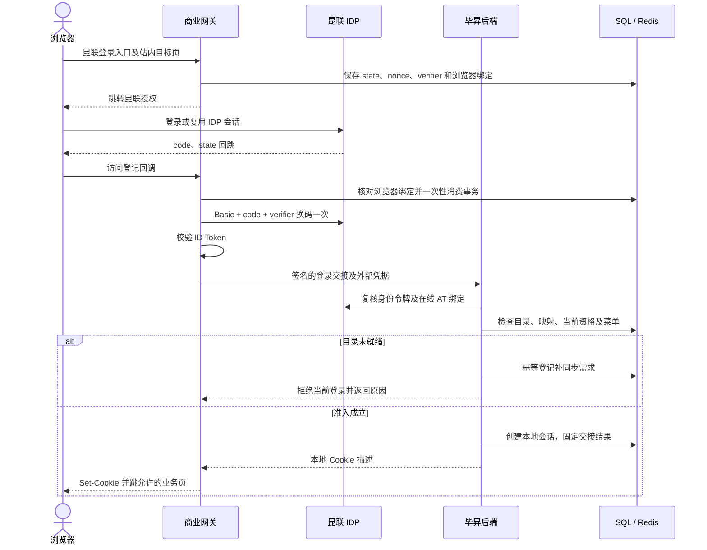

# Design: 昆联 SSO 与用户同步接入

- **Feature ID**: F118
- **Status**: CONFIRMED
- **Confirmed**: 2026-11-03，用户明确“确认设计，继续编写 tasks.md，先不要改代码。”
- **Spec status**: 用户已确认 9 项需求、26 条 AC；本设计已单独确认。
- **Updated**: 2026-11-04（Asia/Shanghai）
- **关联**: [spec.md](./spec.md)、[discovery.md](./discovery.md)、[tasks.md](./tasks.md)、[版本契约](../release-contract.md)、[架构约束](../../../docs/constitution.md)。当前进入实施，进度及证据见 tasks.md／verification.md。
- **实施状态**: IN_PROGRESS / NOT_READY。已完成 T001—T077、T081、T083，共 79 / 83；网关、退出、两端及本地相关回归已完成。真实存储／API E2E／浏览器验收和最终交付门 T078—T080、T082 未完成，不能启用。

## 1. 目标与非目标

商业网关作为昆联 OIDC 客户端，负责登录及浏览器退出协议；毕昇后端负责完整外部目录、稳定身份映射、账号投影、本地会话及逐次业务准入。复用现有业务权限入口，保持用户确认的“无目录拒绝并补同步、菜单人工配置、停用保留人工授权记录”三项行为。

不建设 Agent 节点、服务委托、组织树、用户组目录、身份事件、刷新令牌、后台任务自动撤权或历史账号迁移。其他身份通道保持原协议，不因为本特性而依赖商业网关或昆联服务。

## 2. 关键约束与交付门禁

遵循 [constitution C1—C8](../../../docs/constitution.md) 和当前版本契约；不复制全局规则。本特性特有的约束如下。

1. 昆联现有授权采用机密客户端、Code + PKCE S256、Basic 换码和 RS256 身份令牌；只申请 `openid profile`。当前客户端不接受任意扩展参数，不自动添加 `prompt=login`、`login_hint` 或 `resource`。
2. Access Token 不透明，不能当 JWT 解码；每个新的受保护请求／长连接业务动作必须由后端在线内省，不缓存允许决定。公钥缓存不是授权结果缓存。
3. 全租户目录使用独立 API-Key；接口只支持固定分页参数，不发送未经支持的租户、更新时间等筛选。登录客户端仍受已登记固定租户约束。
4. 上游目录不是一致性快照，不提供完整组织树、组成员和空租户发现。完整批次仅表示成功获取并校验当前接口返回的全轮数据，不承诺时间点快照。
5. 当前按已确认任务实施，运行开关默认关闭。EXT-01／EXT-02 未交付阻止真实联调；EXT-03 的状态传播和目录陈旧上限、EXT-04 的工作空间／到期语义阻止正式启用参数定案。不能拿五分钟同步周期冒充撤权保证。
6. 所有新启用开关默认关闭。测试 HTTP 入口仅能匹配单独批准的精确测试 Origin／issuer；正式配置要求 HTTPS。测试传输设置不关闭任何身份、租户或会话校验。

## 3. 设计决策

本节方案已随本设计获用户确认；职责和业务规则不在任务拆解时重新开放。

| 决策 | 备选与选定 | 原因和证据 | 重新考虑条件 |
| --- | --- | --- | --- |
| D01 职责及协议实现 | 选定网关 OIDC + 后端目录／准入；拒绝两边各实现完整登录或只改旧自定义 SSO URL | 用户确认职责；网关旧实现缺 PKCE／ID Token 验证，现有后端拥有用户和业务权限 | 用户改变部署要求时重新确认，不在实施中自行改成 Python 全登录 |
| D02 内部可信交接 | 新增仅本功能使用的签名协议，后端复核身份令牌及 Access Token 绑定；不接受浏览器填写用户字段直接登录，也不复用旧 login-sync 编排 | 旧链路会跨来源认领和按部门派生租户；网关与后端是独立进程 | 身份方提供双方均验收的等价交接协议后，再评估替换 |
| D03 数据与会话真相 | SQL 保存目录指针、身份准入版本及会话撤销；Redis 保存短时登录事务和辅助互斥；拒绝节点内存会话或允许结果缓存 | AC-07、AC-26；现有中间件部分缓存失败放行不满足昆联准入 | 只有能保持逐次验证、撤销和跨实例语义的等价存储方案才可替换 |
| D04 本地账号与租户投影 | 外部全目录与业务账号分开；管理员显式绑定已有本地租户，再由 Owner 创建本特性专属无默认权限的影子用户；拒绝自动新建全部业务租户、姓名认领或缺部门落 Root | 现有 User 唯一键不含外部租户，TenantResolver 缺主部门返回 Root；上游没有真实组织树 | 上游补完整目录且用户明确要求自动开通业务租户时更新 spec/design |
| D05 同步发布 | 完整暂存、校验后原子切换外部目录及 F118 准入状态；本地 Owner 投影另行幂等收敛；拒绝边拉边修改用户或回滚已生效停用 | AC-06、AC-16；旧 Owner 服务各自提交，不能假设存在跨服务原子事务 | Owner 统一事务能力变化后可优化，但不能放宽未知或投影失败时的拒绝 |
| D06 停用和恢复 | 人工 Grant 保留；F118 会话版本递增、当前访问拒绝，Owner 更新专属用户状态；恢复后重新认证及按当前授权判断 | 用户 C-04；旧会话不能因重新 ACTIVE 而复活 | 只有用户改变授权保留政策才修改，不自动清空 Grant |
| D07 首次未同步及菜单 | 缺映射拒绝本次登录并合并触发补同步；无菜单返回入口未授权；拒绝首次登录时按名称建号或分配默认角色 | 用户 C-02／C-03；UserInfo 无成员 ID，详情查询不能以 sub 替代成员 ID | 新增按 sub 查询且业务明确选择即时建号时更新规格 |
| D08 令牌及退出 | 外部令牌仅后端加密保存；本地 Cookie 可保留到外部会话上限，访问仍受短期 AT 限制；过期后新授权；拒绝盲目刷新或把 AT 交给前端 | AT 当前五分钟，ID Token 过期仍可能作为退出 Hint；Cookie 不是业务放行依据 | 用户纳入 offline_access 后单独设计轮换，不能直接开启库的自动刷新 |

### 3.1 OIDC 库选择与实现边界

网关使用 Spring Security 的 Reactive OAuth2 Client／JOSE 能力，增加昆联专用适配，不改现有 JustAuth 的企微及自定义 SSO 路径。专用 matcher 只覆盖本功能入口，不能因新增依赖启用默认全站登录／CSRF／跳转链而改变其他网关路由。按本项目 Spring Boot BOM 对齐、锁定依赖并检查许可证；不照搬最新版文档的 API 到当前版本，也不在本轮安装或升级依赖。后端身份令牌复核使用已安装的 PyJWT 与 cryptography，复用密码学实现而非手写 RSA 验签。

授权码、nonce 和令牌校验遵循 [OIDC Core](https://openid.net/specs/openid-connect-core-1_0.html#CodeFlowAuth)，PKCE 和精确回跳按 [OAuth 安全实践](https://www.rfc-editor.org/rfc/rfc9700.html)；[Spring Reactive Client 文档](https://docs.spring.io/spring-security/reference/reactive/oauth2/client/authorization-grants.html)只用于确认扩展方向，不能作为本仓库已集成或已编译证据。必须显式启用机密客户端 PKCE，约束库仅发送昆联支持的参数。

## 4. 已有系统与目标设计

### 4.1 当前实现快照

基线：BiSheng `5a359d8e6`，网关 `948cce69`；沿用 discovery 已声明的本地快照，不把未 fetch 的跟踪状态当最新部署。

| 已有入口 | 已有行为 | 本设计改动边界 |
| --- | --- | --- |
| 网关 OauthController、AuthCustomSSORequest | 授权跳转、回调、换码及旧 login-sync；Cookie 和日志处理不满足昆联要求 | 添加独立昆联路由／客户端和安全传输；旧登录路由保留 |
| user/domain/services/auth.py | 本地 JWT 包含用户、租户、token_version；HTTP／WS 登录依赖；DSH 有独立会话分支 | 增加可识别的昆联会话引用与准入分支，不能靠删掉引用回退普通身份 |
| utils/http_middleware.py | 本地 token_version、当前 Redis token、用户及租户检查；部分依赖故障放行 | 昆联分支先进入严格准入；其他分支保持。中间件与依赖只在同一请求内共享已验证结果 |
| common/chat/manager.py | dispatch_client 接收消息，_dispatch_message 支持 message_admission 后再判断业务 use | 对昆联连接在建连与每个新消息执行准入；使用现有回调扩展点，不另建聊天引擎 |
| sso_sync/login_sync_service.py | 跨来源认领、默认角色、部门推导租户 | 新增独立服务，不从旧编排塞参数绕过这些行为 |
| tenant 的 resolver／reconcile／sync | 按主部门计算当前叶子租户，后台有批量修正 | 昆联专属用户走外部映射权威，批量任务不得重新算回 Root |
| org_sync Provider／reconcile | 通用认证和数据格式不匹配，当前对账主体是部门 | 新增昆联客户端与 Celery 实际注册；不把现有 cron 字段当已运行任务 |
| user/logout、前端 request.ts | 本地 Cookie 清理；401 跳第三方登录；503 等错误可呈现 | 加昆联本地撤销／退出票据及固定站内跳转；503 不制造重登风暴 |

当前实现：八张 F118 集成表及用户 Owner 的第九张持久投影表已声明，HTTP／WS／Worker、网关、退出和两端交互已接线；默认关闭，未执行真实 DDL。完成 79/83，真实环境及最终交付门仍待执行；当前证据见 verification.md，不能把本地实现当已部署。

### 4.2 登录数据流（本地实现，真实环境待验）



网关不保存长期本地用户真相，不把未验签的 UserInfo 字段作为身份。后端只信任登记网关的交接，并独立确认凭据确属当前客户端／用户／租户／工作空间。初期不调用 UserInfo 补成员状态，目录才提供成员事实。

### 4.3 目录发布与本地投影

1. 定时／手动／缺目录登录只登记同一 connection 的同步需求；后端 Worker 是唯一拉取方。
2. 获取 SQL 租约及单调 fencing token，创建暂存批次；分页原样续传，固定 Key 与 page_size，不添加 all_tenants 查询参数。全租户范围由专用 Key 的服务端授权决定。
3. 暂存所有返回成员及租户摘要。重复成员、同一租户摘要冲突、必要字段错误或映射冲突使整轮失败；版本只作不透明相等比较。失败不切生效指针。
4. 全部读取和校验成功后，在同一 SQL 事务中切换 active_batch，更新已有身份绑定的外部准入状态与版本。显式停用、删除或从可确认状态变为 UNKNOWN 时增加该绑定的 auth_epoch，使已有会话不能在恢复时复活。
5. 发布完整目录后，再执行本地用户／成员 Owner 投影。目录发布与投影是不同结果：查询同时显示 directory_status、projection_status；不能把投影待处理／失败显示为“全部完成”。
6. Owner 投影失败只重试该身份，准入要求其 source_revision 已投影完成；失败期间拒绝相关用户，不回滚新目录或重新允许已确认停用。其他已完成用户可正常进入。
7. 明确区分“拉取／校验失败，保留旧完整目录”与“新完整目录已发布，Owner 投影尚未完成”。后者不是把半批次作为完整目录发布。

锁、页记录与最终发布均校验 fencing token 和租约。过期旧 Worker 即使继续运行，也不能写入新页或覆盖后来的生效指针。Redis NX 锁只降低重复执行，不作为唯一正确性基础。

同一身份的 Owner 投影与准入版本发布在 binding 行上串行，采用一致锁顺序和有界等待；Owner 可以独立提交，但回执只能以预期 source_revision 完成，不能由旧投影覆盖新修订的完成状态。崩溃后投影仍待恢复，不能把部分 Owner 提交算成完整投影。实现须验证投影／手工禁用／新批次发布竞争，不凭单个进程的锁保证跨实例正确性。

### 4.4 数据设计

以下为当前 SQLModel 表，均通过所属领域 Repository 访问。使用项目双 DB 类型；时间统一 UTC，版本和游标不转整数。外部 UUID 不作为本地 tenant_id。第九表经用户另行批准，见 design-owner-projection-fencing.md。

| 对象／候选表 | 核心字段与约束 | 真相及用途 |
| --- | --- | --- |
| KunlianConnectionState / kunlian_connection_state | connection_id、active_batch_id、sync_fence、lease_owner／lease_until、enabled、policy_revision | 连接运行状态和发布指针，不保存未经批准的远端 URL；秘钥来自受保护配置 |
| KunlianSyncBatch / kunlian_sync_batch | batch_id、connection_id、fence、status、started_at／completed_at、counts、last_request_id、cursor_ciphertext、key_version、page_size | FETCHING→VALIDATING→PUBLISHED，或 FAILED／ABANDONED；同轮 Key／分页参数不可变 |
| KunlianDirectoryTenant / kunlian_directory_tenant | batch_id + external_tenant_id 唯一，摘要、原始状态和版本 | 仅保存接口实际提供的租户；不虚构无成员租户 |
| KunlianDirectoryMember / kunlian_directory_member | batch_id + external_tenant_id + member_id 唯一；subject、状态／deleted、版本、角色和组织／岗位引用 | 同批次 subject 在租户内必须唯一；仅保存契约允许字段，不扩成权限模型 |
| KunlianTenantBinding / kunlian_tenant_binding | connection_id + external_tenant_id 唯一；local_tenant_id、revision、enabled | 显式映射现有本地租户；同 connection 下本地租户不得合并多个外部租户；有本地用户后不能修改目标，只能停用 |
| KunlianIdentityBinding / kunlian_identity_binding | identity_key、完整 issuer／subject／external_tenant_id、member_id、local_user_id、source_revision／projected_revision、admission_status、auth_epoch、local_override | 持久身份和准入版本；digest 冲突必须复核原文并拒绝，不能合并 |
| KunlianWebSession / kunlian_web_session | 随机会话 ID 的哈希、binding_id、auth_epoch_at_issue、browser_binding_hash、client／sid／workspace、AT／ID Token 密文、AT 到期、本地硬到期、state、csrf_epoch | SQL 是 ACTIVE／REAUTH_REQUIRED／REVOKED／EXPIRED 的权威；不以 Redis 缺键继续放行 |
| KunlianHandoffReceipt / kunlian_handoff_receipt | handoff_id 唯一、request_digest、session_id、固定签发上下文及 session_ref_ciphertext、结果状态／到期；退出票据只存哈希和短期结果 | 后端交接幂等；同 ID 不同请求冲突。加密引用只供同交接重签相同会话且不延长期限；退出票据单次消费，不作为业务会话 |
| UserExternalIdentityProjection / user_external_identity_projection | identity_key、原始身份、user_id、operation_id／fence、source_revision／payload_digest、已应用操作及 fence | 用户 Owner 持久操作栅栏和应用回执；阻止旧资料／状态操作覆盖新投影。不改 User／Tenant 列 |

目录快照的 JSON 摘要使用 JsonType，索引使用有界 ID／哈希列，避免在长 issuer／JSON 上建立 MySQL 专属索引。新表声明在可发现模型目录；若只新增独立表，按后端规则走模型发现／create_all，不无条件创建建表 revision。若实施发现需改已有列，则单列 Alembic schema revision，数据回填另行操作且本次不授权。

**控制面与租户隔离**：全租户外部目录属于受限集成控制面，控制面记录以 ROOT 管理范围登记，额外保留 external_tenant_id；不是把外部用户归入 Root。一般用户不能列举该目录。管理操作复用全局超管资格；业务验证仅凭已验证会话引用通过受限 application 协议读取所需绑定。必要的跨租户读取限定在该协议的短作用域内，不在 Endpoint 开一般 bypass，不把外部 UUID 填入现有租户 ContextVar，不手写业务 tenant_id 过滤。

**本地影子用户**：全量外部目录全部保存；只有已显式映射的外部租户才物化业务账号，其他记录显示 UNMAPPED，不能登录或丢弃。调用 user Owner 新增 ensure_external_shadow，不经过 add_user_and_default_role；其 Repository 创建无 UserRole／组／菜单的专属自然人。source 固定 kunlian，external_id 使用带命名空间的身份摘要，真实外部字段保存在绑定表。禁止跨来源认领、用户主键重写或向已有账号自动绑定。

用户与本地租户关系由 tenant Owner 的 ensure_external_membership 协调，只能初次绑定，不能搬迁已有业务账号。UserTenantSyncService／TenantResolver 识别 source=kunlian 后委托该权威；批量租户对账的候选和修正也必须排除部门推导。无真实外部部门树时不制造组织关系。外部租户停用只改变本集成的准入状态，不自动停用可能还有其他本地用户的整个本地 Tenant。

手工禁用昆联专属用户记录 local_override／manual 来源，目录恢复不能覆盖它；同步只解除自身标记的停用。用户停用由 user Owner 更新自身字段并处理既有凭据失效，F118 不直接删 Grant、角色或资产。权限模块的持久投影仍由原 Owner 调用。

### 4.5 会话准入算法

每个昆联业务访问先验证本地 JWT；sub 中增加 auth_source=kunlian 和 kunlian_session 引用，保留原用户／租户／token_version 含义。若凭据带标记或引用、用户属于 kunlian 来源或存在 F118 身份绑定中的任一条件成立，就必须走昆联准入，并要求完整合法的标记和引用；不能靠缺少引用回退普通身份。新建昆联账号没有可兼容的无标记历史会话，不支持导入这种会话。kunlian 是保留来源，普通用户创建／旧 login-sync 不得创建、认领或改写此来源；旧跨来源 fallback 遇到该来源拒绝，避免先改 source 再绕过检测。密码登录／重设不能为专属账号建立其他浏览器会话。

单次准入读取 SQL 当前 session、binding、连接状态、已发布目录和本地用户／成员／租户事实；检查硬到期、撤销、auth_epoch、一致映射、投影完成、手工禁用和目录新鲜度。再用该 session 的 AT 调昆联内省，严格匹配 active、iss、client_id、sub、tenant_id、workspace_id、sid 及有效期。只有全部成立，才构造本地 UserPayload 并交给既有菜单和资源动作判定。

- 不缓存 active=true 或业务允许。HTTP 同一 request 内可以共享一次验证后的不可变结果，不能跨请求或长连接消息复用。
- active=false／到期：持久撤销或标记 REAUTH_REQUIRED，拒绝当前请求；临时网络／容量错误返回依赖不可用，不把故障解释为撤销或缓存允许。
- SQL／Redis 等必需依赖失败均拒绝昆联分支。现有本地 token_version 或当前会话检查的 fail-open 不能覆盖此结论。
- 账号停用和重新可用会保留已递增 auth_epoch；旧会话永远不能因目录 ACTIVE 而恢复。
- source_revision 是投影相关输入与映射修订的指纹，不是每轮 batch_id；相同输入的新批次不让全部账号反复变成待投影。生效状态及 auth_epoch 在发布事务中更新，不能等异步 User 投影成功才阻断已确认停用。
- 本地会话硬到期不超过已验证 auth_time + OP 会话上限，也不超过本地配置上限。AT 到期后仍保留退出所需的 ID Token 密文至硬到期，只允许退出／重新授权协议处理，不准业务访问；首期无刷新。
- 复用现有 allow_multi_login 配置：关闭时在签发事务内撤销该账号旧昆联会话，打开时允许多条；昆联会话不依赖 Redis USER_CURRENT_SESSION 缺键放行逻辑。
- middleware、get_login_user 与 WS 建连依赖通过 sso_sync.application 的统一准入协议调用；Socket 每条新业务消息利用 ChatManager.message_admission 重新读取当前主体，再调用原业务 use 检查。无需等消息的心跳不查询业务数据，不解释为用户身份永久有效。
- 接受准入后已经开始的执行不因稍后撤权被本特性自动取消；下一次查询、继续执行请求、交互提交仍是新的准入动作。
- 对现有延迟任务引用保留昆联来源／会话因果信息，但不增加在途任务的逐节点内省或自动取消。执行快照不能用于公开 HTTP／WS 铸造新的普通登录会话；它与新的浏览器准入是不同合同。

### 4.6 文件与组件规划

下表的网关 Java 路径以 `src/main/java/com/dataelem/gateway/` 为根，后端业务路径以 `src/backend/bisheng/` 为根，platform／client 路径分别以各自 `src/` 为根；pom.xml 位于网关仓库根。表中实现文件已落地，真实集成测试的执行状态以 tasks.md／verification.md 为准。

| 仓库／计划落点 | 改动 | 做什么／不做什么 |
| --- | --- | --- |
| 网关 sso/kunlian/KunlianOidcClient.java、KunlianLoginTransactionStore.java（新增） | 专用协议与 Redis 事务 | 控制支持参数、PKCE、nonce、换码、JOSE／JWKS；不改变 JustAuth 旧客户端 |
| 网关 controller/KunlianSsoController.java（新增） | 新登录／退出路由 | 浏览器绑定、回跳、Cookie 安全写入；不认领账号或授菜单 |
| 网关 sdk/KunlianIdentityClient.java、utils/KunlianRequestSigner.java（新增） | 专用后端交接客户端 | 精确 raw-body 签名、有限重试及脱敏；不使用全局 WebClient 的请求／响应载荷日志 |
| 网关 config/KunlianSsoProperties.java、OauthController.java、pom.xml（新增／局部修改） | 默认关闭的独立配置、登录入口列表和受控库依赖 | 不劫持企微、LDAP、自定义 SSO；不全量升级依赖 |
| 网关 config/KunlianSecurityConfiguration.java（新增） | §3.1 专用 matcher 和客户端 Bean 的具体装配落点 | 验证新增库自动配置不改变旧路由；不新增全站登录机制 |
| 后端 sso_sync/domain/models/kunlian.py、domain/repositories/kunlian.py（新增） | F118 数据和事务 | 本模块 Repository 操作自身数据；不增加 DAO classmethod 或直接写其他 Owner 的对象 |
| 后端 sso_sync/application/kunlian.py、domain/schemas/kunlian.py（新增） | 窄跨模块协议／DTO | 提供会话准入、同步和交接，不把 ORM 暴露给 API |
| 后端 sso_sync/domain/services/kunlian_{login,session,directory,projection,logout}.py（新增） | 业务编排 | 调用自身 Repository 与 user／tenant／permission application 协议，不手写 ORM |
| 后端 sso_sync/domain/clients/kunlian.py（新增） | IDP 内省／公钥和目录请求 | 独立认证客户端，不混用 Cookie、Bearer 与同步 Key |
| 后端 sso_sync/api/endpoints/kunlian.py、sso_sync/api/router.py（新增／修改） | HTTP 入口 | 只校验请求并调用应用服务；不直接查数据库 |
| 后端 user/application/external_identity.py、user/domain/repositories/external_identity_projection.py（新增），user/domain/services/user.py、auth.py、user/api/user.py（修改） | 原 Owner 投影、管理禁用来源、受控签发／退出、禁止昆联密码登录 | 不调用默认角色创建、不迁移历史账号；旧登录通道保持 |
| 后端 sso_sync/domain/services/login_sync_service.py（修改） | 防止旧跨来源迁移认领 Kunlian 保留来源 | 不改 sso／wecom 原有匹配合同，只拒绝侵入 F118 专属来源 |
| 后端 tenant/application/external_membership.py、tenant/domain/repositories/external_membership.py（新增），tenant 的 resolver／sync／reconcile（修改） | 显式租户关联及对账豁免 | 不伪造部门，不创建业务租户或迁移资源 |
| 后端 utils/http_middleware.py、common/chat/manager.py、common/chat/clients/base.py、common/chat/clients/workflow_client.py，api/v1/workflow.py／assistant.py 的 WS 入口（修改） | HTTP／WS 统一准入接线 | 复用 message_admission；BaseClient 增加兼容的单消息执行上下文，不把 GPTS 专用形参直接塞给 WorkflowClient；不得只在握手鉴权 |
| 后端 worker/sso_sync/tasks.py（新增）、worker/__init__.py、worker/config.py（修改） | 真实任务注册、Beat 和投影恢复 | 不在 API-only 启动钩子里假装 Worker 已可运行 |
| 后端 worker/workflow/tasks.py（局部修改） | §4.5 已确认的延迟执行因果信息 | 仅消费无秘密来源引用，不把它用作登录凭据、不增逐节点内省或在途取消 |
| 后端 core/config/sso_sync.py、core/database/tenant_filter.py（修改） | 既有配置命名空间与模型发现 | core 只登记配置／模块名称，不引入 domain 业务逻辑 |
| 后端 common/errcode/sso_sync.py、三语 api_errors（修改） | 稳定错误与文案 | 不以 str(exception) 作为公开业务提示 |
| platform LoginPage/loginBridge.tsx、controllers/request.ts、controllers/API/user.ts、utils/loginReturnTo.ts（修改） | 新按钮、固定站内重新登录、退出后动作 | 不存外部令牌，不依赖 localStorage 决定安全身份 |
| platform layout/MainLayout.tsx、pages/Page403.tsx、pages/LoginPage/TenantSelect.tsx、contexts/userContext.tsx（局部修改） | 将既有四个退出调用者接入 §6.3 的明确结果及 next_action | 不沿用昆联失败也 finally 跳旧退出地址的行为；普通身份合同保留 |
| client api/request.ts、api/user.ts、hooks/AuthContext.tsx、utils/loginRedirect.ts（修改） | 与 platform 保持会话错误／退出合同 | 不混用两端状态库；不顺手重构共享会话 |
| client hooks/queries/auth/mutations.ts、types/chat/mutations.ts（局部修改） | 真实 useLogoutUserMutation 调用及 TLogoutResponse 的兼容类型 | 接通已有 mutation→API→AuthContext，不只给未调用的 API 增加方法，不更改全部 mutation 语义 |
| 前端 packages/locales/src/shared/{zh-Hans,en,ja}.json（局部修改） | 两端共享的登录、等待与退出结果提示源文案 | 共享源统一生成，不手改生成物；不新增管理页面 |

测试文件在各模块现有测试目录扩展；精确任务与依赖见 [tasks.md](./tasks.md)。此表是设计落点；当前已获实施授权，批次进度和证据以 tasks.md／verification.md 为准。

## 5. 已知坑与故障状态

| 事实／约束 | 若忽略会怎样 | 目标处理位置 |
| --- | --- | --- |
| 同步 subject 是登录 sub，成员 id 是另一标识 | 首次登录错误查详情或错绑用户 | KunlianLoginService、DirectoryRepository；缺映射只补同步 |
| 旧 login-sync 会跨来源认领并加默认角色 | 合并历史账号、违反不自动授菜单 | UserService.ensure_external_shadow 独立编排及 Repository |
| 现有租户批量修正按部门派生 | 次日对账把昆联账号移到 Root | TenantResolver／UserTenantSyncService、批量 reconcile 与其 Worker 候选接线 |
| 普通中间件 token_version／Redis 故障可放行 | 以本地 JWT 绕过远端失效 | KunlianAdmissionPort 严格分支，SQL 当前资格及内省缺一即拒绝 |
| Socket 登录依赖通常只执行一次 | 长连接在撤权后继续发新动作 | ChatManager 的 message_admission；WorkflowClient 也更新本次执行主体，不只更新 GPTS 分支 |
| 旧通用 WebClient／回调会输出请求或令牌对象 | 密钥和用户完整载荷进入日志 | 昆联专用 WebClient／异常转换及网关日志脱敏；入口日志不记录回调完整 URL |
| 目录非快照、成员可能随遍历变化 | 漏成员、重复页或误判已删除 | 整轮校验、冲突失败重拉；缺失标 UNKNOWN 并拒绝准入，不硬删账号 |
| AT 不透明且短于本地会话／退出 Hint 生命周期 | 解 JWT 失败或因 Cookie 存在而续权；过期后无法退出 | AT 只内省；本地会话保留受限退出能力，业务状态为 REAUTH_REQUIRED |
| active 状态未明确代表租户未到期 | 把目录 ACTIVE 当租户许可证明 | EXT-04 未固化不正式启用；不得从无 expires_at 的目录推导到期 |
| 原 User 停用 helper 的部分失败只记录日志 | 已停用身份在别的节点或旧会话中继续访问 | F118 auth_epoch／admission 状态在 SQL 发布事务内生效；Owner 失败另行修复，不能作为昆联允许依据 |
| UserTenant 是单个当前叶子，User 唯一键不含外部租户 | 将同名主体或多个外部租户揉成一个业务账号 | 独立身份摘要、显式绑定、一个身份固定本地用户／租户；不自动迁移 |
| 无本地部门不代表无法通过本地成员授权 | 为选人而伪造外部组织树 | 既有授权候选已按有效 UserTenant 查询；管理员可通过现有用户／授权入口配置，部门限定场景保持原限制 |
| 撤销原因是仓储窄协议 | 传入未支持原因会只拒绝请求而未完成预期撤销 | 主体不匹配复用 IDENTITY_CHANGED；实际 HTTP＋SQL 回归确认原正确 Cookie 也不能复活 |
| eager HTTP 读取后检查长度无法限制缓冲 | 超大上游响应耗尽内存后才拒绝 | 专用 Python 客户端按流读取并关闭响应；OIDC 1 MiB、目录页 4 MiB，超限不继续读取 |
| public_origin 是精确 Origin，不是带根路径的 URL | 配置显示就绪，但浏览器 Origin／CSRF 协议无法匹配 | 拒绝尾斜线、userinfo、查询、大写主机及显式默认端口等非规范登记形式；与网关及本地协议装配保持一致 |
| 绕过 SPA 可直接请求网关登录 | 前端过滤过的敏感查询又被 return_to 回显到 Location | 网关也拒绝 ar／access_token／id_token／token／t／code／state／ticket 查询键，先解码键名再比较 |

### 5.1 失败处理原则

- 拉取／验证失败：批次 FAILED，生效指针不变，不用空数组掩盖错误。
- 完整目录已发布但投影失败：保留新目录，projection_status=FAILED／PENDING；相关身份拒绝，后续修复前不能显示为全链路成功。
- 新批次缺成员：不删除用户、Grant 或资源，不将缺失伪装为显式 DISABLED；绑定转 UNKNOWN、准入拒绝并递增版本，待合法目录重新确认后新授权进入。
- 重新 ACTIVE：只清除本集成拥有的停用状态；manual override 或本地租户停用仍优先。人工 Grant 一直保留，访问恢复只取当前仍有效 Grant。
- SQL 租约失效或 fencing 不匹配：旧执行者 ABANDONED，不能 finalize。任务队列丢失时 Beat 从 SQL 需求和投影状态恢复，不需要靠内存任务列表续跑。

## 6. 接口、凭据和生命周期契约

本节所有新增路径均为设计候选；当前没有可供调用的 F118 接口。浏览器、内部网关和同步客户端的凭据严格分开，未知身份头不得覆盖已验证上下文。

### 6.1 新接口及调用方向

| 提供方／候选路径 | 调用方 | 认证和结果 |
| --- | --- | --- |
| 网关 GET `/api/oauth2/kunlian` | 浏览器 | 建立登录事务；只接受站内允许的 return_to；302 至登记 IDP |
| 网关 GET `/api/kunlian/callback` | 浏览器／IDP 回跳 | 消费 state 和浏览器绑定；失败落固定错误页；成功只写后端签发的本地 Cookie |
| 网关 POST `/api/kunlian/logout`、GET `/api/kunlian/logout/callback` | 浏览器 | 前者消费本地退出票据并准备 OP 退出，后者核对 logout_state；不是任意用户身份接口 |
| 后端 POST `/api/v1/internal/kunlian/login` | 网关后端 | 新签名协议；令牌及绑定复核成功后创建本地会话；不接受浏览器直调 |
| 后端 POST `/api/v1/internal/kunlian/logout-ticket:redeem` | 网关后端 | 新签名协议和单次票据；仅返回已结束会话的退出所需材料 |
| 后端 GET `/api/v1/identity-integrations/kunlian/status` | 已有全局超管 | 脱敏的目录、投影、契约就绪及运行状态，不对业务用户开放全租户目录 |
| 后端 GET／PUT `/api/v1/identity-integrations/kunlian/tenant-bindings/{external_tenant_id}` | 已有全局超管 | local_tenant_id、expected_revision；只绑定已存在且合法的租户。物化账号后只允许停用，不允许换目标迁移 |
| 后端 POST `/api/v1/identity-integrations/kunlian/sync` | 已有全局超管 | 幂等登记需求并返回 202／现有运行引用；不直接阻塞 HTTP 拉全目录 |
| 后端 GET `/api/v1/identity-integrations/kunlian/session/csrf` | 持本地昆联会话的同源浏览器 | 协议辅助端点，校验本地 Cookie／SQL 绑定，返回与该会话绑定的 CSRF 值；不提供身份或业务数据 |
| 既有 POST `/api/v1/user/logout` | 浏览器 | 普通身份保留旧行为；昆联会话撤销后返回 next_action，按下一节继续远端退出 |

不增加管理角色或通用权限绕过。配置凭据不通过上述查询接口返回；普通租户管理员仍只在现有管理范围配置菜单和授权。所有状态变更带修订号和操作者审计。

### 6.2 新内部签名与登录交接

使用专门的 `internal_key_id` 和共享密钥，不复用客户的 OIDC secret、同步 Key 或旧 F014 HMAC secret。复用签名工具经验，不改变旧协议。

请求头：`X-Kunlian-Key-Id`、`X-Kunlian-Timestamp`、`X-Kunlian-Nonce`、`X-Kunlian-Signature`。候选签名串为：

```text
v1\nMETHOD\nCANONICAL_PATH\nKEY_ID\nUNIX_TIMESTAMP\nNONCE\nHEX_SHA256(RAW_BODY)
```

对签名串作 HMAC-SHA256，固定编码，恒时比较；时间窗建议 60 秒，nonce 使用安全随机值，防重放记录至少覆盖整个接受窗口。Redis 记录不可用时拒绝。入口限制在登记网关及内部网络，并使用 TLS 或经批准的受保护服务网络；HMAC 不提供传输保密性，也不替代网络／来源校验。原始 JSON 字节先序列化一次再签名，BsClient 原样发出，不能签完后重新序列化。

登录交接的候选业务体：

```json
{
  "connection_id": "<registered connection>",
  "handoff_id": "<one login transaction id>",
  "expected_nonce": "<nonce bound to the browser transaction>",
  "browser_binding_hash": "<hash of the persistent gateway browser binding>",
  "id_token": "<server-to-server only>",
  "access_token": "<server-to-server only>",
  "expires_in": 300
}
```

后端从本地登记配置选择 issuer／client／端点，不接受报文指定验证 URL；重新验签 ID Token，核对 nonce、时间、aud／必要的 azp 和固定租户，再内省 AT 并比对身份／sid／workspace。expires_in 仅作上界输入，不覆盖可信令牌或内省返回的有效期。

handoff_id 与请求摘要唯一绑定，数据库保证同交接最多创建一个会话。同 ID 不同体报冲突；重复内部交接须重新验证当前资格，已撤销结果不得再激活。有限重试每次生成新签名 nonce、保留同 handoff_id；响应丢失不能再换一次原始 code。会话保存固定签发上下文，短期回执加密保存用于重签的会话引用，重复响应仍指向同一会话，签发时采用原绝对到期时间，不延长期限；该可选签发参数只扩展 user Owner，不改变旧签发默认值。

成功 data 严格为 local_jwt、expires_at（绝对 UNIX 秒）、user_id、tenant_id 四字段；网关据此写固定 Cookie，不接收后端任意 Cookie 描述。不返回完整用户目录、外部 secret 或 Refresh Token。网关只写允许的 Cookie 名和属性，不透传任意响应 Cookie。失败由后端稳定业务码解释，网关不调用旧注册接口兜底。

### 6.3 浏览器绑定、Cookie 与退出

登录 state、nonce 使用安全随机 URL-safe 值；verifier 满足昆联长度字符约束并生成 S256 challenge。Redis 中保存其加密或受保护内容、合法 return_to、签发时间和随机浏览器绑定哈希。事务建议 TTL 5 分钟；code 仍只有上游的 60 秒有效期。回调先核对浏览器绑定和 state，再原子消费事务，包括 error 回调；换码请求只执行一次，结果未知就重新授权。

本地 Cookie 继续使用 `access_token_cookie`，Host-only、Path=/、HttpOnly、Secure、SameSite=Lax；不再伪造 refresh_token_cookie。新入口只清理本应用已知旧 Domain／Path 的同名登录 Cookie，出现多个歧义登录值时拒绝而不是选中旧账号。网关的 `kunlian_browser_binding` Cookie 亦受保护，其硬期限与本地会话一致，不能随五分钟登录事务 TTL 一起消失；多个 state 分别绑定其哈希。后端在会话与退出票据中保存该哈希，user/logout 只先清本地访问 Cookie，网关完成或结束退出流程时再清浏览器绑定。正式请求固定使用登记 public_origin 构造地址，不接受任意 Host／Forwarded 头拼回跳。HTTP 测试配置只能对登记测试入口关闭 Secure，不使用要求 Secure 的 Cookie 前缀。

Kunlian 本地会话只从 Cookie 取，不接受 WS 查询参数 t 或浏览器 Authorization 当作替代凭据；旧通道继续原行为。写操作需要精确 Origin 检查及会话绑定的 X-CSRF-Token，WS 握手检查 Origin。CSRF 值由后端受控密钥与 session／CSRF 版本派生，客户端可读取它，但它不能单独建立身份。退出和 CSRF 辅助端点可以在 AT 过期后按本地会话处理，不能作为业务数据读取的免内省入口。

退出流程：

1. 浏览器带本地 Cookie、Origin 和 CSRF 调既有 user/logout；后端 SQL 撤销会话，清本地 Cookie，生成 60 秒单次退出票据。
2. 昆联分支响应增加 `next_action={kind:kunlian_logout,method:POST,url:/api/kunlian/logout,ticket:...}`。前端表单 POST 到固定网关地址；该票据不认证业务，不把 ID Token 返回给前端脚本。
3. 网关经内部签名接口原子兑换票据，获得已结束会话的 ID Token Hint 及登记客户端引用。票据与服务器保存的浏览器绑定匹配，跨浏览器或重复兑换拒绝。
4. 网关建立短时 logout_state，浏览器跳昆联退出 URL 并由 OP 确认；ID Token Hint 是此处唯一允许的外部令牌 URL 用途。网关、反代、后端日志均不记录该查询或完整回调。
5. 退出回调核对浏览器绑定和 logout_state，落固定退出页。远端拒绝、用户不确认或回跳失败均显示远端未完成，本地仍失效。重新登录必须经过新的完整授权。

若第 1 步 SQL 撤销没有成功，不生成退出票据，也不返回“本地已退出”。前端不得沿用旧 onError 分支直接声称成功；可提示重试或在明确本地结果后再继续远端步骤。

后端本地 Cookie 的硬期限可长于 AT，但不长于该 OP 会话／本地政策上限，退出材料保留至同一硬期限。过期的 ID Token 只能在上述退出用途使用；不能用忽略 exp 的验证方法处理登录。

### 6.4 后端跨模块协议

| 候选应用协议 | 消费方 | 责任及边界 |
| --- | --- | --- |
| `admit_kunlian_session(reference, action_context)` | HTTP／WS 身份依赖及逐消息准入 | 返回当前 UserPayload 与不可变会话引用；不代替资源动作授权 |
| `request_directory_sync(connection_id, trigger)` | 登录未就绪／管理入口／Beat | 合并持久需求，不按用户请求创建无界任务队列 |
| `publish_directory(batch_id, fence)` | Worker | 一次发布完整外部目录和 F118 准入版本，不直接写 User／Tenant／Grant |
| `ensure_external_shadow(identity, expected_revision)` | F118 投影器→user Owner | 新建专属无默认角色账号或更新自身资料；不认领既有账号、不覆盖手工停用 |
| `ensure_external_membership(user_id, verified_mapping)` | F118 投影器→tenant Owner | 通过既有生命周期保持明确关联，不按部门推导或跨租户迁移 |
| `revoke_session(reference, reason)` | 退出／状态失效 | 持久失效只增不回退，保留人工授权和审计证据 |
| `record_manual_override(identity, disabled, expected_revision)` | user 管理入口→F118 application | 只记录本集成绑定的手工状态和准入版本；User 自身字段仍由 user Owner 更新，不允许直接跨 Owner 写表 |

新 application 协议以验证后的类型和值对象传递作用域；API 层不跨 import 另一模块的 Endpoint。Owner 的 Repository 管理各自 UoW；F118 不创造跨库事务或绕过 F048 的 Grant 写入路径。当前没有同步角色到业务 Grant 的映射规则，角色摘要只保存，不新增授权规则引擎。

### 6.5 上游客户端与重试

| 调用 | 凭据及处理 | 风险控制 |
| --- | --- | --- |
| Discovery／JWKS | 仅受配置约束的端点；缓存公钥，未知 kid 受控刷新一次，仍未知拒绝 | 不读取令牌携带的 jku／任意公钥，不关闭 TLS；端点变化需通过 allowlist |
| authorize／token | 浏览器授权、后端 Basic 换码；标准 form-urlencoded，verifier 只留后端 | 不让 Basic secret 同时进入表单；不盲重试 code，不申请未批准的刷新范围 |
| introspect | 后端专用 Basic 客户端，一次业务准入一次在线调用 | 超时／容量错误拒绝且返回 503；active=false 拒绝并失效；不缓存允许 |
| user-sync list／detail | 独立无 Cookie／Bearer 的 httpx 客户端，只发 X-API-Key、Accept、可选 Request ID | 不带 Origin／用户身份头、不跟随跨域重定向；仅使用白名单分页参数；详情只用成员 ID |
| 目录 GET 重试 | 仅网络、容量和临时 5xx，指数退避且有总预算；其他 4xx 不盲重试 | 401 停止核对 Key，403 核对范围／白名单，游标非法重启新批次；HTML 403 与业务 JSON 错误区分 |

轮询与缺目录请求合并为 connection 上的持久 sync_requested_at；Beat 扫描到期需求，完成只清除本次已覆盖的请求版本。Page size 首期建议 20，与服务端默认一致；同步周期建议 300 秒，均不是外部 SLA。成功前后记录计数、耗时、request_id 和 fence，不记录游标原文、Key 或完整载荷。

### 6.6 配置及就绪

后端候选配置放在已有 `sso_sync.kunlian` 内，网关使用独立 `custom.kunlian`。后端旧镜像不能识别新顶层配置，故不新增默认启用顶层键，示例新增字段默认注释；本轮不修改任何配置文件。

| 参数组 | 候选内容 | 就绪规则 |
| --- | --- | --- |
| 启用 | directory_enabled=false、login_enabled=false、connection_id | 同步可以先初始化，登录要等映射与投影就绪；正式启用需要 multi_tenant.enabled=true，不能把全租户数据压入单租户默认上下文 |
| IDP | issuer、client_id、允许的固定租户、public_origin、精确回调、端点 allowlist | 与 Discovery 及登记逐字核对；凭据仅安全交付，不能用示例值启动 |
| 秘密 | client_secret_reference、sync_key_reference、internal_key_id／secret_reference、CSRF 密钥 | 使用现有加密配置能力，网关与后端各持所需最小秘密；密钥不进代码、URL 或日志 |
| 会话与目录政策 | max_directory_age_seconds、allowed_workspace_ids／已批准匹配策略、外部状态语义登记版本、会话硬上限 | 目录陈旧上限和 workspace 策略无宽松默认；EXT-03／EXT-04 未固化时 login_enabled 无法通过就绪检查 |
| 调用预算 | introspection_timeout_seconds（建议 2 秒）、HTTP 池上限、同步总时限、GET 重试预算、登录事务 TTL | 是本地资源预算，不是对外性能承诺；容量不足拒绝，不通过缓存允许撑流量 |

SQL 目录按最后一次完整发布计算 age，业务准入超过已登记上限拒绝；新批次缺成员时按 UNKNOWN 处理，不把 source 全局新鲜时间套在未见成员上续权。Key 轮换只能开启新批次，不能将旧游标换 Key 接着拉。公钥刷新、密钥轮换和配置版本变化均需要可观测；无法解密历史会话时拒绝并重新认证，不重新生成随机密钥兜底。

### 6.7 错误语义和响应

上游 OAuth 原生错误不套毕昇信封；本地新接口使用 UnifiedResponseModel。新昆联分支同时使用真实 HTTP 状态和稳定业务原因，不能把 193xx 作为 HTTP status，也不全局改变旧接口异常处理。成功保留 `status_code=200`，错误的 `data.reason_code` 可用于前端和内部客户端分流。

下表设计预留当前 193 模块的 19320—19329；本地 errcode 及版本契约扫描未见业务分配，实施前再扫并落实三语与代码，不能把设计登记当成类已存在。

| 业务码／候选类 | HTTP | reason_code／含义 |
| --- | --- | --- |
| 19320 KunlianLoginInvalidError | 400 | LOGIN_INVALID：事务、协议或一次性凭据错误；重新发起授权 |
| 19321 KunlianDirectoryNotReadyError | 409 | DIRECTORY_NOT_READY：当前登录失败，已合并请求补同步 |
| 19322 KunlianIdentityUnavailableError | 403 | IDENTITY_UNAVAILABLE：身份／租户／workspace 或本地资格不符，不泄露他人目录 |
| 19323 KunlianSessionExpiredError | 401 | SESSION_EXPIRED：本地／外部会话失效或需要重新授权 |
| 19324 KunlianDependencyUnavailableError | 503 | DEPENDENCY_UNAVAILABLE：内省、存储、解密或必要依赖不可用，当前不放行 |
| 19325 KunlianDirectorySyncError | 502 | DIRECTORY_SYNC_FAILED：目录协议／校验失败；只对获权管理者展示批次线索 |
| 19326 KunlianSyncConflictError | 409 | SYNC_CONFLICT：请求或同步状态冲突；返回既有运行引用，不盲重建 |
| 19327 KunlianBindingConflictError | 409 | BINDING_CONFLICT：映射不唯一、摘要冲突或期望修订号不符 |
| 19328 KunlianTrustRejectedError | 403 | TRUST_REJECTED：签名、防重放、Origin／CSRF 或退出票据被拒绝 |
| 19329 KunlianLogoutIncompleteError | 502 | LOGOUT_INCOMPLETE：本地已退出，远端步骤未完成；不得恢复本地会话 |

菜单不足复用 user 模块已存在的入口拒绝语义，HTTP 403；业务资源拒绝保留既有 F048 错误。前端优先识别本功能原因：只有 SESSION_EXPIRED 发起同源固定登录，DIRECTORY_NOT_READY 展示等待重登，403 展示资格／权限提示，503 保留目标页面供稍后重试。使用现有统一错误对象和三语包，不维护另一套吞错成功路径。

## 7. 验证、可观测与发布

### 7.1 验证策略

沿用 spec 的 V-01 至 V-07，当前均 NOT_RUN。主要风险是跨仓交接、真实用户／租户、一次性事务、完整发布和会话撤销，不能只写纯 DTO 测试证明完成。每组成功证据可覆盖多个 AC，不为每条 AC 重跑整套；不跑与本特性无关的全量回归。

| Evidence | 主要层与证据 | 必须观察的失败／并发结果 |
| --- | --- | --- |
| V-01 | 网关契约测试 + 真实浏览器登录／回跳；后端内部交接集成 | state／浏览器绑定／nonce／PKCE／签名／aud／租户错误参数化；一次性 code 不重试；HMAC nonce 重放及 handoff 重复／冲突；密钥和 Hint 不进日志 |
| V-02 | 后端身份／租户 Owner 集成 | 同名、改名、成员 id≠sub、外部多租户不混并；无映射拒绝并合并补同步；无默认角色；管理员配置后可按真实用户进入；部门对账不迁回 Root |
| V-03 | 多页 Mock IDP + SQL／Redis 同步集成 | 拉取中断旧指针不变、重复／不一致页失败、旧 fence 不能发布；完整目录发布与投影失败分别显示；无成员租户不被伪造；Key／HTTP 错误不伪装空目录 |
| V-04 | HTTP／WS 及两实例集成 | 每次新动作实际调用内省；直达后端、无引用、身份头伪造、旧 JWT、依赖故障拒绝；发布停用／重新 ACTIVE 后旧会话仍拒绝；纯连接心跳不授权业务 |
| V-05 | user／tenant／权限 Owner 和真实中间件最小集成 | 停用保留人工 Grant 和资产，manual override 不被目录解除；部分投影失败只拒绝对应身份；不授菜单／资源，不继承创建者权限 |
| V-06 | 会话生命周期 + 真实浏览器退出 | AT 过期本地 Cookie 尚在也拒绝业务，但可拿退出票据；票据跨浏览器／重复拒绝；OP 取消／故障本地仍退出；新授权与旧会话复活区分 |
| V-07 | 原有本地／企微／DSH／开放面定向回归 | 独立昆联 matcher 不改变网关全局安全过滤链；新来源不能被旧登录认领；其他身份不走昆联内省；既有资产与授权不变 |

重点补一条边界回归：当前 WorkflowClient 继承的 BaseClient.handle_message 没有 execution_context 形参，不能只在 ChatManager 填入回调就宣布逐消息接线完成。实现必须验证真实工作流发送／继续／取消入口及旧 GPTS 行为，同时保证消息使用当前准入用户，不能修改共享连接对象导致并发消息串身份。

计划的执行入口如下，仅供实施后使用；以下测试文件尚未创建，本轮不运行这些命令：

```bash
# 后端目录：src/backend；复用既有 Python 3.11 / uv 环境
uv run pytest test/sso/test_kunlian_login_contract.py test/sso/test_kunlian_directory.py test/sso/test_kunlian_admission.py
# 网关仓库；需实施后落地相应测试，不能据当前类名推断测试存在
mvn -Dtest=KunlianOidcClientTest,KunlianSsoControllerTest test
```

网关 README 当前使用 Maven，仓库未提供 mvnw；不能为执行上述示意命令安装未知版本。前端按各自 AGENTS 的 Vitest／typecheck 运行受影响验证，不混用 client／platform 状态库。MySQL／Redis／OpenFGA 及 DM8 中央环境验证按项目规则执行，不用本机静态文档检查代替真实存储和双 DB 验收。

### 7.2 人工联调步骤

1. 使用独立测试连接，双方登记 `https://<毕昇域名>/api/kunlian/callback`、退出回调及固定退出页，提供专属凭据和出口放行；这是登记模板，不是已存在的站点或授权。准备两个同租户用户 A/B 和一个其他租户对照用户，均为专用测试账号。
2. 原有全局超管通过管理 API 显式绑定测试本地租户，触发后端同步；状态接口应显示完整目录及投影结果，其他租户目录存在但未得到登录资格。确认未自动产生菜单或资源授权。
3. A 无菜单时尝试登录，应明确拒绝入口；管理员沿用现有功能配置菜单和测试工作流权限后，A 再登录到指定编辑页面。B 只有共享权限时按 B 身份访问，不能继承 A 权限。
4. 核对实际网络调用：后续每个 HTTP 请求和 WS 新业务动作触发内省；停止内省依赖应拒绝访问，恢复依赖不复活已撤销会话。保持已有执行不被本特性自动取消。
5. 按允许动作停用测试成员并完成完整同步，确认旧会话失败、人工 Grant 和资产记录保留；重新启用并投影后仍需新授权。再次手工停用本地账号，目录 ACTIVE 不得自动恢复。
6. 等待 AT 到期，业务请求重新授权；随后验证本地退出、OP 确认／取消、精确回跳、旧 Cookie 重放和多节点切换。配置缺失或 EXT 未闭合时记录 BLOCKED，不能以 Mock 测试冒充通过。

### 7.3 可观测与参数

日志只记 connection_id、batch_id、脱敏绑定引用、reason_code、HTTP 终态、request_id、耗时和计数；网关登录回调日志去除 code／state／token／完整 URL。各层使用同一 X-Trace-ID 关联，但不把追踪 ID 当身份凭据。

管理状态至少返回：目录发布批次及时间、目录 age、同步执行态和最近失败、投影待办／失败数量、契约就绪原因、任务最后运行时间。区分 0 个成员与未知；不以请求已受理、锁已获得或队列已投递当同步成功。指标包括内省调用／拒绝／超时、同步完整成功／失败、过期 fence 拒绝、目录陈旧、投影积压和重登／退出失败，不把每个用户标识做高基数指标标签。

失败告警使用已有监控入口；告警阈值与发布容量测试确定，不在规格外承诺任意固定 SLA。每个新受保护访问额外有一次在线依赖，容量验收必须按真实请求量及 WS 动作量测量，不能用登录次数估算。

### 7.4 发布、禁用及回退

| 阶段 | 动作 | 安全边界 |
| --- | --- | --- |
| 准备 | 固定后端／网关版本、密钥与内部契约版本，完成模型发现和双 DB 兼容检查；先部署但保持两个开关关闭 | 新内部接口也要求签名；旧版本不认识新 JWT／新路径不能参与昆联入口 |
| 目录初始化 | 仅开启获准目录同步，显式配置租户映射，待 Owner 投影完成，再人工配置菜单／资源 | 不自动开通其他租户，不改变历史账号，目录源与角色不授业务权限 |
| 登录验收 | EXT-03／EXT-04 固化后启用测试登录，完成 V-01 至 V-07 所需证据；确认共享入口各实例均为兼容后端 | 不能把未识别 kunlian_session 的旧实例放在同一业务流量池中，否则它会只验本地 JWT |
| 正式启用 | 配对发布、独立昆联入口，监控内省容量、目录 age 及投影积压 | 协议或模型不兼容时拒绝，不自动切旧 SSO |
| 受控禁用 | 先在 SQL 连接状态关闭准入并持久失效会话，再撤入口／停止同步需求；保留目录、绑定及证据 | 仅关闭前端按钮不是禁用；从不能读取准入状态的节点不允许继续服务昆联业务 |
| 回退 | 保留能识别并拒绝昆联会话的后端安全版本；禁用入口后逐实例排空流量，再处理网关版本 | 不直接回退到忽略 kunlian_session 的旧后端；不能恢复宽松登录作为可用性兜底 |

若必须回到完全不识别昆联引用的历史镜像，先将该业务入口从旧镜像流量中隔离，吊销专属会话并经过 user Owner 增加相关专属账号 token_version，且旧镜像的账户／版本校验已实证不能放行；不能证明时不得向该镜像开放昆联流量。本地普通登录仍走原通道。此处是未来操作方案，不授权本轮执行吊销、部署、Schema 或数据操作。

新表与外部事实留存，不通过回退删除；不回滚已生效的本地手工管理操作或人工 Grant。本轮无历史账号合并／数据回填，若实施发现必须迁移，须先更新设计和明确操作授权。

## 8. 追溯、后续边界与状态

### 8.1 Requirement → Design → Acceptance

| Requirement | 设计位置 | 覆盖 AC | 验证 |
| --- | --- | --- | --- |
| REQ-01 | §4.2、§6.1—§6.3 | AC-01、AC-02、AC-22 | V-01、V-02、V-05 |
| REQ-02 | §4.4、§4.5、§5 | AC-03、AC-04、AC-16、AC-26 | V-02、V-03、V-04 |
| REQ-03 | §4.3、§4.4、§6.5 | AC-04、AC-05、AC-15、AC-16、AC-20 | V-02、V-03、V-05 |
| REQ-04 | §4.5、§6.3、§6.6 | AC-07、AC-08、AC-11、AC-17、AC-25、AC-26 | V-04、V-05、V-06、V-07 |
| REQ-05 | §4.3—§4.5、§5.1 | AC-09、AC-17、AC-18、AC-23 | V-04、V-05、V-07 |
| REQ-06 | §4.3、§4.4、§6.5、§7.3 | AC-05、AC-06、AC-16、AC-19、AC-24、AC-26 | V-03、V-04 |
| REQ-07 | §4.5、§6.3、§7.4 | AC-10、AC-11、AC-21、AC-25 | V-04、V-06、V-07 |
| REQ-08 | §3 D06／D07、§4.4、§6.4 | AC-12、AC-15、AC-18、AC-20、AC-22、AC-23 | V-02、V-03、V-05、V-07 |
| REQ-09 | §4.5、§4.6、§6、§7.4 | AC-02、AC-08、AC-13、AC-14、AC-19、AC-23、AC-24、AC-25 | V-01、V-03、V-04、V-05、V-07 |

### 8.2 暂不建设的能力及触发条件

- 上游增量／事件可用后再扩充目录输入方式，不凭已有 W-14 文档路径宣称可以订阅；届时仍需全量初始化和补偿。
- 组织树、用户组、空租户目录要有独立权威来源，不能从角色名、用户数量或组织 ID 推理；纳入时先更新规格。
- 不建设通用外部身份平台、权限映射引擎、分布式工作流协调器或两套登录客户端。F118 仅服务已确认的昆联连接。
- 不自动把外部 ACTIVE 变成平台管理员，不给目录管理 API 新增面向普通人的入口；菜单和 Grant 仍由既有有权人员配置。
- 外部租户映射后若需换绑／账号合并，是迁移需求；本设计只支持停用旧映射和另行受控处理，不能修改外键继续运行。
- 刷新授权、后端退出通知和在途运行撤权均不在当前实现合同；不能为了减轻五分钟重登或内省压力静默开启。

### 8.3 设计就绪与确认

设计可以完成静态评审，但正式启用仍受 EXT-01 至 EXT-04 约束。max_directory_age_seconds、workspace 匹配和到期语义没有默认宽松值；外部约定未固化则保持 NOT_READY。设计评审不冒充这些外部条件已解除。

| 阶段 | 状态 |
| --- | --- |
| spec.md | CONFIRMED，2026-11-03 用户明确“确认规格” |
| design.md | CONFIRMED，2026-11-03 用户明确“确认设计” |
| design-review.md | 记录静态自审结果，不代表独立复审或运行验证 |
| tasks.md | 已获实施授权，79 / 83；执行证据见 verification.md |
| 代码与依赖 | IN_PROGRESS；本地实现及相关回归通过，未提交／推送 |
| 运行配置／迁移／联调／部署 | NOT_RUN；运行开关默认关闭 |

## 修订历史

| 日期 | 改动 | 触发原因 |
| --- | --- | --- |
| 2026-11-03 | 首版设计草稿；覆盖已确认 9 项需求和 26 条 AC | 用户确认正式规格并要求仅编写 design.md |
| 2026-11-03 | 记录设计确认；只细化既有安全装配、退出调用者、延迟任务及共享文案的文件落点 | 用户确认设计并要求继续 tasks.md；D01—D08 和业务契约未改 |
| 2026-11-04 | 同步当前九表及已实现链路；补主体撤销、流式响应上限、Origin／return_to 和真实测试预算细节 | 用户要求对照规格审查并修复；未改 D01—D08、AC 或发布门禁 |

实施记录（历史快照，2026-11-03 首批）：当时完成上述七项基础任务。当前完成度与适用的任务级自审见 [verification.md](./verification.md)，不以早期快照代替当前状态。

目录实施快照（2026-11-03）：`KunlianDirectoryRepository` 实现租约／fence、分页暂存、原子发布、身份版本及映射 CAS 和脱敏状态查询；`KunlianDirectoryClient` 实现严格目录协议；`KunlianDirectoryService` 和显式注入的 application 委托负责全轮编排。尚未接入 Worker／新 HTTP 管理入口。T009—T016 的 SQLite／Mock 验证覆盖 33 场景，不代表实际目录已同步。同步失败与投影未完成仍分别显示，未改变 D01—D08。

已批准补充（2026-11-03）：[用户 Owner 持久投影栅栏](./design-owner-projection-fencing.md)新增第九张 user_external_identity_projection 表，原 User／Tenant 列不变。用户明确批准；原 user Owner 独立 UoW 原则保留，投影先预留本地 fence，再核对原 F118 事务，最后由 Owner 原子校验 fence／写用户／记录回执。目录投影命令与 OIDC 登录身份分开，不能伪造目录未提供的 sid／workspace／auth_time。

实施细化（T022／T024）：人工状态命令与目录命令共享 user Owner 持久 fence，预留后必须复核原 F118 事务仍有效；普通资料写入在自动 flush 前检查真实来源。既有权限兼容接口可能仅持久排队，租户成员 Owner 通过权限 application 强一致复核关系后才结束自身 UoW。没有改变人工 Grant 保留或权限引擎规则。


连接策略实施细化（T039／T040）：已有 ConnectionState.policy_revision 是本地受控策略版本，不与上游 opaque version 排序。配置新增默认 1 的 policy_revision。首次注册只建立该已登记连接的控制面记录；已有记录只有更高显式版本才能改变启停／登记策略，同版本相矛盾或旧配置拒绝。升版同时使旧租约失效、增加相关绑定 auth_epoch 并登记新同步需求，保留上一完整目录及人工授权；停止后恢复不复活旧会话。目录预热后启用登录及后续安全策略变化须明确升版。准入和交接要求本节点配置与 SQL 当前版本一致；不由旧节点或重复启动自动打开 SQL 已停用连接。只是代码合同和将来的操作说明，不实际修改任何运行配置或控制面数据。

内部来源装配细化（T042）：trusted_gateway_networks 默认空。内部网关必须直接连接后端并保留可核验的传输 peer；昆联内部路由拒绝全部 Forwarded／X-Forwarded 头，不能用转发头声明可信来源。未装配服务或来源策略时拒绝。不改旧路由代理策略。

管理实施细化（T044）：user Owner 强读当前全局超管资格，tenant Owner 核验已存在有效 Root／一级 Child。映射和人工同步审计追加既有 AuditLog，与相应控制面写入同事务；不新增审计表。重复人工需求合并并返回 202 REQUESTED。未发布目录的计数为 null，完整空目录为 0。来源网段缺失／非法也阻断就绪。

逐动作接线细化（T045—T049／T053）：HTTP 在旧容错分支之前强制 Cookie-only／Origin／CSRF 和当前 SQL＋内省，结果仅在同一 Request 复用。WS 逐动作重新准入并调用原 F048 use；BaseClient 用任务局部 ContextVar 保留原工作流状态。队列 cause 只有非凭据摘要，与 Open API execution_snapshot 分开，消费者核验任务 user／已有 Celery tenant header／当前 tenant 一致；不恢复登录或开放面授权，也不自动取消已开始任务。配置秘密以显式 env:NAME 引用装配，新增 encryption_secret_reference（默认空）提供独立 Fernet 密钥；缺失或无效时拒绝，不复用旧通用函数的固定密钥，不修改实际运行配置。

Worker 实施细化（T050—T052）：当前配置仅允许一个已登记连接，Beat 只为该连接持久登记需求并投递默认队列；任务严格要求 Root 本地租户头，关闭不建立网络客户端。投影每任务最多 25 个身份并用 keyset 续投，投递丢失由后续周期恢复，复用原 SQL lease／fence 和 Owner 回执；不把周期作为撤权 SLA。

网关基础实施（T007）：使用独立工作树 bisheng-gateway-kunlian-sso，Java 17 编译与属性 Binder 测试已通过。新增现有 Boot BOM 管理的 OAuth2 Client／JOSE（实际 Spring Security 6.2.4，Nimbus OIDC SDK 9.43.3／JOSE 9.24.4）；未升级全局 BOM。custom.kunlian 默认关闭，不写实际 application 配置。新增依赖的全站自动安全影响仍待 T060／T061 的限定 matcher 与实际上下文验证，不能单独部署此中间态。

网关事务细化（T054／T055）：独立密钥 AES-GCM 保护短期 Redis 记录，生产适配器用 Lua 原子取删。浏览器绑定单独保存服务器硬期限，事务不超过该期限，成功会话才调整绑定期限；消费重新校验服务器期限，防止旧 Cookie 人工重放。内存端口测试不代替真实 Redis 验收。

OIDC 客户端细化（T056／T057）：生产连接器独立池／有界超时／禁止跳转，code POST 无重试；固定 code／openid profile／PKCE S256，严格 Discovery／RS256／身份绑定，JWKS 五分钟缓存及未知 kid 三十秒刷新预算。真实 DEBUG 探针要求秘密响应先有界读取 byte[] 再自行解析，避免默认 JSON／字符串解码器记录令牌；此要求同样适用于后续内部身份 SDK。退出 Hint 类型只用于已撤销会话材料，实际证明由 SDK／Controller 后续接线。

来源分流细化（T046 补充）：旧签发器可能带字符串或整数值浮点 user_id，来源分类按旧依赖可解析值定点查当前源／绑定，但不得据此构造业务身份；昆联仍要求原始声明严格完整。只有绑定 Cookie 的请求维持匿名。来源未知的未登录管理调用返回通用 401 信封，不用昆联重登原因替代普通认证。


内部 SDK 细化（T058／T059）：新签名器与后端确定性向量一致；独立连接器显式关闭隐式重试、wiretap 和跳转，登录仅允许一次显式重试，重用原始字节与 handoff_id、更新签名 nonce。内部超时默认 20 秒且不超过 30 秒。退票不重试，请求固定为 connection_id／ticket／browser_binding_hash，成功 data 固定为 id_token_hint／client_id／local_session_revoked=true；后端须在同一票据消费事务内核对登记连接及客户端。byte[] 严格解析避免秘密进入默认编解码日志。


安全链装配细化（T060／T061）：四个精确路径专用协议链检查登记 Host、Origin 及方法，关闭／秘密缺失时 503。单独兼容链只保留旧请求交给既有处理器的合同，显式关闭新增依赖的 Basic／form／默认 logout／默认 CSRF／安全上下文保存等行为，不创建默认用户；没有新增网关身份。协议运行组件只解析真实 env 秘密引用，三种秘密必须独立，Redis 和客户端由正常节点生命周期管理；配置变化经节点重启生效，不在请求中随机换密钥。


浏览器实施细化（T062／T063）：固定四路由使用 303 导航和静态失败页。先单次消费 state 后处理取消／code，成功会话只根据后端固定绝对期限写 Host-only Cookie；已知旧 Domain／Path 配置限定本应用范围。日志生成前保护覆盖框架在过滤器之前输出的协议 URL，但外围访问日志另行核验。退出兑换获得本地撤销证明后才可跳 OP，取消显示未完成，成功只表示收到受绑定回调。

跨端启动细化：成功回跳附固定 #kunlian-login 非凭据片段。两 SPA 在首个身份请求前清理旧 ws_token／Bearer 传输状态，并移除地址片段；仅服务器当前用户 auth_source=kunlian 才选择昆联交互流程。若本次预期昆联而服务器返回其他来源，拒绝沿用该旧身份并保留重新授权入口；不得通过片段、localStorage 或 Cookie 存在与否推断安全身份。无外部令牌或本地 JWT 进入 URL。此为解决旧 Bearer 与严格 Cookie-only 冲突的传输适配，不增加身份协议。


退出实现细化（T064—T066）：GET 辅助 CSRF 与 POST user/logout 是两个精确方法／路径，本地协议只验证有效本地 Cookie、原 SQL 签发绑定、浏览器绑定及 Origin／CSRF，不构造 UserPayload，不依赖当前角色／成员资格、登录开关或在线 IDP；业务依赖遇到协议请求必须拒绝。SQL 撤销单独提交，之后才签票；已消费退票不再交接 Hint，可幂等确认本地已退出并返回 next_action=null，不代表远端全局退出。

材料保留细化：默认配置没有 connection_id 时不调度清理；有登记连接后每分钟在 ROOT 受限作用域有界清理到期 AT／IDT 和短期回执中的会话引用密文，登录／目录停用不停止清理。只清空本集成已到期秘密，不删除会话／审计记录，不影响业务资产或人工授权。硬期限到达即拒绝协议与业务，物理清理由下一成功调度完成，积压及调度故障需运维监控；不把周期视为撤权 SLA。此处仅实现调度与测试，不执行真实数据库清理。

两端交互细化（T067—T077）：复用 @bisheng/api-client 的纯浏览器协议约束，两 SPA 各自持有页面内交互实例；该实例不提供身份、角色或业务访问允许缓存。当前用户接口只对已认证昆联主体添加 auth_source=kunlian，其他来源保持原响应。未知来源退出先调用受限 CSRF 辅助接口确认，依赖失败不能降级旧退出；仅明确普通未认证结果可沿原通道处理。昆联来源采用 Cookie-only，普通 HTTP、SSE 写请求提交当前 CSRF，WS 不携带查询 t；业务授权仍在服务端逐动作执行。

只有严格匹配 HTTP 状态、19320—19329 和稳定 reason 的 SESSION_EXPIRED 可自动跳固定同源授权入口。目录待同步、来源冲突、权限或依赖故障分别提示；用户信息 503 的手动重试标记也由 Client RequireLogin 消费，避免请求层不跳而路由守卫继续循环。普通管理员收到昆联管理接口错误不能被交互层改成昆联来源。固定 #kunlian-login 只清旧传输状态，服务器来源不匹配时拒绝沿用旧身份。登录按钮仅接受服务端列表中的固定昆联入口；显式原密码登录继续原路径，成功后清除旧昆联交互标记，再以当前用户接口确认身份。

退出调用者细化：Platform 四处退出调用与 Client 真实 mutation→API→AuthContext 均消费明确 local_logged_out 及受限 next_action。SQL 撤销失败保留错误和重试，不清用户／查询状态、不沿旧缓存退出 URL 跳转；成功才清本页提示并向固定网关路径表单 POST 单次票据。返回 next_action=null 只确认本地结束。三语从共享源构建产物，未新增页面或自动授权。

旧身份兼容细化（T081）：过期昆联 Cookie 不应抢占用户主动提交的新凭据。仅 POST /api/v1/user/login、POST /api/v1/user/regist、GET /api/v1/user/public_key、GET /api/v1/user/get_captcha、GET /api/v1/env 保留原启动／凭据入口，由后续既有 UserService 独立认证；共享浏览器传输分类同样不为这些入口索取旧会话 CSRF。没有扩大业务路径豁免，昆联影子账号仍不能借本地密码登录，其他请求继续当前准入。真实存储、上游及浏览器尚未验收，整体 NOT_READY。

真实测试入口细化（T078／T079，2026-11-04）：在用户“先补脚本，真实环境待执行”的授权下补齐两组测试及离线入口检查，不修改产品实现。T078 使用显式专用库与 Redis、独立连接池／Repository，不建表；同脚本支持 MySQL 和 Linux DM8 的分别执行。T079 从真实网关发起授权事务，经真实 Broker／Worker 回执和持久批次状态验证同步，未知上游界面／管理接口由私有 checkpoint 对接真实操作；不新增产品接口、伪造 JWT 或用服务直调替代 Worker。独立首次缺目录探针与已有 A／B 分开，不能删除历史绑定来伪造未同步。脚本参数、清理和未覆盖边界见 [live-test-runbook.md](./live-test-runbook.md)。本地入口通过不解除 ENV／EXT 门禁，任务和整体验收仍待真实执行。
