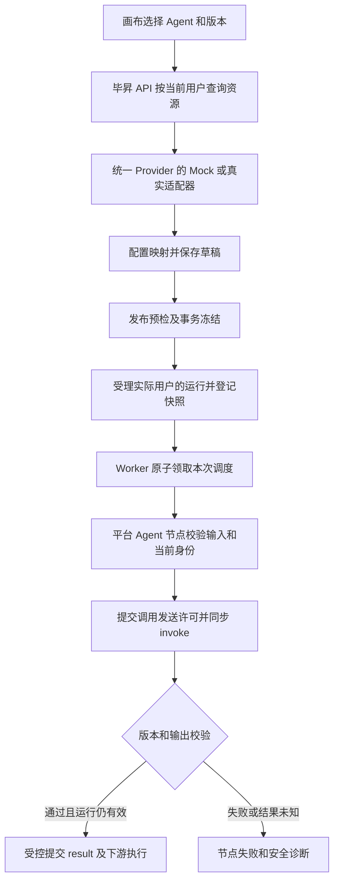

# Design 昆联平台 Agent 节点

- **Feature ID**: F119
- **Status**: CONFIRMED
- **Confirmed**: 2026-11-05，用户确认设计，要求按 Mock 优先继续编写 `tasks.md`
- **Mode**: MOCK_IMPLEMENTATION
- **Updated**: 2026-11-05（Asia/Shanghai）
- **关联规格** — [spec.md](./spec.md)，9 项需求、25 条 AC 已由用户确认。
- **阶段** — 设计目标保持已确认状态。T001—T038 本地实施完成；T039、T040 的脚本、示例和记录已落地，正常 API／Worker 验收待执行。真实适配及真实环境仍为后续计划。

## 1. 目标与边界

在毕昇 Workflow 中增加独立的 `platform_agent` 节点，跑通选择 Agent、固定版本发布、按实际用户同步调用及下游消费结果。开发先使用后端 Mock，真实协议确认后替换适配器。

本期覆盖目录、节点参数、发布与执行校验、同步结果、错误及重复调用保护。异步 Agent、人工交互恢复、远端取消、Workflow 工具登记和反向运行，以及其他平台资源节点按后续批次推进，详见 spec 第 0.3 节。

## 2. 关键约束

遵循[架构约束](../../../docs/constitution.md) C1—C8 和[版本契约](../release-contract.md)。领域归属沿用 Workflow、F118 和 F048，新增内容通过各领域的应用接口协作。

- `Mock` 和 `real` 使用相同的规范化业务契约，模式由后端受控设置确定，普通请求及节点参数不能切换模式。
- 目录和发布按当前操作者判权，正式运行按发起人判权。工作流创建人只作为原有配置作者保留。
- 版本号按不透明字符串处理。发布内容、运行快照和实际调用版本必须可核对。
- 首期执行请求不自动重试。Worker 重复投递仍须经过持久准入，不能依赖进程内锁或节点事件 UUID 去重。
- 真实 Access Token 复用与委托方式属于 EXT-02，正式超时和幂等属于 EXT-03。未确认的真实适配入口返回明确的未就绪错误，Mock 开发可先完成。
- 数字上限、Schema 子集和 Mock 样例为本地设计选择，不能写成昆联已承诺的能力。

### 2.1 运行设置

在既有 `WorkflowConf` 下增加 `platform_agent` 设置，通过现有数据库配置读取机制加载。安装模板如需展示新增项，按后端规则保持注释状态，避免旧镜像读取未知配置。

| 设置 | 设计值或约束 |
| --- | --- |
| `mode` | `disabled`、`mock`、`real`，按用户 2026-11-05 的要求默认 `mock`，无配置即可展示节点。显式 disabled／real 仍生效；设置读取异常仍关闭。 |
| `connection_id`、`policy_revision` | 服务端登记的连接及策略修订。API 和 Worker 必须一致。 |
| `mock_subjects` | 可选的本地用户／租户到样例 A／B／C 的 Mock 映射。空映射时使用通用 B 样例，仅开放 echo 和故障样例；非空时严格按映射，未匹配用户拒绝。所有路径均先做本地资格校验，不替换真实用户身份。 |
| `invoke_timeout_seconds` | Mock 开发默认 5 秒。真实模式要求按正式契约显式登记。 |
| `max_payload_bytes` | 本地请求和响应各默认 1 MiB，超过时明确失败。真实值在 EXT-03 确认后校准。 |
| `base_url`、凭据引用及真实契约修订 | 仅服务侧读取。真实模式必须完成正式协议映射和目标校验后可用。 |

沿用 `/api/v1/env` 的 `workflow` 能力摘要公开 `platform_agent_mode` 和节点是否可用，供界面展示“模拟数据”及禁用状态。摘要不包含地址、凭据或用户映射。每次创建执行及 Worker 领取时读取共享设置并比较修订，禁止仅在 FastAPI 启动时装配。

## 3. 方案对比与选定

### D1 独立节点，复用现有引擎

备选方案包括扩展本地 `agent` 的推理循环，以及新增 `platform_agent` 调用昆联运行时。选定后者，配置、变量、节点事件及调度复用现有引擎。

现有本地 Agent 包含模型、工具和推理循环，职责与昆联托管 Agent 不同。节点注册目前集中在 [node_manage.py](../../../src/backend/bisheng/workflow/nodes/node_manage.py)，适合增加单独类型。后续只有在双方明确统一 Agent 执行契约时再考虑合并类型。

### D2 后端 Mock 与真实适配器共用应用入口

备选方案包括前端写静态选项和成功结果，以及后端通过同一接口提供两类适配。选定后端适配，前端始终访问毕昇 API，Worker 始终调用同一执行服务。

这样可验证真实的保存、发布、身份传递、变量和错误路径。前端模板仍按现有方式登记，目录及执行结果来自后端。正式 OpenAPI 到位后替换适配器和协议映射，不替换画布及执行逻辑。

### D3 在现有图中保存配置与发布绑定

备选方案包括另建 Agent 配置主表，以及使用现有 `FlowVersion.data`／`Flow.data` 保存节点与发布绑定。选定现有图，新增服务端维护的发布清单，并由一个事务完成 F119 发布切换。

当前 [FlowVersionDao](../../../src/backend/bisheng/database/models/flow_version.py) 通过多次提交更新当前版本和 `Flow.data`。F119 需要避免预检图与提交图不一致，也需要防止离线编辑当前版本时覆盖最后一次发布图。冻结范围是本次发布的运行图，既有 `FlowVersion` 的全局版本模型由原 Owner 保持。

需要独立长期历史版本调用时，在后续 Workflow 对外版本能力中重新评估。

### D4 凭据通过 F118 内部限用途授权提供

备选方案包括在节点或队列保存 Token，以及由 F118 在实际调用时校验当前会话并向受控适配器提供短期授权材料。选定后者。

[workflow_causal_scope](../../../src/backend/bisheng/sso_sync/application/workflow_context.py) 只有追踪语义，现有会话应用也没有 Worker 业务准入及对外凭据出口。F119 新增明确的内部应用协议，复用 F118 当前资格检查逻辑，保持浏览器准入和延迟调用分别验证。EXT-02 确认其他已有委托方式后，仅替换这一授权适配。

### D5 一张 Workflow 执行附属表保存准入与调用事实

备选方案包括只用 Redis 锁去重，以及使用 Workflow 所属的 SQL 执行记录。选定一张 `workflow_platform_agent_execution` 附属表，保存冻结图、领取状态和有限的调用元数据。

现有 Redis 状态可被消费清理，节点事件 UUID 每次运行重新生成，均不能可靠辨认旧任务重投。SQL 记录先提交发送许可，再进行网络调用，重复任务看到既有领取事实即停止，原任务保持唯一写入者。

该表服务于 F119 执行保护，仍由 Workflow 负责。它不提供新的任务管理产品或通用恢复框架。未来需要自动恢复、跨请求续取外部结果时再拆独立调用明细或恢复机制。

### D6 使用已有 Schema 库，限制一期可识别范围

备选方案包括对全部 Schema 关键字作泛化支持，以及明确校验子集。选定后者，使用仓库已声明的 `jsonschema==4.25.1`，兼容范围见第 4.3 节。

现有变量池接受结构化值，但缺失变量和合法空值都可能返回 `None`。新节点采用独立的存在性解析，不改变旧节点的变量读取行为。正式参数契约超出该子集时，再扩展并补契约验证。

## 4. 系统现状与接入方案

### 4.1 已核对的现状

| 环节 | 当前代码事实 | 本次接入点 |
| --- | --- | --- |
| 前端节点模板 | `getWorkflowNodeTemplate()` 返回前端 `workflowTemplate`，侧栏据此显示节点。 | 增加模板和后端能力摘要判定。资源列表另外请求后端。 |
| 节点参数 | `FlowNode/Parameter.tsx` 按参数类型分派组件。 | 增加资源选择与结构化映射组件。 |
| 变量 | `GraphState` 按节点和变量名保存值，已有 `#` 一级成员／索引读取。 | 输出统一放在 `result`，对象和数组可整体传递。 |
| 发布与版本编辑 | `WorkFlowService.update_flow_status` 和 `FlowService` 分别处理发布、版本保存与切换。在线当前版本已有编辑限制。 | F119 增加共享事务和内容校验，保留在线编辑限制。 |
| 节点试运行 | `WorkFlowService.run_once` 在线程内直接调用节点 `_run`，没有经过 `BaseNode.run`。 | 新节点试运行改走完整生命周期及实际操作者上下文。 |
| 正式运行 | 开放运行服务及 `WorkflowClient` 保存图并投递 Worker，Worker 传递运行人、租户及作者。 | 在两类入口增加统一 F119 受理和持久执行引用。 |
| 输出提交 | `BaseNode.run` 在 `_run` 返回后写入变量，再发送节点结束事件。 | 增加默认空实现的输出提交上下文，新节点在该上下文中核验终态。 |
| 停止与状态 | Redis 保存停止标记，运行状态可被清理。 | 对 F119 同步记录 SQL 停止事实，并限制迟到结果写入。 |
| 身份 | F118 校验会话、目录、用户、租户并在线内省，Token 密文保存在 F118。 | 通过 F118 内部限用途应用协议复用。 |

### 4.2 主流程



资源查询、发布预检和执行使用同一规范化契约，身份分别取编辑者、发布者及运行者。每次实际访问重新判定资格，不缓存允许结果。

### 4.3 节点配置与 Schema

`NodeType` 增加 `platform_agent`，配置继续使用 `BaseNodeData.group_params`，内部参数键如下。

| 参数键 | 形态 | 含义 |
| --- | --- | --- |
| `agent_ref` | `agent_id`、`version_id` | 用户选定的资源与具体版本，不透明字符串。 |
| `input_bindings` | 参数名到绑定的映射 | `source=constant` 使用显式 `value`，`source=variable` 使用已有变量引用。 |
| `result` | 只读输出说明 | 对应版本的输出 Schema，运行时真正的变量为 `node_id.result`。 |

节点构造和 `init_data` 只解析配置，不能查远端、取得调用凭据或发送 invoke。发布时现有代码会构造完整 Workflow 校验图，所有外部预检由应用服务显式执行，执行调用仅在节点实际运行时发生。

字段级输入以对象根 Schema 为一期配置形态，嵌套对象和数组作为完整值输入。输出 `result` 支持全部约定 JSON 类型，已有变量选择器可暴露 `node_id.result#字段` 或 `#索引`，更深层结构以完整对象或数组传递。字段名与现有变量语法冲突时只提供整体引用，不能错误拆解。

Schema 先按 JSON Schema 2020-12 的明确子集规范化，支持 `type`、`properties`、`required`、`items`、`enum`、`additionalProperties`、基本数值／长度限制，以及 `title`、`description`。允许通过类型列表表达 `null`。远程 `$ref`、组合 Schema、递归定义和未识别的校验关键字返回不支持，禁止静默忽略。默认值不自动填充，未提供的可选字段省略，额外字段按 Schema 判断。正式方言和根结构在 EXT-01 确认后校准。

常量保存 JSON 类型。变量解析返回 `MISSING` 或真实值，区分缺失、`null`、`false`、`0` 和空字符串。输入和输出均完整校验后再继续，采用标准 JSON 编解码并拒绝非有限数值。配置中没有 Token、认证头、任意 URL 或可执行表达式。

草稿允许保留未配置项，完整性错误由后端校验结果和前端提示共同展示。版本切换后重新校验输入及下游 `result` 引用，前端失效目录缓存的键包含本地用户、租户、模式、连接修订和 Agent，避免跨身份复用。

### 4.4 发布绑定与并发编辑

服务端在图根维护 `_platform_agent_publication`，包含 `binding_version`、`provider_mode`、`connection_id`、`policy_revision`、候选图摘要，以及按节点保存的固定版本、输入输出 Schema 和 Schema 摘要。它属于服务器生成的发布材料，写请求中的同名数据不能获得信任。

发布按以下顺序执行。

1. 读取候选图并计算稳定摘要，复核当前发布者的 Workflow `publish` 权限。远端预检由当前发布者身份完成。
2. 校验每个 Agent 的版本、使用权限、状态和 Schema。详情足够判权时直接使用，其他情况调用同一 Provider 的 `check_use`。
3. 全部通过后进入 Repository 事务，按 `Flow → FlowVersion` 顺序加行锁，核对租户、版本归属、删除／上线状态及候选摘要。配置修订变化则拒绝。
4. 同一事务写入发布绑定和运行图，更新当前版本指针及 `Flow.status`。任何一步失败均回滚，远端调用不放在 SQL 锁内。

F119 的版本保存、切换、删除和发布使用相同锁顺序。判定范围覆盖当前发布图、提交图或已有绑定中任一含平台 Agent 的情形，移除最后一个平台节点也不能绕开保护。

移除最后一个平台节点后，仍经该事务发布，成功时不再写平台发布绑定。此前已受理的 SQL 快照保留，新的普通流程回到原运行路径。

离线编辑 F119 当前版本时，保存 `FlowVersion.data` 草稿但不经旧 DAO 自动覆盖最后发布的 `Flow.data`，发布绑定重新预检后才生效。前端编辑按版本详情加载草稿，运行读取最后发布图。在线当前版本继续遵守现有禁止编辑规则。元信息更新按既有资格执行，不重写冻结引用。

运行受理先核验服务器保存的发布材料，再应用允许的普通运行输入。开放入口的 `override` 不能覆盖平台 Agent 的资源、版本、映射、Schema 或发布材料。试运行和调试的图可由用户编辑，但必须重新查询受控 Provider 并生成临时绑定。

2026-11-05 审查修正：调试受理复用图校验生成临时绑定；单节点试运行只允许其显式提供的输入变量替代完整图中的上游引用，常量、必需字段和固定 Schema 仍校验。前端保留旧映射并允许作者明确移除，合法常量随编辑保存。Worker 在核对实际主体、租户、会话和派发类型后先领取唯一派发，再复核当前资格；拒绝、构造及恢复失败均结束其所属执行并公开安全领域原因。回调在读取内存对象之前绑定该执行命名空间，过期 owner 不能改写新执行。上述为既有任务的实现补齐，不改变权限规则、数据结构或真实端口。

### 4.5 运行快照与重复投递

拟新增 `workflow_platform_agent_execution`，仅在包含平台 Agent 的调用中创建。`execution_id` 是内部受理标识，每次独立运行重新生成，对外沿用既有 Workflow `session_id`。

| 字段组 | 保存内容 |
| --- | --- |
| 主键及归属 | `execution_id`、`tenant_id`、`workflow_id`、既有 `session_id`、实际 `user_id`、入口类型。 |
| 固定运行内容 | 接收时的 `graph_snapshot`、摘要、发布绑定、模式、连接及策略修订。 |
| 身份引用 | F118 的会话哈希、绑定 ID 和预期本地身份，或明确标记的 Mock 样例身份。保存可复核引用，不保存 Token。 |
| 调度事实 | 各次 `dispatch_id` 的受理／领取／结束状态及持有者标识。首次启动和既有输入恢复分别领取。 |
| 调用事实 | 按节点 ID 和本次节点执行序号记录版本、请求摘要、发送状态、Agent Run、失败种类及远端结果是否未知。 |
| 生命周期 | 运行状态、停止标志、调用截止时间及创建／更新时间。 |

图及有限控制记录采用 `JsonType`，其他字段使用明确列和有界索引。Repository 加载并重新赋值 JSON，不使用数据库特有 JSON SQL。新模型参加自动发现和租户过滤登记，双数据库验证覆盖唯一性与行锁。该表不复制业务输出、Token 或外部原始报文。

入口完成本地授权后，锁定 Flow 并核对同一受保护 Session 当前是否已有活动执行。活动执行复用已有记录，新的显式运行创建新的 `execution_id`。SQL 登记提交后才投递队列，投递失败记录为未调度，不能标记已执行。队列只传内部执行／调度引用和既有必要上下文。

Worker 在更新 Redis 状态或构造引擎之前，原子领取 `dispatch_id`。已经领取或结束的重复消息直接结束，不执行图、不改写原任务状态。首次领取后从 SQL 取得冻结图和可信身份，Redis 图不存在也不能通过重新读取当前 Flow 来替代。执行记录缺失一律拒绝，不由 Worker 重建。

运行记录使用 `READY → RUNNING → WAITING／SUCCEEDED／FAILED／ABORTED／UNKNOWN`。只有现有输入节点的合法恢复可使 `WAITING` 回到 `RUNNING`，终态不回退。每次启动或恢复的 `dispatch_id` 由服务端生成并登记，再分别从 `ACCEPTED` 领取为 `CLAIMED`。领取人持有内部 owner 标识，完成与异常提交均比较当前 owner，旧消息不能修改新一次调度。恢复请求及重复输入沿用原有消息权限和校验，不提供新的恢复接口。

已有输入节点恢复使用同一 `execution_id` 和 SQL 冻结图，恢复前向原内存 Workflow 显式传入新调度上下文。节点固定运行引用，调用时取得当前调度的 owner，不能在构造节点时固化第一次调度的持有者。所有事件和状态更新携带所属执行引用，旧任务不得写入同一 Session 后来新开的执行。

Mock 实现将派发区分为 START、RESUME。Redis 通过 Session 指针定位当前内部执行，其数据、输入、停止、状态和事件使用含 execution_id 的独立命名空间。晚到的旧回调即使遇到 Session 重用，也只关联原命名空间；事件内部携带执行引用，返回前移除。更新指针前在短事务核对 READY，停止事实先写 SQL；无执行引用的旧消息不能运行新的平台图。这里没有增加对外 Session 接口。

运行中的节点使用 `node_id + execution_ordinal` 识别逻辑调用，序号来自该次图执行，区别于 `exec_unique_id` 事件 UUID。同一节点在合法循环中的下一次执行使用新序号，独立运行使用新执行 ID。

调用发送前在短事务内记录 `DISPATCHING` 和请求摘要，提交后才能发送。调用一次后转换为 `SUCCEEDED`、`FAILED`、`UNKNOWN` 或 `ABANDONED`。首期不重发 POST，即使远端后来提供幂等能力，也须先核对正式重放规则后启用。重复调用看到已发送事实时不能再次发送。

Worker 崩溃后不自动重建图或领取旧发送许可。已有记录保留供诊断，恢复执行能力属于后续批次。控制记录本期不做自动删除，后续清理须保留“缺失记录拒绝旧任务”的规则。图大小和控制元数据受节点步数及载荷上限约束。

### 4.6 调用身份

当前 Mock 路径通过用户领域既有 `read_current_person_facts` 查询当前账号状态、租户和 token_version，再调用 F048。准入仅保存这些可复核值及配置摘要。开放入口要求已认证快照中的 user 主体与 effective_user_id 匹配，不能用服务账号所有者替代运行人。F118 的真实凭据端口仍在 T042—T045，未实现或宣称真实通过。

本地 token_version 与受理快照不一致时复用现有 `19103 / TokenVersionMismatchError`，明确提示重新登录。授权拒绝仍按权限错误处理；不新增错误码或真实凭据适配。

Workflow 应用创建只由服务侧构造的 `VerifiedAgentActor`，包含本地运行人、资源租户、入口、模式和可复核身份引用。

| 场景 | 主体与处理 |
| --- | --- |
| 目录、版本与发布预检 | 使用当前编辑者或发布者，通过现有 Workflow 编辑／发布授权后访问对应外部资源。 |
| 节点试运行及流程调试 | 使用当前操作者，补齐从资源事实取得的租户。 |
| 正式运行 | 使用受理时的实际发起人，Worker 再复核当前 Workflow 使用资格。 |
| 已有人工输入节点恢复 | 沿用该运行的实际发起人。恢复者与其不一致或原授权不能继续核验时，平台 Agent 调用拒绝。 |
| 无可信实际用户的开放／匿名入口 | 在进入平台 Agent 调用前拒绝。原节点继续各自的既有身份合同。 |
| Mock | 先做真实本地用户及 Workflow 授权检查，再用受控样例映射模拟外部身份及数据范围。 |

F118 新增内部 `AgentAuthorizationPort`，接受可信执行引用、目标用途及预期用户／租户。在其 Owner 内通过现有仓储读取会话、目录、映射和 Token，复核当前用户、租户、会话期限、撤销状态和在线内省结果。浏览器 `HTTP`／`WEBSOCKET` 准入协议保持原定义，不把追踪字段当作 Worker 凭据。

需要扩展的会话哈希查询封装在 F118 Repository 内，只供已持久登记且匹配预期主体的内部调用。Workflow 不直接查询 F118 表，不凭一个客户端提交的哈希获得授权。

EXT-02 若确认 Access Token 可用于目标接口，授权端口向受控 HTTP 适配器提供仅本次使用的秘密材料，仍由昆联校验真实用户的 Agent 及数据权限。Token 过期、受众不符或映射失效时拒绝，提示同一用户重新授权。接口未确认时真实授权适配保留 TODO 并返回未就绪，不能导出浏览器 Token 给前端或放入队列。

### 4.7 同步调用、停止与输出提交

`PlatformAgentNode` 只负责映射和执行编排，调用统一应用服务。调用前完成当前资格、输入、绑定版本和环境校验，再记录发送许可。

每次实际调用前通过 Provider 读取当前固定版本状态和 Schema，比较规范化 Schema 摘要与绑定材料。版本不可用、同版本结构漂移或不能取得必要证明时，调用前拒绝。运行成功响应再复核实际执行版本，不能只检查请求中的版本号。

HTTP 适配器使用已有 `httpx`，TLS 校验开启、目标固定为服务侧登记地址、禁用重定向和自动 POST 重试。限定总等待时长及读取字节数，连接／读取超时受同一剩余预算约束。输入校验、身份验证和读取版本的预算也须计入节点总预算，避免只约束单次读取。同步节点通过仓库已有异步桥接执行受总截止时间约束的请求，HTTP 客户端在对应调用的异步上下文内创建和关闭，避免跨线程事件循环复用客户端。

成功响应先转换为规范化结果，再校验执行版本证明及输出 Schema。`PlatformAgentNode` 返回 `{"result": output}`，元数据由安全运行日志承载。

发送许可的请求摘要包含模式、连接修订、主体、租户、固定版本及完整规范化输入。同一逻辑调用携带不同摘要时拒绝。成功结果先留在本次内存调用中，只有下面的输出提交作用域完成后，调用记录才能成为 `SUCCEEDED`。

为覆盖 `_run` 返回后到写变量前的窗口，`BaseNode.run` 增加默认空实现的 `output_commit_scope`，包住实际变量写入。新节点在该作用域内锁执行记录，复核调度持有者、当前模式修订、停止／终态和截止时间，再提交调用成功。变量写入或 SQL 提交失败须恢复本次变量改动并抛错，下游仅在成功提交后执行。旧节点的默认作用域保持原行为。

F119 的停止先持久写入停止事实，再设置原有 Redis 停止标记。既有调度等待超时、读流超时及显式停止，只要会将本地执行结束，也要经同一执行服务记录终态。节点最终提交与停止事务按行锁排序，已结束运行的迟到结果转为放弃，不能再写成功输出。远端取消本期未接入，界面明确表示远端结果未知。

NodeStart／NodeEnd 继续使用现有事件，安全日志包含模式、Session、内部执行 ID、节点执行、版本、已有 Agent Run、耗时及失败种类。`parse_log` 只返回允许字段，禁止把异常 `str()` 或原始 HTTP 报文直接作为公开原因。

| 情形 | 本地处理 | 远端事实 |
| --- | --- | --- |
| 输入、身份或版本校验拒绝 | 调用前失败。 | 未发送 invoke。 |
| 可信的鉴权／授权拒绝或已确认的执行失败 | 节点失败。 | 按正式契约记录已知拒绝或失败。 |
| 成功终态但版本／输出不匹配 | 节点失败，不提交业务输出。 | 保留已知远端终态，不能推断业务操作已回滚。 |
| 写出请求后断连、超时、无法解释的服务错误 | 调用及运行记录为结果未知，Workflow 按现有失败状态反馈。 | 保留已有 Agent Run，不断言未执行。 |
| 异步受理、运行中、等待输入 | 返回一期不支持，保留未知结果及关联信息。 | 远端可能继续运行。 |
| 本地已经停止 | 放弃迟到输出。 | 未取得远端终态时仍为未知。 |

调用记录分别保存本地结果和已知远端状态，不能从本地 `FAILED` 推导远端失败。限流或服务错误只有在正式合同明确未受理执行时才能记为已知拒绝。

### 4.8 Mock 数据及 TODO

Mock Provider 使用随版本发布的只读样例数据，通过正常应用接口返回。目录按样例用户／租户过滤，至少包含成功 Agent 的 V1／V2、拒绝版本、不可用版本及超时／非法输出／非终态场景。不同版本故障样例由服务侧定义，不通过普通业务参数切换鉴权模式。

API 和 Worker 读取相同的 Mock 修订，调用去重和运行状态使用同一 SQL 控制记录。代码内字典仅保存不可变样例，不保存可变调用事实。

| TODO | 位置与说明 | 替换完成条件 |
| --- | --- | --- |
| EXT-01 | Mock 资源、版本、Schema 及权限判定来源。 | 正式目录和版本契约通过同一套契约验证。 |
| EXT-02 | Mock 外部身份映射、真实授权占位适配。 | 明确 Token 复用或现有委托规则，完成实际用户审计。 |
| EXT-03 | Mock invoke、故障样例、超时和幂等假设。 | 正式同步契约和失败样例通过，安全重放仍按实际支持范围启用。 |
| EXT-04 | 固定样例 ID、测试身份及本地联调资料。 | 换成专属测试环境并留存真实验证证据。 |
| EXT-05 | 首批样例只覆盖单向同步调用的假设。 | 选定 Agent 确实涉及嵌套时，先确认防环契约。 |

Python 注释示例为 `# TODO [F119][EXT-03] 当前 invoke 为 Mock，正式同步契约确认后替换并补真实失败路径验证。` TypeScript 使用合法的 `// TODO`。每个临时来源和协议假设在对应实现位置留标记，TODO 表与实际位置在 tasks 和后续验证中核对。

### 4.9 文件结构计划

下表均为拟修改或新增的文件，实际任务在设计确认后拆分。

| 文件或目录 | 类型 | 职责及边界 |
| --- | --- | --- |
| `src/backend/bisheng/workflow/application/platform_agent.py` | 新增 | 向现有入口导出资源、校验、发布与执行应用接口，不直接写 ORM。 |
| `src/backend/bisheng/workflow/api/{router.py,endpoints/platform_agent.py}` | 新增 | 提供前端资源查询及验证路由，主体由现有认证依赖取得。 |
| `src/backend/bisheng/api/router.py` | 修改 | 登记 Workflow 新子路由。 |
| `src/backend/bisheng/workflow/domain/schemas/platform_agent.py` | 新增 | 规范化资源、绑定、输入、结果及公开诊断类型。 |
| `src/backend/bisheng/workflow/domain/services/platform_agent_service.py` | 新增 | 校验、发布预检、调用、去重及停止编排，不接管身份 Owner。 |
| `src/backend/bisheng/workflow/domain/clients/platform_agent.py`、`platform_agent_mock.py` | 新增 | Provider 契约、真实占位适配及 Mock，TODO 均落到实际边界。 |
| `src/backend/bisheng/workflow/domain/models/platform_agent_execution.py` | 新增 | 一张 Workflow 执行附属表。 |
| `src/backend/bisheng/workflow/domain/repositories/platform_agent.py` | 新增 | 现有图的事务发布、新执行记录和短事务领取，全部新增 SQL 归此。 |
| `src/backend/bisheng/workflow/nodes/platform_agent/platform_agent.py`、`__init__.py` | 新增 | 新节点输入、同步执行、受控输出及日志。 |
| `src/backend/bisheng/workflow/{common/node.py,nodes/node_manage.py}` | 修改 | 注册 `platform_agent`，旧 Agent 类型保留。 |
| `src/backend/bisheng/workflow/{nodes/base.py,graph/graph_engine.py,graph/workflow.py}` | 修改 | 默认空提交作用域与只在 F119 使用的执行上下文传递。 |
| `src/backend/bisheng/api/services/{workflow.py,flow.py}` | 修改 | 节点试运行、发布和版本操作进入统一 F119 应用入口。 |
| `src/backend/bisheng/workflow/domain/services/published_workflow_service.py`、`src/backend/bisheng/common/chat/clients/workflow_client.py` | 修改 | 开放和浏览器运行受理，冻结图并投递引用。 |
| `src/backend/bisheng/common/chat/manager.py`、`src/backend/bisheng/{api/v1/workflow.py,public_endpoints/api/endpoints/workflow.py}` | 修改 | 由路由向既有连接构造参数注入 BrowserPlatformAgentRuntime；common 只调用端口，不直接导入 F119 领域。普通流程不装配 Provider。 |
| `src/backend/bisheng/main.py` | 修改 | 仅让新增 PlatformAgentError 在既有入口保留设计的 HTTP 状态；旧错误语义保持。 |
| `src/backend/bisheng/worker/workflow/{tasks.py,redis_callback.py}` | 修改 | 调度领取、快照读取及终态写入，重复任务不覆盖原任务。 |
| `src/backend/bisheng/sso_sync/application/agent_authorization.py` | 新增 | F118 限用途内部授权出口。 |
| `src/backend/bisheng/sso_sync/{domain/services/kunlian_session.py,domain/repositories/kunlian.py,application/runtime.py}` | 修改 | 在 Owner 内复用验证并增加内部装配，原浏览器合同不变。 |
| `src/backend/bisheng/{core/config/settings.py,api/v1/endpoints.py}` | 修改 | 子设置与无秘密的能力摘要。 |
| `src/backend/bisheng/core/database/tenant_filter.py` | 修改 | 登记新模型的自动租户过滤。 |
| `src/backend/bisheng/common/errcode/flow.py` | 修改 | 错误类型与公开诊断，数字码按第 6.4 节登记。 |
| `src/frontend/platform/src/controllers/API/workflow.ts` | 修改 | 模板和节点相关 API，沿用现有请求封装。 |
| `src/frontend/platform/src/types/flow/index.ts`、`src/frontend/platform/src/util/flowUtils.ts` | 修改 | 类型、`result` 引用和版本变更后的映射校验。 |
| `src/frontend/platform/src/pages/BuildPage/flow/FlowNode/component/PlatformAgentItem.tsx` | 新增 | 选择 Agent／版本及结构化映射，沿用现有参数注册方式。 |
| `src/frontend/platform/src/pages/BuildPage/flow/FlowNode/{Parameter,RunTest,RunLog,NodeLogo}.tsx`、`src/frontend/platform/src/pages/BuildPage/flow/Sidebar.tsx` | 修改 | 参数挂载、试运行、日志、图标及能力摘要展示。 |
| `src/frontend/platform/public/locales/{en-US,zh-Hans,ja}/flow.json` | 修改 | 节点、Mock 标记及错误提示的三语文案。 |
| `src/frontend/packages/locales/src/api_errors/` | 修改 | 新业务错误三语源，生成产物按现有命令更新。 |
| `src/backend/test/workflow/`、Platform 对应组件测试 | 新增 | 按第 7 节组织独立风险验证。 |

设计确认后，在版本契约中登记本次 Workflow 附属记录、依赖和实际分配的码位。新表按现有模型发现机制创建，已有表不增加列。本文未执行建表、数据处理或部署操作。

## 5. 已知坑与处理位置

| 现状事实 | 忽略后的影响 | 处理位置 |
| --- | --- | --- |
| 前端模板目前是本地数组，不由后端节点工厂提供。 | 只注册 Python 节点，画布仍无法选择。 | `controllers/API/workflow.ts`、Sidebar 及后端能力摘要。 |
| `run_once` 直接调用 `_run`。 | 绕过新节点输出提交和节点事件边界。 | `WorkFlowService.run_once` 的平台节点分支。 |
| 当前版本保存会同步 `Flow.data`，发布又分多次提交。 | 草稿覆盖运行图，或发布指针和图不一致。 | F119 发布 Repository、`FlowService` 各版本操作。 |
| `override_nodes_params` 可以按键覆盖节点参数。 | 调用方可能替换 Agent 版本或绑定。 | 受理前拒绝覆盖平台节点和服务端绑定。 |
| 节点执行 UUID 每次重新生成，Session 也可被多轮复用。 | 重投无法去重，或合法新执行被误去重。 | `execution_id`、`dispatch_id` 和节点序号。 |
| F118 因果信息明确没有认证能力。 | 把追踪字段当作允许决定，延迟任务绕过过期或停用。 | F118 内部限用途授权端口。 |
| 现有正式入口会过滤部分节点事件。 | 不能把新增公开节点事件 API 误计为本期交付。 | 原有 UI 日志承载安全元信息，公开事件能力按后续批次。 |
| `_global_workflow` 只存在于 Worker 内存。 | Worker 崩溃后不能凭 SQL 图快照声称已恢复完整流程。 | 本期阻断旧任务重跑，保留结果未知。 |
| 缺变量与 `None` 在旧读取路径中可能相同。 | 将合法空值误判为缺失，或缺失输入蒙混过关。 | 平台节点独立存在性解析。 |
| `_run` 返回后才由 BaseNode 写变量。 | 停止与返回交错时写入迟到成功结果。 | 输出提交作用域及 SQL 终态核验。 |
| Session 可以重用，而旧 Worker／停止消息仍可能晚到。 | 若复用同一 Redis 状态和事件键，旧回调可能影响新运行。 | execution_id 命名空间、派发种类核验及 SQL 领取；本地测试通过，多实例仍待 T048。 |
| 调试图也可能在受理后发生同版本 Schema 漂移。 | 不生成临时绑定时无法阻止执行含义变化。 | DEBUG 受理复用 validate_graph，单节点试运行显式登记输入变量。 |
| 资格复核、构造或恢复在节点运行前就可能失败。 | 只改 Redis 会让 SQL 一直占用会话；原始异常还可能泄漏内部内容。 | 唯一派发先领取，失败按 owner 结束执行；应用入口统一公开错误，回调先绑定执行。 |
| F119 新增职责不能按历史守卫报告数量判定合规。 | 在已有违规兼容层继续新增领域依赖。 | 路由注入 BrowserPlatformAgentRuntime，应用入口负责受理、恢复和中止。 |
| Python 导入 Worker 子模块会先执行 worker/__init__.py 的全部任务注册。 | 平台节点顶层依赖 Worker 桥接工具，首次导入 API 时形成循环依赖；pytest 预加载会掩盖此问题。 | 节点改用已有 utils.async_utils.run_async_safe；timeout=None 由领域总预算控制，API 复用请求循环、Celery 复用已登记循环。独立进程验证真实导入顺序。 |
| /user/info 的 tenant_id 可为空，叶租户通过 leaf_tenant_id 提供；单租户用户可能无租户字段。 | 组件直接要求 tenant_id 时完全不发能力及目录请求，看起来没有 Mock 数据。 | 能力查询只依赖登录用户及流程；缓存采用 tenant_id／leaf_tenant_id。服务器明确 multi_tenant_enabled=false 时使用单租户缓存作用域，不向后端传造身份；多租户信息缺失时提示刷新／重登并阻断。 |

## 6. 对外契约与依赖

### 6.1 毕昇提供的接口

以下为本地新增接口，成功响应沿用 `resp_200`，错误沿用项目错误格式。所有路由先按当前用户验证对应工作流编辑资格和租户，再处理资源，路径不含 `config`。

| 接口 | 请求与响应要点 | 消费方 |
| --- | --- | --- |
| `GET /api/v1/workflow/platform-agents` | `workflow_id`、可选游标。返回已过滤的 Agent、可选版本或版本发现信息、下一游标和 `provider_mode`。 | 画布资源选择。 |
| `GET /api/v1/workflow/platform-agents/{agent_id}/versions/{version_id}` | `workflow_id`。返回固定版本、可用状态、输入输出 Schema、可用权限判定和模式。 | 节点配置。 |
| `POST /api/v1/workflow/platform-agents/validate` | `workflow_id`、候选图及目标节点。返回按节点／字段定位的配置问题，受保护资源访问失败走正常错误响应。无副作用。 | 配置与试运行前校验。 |
| 现有草稿、版本和发布接口 | F119 图接入统一校验和事务，不改变旧请求成功信封。 | 画布保存与发布。 |
| 现有 `/workflow/run_once`、WS、开放 invoke | 新节点走统一执行上下文，模式及诊断通过现有日志承载。对外仍使用 Workflow Session。 | 编辑器及原有运行调用方。 |

游标按当前用户、租户、模式和筛选作用域绑定，其他作用域的游标拒绝，不能透传为任意查询条件。版本发现如需补调用，由 Provider 内部适配昆联现有接口，避免前端依赖未确认的外部路径。

### 6.2 内部 Python 契约

| 接口 | 规范化语义 | 边界 |
| --- | --- | --- |
| `list_agents(actor, cursor)` | 当前主体可用资源及版本发现信息。 | 由 Provider 判定外部可用范围。 |
| `get_version(actor, ref)`、`check_use(actor, ref)` | 固定版本 Schema、状态及当前使用资格。 | 可以复用一个上游详情调用，不能缓存允许结果。 |
| `invoke(actor, ref, inputs, call_context)` | 明确的成功／失败／非终态结果，包含可核对版本和已有运行标识。 | Mock 与真实使用相同类型，外部字段在适配器翻译。 |
| `prepare_execution`、`claim_dispatch` | 保存受理快照、持久原子领取。 | 只接受服务端已认证主体。 |
| `BrowserPlatformAgentRuntime.prepare／resume／abort` | 浏览器受理、恢复和失败中止；由路由注入现有连接参数。 | common 只持有端口，业务编排和 Repository 留在 Workflow；普通图不构造 Provider。 |
| 前端 `getPlatformAgentCapabilities` | 保留现有 workflow 能力并携带服务器的 multi_tenant_enabled。 | 用户信息使用 tenant_id 或 leaf_tenant_id；仅服务器明确关闭多租户时，无租户字段用户才采用单租户缓存作用域。此字段不作为认证参数发回。 |
| `reserve_call`、`finish_call`、`request_stop` | 发送许可及受控状态转换。 | Repository 完成短事务和并发核验。 |
| `AgentAuthorizationPort` | 校验当前 F118 身份并提供仅用于受控目标的单次授权。 | 不向前端、节点参数或队列导出 Token。 |

`call_context` 关联既有 Session、内部执行、节点、序号和 Trace。规范化 `InvokeResult` 包含 `status`、`agent_id`、`version_id`、`output`、可空的 `agent_run_id` 和安全错误种类。它是毕昇内部契约，EXT-03 未确认前不能要求昆联直接采用同名字段。

### 6.3 依赖与风险

| 依赖 | 使用方式 | 会影响本设计的变化 |
| --- | --- | --- |
| 昆联目录、版本与 invoke | EXT-01、EXT-03，暂用 Mock。 | Schema、版本稳定性、错误和幂等语义变化，需调整适配和契约样例。 |
| 昆联身份协议及 F118 | EXT-02，复用原 Owner 并增加受限内部端口。 | Token 不允许用于 Agent 时，真实调用保持未就绪，补充已确认的委托适配。 |
| F048 和既有 Workflow Owner | 原有业务动作、资源资格和版本入口。 | 动作映射或事务入口变化，须同步受理与发布接线。 |
| MySQL／DM8 | 图事务、受理和发送许可。 | 数据库不可用即拒绝新发送，SQLite 不能证明双实例行锁。 |
| Redis／Celery | 原有变量、事件、停止和调度。 | 数据丢失不能推导为“未执行”，不得重建旧发送许可。 |
| `httpx`、`jsonschema` | 使用仓库已有依赖。 | 升级或替换时复核预算、读取限制及 Schema 行为。 |
| Platform 共享 UI 和三语资源 | 当前已落地组件与本地化流程。 | 不新增状态库或自造基础控件，不把内部对象名直接暴露为业务文案。 |

### 6.4 错误契约

公开错误区分配置无效、版本不可用、发布冲突、身份失效、权限拒绝、上游故障／限流、超时结果未知、输出不匹配、非终态不支持、重复执行及模式不匹配。HTTP 接口使用对应真实状态，节点执行通过现有失败事件反馈。

新增领域异常统一继承 `BaseErrorCode`，身份与权限问题沿用 Owner 的既有异常。新的数字码在实现前扫描 Workflow 模块 105 实际占用，并同步版本契约、架构编码登记和三语源。本文仅确定错误类别，不预占尚未登记的数字码。

## 7. 验证、发布与回退

### 7.1 需求与 AC 追溯

| Requirements | 设计落点 | Acceptance | Verification |
| --- | --- | --- | --- |
| REQ-01 | 第 4.3、4.8、6.1 节 | AC-01、AC-02、AC-03、AC-23 | V-01 |
| REQ-02 | 第 4.3、4.7 节 | AC-03、AC-04、AC-05、AC-13、AC-14 | V-01、V-04 |
| REQ-03 | 第 4.4、4.5 节 | AC-05、AC-06、AC-07、AC-08、AC-09 | V-02 |
| REQ-04 | 第 4.6、6.4 节 | AC-06、AC-10、AC-11、AC-12、AC-21、AC-25 | V-03、V-06 |
| REQ-05 | 第 4.3、4.7 节 | AC-08、AC-09、AC-13、AC-14、AC-15、AC-18、AC-23 | V-04、V-06 |
| REQ-06 | 第 4.5、4.7 节 | AC-09、AC-12、AC-14、AC-15、AC-16、AC-17、AC-18、AC-19、AC-23 | V-04 |
| REQ-07 | 第 4.7、6.4 节 | AC-19、AC-20、AC-21 | V-05 |
| REQ-08 | D1、第 4.9、7.3 节 | AC-22、AC-25 | V-06、V-07 |
| REQ-09 | D2、第 4.8 节 | AC-23、AC-24、AC-25 | V-01、V-04、V-06、V-07 |

### 7.2 最小充分验证

按 spec 的 V-01 至 V-07 组织验证，同一证据复用到相应 AC。实施时权限、发布并发、发送许可和停止竞争测试先行。

- V-01 使用 Platform 行为测试验证资源、空态、映射和草稿，不另造一套前端 Mock。
- V-02 使用真实 SQL 事务验证预检后并发修改、版本切换、失败回滚和已受理快照。MySQL／DM8 行锁与两实例结果单独登记。
- V-03 验证 HTTP／WS／试运行／Worker 的实际身份、过期和拒绝。F118 相关原有回归须重跑，真实昆联审计继续待执行。
- V-04 使用可控 Provider 或 HTTP 传输验证入参、输出、同步预算、重复领取、提交前崩溃及迟到结果。断言网络发送次数，不能只看节点状态。
- V-05 验证事件、安全诊断和输出访问。正常日志只保留允许字段，敏感探针不得出现在可见内容。
- V-06 从正常画布完成「开始 → 平台 Agent → 输出」，覆盖 A 发布／B 运行、V1 固定及一条拒绝。相关旧 Agent 与其他节点回归保持独立结果。
- V-07 验证模式／修订不一致时拒绝，真实失败不会返回 Mock。静态核对 `TODO [F119]` 与对应 EXT，替换接口后仍须补真实证据。

后端测试放在 `src/backend/test/workflow/` 的 F119 文件中，使用已有 Python 3.11 环境。新增文件落地后再执行其定向 pytest 命令，当前不列不存在文件的已执行命令。Platform 使用现有 Vitest、lint 和 typecheck，端到端按项目 e2e-test 流程组织。

手动 Mock 基础验证无需登记平台设置或主体映射，使用默认通用 B 样例，在平台构建页创建最小图，保存重开、发布、运行并选择故障样例核对失败。专项 A／B 权限、私有和空目录验收可显式设置 mock_subjects。节点和日志须显示模拟来源。当前运行的旧 API／Worker 进程须重启以加载新默认值。真实验收将模式切为已就绪的 `real`，重新选择真实 Agent、验证发布绑定，并由双方核对已有运行标识。

实施后的本地入口可沿用项目已有启动命令，后端在 `src/backend/` 执行下列命令。

```bash
uv run uvicorn bisheng.main:app --host 0.0.0.0 --port 7860 --workers 1 --no-access-log
```

Platform 在 `src/frontend/platform/` 执行 `pnpm start -- --host 0.0.0.0`，通过 `http://localhost:3001` 进入构建页。完整流程还需要项目已有 Workflow Worker 和中间件。A／B 使用本地已存在且已配置菜单及 Workflow 对象权限的自然人账号，Mock 样例按实际用户及租户 ID 登记，不能把样例 A／B 名称当成登录账号或凭据。以上为后续验证入口，本轮未启动服务。

### 7.3 启用与回退

首批实施先交付 Mock，真实适配在 EXT-01 至 EXT-04 明确后接入。本次文档不执行任何启用或发布步骤。

拟上线前先核对新模型发现、租户登记和双数据库创建兼容性，完成 API 与 Worker 的同版本部署。当前默认启用 Mock 并标记模拟来源；需要关闭时显式配置 mode=disabled。关闭仅隐藏新增节点入口并拒绝新平台 Agent 调用，普通工作流保持原路径。禁用时须使已有 F119 执行记录不能继续领取或提交成功，已经发出的远端请求保留结果未知。

回退优先禁用新能力并处理在途任务。数据保留执行记录及原有工作流版本，不自动清理。旧镜像无法解析 `platform_agent`，不得承接包含该类型的运行；这类流程需保持禁用，或由管理员显式切回兼容版本后再运行。

## 8. 后续改进与待确认项

- 真实协议未确认时保留明确失败的占位适配，Mock 功能可以独立开发验收。
- Worker 崩溃后的自动恢复、未知结果查询及远端取消留在长任务批次，首期持久记录用于阻止重复发送和诊断。
- 深层字段可视化编辑、完整 JSON Schema 兼容及自动重放，以真实 Agent 参数和接口能力为依据逐项扩展。
- 双向嵌套 Agent 进入测试范围前先落实 EXT-05，首批 Mock 不宣称已有全局依赖治理。
- 用户已确认新增一张 Workflow 执行附属表、F118 内部授权端口和发布事务接线的设计。当前 T001—T038 的本地 Mock 实现及本轮审查修复已验证；正常环境验收和真实授权端口仍待后续任务。独立对象 Owner 与既有权限动作保持原归属。

## 9. 文档验证与修订

本地实现和验证见 [verification.md](./verification.md) 及 [source-state.json](./source-state.json)。Mock 正常入口 E2E、浏览器和真实环境仍为 NOT_RUN，不将进程内图测试计作完整阶段验收。替换来源继续保留 `TODO [F119][EXT-NN]`。

| 日期 | 修订 | 原因 |
| --- | --- | --- |
| 2026-11-05 | 初版设计，待确认 | 用户确认含 Mock／TODO 要求的规格，要求继续编写设计。 |
| 2026-11-05 | 设计已确认，进入任务规划 | 用户确认设计，要求 Mock 优先，保留 TODO，真实环境验证待执行。 |
| 2026-11-05 | T001—T038 本地实现与验证，阶段验收待执行 | 实现资源、发布、运行、输出保护及 Platform 配置；记录 SQL／Redis 派发隔离、用户 Owner 复用和局部错误 HTTP 接线。 |
| 2026-11-05 | Mock 代码审查修复 | 补齐临时绑定、编辑器映射和常量保存、排队拒绝及异常终态、19103 重新登录提示；通过应用端口移除 common 新增的 F119 领域依赖。真实接口及环境状态不变。 |
| 2026-11-05 | 修复 API 首次导入循环依赖 | 平台节点改用已有 run_async_safe；保留领域总预算，移除节点注册对 Worker 任务注册的依赖。增加真实独立进程 API 导入回归，防止 pytest 预加载掩盖启动问题。 |
| 2026-11-05 | 用户确认默认启动即可使用 | 默认 mode 改为 mock，空主体映射使用通用 B 样例；保留显式关闭、真实模式、非空映射拒绝及所有本地身份／授权检查。无需调整运行配置或依赖。 |
| 2026-11-05 | 修复目录不发请求 | 兼容用户信息的叶租户／单租户形态，能力接口保留服务器多租户标志，明确缺失身份提示；目录、版本仍由后端提供，Mock 名称改为直观示例名称。 |
