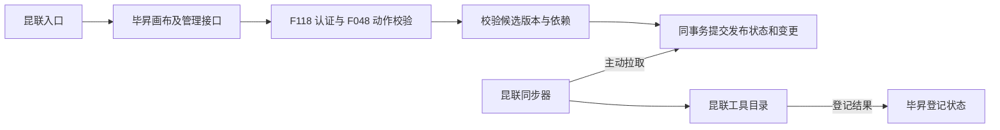

# Design 昆联 Workflow 管理入口与发布登记

- **Feature ID**: F121（合入前复核）
- **Status**: CONFIRMED
- **Confirmed**: 2026-11-06，用户确认本设计。执行顺序与验证门槛见 [tasks.md](./tasks.md)。
- **Updated**: 2026-11-06（Asia/Shanghai）
- **关联**: [已确认规格](./spec.md)、[版本契约](../release-contract.md)、[架构约束](../../../docs/constitution.md)、[对接确认清单](../../../docs/architecture/proposals/kunlian-workflow-main-flow-interfaces.md)。
- **已确认**: 首轮复用毕昇画布和既有管理接口，昆联主动拉取发布与下线变更。本文描述拟实施方案和候选合同。§6.3 的 `待双方确认` 项仍开放。

## 1. 目标与范围

昆联提供新建、可见列表和详情入口，毕昇负责用户认证、工作流权限、画布编辑及发布事实。昆联用独立同步身份读取有权登记的版本和状态变化，更新工具目录并回传登记结果。

首轮交付边界到工具可用性为止。昆联后端直写工作流、反向执行、运行事件、在途取消、双向依赖治理和权限镜像各自留在后续工作包。F119／F120 的真实资源权限与协议仍依赖各自的正式契约。

## 2. 关键约束

- 遵循 C1–C8。Workflow 拥有发布及同步事实，F118 拥有昆联身份及会话，F048 拥有业务授权和所有者投影，开放平台拥有服务凭据。昆联工具目录是毕昇发布事实在昆联侧的视图。
- 浏览器用户、代用户查询和同步器使用不同用途的身份。每次查询、状态变更和拉取都重新校验当前身份与范围。同步器获得的登记信息不授予任何用户查看、编辑、发布或运行工作流的权限。
- 首轮以明确纳入的工作流为登记范围。普通本地流程沿用现有发布行为，历史流程默认不纳入。拟按连接与租户建立独立变更流，首轮每个登记范围一个逻辑消费组。范围和启用方式见 EXT-03。
- 对外登记资料是发布时冻结的业务描述和引用，按字段白名单输出。草稿图、凭据、默认业务数据、提示词、用户输入及运行日志不进入同步报文。
- 采用 MySQL／DM8 共有的事务和锁语义。运行配置、凭据、表结构、发布制品和环境启用由后续实施阶段单独确认。本文的表和字段均为设计提案。

## 3. 方案选择

| 决策 | 选定方案与理由 | 重新评估条件 |
| --- | --- | --- |
| D-01 管理入口 | 昆联提供入口和只读列表／详情，创建及写入复用毕昇页面和接口。这样现有画布、版本校验、审计及 F048 动作继续生效，避免复制编辑和发布逻辑。 | 昆联明确要求其后端直接创建或发布，并确认实际用户委托及授权责任。 |
| D-02 发布事实 | 复用现有发布预检，在发布／下线的 SQL 提交中一并记录登记状态及可拉取变更。只轮询在线列表看不到下线，提交后再异步补写变更则可能漏记。 | 已有可与 Workflow 事务共用并满足提交顺序的变更服务，或实测顺序锁影响吞吐。 |
| D-03 同步与对账 | 昆联主动拉取，先扫描目录再重放扫描期间的变化，正常运行按持久游标续取。请求只读取已提交事实，昆联落库后再推进游标和回传结果。 | 双方确认的时效、事件量或保留周期超出拉取模式可承受范围。 |
| D-04 工具版本 | 每个发布版本有固定描述与版本身份，昆联用该身份幂等登记。更新当前可选版本不改变历史绑定。毕昇提供最新的登记可用性检查。 | 反向调用确认需要多个版本同时承接新调用，或要引入弃用与归档等状态。 |

## 4. 当前实现与拟实施设计

### 4.1 复用点与缺口

| 现有入口 | 源码核对结果及复用方式 |
| --- | --- |
| Platform `/flow/:id/`、应用列表和创建组件 | 复用 `FlowPage`、`CreateApp` 及 `controllers/API/workflow.ts`。昆联以顶层导航进入毕昇站点。新增独立创建落点与否取决于 EXT-01，已有入口可满足时直接复用。 |
| `POST /api/v1/workflow/create` | 现有入口校验创建资格、配额和同名规则，`FlowDao.create_flow` 提交 Flow 与 v0，然后通过 `FlowService.create_flow_hook` 初始化权限与审计。F121 补创建请求识别和投影未完成的恢复语义。 |
| `GET /api/v1/workflow/list`、`GET /api/v1/workflow/get_one_flow/{flow_id}` | 列表显式使用工作流类型和 `action=visible`。详情及版本读取复用 F048；昆联摘要只返回授权所需字段。已有详情支持分享链接，昆联后端查询仅采用本次可信用户的业务权限。 |
| `GET/POST /api/v1/workflow/versions`、`GET/PUT /api/v1/workflow/versions/{version_id}` | 复用版本表和画布保存行为。补有条件保存与发布后的版本保护，覆盖普通流程及 F119／F120 混合流程进入 F121 登记范围时的路径。 |
| `PATCH /api/v1/workflow/status` | 复用 `WorkFlowService.update_flow_status` 的动作校验、版本归属及图检查。F119／F120 的发布材料继续由现有领域服务准备，统一提交时增补 F121 记录。 |
| `PATCH /api/v1/workflow/update/{flow_id}`、既有版本切换与删除入口 | 现有元数据入口可带 `status`；旧版本 DAO 在更新当前版本时也可能写 `Flow.data`。登记范围内，所有状态变化归到同一个受保护的提交路径。删除或解除登记资格需先产生不可用事实，保留必要下线记录。 |
| `GET /api/v2/flows/{flow_id}` 和 `POST /api/v2/workflow/invoke` | 现有 `workflow:read`、`workflow:invoke` 属于开放平台合同。复用其身份底座及工作流服务；查询接口需裁剪摘要。现有调用请求只有 `workflow_id`，登记可用性和按版本调用要在后续运行工作包显式接线。 |

代码锚点见[前端路由](../../../src/frontend/platform/src/routes/index.tsx)、[浏览器路由](../../../src/backend/bisheng/api/v1/workflow.py)、[版本服务](../../../src/backend/bisheng/api/services/flow.py)、[状态服务](../../../src/backend/bisheng/api/services/workflow.py)、[平台节点发布事务](../../../src/backend/bisheng/workflow/domain/repositories/platform_node_publication.py)及[开放平台权限范围](../../../src/backend/bisheng/open_api/domain/scopes.py)。

### 4.2 鉴权与管理入口

| 调用 | 身份与准入 | 范围与返回 |
| --- | --- | --- |
| 昆联页面 → 毕昇新建／画布 | F118 会话，按现有策略验证当前用户、绑定及租户。缺会话走既有 OIDC 流程，网关校验同站允许的回跳路径。 | 深链接只含已登记的页面目标和工作流标识。来源标记只用于展示及定位。用户、租户和凭据均由可信上下文解析。 |
| 昆联后端 → 用户列表／详情 | 优先复用开放平台可验证的自然人身份或既有可信委托。校验调用方、用途、用户绑定、受众、时效和实际租户，再走 F048 `visible`。身份合同 EXT-01 未齐备时，此服务端路径保持关闭。 | 列表按授权分页，可显示名称、发布状态和允许操作。详情只返回当前用户获准查看的摘要。操作提示分别计算 `edit`、`publish`、`unpublish`，直接请求仍需对应动作权限。 |
| 毕昇页面 → 创建／保存／发布／下线 | 现有登录、CSRF、创建资格和配额，保存用 `edit`，发布及下线分别用 `publish` 和 `unpublish`。F048 授权由 Workflow Owner 服务传入已验证的对象和版本。 | 所有写入在毕昇进行。F048 授权和撤权继续生效，无法验证身份或权限时返回安全错误。 |
| 昆联同步器 → 目录／变更／版本资料／回执 | 独立受限的服务主体，优先复用现有开放平台凭据设施。毕昇把主体绑定到明确的连接、租户、目录范围及登记读／回执写用途，每次请求复核。正式凭据形态及 scope 名称见 EXT-02。 | 只读取该范围内的登记资料、可用性和变更，只写本消费组的登记结果。同步凭据不能访问用户列表、草稿、编辑和运行接口。 |

前端正常操作继续使用现有请求封装和页面权限展示。昆联接入时需要登记 HTTPS Origin、新建与详情落点及允许的返回路径。不同登录态或租户下的查询缓存按可信主体和租户隔离。旧列表与深链接在权限变化后必须重新判定。

创建和编辑采用以下业务约束。

1. 创建入口提交一个逻辑请求标识，同一用户与租户的同标识重试返回同一 Flow 和初始版本。服务端保存请求摘要，标识相同但参数不同时返回冲突。同名校验保留原义。
2. 创建申请先取得稳定对象标识并记录进度。继续通过 F048 的创建投影和修复入口完成所有者关联，复用同一对象与幂等键。创建或授权投影未完成时返回待处理或可诊断错误，列表和详情不提前开放，重试不再次创建或重复占用配额。SQL 记录与 F048 投影的既有分步边界要在设计审查中核对。
3. 画布打开时取得服务端草稿修订，提交时带上所依据的修订。保存使用比较后写入，冲突提示重新加载。已用于 F121 登记的发布版本保持不可覆盖，需要继续编辑时复制为新的候选版本。版本保存、当前版本切换和删除均验证归属与发布保护。

### 4.3 发布、下线与版本资料

1. 读取服务端候选版本并检查归属、发布动作和候选修订。在事务外完成图校验、F119／F120 资源及绑定校验，并准备版本资料。检查失败时保留原发布版本。
2. 事务内锁定目标工作流及版本，复核修订、候选摘要、登记资格和影响本次校验的环境修订。按相同事务保存 `Flow`／`FlowVersion` 发布状态、登记投影和变更。保存失败整体回滚。同步请求与昆联远程资源调用均在事务外。
3. 登记数据按 `(connection_id, tenant_id, workflow_id, workflow_version_id)` 定位。对同一已发布版本冻结可登记的名称、用途、输入输出 Schema、外部依赖摘要和资料摘要。Schema 来自经发布校验的输入输出声明，使用双方确认的可转换子集；复杂输出不能从节点内部报文猜测。资料尚不完备时记录登记待补充，不能变为可选工具。冻结后发现契约有误时发布修正版。
4. 新版本上线时，同一变化携带当前版本和被替代版本的不可选状态。昆联在同一个工作流范围更新当前可选项，保留旧版本标识。新版本资料不足时，先撤掉已经被替代的可选项，新版本保持待补充。下线时校验 `unpublish` 及当前发布版本，提交后毕昇的可用性校验立即拒绝该版本，随后昆联读取下线记录撤掉可选项。已下线版本再次上线有新的变化序号，即使版本 ID 相同。
5. 同步器在登记生效前按当前授权核对版本及变化序号。昆联工具目录是可用性的投影，读取到旧目录或登记回执成功均不构成新调用许可。发现当前不可用或无法确认时拒绝开放新选择。若状态在检查后并发改变，后续选择仍以毕昇的实时判定为准，目录由增量或对账收敛。正式反向运行在受理前必须接入此判定并独立鉴权。本期交付判定与登记，保留既有运行合同。

版本资料建议字段如下，正式字段及 Schema 方言在 EXT-03 确认。

| 数据 | 关键字段 | 约束 |
| --- | --- | --- |
| 工具描述 | `workflow_id`、`workflow_version_id`、`name`、`description`、`input_schema`、`output_schema`、`descriptor_version`、`descriptor_digest` | 以发布时冻结值为准。版本 ID 为不透明标识，名称供展示。 |
| 外部依赖摘要 | `resource_type`、`resource_id`、已固定的 `resource_version_id`、有契约支持的连接标识 | 从服务端发布绑定生成。知识库若只固定资源引用，版本字段留空。 |
| 变更记录 | `event_id`、`sequence`、`workflow_id`、`current`、`retired_version_id`、`change_type`、`occurred_at` | `current` 携带版本、登记资格、可用状态和资料摘要。下线或撤出范围保留版本定位和状态，无须附完整资料。`occurred_at` 用于审计。 |
| 登记结果 | `event_id` 或全量条目的来源序号、版本、`status`、安全失败原因、关联 ID | 结果仅说明昆联侧登记或移除是否完成。重复回传同一结果应幂等，失败后允许该变化更新为成功。旧结果不能覆盖新变化。 |

### 4.4 拉取、断点和补偿

**提交顺序。** 每条流使用 `(connection_id, tenant_id)` 和 `scope_generation` 标识。在同一个 SQL 发布事务内锁定该流的控制行、分配单调递增序号并写变更。工作流写入统一按 Flow、FlowVersion、流控制行的顺序加锁。禁止以未提交的自增值或更新时间作为进度，避免后提交的较小序号被跳过。对同一工作流，最新变更序号也作为登记新旧的比较依据。范围变化时使旧游标失效，按新范围重建目录。

**首次或游标失效后的全量对账。**

1. 昆联请求初始化，毕昇返回同一授权范围的扫描标识、已提交序号 `B`、分页令牌及有效期。启动时记录所需增量保留范围，扫描过期或日志已截断时整次重新开始。
2. 昆联按稳定工作流 ID 分页扫描当前可登记项，逐页写入独立的暂存目录。每项携带本身最后变化序号。扫描和变更读同一个权威提交视图。分页令牌属于这次扫描，与可持久化的增量检查点分开。
3. 扫描完成后，用基准游标启动增量窗口并固定上限 `H`，重放 `(B, H]` 内全部变化，包括下线与替换。按工作流来源序号防止较旧变化覆盖扫描中读到的更新；扫描期间新增加但落在已扫 ID 区间的记录也由重放补齐。所有页和重放完成后，昆联原子切换本范围的有效目录与检查点。未完成的扫描不会清空当前目录；来源失权的范围立即从可用范围排除。
4. 已下线、撤出范围或在全量中缺席的旧条目从本范围的可选目录移除。按工作流标识与来源比较，避免较早扫描覆盖已处理的更新。切换后以 `H` 继续增量，记录本次全量核对结果。

**日常增量。** 昆联以持久检查点开始一次拉取窗口。毕昇返回有序变化、窗口上限 `H`、是否还有分页、继续本窗口的分页令牌和可持久化的 `next_cursor`。每页只覆盖大于上次位置且不超过窗口上限的变化，末页游标指向 `H`，下一轮再取新的上限。窗口分页令牌丢失时从已持久化游标开新窗口。全量重建必须完成原窗口后才切换有效目录，原窗口失效则丢弃暂存并重建。服务端游标做完整性保护，绑定逻辑消费组、连接、租户、范围世代和接口版本；换发同一主体凭据时可以续取，越权、篡改、过期或低于日志保留点的游标分别安全拒绝或要求全量重建。消费组并行实例共享进度，并保证只有持当前消费权的实例能推进检查点或切换目录。

**落库和回执。** 昆联按版本唯一键幂等登记，按工作流最新序号拒绝旧变化覆盖。先持久化目录变更及待回传结果，再推进对应连续处理的增量检查点。若目录接口与检查点不能共用事务，用同一个事件幂等键重试，确认登记实际结果后再推进。拉取返回、分页结束和收到 HTTP 200 都不表示登记成功。昆联重启从已提交位置读取，已落库但未确认的同一变更可重放。回传登记结果走单独的受限入口，回执失败独立重试，不回退已提交的目录检查点。对已被权威新状态取代的变化，可标记为已跳过并记录依据，不能默默跳过未知或失败变化。

| 故障 | 恢复方式 | 用户所见 |
| --- | --- | --- |
| 拉取超时、断线或服务重启 | 从持久检查点重新读取，按事件和来源顺序幂等处理。 | 当前登记状态保持上次已知结果，可观察同步滞后。 |
| 昆联目录写入失败或结果未知 | 保留失败条目及游标，按约定退避重试或先核对目录；超出重试窗口告警并保留人工重放路径。 | 该变化显示登记失败待补偿，发布事实仍有效。积压期间新选择仍需权威校验。 |
| 回执丢失或乱序 | 重发同一回执，毕昇比较事件、版本及当前来源序号；同一变化成功终态不被延迟失败回执覆盖。 | 昆联目录可已处理，毕昇登记状态仍待确认，收到有效回执后更新。 |
| 游标无效、超出保留期或权威对账差异 | 按新的合法范围重新全量扫描并重放。仅在完整核对后切换。 | 能区分需重新同步、未登记和当前不可用。 |
| 凭据失效、撤权或范围缩小 | 停止拉取并拒绝新可用性请求，撤掉失权范围，恢复后以当前授权重启。 | 受影响工具不能凭旧目录变为可选，其他范围继续独立同步。 |

建议轮询、分页上限、日志保留、登记超时及告警阈值按规模和时效约定选择。待定参数见 EXT-05，设计阶段不承诺生产时延。全量对账和游标重建应有小范围故障演练。

### 4.5 数据落点与模块职责

| 拟实施落点 | 职责与变化 |
| --- | --- |
| `src/frontend/platform/src/pages/BuildPage/`、`src/frontend/platform/src/routes/index.tsx`、`src/frontend/platform/src/controllers/API/workflow.ts` | 复用创建与画布，按确认后的导航补安全落点。接已有请求的创建标识、草稿修订与登记结果展示。 |
| `src/backend/bisheng/api/v1/{flows,workflow}.py`、`src/backend/bisheng/api/services/{flow,workflow}.py` | 保留浏览器接口，收口纳入范围的创建、保存、发布、下线和删除入口。流程所有者和权限通过 `permission.application` 协议处理。 |
| `src/backend/bisheng/workflow/application/`、`src/backend/bisheng/workflow/domain/{schemas,services,repositories}/` | 拟新增登记应用服务、资料归一和同步仓储，复用 `platform_node_publication` 的同事务发布边界。拟增持久事实包括创建请求进度、发布资料和当前登记状态、流控制行和变更明细。具体 SQL 表名、索引、保留策略和兼容方案在设计确认后拆任务。 |
| `src/backend/bisheng/open_endpoints/api/endpoints/`、`src/backend/bisheng/open_api/domain/scopes.py` | 拟接开放平台的昆联用户查询与同步入口。沿用现有入口守卫和独立 scope 登记，权限范围确认后装配。 |
| 商业网关 F118、昆联同步器 | 网关复用登录及回跳校验，允许清单按确认落点配置。昆联负责目录写入、同步检查点、重放及回执。 |

## 5. 已知坑与处理位置

| 事实 | 影响 | 设计处理 |
| --- | --- | --- |
| 普通列表游标按更新时间和 ID 分页，在线列表不含下线版本。 | 用作同步会漏下线，并可能因并发修改跳过对象。 | §4.4 独立变更流和重放。 |
| 普通创建先写 Flow 和初始版本，再调用权限投影。 | 投影失败后简单重建会产生重复流程或孤儿。 | §4.2 使用稳定对象与现有 F048 恢复路径。 |
| 有多个入口能更新状态或当前版本，版本 DAO 可能回写图。 | 只在画布的发布按钮记录同步，会漏掉旧路径的变更。 | §4.1、§4.3 收口登记范围内的发布状态和不可覆盖约束。 |
| 登记回执可能晚于下线或新版本发布。 | 旧成功回执可能把界面恢复成已可用。 | §4.3、§4.4 按源变化序号比较，最新发布事实优先。 |
| 现有开放调用只带 `workflow_id`，加载当前图。 | 历史绑定会被误解为已经有固定版本执行能力。 | §4.3 先明确登记和可用性边界，后续运行接线单独验收。 |

## 6. 对外契约与待确认事项

### 6.1 毕昇提供的候选能力

以下均为候选路径，完整 OpenAPI 在双方确认后固化。

| 请求 | 调用身份 | 用途 |
| --- | --- | --- |
| `GET /api/v2/kunlian/workflows`、`GET /api/v2/kunlian/workflows/{workflow_id}` | 可信实际用户 | 昆联侧可见列表、详情及允许操作摘要。创建和写入继续走毕昇页面入口。 |
| `GET /api/v2/kunlian/workflow-registrations/snapshot` | 同步读 | 初始化或全量核对。首次返回基准序号及 `base_cursor`，后续以 `page_token` 分页。 |
| `GET /api/v2/kunlian/workflow-registrations/changes` | 同步读 | 以 `cursor` 开始窗口，或用 `page_token` 继续当前窗口。返回有序变化、`next_cursor` 和分页状态。 |
| `GET /api/v2/kunlian/workflow-registrations/{workflow_id}/versions/{workflow_version_id}` | 同步读 | 查询该版本登记资料及当前可用性。已不可用时只返回允许看到的不可用状态。支持核对源序号及摘要。 |
| `POST /api/v2/kunlian/workflow-registrations/receipts` | 受限回执写 | 回传已登记、已移除或失败结果及关联信息。回执只更新登记进度。 |

候选错误语义为 `401` 无有效身份、`403` 超授权范围、`409` 草稿／版本／幂等冲突、`410` 游标失效需要重扫。不存在与不在范围的对象按统一防枚举口径返回。浏览器原有错误合同沿用，新的 OpenAPI 错误码按 C5 另行登记。状态查询与可用性检查返回可审计的请求关联 ID。

### 6.2 依赖

| 依赖 | 所需能力 |
| --- | --- |
| F118 和商业网关 | 有效会话、可信租户、安全回跳及停用后的准入拒绝。 |
| F048 和开放平台 | 业务动作、创建所有者投影、凭据校验及按实际用户或服务主体约束范围。 |
| Workflow、F119、F120 | 候选图、版本发布、固定资源引用和资源校验。 |
| 昆联同步器和工具目录 | 可持久化检查点、版本唯一键、幂等登记和移除、失败回传及全量对账。 |

### 6.3 待双方确认

| ID | 状态 | 待确认内容 |
| --- | --- | --- |
| EXT-01 | 待双方确认 | 昆联菜单与详情入口、毕昇 HTTPS Origin、允许回跳路径、项目与租户对应关系，以及昆联后端代实际用户查询的可信凭据、受众和过期行为。 |
| EXT-02 | 待双方确认 | 同步器服务身份的发放、轮换与撤销，连接／租户及消费组绑定，读与回执写权限范围。确认昆联可在落库后回传结果，并提供错误和重试样例。 |
| EXT-03 | 待双方确认 | 登记资格与启用范围、输入输出 Schema 方言和支持子集、描述与依赖字段、资料摘要兼容规则。旧绑定是否还能发起新调用由反向运行合同明确。 |
| EXT-04 | 待双方确认 | 昆联是否有额外创建资格、平台配额、权限镜像或全局依赖检查要求。当前设计沿用现有权限与配额，其余需求需单独确认范围。 |
| EXT-05 | 待双方确认 | 将规格 EXT-02 的运行参数单列。确认拉取间隔、分页和响应上限、游标和变更保留期、全量核对频率、发布／下线传播时效、报警和补偿负责人。提供测试地址、OpenAPI、版本样例和联调时间。 |

首轮由昆联拉取已确认。权限镜像、额外昆联配额、全局依赖治理等规格外请求出现时，先回到范围确认。

## 7. 验证与可观测

| Verification | 需求／验收 | 最低充分证据 |
| --- | --- | --- |
| V-01 页面与管理入口 | REQ-01、REQ-03、REQ-04；AC-01、AC-02、AC-05、AC-07 | 浏览器验证登录回跳、A／B 列表和详情、查看者不能保存、编辑保存及冲突提示。 |
| V-02 权限与版本集成 | REQ-01 至 REQ-06、REQ-10；AC-02 至 AC-09 | 实际路由和服务验证租户、撤权、重复创建、投影恢复、草稿竞争、错误版本及资源校验。用双数据库证据确认同事务写入、回滚和发布顺序。 |
| V-03 登记合同与故障 | REQ-05 至 REQ-10；AC-06、AC-08 至 AC-12 | 模拟消费者验证发布 V1／V2、同版下线重发、游标断点、并发提交顺序、全量扫描期间变化、重复和乱序、崩溃重放、权限缩小及回执幂等。 |
| V-04 双方真实联调 | REQ-01、REQ-03、REQ-06 至 REQ-10；AC-01、AC-05、AC-10 至 AC-12 | 测试站点完成 A 新建、授权 B、编辑发布、昆联登记、下线和恢复验证。记录两侧状态及传播时延。当前待执行。 |

分别观测发布提交、待同步时长、变更积压、最后成功游标、游标重建、登记失败和下线滞后。用工作流 ID、版本 ID、变化序号及请求关联 ID 串联两端记录；日志只写安全分类与定位字段。

## 8. 启用与回退

按连接和租户小范围启用。先建立授权、投影及初始检查点，再开放昆联选择。停用接入时，毕昇的可用性先关闭，昆联移除可选项并完成核对，再停用拉取或回执入口；已保存的工作流、版本和历史绑定继续由各自所属系统保留。恢复后重新核验范围和游标，必要时从全量重建。环境验证、发布制品和部署安排属于后续工作。

## 修订记录

| 日期 | 变更 | 状态 |
| --- | --- | --- |
| 2026-11-06 | 根据确认的首轮范围完成拉取设计，记录鉴权、登记、断点与补偿。 | 设计待确认，环境验证待执行。 |
| 2026-11-06 | 用户确认设计，进入任务拆分。 | EXT-01 至 EXT-05 仍待双方确认，环境验证待执行。 |
