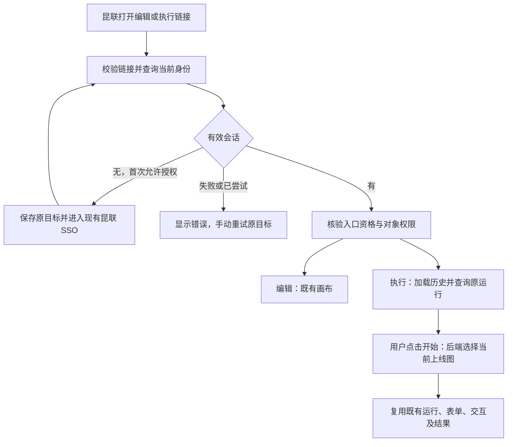

# Design：昆联 Workflow 编辑与执行直达入口

**Feature ID**: F129
**关联**: [spec.md](./spec.md)、[tasks.md](./tasks.md)、[需求发现](./discovery.md)
**版本**: v3.0.0
**最后更新**: 2026-11-11
**Status**: Confirmed，用户于 2026-11-11 确认。W1 共享规则已实现并完成定向验证；页面、后端及网关接线尚未实施，链接尚未完成联验。见 [验证记录](./verification.md)。

## 1. 目标与非目标

提供两条稳定的浏览器链接，从昆联打开指定 Workflow 的编辑器或执行页。优先复用现有页面和 F118 登录协议，补齐自动登录、原目标恢复与失败重试。执行页由用户明确发起运行，每次新运行使用受理时的当前上线版本。

本次不新增编辑器、执行引擎、外部运行 API、数据库表、匿名入口或项目映射；不通过链接选择历史版本，不改变已开始运行的恢复规则。身份、用户、租户、授权、发布及运行事实继续由既有 Owner 管理。

## 2. 关键约束

- 遵循 [架构约束](../../../docs/constitution.md) C1–C8 和 [版本契约](../release-contract.md)，F118、F048、F121 领域归属不变。
- Platform 和 Client 是两个独立 SPA。共用入口解析和登录尝试规则，不共享各自 React 状态或请求封装。共享工具不调用 HTTP。
- 当前站点为同源 `http://192.168.106.104:3001`，Client 基路径为 `/workspace`；继续使用静态构建产物目录映射及 Nginx，不恢复 Vite 常驻模式，也不新增端口。
- `entry=kunlian` 只选择入口行为，不证明用户来自昆联，不授予任何权限。身份与当前租户来自服务器已确认会话，不能从 URL 设置。
- W1 只在本地实现共享规则，不连接服务器、不运行或发布工作流。正式昆联回调及真实验收保持 `NOT_RUN`。

## 3. 方案对比与选定

### 决策 1：复用页面路径，用明确标记识别昆联入口

- **备选**：A. 复用 `/flow`、`/workspace/app` 路径，增加入口标记；B. 新增两套页面或独立入口路由后再跳转；C. 两条按钮直接指向 SSO 授权接口。
- **选定**：A。编辑入口另保留既有 `from=workflow-management`，以复用管理编辑读取及返回行为。
- **原因**：现有两个 SPA 已有目标页面。新增标记能将自动 SSO、手动启动约束限定在昆联入口；B 增加一层导航而没有新增业务价值，C 会让已有有效会话也先走授权，不符合规格。
- **重新考虑条件**：以后要求独立品牌页面、跨站点部署或专属导航壳时，再讨论独立入口路由。

### 决策 2：共享规则，两端分别承接鉴权与页面状态

- **备选**：A. 在两端分别复制 SSO 跳转代码；B. 共享纯解析与尝试记录，复用各自身份请求，并由入口边界统一处理跳转；C. 仅让所有 401 继续走通用拦截器。
- **选定**：B。
- **原因**：当前 Platform 管理页有专用防循环，Client 的普通 401、昆联异常处理和 MainLayout 未登录 `logout()` 也可能导航。只改路由会产生多个导航发起者。纯规则放入 `@bisheng/api-client`，各 SPA 的 HTTP、React 状态和提示仍留在所属应用。
- **重新考虑条件**：只有两端整体身份初始化已统一为新的公共协议时，才合并状态所有者。

### 决策 3：页面加载只查询状态，明确操作才开始运行

- **备选**：A. 延续新会话自动 `init_data`；B. 昆联入口只发 `check_status`，用户点击开始后复用初始化与输入处理；C. 新建一套运行接口及表单页面。
- **选定**：B。
- **原因**：`useWebsocket.ts` 当前对新会话自动发送 `init_data`，而 `WorkflowClient.init_workflow()` 能派发任务。`initial_open=true` 只对部分已有 Agent 运行有保护，不能当作普通 Workflow 的禁止启动保证。C 会复制现有表单和交互链路。
- **重新考虑条件**：若以后明确要求链接点击即执行业务，应另行确认副作用、受理幂等和浏览器重放规则。

### 决策 4：新运行由服务端取得当前发布图，原运行沿用冻结图

- **备选**：A. 使用浏览器缓存或消息中的 `data`；B. 新运行受理时由 Workflow Owner 核验当前发布事实，读取并冻结图；C. URL 固定版本。
- **选定**：B。C 已由用户明确排除。
- **原因**：普通 Workflow 的初始化当前可以将浏览器 `data` 写入 Redis，Worker 随后读取；平台 Agent／知识库适配虽已有发布图读取，也不能证明普通节点路径满足当前版本规则。入口链接不携带图或版本，后端必须核验上线状态并选图。
- **重新考虑条件**：以后需要按历史发布版本运行时，扩展单独合同，不默许未声明的版本参数。

## 4. 系统现状及拟实施流程

### 4.1 已核对的现状

| 位置 | 当前事实 | 对本次设计的影响 |
| --- | --- | --- |
| Platform `routes/index.tsx`、`pages/BuildPage/flow/index.tsx` | 已有 `/flow/:id/`；管理来源调用 `getWorkflowManagementEditorFlow`，其他来源单独检查编辑权。 | 保留画布、版本选择、管理来源及未保存提醒。 |
| Platform `pages/LoginPage/login.tsx`、`contexts/userContext.tsx`、`controllers/request.ts` | 自动昆联登录主要识别管理页；UserContext 还处理历史 URL token。 | 外部入口需在历史 token 处理前识别及校验，不能借兼容逻辑接收凭据。 |
| Client `routes/index.tsx`、`pages/appChat/AppChatEntry.tsx` | 已有 `/app/:fid/:type` 及带会话 ID 的页面；优先打开最近会话；`buildQs()` 会去掉 `entry`。 | 保留历史会话选择，但需保留有效入口标记，避免跳转后丢失防循环或手动启动规则。 |
| Client `hooks/AuthContext.tsx`、`layouts/MainLayout.tsx` | 用户查询与 Recoil 同步存在渲染间隔；MainLayout 未登录时调用退出。 | 入口边界放在 MainLayout 外，身份未确认前不挂载业务布局，避免与 SSO 竞争。 |
| Client `pages/appChat/useWebsocket.ts` | 新会话自动初始化，已有会话查询状态；已有重新运行、输入、停止与 Agent 交互逻辑。 | 只对有效昆联入口启用状态查询优先模式，复用显式运行、输入及恢复。 |
| Backend `api/v1/workflow.py`、`common/chat/manager.py` | 浏览器 WS 使用登录依赖、F118 消息准入、Workflow `use` 权限，并注入两个平台节点适配器。 | 继续复用可信身份；新发布图加载能力通过端点注入，common 层不反向导入业务领域。 |
| Backend `common/chat/clients/workflow_client.py`、`worker/workflow/tasks.py` | `check_status` 在无运行时能返回允许初始化；`init_workflow` 随后写 Redis 并派发任务，普通图来自初始化消息。 | 状态查询不得派发新任务；新运行必须先加载权威发布图，Worker 使用受理时冻结的图。 |
| Gateway `controller/KunlianSsoController.java` | 成功回跳使用事务 `returnTo`；当前固定 HTML 失败页的重试链接不带原目标。 | 需要小范围补齐失败页的可信目标重试，不更改 OIDC 协议或令牌处理。 |

以上表格记录设计时的基线。W1 已新增共享链接与尝试工具及 callback 初始阶段查询；W2 已接入 Platform 编辑入口和网关可信目标失败重试，并通过本地 Mock。Client 边界和后端发布图加载器尚未实现，不能把编辑入口的局部验证视为两端完整交付或真实联验。

### 4.2 主流程



### 4.3 编辑入口

1. 在 Platform 启动读取参数前调用共享解析器。有效入口仅提取 Workflow ID、固定来源和动作；格式无效或含凭据则进入安全失败页，不写 Cookie 或身份存储。
2. 复用 `getUserInfo()` 确认会话。未登录由现有 LoginPage 承接，扩展其原管理页目标识别为本次精确编辑目标，保留完整安全查询参数。
3. 两端共享登录尝试规则，但保留 F121 原管理页行为。拦截器对本入口的身份失败只报告给入口边界，不跟随旧 `THIRD_PARTY_LOGIN_URL`，也不与页面同时发起跳转。
4. 有效用户进入画布前，复用现有管理端资格判定和管理编辑读取入口。服务器仍执行可信租户、对象查看与 `edit` 校验；不因 URL 来源省略服务端授权。
5. 保留 `from=workflow-management`：保存、发布和下线继续走原入口及独立权限；点击返回仍回 `/build/workflows`，未保存提醒沿用现有逻辑。

W2 实施补充：`UserProvider` 继续拥有唯一的当前用户启动查询，向登录页提供 `workflowEntryError`；编辑入口移除旧全局回跳残留，再执行既有资格判定。无管理端或构建入口资格时进入 `/403`，不改跳工作台。有效身份和入口资格确认后才清理该目标的尝试记录。当前编辑页后续收到身份拒绝时，request 通过本地事件交给同一 Provider，关闭业务子树并由 LoginPage 决定登录；事件不建立身份。HTTP 错误和 HTTP 200 业务错误均保留原始 `ApiError`，昆联业务错误仍校验完整 code／reason 对，不单凭数字错误码识别协议。CSRF 与退出请求继续使用原有处理规则。失败 UI 复用现有三语错误文案；未配置精确昆联协议时不跟随旧第三方地址。

### 4.4 执行入口

1. 在 Client `AuthLayout` 内、MainLayout 外增加条件入口边界。只有匹配的昆联 Workflow 链接进入本次处理；其他页面直接沿用原逻辑。
2. 复用 AuthContext 当前用户查询，并暴露其确认结果供边界使用。不能仅以旧 Recoil 用户、旧本地标志或尚未完成的查询认定已登录；必要的入口刷新只复用这一查询，不额外形成另一份身份状态。
3. 身份未确认时不挂载 MainLayout、AppRoot 或 AppChat，因此不触发其退出、历史读取、WebSocket 及业务请求。首次需要 SSO 时，通过 Client API 封装读取现有 `/api/oauth2/list`；仅在精确提供 `/api/oauth2/kunlian` 时使用该协议。未配置或依赖故障显示失败，不跳往不明地址。
4. 会话确认后按服务器 `has_workbench`（旧响应才使用现有兼容判定）及既有应用入口规则检查；复用 Workflow `use` 和详情读取，不要求 `edit` 或发布权，不自动授予菜单或对象权限。
5. AppChatEntry 继续优先选择最近会话。有效 `entry=kunlian` 在入口到会话、历史切换、新建会话及刷新中保留；普通页面不额外携带标记。React Router 内使用 `/app/...`，浏览器及 SSO 回跳使用 `/workspace/app/...`，避免重复添加 basename。
6. 本入口在首次打开和重连时只发 `check_status`。有活动运行则使用原恢复协议；没有活动运行时展示明确的“开始运行”，不发 `init_data`、`input` 或交互提交。前端收到完成状态时关闭本入口的自动重跑分支，不能受独立分享页自动重跑设置影响。
7. `check_status` 无活动运行且没有历史时，后端也返回既有 `workflow_status_checked/finished` 状态通知，供页面显示开始操作；该通知不创建执行记录、不写运行输入、不派发任务。原会话记录与审计仍按现有查询语义处理。
8. 用户点击开始后，复用初始化及后续输入链路。有输入节点的流程开始后显示既有输入表单，无输入流程开始后直接运行；不为了预取表单而自动跑图。进行中按钮禁用，响应未知时先查询原状态，不自动补发开始。

### 4.5 当前上线版本及运行边界

- 在 Workflow 应用层增加发布图加载服务，调用 Workflow repository，在可信租户上下文中读取并核验同一个 Flow 及其唯一当前、未删除版本：类型正确、上线、版本归属正确、Flow 发布图与当前版本内容一致，并按 F048 核验 `use`。
- repository 在同一事务内锁定 Flow 后读取当前版本，返回深拷贝的 `{workflow_id, workflow_version_id, graph}`。不在服务中写 ORM，不新增 DAO 入口或表；无法取得一致发布事实时拒绝，不猜测其他版本。
- 浏览器 WS 端点经 ChatManager 注入这个加载器。common 客户端只调用注入协议，不导入业务 repository。浏览器发布运行必须提供该能力，缺失时失败关闭，不退回消息里的图。
- 绑定对象和会话使用连接准入时保存的 Workflow ID、chat ID；消息若携带不同 ID 则拒绝，不能将有会话的发布运行改成空 chat ID 的调试模式。空会话的画布调试继续按 `edit` 资格处理并允许草稿；非空会话按 `use` 和上线发布运行处理。来源 query 不参与此裁决。
- 只有确认确实需要新运行后才加载发布图。`init_workflow` 对发布运行使用服务端图，忽略浏览器图、版本参数和旧会话缓存。既有两个节点适配器继续负责各自准入；若准备期间发布已改变，导致其返回的图与所选快照不一致，则通过现有 abort 清理本次尚未派发的准备结果，返回错误，不混用两个版本或自动重试执行。
- 当前用户完成准入后，repository 锁定读取并确认当前上线快照，是本次新运行选择发布版本的线性化点；节点准备、写入原运行数据及派发只使用这一快照。若下线先于此点生效，则拒绝新运行；若该点之后发布 V2，则已选择的 V1 不替换为 V2，下次新运行重新选图。既有节点准入若因后续发布／下线变化拒绝，仍应停止派发并清理未派发准备结果，不自动换版执行。
- 沿用现有 Redis、运行记录、队列和 Worker；通过已有运行数据保存冻结图，不增加新的共享存储或历史迁移。续跑、人工输入、停止和跨 Worker 恢复使用原运行事实，不能在恢复时重新取最新图。原下线后运行及输入准入规则继续有效。
- 此权威发布图处理放在浏览器发布运行的共用业务边界，而非 `entry` 条件内，避免删除 URL 标记就绕过规则。v2／v3 和反向运行接口继续使用各自既有合同；需回归合法画布调试、普通浏览器发布运行及平台节点。

### 4.6 登录尝试与错误处理

共享工具返回 `not-entry`、`invalid-entry` 或 `{kind, workflowId, chatId?, returnTo}`。每端入口状态为 `CHECKING`、`AUTHORIZING`、`READY`、`FAILED`；这是页面状态，不是新的身份或运行状态机。

| 状态／事件 | 处理 |
| --- | --- |
| 已确认用户与入口资格有效 | 进入 `READY`；清理该目标的待授权记录，业务操作仍由服务器逐次授权。 |
| 普通未登录或首次 `SESSION_EXPIRED` | 在协议已配置、非回调、无失败标记且未尝试时，记录目标并授权一次。 |
| `#kunlian-login` 回调 | 继续使用 KunlianBrowserFlow 清旧 Bearer、核对服务器 `auth_source`；保留本次来自回调的只读阶段信息，不能在消费 hash 后失去防循环判断。 |
| 回调后仍无会话、目录未就绪、身份不可用、信任拒绝、网络故障 | 进入 `FAILED`，不自动重跳；使用本地已知错误文案，保留原目标供手动重试。 |
| 并发 401 或昆联异常 | 新入口由同一边界及尝试记录决定导航；HTTP 拦截器保持请求失败，不另外调用 reauthorize、旧第三方地址或 logout。已进入 READY 后发生会话失效也遵循同一规则。 |
| 用户点击重试 | 显式新建一次授权尝试，使用原目标；不得选择旧全局 `LOGIN_PATHNAME` 残留。 |

尝试记录使用同标签页 `sessionStorage`，键为 `kunlian:workflow-entry-attempt`，值仅含 `{kind, workflowId, returnTo, startedAt}`；10 分钟过期，不含凭据。跨文档的 SSO 返回仍能判断已尝试，已有 F121 尝试规则不被替换。存储不可用时显示手动登录入口，不以无法记住状态为由反复自动授权。

**W1 已实现的共享合同**：

- `parseKunlianWorkflowEntry(pathname + search)` 返回设计中的三个结果；已知 `status_code` 19320–19329 保留为 `failureCode`，但从规范化后的 `returnTo` 剔除。输入不能是事先经 URL 自动规范化的站外地址。
- `buildKunlianWorkflowEditPath(workflowId)`、`buildKunlianWorkflowRunPath(workflowId, chatId?)` 构造安全的浏览器相对路径。当前 ID 为现有生成方式的小写 32 位十六进制；不会修改非昆联旧路径。
- `claimKunlianWorkflowLoginAttempt(entry, {storage?, now?, callback?, manual?})` 只领取导航尝试，不实际请求或导航。调用方必须明确传入 `callback: false` 才允许自动领取；回调、已知失败、未知初始阶段、损坏或未来时间的记录均阻断自动领取。用户明确重试时用 `manual: true`，仍校验目标；存储失败不阻止这次明确手动操作。
- 去重按同一 Workflow＋动作匹配，进入会话后仍受同一记录保护。`clearKunlianWorkflowLoginAttempt(entry, storage?)` 在会话确认后可清除该 Workflow＋动作的记录，允许从不带 chat ID 的入口跳到该对象会话后清理；不能清除其他对象或动作。常量与 Storage 端口类型由共享包导出，两个 SPA 无需复制。
- `KunlianBrowserFlow.isCallbackEntry()` 是该实例创建时的只读历史，hash 被消费、身份随后确认或显式登录状态重置后不改变。它不是当前身份、授权来源或登录成功标志，既有来源确认、CSRF 和退出逻辑保持原样。

网关仅在 `beginLogin` 返回已验证事务或 callback 成功消费事务后，把已验证 `returnTo` 放入本次 exchange 的内部属性；失败页重试链接从该属性生成，经过 URL 编码及 HTML 属性转义。不能取回调原始 query、Referer 或请求头作为目标。无可信事务时保持固定安全页，不回显或采用不可信目标；SSO 过程中事务缺失的用户可重新打开原昆联链接发起登录。本次不增加 callback 字段或放宽允许回跳前缀。

## 5. 已知坑与处理位置

| 事实 | 忽略后的问题 | 处理位置 |
| --- | --- | --- |
| 昆联请求失败既可能是 HTTP 错误，也可能是 HTTP 200 的业务错误包。 | 页面把拒绝当成功，或通用拦截器抢先跳转。 | 两端 request 封装与入口边界测试同时覆盖两种形式。 |
| Client MainLayout 未登录会调用退出；AuthContext 的用户和认证状态不是同一渲染时刻就绪。 | SSO 跳转与退出竞争，或有效用户也被送去登录。 | 边界位于 MainLayout 外，以当前查询确认结果为准。 |
| AppChatEntry 去掉 `entry`，AppRoot／ChatView／侧栏还各有会话导航。 | 第一次能登录，进入会话或刷新后丢失昆联规则。 | 统一使用小型链接构造工具保留经过校验的标记，覆盖各会话导航。 |
| `initial_open` 不等于“禁止执行”。 | 空会话页面打开就派发任务，或无输入流程直接执行。 | 昆联入口先 `check_status`，仅明确操作初始化；测试观察队列派发次数。 |
| 普通 Workflow 图与平台节点图的准入路径不同。 | 只测 Agent 图通过，普通流程仍运行浏览器陈旧数据。 | 共同发布图加载器；分别覆盖普通、Agent、知识库图。 |
| 编辑器需要 `from=workflow-management`。 | 返回普通应用列表，或改走不同的详情读取路径。 | 编辑链接保留该参数，复用 F121 helper。 |
| 网关错误页与 SPA 是不同页面。 | 前端保存了目标，网关“重新登录”却丢目标。 | 网关使用已验证事务生成安全重试链接；无可信事务不拼目标。 |

## 6. 对外契约与依赖

### 6.1 提供给昆联的链接

| 用途 | URL 模板 |
| --- | --- |
| 编辑指定 Workflow | `{origin}/flow/{workflow_id}?from=workflow-management&entry=kunlian` |
| 使用当前上线版本 | `{origin}/workspace/app/{workflow_id}/10?entry=kunlian` |

`origin` 为浏览器可达的毕昇站点，当前测试值 `http://192.168.106.104:3001`。`workflow_id` 是毕昇 Workflow 标识，不是版本号、chat ID、昆联项目 ID 或 Workspace ID。`10` 为现有 Workflow 类型。`entry`、`from` 均为固定导航参数，不是授权证明。

以此前管理页使用的 Workflow ID 举例，拟交付格式为：

```text
http://192.168.106.104:3001/flow/2c3bcfd3f5d840ec9d68e8027644aac4?from=workflow-management&entry=kunlian
http://192.168.106.104:3001/workspace/app/2c3bcfd3f5d840ec9d68e8027644aac4/10?entry=kunlian
```

这两个示例当前仅说明设计格式，不表示本特性已部署、该对象已上线或真实 SSO 已通过。最终发给昆联的文档只使用实施后实际核验的对象、权限与站点。

解析规则：本次合同使用现有生成方式对应的 32 位十六进制 Workflow ID；保留两端非昆联旧路由，不批量规范历史 ID。有效内部会话路径还允许现有 32 位 chat ID。只允许固定导航键；重复键、非法路径分隔、越界编码、版本参数、身份／租户参数和凭据键拒绝。固定来源参数也必须精确匹配；安全回跳继续通过现有 `safeKunlianReturnTo` 及网关校验。带 callback 错误信息时只消费现有已知错误字段，生成下一次 `return_to` 前剔除错误信息。

### 6.2 复用合同与风险

| 依赖／提供的内部协议 | 用途及风险 |
| --- | --- |
| `GET /api/oauth2/list`、`GET /api/oauth2/kunlian?return_to=...`、既有 callback | 发现登录方式及发起登录；网关必须允许既有 `/flow`、`/workspace` 前缀。不得将查询结果当授权。 |
| `GET /api/v1/user/info`、F118 CSRF 与消息准入 | 唯一可信浏览器身份；保留 Cookie、CSRF 和退出行为，不能由前端伪造 user／tenant。 |
| 管理编辑详情、Workflow 版本／保存／发布／下线接口 | 继续按既有动作授权，来源参数不会给只读用户编辑权。 |
| Client `/api/v1/flows/{id}`、权限检查、历史及 `/api/v1/workflow/chat/{id}?chat_id=...` | 页面加载、执行及交互；REST／WS 必须同一实际用户，WS 会话归属与目标核验不能省略。 |
| 拟新增应用层发布图加载接口 `load_published_browser_snapshot(user, workflow_id)` | 返回内部 `{workflow_id, workflow_version_id, graph}`，不给浏览器新增 HTTP API；由 repository 取得一致发布事实，业务服务负责身份和动作。 |
| ChatManager 注入参数 `published_workflow_loader` | 仅由浏览器 WS 端点设置，转交客户端调用；不是浏览器输入，缺失时发布运行不得回退到客户端图。 |
| 现有 `check_status`／`init_data`／`input` 和 `workflow_status_checked` | 不增加公开 WS action；无运行的只读状态通知补齐，开始与原运行恢复分开测试。 |
| Node、pnpm、静态目录与 Nginx | 实施后的两端生产构建及深层路由验证必须通过；当前 3001 静态部署方式保持。 |

### 6.3 文件改动计划

以下为设计落点，tasks 拆分时沿用；不表示文件已经新增。所有新增共享工具保持纯规则，不调用网络、不创建 React 全局 store。

| 文件／目录 | 计划职责及边界 |
| --- | --- |
| `src/frontend/packages/api-client/src/kunlianWorkflowEntry.ts`、`index.ts` | 新增严格入口解析、链接构造、尝试记录纯函数；不实现身份认证或对象授权。 |
| `src/frontend/packages/api-client/src/kunlianBrowser.ts` | 保留 callback 初始阶段的只读提示，配合现有协议；不放宽安全回跳规则。 |
| Platform `utils/workflowManagement.ts`、`pages/LoginPage/login.tsx`、`loginBridge.tsx`、`contexts/userContext.tsx`、`controllers/request.ts` | 接入编辑目标、失败重试及早期参数校验；保留 F121 管理入口和普通登录兼容。 |
| Client `routes/KunlianWorkflowEntryBoundary.tsx`、`routes/index.tsx`、`hooks/AuthContext.tsx` | 条件边界及已有查询确认结果，防止未登录挂载业务布局；不新增 Recoil atom。 |
| Client `api/kunlianWorkflowEntry.ts`、`api/request.ts`、`utils/loginRedirect.ts` | 用既有 HTTP 封装读取 OAuth 配置，协调入口身份失败和重试；不另建 axios 客户端。 |
| Client `pages/appChat/AppChatEntry.tsx`、`ChatView.tsx`、`ChatInput.tsx`、`useWebsocket.ts`，以及 `routes/AppRoot.tsx`、`pages/appChat/hooks/useAppSidebar.ts` | 保留标记，新增手动开始展示及状态查询优先模式；复用既有输入、停止、交互，非昆联入口保持原自动行为。 |
| Backend `workflow/application/browser_workflow_entry.py`、`workflow/domain/repositories/browser_publication.py` | 新增发布图加载及一致性核验；不写集成表，不增加数据迁移。 |
| Backend `api/v1/workflow.py`、`common/chat/manager.py`、`common/chat/clients/workflow_client.py` | 注入加载器、校验连接目标及运行资格、分开状态查询与新运行、使用服务端图；common 层不反向加载业务模块。 |
| Gateway `src/main/java/com/dataelem/gateway/controller/KunlianSsoController.java` | 失败页从已验证事务保留重试目标；不改变协议地址、凭据或信任策略。 |
| 两端 locale 源文件、共享 `packages/locales` | 所需开始、登录与失败文案三语齐全；错误码文案仍由共享源生成，不手改生成文件。 |
| `src/backend/test/workflow/`、Platform 及共享包 Vitest、Client Jest、网关现有 controller tests | 围绕导航、拒绝、派发与版本结果补用例，不按 AC 机械增加重复测试。 |

## 7. 验证、可观测及发布

### 7.1 验证策略与追溯

| Requirements | Acceptance | 最小充分证据 |
| --- | --- | --- |
| REQ-01 | AC-01、AC-06、AC-10 | 编辑入口定向测试及隔离浏览器：原目标、无编辑权拒绝、未保存返回和 F121 原入口回归。 |
| REQ-02 | AC-02、AC-09 | 执行边界与 WS 测试：使用者无编辑权仍可用；首次打开、刷新、重连、SSO 不发起新任务或答案提交，明确操作才派发。 |
| REQ-03 | AC-03、AC-04、AC-09 | 受控 backend repository／应用与 Worker 派发替身：普通图、Agent 图、知识库图，V1→V2、陈旧图、下线竞争、原运行恢复。 |
| REQ-04 | AC-01、AC-02、AC-05、AC-06、AC-07 | 身份初始化及导航集成：已有会话直达，缺失会话 SSO，跨应用目标不丢失，用户切换或跨租户拒绝。 |
| REQ-05 | AC-04、AC-06、AC-07、AC-08 | 纯解析与拦截器测试、网关 controller tests：伪造／重复参数、站外目标、凭据、并发失败及 callback 后拒绝，失败页只用可信目标。 |
| REQ-06 | AC-05、AC-09、AC-10 | 原管理页、普通执行页、画布调试定向回归及两端生产构建；浏览器 Mock 验证入口、会话切换和刷新。 |
| REQ-07 | AC-10 | 实施后对外链接文档、示例与验证记录核对。真实联合验收独立标记。 |

优先扩展现有 `test_workflow_auto_rerun_status.py`、`test_workflow_offline_input.py`、平台节点 entrypoint tests 以及两端昆联会话、登录回跳用例。新后端用例放在 `test/workflow/`，不放 test 根目录。Mock 测试以任务派发／输入提交次数和实际冻结图为证据，不只断言显示文字或 URL。

W1 共享规则及已有 Platform 会话相关回归已执行，证据与环境阻塞见 [验证记录](./verification.md)。上表页面、运行及真实验收不能据此标记通过。真实 MySQL／DM8 锁与发布竞争、OpenFGA 权限矩阵、真实 SSO 与实际队列运行不能由 SQLite 或浏览器 Mock 代替。

### 7.2 手动验收步骤

1. 准备同租户编辑者、使用者但无编辑权、无使用权及其他租户账号。准备可安全运行的已上线 V1，以及未上线、下线对象；不要直接以示例 Test 的发布状态作保证。
2. 已登录编辑者打开编辑模板，确认对象正确，修改后返回并取消离开，再选择不保存回到管理页；使用者打开同一编辑链接应被拒绝。
3. 使用者打开执行模板，保持页面空闲并刷新，后台无新增派发；点击开始，完成现有文本输入、状态及结果闭环。
4. 保持 V1 的原运行，再上线 V2；同一链接新发起的运行执行 V2，原运行恢复仍对应 V1。页面打开后下线再点击开始应拒绝。
5. 无会话分别打开两个模板，完成昆联授权后检查原目标。取消授权、目录未就绪或回调后仍未准入时，页面不循环；点击失败页重试仍携带可信原目标。
6. 生产静态部署后直接打开和刷新两个深层路由，核对资源及 REST／WS 路径，继续使用 3001。每项记录实际账号角色、目标、结果和未执行原因，不在日志中保存凭据。

### 7.3 观察、部署与回退

- 使用既有 trace、Workflow ID、版本 ID、会话及状态通知定位；新增日志仅记录动作、结果及拒绝原因，不能打印完整 URL query、token、授权码或上游正文。Mock 验证用派发替身计数，真实环境核对队列与原运行事实。
- 本轮不部署。后续获授权实施并验证后，构建 Platform 和 Client，通过已有静态产物版本目录原子切换；涉及的后端源文件需同步 API 与 Worker 后统一生效。网关如有失败页改动，按其原构建方式更新，并单独验证 callback。
- 保存旧静态产物、对应后端快照及网关镜像。需要回退时按同一批次恢复，避免一端已使用新入口规则而另一端仍为旧代码；不清理数据库、运行表或会话记录。无 Schema 变更，不做历史迁移。

## 8. 待确认事项与后续范围

- `TODO [F129]`：昆联确认最终浏览器 Origin、两类按钮参数及可联验的授权账号；目前继续按 3001 测试站点设计，不将其视为公网可达证明。
- `TODO [F129]`：联验网关实际允许回跳前缀、目录准入、失败页重试及现有 CSRF／WS 行为；不为调试关闭安全校验。
- 指定历史版本、点击即自动运行、匿名分享、昆联项目／Workspace 映射和新运行协议不在本批范围，需要时单独确认。
- 若实施发现需要新增持久状态、变更已确认运行恢复语义或改动其他服务的安全合同，应先更新设计并重新确认，不扩大本批。

## 修订历史

| 日期 | 改动 | 触发原因 |
| --- | --- | --- |
| 2026-11-11 | 初版，记录既有链路、链接合同、登录及失败恢复、手动启动、当前发布图、改动落点和验证边界。 | 用户确认 F129 spec，执行页使用当前上线版本。 |
| 2026-11-11 | 同步 W1 工具、损坏记录的手动恢复、跨会话目标清理及 callback 初始阶段的实际合同。 | 用户授权 T001–T003；经用户确认保留并合并并发测试修改，不扩展到页面接线。 |
| 2026-11-11 | 同步 W2 编辑入口的早期拒绝、当前用户错误交接、HTTP 200 业务拒绝和网关事务目标重试。 | 用户授权 T004–T009；仅本地 Mock 与回归，不部署；执行页及后端保持待实施。 |
