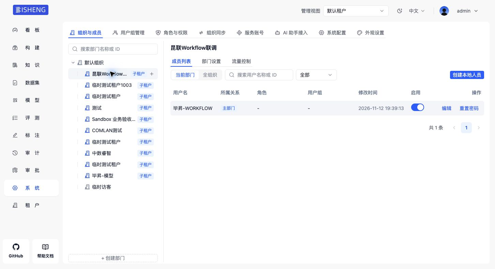

# 昆联用户成员显示修复部署记录

2026-11-12，用户授权后已部署至 `192.168.106.104`，发布 `20261112-membership-fix`，19:38:53 完成代码切换。

修复同步只创建账号和租户关联、未建立部门成员关系的问题。复用现有部门成员及持久权限投影；已同步成功的用户也能由常规恢复补齐，重复同步不重复建立关系。

| 检查 | 结果 |
| --- | --- |
| 昆联用户的部门关联 | 15 条，缺失和错误根部门关联均为 0 |
| 部门成员权限 | 15 名用户逐一真实检查，全部通过 |
| 重复恢复 | 连续两轮通过，成员及账号／角色数量保持 |
| 账号与授权 | User 16、Tenant 11、Role 13、UserRole 17；原人工角色保留 |
| 浏览器成员页 | 试点租户显示用户“毕昇-WORKFLOW”，共 1 条 |
| 真实 SSO | 试点账号重新登录并回到工作流管理页，归属 user 2／tenant 2 |
| 服务健康 | API、Worker、网关运行正常；匿名 user/info 返回 401 |
| 部署边界 | 六个后端文件，重启 API／Worker；14 个受保护文件摘要保持，配置、Schema、网关和前端未改 |

私有备份：`/dataelem/bisheng-kunlian/source/backups/20261112-membership-fix`。数据库导出 10,706,938 字节；回退脚本：`/dataelem/bisheng-kunlian/source/ops/20261112-membership-fix/rollback.sh`。只读回退检查通过，未执行实际回退；回退代码保留合法成员数据。

本地新增 11 项用例通过。相关回归 403 项通过、4 项失败，4 项均与未修改基线的旧夹具失败一致，无新增失败。完整 QA、真实并发故障、DM8 和其他租户实际 SSO 仍待执行。

详细证据与操作中修正见 [verification.md E-025–E-028](./verification.md) 和 [结构化部署记录](./evidence-deployment-20261112-membership-fix.json)。此次未提交或推送代码。
