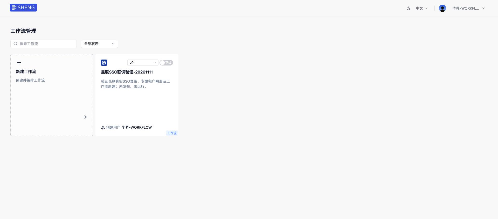

# 昆联 SSO 与用户同步部署联调记录

日期：2026-11-12。结论：**104 已更新，真实目录同步、有效成员自动开通与已登记试点账号的 SSO 登录／退出通过**。其他租户登录范围、完整权限矩阵及故障验收仍待后续，不将本轮结果写成全特性验收。

## 部署结果

| 项目 | 结果 |
| --- | --- |
| 服务器与入口 | 192.168.106.104；[公网工作流管理](http://110.16.193.170:50055/build/workflows)，原 3001 端口保留 |
| 发布与时间 | `20261112-f130-sso`；2026-11-12 18:47:34 +08:00 |
| 更新内容 | 24 个后端运行 Python 文件、网关 JAR；沿用源码及 JAR 目录映射，无前端改动，不重建应用镜像 |
| 配置变化 | 后端仅 `auto_onboarding_enabled: true`、`policy_revision: 3`；其余配置语义、凭据、回调、信任范围不变 |
| 登录范围 | 保留真实 `fixed` 模式，仍只接受昆联已登记的 Workflow 租户和 Workspace；没有启用 Mock 组合或开放其他租户登录 |
| 服务 | API healthy，Worker／网关运行且 restart count 为 0；原 3 个容器 ID、镜像、环境、挂载及网络名称相同，网关地址仍为 172.19.0.12 |
| 校验 | 全部 24 个源码文件及网关 JAR 哈希核对通过；除后端两项启用配置外，12 个配置／凭据文件哈希保持一致 |
| Git | 部署当前未提交工作树，实际文件摘要见证据；未暂存、提交或推送 |

网关使用现有 JDK 17 与 Maven 离线缓存执行 `mvn -o -q -DskipTests package`，退出 0；复用此前同生产代码的 77 项网关相关回归。后端复用既有 378 项及补充 12 项本地证据，没有因部署重新运行无关测试。停止前 Worker 活跃任务为 0；服务重启期间的连接重置／502 随健康恢复消失，不作为持续故障。

## 真实用户同步与自动开通

从 104 使用已有专用 Key 拉取昆联真实目录，完整发布批次 `f3f044ff-0f2c-49a4-b1ab-16e00b935f6a`，请求／完成版本均为 302，策略修订 3。目录有 13 个租户、18 个成员：10 个租户 ACTIVE，3 个 SUSPENDED；15 个成员属于 ACTIVE 租户，另 3 个属于暂停租户。

| 核查 | 实际结果 |
| --- | --- |
| 有效租户来源与映射 | 10 条 READY、10 个映射；保留原试点目标，不按名称合并 |
| 基础模板 | 10 条 APPLIED；各自仅 admin／build／create_workflow 三键 |
| 有效成员 | 15 条身份绑定全部 ACTIVE／SUCCEEDED；15 条基础资格 APPLIED，15 条实际自动 UserRole |
| 最小权限 | 自动模板业务资源 Grant 为 0；未授予管理员角色 |
| 人工授权 | 原 user 1 → role 1／tenant 1，user 2 → role 3／tenant 2 两条关系均保留 |
| 暂停租户 | 3 个暂停租户及对应 3 名成员未自动开通，原始记录保留在完整目录 |
| 最终数量 | Tenant 11（含 Root）、User 16（含原管理员）、Role 13、UserRole 17 |
| 恢复复核 | 租户阶段 10 成功、资料投影阶段 0 个未完成候选、基础资格阶段 15 成功；失败均为 0；最终物化结果与回执一致 |

上述数量来自实际 MySQL 与原领域投影结果，不以目录总数冒充已开通数量。人工同步复核时资料投影候选已为空，不能解释为没有用户投影；最终 15 条绑定均已成功。原成员权限投影仍通过既有权限 application 完成，不增加资源授权旁路。

## 真实 SSO 浏览器验证

使用已交付的 `bisheng-workflow-tenant` 账号和受控文档中的现有密码；凭据没有写入仓库或验收记录。

1. 从公网工作流管理入口发起真实授权，跳到昆联登录页。
2. 输入测试账号，经真实授权码、PKCE、网关和后端验证，回跳 `/build/workflows`。
3. 以本地 user 2／tenant 2 查看自己的既有工作流；新建仅打开表单并取消，没有创建、发布或运行新的 Workflow。
4. 刷新管理页仍可访问；SQL 记录确认对应 client、Workspace 和当前 ACTIVE 会话。
5. 从毕昇退出，再确认退出昆联统一会话；回到退出回调，显示 `LOGOUT_CALLBACK_RECEIVED`。
6. 退出后 SQL 为 EXPIRED 2、REVOKED 1、ACTIVE 0；再次进入要求重新认证。重新输入测试账号后再次成功回到管理页，最终保留该页面。



退出截图见 [退出回调凭证](./sso-logout-20261112.jpg)。未将授权入口的 303 单独当作登录成功。

## 接口与保护行为

| 检查 | 结果 |
| --- | --- |
| 公网管理页 | HTTP 200 |
| 匿名 user/info | HTTP 401 |
| 匿名创建 Workflow | HTTP 401，没有创建对象 |
| 已登记公网 SSO 入口 | HTTP 303 |
| 未登记内网 Origin 发起 SSO | HTTP 403，未放松 Origin 策略 |

末次管理页 HTML 响应 0.5953 秒，为单次请求时间，不能当作浏览器完整首屏或容量测试。

## 备份与回退

私有备份 `/dataelem/bisheng-kunlian/source/backups/20261112-f130-sso`，0700；保存原源码、配置／凭据私有副本、容器快照、原网关指针及全库导出。SQL 导出 10,507,132 字节，SHA-256 `a32632bf5cc51d2e292f0fc676c20eedcd6a99313d32427154168985f4788b8d`。备份包含敏感数据，不向外分发。

运维与精简证据：`/dataelem/bisheng-kunlian/source/ops/20261112-f130-sso`。回退入口：

```sh
sh /dataelem/bisheng-kunlian/source/ops/20261112-f130-sso/rollback.sh
```

回退先核对来源、配置和网关指针没有并发变化，再停止服务恢复代码及 JAR，关闭自动开通并将策略提高到 4，避免倒退政策修订；保留已经创建的租户、用户、角色和来源记录，不执行全库恢复。回退静态检查及无写入的前置核对已通过，**没有实际执行回退／恢复演练**。

## 尚未完成的验收

- 昆联客户端目前仍是单租户登记；其他租户即使完成同步，也不能据此通过本客户端登录。
- 完整跨租户权限矩阵、停用与网络往返竞争、真实行锁与故障注入、跨 Worker 中断恢复、DM8 仍待专门验收。
- 管理控制面、完整隔离 Mock 浏览器和全特性审查仍按后续任务推进；不因本次部署关闭整项验收。
- 早期 116 配置误用事件继续按原验证记录保留，本轮没有访问该库或声称其影响已关闭。

结构化证据见 [evidence-deployment-20261112.json](./evidence-deployment-20261112.json)。
