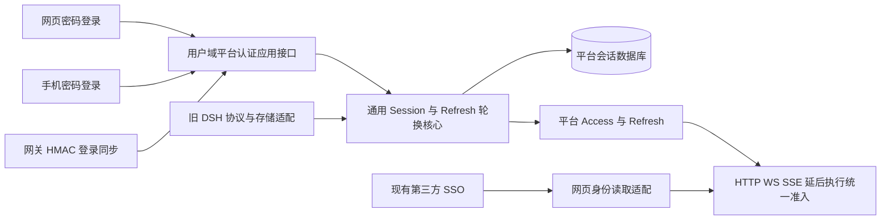

# Design: 将 DSH 会话机制平台化

**关联**：[spec](./spec.md) · [需求确认记录](./discovery.md) · [版本契约](../release-contract.md)。
**版本**：v3.1.0-alpha1。**更新**：2026-11-27。
**状态**：目标设计 D1 已由用户于 2026-11-27 确认；用户随后授权按tasks实施与测试，开发与本地单元验证完成；真实集成按用户要求移交，验收证据单列。§4.1记录基线现状，目标契约保持D1；落地文件路径以实施记录为准。

## 1. 目标与非目标

把现有 DSH 会话的并发轮换、重试恢复与撤销机制提炼为用户域拥有的平台能力，先供网页、手机使用，后续供 DSH 使用。新平台 Access Token 默认 30 天；普通旧网页凭证切换时重登。

不改网关程序，不改变第三方 OAuth2／OIDC 协议、数据库或凭证策略，不迁移存量 DSH 会话，不实现通用第三方授权平台，不改变 PAT／服务账号、匿名分享和业务权限。首期不承诺旧手机无感迁移。

## 2. 关键约束与状态权威

遵循 [constitution](../../../docs/constitution.md) C1–C8；领域归属见 release contract 的 AUTH-INV-01～AUTH-INV-06。

- 30 天指 Access Token 自身，不是对 DSH 的 5 分钟 Access Token 换一个产品叫法。现有 DSH 验证器仍保留原限制，不能全局放宽后混用用途。
- Session 和 Refresh Token 以 MySQL／DM8 事务状态为准。Redis 用于节流、撤销通知和短期协调，不以本地文件或 Redis 缺失为“会话有效”的依据。
- 网关已知响应只有 `user_id/leaf_tenant_id/token`。不依赖网关接收新字段、转发 Set-Cookie 或保存刷新凭证。
- 普通旧网页 JWT 没有 Session；历史手机也可能使用同格式 JWT。拒绝旧网页凭证必须伴随手机版本发布安排，不能凭外观猜测来源。
- 新请求直接确认会话有效性；同一请求复用已准入身份。既有流与连接每 5 秒以内确认一次状态，并在新业务消息／延后执行之前重新准入。无法确认时停止新业务和认证输出，返回可重试服务故障，不按已撤销处理。
- 新认证的租户归属是用户当前 Home；管理目标仍由现有请求作用域机制控制。DSH 旧 `principal_scope` 清空管理范围的行为不能整体用于平台管理请求。

## 3. 方案对比与选定

### 3.1 会话核心归属

- 备选：给网页增加独立 refresh 服务；所有网页直接依赖 `dsh`；提炼通用核心并保留旧 DSH 适配器。
- 选定：用户域拥有通用核心，提炼 DSH 事务及后继推导机制。`dsh` 通过用户域公开应用协议适配，用户域不得反向导入 DSH。
- 原因：当前 `DshAccessService` 固定专用 typ/aud、恰好 9 个 claim、最长 600 秒，且会话和域上下文均带 DSH 约束；原样复用不能签发平台 30 天 Token。
- 重新考虑条件：后续有独立部署的统一身份服务需求；当前不拆微服务、不抽象通用身份协议框架。

### 3.2 默认期限（已确认）

| 配置／对象 | 默认 | 计算与语义 |
| --- | --- | --- |
| `access_ttl_seconds` | 2,592,000 秒＝30 天（已确认） | `access_exp = min(now + 30d, session.expires_at)`，刷新不会延长旧 Access Token 的 exp |
| `session_idle_ttl_seconds` | 7,776,000 秒＝90 天 | 创建时 `expires_at=now+90d`；业务活动顺延 |
| 当前 Refresh Token | 默认与 Session 同时到期，初始 90 天 | 无独立于 Session 的滑动计时器；业务活动更新当前 ACTIVE 代的到期时间 |
| `session_absolute_ttl_seconds` | `null`（不设额外绝对总寿命） | 如显式配置，则上述期限均截断到 `created_at+absolute_ttl` |
| `refresh_reuse_grace_seconds` | 86,400 秒＝24 小时 | 参考 DSH 丢包／休眠恢复；仅返回同一未消费后继，不为任意历史凭证开启宽限 |
| `access_refresh_margin_seconds` | 86,400 秒＝1 天 | 客户端在启动／前台／请求时进入该窗口则尝试刷新；并非每次轮询都刷新 |
| Web 初次刷新凭证绑定窗口 | 300 秒 | 仅网关登录创建的新 WEB Session 的一次绑定；不是旧 JWT 升级接口 |

- 备选：三种凭证都 30 天；Session 跟随每次刷新无限顺延；Access 30 天、Session/Refresh 90 天并按业务活动延长。
- 选定：最后一种。30 天 Access Token 到期后仍有恢复窗口；90 天是 3 个 Access 周期的默认值，已由用户于 2026-11-27 连同spec/design确认。
- 业务活动使用现有 `core/session_activity.py:business_activity` 服务端声明。聊天提交、已登记的 workflow／agent 执行、实际文件上传、业务变更属于活动；身份读取、启动配置、列表轮询、心跳、刷新和 bootstrap 不属于。不存在“所有带认证 GET 都算活动”的默认规则。实现时逐入口登记清单并验收，未登记入口不顺延。
- 业务活动只在认证已通过且会话仍有效后记录，保留 DSH 现有“在具体业务权限决策前记录”的时序；业务被资源权限拒绝不改变认证有效性。重复失败请求不能重新打开已结束会话。
- `now >= expires_at` 即失效；在取得事务锁后读服务器时间。活动与刷新均不能复活过期／撤销会话。参数须为正，闲置期限至少等于 Access 默认期限；策略快照存入新 Session，配置修改默认只影响新会话，已有会话需显式管理动作。
- 示例：D0 登录，Access 到 D30、Session/Refresh 到 D90；D31 可刷新得到到 D61 的 Access，但后台刷新本身仍不把 D90 改掉；D31 随后的已登记业务活动将 Session/当前 Refresh 顺延到 D121。若一直只有后台请求，D90 仍需重登。
- 重新考虑条件：用户要求更短的离线恢复窗口或定期强制重认证；调整配置与规格，不改轮换算法。

### 3.3 旧网页与协议兼容

- 备选：双读普通旧 JWT 并自动升级；切换时拒绝普通旧 JWT，保留旧 DSH 的定向兼容。
- 选定：后者，符合用户允许重新登录的决定。不要通过更换主密钥达成失效。
- 原因：旧平台 JWT 的 JSON 字符串 `sub` 没有 Session，继续长期兼容会留下独立校验／撤销链；DSH 浏览器桥接虽也用旧封装，却另有可验证的 DSH Session，不能一起删除。
- 重新考虑条件：用户明确恢复“旧网页登录态无感迁移”要求；须重新确认范围，不能偷偷添加旧 JWT 换长期 Refresh 的接口。

### 3.4 会话与单点策略

- 备选：沿用 Redis “最后一个 Access Token”；按 Session 判断当前登录。
- 选定：按 Session。`allow_multi_login` 含义不变，关闭时同用户的新统一登录取代旧统一 Session；刷新不取代其他 Session。同浏览器两 SPA／多标签是一个 WEB Session，手机是另一个。
- 并发成功登录以用户级准入锁串行化，后提交者生效。`logout-all` 只操作新平台 Session，不提高用户 token_version 来间接终止第三方 SSO／旧 DSH。
- 原因：Access 轮换不等于登录；当前手机用原始 JWT 与 Redis 比较，不能作为新的通用权威。
- 重新考虑条件：需要按客户端类型分别限额；本期不增加“每种端各一个”产品语义。

### 3.5 网关交付刷新凭证

- 备选：修改网关响应传递 Refresh Token；凭任意旧 Cookie 自动升级；后端创建新 WEB Session 后由新网页完成受限绑定。
- 选定：最后一种，具体见 §6.4。网关返回的 `token` 是新平台的bootstrap专用入口凭证，客户端无需网关识别其内部结构；成功绑定后由毕昇后端交付完整平台Access Token。入口凭证永久只允许bootstrap，即使对应Session已经BOUND也不能用于业务接口。
- 原因：已核实 `LoginSyncResponse` 只有三个字段；现有网页无法从网关得到 Refresh Token。绑定必须可重试且不能重置已使用的刷新链。
- 重新考虑条件：网关未来主动支持新的凭证交付契约；当前不依赖该改动。

## 4. 系统现状与目标结构（两者不可混淆）

### 4.1 已核实的代码基线

毕昇：`origin/feat/3.1.0-alpha1`，`572d5ecf77`；手机和桌面提交见 discovery。以下是源码事实，不代表真实部署验收。

| 写入／入口 → 读取／消费者 | 已有行为与关键文件 |
| --- | --- |
| `UserService.user_login` → `AuthJwt` / `LoginUser` / 全局中间件 | `user/domain/services/user.py` 签发平台旧 JWT 并写 Cookie、Redis 当前 Token；`auth.py` 使用 HS256，JSON 字符串 sub，HTTP Cookie 优先于 Bearer；网页当前无有效自动刷新链 |
| `LoginSyncService.execute` → 网关 → 浏览器 | `sso_sync/domain/services/login_sync_service.py` 调用 `LoginUser.create_access_token`，返回 token；`payloads.py:LoginSyncResponse` 保留 `user_id/leaf_tenant_id/token`；入口带 HMAC |
| DSH identity ticket → `DshLocalSessionService` → `DshAccessService` | `dsh/domain/services/local_session.py` 签发专用 Token；`domain/repositories/local_session.py` 提供事务轮换及活动续期；`access.py` 验证专用用途及设备 Session |
| 手机密码登录 → mobile session → 平台 HTTP | `dsh/domain/services/mobile_session.py` 签发普通平台 JWT，并独立维护手机 Refresh 表；手机 `completePasswordLogin` 有二次建会话步骤 |
| DSH Token → web-session → 两个 SPA | `dsh/domain/services/web_session.py` 创建带 `dsh_web_session` 的旧封装 Cookie，Redis 绑定原 DSH Token；`validate_web_session` 继续查原 Session |
| 网页 Cookie → 第三方 SSO 授权 → 第三方凭证 | `oauth2_provider/api/endpoints/oidc.py:_try_browser_user` 依赖 AuthJwt 与 UserPayload；`domain/services/auth_service.py` 独立签发 ES256 OAuth2/OIDC Token，不接受其替代平台 JWT |
| `LoginUser._runtime_credential_reference` → 延后执行 | `user/application/runtime_identity.py`、`app_runtime/domain/services/runtime_authorization_service.py` 目前认 `web_session/dsh_session`，旧网页引用只含人员版本和 exp；只换 HTTP 验证器会漏掉撤销检查 |

### 4.2 目标数据流

图中 DSH 连接表示“过渡适配可委托同一轮换算法”，不是首期将旧 DSH Token 变为平台 Token。其业务活跃期限、密钥用途和外部响应保持原样；新平台策略是 30/90 天，不套用到历史 DSH。

### 4.3 目标模块与写入边界

以下为实施后的职责映射（路径相对`src/backend/bisheng`）；文件合并仅改变组织方式，不另建第二套登录引擎。

| 模块／入口 | 做什么 | 不做什么 |
| --- | --- | --- |
| `user/application/platform_auth.py`、`user/platform_auth_runtime.py` | 公开已验证密码身份接缝；API/worker懒组合Session服务，支持app.state注入测试实例 | 不接收任意客户端user_id/Home冒充身份，不承担业务权限 |
| `user/domain/services/user.py:authenticate_password`及`PasswordLoginIdentity` | 从旧登录提取密码、验证码、限制、Home与角色校验，新旧登录共同调用 | 不签Token，不写认证Cookie，新入口不反调user_login |
| `user/domain/services/platform_session.py` | 平台Session期限快照、签发、轮换、绑定、撤销、父子Web会话与短票据编排 | 不导入DSH，不直接写SQL，不承载UI |
| `user/domain/services/session_rotation.py`、`user/application/session_protocol.py` | 无IO状态决策及跨域公开协议；平台与旧DSH共同委托consume/recover/revoke判断 | 不查DB，不决定权限，不允许外部请求指定策略 |
| `user/domain/repositories/platform_session.py` | 窄仓储、user→Session→RT锁序、当前读、短票据有界清理；事务scope注入服务 | 不建设通用存储插件框架；旧DSH仍适配自己原表，不复制一套转移决策 |
| `user/domain/services/platform_identity.py`、`platform_transport.py`、`platform_origin.py` | AuthJwt/LoginUser统一准入；Cookie/Bearer冲突、CSRF及可信外部origin | 不将DSH principal_scope套到管理请求，不经domain→application→旧登录形成回环 |
| `user/domain/services/platform_stream.py` | 已建立HTTP/WS的3秒检查周期和2秒读取预算，每条WS新消息重新准入 | 不取消已提交业务，不把存储故障当撤销 |
| `user/domain/models/platform_session.py` | 三个独立平台表：Session、Refresh和60秒Web票据 | 不改旧DSH/OAuth表语义，不增OAuth客户端副本 |
| `user/api/endpoints/platform_auth.py` | login/session/refresh/退出/csrf/bootstrap/短票据transport和真实HTTP错误 | 不跨API导入，不编排组织同步 |
| `user/application/runtime_identity.py`及既有延后执行消费者 | 保存不含原始凭证的platform_session引用，执行前重新读Session/身份与原Access期限 | 不替客户端用服务器不存在的Refresh续期 |
| `dsh/domain/repositories/local_session.py`兼容适配 | 保留原codec、数据、TTL及错误映射，委托通用无IO轮换规则 | 不要求桌面先升级，不用DSH专用Token签平台30天Access |
| 两SPA的api-client共享模块及各自认证适配 | 同源Cookie、Web Locks/IDB、epoch/fence、身份缓存门控与host恢复 | Zustand与Recoil不混用，不清无关用户偏好 |
| 手机AccessClient/SessionCoordinator | 同一平台响应、原子安全存储、origin恢复、并发与重试、host短票据 | 不另建手机签发策略，不将原生AT/RT注入网页 |

初期旧 DSH 的 façade 和表继续存在。共享规则接收锁内取得的Session/Refresh/直接后继快照、锁后时间和服务端策略，返回消费／恢复／撤销决策；各仓储负责自己的锁、唯一约束和条件写入。仓储不得再各自重写有效性及重放决策。新平台使用本设计策略，旧DSH适配保持原ABSOLUTE/SLIDING策略及错误映射。若无法保持其合同等价，先保留旧 DSH 实现并把抽取标为未完成，不能假称统一已完成。

依赖方向：新应用入口调用提取后的login_identity与Session服务，不能再调用会签旧JWT/写Cookie的`UserService.user_login`整体方法。旧登录入口作为上层适配调用新应用接口；旧AuthJwt/LoginUser通过平台准入能力和懒组合根／app.state注入取身份，不新增domain反向导入application。既有`AuthJwt.create_access_token`在旧DSH桥接中仍有专属用途，不把它全局替换为平台签发器；只逐一更换普通密码、手机及SSO Sync的写入方。

### 4.4 目标数据模型与凭证

`platform_session`：私有数据库自增BIGINT主键`issuance_order`（SQLite测试为INTEGER variant）；对外唯一非空`session_id(32位UUID十六进制)`、`user_id/tenant_id`、服务端确认的`client_id`、`device_label/client_version`、`state`、`version`（Session版本）、`token_version`（用户版本）、`created_at/last_activity_at/expires_at/absolute_expires_at?`、`access_ttl_seconds/idle_ttl_seconds/refresh_grace_seconds`策略快照、`delivery_state`、可选`parent_session_id`。绑定截止由created_at+300秒推导，首代绑定状态由generation=1的Refresh判断，不额外复制可推导字段。过期由当前服务器时间判断，不依赖清理任务；撤销立即改变状态/版本。

`platform_refresh_token`：`token_hash(SHA-256)`、`session_id/tenant_id`、`generation`、`state(ACTIVE/USED)`、`used_at?`、`expires_at`；`(session_id,generation)`唯一，Session撤销是整个family的权威，无须更新每个历史token为REVOKED。

`platform_web_ticket`：摘要主键、parent `session_id`、实际`host_session_id`、`tenant_id`、`origin`、60秒`expires_at`及`consumed`。SQL事务单次消费并创建access-only子Session；有界清理过期票据。三个表都有标准create_time/update_time及tenant索引。

只存Refresh/票据摘要。平台Access、确定性Refresh后继、Web绑定、CSRF使用从现有持久化主秘密按不同purpose派生的密钥，不沿用DSH label、不轮换主秘密。新装和online upgrade由model discovery发现新表，重复create_all不改既有表；无额外create-table revision。

新 JWT：header 固定算法 HS256、新 `typ=bisheng-platform-access+jwt` 与 `kid=platform-access-v1`；claims 为 `iss=bisheng-platform`、`aud=bisheng-platform-api`、`sub=用户ID字符串`、`tenant_id=Home字符串`、`session_id`、`session_version`、`token_version`、`client_id`、`iat/exp`（UTC秒整数）、`jti`。凭证不携带冻结角色列表，不接受用户传入的 Home／管理范围。Access TTL 不得由客户端请求覆盖。

首先完整验证签名、issuer、audience、类型与字段，再按已验证的格式进入对应 Session 校验。新格式校验失败不退回旧 JWT。平台 Token 不接受于第三方 OAuth2 UserInfo；第三方凭证不接受于平台业务；v2／匿名路由保留独立契约。明确路由拥有者后再取凭证，不扩大全局豁免。

## 5. 已知坑与处理位置

| 事实（基线已核实，除注明计划） | 忽略后果 | 处理位置 |
| --- | --- | --- |
| DSH typ/aud、9 字段与 600 秒上限写死 | 直接发 30 天 Token 会被拒；全局放宽又混淆模型凭证用途 | `DshAccessService.decode` 保留；新 Platform codec 独立 |
| 旧 DSH 浏览器 Cookie 用旧网页封装但带可验证的 `dsh_web_session` | 一刀切拒绝所有旧封装会破坏旧桌面聊天／网页 | AuthJwt 旧桥接适配 → `validate_web_session` → 原 DSH Session，只有此分支保留 |
| 网关后端响应只有一个 token | 新网页没有 Refresh；不能靠“登录成功”证明续期可用 | SSO Sync 签发 + §6.4 Web 绑定 |
| OAuth2 自动授权直接读 AuthJwt | 新平台登录后第三方仍被当未登录，形成回跳循环 | `oidc.py:_try_browser_user` 和 consent 的 UserPayload 接入新身份 façade；协议不变 |
| 旧平台 JWT 的 sub 是 JSON，DSH 的 sub 是用户ID | 只替换 Cookie 签发会使 /user/info、WS 报错 | AuthJwt / LoginUser 统一结果适配，业务只读规范身份 |
| DSH `principal_scope` 会清管理范围 | 管理员登录正常但管理作用域错误 | 平台准入使用平台作用域解析；不复用旧 scope 实现 |
| 旧手机也用普通平台 JWT | 拒绝旧网页时旧手机也可能失效 | 协调手机发版，最低版本提示；不靠 JWT 外观区分 |
| runtime credential reference 只认旧 kind | HTTP 可撤销，排队任务／托管应用仍用失效身份 | 新 `platform_session` 引用及用户、app_runtime 两侧 resolver 一起改 |
| 当前 Web 桥接无法在普通网页取得 Refresh Cookie | 新网页主动刷新会误把旧 DSH 视为退出 | `/auth/session` 返回 `refresh_mode=host`，SDK 不调用平台 Refresh；旧宿主继续既有短 Cookie 续期 |
| 派生密钥共享平台持久化主秘密 | 旋转全局秘密会连带破坏 OAuth2 ES256 和旧 DSH | 新格式分流失效旧网页，不用换主秘密逼重登 |

## 6. 接口契约与依赖

### 6.1 通用响应和请求身份

平台新接口使用真实 HTTP 状态和统一 envelope：成功 `{"status_code":200,"status_message":"success","data":...}`；失败 `{"status_code":106xx,"status_message":"...","data":{"auth_reason":"...","retryable":false}}`。`Cache-Control: no-store`。OAuth2 协议响应继续原裸 JSON／HTTP 契约，不包平台 envelope。

凭证响应 `data` 公共字段：`token_type="Bearer"`、`expires_in`、`access_expires_at`、`refresh_expires_in`、`refresh_expires_at`、`session_id`、`session_expires_at`、`user{id,user_name}`、`tenant{id,name}`、`default_entry`。时间均 RFC3339 UTC；`expires_in` 为服务端剩余秒数而非客户端寿命承诺。

原生 `client_id=bisheng-mobile` 另返回 `access_token/refresh_token`；不写认证 Cookie。网页 `bisheng-web` 由服务端写两种按 Session 命名的 HttpOnly Cookie，不在新通用响应中返回原始 Token；允许读取会话 metadata 和 `csrf_token`。client_id 是公开路由标签，不是身份秘密；类型不改变账户权限。浏览器请求 native 传输不能绕过跨域策略或 Cookie 认证的 CSRF 检查。

同一平台请求同时有选中 Session 的 Access Cookie 和 Bearer：若两者不同则 HTTP 400 `credential_conflict`，不再悄悄 Cookie 优先；两者相同只处理一次。没有被选中的历史 Session Cookie 不参与候选，不扫描它们寻找可登录身份。专属 OAuth2 Basic、HMAC、DSH、v2 和匿名路由由其原认证入口决定，不套用这条平台规则。刷新/CSRF路由只消费自己的Refresh证明，不先用过期Access拦截。

### 6.2 新平台接口

| 方法与路径 | 输入／认证方式 | 成功／关键失败 | 消费者 |
| --- | --- | --- | --- |
| `POST /api/v1/auth/login` | JSON `user_name,password,captcha_key?,captcha?,client_id,device_label?,client_version?`；密码仍用现有公钥加密；不接受 user_id/tenant_id/TTL | 200 凭证响应；网页写 Cookie；沿用密码过期、验证码、账号／组织检查结果 | 新网页、新手机 |
| `POST /api/v1/auth/refresh` | native：JSON `refresh_token`，不要求有效 Access；web：Refresh Cookie + CSRF；两种 Refresh 不得混传 | 200 轮换响应；401 明确失效；503 可重试 | 两种客户端 |
| `POST /api/v1/auth/logout` | 同 refresh 的会话持有证明；可用有效 Access 撤销自己的 Session，但 web 始终要求 CSRF | 200 幂等，网页先清选择标记，使用仅限该端点的`X-Platform-Session: <sid32>`选择原HttpOnly凭证并正常验证CSRF；再清Cookie；不存在的凭证不泄露状态，服务故障返回503 | 两种客户端 |
| `POST /api/v1/auth/logout-all` | 有效新平台 Access + web CSRF | 200 撤销该用户全部平台 Session；不碰旧 DSH／第三方授权 | 两种客户端 |
| `GET /api/v1/auth/session` | 新平台 Access；旧 DSH 定向桥接为专门适配 | 200 身份／到期信息，`refresh_mode=cookie/native/host`、`delivery_state`；Access expired 返回401可触发刷新 | SPA 启动、手机；不记录活动 |
| `GET /api/v1/auth/csrf` | 仅同源 Refresh Cookie；有效Refresh family，不要求有效Access | 200 仅含刷新用csrf_token；no-store，不返回用户或凭证，不记录活动 | 网页Access过期后的恢复 |
| `POST /api/v1/auth/web-session` | 新手机 Access + 新会话仍有效；原生 Bearer，不接受旧普通 JWT | 200 返回一次性随机 `ticket`、同源 `consume_url`、`expires_in=60`；Redis 摘要记录、单次消费 | 手机内嵌网页 |
| `GET /api/v1/auth/web-session/consume?ticket=...` | 60 秒一次性票据；当前请求 origin 必须与签发部署一致 | 303 到后端固定的站内 workspace 入口；写受约束平台 Cookie，不下发 Refresh；建立绑定parent的access-only子sid，不建立独立长期登录 | WebView；禁任意 redirect |
| `POST /api/v1/auth/web-bootstrap` | 仅 Cookie 中的新 WEB Access；CSRF + 同源；Session 尚待绑定且未过300秒 | 200 写 Refresh Cookie、改 BOUND；可恢复同一未消费首代；窗口过期401并结束待绑定会话 | 网关回跳后的新网页 |

WebView consume 的 ticket 不承载 Access Token；响应 `Referrer-Policy:no-referrer`、`Cache-Control:no-store`，随即跳走清除 query，访问日志对该路径的 query 做脱敏。SQL短票据表记录parent session_id、host子sid、部署origin、一次性摘要及60秒期限，在同一数据库事务中消费并建立子sid；有界清理失效票据，获取票据不允许续期会话。写入浏览器的 Cookie 仍为平台 Token，parent Session 每次准入都验证，WebView真实业务活动同样顺延parent及当前Refresh；`refresh_mode=host`，由手机用自身 Refresh 获取新票据。新手机依据返回的session_id，在当前账号epoch仍有效时设置非秘密的网页Session选择标记，再加载consume URL；服务端只写该sid命名的Access Cookie。票据消费只影响嵌入的 WebView cookie jar，不清手机原生凭据。

路由认证分类：login 为 PUBLIC transport；refresh、csrf、bootstrap、web-session consume 为明确的 credential-owned transport，各endpoint验证自己的证明，不要求先有未过期Access；session、logout-all、web-session签发为身份入口。logout可凭Refresh幂等处理。它们不携带管理租户头、不继承管理范围；不能仅加进全局无鉴权白名单就放行。

### 6.3 旧接口与网关

| 入口 | 首期目标行为与边界 |
| --- | --- |
| `POST /api/v1/user/login` | 保留旧密码请求字段作为 WEB 登录适配，内部调用同一核心；返回原用户展示／default_entry 字段并写新 Cookie。普通旧 Token 不兼容不等于必须删除这个路由；新网页不再依赖返回 Access Token 或 ws_token。旧手机应升级，不承诺其旧两步调用继续成功。 |
| `POST /api/v1/user/logout` | 委托平台撤销与清 Cookie；保留路径。旧 DSH host 桥接中的网页退出只结束该浏览器绑定，不擅自撤销桌面原生 Session。 |
| `/api/v1/user/info` | 保留用户信息字段；认证来源改由统一 façade 提供，保留原权限展示语义。 |
| `POST /api/v1/internal/sso/login-sync` | HMAC、payload、`LoginSyncResponse{user_id,leaf_tenant_id,token}` 和组织同步不变；同步成功后签发新 WEB Session 的 Access，delivery=PENDING_WEB_BIND。Session 创建不成功不得返回登录成功。 |
| 第三方 `/api/v1/oauth2/**` 与 discovery | 原协议、scope、audience、ES256、Session/Refresh 表与默认TTL不改。只将 browser identity reader 指向平台准入；不是把 OAuth2 Token 改成平台 API Token。 |
| 旧 `/api/v1/dsh/mobile/session{,/refresh}` | 属于历史手机接口，本期不承诺旧会话迁移；正式切换后停止创建旧手机 Session，给出 HTTP 426／明确最低版本信息。此变更必须与手机新版本及发布说明一起交付。手机电脑列表／RPC等业务路径保留、改为平台准入。 |

426 响应使用现有 envelope 加 `auth_reason=client_upgrade_required`、`minimum_client_version`；精确最低版本在构建发布时登记，文档不伪造未发布版本号。旧客户端是否能呈现升级信息要在灰度中验证；不能呈现时依赖商店/安装包升级通知，不能宣称兼容完成。

### 6.4 Cookie、CSRF 与首次绑定

- `access_token_cookie` 仅保留为网关首次落地及旧DSH桥接的兼容入口；新普通网页登录不再使用这个固定名称持有长期认证状态。网关落地Token在Session仍为PENDING_WEB_BIND且未过窗口时只用于绑定；旧DSH分支仍必须验证原DSH Session。
- 新网页Cookie名：`platform_access_<sid32>`（Path `/`）与 `platform_refresh_<sid32>`（Path `/api/v1/auth`），sid32是服务端UUID去掉连字符后的32位小写十六进制。均Host-only、HttpOnly、SameSite=Lax；HTTPS使用Secure，既有明确允许的内网HTTP部署按原发布配置处理。Access Cookie Max-Age等于Access剩余期限。
- 非秘密选择标记 `platform_session_hint=<sid32>` 使用Path `/`、SameSite=Lax，由认证SDK在当前epoch有效且登录/绑定成功后写入；服务端刷新响应绝不Set-Cookie写这个标记。SDK可在同sid且epoch有效的成功响应后延长其物理保留期，默认同为121天。其值不提供认证能力，必须同时有同名有效Access或Refresh Cookie并通过服务端验证。它可被修改但不能凭此冒充没有凭据的Session；SSO授权、下载等无自定义header的浏览器导航也据此选择Cookie。退出先清标记并撤销Session。没有标记不自动扫描历史Cookie恢复身份；只有受限的新网关PENDING绑定和旧DSH定向桥接例外。
- 使用按sid命名的Cookie是为解决浏览器自动处理Set-Cookie的竞态：仅靠JS的epoch不能阻止迟到HTTP响应覆盖固定名称Cookie。旧Session刷新响应最多留下该旧sid的孤立Cookie，无法覆盖新sid的凭证或改写选择标记；已撤销Session的孤立Cookie也不能恢复登录。选择标记可保存在普通Cookie并按活跃网页运行定期延长其存储期；它不是登录凭证，期限不参与会话准入。退出/新登录与标记更新仍使用跨标签锁和epoch。
- Refresh Cookie的物理保留期默认 `session_idle_ttl + access_ttl + access_refresh_margin = 121天`，每次真实签发/轮换重写。它不同于Refresh的服务端有效期（初始90天），不能据Cookie尚存在延长登录。这样覆盖“上次写Cookie后，Access剩余30天内发生业务活动使服务端Refresh延长”的最大窗口，避免浏览器提前删除仍有效的Refresh；被撤销或过期的family始终被拒。
- 业务响应在实际记录活动时返回 `X-Auth-Session-Expires-At`（RFC3339 UTC）与 `X-Auth-Activity-Recorded: 1`；未记录不发该标记。SDK在收到活动信息或用户发起WS/SSE业务后合并读取session metadata，必要时在跨标签锁内刷新同步Cookie（最多每24小时一次，Access临期或恢复失败除外）。刷新本身不记录活动。手机同理原子保存metadata；旧本地Refresh到期时间是提示，不据此直接删凭证。
- CSRF：web 的登录、刷新、退出、bootstrap 只允许部署登记的完整 Origin，拒绝跨站 Fetch Metadata；已登录操作需 `X-CSRF-Token`，与会话／服务端随机 nonce 绑定，不能只凭一个可由攻击者写的未签名 Cookie。GET `/auth/session` 在同源读取时提供 csrf_token；401 可通过同源、无跨域放行的 GET `/auth/csrf` 仅凭 Refresh Cookie 获取刷新 CSRF，响应 no-store、不记录活动、不返回身份或凭证。该补充端点属 PUBLIC transport，但必须验证 Refresh family 可用性；服务故障503。
- 网页启动先恢复认证再发业务查询：新普通登录已经 BOUND；网关回跳先 GET `/auth/session` 得到 PENDING_WEB_BIND 与 CSRF，再 POST bootstrap，之后加载 user/info 与业务。不存在“先发一批业务401再猜是否需要绑定”的时序。
- 待绑定 WEB Session 除 session/bootstrap/logout 之外不允许业务准入；过300秒不能继续换长期刷新凭证。首代随机材料由平台绑定用途密钥确定性生成，数据库只存摘要；重试仅在同一窗口、同一Session、首代仍 ACTIVE 时返回同一值。已轮换后不得重新初始化；返回409 `web_binding_completed`，客户端先尝试已有 Refresh Cookie，缺失则重新认证，不能靠旧 Access 重置刷新链。绑定成功后SDK写Session选择标记。保留网关首次落地Cookie至其自然到期，不在异步绑定响应中删除固定名Cookie，以免迟到删除影响另一场新网关登录；BOUND Token不能再次走PENDING例外。
- 账号切换／退出使用客户端epoch与存储generation；旧响应不得更新当前选择标记或原生安全存储。网页认证变更在同源跨标签锁内串行化；切账号先撤销旧Session再登录新账号，不能保留可被选择的旧账号凭据。刷新响应只写自己sid命名的Cookie，不依赖AbortController保证服务端无副作用。清理Cookie只按所属sid，后台通知不能把新账号Cookie一起删掉；孤立Cookie在过期/重登清理，不据它自动恢复旧登录。
- 浏览器协调使用同源 Web Locks；不可用时以 IndexedDB 原子租约（含 fencing generation、到期和持有者）协调并用 BroadcastChannel 通知，服务端幂等恢复兜底。只用 BroadcastChannel 发送“我要刷新”不构成互斥。协调模块不依赖任一 SPA store。

### 6.5 事务、刷新与撤销

1. 新登录复用现有密码／账号／Home／角色校验。公共 `issue_verified_login` 只接受服务端已验证的身份结果；网关从 HMAC 与组织同步路径调用，不能新增“body.user_id 直接签发”接口。
2. 涉及用户级策略的 grant 写入统一遵循“用户准入锁 → Session → Refresh”顺序。单点模式在创建新 Session 的同一事务中撤销已有平台 Session；多点模式保留。旧 DSH／OAuth2 会话不参与。
3. 刷新先由随机摘要定位归属，再进入验证后的租户上下文；锁 Session 后读服务器时间，确认身份版本、Home、状态、期限和 Refresh generation。ACTIVE 代消费为 USED，插入唯一后继，事务一起提交。后继使用平台专用 HMAC 派生，保留 DSH 的确定性重试机制。
4. USED 代仅在 `now-used_at <= 24h`、Session有效且直接后继仍ACTIVE时恢复同一后继；不新增一代，不延长任何期限。否则撤销 family，提交撤销后再返回错误。未知随机 token 只拒绝，不能定位或撤销其他会话。
5. 业务活动按用户→Session→Refresh的统一锁序重验状态，更新其闲置期限和当前 ACTIVE Refresh；到期判断不得使用等锁前时间。只记录 route-owned 活动能力，不能由 body/header 声称“正在活跃”。
6. 每次新业务准入读取当前 Session 和身份版本；不要把30天JWT当30天免查数据库的授权。长连接状态通知与最长5秒周期复查配合，单次状态读取预算不超过2秒，未在预算内确认即暂停认证输出；延后执行使用凭证引用重新准入。存储不可用503，不能 fail-open 执行业务，也不能继承旧中间件的查询失败放行语义。
7. 单会话撤销幂等，只改Session权威状态即可使所有代失效。ACTIVE Session的已使用摘要保留到会话结束，以识别超过宽限的重放；每次轮换只访问当前代及直接后继，不加载整条链。Session终结后至少保留24小时审计／迟到请求窗口；本轮保守保留Session及Refresh历史行，仅对短票据做有界清理，后续运维可分批清理结束会话摘要及孤立绑定。长期活跃Session历史行会增长，这是明确的存储成本，不用删除USED摘要后仍能撤销family作虚假承诺。临时失败不清客户端凭据。显式退出即使网络失败也清本地，提示“本地已退出，服务端撤销未确认”，不能假称远程已撤销。

### 6.6 DSH 兼容矩阵

| 对象 | 首期 | 后续迁移完成时 |
| --- | --- | --- |
| 旧桌面安装包、`/dsh/authorizations`、identity_ticket+PKCE | 保持请求、响应、客户端登记规则与授权交互 | 授权身份交给平台签发入口 |
| 旧 `/dsh/token`、issuer/typ/kid/audience、DSH表 | 保持原期限与错误语义；兼容适配可复用通用算法，不改变线协议 | 新客户端用平台Token；旧版本的双读有明确退场版本后再删 |
| `/dsh/web-session` 与 `dsh_web_session` Cookie | 原换证和绑定继续有效；只接受经原DSH签名和Session验证的定向桥接，不能让任意旧网页JWT混入 | 使用平台受约束 Web 会话机制，删除专用换证 |
| DSH 模型访问／配额、插件 Broker、手机桌面绑定 | 原专用认证入口保持；不因平台Token上线就默认放行新Token | 按注册路由适配平台Principal，权限／配额仍由原业务判断 |
| 全部退出、平台单点配置 | 不宣称覆盖历史DSH Session | 正式迁入平台Session后才纳入；不能首期提前改变其登录策略 |

新网页识别 `refresh_mode=host` 后不主动向平台 refresh 接口提交空凭证，不持久化宿主原生 Refresh；保留旧宿主现有 Cookie 续期定时器。普通旧 JWT 切换拒绝不触发 DSH 全局密钥变化。

### 6.7 准入与身份消费者完整性

| 生产者 | 消费者／必须同步适配的入口 | 结果 |
| --- | --- | --- |
| 平台 codec + Session admission | AuthJwt、LoginUser/UserPayload、HTTP middleware、WS dependency | 规范 `user_id/user_name/tenant_id/token_version/session_id`；不泄露传输差异 |
| 已验证的平台Principal | `core/session_activity.py` 能力 | 安装平台业务活动 recorder；core 不反向导入 user/domain |
| 平台身份 façade | OAuth2 `_try_browser_user`、consent；DSH `browser_user` | 读取新WEB身份，但不把新Token直接放进旧DSH模型访问通道 |
| 平台 Session | 手机 `/dsh/mobile/desktops`、RPC、stream 等既有业务路由 | 业务路径保留，凭证入口通用化；账号与Home检查保持 |
| 平台Principal | `_runtime_credential_reference` 新 `kind=platform_session` | 引用只含 sid、session_version、user_id、tenant_id、token_version、原Access exp；禁止序列化原始Token |
| 新凭证引用 | `user/application/runtime_identity.py`、app_runtime 创建与运行resolver、排队执行入口 | 执行前校验Session、身份和原授权期限；后台任务不延长登录闲置；撤销后不再以旧缓存身份新执行 |
| 原DSH桥接的已验证绑定 | 既有 `dsh_session` runtime resolver | 保留原DSH引用与校验；普通旧 `web_session` 引用切换后不自动升级 |
| 路由认证元数据 | request-scope registry、两个SPA API客户端分类 | auth refresh/bootstrap 不依赖有效Access、不注入管理租户头；业务管理范围仍按原分类 |

对平台凭证引用而言，原Access已到期时不允许延后操作用原身份新执行，用户须在有效登录下重新发起；不自动拿服务器不存在的客户端Refresh替用户续期。已运行后台任务的业务取消／补偿仍归所属业务，本特性只停止新的身份准入与认证输出，不承诺回滚已提交业务。

### 6.8 错误契约（设计预留，实施前复查占用）

基线 `common/errcode/user.py` 已占用10600～10622的若干值、10630和10640；全文检索10650～10664未命中。下表只在文档预留，不修改错误码源码或locale。后续按C5分配并同步三语。

| Code | HTTP | auth_reason | 客户端处理 |
| --- | --- | --- | --- |
| 10650 | 401 | invalid_access_token | 报告无效身份，不自动循环刷新；签名／用途不符不降级旧格式 |
| 10651 | 401 | access_expired | 合并Refresh后重试一次 |
| 10652 | 401 | invalid_refresh_token | 结束当前本地会话 |
| 10653 | 401 | refresh_token_reused | 已撤销family，重登 |
| 10654 | 401 | session_expired | 重登 |
| 10655 | 401 | session_revoked | 重登 |
| 10656 | 401 | legacy_web_token_rejected | 清旧认证标记，正常重登；不试旧Token升级 |
| 10657 | 409 | web_bootstrap_required | 阻止业务查询，进入绑定 |
| 10658 | 401 | web_bootstrap_expired | 重新认证 |
| 10659 | 503 | auth_service_unavailable | retryable=true；保留凭据，停止新业务 |
| 10660 | 403 | csrf_rejected | 重取CSRF或报告；不当作密码错误 |
| 10661 | 400 | credential_conflict | 修复混传；不静默选择身份 |
| 10662 | 426 | client_upgrade_required | 展示最低版本／升级入口 |
| 10663 | 400 | invalid_auth_request | 修正请求，不循环刷新 |
| 10664 | 409 | web_binding_completed | 已有Refresh则恢复，否则重登；不能重置链 |

保留已有账号禁用10620、被替代10604、身份版本19103及租户领域错误语义；均不可用Refresh绕过。丢失网络响应不是一个服务端“会话已撤销”结果。

### 6.9 外部依赖与风险

| 依赖 | 契约／风险 |
| --- | --- |
| MySQL／DM8、SQLAlchemy事务 | 锁顺序、唯一后继及时间读取必须在两种数据库验证；SQLite用例不是DM8验收 |
| Redis | 短票据、节流、通知可用性；不可用不回退为任意票据可用或默认身份 |
| 用户／Home／权限应用接口 | 身份同步完成才签发；角色可用性与资源授权仍由owner处理；不搬移组织业务写入权 |
| 现有持久化JWT主秘密 | 不更换、不读写本地文件作为权威；新purpose分离；配置变更不能无意覆盖旧DSH/OIDC |
| 网关登录回调 | 必须继续原样交付token到现有Cookie/落地页；已只读核对本地Gateway f6160db4的HMAC、固定Cookie及WebSocket透传，不依赖它传额外Cookie；真实链路是发布前P0验收项 |
| 两个SPA、手机系统安全存储／WebView | 同源协调、Cookie隔离、异步返回顺序；真机验证iOS/Android；不需要新的系统二进制 |
| DSH安装包与宿主浏览器隔离会话 | 源码快照不能替代安装包验收；旧host续期／退出／账号切换必须覆盖 |

## 7. 验证、发布与可观测

### 7.1 验证策略（计划，未执行）

- 单元／时钟测试：30/90天边界、到期不可复活、活动分类、Access截断、确定性后继、宽限后继已消费拒绝、客户端epoch。
- 并发集成：两个刷新、刷新与退出、新登录与旧刷新、绑定响应丢失、并发标签页。验证提交后撤销不会被迟到响应覆盖；MySQL/DM8均做事务场景。
- API E2E：新网页登录/手机登录→业务→刷新→单点替换→退出；Access过期且Refresh有效；普通旧JWT拒绝；网关HMAC登录→原token落地→绑定→续期。
- 回归：现有OAuth2 public/confidential、同意/拒绝/免确认、scope、revoke；旧DSH原生、模型、插件Broker、手机桥接、内嵌网页及Cookie续期；v2/PAT/服务账号和匿名分享。
- 延后执行：同一sid从HTTP生产到app_runtime消费，撤销/Access到期/用户Home变更后新执行拒绝。WS/SSE在5秒内停止认证输出；不把登录退出扩大为业务回滚。
- UI／真机：两个SPA与多个标签、浏览器休眠、私有模式、Web Locks缺失fallback、iOS/Android恢复前台、更换服务器地址。新手机先恢复服务器地址再发刷新，禁止跨部署发凭证。

设计已确认；QA参考用例见 [test-cases.md](./test-cases.md)，任务拆解见 [tasks.md](./tasks.md)。QA参考用例不作为研发任务生成或开发测试验收的输入；研发测试独立从spec的AC和本文契约推导。本地开发执行结果见validation.md；真实QA表仍保持待执行。

### 7.2 手动验收入口与观察方法

使用测试环境origin `https://auth-test.example.invalid` 作为占位，执行时替换为实际origin；账号用专用普通用户A、B和有权限的管理员，不放真实密码或Token进文档。

1. 管理员设置单点／多点策略；A打开 `/` 登录，在 `/admin` 与 `/workspace/` 两个SPA和两个标签来回访问，查看网络中 `/api/v1/auth/session` 的同一sid和不同页面共用Cookie。
2. 使用测试时钟或测试策略缩短等比TTL，模拟Access到期但Session有效，观察 `/auth/refresh` 只形成一个后继；不能在生产等30天或修改服务器时钟。
3. 在手机测试包中登录A，断网再恢复，后台再唤醒；临时错误不删除安全存储。单点模式下重新在网页登录，手机收到明确被替代而非反复刷新。
4. 保留发布前普通旧Cookie，升级后打开网页只重登；另用旧DSH安装包打开内嵌网页，确认不会一起跳普通登录。
5. 从真实网关已有登录入口完成A认证；Network记录原响应字段不变，随后出现session/bootstrap，取得按sid命名的HttpOnly Refresh Cookie；用测试代理丢弃绑定响应后重试，同sid同首代，无额外有效分支。再延迟一次旧Session刷新响应至切账号以后，确认只出现孤立旧sid Cookie，新账号选择标记不变。
6. 用系统设置现有OAuth2客户端页及独立测试应用走 `/api/v1/oauth2/authorize` 完成回调、UserInfo、Refresh、Revoke；已签发OAuth Token不因本次发布失效。
7. 撤销A当前Session，观察其WS/SSE及延后请求；检查服务端只记录sid、generation、原因，不记录完整凭证。

### 7.3 发布路线与回滚边界

| 阶段 | 交付／放行条件 |
| --- | --- |
| P0 文档 | spec S1与design D1已确认；用例、tasks及文档审查已完成，用户随后授权实现与单元测试 |
| P1 核心 | 通用轮换和状态机、平台模型／codec、用户域公开接口、旧DSH适配等价验证；只做增量schema，不改旧表语义 |
| P2 网页切换 | 两SPA、HTTP/WS/延后身份consumer、SSO身份适配、网关后端签发与bootstrap同批；强制普通旧网页登录一次；不可只发后端或只发一个SPA |
| P3 手机切换 | 新版同平台响应、电脑桥接及WebView、新版本提示；与P2协调上线后停止旧手机签发。未准备好手机发布则不对该部署执行全量旧JWT拒绝，不能发布后才补说明 |
| P4 灰度 | 多实例均已加载新准入，执行新旧DSH与第三方SSO回归、真机与双DB验证，才扩大发布 |
| P5 后续DSH | 新桌面逐步改用平台Token；覆盖模型/插件/桥接/内嵌网页消费者，再按最低支持版本退役旧codec与旧表；不在本期假称完成 |

无需回填普通旧网页JWT为新Session。先部署可识别新格式且保留DSH的后端版本，再切网页／手机；扩容副本必须同能力，不允许请求在新旧不兼容副本间随机路由。切换前固定回滚地板版本：保留新表和新格式验证／撤销；回滚只关新入口或恢复兼容UI，不降回完全不认识Session的旧镜像。不恢复全量数据库来抹掉用户退出，不删除新表，不旋转主秘密。

运行观察建议（本轮沿用既有登录审计与认证错误日志，未新增专属指标服务）：`login_issued`、`refresh_rotated`、`refresh_recovered`、`refresh_reused`、`session_revoked`、`web_bound`、`auth_unavailable`；只带追踪ID、sid、客户端、generation、原因，禁止原始AT/RT/HMAC/密码。观测刷新失败率、宽限恢复、重放、普通旧JWT拒绝、bootstrap失败和各副本协议版本；高基数sid不做指标标签。

## 8. 后续改进与本轮停止点

- 后续DSH迁移是在已有核心上适配消费者，不新建第四套轮换流程。旧DSH旧表暂保留的原因是仍有已安装客户端，退役触发条件是最低支持版本覆盖且活跃旧会话清零。
- 不建设完整OAuth注册体系的新副本；第三方继续F026。未来若需跨产品OIDC联邦，再另立规格。
- 不做普通旧网页无感迁移；不引入额外180天绝对上限。90天闲置和无额外绝对上限已在源码及单元验证落实，不表示已发布或真实集成通过。
- 当前spec/design已确认，QA参考用例与tasks已整理并作独立文档审查；用户已授权实现及测试，开发与本地单元验证完成，未部署。已知外部验证缺口：网关真实透传、旧DSH安装包、手机两平台、DM8并发，均列为后续验收而非本次完成项。

## 修订历史

| 日期 | 改动 | 触发原因 |
| --- | --- | --- |
| 2026-11-27 | 初版草案；按DSH平台化、Access30天、普通旧网页可重登整理默认期限、接口和兼容边界 | 用户明确仅授权spec/design；基线572d5ecf77 |
| 2026-11-27 | 用户确认spec S1与design D1，接受Session／Refresh默认90天；更新确认状态并进入用例／tasks文档阶段 | 用户再次明确先不写实现；契约和算法口径未改 |
| 2026-11-27 | 按模板整理QA参考用例及7个Wave的tasks，补充独立任务审查；仅更新文档阶段状态 | 不改变已确认S1/D1行为，不执行测试或实现 |

### 实施细化（2026-11-27）

- 网关现有实现记录入口Cookie到日志，因此入口凭证永久限定为bootstrap用途，绑定后签发完整Access；不因Session已绑定将入口凭证升级为业务权限，不修改网关响应字段或网关源码。
- 新建独立表按backend AGENTS §Migration policy经model discovery及online upgrade create_all创建；本次若没有既有表schema变更，不新增冗余create-table revision。回滚保留表与撤销记录。
- 移动版交付版本1.1.0+2，后端minimum_client_version为1.1.0；源码完成不等同于移动商店／企业分发已发布，切换开关须等待协调部署。

- WebView采用access-only子sid绑定原生parent，网页只持child Access且不持Refresh；票据SQL原子消费，parent失效立即限制child。该细化解决host模式与普通cookie刷新模式区分，未新增独立长期登录。
- 网页logout先清选择标记，窄`X-Platform-Session`只帮助logout/logout-all及其csrf恢复这几个credential-owned端点选择已持有的Cookie，不作为身份或业务准入凭证。跨源及CSRF检查不变。

- 外部origin统一由platform_auth.public_origin、既有bs_client.platform_public_url或明确可信代理解析；生产须配置真实公网入口。enabled只停止新签发，既有会话校验/refresh/撤销始终保留。
- 用户随后将真实集成测试收回自行执行，本轮完成开发与单元验证；开发结果与未执行的真实环境验收分别见validation.md及handoff.md。

### 收尾已核实边界

- 两SPA认证transport固定同源根`/api/v1/auth`，不跟随`/workspace`或自定义SPA base，否则Path `/api/v1/auth`的Refresh Cookie不会发送；Client开发代理同步根auth入口。
- Access Cookie自然删除时，有有效Refresh仍可通过session/CSRF恢复；手机host冷启动由原生桥重取票据，不能因snapshot为空误走普通网页登录或空Refresh。
- 两秒预算只施加于认证读取；写事务等待明确提交结果，避免已知超时后线程仍悄然完成单点替换。长连接3秒周期+2秒读取预算，每条WS新消息重新准入。
- 新增23个上传/知识业务入口通过平台专属活动声明，只有PlatformActivity读取；旧DSH保留原活动口径。手机真实RPC写方法计活动、list/status不计，实际SSE路由纳入统一守卫。

- 网关会话选择使用数据库生成的私有issuance_order严格比较新旧，不依赖created_at相等时猜测。MySQL DATETIME未指定fsp时默认精度为0，详见[MySQL官方类型说明](https://dev.mysql.com/doc/refman/8.0/en/date-and-time-type-syntax.html)；即使保留微秒，多实例时钟偏差也不适合作为发行顺序。sid、JWT、Cookie及API不暴露或依赖这个内部主键。
- 网关绑定响应整包丢失后，较新的Session即使已BOUND，只要300秒窗口内且首代仍ACTIVE，仍可受限恢复同一首代；首代已USED不恢复，更晚已选Session始终优先。初代重试不新建刷新分支。

- Session metadata增加可选非秘密`cookie_retention_seconds`，新后端按该Session冻结idle+access+86400计算。RT Cookie及SDK hint使用同值；缺字段兼容时SDK默认121天。默认30/90为121天，自定义60/90为151天、30/180为211天，改全局配置不改变旧会话策略。提前一天刷新当前为SDK常量，不是新增未接线的后端配置项。
- 既有公开/自证exempt路径在中间件内跳过无关平台Cookie/Bearer；endpoint继续验证自己的分享/刷新/签名证明。受保护路由仍正常平台准入，未扩大白名单；refresh在端点自身显式检查混传冲突。
