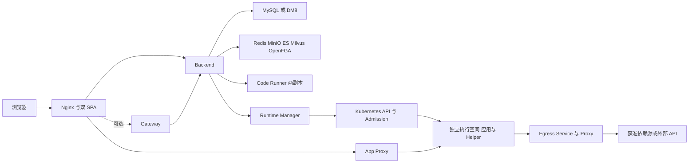

# F008 标准 Helm 交付设计

状态：用户于 2026-11-10 授权按最新讨论更新并实施。当前源码、Chart、测试和教程已完成本轮改造；不构建镜像、不部署线上。规格见 [spec.md](./spec.md)，真实结果见 [verification.md](./verification.md)。

## 1. 已确认边界

- 取消 Kubernetes 强制环境预检及 24 小时报告门槛；保留可选手动诊断和每次应用的镜像/构建/启动/健康检查。Docker 宿主隔离合同不改。
- 不增加整套初始化完成标记、`init_target_digest` 或 claim 表；等待实际 Alembic、匹配的权限状态和官方目录。
- 尚无对外标准 Chart，不做 122/旧部署迁入或前代保护映射。标准 Chart 自身未来升级仍保留数据/密钥/默认项。
- 第 3 项先验证现有 Admission、UID、删除和未知写入者保护，再决定是否改。基线 437 项通过，没有据此修改核心保护规则。
- Egress 使用稳定 Service，Manager 启动解析 DNS；没有额外地址注册/冻结状态机。应用本身保持无 DNS、只能经代理出网。
- Vibe、代码沙箱默认开，Gateway 默认关。已开启沙箱后热关闭的端点/执行器/会话联动缺陷延期。
- 管理员沿用首次正常注册成为超管，不预建用户。官方目录由受信发行物初始化，人工管理仍为超管权限。

## 2. 组件及数据流

平台、Gateway、沙箱、运行控制面位于 `.Release.Namespace`。应用/Helper 位于专用执行 namespace。所有资源名带 release/namespace 摘要，组件 selectors 独立；不创建/修改共享控制 namespace 的 PSA 标签。执行域保留 restricted、ResourceQuota、RBAC、Admission、默认拒绝与代理出网规则。

内部控制、材料和受控平台 API 走私有 ClusterIP HTTPS。公开端口拒绝内部控制/材料路径；内部入口保留原方法、URI、query、body，精确转发 `/api/v1/internal/app-runtime/v2/`、`/api/v1/internal/app-proxy/`、`/internal/app-runtime/v2/material-access/`，并为现有 SDK/平台存储调用转发 `/api/v2/` 和 `/api/v1/apps/`。认证、OBO、签名与材料授权仍由原服务执行。

控制面到私有 frontend 的 NetworkPolicy 同时提供精确 namespace/Pod selector + 实际 Pod 端口，避免只使用 Service CIDR/443、在 DNAT 后失效。应用执行域无此直连规则。

## 3. 方案选择与职责

| 决策 | 实现与理由 | 重新考虑条件 |
| --- | --- | --- |
| 唯一公开父 Chart | `docker/helm/bisheng`，固定依赖唯一 runtime/sandbox 子源码 | 组件独立发行合同变化 |
| 正式初始化命令 + 普通 Job | 复用原迁移/权限逻辑，避免各 API 副本并发 DDL；无业务总闸门 | 需要显式版本升级工具时另设合同 |
| 执行策略与诊断分离 | 运维负责环境，诊断不授权；业务发布仍按真实结果失败 | 未来产品明确要求环境认证 |
| 策略原字节快照 | 保留已开始操作的资源/调度/期限；API 调用者不能冒充 | 运行协议重大版本变化 |
| 独立稳定服务身份/签名根 | Helm lookup 保留或 existingSecret，避免升级自动换钥 | 显式轮换设计及证据齐备 |
| trusted catalog 缺项初始化 | 无伪造管理员，既有默认及不可变版本不覆盖 | 增加模板管理产品界面 |
| 用途区分存储 | 平台缓存按需共享，应用卷独立有界 RWO，驱动由运维提供 | 新 CSI 已完成锁/容量/恢复验收 |

### 3.1 源码职责

| 文件 | 职责 |
| --- | --- |
| `runtime_manager/deployment_policy.py` | schema2 严格配置解析、原字节摘要、Helper/阶段参数和稳定保护摘要 |
| `runtime_manager/executors/kubernetes.py`、`k8s_templates.py` | 配置消费、真实 API/执行、冻结模板、原 deadline、实际 UID 围栏 |
| `runtime_manager/k8s_boot.py` | 在控制面解析稳定 Egress Service，不给应用开放 DNS |
| `runtime_manager/bootstrap_keys.py` | data seed 派生公开数据验证键，指定 CM get/patch；无 Secret API 或执行权限 |
| Backend `runtime_deployment_policy.py` | 服务端期望文件、快照/心跳一致性、Helper 资源校验；无编排 SDK |
| Backend `runtime_operation_service.py` | 冻结策略、当前准入与历史保护/既有路由分别处理 |
| Backend `runtime_kubernetes_service.py` / repository | 参数一致的意图校验、真实有效 Pod 需求与容量预约；原事务和停止证据不变 |
| Backend `system_profile_service.py` / `runtime_delivery.py` | trusted catalog 缺项种子、system 来源和无用户身份 |
| `bisheng.core.config.deployment_renderer` | 镜像内纯配置装配，投射 Secret 文件 → 私有 Settings，无业务服务调用 |
| Backend `scripts/standard_helm_bootstrap.py` / `wait_schema.py` | 正式初始化/只读有限等待实际状态，不进入 HTTP 请求全局闸门 |
| Backend `scripts/initialize_mysql.py` / `initialize_gateway.py` | 仅所拥有库的初始化、匹配 SQL 验证与未知非空结构拒绝 |
| `scripts/verify_k8s_runtime.py` | 运维显式诊断、原 UID 安全回收与独立报告，不改执行策略 |
| `scripts/package_helm.py` | 校验真实配套清单/目录后组装 Chart，绝不构建镜像或部署 |

## 4. 数据与接口合同

### 4.1 配置 schema2

`descriptor.json` 为 flat JSON，`schema_version=2`、`configuration_source=operator-configured`，无 probe_report。包括 installation_id/node_id/cluster_id/namespace/platform、预算、状态 revision、精确 manager/CNI/storage identities、helper/assembler digest、storage/network/package/registry 配置、Helper resources、placement、image_check/init_phase/health 超时和操作总期限。

`policy_digest` 为**实际 UTF-8 原字节** SHA256。解析拒绝重复键、非有限 JSON、过大文件、非法作用域/镜像/资源/选择器冲突。后台 `runtime_kubernetes_nodes[node_id]` 指向运维挂载的期望文件；不接受 Manager 自报的策略作为服务端期望。

保护摘要输入为 `installation_id,node_id,cluster_id,namespace,status_policy_revision,manager_username,cni_username,storage_controller_usernames`，另加固定 `guard_contract_version=1`；storage identities 排序。用 `json.dumps(sort_keys=True,separators=(",",":"),ensure_ascii=True,allow_nan=False)` UTF-8 无尾换行计算。Backend 与 Manager 使用同一测试向量。普通镜像/资源/超时/调度调整不改变保护摘要。

Manager 心跳 capabilities.configuration 包含 version/source/state/policy_digest/protection_baseline_digest。当前编排还须 API 可用和部署策略匹配。独立 probe_report 为 not_run/completed/previous_configuration/unavailable 及真实检查时间/结果，不赋予运行权威，也不声明刚做过环境实测。

### 4.2 操作和资源

Backend 创建新操作时写 `payload.execution_policy_json/execution_policy_digest`；拒绝调用者提交这些保留字段。Manager、Backend 意图校验和已有 Admission approved-template 投影配对，不按升级后配置重解释旧模板。各操作 deadline 已持久化，重试/进程重启不重置。

应用主容器用原冻结档位。Helper CPU/内存 requests=limits，通过策略参数调整共同额度。有效需求为 max(普通容器需求合计、最大 init 需求)，对同时存活且未确认停止的 Pod 合计；在原节点/操作事务锁内扩容已有预约，超过总预算拒绝意图。预约不因未知状态释放。

placement 与 Linux/架构取交集，只接受 selector/affinity/tolerations，不开放任意 PodSpec/nodeName/hostPath/权限绕过。镜像检查脚本/Pod/Backend/Admission 使用同一冻结上限，阶段窗口取原操作剩余期限。安全票据/身份租约不成为任意关闭的参数。

### 4.3 保护历史及入口

- 新 UID 首次绑定按 Backend 认可的配置建立历史；旧 false/unknown 不被后续心跳、诊断成功或配置声明修成 true。
- 临时 API/配置不可读取不授予新的停止权，但不伪造已经证实的历史断档。确认 scope/revision/身份改变按原保守规则降低历史。
- `kubelet_terminal/never_scheduled` 仍要求原 UID、RV、绑定及删除证据。404、NodeLost、Unknown、替换 UID 不是停止证明。
- 已确认 serving 路由与新编排状态区分：短暂编排失联不直接撤路由；实际权限失效、被替代、停用、不健康或保护失效仍按原业务流程拒绝。
- RuntimeClass 不因声明或旧诊断被静默描述为已加固；本期保留默认档回退及明确告警，不为此新增集群权限。

### 4.4 Profile 数据变化

仅 `runtime_profile` 增加 `origin/release_version/catalog_digest`，`created_by` 可空。迁移挂实际单 head `v310b1_f004_workflow_soft_delete`，新 revision `v310b1_f008_system_profiles`；MySQL/DM8 继续用现有 Alembic helper。存在 system profile 时拒绝把其降级为伪造用户记录。

系统种子来自发行 Chart 固定 `files/runtime-catalog/catalog.json` 和锁文件，挂 `/run/official-runtime-catalog`。校验 hash、release、正式双架构 profile；不可变 code/revision 一致 no-op、冲突失败；语言默认仅补缺项。手工 API 仍超管且不允许 origin 伪造。仓库镜像替换需要新合法 catalog revision，不能重写旧审批/运行组合。

## 5. 初始化与密钥

1. 创建 Service、数据配置、Secret、RBAC/Webhook。只有本安装内置 MySQL 的实际消费者才建库/账号，外部 host 不在该任务处理范围。
2. 内置 OpenFGA 用正式镜像迁移自己的专用 datastore；外部 OpenFGA 不运行该迁移。
3. 平台 Job 串行 Alembic → 空环境权限模型/Catalog → 启用 Vibe 时官方目录。只操作实际状态，无总完成记录，不创建管理员；未知非空授权状态失败。
4. API/Worker 只读有限等待实际 schema/权限/catalog，然后正常入口；原 lifespan 的默认业务数据流程继续。
5. key-init 只带 data seed，在 fsGroup=10001 下读取 0440 文件，向指定公开 CM 空→预期公钥写入。不发布材料 issuer 根；原按 workload 的 HMAC 委托继续登记其公钥。
6. Gateway 默认关闭；开启时单独固定 1.8.0 SQL 合同，空库初始化、精确匹配 no-op、未知非空结构拒绝。

普通 Job backoff=0、有限 activeDeadline/timeout、保留失败日志，无环境验收 Job/CronJob。初始化失败停止依赖启动，不自动覆盖、删库或回滚数据。

公开数据库示例密码可修改；内部 JWT/HMAC/issuer/data/TLS 各安装随机且 lookup 保留，有 ownership/content 校验。外部密钥通过 `global.credentials.*` 与各组件 existingSecret 引用，不跨 namespace 复制私钥。父子共享 Secret 引用和内部端口用 Helm global 参数传递，禁止依赖模板渲染顺序。受管配置/策略/代理配置的 checksum 进入 Pod template，升级自动滚动；Chart 外的 existingConfigMap/Secret 更新用 global.configRevision 显式触发重新装配，不静默轮换根密钥。

## 6. Helm、网络与存储参数

详见 [公开教程](../../../../docker/helm/bisheng/README.md) 和 `values.yaml/values.schema.json`。

- 平台/依赖分别提供 resources、探针、nodeSelector/affinity/tolerations、持久化。Beat 固定一副本。Gateway 独立许可证和专用库。
- 父 Chart global 为镜像 registry/pullSecrets、clusterDomain、内部 Pod 端口及共享凭据引用。runtime 提供控制面、执行预算/Helper、阶段期限/总操作期限、网络和存储。使用自定义 fullname 时内部 origin 必须显式匹配。
- 平台缓存默认各 Pod 有界 emptyDir，可按用途 existingClaim/新 PVC；跨节点共享才需要 RWX。应用卷为有界 ext4/xfs RWO、容量/锁/恢复能力由运维确认。StorageClass null/空字符串/具体名三态，不自动格式化或安装驱动。
- 新 runtime 继续默认离线，不因 Chart 升级回退公网。在线允许的依赖源只在原受控下载阶段访问；安装/编译及运行出站合同不改。OCI 可写仓库仅要求于需推镜像的模式。
- control 的 NetworkPolicy 仅选本 release 的 runtime 组件；执行 default-deny 保留。应用及数据不是 Helm 控制器：停用/卸载前通过正常业务流程停止并备份；namespace、数据和执行隔离/Webhook保留，不留下无隔离运行 Pod。

## 7. 手动诊断、发行及验收

`diagnostics.enabled` 仅创建独立报告/计划 ledger CM，不自动执行。运维从生成的 diagnostic-plan 补真实目标及凭据后显式运行工具。resource_names 解决 release 命名；否定网络检查保留正对照，回收继续核对原 UID/状态/围栏；schema2 publish 只 CAS 更新独立 report，不触碰 policy。没有 24 小时过期或默认周期任务。

正式打包须提供 image-set schema1：匹配 appVersion/source_revision、runtime 合同2、Gateway SQL合同1.8.0；覆盖平台/依赖/Gateway/沙箱/所有 Helper/Job，digest 与双架构齐备、官方 catalog/锁及全部材料镜像对应。脚本 staging 固定本地子依赖并生成 tgz/checksum。来源与真实原生架构执行由正式发行流水线另验，模板 fixture 不冒充发行。

### 已知边界

| 情况 | 当前处理 |
| --- | --- |
| 父子模板渲染顺序不保证 | global 共享引用/端口，配对测试 |
| Service DNAT 后目的地址/端口变化 | 私有 frontend 精确 Pod peer/实际端口，真实 CNI 仍须后续验收 |
| Secret 投射默认 root0400、命令镜像非 root | key-init 明确 fsGroup/0440；模板检查 |
| 显式 false 与缺失不同 | hasKey/缺项种子，不把 false 作为默认覆盖 |
| 代码沙箱热关闭 | 延期，默认开启持续使用 |
| Egress Service 被显式重建换 IP | 运维停发任务/重启 Manager，按真实错误处理，不维护地址注册表 |
| 真实镜像、CSI、CNI、许可证、跨架构 | 本轮没有构建/部署证据，不声称支持已验收 |

## 8. 对外依赖与验证

Incoming：部署 values/Secret/可信发行目录；平台现有鉴权/六动作/审批/组合冻结合同不变。Outgoing：原 SQL/OpenFGA、runtime v2 端点、Kubernetes API、现有镜像/材料/依赖网络，不新增业务 HTTP 接口或请求全局初始化闸门。Backend 不引入 docker/Kubernetes SDK。

源码验证覆盖父 Chart 默认/外部/混合/开关/升级保留/双 release，配置装配、官方种子、Manager→Backend 摘要/诊断解耦、资源预约和停止保护；用现有测试证明边界，保留基线失败。真实新集群安装/业务 E2E 根据 test-cases.md 等配套镜像后执行，本轮明确未执行。

## 修订历史

| 日期 | 修订 | 原因 |
| --- | --- | --- |
| 2026-11-10 | 初始设计与独立审查 | 用户确认规格 |
| 2026-11-10 | 移除总标记/claim、旧迁入、额外地址状态；第3项先验证，沙箱热关闭延期 | 用户最新讨论与实施授权 |
| 2026-11-10 | 同步源码实际 flat policy、Job/目录/密钥入口、共享参数、网络/存储及源码验证边界 | 实施与交叉验证发现，不宣称线上验收 |
