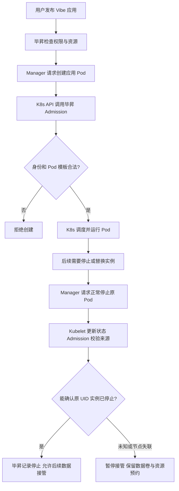
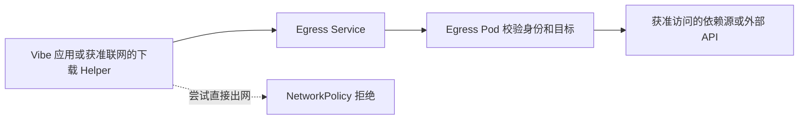

# F009 复评讨论与范围收敛

本文件记录 2026-11-10 用户对复评问题的进一步澄清。用户最新授权已确认第 1、2、4、5 项的简化边界；第 3 项先验证、有缺陷再修。具体实现已同步 design.md。仅修改源码与部署文件，不构建镜像、不部署线上。

## 1. 已确认：复用实际初始化状态，不加总完成标记

现有 `src/backend/entrypoint.sh:42–56` 执行 Alembic 成功后启动 API，并没有本设计提出的全局 `init_target_digest`/完成标记。标记是为新设计的“独立 bootstrap Job → 其他副本等待”协调流程新增的实现选择，不是标准 Helm 或 Kubernetes 的必需机制。

它原本要回答“所有必要初始化是否针对当前目标完成”，避免多副本并发迁移或拿旧初始化结果启动新服务；但实现它确实需要新增初始化/等待代码和持久状态，不能称为单纯 Helm values 变更。它不参与用户请求鉴权。

用户质疑后，不应将“补全这个新标记”直接当作必修业务 Bug。先比较复用 Alembic 既有版本、正式幂等初始化命令和各组件实际状态的最小方案，再决定启动顺序；仅设置 Helm `--wait` 不等于自动建立服务启动依赖。生产 OpenFGA 的正式初始化和官方 profile 种子仍要有明确入口，不能靠切 dev 或静默覆盖既有模型解决。

## 2. 用户已确认：不做旧部署接入兼容

本期没有已对外发布的标准 Helm 旧版本。不考虑 122 定制部署或其他旧方案自动迁入新标准 Chart，不新增它们的 claim 接纳、legacy 前代映射和兼容迁移流程。原复评 R-02 从本期阻塞中移出。

这里的“旧部署接入”与标准 Chart 发行后的正常 `helm upgrade` 不同。后者仍保留密钥、数据、用户默认项和运行应用，避免重新初始化覆盖已有内容。也不删除原有 Vibe 清单、操作或产品权限兼容合同。

## 3. Pod 保护：Kubernetes 机制与毕昇规则分别负责什么

Kubernetes 提供 RBAC、准入 Webhook、Pod UID、kubelet 状态等机制。现有毕昇代码决定哪些身份/模板/修改可接受，以及何时可将原实例认定为已停止。这些规则不是本次 Helm 新增的业务功能。

- `src/runtime-manager/runtime_manager/k8s_admission.py:234–270、452–519`：校验资源作用域、调用身份及 Pod 基线。
- 同文件 `521–546`：约束状态更新和终态来源；`548–585`：限制删除条件。
- `src/runtime-manager/runtime_manager/k8s_lifecycle.py:46–118、147–173`：按原 UID、实际状态及保护历史构造停止证据，再完成清理。
- `src/backend/bisheng/app_runtime/domain/repositories/runtime_kubernetes_repository.py:344–388`：核验并记录停止证据。

保护目标包括限制应用权限、避免伪造状态，以及防止旧实例仍写数据时启动第二个写入者。R-03 中“旧部署的前代保护映射如何迁入”随第 2 项排除；标准 Chart 未来更新本身若改变保护规则，仍不能破坏正在运行 Pod 的合法状态更新与停止证明。

## 4. Egress 与任务含义

“代理 A/B”只是解释中前后两个代理地址的例子，不是要增加两个代理组件。“任务”指已有的一次 Vibe 依赖准备、构建、预览或发布操作，不是新增用户任务类型。

当前 Chart 的 `deploy/kubernetes/app-runtime/templates/network.yaml:24–34` 只允许受管执行 Pod 连接 Egress Proxy 的端口；代理代码另按身份和域名规则决定允许的请求。允许的出网经代理，绕过代理的连接被网络策略阻断；禁网安装/编译阶段仍不能借此放开。

上轮 R-04 针对的是拟议的“动态观察 Service UID/IP 后冻结”设计缺口，不代表 Egress 现有能力本身有该 Bug。简化设计应先复用稳定 Service 入口和现有配置/操作模板；是否需要额外持久化地址观测，要由实际恢复链路证明，不能直接增加一套代理地址注册/冻结状态机。仅配置代理环境变量也不足以阻止绕过，网络策略与支持它的 CNI 仍是部署前提。

## 5. 用户已确认：沙箱启用后关闭的联动缺陷延期

R-05 是执行配置消费问题：已保存的 DB/Redis 端点可覆盖部署默认，删除内置 Runner 后容器执行器仍可能使用旧端点。它不仅是 Helm 模板问题；但本期按用户指示暂不修复。

本期以沙箱默认开启并持续使用为验收路径；“已有环境从启用转关闭后，旧端点、执行器与会话如何联动”单列后续问题，不作为本期阻塞，也不宣称已经验证支持。此延期仅缩小 AC-12 对这个切换场景的验收；不影响 Vibe 开关、全新安装显式关闭及已有 false 值保留等其他要求。后续教程应标明该限制，不能笼统宣称带已保存端点的运行环境可直接关闭内置沙箱。
