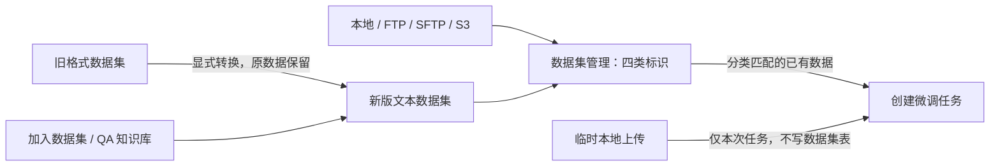

# 数据集迭代范围梳理（2026-11-25 用户已确认）

用户需求日期：2026-11-25。继续基于微调分支开发，保留模型名称支持小数点的修复。

核对基线：远程 `feat/3.1.0-beta1-025-multimodal-finetune` 为 `29f4c406718c85f88047b96007584df78237db7d`；本地工作分支 `codex/f025-model-name-dot` 为 `3b7cc045a1895ebc7c709e8a2186296d4f676f16`，该提交只增加模型名称小数点支持。

## 已核实的现状

| 业务入口 | 当前行为 | 本次需要调整 |
|---|---|---|
| 数据集管理页 | 调用 `/finetune/job/file/preset`，记录在 `PresetTrain`；支持本地旧格式及 QA 知识库导入 | 展示四类标识、统一新旧数据入口、接入已有远程来源导入能力 |
| 任务内已有数据选择 | 调用 `/finetune/datasets`，读取 `FinetuneDataset`，按报告中的类型过滤 | 改为选择数据集管理中已有的对应类型数据，避免两套可复用列表分离 |
| 任务内上传／导入 | 本地上传和远程导入均保存 `FinetuneDataset` 可复用版本 | 临时本地上传仅用于当前任务，不新增可复用数据集或版本记录 |
| QA 知识库转数据集 | 校验知识库访问权限，生成 `instruction/input/output`，保存旧记录 | 保留入口及权限检查，直接生成新版文本格式与文本分类 |

代码证据：`src/frontend/platform/src/pages/DataSetPage/{index,CreateDataSet,QaKnowledgeSelect}.tsx`；`src/frontend/platform/src/pages/ModelPage/components/{CreateTaskList,DatasetImportDialog}.tsx`；`src/backend/bisheng/finetune/{api/finetune.py,domain/services/finetune_file.py,domain/services/datasets.py,domain/repositories/dataset.py}`。

当前旧模板为 `instruction/input/output`；新版文本校验同时接受旧模板与 `messages`，因此不能仅根据“校验通过”判断其是否属于新版文本。新增分类后必须明确区分。

## 本次需求边界

| 编号 | 需求口径 | 可验收结果 |
|---|---|---|
| D1 | 分类为旧格式、文本、图文、视频；分类与来源分别记录和展示 | 数据集页能看到四类标识，并能按分类筛选；本地、FTP/FTPS、SFTP、S3/MinIO 导入按实际格式校验 |
| D2 | 保留旧格式及旧数据，提供显式转换 | 旧数据仍可查看、下载；转换另生成一份新版文本数据集，不覆盖原记录或内容；转换失败说明具体样本原因 |
| D3 | 任务按所选文本／图文／视频类型选择已保存数据集 | 下拉列表与数据集页使用同一业务来源，只显示当前租户可用且分类匹配的数据；旧格式需先转换后进入新版任务选项 |
| D4 | 创建任务页允许临时上传一份本地数据 | 上传后可以校验、预览和用于当前任务；不新增任何可复用数据集／版本表记录，不出现在数据集页及其他任务的已有数据列表中 |
| D5 | 保留“加入数据集”和 QA 知识库转数据集 | 新产生的样本直接规范化为新版文本数据，并标为文本；保留原有租户和权限约束 |

旧格式转换以 `messages` 文本格式作为目标，保留原问题、补充输入和标准答案；不能静默丢弃原输入或无法识别的会话信息。临时上传同样由服务端校验和复核，不接受浏览器伪造的类型、样本数、文件归属或校验报告；创建任务后只在任务自身记录中保留所用文件引用及校验快照。

示意：

沿用现有单任务单份数据、远程数据由 FT 直接读取、凭据不长期保存、原始模型与训练产物存放 FT 挂载目录等约定。不增加 FT 认证、模型 MinIO 归档、云数据源种类、定时同步或批量迁移需求。

## 确认与后续核对

1. 用户已确认上述 D1—D5 范围，包括旧格式转换保留原记录、另生成文本数据集，以及任务临时上传不写可复用数据集／版本表。
2. 继续核对“之前的加入数据集”的具体页面或按钮：当前分支已确认数据集页本地导入和 QA 知识库导入，尚未定位到另一个独立的同名入口；该业务要求已纳入规格，入口位置在技术设计阶段继续追溯，不将未定位视为可以移除。

本轮只完成代码链路核对与需求梳理，未修改业务代码、数据库或部署环境。按仓库 `docs/SDD-Guide.md` §1、§3，确认 Discovery 后更新并评审 `spec.md`，规格确认后进入技术设计；本次涉及数据分类、持久化规则和任务选数契约，使用完整 SDD 流程。
