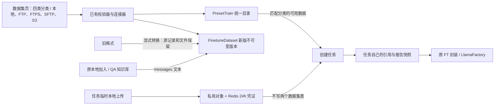

# 数据集迭代验证记录（2026-11-26）

当前范围：`codex/f025-model-name-dot` 上基于 `3b7cc045` 的数据集增量。规格、设计已确认；代码在隔离工作树本地实现。**未推送、未部署；109/20 的应用、数据库、FT 镜像均未在本轮变更。**

## 实际改动



新增数据库列和索引、目录 Repository/格式转换/临时上传服务、管理和预览 API；任务页分离保存数据与临时上传；现有 QA/本地加入写新版文本。同步三份 Nginx 规则及三语错误码、路由 scope 生成产物。FT 与 LlamaFactory 未改；基础模型及训练结果仍保存在 FT 挂载目录，不上传 MinIO。

## 自动检查

| 检查 | 实际结果与边界 |
|---|---|
| 后端 finetune + 隔离 HTTP E2E + 单迁移 head | 313 项通过；含新的 DDL 重复升级/默认值/唯一上传约束/回退保留原行测试 |
| 前端本轮关联套件 | 5 个文件，34 项通过；目录分类/转换保留旧行、临时上传隔离、错误重试、类型切换与菜单入口 |
| 扩大前端回归 | ModelPage + DataSetPage 共 43 文件、279 项断言通过，但有 1 个未处理异常；不能写为全绿。`knowledgeModelRetention.test.tsx` 缺 `LoadingIndicatorProvider` mock，在 `3b7cc045` 原始前端归档中单独复现相同错误；未扩大本轮范围修改该测试 |
| 类型检查 | 前后两个 SPA 与共享包全工作区 typecheck 通过；最终 Platform 1450 个严格文件通过 |
| lint / Ruff / arch-guard | 通过；前端原 `BatchTagDraftDialog.tsx:58` 有 1 条未使用 eslint-disable 警告；无新增 lint 错误 |
| i18n | 全工作区检查通过；错误码从 packages/locales 生成两端产物 |
| Platform 生产构建 | 通过；现有 chunk 体积警告保留 |
| 迁移 | 新唯一 head `v310_f025_dataset_catalog`，父 `v310_f025_merge_release_heads`；SQLite DDL 与事务测试通过；不等同 MySQL/DM8 实机迁移验收 |
| 路由 scope | 使用正式导出脚本从实际应用路由生成，新增 10 条，原条目不变 |
| Nginx | Compose、独立前端、Helm 三份规则一致；每份 5 个命中和 4 个反例通过。当前本机 Docker daemon 未运行，未执行 nginx -t、Helm 渲染或真实 2 GiB 上传；见联合验收清单 |

复跑入口（从仓库相应目录使用项目依赖环境）：

```bash
# src/backend
python -m pytest test/finetune/ test/e2e/test_e2e_f025_datasets.py test/database/test_alembic_single_head.py -q
# src/frontend/platform
pnpm exec vitest run src/pages/ModelPage/components/finetuneV2.test.tsx src/controllers/API/finetuneDatasets.test.ts src/pages/DataSetPage/index.test.tsx src/pages/ModelPage/components/CreateTask.permissions.test.tsx src/pages/ModelPage/finetune.permissions.test.tsx --maxWorkers=1 --minWorkers=1
pnpm typecheck
pnpm lint
pnpm build
# src/frontend
pnpm check-i18n
# 仓库根
bash scripts/arch-guard.sh
```

本轮 Python 使用 `/private/tmp/f025-dataset-python` 隔离环境补齐分支所需的 paramiko 3.5.1，未修改主工作区依赖；前端依赖也安装在隔离工作树。

## API E2E 覆盖

运行 `test/e2e/test_e2e_f025_datasets.py` 的两条完整 HTTP 链路：真实路由、Service、格式校验、Repository、SQLite；缓存与对象存储为受控内存替身，认证/请求准入与 FT 为替身。包含普通菜单用户允许/拒绝配对和严格租户过滤夹具。它不覆盖真实登录、生产 MinIO、真实远程协议传输或 GPU。

| AC | 自动证据 | 部署验收边界 |
|---|---|---|
| AC-40 | 目录分类/来源、分页测试；目录 UI 分类与来源分开显示 | 四类浏览器展示待验收 |
| AC-41 | 本地持久导入和类型不符拒绝 HTTP；现有连接器/脱敏测试回归 | FTP/FTPS/SFTP/S3 本次实际部署联测待执行 |
| AC-42 | 登记 dry-run/apply/重复运行跳过删除项；迁移不覆盖原行 | 目标历史数据 dry-run 待执行 |
| AC-43 | 转换 HTTP 保留旧对象；纯函数精确保留 system/history/input | 实际页面下载新旧文件待核对 |
| AC-44 | 坏格式、未知字段和混合格式拒绝，返回样本位置 | 页面错误提示待走查 |
| AC-45 | SQL 分类候选、错租户版本关联拒绝；任务类型切换 | 已保存版本真实训练待执行 |
| AC-46 | 临时上传和创建任务前后两个数据集表计数相等 | 数据库实机计数待核对 |
| AC-47 | 空名称 10109 后补含小数点名称成功；重复返回同一 ID，仅调用一次 FT | 实际页面连贯操作待走查 |
| AC-48 | 清空临时缓存后 preview 10134，任务列表快照仍完整，同请求重试返回已有任务 | 真实 FT 读取与训练完成待执行 |
| AC-49 | 原 `/job/file/preset` 本地加入入口输出新版文本回归 | 现有调用者/页面待联合验证 |
| AC-50 | 原 QA 生成文本、对象归属和知识库授权回归 | 实际 QA 页面及账号验收待执行 |
| AC-51 | 类型不符和服务端权威报告复核；临时与保存互斥 | 浏览器类型切换待走查 |
| AC-52 | 菜单权限允许/拒绝、用户凭证归属、跨租户旧引用与数量隔离 | 实际登录及网关准入待验收 |

整体 E2E 状态：**PARTIAL**（隔离 HTTP 与本地自动化通过，目标部署/浏览器/真实训练未执行）。正式 QA 八列用例 `test-cases.md` 保持“待执行”；手动清单见 `e2e-checklist.md`，不将编写用例算作执行。

## 本次升级顺序与回退

1. 只更新明确指定的走查项目，先留存现有构建、配置和数据库备份，再执行本次加列迁移。
2. 使用目标环境既有配置和对象存储连接，先按租户 dry-run，再核对 registered/skipped/errors 后 apply：

   ```bash
   cd src/backend
   uv run python scripts/register_f025_dataset_catalog.py --tenant-id <目标租户ID>
   uv run python scripts/register_f025_dataset_catalog.py --tenant-id <目标租户ID> --apply
   ```

3. 脚本错误返回非零，保留原文件/记录；不可读对象、格式不明、仅存远程文本计划而无法核实原始格式的记录需要按错误清单核对，不伪造新版分类。登记不是业务请求的升级账本依赖。
4. 更新平台前后端并同步所在部署形态的 Nginx 配置；完成 `e2e-checklist.md`。本轮无需变更 FT 镜像或模型挂载目录。
5. 回退应用保留新增字段、目录及原文件，不执行删除字段/覆盖对象的回退；目录删除只是软删除，兼容登记不将其复活。原 v1 调用只选旧格式目录，新版文本走 v2 任务路径。
