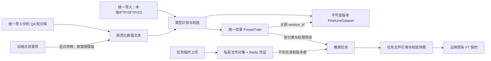

# Design: 多模型多模态微调闭环

> **本文档定位 — 现状快照（Why this How）**
>
> `spec.md` 定义需求和验收口径；本文记录本功能选定的实现边界、契约和已知坑；`tasks.md` 记录实际执行。

**关联**: [spec.md](./spec.md) · [tasks.md](./tasks.md)
**版本**: v3.1.0-beta1（F025）
**最后更新**: 2026-11-26（数据集迭代已本地实现；目标环境联合验收待执行）

---

## 1. 目标与非目标

- **目标**：在保留旧文本任务的前提下，把毕昇微调入口改造成由训练服务能力驱动的文本/图文/视频 LoRA 闭环；平台负责租户、数据、任务和事实展示，训练服务负责模型适配、GPU 预检、训练、产物检查和独立样本推理。
- **非目标**：本功能不建设通用训练编排平台，不另建第二个数据集管理中心、长期凭据库或定时同步机制，不开放音频、视频音轨、QLoRA 或大规模训练，不改变在线推理服务的发布协议，也不部署生产环境。

---

## 2. 关键约束

- 遵循 [`docs/constitution.md`](../../../docs/constitution.md) C1–C8；新增平台调用遵循 Router → Service → Repository/外部适配器，新增数据库字段使用双数据库兼容类型，租户继续由现有上下文自动注入。
- 主平台和 `bisheng-ft` 是两个独立仓库、两个部署单元；跨边界只能依赖版本化 HTTP 契约，不能 import 对方源码。
- 模型能力以“训练服务 + 精确基础模型标识 + 权重版本”为作用域；一次 GPU 实测不能升级为所有同名或同系列模型均支持。
- 本次能力组合增加 `Qwen/Qwen3-0.6B + text + lora` 和 `Qwen/Qwen2.5-VL-3B-Instruct + image_text/video_text + lora`；验证状态由对应正式 FT 运行证据决定。旧文本白名单保留兼容状态，但不伪装为本轮重新验证。
- 本轮沿用 Docker 内可见的 NVIDIA GPU 及现有设备映射；2026-11-25 走查部署记录使用 GPU 7，数据集迭代不改映射，页面不得把宿主编号当作稳定设备标识。
- 每项任务使用一份已保存的不可变数据版本或本次临时上传的数据快照。文本支持 JSON/JSONL/ZIP；图文和视频最终形成 ZIP，根清单接受 `train.json`、`train.jsonl`、`data.json` 或 `data.jsonl`，媒体使用包内安全相对路径，不限定 `media/` 目录。解压后总量、路径穿越、符号链接、缺失媒体和图片解码必须在提交前检查。
- 基础模型和训练产物继续保存在 FT 容器挂载目录，由训练服务管理；平台只保存引用、任务快照和报告，不读取 API 节点本地模型文件，不新增模型 MinIO 归档。
- 真实 GPU 训练和推理测试只证明链路；合成小数据集不得形成效果、容量或稳定性承诺。

---

## 3. 方案对比与选定

### 决策 1：模型支持范围由训练服务能力目录驱动

- **备选**：
  - A. 在 React 页面维护模型名称数组 — 改动小，但平台会凭名称猜测能力，新模型需要重新发前端。
  - B. 从模型目录自动扫描并按名称/架构推断 — 能发现模型，但无法证明模板、LoRA 目标、GPU 和推理重载已经验证。
  - C. 训练服务返回显式能力目录，平台保存任务时冻结能力快照 — 新模型通过数据登记扩展，验证状态可追溯。
- **选定**：C。
- **原因**：现有页面只有 `sft_support` 布尔值，旧 wrapper 只有十个精确名称；真实验证已经证明两个新模型可用，但没有证据支持整系列自动放行。显式目录同时解决扩展性和“不把模拟/推断当实测”。
- **何时该重新考虑**：模型注册统一归入平台模型中心，并能为每个训练服务维护同等完整的能力和验证证据时，可由平台作为目录真相；FT 仍需在提交时复核。

### 决策 2：保持旧接口并新增能力、预检和验证契约

- **备选**：
  - A. 原地替换 `/v2.1/sft/job` 的请求和状态 — 契约整洁，但会破坏现有文本任务和旧训练镜像。
  - B. 保留旧 job 契约，增加 capabilities/preflight/inference/artifacts，并让新任务携带版本字段 — 可滚动兼容，平台可识别旧服务。
  - C. 主平台直接 SSH/执行训练 CLI — 绕过服务契约，无法正确处理权限、状态和多实例。
- **选定**：B。
- **原因**：PRD 要求旧文本回归；当前平台已经通过 `SFTBackend` 隔离训练服务。扩展同一边界的风险小于跨越边界直接执行命令。
- **何时该重新考虑**：所有部署都升级到新契约且历史任务完成迁移后，可另起版本删除 legacy adapter；不能在本 feature 内静默删除。

### 决策 3：本地与远程数据统一形成不可变版本

- **备选**：
  - A. 浏览器分别上传 JSON 和任意数量图片，由页面维护对应关系 — 交互灵活，但刷新、重试和任务快照容易失配。
  - B. 上传包含清单和媒体的 ZIP，平台生成内容哈希及检测报告 — 数据版本天然不可变，便于训练节点一次拉取和复现。
  - C. 训练服务直接读取用户电脑目录 — 服务器不可达且破坏安全边界。
- **选定**：B；文本 JSON/JSONL 继续兼容。11月3日增加 FTP/显式 FTPS、S3/MinIO 一次性导入，由正式平台后端读取清单和相对媒体并收敛到同一上传校验及版本存储路径。
- **原因**：ZIP 保留清单和媒体关联，并在 MinIO 中形成单一不可变对象；复用版本无需每次重新连接来源。当前 20 MiB、500 个读取文件和 90 秒是小规模导入实现边界，不是客户规模承诺。
- **何时该重新考虑**：超大数据集、定时同步或长期数据源进入范围时，改用异步导入和对象清单；不能把本次有界同步读取扩展为无限制单包。
- **2026-11-19 修订**：远程图文/视频数据改为决策 8 的「导入计划」，不再复制进 MinIO；本地上传上限提高到 2 GiB。文本远程清单仍按本决策存成平台内的 JSON 版本。

### 决策 4：现有任务表兼容扩展，不新建第二套任务系统

- **备选**：
  - A. 为多模态另建任务表和页面 — 隔离快，但产生两套状态、取消和发布逻辑。
  - B. 扩展 `Finetune`，增加数据类型、阶段、能力快照、数据检测、产物和推理验证字段；旧记录字段为空时按 legacy 展示。
  - C. 把所有新增事实塞进 `extra_params` — 无迁移，但查询、展示和长期契约不可控。
- **选定**：B。
- **原因**：现有任务已有租户、状态、日志、取消和发布生命周期。新增字段使用 `JsonType`/`LargeText`，可同时适配 MySQL 和 DM8，并能明确区分历史未知与本轮已验证。
- **何时该重新考虑**：本轮已使用独立 `FinetuneDataset` 保存数据版本；评测、多产物发布形成独立生命周期，或一项训练需要多个并行 trial 时，再拆分其余实体。

### 决策 5：成功由“进程 + 产物”共同决定，真实推理单独记录

- **备选**：
  - A. 训练进程退出码为 0 即成功 — 延续旧行为，但可能缺 adapter/processor。
  - B. 退出码为 0 且产物清单完整才进入训练成功；独立样本推理作为单独验证状态展示。
  - C. 推理效果必须达到统一准确率才成功 — 小样本和不同任务没有统一阈值，容易制造虚假指标。
- **选定**：B。
- **原因**：真实实验已经出现“产物重载”是独立必要步骤；同时本轮合成样本只能证明格式和链路，不能设通用效果阈值。
- **何时该重新考虑**：客户提供正式评测集和签字阈值后，新增任务级效果验收，但仍不能替代产物完整性检查。

### 决策 6：现有数据集页统一管理，任务内临时上传不入库（2026-11-26）

- **备选**：A. 沿用两套列表，任务内每次导入均保存版本；B. 扩展现有 `DataSetPage` 为统一入口，任务内只选择已保存数据或上传临时文件；C. 新建另一套数据集中心并迁走全部旧数据。
- **选定**：B，对应用户已确认 AC-40—AC-52，替代原任务内导入即永久保存的约定。
- **原因**：代码已存在 `PresetTrain` 目录和 `FinetuneDataset` 版本两种职责；统一业务入口即可复用现有能力，同时避免临时试验污染长期列表。旧入口和历史任务不能被迁走或删除。
- **边界**：数据集页支持旧格式/文本/图文/视频与本地/FTP/FTPS/SFTP/S3；任务临时上传仅本地文件，不保存为数据集。已有远程版本仍要求每次训练重新输入凭据。
- **何时重新考虑**：用户另行要求任务内主动保存为数据集、长期凭据或后台同步时，再扩展入口；本次不自动增加这些行为。

### 决策 7：数据送达训练服务——能拉就拉，拉不到就直传（2026-11-18）

- **背景**：老设计默认 FT 与平台同机部署，FT 按平台签发的对象存储链接自己下载。平台和 GPU 分开部署时，FT 常常访问不到平台的对象存储（网络分区、NAT、`sharepoint` 默认 `127.0.0.1:9000`）。2026-11-18 实测：GPU 服务器访问不到经 NAT 接入的平台，平台却能访问 GPU。
- **备选**：A. 只拉取，要求客户开放 GPU → 平台存储的访问；B. 只直传，所有字节经平台后端转发；C. 每次提交先让 FT 试下载，能下载就拉取，下载不到就直传。
- **选定**：C。FT 新增 `POST /v2.1/sft/probe`（试下载并返回是否可达）和 `PUT /v2.1/sft/files/{sha256}`（按内容哈希接收文件，已存在则直接复用）；直传后任务里的数据引用写成 `ft-file://<sha256>`。没有探测接口的旧版 FT 返回 404 时保持拉取。
- **原因**：网络通的环境保持由对象存储直接供数，不给平台后端增加负担；网络只通一个方向时也能训练。客户 IT 只需开放「平台 → FT」一个方向。
- **代价与边界**：直传时数据经平台后端转一手（按 1 MiB 分块边读边发，不整体读入内存）；FT 上的直传文件按哈希去重保存，删除任务不会清理，需要定期运维清理。几百 GB 级数据两种方式都不合适，由决策 8 让 FT 直接读取客户数据源。

### 决策 8：远程数据直达训练服务，平台只登记计划（2026-11-19）

- **背景**：远程导入原先把清单和媒体全部读到平台、打成 ZIP 存进 MinIO，再拉取或直传给 FT。数据要多走一趟，平台后端还要承担几十上百 GB 的读写。用户的诉求是数据从自己的存储直接到 GPU。
- **备选**：A. 维持复制进平台（上限只能很小）；B. 导入时平台只登记清单和文件大小，训练时 FT 用当次输入的凭据直接下载；C. 平台长期保存凭据，后台定时同步到 FT。
- **选定**：B。导入时平台读清单、按目录列出文件大小、取前 3 条样本的媒体做预览；生成 `remote_plan`（清单记录 + 每个文件的相对路径和大小，或远程 ZIP 的路径和大小）存成一个小对象作为不可变版本。提交训练时用户再输一次密码/密钥，随 `dataset_source` 只发给 FT；FT 先登录并读一个文件（`POST /v2.1/sft/source/check`），通过后才建任务，再逐个下载、核对大小、照常校验和训练。
- **原因**：大数据不经过平台；凭据不落盘，平台和 FT 都不保存；复用版本时仍是同一份清单。用户 2026-11-19 选择「远程来源一律直达 GPU」「每次提交训练时再输一次密码」。
- **代价与边界**：GPU 服务器必须能访问数据源；导入时只核对大小，同样大小的内容替换发现不了；远程 ZIP 在 FT 下载后才检查内容，平台无预览；单个远程数据集默认最多 200,000 个文件、200 GiB（FT 环境变量可调）。没有断点续传。
- **何时该重新考虑**：需要定时同步、长期凭据或逐文件哈希校验时，改为 C 加凭据托管（密钥管理服务）另行设计。

### 决策 9：新训练服务恢复 Freeze 和全量（2026-11-20）

- **背景**：老页面默认是全量，另有 Freeze 和 LoRA；新页面最初只接了新训练服务验证过的 LoRA，升级后这两种方式消失。用户认为去掉会显得奇怪。
- **选定**：在新训练服务上补回，不恢复老训练服务和老模型。能力目录的 `training_methods`：文本模型 `lora/freeze/full`，图文、视频模型 `lora/freeze`。Freeze 训练最后 `freeze_trainable_layers` 层（默认 2），视觉部分与 LoRA 一样冻结；全量默认学习率 1e-5。Freeze 和全量都产出完整模型，产物检查要求模型权重，新样本推理从任务目录加载模型。
- **代价与边界**：图文、视频 3B 模型全量需要约 50 GB 显存，单卡不提供；全量产物较大（Qwen3-0.6B 约 2.3 GB，以 fp32 保存）。能力条目 ID 里的 `lora` 是历史命名，改 ID 会让旧任务对不上快照，保持不变。只做了小样本真机验证。
- **老训练服务**：没有能力目录接口时报 10133「训练服务版本过旧」，提示升级；不再兼容老训练服务的新建任务。

### 合入 beta1 的权限与隔离（2026-11-20）

- 上游 11-19 把微调任务改为「当前有效 `model` 菜单」授权（`get_finetune_user`），训练服务维护仍要求管理员。F025 新增的任务接口（能力、预检、推理验证、验证媒体、数据集版本列表 / 导入 / 预览）同样走 `get_finetune_user`；创建页的服务下拉改用 `GET /api/v1/finetune/server/options`（只返回 id 和名称），「训练服务管理」按钮只对管理员显示。
- 查任务统一走上游 `_get_job`（同时校验训练服务仍属本租户、没有被其他租户共用）。远程计划对象改存到 `finetune/train_file/personal/{tenant}/{user}/` 下。
- 老版任务仍走上游的文件归属校验（个人文件只能是本人上传）；v2 数据集版本是租户内的不可变记录，同租户有模型菜单的人都能复用（AC-26/29），由 `validate_uploaded_datasets` 按租户重读记录。**这一点与上游「其他用户的个人上传不能用于训练」的原则不同，需要和上游负责人确认。**
- 老版任务的 `extra_params` 上游改为严格校验（未知字段拒绝），所以只有 v2 任务带 `contract_version` / `capability_id`。

---

### 决策 10：目录与版本保留两种职责，不保留两套可复用列表

- **备选**：A. 用报表 JSON 中的类型字段并集合并旧、新接口；B. `PresetTrain` 作为统一目录，关联 `FinetuneDataset` 不可变版本；C. 删除旧表，把所有记录迁入新表。
- **选定**：B。旧目录保留原 ID、文件和创建者；新增分类与版本关联。已保存的新版本补齐目录索引，任务只查询这一目录。
- **原因**：`DataSetPage` 实际使用 `PresetTrain`，不是遗留的 `database/models/dataset.py`；新版本还承载推理媒体，不能把所有 `FinetuneDataset` 行都展示为训练数据。类型列和 SQL 分页也避免现在先读全表、再在 Python 中过滤报告。
- **事务**：新格式导入一次写入目录和版本，使用同一 Repository 事务；保存失败不能留下可选目录。删除目录仅标记不可用，不删除不可变版本或训练文件；列表中消失且不能再被新任务选择，历史引用保留。此标记同时防止兼容登记脚本重新发现孤立版本后把已删除的数据复活。
- **何时重新考虑**：明确需要数据集内多个版本的编辑、发布和回滚生命周期时再扩展；本轮每个目录项关联一个版本，不增加版本管理产品功能。

### 决策 11：旧格式显式转换，分类依据实际内容

- **备选**：A. 把历史 `report.data_type=text` 全部当作新版文本；B. 按实际清单识别格式，旧格式只在用户点击转换时规范化；C. 升级时批量覆盖旧文件。
- **选定**：B。`instruction/input/output` 属于旧格式，`messages` 属于新版文本；图文、视频仍按现有媒体规则校验。远程纯文本 ZIP 由平台有界读取（200 MiB 清单上限加 1 MiB 压缩包开销）；图文/视频继续沿用 FT 直读来源计划。新版文本导入拒绝旧格式，不再提供旧格式新导入；已有历史旧格式仍保留并支持显式转换。
- **原因**：现有 `validate_records()` 同时接受两种文本，报告中的 `text` 不足以证明已转换；用户明确要求保留旧格式，覆盖文件会破坏原数据和历史引用。
- **转换**：纯函数输出 `messages`：可选 `system` 放第一条，合法 `history` 问答对顺序保留；`instruction` 与非空 `input` 用两个换行连接成当前 user，`output` 为 assistant。无输入不追加空文本。非字符串、无法识别的会话字段或损坏 history 报样本位置，不猜测或丢弃。转换结果重新校验后保存新目录、新版本，`source_dataset_id` 与源内容哈希用于追溯，原记录不更新。
- **何时重新考虑**：用户确认新增旧格式方言时，增加有样例与测试的适配器；不能在通用校验中扩大隐式猜测。

### 决策 12：临时上传凭证放 Redis，任务引用落任务表

- **备选**：A. 在版本表中写临时行并靠过滤隐藏；B. 仅信任浏览器回传报告；C. 私有对象存储保存文件，Redis 保存有时效的服务端校验凭证，成功任务保存自身引用和快照。
- **选定**：C。A 仍违背“不写数据集/版本表”，B 可伪造类型、数量和文件归属。
- **范围**：上传产生随机 `upload_id`，凭证绑定 tenant、user、对象 key、类型、哈希、样本数和预览，默认有效期 24 小时；不保存源连接凭据。失效或 Redis 不可用时明确要求重新上传，不能改为信任客户端。
- **重试**：预检或任务参数校验失败不消费凭证。成功提交时 `Finetune.transient_upload_id` 的唯一约束阻止同一临时上传重复创建任务；相同用户、相同规范化配置重试返回已创建任务，不重复发起 FT；配置不同则提示该上传已用于任务，需重新上传。比较用快照不包含密码/密钥。数据库提交前失败回滚后仍可重试，提交后 FT 失败按既有任务状态展示。
- **生命周期**：任务提交成功后，执行和历史查看使用任务中的文件引用与报告，不依赖 Redis 后续存活。临时文件位于对象存储私有前缀，不是 API 本地目录；取消或过期不自动成为数据集，不新增后台清理机制或 FT 数据副本清理需求。
- **何时重新考虑**：需要跨会话恢复未提交表单或长期保存临时材料时另行定义生命周期；本次只保证有效期内重试与已创建任务追溯。

## 4. 系统现状（接手必读）

已核实基线为微调分支 `29f4c406` 加模型名修复 `3b7cc045`。本轮数据集迭代已在该基线上本地实现，§4.4—§4.8 描述当前代码；测试与部署边界见 dataset-iteration-validation.md，不表示走查环境已经升级。

### 4.1 数据流

#### 能力发现

`创建页选择训练服务 → 平台 GET /api/v1/finetune/capabilities → FinetuneService → SFTBackend → FT GET /v2.1/sft/capabilities → 页面按 data_type/method/status 筛选`

- FT 从版本控制内的能力清单读取精确模型条目，并结合当前模型目录和运行依赖返回 `available` 与检查原因。
- 平台不缓存为第二份长期真相；创建任务时把当次条目冻结到 `capability_snapshot`。
- 老 FT 服务没有能力接口时，平台只返回 `legacy` 条目，不开放图文。

#### 数据上传与预检

已核实基线：`单页选择已有版本，或任务弹窗导入 → 现有导入器/FinetuneFileService → 对象与 FinetuneDataset 版本 → 数据报告/预览 → 预检`。本轮以 §4.4 的目录与临时上传两条路径替换“任务导入即入库”。

- 文本 JSON/JSONL 支持 Alpaca 和 `messages` 对话结构。ZIP 根清单支持 `train` 或 `data` 的 JSON/JSONL，媒体使用相对路径；平台拒绝绝对路径、`..`、符号链接、缺失媒体及不可解码图片。视频当前仅 MP4，平台先做结构检查，FT 再真实解码。
- `GET /datasets` 按模态列出当前租户版本；前端保留完整版本对象作为唯一 `train_data`，创建时后端按租户及对象 URL 重新读取报告。
- 导入请求以 JSON body 提交 `source`、`connection`、`manifest_path` 或 `manifest_text + manifest_filename`、`media_root`。凭据不进入 URL、存储记录或日志。
- 导入端点通过专用解析依赖读取有界请求体，使用 `model_validate_json` 校验；将错误转换为 10129 并排除 input/context，避免旧全局 422 处理器回显凭据。该解析不改变前端 JSON 字段结构。
- 已有及远端版本通过 `/datasets/{version_id}/preview` 返回前三条样本；媒体 URL 同源且受认证。前端封装请求下载 Blob 以携带 Bearer 身份，展示结束撤销 Blob URL，不把令牌加到媒体 URL。
- FT 在真正创建任务前再次检查能力和资源，避免页面检查后 GPU 状态变化。

#### 数据送达（2026-11-18）

`提交任务 / 新样本验证 → transfer.reference_for → 签发存储链接 → FT /v2.1/sft/probe → 可达：把链接交给 FT（pull）；不可达、签发失败或探测失败：从 MinIO 分块读取 → FT PUT /v2.1/sft/files/{sha256} → 交给 FT ft-file://<sha256>（push）`

- 结果写入 `dataset_report.transfer`（训练）或验证记录的 `transfer` 字段（新样本），详情页显示「数据传输方式」。
- 直传失败在创建远端任务之前报 10131，不会留下没有数据的远端任务。

#### 远程数据源（2026-11-19）

`导入：平台 remote_reader 登录来源 → 读清单 → 按目录列出文件大小（SFTP listdir_attr / FTP MLSD，不支持时逐个 SIZE / S3 list_objects）→ 读前 3 条样本的媒体并解码 → remote_plan 存 MinIO（<id>.plan.json）+ 预览包（<id>.plan.json.preview.zip）→ FinetuneDataset(report.delivery="remote", report.remote=公开连接信息)`

`训练：页面输入密码/密钥 → POST /api/v1/finetune/job（dataset_credentials，专用解析，不入库）→ transfer.remote_source 合并公开信息和本次凭据 → FT /v2.1/sft/source/check → 计划对象按拉取/直传送达 → FT /v2.1/sft/job（dataset_source）→ FT 下载每个文件并核对大小 → 校验 → 训练`

- 文本远程清单不生成计划，直接按本地 JSON 上传的路径存成平台版本（数据就在清单里）。
- 任务的 `dataset_report.transfer` 记为 `source`，详情页显示「训练服务器直接从数据源下载」。
- FT 只把去掉密码/密钥的 `dataset_source` 写进任务状态文件；校验失败的请求体不回显（422 处理器去掉 input）。

#### 训练与验证

`POST /api/v1/finetune/job → 平台冻结快照并调用 FT → FT 准备数据并运行 LlamaFactory → 状态/日志轮询 → 产物清单 → 页面提交独立文本/图片 → FT 干净子进程重载并推理 → 平台保存验证记录`

- 旧文本任务继续走原 legacy 参数映射。
- 新任务使用 `contract_version=2`，训练服务使用参数数组或配置文件执行，不拼接用户输入到 shell 字符串。
- 平台的 `status` 保留旧五态兼容列表，新增 `stage` 表示 `preparing/training/checking_artifacts/validating/completed/failed/cancelled`。

### 4.2 关键数据结构 / 字段约定

#### 模型能力条目

| 字段 | 类型 / 格式 | 说明 | 消费方 |
|---|---|---|---|
| `capability_id` | string | 精确条目 ID，模型版本变化必须换 ID | 平台、FT、任务快照 |
| `model_name` | string | 模型管理中使用的精确名称 | 平台模型选择器 |
| `model_path` | string | FT 节点内配置路径；不返回浏览器 | FT |
| `input_types` | `string[]` | `text`、`image_text` 或 `video_text` | 页面筛选、预检 |
| `training_methods` | string[] | 以能力目录声明的 `lora/freeze/full` 为准，不能凭名称放行 | 页面、预检 |
| `template` | string | LlamaFactory 模板 | FT adapter |
| `validation_status` | enum | `gpu_smoke_passed/legacy/unverified/blocked` | 页面、提交门禁 |
| `validation_evidence` | object | 环境、日期、基础模型版本和证据摘要 | 任务详情 |
| `parameter_schema` | object | 可公开参数、默认值和上下限 | 页面表单、服务端校验 |

#### 创建和预检请求

| 字段 | 类型 / 格式 | 说明 | 消费方 |
|---|---|---|---|
| `contract_version` | integer | 新任务固定为 `2`；缺失视为 legacy | 平台、FT |
| `data_type` | enum | `text` / `image_text` / `video_text` | 平台、FT |
| `capability_id` | string | 选择的精确能力条目 | 平台、FT |
| `train_data` | array，长度为 1 | 平台创建请求携带已保存版本或临时上传的标识，服务端解析为实际对象引用和报告 | 平台 |
| `method` | enum | 只允许当前能力目录提供的训练方式 | 平台、FT |
| `parameters` / `extra_params` | object | 预检使用 parameters，创建使用 extra_params；只允许能力 schema 的训练参数 | 平台、FT |
| `preflight` | object | `passed`、逐项 `checks` 和资源快照 | 页面、任务记录 |

#### 远程数据计划（`remote_plan`，2026-11-19）

| 字段 | 类型 | 说明 |
|---|---|---|
| `kind` / `version` | `"remote_plan"` / `1` | FT 据此走直连下载 |
| `data_type` | enum | 必须与任务一致 |
| `layout` | `manifest` / `zip` | 清单 + 媒体，或来源上的完整 ZIP |
| `records` | array | 清单全部记录（仅 manifest） |
| `files[]` | `{path, size}` | 相对媒体路径和导入时的字节数（仅 manifest） |
| `zip` | `{path, size}` | 来源上的 ZIP 路径和大小（仅 zip） |

版本报告 `report.remote` 保存 `type/endpoint/username/bucket/region/tls/host_fingerprint/layout/path/media_root/probe`，不含任何密码或密钥；`report.sha256` 是计划对象的哈希，`report.total_bytes` 是计划内文件总大小。

#### 任务扩展字段

| 字段 | 类型 | 说明 |
|---|---|---|
| `data_type` | string | 旧记录为空，显示为 legacy/未知，不推断 |
| `stage` | string | 细粒度阶段，不替换旧 `status` |
| `capability_snapshot` | JSON | 创建时冻结的能力事实 |
| `dataset_report` | JSON | 数据对象哈希、样本数、媒体数和检测结果 |
| `artifact_report` | JSON | 文件名、大小、SHA-256 和完整性结论 |
| `inference_validation` | JSON | 输入摘要、基础/适配器身份、生成参数、真实输出或失败原因 |

### 4.3 关键模块职责

| 模块 / 文件 | 职责 | 不做什么 |
|---|---|---|
| `finetune/api/finetune.py` | 认证后的 HTTP 输入输出和 DTO 转换 | 不访问数据库、不拼训练命令 |
| `finetune/domain/services/finetune.py` | 编排能力、数据、预检、任务、产物和验证规则 | 不写 ORM 查询、不凭模型名推断能力 |
| `finetune/domain/services/finetune_file.py` | JSON/ZIP 安全检测、哈希和 MinIO 存储 | 不训练、不保存源凭证 |
| `finetune/domain/sft_backend.py` | 版本化 FT HTTP adapter 和错误翻译 | 不承担业务授权、不持久化任务 |
| `finetune/domain/models/finetune.py` | 任务持久化字段和 DAO | 不调用外部服务 |
| `controllers/API/finetuneV2.ts`、`finetuneDatasets.ts` | 新训练和数据集 HTTP 类型与请求边界 | 页面/store 不直接发 HTTP、不存连接凭据 |
| `finetune/domain/services/datasets.py`、`remote_dataset.py` | 版本列表/导入/预览；登录来源、读清单、列文件大小、取 3 条预览样本，生成远程计划 | 不下载全部媒体、不保留来源凭据 |
| `finetune/domain/services/transfer.py` | 计划/数据包送达 FT（拉取或直传）；合并本次凭据并让 FT 预检数据源 | 不记录凭据、不持久化 `dataset_source` |
| `ModelPage/components/DatasetSourceCredentials.tsx` | 远程版本提交前输入本次密码/密钥 | 不写入 store、浏览器存储或 URL |
| `bisheng-ft/sft_server/remote_source.py` | FT 侧 FTP/FTPS/SFTP/S3 连接、SSRF 防护、按计划下载并核对大小 | 不把凭据写盘或写日志 |
| `ModelPage/components/DatasetImportDialog.tsx`、`SavedDatasetPreview.tsx` | 现有导入与鉴权预览；本轮拆分保存与临时预览调用 | 不伪造校验报告、不把临时上传写入数据集表 |
| `ModelPage/components/CreateTask*` | 单页分区表单、能力筛选、检测和预检展示 | 不维护模型白名单、不伪造状态 |
| `bisheng-ft/sft_server/capabilities.py` | 加载和校验能力清单 | 不从相似名称自动放行模型 |
| `bisheng-ft/sft_server/preflight.py` | 检查模型文件、模板、依赖、GPU 和参数 | 不创建任务 |
| `bisheng-ft/sft_server/sft_manage.py` | 隔离任务目录、进程生命周期、状态和产物清单 | 不决定平台租户权限 |
| `bisheng-ft/llmtuner/wrapers/trainval.py` | 把能力条目和标准任务参数映射到 LlamaFactory | 不使用前端任意参数拼 shell |

---

### 4.4 数据集迭代的数据流（本地实现）



### 4.5 数据模型与升级（本地实现）

| 实体 | 本轮字段/约定 | 真相与查询规则 |
|---|---|---|
| `PresetTrain` | 新增 `data_type`：legacy/text/image_text/video_text；`source_type`：local/ftp/sftp/s3/qa/collection；可空 `version_id`、`source_dataset_id`，新增 `is_deleted` 默认 false | 训练数据集的唯一目录；列表和新任务选择仅取未删除项；现有 `type=0/1` 保留原义，不拿它承载四类分类 |
| `FinetuneDataset` | 保留已有版本和推理媒体字段，增加明确的格式标识写入校验报告 | `purpose=training` 的版本由目录关联；`purpose=inference` 永不进入目录；对象 URL 与报告由服务端返回 |
| `Finetune` | 新增可空 `transient_upload_id`，非空唯一；`train_data`、`dataset_report` 保存本次快照 | 已保存数据记录 catalog_id/version_id；临时数据记录 upload_id、私有对象 key 和服务端报告；不存源密码 |
| Redis | `finetune:task-upload:{tenant_id}:{user_id}:{upload_id}`，带 TTL | 只作临时上传凭证；非持久目录，不跨用户读取；预览同样检查归属与有效期 |

`version_id` 在目录中非空时唯一，重复导入流程必须在事务中处理唯一冲突，避免一个历史版本补登记多次。MySQL/DM8 使用同一类型与 Repository SQL；可空唯一列和索引由双数据库回归验证。

升级先做纯 DDL；新 revision 为 `v310_f025_dataset_catalog`，接核实的唯一 head `v310_f025_merge_release_heads`。一次性兼容登记脚本位于 backend/scripts，支持 dry-run、分页和重复执行；不从 API 启动、列表请求或权限服务触发全量扫描。旧目录默认 legacy，脚本按实际清单判别：真实旧格式保留；已有 messages 文本补不可变版本与目录关联；旧 QA 来源恢复为 qa。历史独立训练版本也按真实清单补目录；原对象不重写。目录存在且 version_id 已关联时跳过；ID 碰撞不能覆盖不同数据，应换新目录 ID 并保留版本关联。清单无法读取或格式不明时保留原记录，报告为待核实，不伪造文本分类/已验证状态。

兼容登记属于本轮升级步骤，在切换新版管理/任务入口前执行，并核对有效旧目录、历史训练版本与登记结果；失败项保留原行和文件并输出清单，不伪造分类。迁移或登记失败时保持原应用服务，不以半完成结果宣称升级通过。新 API 只查统一目录，不在列表请求中扫描对象存储或回退到第二套可复用列表，也不查询任何“升级完成账本”作为业务准入。脚本重复运行必须识别包含 is_deleted=true 的已有版本关联，不能重新加入已被用户删除的目录项；按租户执行作用域调用 Repository，不能在业务查询中手写 tenant_id 过滤。

### 4.6 接口与权限（本地实现）

| 接口 | 用途 | 权限/兼容 |
|---|---|---|
| `GET /finetune/dataset-catalog` | 四类管理列表，keyword/data_type/source_type/page/limit；返回 data/total | `get_dataset_user`；SQL 分页，列表与数量同条件 |
| `POST /finetune/dataset-catalog/files` | 本地持久导入，显式 name/data_type，仅 text/image_text/video_text | 数据集权限；检测后保存目录及必要版本 |
| `POST /finetune/dataset-catalog/import` | 现有 FTP/FTPS/SFTP/S3 持久导入 | 数据集权限；复用连接器及凭据脱敏，不能借任务权限写目录 |
| `POST /finetune/dataset-catalog/{id}/convert` | 旧格式转新文本 | 数据集权限与严格租户范围；返回新目录项，原记录不变 |
| `DELETE /finetune/dataset-catalog/{id}` | 将目录标为已删除 | 数据集权限；新列表与新任务不可用，保留版本和历史引用，不扩大为物理文件清理 |
| `GET /finetune/dataset-catalog/{id}/preview`、`/media`、`/download` | 管理页查看与下载 | 数据集权限；内部复用版本/旧格式读取，不能要求用户额外拥有模型菜单权限 |
| `GET /finetune/datasets` | 任务候选，只含活动目录关联的已校验新版版本 | `get_finetune_user`；按任务三类筛选；返回值保留 TrainingFile 兼容字段并增加 catalog_id |
| `POST /finetune/job/file` | 改为任务临时本地上传 | 任务权限；返回 `{id: upload_id, upload_id, name, url, dataset_report, expires_at, temporary:true}`，不写任何数据集表 |
| `GET /finetune/task-uploads/{upload_id}/preview`、`/media` | 临时文件预览 | 任务权限 + tenant/user/TTL 校验；媒体路径继续限制为校验过的清单引用 |
| 原 `POST /finetune/job/file/preset` | 保留原本地保存/QA API；旧格式输入拒绝 | 数据集权限；本地只接受新版 messages 文本；QA 直接生成 messages，原权限检查保留 |
| 原 preset 列表/删除/下载与版本预览 | 兼容现有调用 | 通过统一目录 Repository 读取未删除项；历史对象仍按原归属鉴权 |

URL 前缀为 `/api/v1`。新增接口不得出现 config 路径。管理页下载/预览使用专属目录路由和数据集权限，内部复用版本解析；浏览器下载链接使用现有 MinIO `clear_host=True`，返回 `/object/{bucket}/{key}` 并保留完整签名查询串，不能把 FT 所用直链当浏览器路径。任务已有版本预览须有任务权限与可用目录，临时预览须为本人。凭据字段继续使用 `SecretStr`，验证错误不回显原输入。临时上传无效/过期使用新增 10134，已用于不同配置的任务使用新增 10135；已核对基线无占用。定义放 finetune 错误模块，三语文案只维护在 packages/locales 并生成客户端产物。归属不匹配不透露目标文件或任务；旧格式/分类错误复用 InvalidDatasetPackageError，附样本位置。

创建任务 `train_data` 仍只允许一份。已有数据发送 catalog_id/version_id；临时数据发送 upload_id，二者互斥。服务端重读目录/版本或 Redis 记录，忽略请求中的 url、分类、样本数和报告；如果已有目录删除、格式不符、临时凭证过期或不属于本人，在建任务及 FT 调用前拒绝。旧 contract_version=1 的历史调用保留其既有验证入口，只选择 legacy 目录；不把新版 temporary 标记当作授权。

### 4.7 服务与页面改动（本地实现）

| 位置 | 修改职责 | 不承担 |
|---|---|---|
| 新 `domain/repositories/dataset_catalog.py` | 目录分页/过滤、版本关联、原子保存、历史登记与旧接口适配 | 不访问 FTP/MinIO、不在 Service 写 ORM |
| `datasets.py` + 新 `legacy_dataset.py` | 管理目录编排、旧格式识别与纯转换；复用现有校验/预览 | 不执行训练、不覆盖旧文件 |
| 新 `task_uploads.py` | 临时上传、服务端凭证、预览和任务引用解析 | 不调用目录/版本 save，不保存为可复用数据 |
| `finetune_file.py` | 复用对象存储、文件大小和哈希检查；原本地入口只接受新版文本，QA 直接生成新版文本 | 不再让所有任务上传隐式保存版本 |
| `multimodal.py` / `finetune.py` | 保存数据/临时数据两种解析、提交前复检和快照；唯一上传 ID 的重试处理 | 不从浏览器恢复“已验证”状态 |
| `DataSetPage` / `DatasetImportDialog` | 四类标签、分类筛选；单一导入按钮承载本地/远程/QA，导入仅三类新格式；历史旧格式仍可转换/下载/预览 | 不另建一套管理页面 |
| `DatasetImportDialog` | 抽出可复用持久导入表单供数据集页使用，回调处理保存结果 | 不在任务页展示“保存为可复用版本” |
| `CreateTaskList` / `SavedDatasetPreview` | 下拉统一目录候选；独立本地临时上传及预览；切换类型清空不兼容选择 | 不将临时数据加入 datasets 下拉数组或刷新后长期显示 |
| `finetuneV2.ts` / `finetuneDatasets.ts` / 三语文案 | 明确 saved/temporary 选择类型、API 与提示 | store 不发 HTTP、不保存连接密码 |

历史本地保存与 QA 使用 `POST /job/file/preset`。当前页面已合并至 DatasetImportDialog，前端 `importQADataset` 仅发送 name/qa_list，服务端沿用 QA 可见权限检查；原本地保存 API 只接受新版 messages 文本，不接受旧格式。独立 CreateDataSet 和旧 createDatasetApi helper 已删除。

### 4.8 升级、失败与部署边界（本地实现）

1. 先按现有单 head 执行加列迁移，再执行元数据兼容登记的 dry-run/实跑；每个历史项独立事务，可重复运行。验收登记结果后切换本次应用入口；失败保留原服务，不在业务鉴权、API 健康检查中引入升级标记。
2. 所有源文件转换与新版本检查在保存目录事务之前完成；目录和版本同事务。数据库提交结果不明时不盲删已上传对象，避免删掉成功任务/版本材料；本次未新增自动回收机制。原对象不删除。
3. 两种文本格式混杂、字段缺失或未知会话格式，返回对应样本位置；远程连接和媒体存在性错误沿用现有错误翻译，不显示凭据。
4. 不修改 FT API、LlamaFactory、模型目录、输出目录和 GPU 配置。数据集与临时文件仍走平台已有对象存储；模型和训练产物仍在 FT 挂载目录。
5. 应用回退保留加列、目录、不可变版本和原文件，不运行删列/覆盖文件的 downgrade；回退前核对旧客户端对新增目录项的兼容性，不能默认旧训练路径支持所有新格式。
6. 设计已确认并完成本地代码及自动验证；本轮未改目标数据库或部署。既有走查地址为 `http://192.168.106.109:3002/dataset` 与 `/model/finetune`，只在明确更新该走查项目时使用；不操作其他项目。

---

## 5. 已知坑 / 反直觉事实

| # | 反直觉事实 | 如果不知道会怎样 | 在哪处理 |
|---|---|---|---|
| 1 | 宿主 已分配GPU 在只映射指定设备的容器内通常显示为 0、1 | 把宿主编号传入容器会选错设备或报不存在 | FT `preflight.py` 返回 UUID 和容器编号；平台只回传能力结果 |
| 2 | 旧 `trainval.py` 的模型映射既是名称白名单又决定模板/LoRA target | 只改页面选项仍会在训练阶段报不支持 | FT `capabilities.py` 与 wrapper 统一从同一条目读取 |
| 3 | 旧 FT 使用 `ASCEND_RT_VISIBLE_DEVICES` 和 `npu-smi`，目标服务器是 NVIDIA | Docker 能看见 GPU 也不代表旧命令会用 CUDA | FT resource adapter 按运行时选择 NVIDIA，NPU legacy 路径不冒充通过 |
| 4 | 图文 JSON 上传成功不等于图片实际进入训练 | 训练可能只学文字，页面却显示图文成功 | `finetune_file.py` 检查引用；FT 数据准备再次检查解压目录 |
| 5 | 训练退出码 0 不保证 adapter、processor 或 tokenizer 完整 | 页面可能显示成功但干净进程无法加载 | FT artifact report + 平台 `artifact_report` 门禁 |
| 6 | LoRA adapter 绑定基础模型的精确版本 | 同系列权重替换后可能加载失败或结果失真 | `capability_snapshot` 和验证记录保存精确基础模型身份 |
| 7 | 现有 `status=4` 只表示旧“训练成功”，不能表达产物和推理验证 | 改旧枚举会破坏列表、发布与历史任务 | 保留 `status`，新增 `stage` 和两个报告字段 |
| 8 | 本地上传 2 GiB、远程 200 GiB / 200,000 个文件和单 GPU 串行锁都是部署值，不是产品容量 | 把这些数值写成承诺会导致错误验收 | 能力参数 schema 标为部署值；spec 明确不作容量承诺 |
| 9 | 旧任务新增字段全部为空是“历史未知”，不是“未验证失败” | 页面会错误否定历史成功任务 | DTO 和详情页显式渲染 legacy/未知 |
| 10 | 平台前端有中、英、日三套 model 文案 | 只补中文会造成其他语言 key 或回退文本暴露 | `locales/{zh,en,ja}/model.json` 同步更新 |
| 11 | `sharepoint` 默认 `127.0.0.1:9000`，签出的链接只在平台机器上有效 | 分开部署时 FT 拿到链接却下载不到，训练才开始就失败 | 决策 7：先探测，下载不到就直传 |
| 12 | FT 推理会自动在问题前加 `<image>`/`<video>` 占位符 | 用户粘贴训练数据里带占位符的问题时出现两个占位符，推理报「图片数量与占位符不符」 | `inference_runner.build_prompt` 已有占位符时不再添加 |
| 13 | 数据集表名是 `finetunedataset`（SQLModel 默认取类名小写），不是 `finetune_dataset` | 按想当然的表名查库会以为表没建 | 文档与契约按实际表名写 |
| 14 | LlamaFactory 对 Alpaca 数据会查找所有默认列；只有 instruction/output 的文本行会报 `KeyError: 'input'` | 平台校验通过的文本数据在训练时失败（2026-11-19 真机发现，旧样例都带 input 才没暴露） | FT `_write_dataset_info` 只登记数据里实际出现的列 |
| 15 | 远程版本只核对文件大小，不逐个哈希 | 来源上同样大小的内容替换不会被发现 | spec 边界情况写明；需要时改为逐文件哈希（决策 8「何时该重新考虑」） |
| 16 | 本地 2 GiB 数据包第一次用于训练时，创建任务请求要等平台把包直传给 FT | 1.5 GB 在办公网实测约 230 秒，接近通用 `/api` 300 秒代理超时，前端会看到超时而任务其实在建 | nginx 给 `/api/v1/finetune/job(/file)` 单独 1800 秒、2100m；页面提示可能要几分钟 |
| 18 | 全量训练用混合精度，权重以 fp32 保存 | Qwen3-0.6B 全量产物约 2.3 GB，是 Freeze（bf16，约 1.2 GB）的两倍，磁盘估算按 fp32 | 决策 9；FT README 写明 |
| 19 | 能力条目 ID 带 `lora`（如 `qwen3-0.6b-lora-20261102`），但条目现在也提供 Freeze 和全量 | 按 ID 猜训练方式会猜错 | 训练方式以 `training_methods` 为准，ID 只是历史标识 |
| 17 | 有的 FTP 服务器不支持 MLSD | 列不出大小就会误判文件缺失 | 平台遇到 MLSD 报错时对每个文件发 SIZE |

---

本轮数据集迭代新增的坑：

| 事实 | 忽略后的结果 | 处理位置 |
|---|---|---|
| 旧 `type=0/1` 是文件/QA 来源，不是文本/图文分类 | 历史 QA 被错误标成图文 | catalog 新字段与兼容登记脚本 |
| `validate_records()` 接受 Alpaca 和 messages 两种文本 | 只看 text 报告会跳过旧格式转换 | `legacy_dataset.py` 的结构识别与转换 |
| 旧 `upload_file(False)` 会保存 `FinetuneDataset` | 仅改弹窗文案仍然污染数据集表 | 独立 `task_uploads.py`，测试断言两个表均无新增 |
| 版本还含推理媒体，目录删除也不删除版本 | 直接枚举版本会出现推理文件或已删除数据 | catalog + purpose 过滤，任务预检复核目录 |
| 临时校验凭证有 TTL，任务执行周期可能更长 | 执行依赖 Redis 会让已创建任务过期失效 | 成功任务使用自身已冻结的文件引用与校验快照 |
| 任务权限与数据集管理权限不同 | 复用旧 import 接口会使任务用户获得持久写入权 | 临时上传用任务权限，保存/转换入口用数据集权限 |

| SQL 租户过滤对外连接和聚合的处理不同 | 旧目录无版本会被外连接过滤隐藏；COUNT 可能漏掉关联版本租户条件 | 目录先分页后查版本；候选内连接的列表/数量都使用官方 tenant filter clause，含错租户关联的负向测试 |
| 新目录上传 URL 与原任务 URL 不同 | 只改后端大小限制，新入口仍被 Nginx 拦截 | Compose、独立前端与 Helm 三处同一条大文件/长超时路由同步扩展 |

| 浏览器与 FT 的签名链接路径用途不同 | 浏览器使用直链路径再替换域名，会落到 SPA 首页并保存为 JSON；只补前缀仍可能签名失败 | 浏览器下载使用 clear_host=True；FT 保留直链；部署 /object 的上游 Host 必须等于 MinIO sharepoint，保留 bucket 校验、签名查询串及 Range |

## 6. 对外契约与依赖

### 6.1 我提供给别人的（Outgoing）

| 契约 | 形式 | 谁在用 |
|---|---|---|
| `GET /api/v1/finetune/capabilities?server_id=` | HTTP API | platform 创建任务页 |
| `POST /api/v1/finetune/preflight` | HTTP API | platform 创建任务页 |
| `POST /api/v1/finetune/job` 扩展字段 | HTTP API，旧字段兼容 | platform、历史调用方 |
| `POST /api/v1/finetune/job/{job_id}/validate` | JSON HTTP API；媒体先通过 `/media` 上传 | platform 任务详情页 |
| `GET /api/v1/finetune/datasets?data_type=&page=&limit=` | `{data: TrainingFile[], total}` | 单页已有版本选择 |
| `POST /api/v1/finetune/datasets/import` | 兼容持久导入，现需数据集菜单权限 | 旧调用方 |
| `/api/v1/finetune/dataset-catalog` 管理路由 | 分类列表、本地/远程导入、显式转换、软删除、预览/媒体/下载；详见 §4.6 | Platform 数据集页 |
| `POST /api/v1/finetune/job/file` 与 `/task-uploads/{id}/preview,media` | 临时文件凭证与本人预览，不写目录/版本；详见 §4.6 | Platform 任务页 |
| `GET /api/v1/finetune/datasets/{version_id}/preview` | `{samples:[{messages,media}],version_id,dataset_report}` | 版本样本预览 |
| `GET /api/v1/finetune/datasets/{version_id}/media?path=` | 同源鉴权媒体字节，private/no-store | 前端 Blob 预览 |
| `GET /v2.1/sft/capabilities` | FT HTTP API | 主平台 `SFTBackend` |
| `POST /v2.1/sft/probe`、`PUT /v2.1/sft/files/{sha256}`、`ft-file://<sha256>` 引用 | FT HTTP API（2026-11-18） | 主平台 `transfer.reference_for` |
| `POST /v2.1/sft/source/check`、任务参数 `dataset_source`、`/health` 的 `transfer_modes` 含 `source` | FT HTTP API（2026-11-19） | 主平台 `transfer.check_source`、`create_job` |
| `POST /api/v1/finetune/job` 的 `dataset_credentials` | 只写字段，不入库、不回显 | 创建页远程版本 |
| `POST /v2.1/sft/preflight` | FT HTTP API | 主平台 `SFTBackend` |
| `/v2.1/sft/job/*` 的 v2 payload/response | FT HTTP API | 主平台任务编排 |
| 能力目录 JSON schema | 版本化数据格式 | FT 配置、平台任务快照、测试 |
| `FinetuneService.get_capabilities/preflight/validate_inference` | Python service API | finetune endpoints |

### 6.2 我依赖别人的（Incoming）

| 依赖 | 形式 | 风险点 |
|---|---|---|
| 模型管理中的 `ModelDeploy.id/model/server` | 平台数据契约 | 模型改名或 server 归属变化会使能力匹配失败，必须显式报错 |
| MinIO 私有对象和临时分享链接 | 对象存储契约 | 链接过期、FT 网络不可达会使预检或数据准备失败 |
| MySQL/DM8 + tenant auto-filter | 平台基础设施 | 新字段/Repository 绕过 dialect helper 或租户上下文会违反 C2/C3 |
| Redis | 平台临时上传凭证；现有 worker 基础设施 | 未提交凭证丢失需重新上传；已创建任务使用数据库快照，不依赖凭证继续存在 |
| `paramiko>=3.5.1,<4`（LGPL-2.1） | SFTP 客户端 | 只用账号密码；主机指纹可选校验，不填则不校验（防冒充靠管理员填写指纹） |
| FT 镜像内 `paramiko==3.5.1`、`minio==7.2.18` | FT 直连数据源 | 旧镜像缺这两个包时 SFTP/S3 直连失败；GPU 服务器到数据源的网络必须通 |
| `nvidia-smi`、CUDA、PyTorch | 系统二进制/运行时 | 容器只装驱动库但 PyTorch 架构不匹配时预检必须失败 |
| LlamaFactory 固定版本 | 第三方训练器 | 模板名、参数名或多模态数据格式升级会破坏 adapter |
| Transformers + PEFT | 产物重载和推理 | 基础模型类或 processor 版本不匹配时验证失败 |
| Qwen3-0.6B 与 Qwen2.5-VL-3B-Instruct 权重 | 外部模型资产 | 路径存在不等于文件完整；能力条目必须配校验和/版本证据 |
| 平台 i18n `model` namespace | 前端契约 | 新文案缺任一语言会显示 key 或错误回退 |

---

## 7. 测试与可观测

- **单元测试**：平台覆盖能力筛选、旧服务 fallback、DTO/参数验证、ZIP 路径安全、状态转换和租户隔离；FT 覆盖目录 schema、预检、命令参数、产物清单和取消；前端覆盖数据类型切换、模型过滤、未验证禁用和提交 payload。
- **集成测试**：用假的 FT HTTP server 验证平台 Router → Service → adapter；用临时目录和伪 `nvidia-smi` 验证 FT，不要求 GPU。数据库相关测试至少在 SQLite 快测并由设计审查保证 MySQL/DM8 helper 使用正确，DM8 留中央回归。
- **页面测试**：启动本地平台后，创建页完成文本/图文切换、上传错误包、选择验证模型、预检失败/通过、提交和详情恢复。Playwright 尚未成为自动门禁时保留可重复手工清单。
- **真实 GPU E2E**：在隔离容器中只映射宿主 已分配GPU，按能力目录依次跑已准备的文本、图文与视频组合；每项使用未参与训练的样本执行新进程重载。运行前后执行 `nvidia-smi`，禁止并发占用。
- **可观测**：平台日志记录 tenant/job/capability/stage 和 FT 请求结果，不记录数据正文；FT 日志记录 job、模型精确 ID、GPU UUID、命令参数摘要、退出码和 artifact hash。页面只展示真实返回值，网络失败显示失败/未知。

手工入口：

```bash
# 平台后端（src/backend）
uv run uvicorn bisheng.main:app --host 127.0.0.1 --port 7860 --workers 1 --no-access-log

# 平台前端（src/frontend）
pnpm --filter bisheng start -- --host 127.0.0.1

# FT 服务（独立 bisheng-ft 仓库 src/sft_server）
uvicorn multimodal_service:app --host 127.0.0.1 --port 8000 --workers 1

# 快速契约检查
curl -s http://127.0.0.1:8000/v2.1/sft/capabilities
```

真实 GPU 的 Docker 镜像、模型挂载和命令以项目 `gpu-validation/` 的已验证配置为准；账号、口令和服务器地址不写入仓库。

---

### 本轮数据集迭代的验证计划（待实施）

- 单元测试覆盖旧/新文本识别、input/system/history 不丢失、逐样本错误、四类校验、临时凭证归属/TTL、目录与版本事务及唯一约束；前端测试覆盖四类列表、转换回显、任务类型切换和临时/已保存两条请求。
- 集成测试验证本地/FTP/SFTP/S3 的持久导入、来源失败不入目录、旧数据兼容登记可重跑且不复活已删除项；MySQL/DM8 验证唯一可空版本关联、分页和计数一致，未跑中央 DM8 不得宣称双库已实测。
- API E2E 与页面核对使用数据集菜单用户、模型菜单用户、兼具菜单用户和另一租户用户；重点断言临时上传、取消、创建失败与成功后，presettrain 与 finetunedataset 均没有新增临时记录；任务成功写入自身引用和快照。
- 手动路径：在 `/dataset` 导入三类新版样例，验证旧格式导入被拒绝；对已存在的历史旧数据执行转换并下载核对；在 `/model/finetune` 切换三类类型核对候选；临时上传后取消/重试/提交，再回到数据集页确认未新增。QA 导入须使用有权与无权知识库分别验证。实际加入入口或兼容调用者列入验收记录，不以新远程入口代替。
- 拟执行命令：从 `src/backend/` 运行 `uv run pytest test/finetune/ -q`；从 `src/frontend/` 运行 `pnpm --filter bisheng exec vitest run` 的相关数据集/任务测试及 lint、typecheck、check-i18n；按仓库 `/e2e-test` 流程补 API 闭环。设计确认后生成正式八列 QA 用例，再拆实施任务。
- 日志仅记录操作、目录/版本/上传 ID、类型、结果与耗时；转换异常定位样本索引，不记录整段训练样本或任何连接凭据。临时记录存续与实际训练是不同验收项，不用模拟任务冒充 GPU 训练。

## 8. 后续改进 / 不打算做的事

- 本轮已实现 FTP/显式 FTPS、SFTP、S3/MinIO 远程数据直达训练服务（决策 8）；持久凭据、定时同步、断点续传和逐文件哈希校验仍需独立设计。
- 视频必须完成模型、预处理、显存、产物重载和目标推理验证；音频及视频音轨明确不纳入本期。
- 大数据集应改为对象清单和流式准备，ZIP 只服务本次小规模闭环。
- 模型和产物继续由 FT 挂载目录管理；不新增模型转存。
- 发布到现有 RT 推理服务仍沿用 legacy 路径，本轮只保证独立重载验证；目标 RT 支持多模态 adapter 后另行设计发布适配。
- 客户效果阈值、并发和容量在取得真实数据与压测结果前不进入默认配置。

---

## 修订历史

| 日期 | 改动 | 触发原因 |
|---|---|---|
| 10月30日 | 初版：能力目录、兼容接口、数据包、任务扩展和验证闭环 | PRD 完成且文本/图文真实 GPU 可行性已通过 |
| 11月3日 | 纳入单页数据集版本复用、本地/FTP/显式 FTPS/S3 导入与鉴权预览；同步有界读取及422脱敏契约 | 用户确认数据集方案并授权测试环境部署 |
| 2026-11-18 | 迁入 3.1 beta1 并改号 F025；新增决策 7（拉取 / 直传自动选择）、SFTP 导入（账号密码 + 可选主机指纹）、错误码 10131 | 用户确认：网络不通不能等于传不了数据，FTP / SFTP / S3 都要实测 |
| 2026-11-20 | 合入 beta1@4bfe411b10：接入上游的模型菜单授权、`_get_job` 训练服务归属校验、服务选项接口和地址规范化；新接口统一用 `get_finetune_user` | 用户要求改到最新 3.1.0-beta1 分支开发 |
| 2026-11-20 | 新增决策 9（新训练服务恢复 Freeze 和全量）、错误码 10133、坑 18–19 | 用户确认：原有的训练方式不能去掉 |
| 2026-11-19 | 新增决策 8（远程数据直达训练服务、每次训练重新输入凭据）、本地上传 2 GiB、错误码 10132、坑 14–17 | 用户确认：远程来源一律直达 GPU、凭据每次重输、本地 2 GB 不做断点续传 |
| 2026-11-26 | 设计经确认并本地实现：目录分类、显式转换、临时上传、兼容脚本、三种 Nginx 配置；补充租户聚合查询陷阱与自动测试证据 | 用户确认后实施，保留 FT/LlamaFactory 边界与历史数据 |

## 11月2日交付实现补充

- 正式 FT 独立入口 `multimodal_service:app` 提供现有 `/v2.1/sft` 与 common ingress；部署不需要旧版 Celery/Redis worker，使用固定新版 LlamaFactory。
- 平台查询服务能力时自动登记精确 `model_name` 对应的基础模型，模型配置位于 FT 能力目录；不要求管理员修改页面白名单。
- `FinetuneDataset` 记录不可变上传版本、MinIO URL、报告和租户；创建任务重新读取服务端记录，忽略浏览器伪造报告。视频上传只作结构初验，真实解码由 FT 执行并写入执行报告。
- `POST /api/v1/finetune/job/{id}/media` 上传新样本到该任务的对象空间；验证接口只接受本租户本任务登记的对象，不转发任意客户URL。`baseline=true` 可单独加载基础模型，结果分别记录。
- 任务ID先落库再向FT提交；网络中断保留同一任务供状态重查。完成状态必须带完整产物；取消以FT确认的CANCELLED为准。
- 服务端 endpoint 保留 HTTPS；2026-11-20 合入 beta1 后按上游规则规范化为「协议 + 主机 + 端口」，不再保留网关路径前缀（上游用规范化地址判断训练服务归属）。服务记录每次按当前租户查询，不用跨租户内存缓存。


## 11月3日验证状态

- 后端四个测试文件合并 **66 项通过**；前端组件与 API **20 项通过**，565 个严格类型文件通过，platform/client 两套生产资产已构建。详见 `backend-validation.md` 与 `frontend-validation.md`。
- 正式连接器通过真实 FTP 和 S3 各三种模态的清单加媒体、完整 ZIP 读取与校验，共 **12 次通过**；证据为 `src/backend/test/finetune/evidence/formal-dataset-import-20261103.json`。
- 这些结果分别证明代码契约和真实协议读取，**不表示完整平台浏览器/E2E 已完成**。平台登录、数据库/MinIO 版本持久化、浏览器版本复用、预览和训练提交链路仍由测试环境验收确认；FTPS证书握手与外部S3映射也未包含在上述12次验证中。

## 2026-11-26 数据集迭代设计状态

- 规格 AC-40—AC-52 及 AC-09/24/26/27/29 修订已由用户确认。
- 本文决策 6、10—12 与 §4.4—§4.8 已实现。自动化证据见 dataset-iteration-validation.md；正式 QA 八列用例与浏览器清单仍待执行，不能用单元/API 测试代替真实部署验收。
- 平台改动覆盖目录、转换、临时上传和选数；FT 与 LlamaFactory 均直接复用。


## 2026-11-26 浏览器下载修复

恢复现有 F009 浏览器契约：目录下载、原目录下载和个人训练文件下载返回 `/object` 路径，沿用原授权与文件归属检查。暂存上传和 FT 拉取仍用直链。部署 Nginx 的 object location 必须显式设置签名 sharepoint 对应的 Host；不能用浏览器 Host 或默认 minio:9000 代替。

本修复没有新增表、格式转换或登记操作。原有 `presettrain` 是统一目录，原有 `finetunedataset` 是不可变版本；上次只为已有文本版本补目录关联，没有搬表、删除版本或改写原文件。


## 2026-11-26 统一导入当前实现

按用户本次指令，早先的独立加入入口和旧格式导入方案已被替代：

- DataSetPage 仅有“导入数据集”。DatasetImportDialog 复用现有控件与 QA 候选选择器，来源包含本地、FTP/FTPS、SFTP、S3/MinIO、QA；QA 输出固定为 text。旧 CreateDataSet 组件、转发组件和已无调用的前端 helper 删除。
- 分类筛选仍保留 legacy，用于已有历史数据；导入分类仅 text/image_text/video_text。表单、远程 DTO 和 Service 都拒绝旧格式新导入；原 preset 本地保存入口也拒绝旧格式，不能作为绕过入口。显式转换服务仍读旧文件、另存新版文本。
- QA 仍通过原 POST /job/file/preset，权限和 tenant 规则不变，直接生成 messages，不再先构造旧格式再转换。
- FinetuneDataset 是一次导入的不可变文件引用与校验/预览快照，没有多版本历史、版本切换或回滚 UI。每个目录项只关联一份导入记录，任务冻结其引用，避免后续文件变化影响已有任务。页面称“数据集”，不展示内部版本 ID 冒充版本管理。
- 此次没有新增表、删表或数据迁移；部署不再运行兼容登记。FT、模型与训练结果挂载目录及已修复的 object 下载链路保持现有契约。
