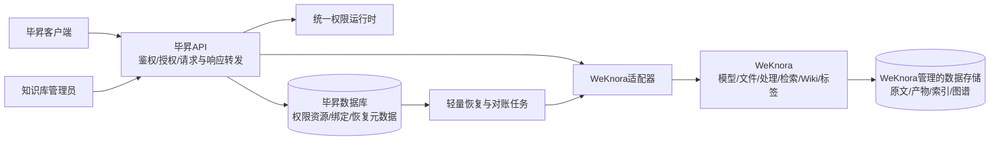
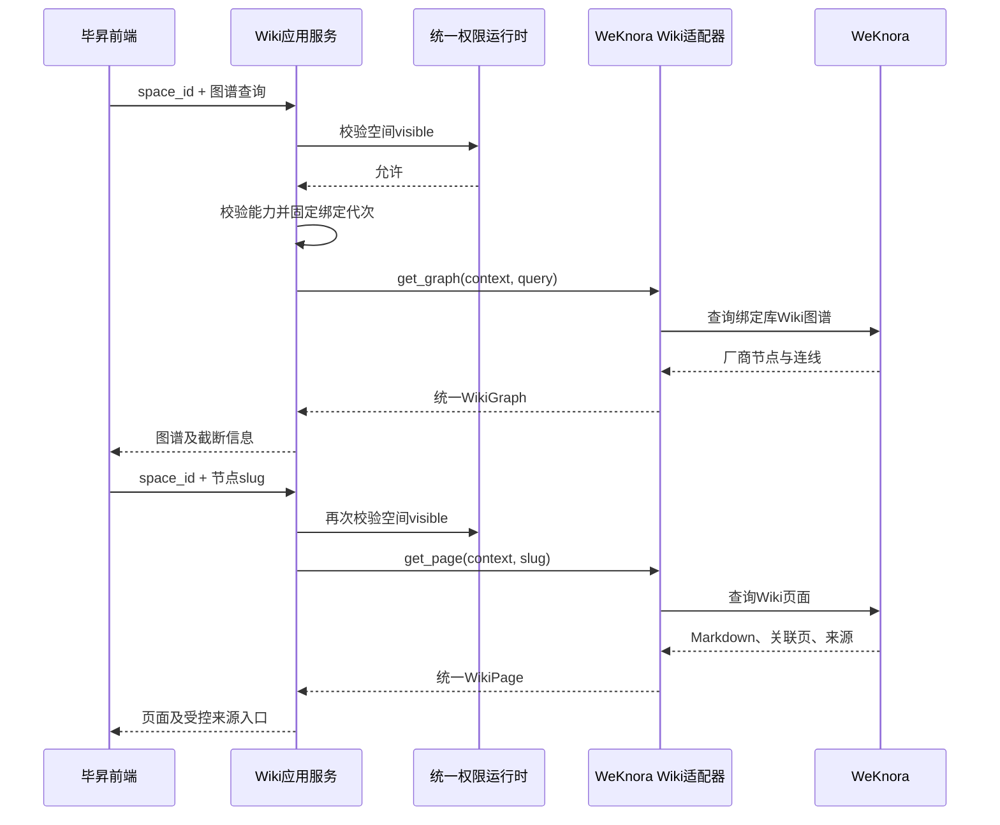

# 毕昇知识空间与 WeKnora 集成实现方案

> 评审草案 · 2026-11-23 · 按用户补充修订存储与代理边界
>
> 基线：《毕昇知识空间与WeKnora集成需求》，2026-11-20产研评审稿。后续用户明确：模型从WeKnora获取；WeKnora类型知识空间中的数据全部存储到WeKnora，毕昇负责转发和权限控制。后续明确口径优先于基线中的存储待评审项。
>
> 本文是方案，不表示业务代码已实现或通过正式SDD确认。

## 1. 结论与依据

**本文是知识空间多后端接入的唯一实施入口。** Native、WeKnora及后续厂商共用本文定义的端口、授权边界和兼容契约。需求清单与历史评审用于追踪来源，不作为平行规格；首期范围以§15.2为准。架构决策不替代正式SDD确认或真实部署验收。

实施阅读顺序：先读§2确定后端如何注册、选择和声明能力，再读§4与§10确定存储边界及对外契约；按功能查§3、§5—§9、§11—§12，最后按§13—§15落实代码、迁移和验收。

WeKnoraProvider采用 **毕昇权限与代理入口 + WeKnora数据与处理后端**。WeKnora类型空间的原文、历史版本内容、解析产物、分块、索引、标签、Wiki及图谱全部存于WeKnora及其管理的存储系统。毕昇不保存这些内容的业务副本，不运行该类型空间的本地解析、向量写入、标签生成或Wiki合成流程。

在知识空间集成层，毕昇仅持久化空间基本信息、成员/文件权限资源、远端绑定、版本关联、实例连接配置和必要操作恢复元数据，不能扩展为另一份文档内容库。文件列表、标签、模型和处理结果从WeKnora读取并经授权返回。会话消息、工具结果、任务检查点及生成交付物属于使用阶段数据，可能包含授权检索片段，不等同于知识库同步副本；其存储与保留边界见§4.4，不能宣称适配层已保证任何正文都不在毕昇持久化。

**核验范围与版本：**最初[源码卡点审查](./WeKnora源码集成卡点审查-20261123.md)固定main提交 `cf5306da87d6348c7a1ba4583dd4f6d524f7bfb3`。后续选定的本地正式版为[WeKnora v0.9.0](../../../dist/WeKnora)，提交 `f17ee8a8da901bd658a4cb25f40b5fd41adbfdd7`，二者不能混为同一基线。

本轮[毕昇功能复审](./知识空间适配层功能复审-20261123.md)结合当前毕昇工作树，实读v0.9.0检索/重排、引用定位、文本chunker预览及模型/文档结构，补齐各使用入口和兼容要求。旧报告14项仍是指定main提交的静态证据，未全部在release重验；§15.3明确按该历史基线理解，最终实例能力依赖选定release的契约验证。未部署联调、运行功能或性能测试，方案不等于已实现。本文拟新增毕昇接口不等于上游已有同名接口。

逐条需求对应见[需求清单](./WeKnora集成需求清单.md)。事实依据为用户需求及当前代码，不使用需求响应技能附带的示例产品知识库作为证据。

## 2. 职责与总体架构



| 事项 | 存储与权威来源 | 毕昇职责 |
|---|---|---|
| 空间访问模式、成员及授权关系 | 毕昇 | 复用现有权限运行时 |
| 空间与远端库绑定 | 毕昇控制元数据 | 记录类型、环境、远端库ID及当前生效代次 |
| 原文、历史版本内容、图片及附件 | WeKnora | 上传/读取流转发，按文件动作判权 |
| 文件列表、描述、标签、处理状态 | WeKnora | 取回后关联本地授权资源、过滤和规范化响应 |
| 文件权限资源、版本ID关联 | 毕昇控制元数据 | 关联远端文档到本地资源，不保存正文 |
| 分块、向量、全文索引、Wiki和图谱 | WeKnora | 经授权代理查询，不落本地内容库 |
| 模型目录、凭据及生效配置 | WeKnora | 代理模型选项及配置读取；创建时复核 |
| 标签初始化、重处理、数据迁移 | WeKnora | 授权后触发并转发任务状态 |
| 跨系统操作恢复 | 两侧各自记录执行事实 | 毕昇只记录请求键、远端任务ID、结果和错误 |

空间通过 `provider_key`（如native、weknora）、`provider_instance_id`、远端库ID及生效代次选择后端，与现有 `KnowledgeTypeEnum.SPACE` 资源类型分开。客户端API和权限入口复用，存储、处理和检索统一经应用服务和Provider协议分派；同厂商不同实例拥有独立凭据、版本和认证范围。原生路径逐步封装为NativeProvider，WeKnora类型不能误入本地MinIO/Milvus/ES流程；实例或绑定缺失时不得默认回落原生后端。

### 2.1 后端注册与请求分派

客户端、开放接口和Worker调用同一应用服务；应用层负责身份、权限、业务预检、操作意图与审计，Provider只提供事实读取及内容操作。共享检索入口先按真实资源类型分流：仅知识空间进入Provider解析，普通文档库、QA和临时文件不因本次改造而需要空间绑定。既有原生空间明确标识为native，不能把“缺绑定”解释为原生空间。

启动时由受控注册表显式安装经过审查的 `ProviderFactory`，用稳定的 `provider_key` 查找实现，不从数据库字符串动态导入代码。API及所有执行知识操作的Worker使用同一注册清单；未知实现、未授权实例或不兼容契约报错，不回退其他后端。新增厂商交付工厂、端口实现、能力声明和契约测试；只有引入新业务语义才改公共协议。

`ProviderResolver` 加载本地空间与实例事实，校验租户、访问范围与绑定状态，固定本次生效代次，再按实现及契约版本取得能力，组装请求级端口。连接池可按实例及凭据版本复用，但用户身份、远端库、候选集合、游标不得放在全局可变对象中。凭据轮换后新请求使用新版本；旧连接按有界生命周期关闭，撤销的凭据不用于恢复任务。恢复始终按冻结实例和目标重新鉴权。映射唯一范围至少包含租户、实例、远端范围/库、代次、资源类型及远端ID，不要求不同实例ID全局唯一。

### 2.2 公共端口与准入门槛

| 组合端口 | 职责与边界 |
|---|---|
| SpacePort | 空间生命周期与实际设置回读；确保创建可查回。 |
| ModelCatalogPort | 模型选项及用途校验，ID只在实例内有效。 |
| DocumentPort | 文件流接收、列表、重命名、原文及预览读取。 |
| FolderPort | 稳定目录身份、父链、冲突与移动规则。 |
| TagPort | 词表、文件关联、来源和关联修订，详见§9。 |
| ProcessingPort | 处理默认值、重处理/重分块；文本调试与正式预览会话分别声明。 |
| MetadataPort | 值、schema、值迁移和过滤分别声明。 |
| VersionPort | 版本链、主指针与有效来源切换。 |
| RetrievalPort | 在逻辑候选范围内召回并返回可定位来源。 |
| WikiPort | 可选的状态、图谱、搜索、页面和资源；不代替实体图谱查询。 |
| OperationPort | 受理、进度、终态、查回及有条件的重试/取消。 |
| TransferPort | 迁移预检、导出、导入和目标验证，不自行接管另一厂商。 |

基础接入必须支持空间生命周期、文件上传/读取/列表/删除及可证明的操作结果或对账。作为可检索空间发布还必须通过检索权限与来源验收。作为本期WeKnora产品开放，则另须满足§15.2及对应验收；“可注册”不是“满足首期要求”。

### 2.3 能力响应与执行约束

`GET /{space_id}/capabilities` 的统一DTO包含 `schema_version`、`capability_revision` 和按操作键索引的 `operations`。每项含 `status`（`supported / conditional / unsupported / unverified`）、`reason`、`execution` 和 `constraints`。例如文件读取可按存储实例声明Range条件，批量下载声明文件数和字节上限；不以一个厂商级布尔值代表所有空间都支持。依次依据厂商版本、实例部署、空间配置及目标对象条件求值，权限另外逐次判断；短时不可用是运行健康问题，不永久改变能力声明。

前端按声明展示限制；服务端校验参数、身份及能力。预检计划冻结能力修订及关键约束，确认时如版本或所依赖能力发生变化，返回计划过期并重新预检。未经验证的操作不得当作已支持，不返回“成功但无结果”代替拒绝。

## 3. 存储、上传与服务边界

### 3.1 上传使用受控流式代理

```text
浏览器 → 毕昇校验上传权限与参数 → 转发文件流 → WeKnora接收与持久化
                                                    ↓
                         毕昇保存远端文档/任务ID及授权关联，返回接收结果
```

不复用现有“上传到毕昇MinIO，再由Worker读取”的数据路径。复用认证、配额、参数校验及授权机制，为WeKnora类型增加专门流转发入口。使用有界缓冲和背压，不能将整文件读入内存。

**旧入口兼容。** [旧上传路由](../../../src/backend/bisheng/knowledge/api/endpoints/knowledge.py#L116-L148)当前在查重前保存原文；[旧客户端](../../../src/frontend/client/src/api/knowledgeUpload.ts#L12-L35)必须取得 `file_path` 才会继续注册。服务端应在首次写入存储前用真实目标租户和空间绑定判断后端，而不是靠前端选择新URL。Native保留原有“暂存路径→注册”协议。WeKnora入口须明确目标目录并使用上传收据；旧协议不能表达这些信息时，直接返回客户端需升级的业务错误，不落毕昇对象、不提交远端上传、不投递原生任务。旧注册入口同样校验空间类型，不接受把远端URL或文档ID伪装为本地 `file_path`。注册阶段的通信重试只复用原收据，不重新上传字节。

上传请求在首次创建远端文档前，先登记稳定请求键和待完成的授权资源意图；远端接收并可按该键查回后，完成文件资源映射。SQL事务不跨HTTP请求持锁。若远端成功而本地提交失败，文件保持未对外开放，由对账恢复关联或清理远端孤儿，不能让未授权文件直接出现在列表中。

**毕昇没有原文副本，因此上传失败不具备任意后台重传字节的条件。** 远端未收到完整文件时，客户端需重传或续传；远端已完整接收后，解析/标签/Wiki失败由WeKnora基于自身文件重试。ACK未知时先按请求键查结果，不能立即再次上传生成重复文档。若需要断点续传，上传会话、分片及校验由WeKnora持久化，毕昇仅代理。

HTTP框架或网关若产生临时缓冲，属于请求期实现细节，必须限额并及时清理，不能作为异步重试的数据来源；部署有禁止落盘要求时关闭磁盘缓冲。知识空间上传/代理链不把原文、解析产物或检索正文副本写入毕昇对象存储、内容表、日志及持久响应缓存。经授权检索后进入会话或任务记录的片段另按§4.4管理，不能以此将整库或原文同步到毕昇。

### 3.2 预览、下载与资源读取

保留两步读取契约。第一步：[现有预览和下载路由](../../../src/backend/bisheng/knowledge/api/endpoints/knowledge_space.py#L654-L671)继续返回原JSON信封和客户端依赖的URL字段，不能改为返回PDF或其他文件字节。WeKnora分支将这些字段指向毕昇同源受控内容地址，不返回远端签名URL。预览响应中的 `original_url`（需要用原文件渲染时）仍是预览用途地址，不授予下载动作；下载响应中的 `original_url` 是单独的下载用途地址。

第二步：浏览器访问内容地址，服务端按实际查看者重验租户、空间、文件版本、绑定代次、墓碑及对应用途的动作（预览visible，下载download），再代理远端字节。地址或句柄本身不是权限凭据；普通GET和每次Range请求均先判权，撤权后旧地址不可继续发起读取。下载保留审计，原生客户端字段及原生空间响应保持兼容。

已有原文preview/download接口，可代理其Content-Type、大小、Content-Disposition等语义；但固定源码只有上游reader实现ReadSeeker时支持Range，否则返回完整200及Accept-Ranges:none。必须按目标存储和预览格式声明Range/预览能力，不能一律承诺206或Office转换产物。必要时补存储端Range接口。远端原文URL、限时grant、对象存储签名URL与服务Key不返回浏览器，避免绕过毕昇授权。详见审查报告D12。

Markdown中的图片、附件链接改写为毕昇受控接口。空间共享的Wiki产物按空间授权，原始文件附件按文件授权；无法分类的资源不直接透传。WeKnora用户文件和对象存储不开放匿名直连。

## 4. 最小控制数据模型

以下表名为建议，优先复用现有权限资源与操作记录，避免为转发场景引入第二套内容数据模型。

| 控制对象 | 必要字段 | 边界 |
|---|---|---|
| 空间绑定 | tenant_id、space_id、provider_key、provider_instance_id、remote_scope_id、remote_kb_id、active_generation、state、revision | 实例封装环境与凭据引用，远端范围的真实字段按目标版本适配 |
| 文件资源映射 | tenant_id、space_id、local_file_id、logical_document_id、version_id、remote_document_id、generation、lifecycle_state | 仅权限定位、引用与版本关联，不存正文/解析结果 |
| 操作恢复记录 | request_key、request_hash、kind、target_ids、remote_task_id、state、attempt、next_attempt_at、last_error | 记录传输/操作结果，不存上传字节或LLM输入输出 |
| 迁移代次记录 | binding_id、generation、remote_kb_id、embedding_fingerprint、state、content_revision | 支持单生效库切换和对账 |

模型选项、标签正文与关联、Wiki正文、图谱节点、分块和文件处理详情直接读取WeKnora，不建立本地持久投影。必要的状态摘要用于故障恢复时只存阶段和错误码。只读模型配置如需快照，仅存非敏感指纹/修订用于一致性校验，不以快照替代远端实际配置。

为兼容现有权限资源身份，保留本地file/document/version三元组作为控制数据，明确标记外部资源，原文/预览对象字段为空，不据此生成本地路径或触发本地解析。授权生命周期、绑定代次与删除墓碑由本地控制，解析就绪经provider-aware事实端口读取远端并复核；不再直接以原生status==SUCCESS SQL认定外部文档可检索。需要保存的就绪修订只作可失效的控制证明，不复制处理正文。

必须改造API/Worker共享权限装配根及单条/批量文件事实loader，并同步检索资格组件，不能只有映射表没有可加载的权限资源。版本变更先确认远端有效贡献切换再CAS本地主指针。新外部映射经Repository访问，权限经permission应用协议。详见审查报告B03/B06。

新增控制表按项目机制注册租户隔离；恢复任务正确恢复租户上下文。MySQL/DM8使用项目适配类型、唯一键和CAS；现有表改动走Alembic，存量迁移单独执行。

### 4.1 毕昇侧实际保留的信息

下表是拟实施的存储白名单。控制字段优先复用现有业务对象，表名和最终schema在正式设计中确定，不能为了兼容原生模型而填入不需要的内容字段。

| 类别 | 毕昇保留字段/记录 | 用途与约束 |
|---|---|---|
| 空间资源 | space_id、所属租户、创建人、部门关系、名称/描述等必要基本信息、访问/发布/分享模式、生命周期 | 首页展示、选择器和权限目标；名称/描述的同步权威见§4.3 |
| 成员与授权 | 成员、角色/用户组/部门授权、空间/目录/文件权限资源、继承父链、加入申请/审批、授权修订与审计 | 始终按毕昇当前身份判权，不能以远端服务凭据的权限代替用户权限 |
| 实例与绑定 | provider_key、provider_instance_id、远端认证范围、remote_kb_id、active_generation、绑定状态/修订 | 同厂商多实例隔离，定位唯一生效库 |
| 文件与目录映射 | 本地授权resource_id、远端对象ID、空间及父目录关联、代次、授权生命周期与墓碑 | 原文入口、来源引用、归属及继承判定；远端目录稳定ID仍需补能力 |
| 版本控制 | logical_document_id、version_id、file_id、远端文档关联、主版本指针及切换修订 | 只存版本关系，历史文件字节全部在WeKnora；与远端有效贡献切换协调 |
| 就绪证明 | 必要远端任务ID、就绪修订、校验时间、失效状态 | 仅作可复核控制证明，不复制完整解析状态详情，不当永久授权 |
| 操作恢复 | operation_id、类型、request_key、request_hash、冻结目标、remote_task_id、阶段、attempt、next_attempt_at、错误码和关联ID | 支持ACK未知、局部失败、删除/迁移恢复；不存上传字节、正文或LLM输入输出 |
| 一致性与迁移 | 冻结实例/库/目标、generation、operation_epoch、删除manifest、target/applied修订、模型身份指纹 | 旧任务隔离及Wiki更新屏障，不能保存Wiki页面或向量快照 |
| 连接配置 | WeKnora地址、认证范围映射、加密服务凭据或密钥引用、超时/并发、能力契约版本 | 仅后端访问；不复制WeKnora中各模型的API Key |

请求摘要针对冻结控制参数和幂等约束计算，不通过“存完整请求体”变相保存原文。文件摘要如用于校验/去重只是不可逆控制值，按需要保存，不能替代请求收据。

### 4.2 不在毕昇建立持久知识副本

| 数据 | 权威存储 | 毕昇访问方式 |
|---|---|---|
| 原文、历史版本文件、原始图片/附件 | WeKnora管理的存储 | 授权后流式代理 |
| 解析文本、转换产物、预览产物 | WeKnora管理的存储 | 按后端能力获取，不落本地内容库 |
| 分块、向量、全文索引 | WeKnora | 调用检索/分块读取接口，不同步本地Milvus/ES |
| 标签词表、同义关系、文档标签关联 | WeKnora | 按需读取并做ID适配，不维护第二权威标签库 |
| Wiki正文、页面关系、实体图谱节点及边 | WeKnora | 代理查询及受控资源读取，不建立本地图谱/正文持久缓存 |
| 完整模型目录、模型凭据、生效处理设置 | WeKnora | 读取选择项/生效摘要；本地仅保留必要身份指纹 |
| 远端解析/标签/Wiki任务详细执行记录 | WeKnora | 查询展示，仅记录本地恢复必要ID、阶段及错误 |

文件名、大小、格式、标签和详细状态原则上远端读取；如引用展示/审计需要名称快照，限定为对应事件的展示证据并标记时间及来源，不以快照回写远端，不扩展为可替代远端查询的权威文件目录。对象内部路径、签名下载地址不作为长期关联键保存。

### 4.3 数据权威与同步规则

毕昇空间的名称/描述等展示管理字段由毕昇空间资源维护，创建、重命名和描述变更通过可恢复命令同步WeKnora；远端管理员直接修改这些字段视为漂移，记录冲突并通过明确对账操作处理，不用双向定时覆盖猜测权威。此为推荐实现规则，正式设计需固定冲突处理方式。

成员、权限、主版本控制指针与墓碑以毕昇为准；文件内容、标签、生效模型及解析/Wiki结果以WeKnora为准。主版本业务指针不能代替远端有效来源状态；模型管理员更新不能被本地创建快照覆盖。控制状态只有在远端结果被验证后才能推进，远端失联时不以旧状态新增读取许可。

若复用KnowledgeFile等记录，必须标记外部资源、保持原文/预览对象路径为空。前端名称快照、会话引用或本地授权行均不能被原生Worker识别为待解析文件。目录结构内容由远端维护，毕昇仅保留授权继承所需关联。

### 4.4 会话、工具结果与任务记录的单独边界

“知识库不在毕昇重复建库存储”不等于“使用知识库后任何正文都不会进入毕昇持久记录”。授权检索片段交给日常会话或任务Agent后，可能随消息、工具结果、任务步骤、检查点及来源引用记录保存；生成的答案和报告也可能包含来源内容。它们是使用阶段产生的数据，不是Provider同步的知识库副本。

本方案允许沿用现有会话/任务记录机制，但必须继承对应会话、任务、分享和交付物的访问/保留规则，避免把WeKnora服务Key、内部URL或无权片段写入记录。检索结果在进入模型、历史和检查点前完成权限过滤。原文件删除/撤权后禁止新的读取，不自动等价于删除已有答案、交付物及历史快照；其保留/清理按会话和任务数据策略执行，不能误报为已随知识库删除完成。

默认不将整库或原文导入任务工作目录。对当前任务明确需要的片段/产物，按既有任务数据生命周期管理；不借“结果复用”建立跨用户持久正文缓存。诊断日志和集成操作账本仍不记录正文。

若后续要求“任何检索正文都不得在毕昇持久化”，这是额外约束，需单独设计消息脱敏/仅句柄记录、工具结果保存、任务检查点、来源缓存、生成交付物及续跑恢复策略，并验证是否影响追溯和任务继续执行。本方案不把这一更强保证当作已经实现或默认确认。

### 4.5 存储边界验收

- 上传、处理、预览和Wiki读取后，毕昇对象存储、内容表、Milvus/ES及持久响应缓存无WeKnora知识副本；请求缓冲结束后释放，日志无正文/密钥。
- 本地可查到空间/权限、绑定、文件版本关联和恢复记录，且这些控制行不会触发原生解析/索引。
- 名称/描述变更可对账，标签/模型/处理结果不会被本地旧快照覆盖。
- 按日常会话、任务模式分别检查工具结果、历史、检查点和交付物的实际保存位置、权限与保留期，区分其使用阶段记录与知识副本；不以“MinIO没有上传原文”代替全链路验证。
- 删除/迁移期间保留足以恢复的冻结目标和墓碑，完成后按控制账本/审计策略清理；不承诺由知识库删除自动清除已有会话交付物。

### 4.6 配额与计量控制数据

保留外部存储不等于取消毕昇用户、角色和目标租户链的容量限制。现有QuotaRepository按本地KnowledgeFile.file_size统计，仅远端即时读取文件大小不足以处理并发预留。将byte_count、accounting_subject、计量类型、reservation/committed/released、operation_key、远端接收校验值及必要计量修订加入控制白名单，不视作内容副本。

上传前按已声明大小预留、接收后核验实际大小再提交；ACK未知保持预留并对账，重复请求不重复扣减，删除/迁移只释放或转移一次。未知长度流需采用受限上限/分段预留或明确拒绝，不能无限接收后才发现超额。用户/角色、目标租户及父链配额与WeKnora实例自身配额分别执行。

逻辑原始字节、上传预留、历史版本保留、远端物理占用及异常对象分别按§15.2计量；迁移不得重复扣减用户额度。远端处理模型费用与毕昇回答模型用量分开，不通过虚填本地LLM日志模拟远端计费。

## 5. 建库、模型和 Embedding 锁定

### 5.1 模型选项来自WeKnora

毕昇客户端 → 毕昇 `/model-options` → WeKnora `GET /api/v1/models`。后端依据当前租户绑定的环境及认证范围调用，按实际模型类型组织LLM、Embedding选项，VLM读取WeKnora管理员预设。不维护独立的毕昇模型副本，也不将毕昇自身模型ID当作WeKnora模型ID。

固定源码返回 `{success, data: []dto.ModelResponse}`，已有type、status、capabilities、is_builtin，Embedding参数位于parameters.embedding_parameters；类型枚举包含Embedding、KnowledgeQA、VLLM等，适配器显式转换。status不等于实时调用健康，稳定模型版本仍需集成约束。模型列表API Key需要manage_models或full_access，仅retrieve/ingest不足；建库另需manage_kbs，实例须明确WeKnora租户/Workspace映射、X-Tenant-ID规则及新库白名单授权。前端仅投影选择所需字段，不透传管理详情。证据见审查报告D14。

**模型继承与生效时点。** 创建时将用户选定的对话LLM绑定为 `summary_model_id`；Wiki合成和自动标签各按“本用途显式模型优先，否则继承当前摘要模型”解析。默认不把摘要模型ID复制到两个用途的覆盖字段，否则将来修改摘要模型时不会跟随。管理员可通过毕昇单独覆盖某用途或清除覆盖以恢复继承；VLM独立取管理员视觉模型预设，不隐式回退到无图像能力的摘要模型。对应v0.9.0的[Wiki回退逻辑](../../../dist/WeKnora/internal/application/service/wiki_ingest_batch.go#L388-L399)及[标签回退逻辑](../../../dist/WeKnora/internal/application/service/knowledge_auto_tag.go#L212-L217)。

库级变更经远端回读确认后受理的新任务使用新生效配置，任务记录解析出的模型身份、用途和配置修订；已开始的任务不在同一次执行中切换模型。设置保存只更新配置，不把历史摘要、Wiki页面或图像处理结果标为已重算。需要更新历史产物时显式提交独立重处理任务，按选定范围展示进度和结果。

**建库可用性门禁。** 模型选项必须限定在服务端确认的目标实例和认证范围，仅开放用途匹配且有有效可用性证明的模型。创建提交时重新校验：LLM能对话、Embedding能输出向量且模型ID/稳定版本/维度可验证、默认VLM支持图像输入。目录中存在或 `status` 正常不是充分证明；可采用目标环境可信的健康校验，或按实例、模型版本、用途、凭据修订绑定的近期成功探测。无证据或证据过期时须重新探测，探测使用受控测试输入，不使用用户文件。模型不存在、类型错误、归属不符或VLM缺失/不支持图像时拒绝建库，提示应调整的配置；服务不可达或探测超时返回可重试的“无法验证”，不当作可用。预检未通过不发远端创建请求；若创建后回读或复核失败，保留未就绪绑定供恢复，不标记 `ready`。

提交前向用户展示拟生效配置摘要：摘要LLM、Wiki及标签的继承/覆盖来源、Embedding版本和维度、VLM、分块与各开关；未指定的RAG、解析引擎、存储和图片向量检索注明“沿用目标环境默认”，不自行填值。提交时如关键配置与展示值已变化，重新展示并确认。

**验收：**选A建库，在任务记录中核对摘要、Wiki和标签均使用A；改摘要为B后，新任务的三种用途均用B；另设Wiki覆盖C，则新任务为B/C/B，清除覆盖后Wiki重新随B。历史产物只在独立重处理成功后更新。分别测试模型不存在、类型错误、跨环境ID、VLM缺失或无视觉能力、模型服务超时，均不得得到就绪空间；恢复可用后按原请求恢复，不创建副本。

### 5.2 创建与绑定

1. 校验创建权限、目标环境模型ID及类型、VLM预设和Wiki/Neo4j等依赖。
2. 登记空间权限资源、绑定意图和稳定创建请求键，遵循现有权限投影账本协议。
3. 转发同名知识库创建请求。仅设置需求明确的Wiki、实体图谱、多模态、标签、模型与分块项，其余由WeKnora默认值决定。
4. **建库预设（B03）**：本期显式创建 `type=document`，保留向量和关键词索引，独立开启Wiki生成、实体抽取、多模态和自动标签，不能改建成wiki类型来代替。v0.9.0 的[默认值逻辑](../../../dist/WeKnora/internal/types/knowledgebase.go#L880-L925)会清除非document库的自动标签配置。除Neo4j及两个图谱开关外，按[抽取参数校验](../../../dist/WeKnora/internal/handler/knowledgebase.go#L1700-L1758)检查实例预设：`text`非空，`tags`、`nodes`、`relations`非空，节点名称不重复，关系两端引用已声明节点且类型非空。这里的tags是抽取示例，不是文件标签模板。发送前冻结已验证的预设版本；缺失或无效时不发建库请求。用同一库导入测试资料，同时验证普通分块可召回、Wiki页面可读、有实体关系产出及文档可打标；不能只看建库返回码或图谱开关。
5. 回读实际生效配置，完成绑定。准备状态下不允许向未就绪库上传。
6. 后续模型、分块和Wiki设置读取WeKnora，不用本地默认值周期覆盖管理员修改。

绑定状态：`pending → provisioning → verifying → ready`，错误进入 `retry_wait / failed`；远端结果未知进入 `reconciling`。

固定源码支持创建时传入知识库ID，因此建库优先采用“毕昇后端预分配UUID → 本地冻结请求键/摘要 → POST固定ID → ACK未知时按ID GET并校验归属及配置”。重复ID插入不是自动重放，适配层必须完成冲突查回，不能按同名库猜绑定；若此路线通过故障测试，无需为建库先新增上游幂等接口。文件上传则由远端生成ID，只有内容hash去重，缺少通用请求键收据及查询，需要独立扩展。X-Request-ID只用于日志，不作为幂等依据。详见审查报告B01。

### 5.3 Embedding强锁

创建时记录环境、模型ID、实际模型/稳定版本及维度指纹。WeKnora在知识库更新和模型目录更新处强制保护：集成库创建后立即锁定，包括空库；不允许普通UI/API改绑，也不允许同ID替换已引用实际模型、版本或维度。凭据维护与不改变模型身份的连接维护可保留。

毕昇只读展示并阻止相关转发修改；实际强锁必须在WeKnora实施，毕昇代理无法拦住管理员直接操作WeKnora。源码确认普通KB更新仅阻止有文档库改绑，空库可改；模型更新没有沿用删除时的引用保护，初始化路径也能改库绑定和模型维度。必须把普通更新、初始化、模型目录修改及与上传并发的校验统一为不可变约束，查询异常拒绝修改。维度校验不能替代模型身份/版本保护。变更通过新库迁移完成，且原生copy/move要求同Embedding，不能直接用于换模型迁移（见§12及审查报告B02/D09）。

## 6. 上传、分块与处理状态

WeKnora类型采用“授权 → 远端接收文件 → 完成本地授权关联 → WeKnora异步处理”的流程。毕昇不消费原文解析任务，也不将文件写入本地索引。

分块默认值从WeKnora生效设置读取，创建及上传请求由毕昇校验后转发。固定源码的multipart `process_config` 已支持KnowledgeProcessOverrides，包含chunking_config、parser_engine_rules及parser_engine_overrides，并持久到文档metadata供worker实际切分使用。同一批每个文件请求发送相同配置即可实现本批覆盖，无需修改整库设置。毕昇现有高级参数仍须做能力映射，不支持项明确拒绝。

适配器发送经校验的完整切分快照，避免仅提供size时无意将enable_parent_child改为false；上游overlap非零才覆盖，无法以0清除库默认非零值，空separators也无法清空，需要补字段存在性或明确replace语义。不能用临时PATCH整库规避。文本切分覆盖与文件字节分片/断点续传是不同能力，后者未确认支持。详见审查报告D11。

| 阶段 | 权威来源 | 毕昇展示 |
|---|---|---|
| 上传中/传输失败 | 本次代理请求 | 进度、是否需要客户端重传 |
| 已接收 | WeKnora文件及请求键查询结果 | 返回文件资源ID与远端任务关联 |
| 解析/索引处理中或完成 | WeKnora | 映射既有文件状态，保留真实阶段 |
| Wiki生成/更新/失败 | WeKnora | 与解析成功独立展示 |
| 标签处理/失败 | WeKnora | 独立重试，不改变解析成功 |
| 删除中/已删除 | 远端任务及本地授权墓碑 | 立即阻止访问，展示清理结果 |

**上传冲突契约。** [v0.9.0的重复文件响应](../../../dist/WeKnora/internal/handler/knowledge.go#L224-L237)在HTTP 409的 `data` 中包含已有文档对象。适配器不得透传该对象或原始错误消息，也不得把409转换成成功收据。按以下顺序判定：

| 判定 | 返回与允许的后续操作 |
|---|---|
| 同请求键重放 | 校验原租户、申请人、空间、目标目录/版本、请求摘要和当前权限；均匹配才返回该请求自己的收据或未决状态。同键异参拒绝，不能仅凭键认领结果。 |
| 不同请求、内容相同 | 内容去重不是操作幂等。不为新请求建立指向已有文档的绑定。只返回最小冲突结果；无权查看已有文件时不返回其ID、名称、目录或已有收据。 |
| 同名、内容不同 | 按目标目录的名称冲突规则处理，不自动覆盖。仅在对目标完成查看及对应写入/版本操作授权后，才展示具体对象并接受显式覆盖或版本关联。 |

无权查看冲突对象时，两种业务冲突对调用者使用相同的通用提示，不暴露是哪一个已有文件；内部可分别记录脱敏原因。具备目标目录上传权限不等于可查看、覆盖或为另一文件创建版本。

批量上传按文件独立接收和记录结果，失败文件不抹掉成功项。远端以外部文件版本键去重。同一请求键不同内容摘要冲突，不能覆盖已有结果。

处理状态按需读取或有界轮询WeKnora；如果目标版本有可信回调，再用于通知加速。毕昇只保留必要恢复状态，重复/乱序事件不能使终态回退，删除后的迟到成功不能重新开放文件。

**整文件夹上传（C03）不是多选文件平铺。** 首期按独立能力准入：仅当能保留非空树相对路径、父目录身份和授权、根目录重名处理、逐文件收据及恢复语义时开放。预检规范化相对路径并冻结目标父目录、根名、子路径及每文件操作键；遇冲突不得自动与已有目录合并。部分上传失败时保留成功项，重试仅恢复原树未完成条目；不得重复建根或越过目标子树权限。独立空目录仍按§15.2受限；所选树含不能保留的空目录时先提示差异并取得确认，否则不开始。未满足准入条件时UI与API均拒绝整目录操作，不影响正常多文件上传。验收同名根、两层同名子目录、空目录、深层断流和再次提交。

### 6.1 上传前解析预览、编辑与提交

现有毕昇支持真实文件解析预览、编辑/删除分块，再用upload_id、preview_id、expected_revision、rule_digest冻结提交。它不同于原文预览，也不同于只读文本切分调试。v0.9.0的 `/chunker/preview` 接text，不写库/不Embedding，不能代替这套会话收据。

ProcessingPort分开声明text_chunker_preview与file_preview_session/read/edit/commit/abort。若完整兼容，需要WeKnora临时会话保存文件和编辑产物，提交前不进入索引/Wiki/标签发布，按冻结修订幂等提交/取消；毕昇只存句柄和控制修订，不本地解析兜底。不具备时明确关闭上传前编辑能力，不能上传后修改再伪称预览。按§15.2，首期关闭上传前编辑预览，直接上传与入库后的原文预览不受影响。

### 6.2 非文件上传入口：频道文章与网页

**频道文章。** 手动「加入知识空间」与资讯自动投递共用同一导入操作。在生成任何入库用MinIO对象之前解析目标空间Provider；保持文章来源的敏感内容可见性检查、实际执行身份、目标空间/目录写权限和重复项处理。Native沿用原链；WeKnora分支把同一篇文章的Markdown正文与HTML预览作为一次导入交由远端保存，只在毕昇记录文章来源ID、目标授权资源及恢复收据，不生成临时Markdown、持久HTML副本，也不投递原生解析任务。频道作为原始业务系统已有的数据不在清理范围内。远端不能保存并关联这两种产物时，手动和自动入口都须在写入前报告不支持；不能导入正文成功却静默丢失预览。

**网页链接。** 独立声明 `document.import_web_snapshot`。建议由毕昇复用既有网页抓取与校验逻辑，每次成功导入使用同一份抓取结果：把Markdown、清理后的HTML快照及原始URL、最终URL、标题和内容摘要一同交付WeKnora。预览和索引引用同一快照修订，不再让WeKnora按URL二次抓取。HTML仅由远端保存，预览仍经毕昇授权代理。WeKnora v0.9.0的URL导入请求没有等价的 `overwrite` 和目标目录参数，不能直接透传来代替此协议。

保留目标目录授权、内容重复与同名冲突两种反馈。未指定覆盖时不改变既有文件；明确覆盖时，冻结目标及其修订，保留本地文件授权ID，在远端准备新快照并撤回旧Wiki来源后切换有效修订。历史引用仍指原修订；原修订不可用时标记失效，不自动改指新正文。保证的是“一次成功导入对应一个不可变快照”，而不是所有重试只发起一次网络抓取。按以下边界恢复：①远端已持久接收完整快照：按原收据继续提交，不重新抓取；②确认未完整接收且原缓冲已丢失：终止原尝试，清理远端残片，允许显式新尝试重新抓取、分配新快照修订；③接收结果未知：保留原尝试并按收据对账，不重新抓取、不发布，也不提前推进覆盖指针。Markdown和HTML须同属一个快照并整组确认；仅有摘要不能重建丢失的内容。后端缺少快照提交/覆盖能力时，在抓取或写入前拒绝相应操作，不退回本地存储。

**快照提交清单与去重分开。** [现有网页抓取结果](../../../src/backend/bisheng/knowledge/domain/services/web_link_import_service.py#L219-L230)的 `content_hash` 只覆盖Markdown，继续用于内容查重，不作为整份快照的身份证明。每次尝试由远端按同一收据保存不可变清单：快照修订、Markdown字节摘要、最终用于预览的HTML字节摘要（无HTML时显式标记缺失）和最终来源URL。两份产物及清单都持久化且核验一致后才能发布；毕昇操作账本只保存修订、收据和清单摘要。恢复时复核整份清单，任一项不符均不推进有效指针。正文相同但HTML或最终来源不同，不得据正文摘要复用原收据或宣称同一快照。

### 6.3 文件业务编号

现有 `file_encoding` 是业务编号，不是字符编码或解析器配置。将 `document.business_code.update` 单独声明：若开放，由WeKnora持久化编号，毕昇按既有文件 `rename` 动作判权，记录实际更新人和审计并回读。不触发重解析、索引重建或版本切换。远端无法可靠存取该字段时，外部空间关闭此编辑入口并由API拒绝；Native行为不变。

## 7. 文件版本、删除和多源Wiki

版本内容与历史原文都在WeKnora，毕昇保留权限资源和版本指针映射，以兼容已有版本页面和引用接口。目标WeKnora若无逻辑版本链，可由每个版本一个远端文档配合毕昇指针表示，不能由此回退到毕昇保存历史字节。

**已确定：只有当前主版本贡献有效索引和Wiki。** 历史内容保留在WeKnora，但需有不参与有效召回与Wiki合成的状态。目标版本不能区分归档文件与有效文档时，应补WeKnora能力，避免存档历史内容污染Wiki。

主版本切换由毕昇授权后发起，WeKnora执行新版本准备、旧来源撤回、新来源发布和Wiki刷新。支持预处理时先准备再切换；不支持时展示更新窗口，不宣称原子无缝完成。

删除执行前保留现有“引用检查 → 预检 → 用户确认 → 引用/权限/修订重验”的协议，不以远端delete替代。Provider提供带目录/内容修订的目标scope，与本地应用/工作流等引用闭包关联，冻结coverage/inbound摘要和远端目标；确认时树或引用已变化就重新预检，force仅沿用既有允许场景。不能只改执行manifest而继续用过期本地file_level_path展开远端目录。

删除流程：

1. 预检确认通过后，毕昇冻结资源状态并写删除意图，立即拒绝文件读取/检索，防止新请求访问待删除内容。
2. 转发WeKnora删除任务，由其清理原文、历史版本目标、解析产物、索引、标签关联、实体及Wiki来源贡献。
3. 查询远端任务完成，结束本地恢复记录并清理或墓碑化授权映射；失败允许恢复。

WeKnora类型不执行毕昇MinIO/ES/Milvus清理。现有删除框架需按backend选择步骤，不能对外部文件盲目跑本地存储步骤。覆盖文件、历史版本、目录递归、清空和整空间删除。

源码确认多源Wiki撤回重写已实现：单源删页、多源剥离引用，持久retract利用剩余来源summary重写。需要修复的是故障交付与完成证明：来源页查询或retract入队失败可能只Warn后继续删除；文档Wiki子任务完成时整库finalize仍可待执行，索引页重建失败也可能清掉待办。现有completed、stats和页面version均不能当作全库收敛令牌。

WeKnora需让关键Wiki清理失败传播到可恢复删除状态，并补mutation target_revision/applied_revision、包含finalize的收敛查询及关键失败重试。毕昇仅记录令牌/屏障控制元数据，删除影响内容暂不展示，待真实applied_revision达到目标再恢复；无法定位受影响页面时先屏蔽空间Wiki。不能靠固定等待时间或重复GET推断完成。详见审查报告B04。

原始文档版本归档仍是明确上游缺口：Wiki页面revisions/archived不等于原始文件主版本隔离。非主版本作为仍存在的远端Knowledge时，当前Wiki守卫不会自动排除；需补有效来源状态、入队及写前检查，再与主版本切换/撤回编排协同。

### 7.1 版本关联、处理作业与入库后编辑

| 操作（评审ID） | WeKnora首期准入与操作契约 | 验收 |
|---|---|---|
| 手动关联、搜索候选、合并（D04） | 与设主版本分开。远端有效版本隔离未验证前不开放关联写；完整逻辑文档合并首期受限。开放前需校验源、目标都属同一授权空间，候选搜索只返回可见且符合关联条件的文档；冻结两条链和主指针修订，远端切换成功后再提交本地关联。 | 确认期间切主或源版本变化则拒绝旧计划；不泄露无权候选，不改写历史引用，只有一个版本贡献有效内容。 |
| 相似推荐、待处理列表与忽略（D05） | 与人工关联独立声明。首期不展示未经验证的推荐或忽略入口；API返回能力不支持，而不是假装“没有相似文档”。以后开放时按可见文件进行文档级近似判定，不用内容hash或分块召回冒充；忽略只改变提示状态。 | 完全相同、仅局部修改、无权的相似文件分别验证；忽略不修改原文或版本链。 |
| 失败文件及批量重试（D06） | 区分断流重传与远端处理重试。沿用inspect → precheck → confirm；预检不写，列出有效项与不含敏感名称的无效原因。混选时明确确认跳过，执行前重验权限和文件状态，仅处理冻结目标。 | 取消无任务；成功、处理中、失败及撤权文件混选时不误重跑；重复确认复用原结果。 |
| 成功文件重新处理/重分块、任务履历（D07） | 与“失败重试”独立授权。冻结版本、配置快照和本批覆盖项；按空间展示作业状态、分页明细、每项错误及重试资格。结果复核绑定和修订；不得借重新处理绕过Embedding锁或派发原生重建。 | 自定义规则确实生效；过期计划被拒，部分失败只重试失败项；无权用户不能读取明细或触发重试。 |
| 已入库分块查看/修改/删除（D08） | 与§6.1上传前预览区分：外部空间首期仅开放已授权文件的分块读取，不开放已发布分块的正文、定位框编辑或删除。后续开启写入须冻结文件版本、稳定chunk ID和修订，确认写后索引、Wiki贡献及引用定位可恢复地更新。 | UI与写接口一致拒绝；后续验收并发编辑冲突、重复删除不误删邻块、旧引用失效不改指，不能仅凭远端chunks路由存在放开。 |

## 8. Wiki代理与权限

### 8.1 展示范围与可选能力

本期区分两类图谱：实体关系图谱由WeKnora在入库时抽取和维护，作为后端处理/索引能力，不单独增加前端入口；Wiki图谱展示Wiki页面及其关联，点击节点查看Wiki页面。两者独立开启，不能拿实体关系图谱接口或实体ID替代Wiki图谱与slug。

Wiki通过通用适配层的可选WikiPort接入。NativeProvider当前声明 `wiki.read`、`wiki.graph` 不支持，WeKnoraProvider按目标版本和实例/空间配置声明能力；前端据能力显示入口，不写死provider_key判断。未来其他厂商实现同一协议可复用页面。

建议内部协议（不是WeKnora真实API声明）：

```python
class WikiPort(Protocol):
    async def get_status(self, context) -> WikiStatus: ...
    async def get_graph(self, context, query: GraphQuery) -> WikiGraph: ...
    async def search_pages(self, context, query: str) -> WikiSearchResult: ...
    async def get_page(self, context, slug: str) -> WikiPage: ...
    async def read_asset(self, context, asset_id: str) -> AssetStream: ...
```

context由后端根据空间绑定解析，固定实例、认证范围、远端库和active_generation。图谱查询包含有界节点数、可选中心slug/展开游标，具体取决于后端能力；不能承诺上游未具备的增量展开。

### 8.2 请求与授权链

每个Wiki请求先加载真实空间、校验租户/状态，再通过统一权限入口检查 `knowledge_space.visible`，最后按生效绑定调用WeKnora。图谱、搜索、展开、slug详情、Wiki资源均遵循同一空间级规则。浏览器不提交任意远端库ID。



图谱和详情结果返回前复核绑定代次及内容更新屏障，避免迁移或删除期间把旧库结果展示为当前内容。

空间读权限通过后，Wiki标题、摘要、正文和连线不按来源文件裁剪。原文列表、预览、下载和普通RAG继续执行文件权限。

`source_refs`由适配器映射到毕昇文件授权资源及版本，点击来源时重新判权并代理读取WeKnora。旧代次、跨租户或未关联的远端文档不能生成可用原文入口。受限来源仅显示占位，不返回原文件名或原文URL；Wiki正文自身出现的来源名称仍按空间共享口径处理。

Markdown清理危险HTML并改写资源地址。slug规范化且安全编码，禁止成为任意路径或任意URL代理。WeKnora管理端凭据、内部下载URL及模型凭据不透传。

本方案默认不在毕昇持久缓存Wiki/图谱/正文，直接代理。请求期缓冲不作内容副本；权限服务失败时拒绝访问。前端查询数据按用户、租户、空间和绑定代次隔离，切换身份或空间后清空旧内容。

### 8.3 统一响应与上游适配

| DTO | 统一字段建议 | 约束 |
|---|---|---|
| WikiStatus | enabled、state、content_revision、updated_at | state区分准备/生成/更新/就绪；请求错误单独表达，不推断为空 |
| WikiGraph | nodes、edges、truncated、可选next_cursor | 默认有界，不将截断结果称为完整图谱 |
| WikiNode | id、slug、title、page_type、summary | ID限定库与代次；页面类型按实际来源规范化 |
| WikiEdge | source、target、relation_type或说明 | 引用有效节点，不能混入普通实体图谱连线 |
| WikiPage | slug、title、page_type、summary、markdown、related_pages、source_refs | 正文按需读取；来源映射为本地资源，不返回内部对象路径 |
| WikiSearchResult | items、可选游标/截断信息 | 只在绑定库内搜索，结果含可定位slug |

以上是拟定公共契约，WeKnora原始字段由mappers转换。缺失值不编造；未知页面类型保留受控unknown值及可显示说明。

固定源码已确认单数前缀 `/api/v1/knowledgebase/:kb_id/wiki` 下的graph、stats、search、pages/*slug及revisions；source_refs支持裸UUID或UUID|title，适配器解析ID后映射本地资源。slug可以包含斜杠，拟新增毕昇pages路由必须采用安全catch-all（FastAPI `{slug:path}`）或查询参数，不能仅接收一个路径段。

graph已有overview/ego模式、默认500/最大2000节点、depth最大3及truncated信息；没有图cursor，不能构造不存在的next_cursor能力。点击节点按slug补读来源符合当前DTO，graph节点本身不含source_refs。实际查询先ListAll完整页再内存裁剪，仍需远端轻量投影/有界查询优化和规模压测。stats仅作活动与数量提示，WikiStatus的可靠内容修订需§7新增收敛协议支撑。证据见审查报告B04/D13；未据此宣称目标环境联调通过。

## 9. 自动标签与任务恢复

### 9.1 知识空间标签设计

本节统一规定个人空间和部门空间从建词、打标到检索的业务规则，并区分毕昇原生行为、WeKnora v0.9.0 可复用能力与待实现扩展。跨系统任务恢复见§9.2，检索入口的通用权限和身份契约见§10。

#### 9.1.1 用户看到的是一套标签，后台管理的是四种对象

| 对象 | 回答的问题 | 毕昇原生空间 | WeKnora 空间 |
|---|---|---|---|
| 标签库（模板） | 建空间时从哪些词起步？ | 沿用公共/私有词表及绑定规则 | 同租户公共词表可一次性导入；不是持续绑定 |
| 空间标签 | 本空间可以使用哪些词？ | 毕昇保存 | WeKnora 按库保存名称、UUID、排序等；用户只在毕昇管理 |
| 文件标签关联 | 哪篇文件被标为什么，谁标的？ | 沿用原生文件标签 | WeKnora 保存关联；目标设计区分人工与自动来源，同一关联可同时有两种来源 |
| 标签筛选 | 本次操作只使用哪些文件？ | 使用原生标签身份 | 毕昇保存并校验范围引用，匹配文档以远端当前关联为准 |

**标签是分类条件，不是权限。** 用户能选“验收”不等于能打开所有验收文件。删除文件上的“验收”、删除空间里的“验收”以及删除毕昇的模板，是三种不同操作，均不得删除文件。

例：设备部与采购部用同一公共模板建库，各自得到“采购、安装、验收”。设备部将“验收”改为“现场验收”，不会改变采购部或模板。成员选择设备部的“现场验收”提问时，系统只在其有权阅读且当前关联这个标签的有效文件版本中检索。

#### 9.1.2 建空间：决定候选词从哪里来

| 起点 | 初始行为 | 后续行为 |
|---|---|---|
| 已选公共模板 | 校验源词表同租户且为公共、目标操作人有空间管理权限；预览同名复用、新增、歧义，确认后导入。首期不允许导入私有词表，即使操作者能读源空间。 | 修改或删除模板不联动远端，也不关闭打标。要补词，重新预览差异，只添加确认的新词，不猜测改名或删除。 |
| 未选模板，库已有标签 | 直接采用已发布的空间候选词。 | 新文件使用当前候选分类。 |
| 未选模板，库中无标签 | 首批成功解析文件提供代表性摘要或正文，由 WeKnora 的当前标签用途 LLM 生成候选，规范化同名、保守归并明显同义项，再发布词表。 | 按文件回填首批及初始化窗口内完成的文件。首批全失败时等后续成功文件；历史补标单独运行，不重建向量。此流程需扩展上游。 |

部门批建按部门冻结源词表输入快照、摘要、目标库/代次和请求键，各库分别解析标签 ID。按项记录已创建、已复用、失败、结果未知；超时先查回，只续跑未完成项。目标库内原样同名并发创建可利用 v0.9.0 的[唯一索引](../../../dist/WeKnora/migrations/versioned/000001_agent.up.sql#L255)，不代表大小写、全半角或同义词可自动合并。源词表使用量不计入这些一次性导入。空间建库/授权与标签初始化分别报状态，一个部门失败不影响其他部门。

三个数字不要混用：毕昇[单份模板最多200项](../../../src/backend/bisheng/knowledge/domain/services/knowledge_space_tag_library_service.py#L19-L39)；v0.9.0 自动分类只取[排序前500项](../../../dist/WeKnora/internal/application/service/knowledge_auto_tag.go#L167-L190)，不是人工选择器上限；首批生成最多20个候选、单篇最多3个自动标签是**已确认的首期产品上限**，不是上述平台限制。

#### 9.1.3 使用标签：同一组操作，同一套权限说明

| 用户操作 | 执行规则 | 明确不做什么 |
|---|---|---|
| 浏览、搜索标签 | 在有权访问的空间内分页查询；人工选择不受500项上限限制。普通成员默认不展示全库文件/分块用量；若展示可见命中数，与实际筛选使用相同权限和条件。 | 第一页不是完整词表，未知数量不显示为0。 |
| 建词、改名 | 需要空间标签管理权限，改变候选集合或其分类语义时推进词表修订。改名保留标签身份。单文件弹窗确认新词时就创建空间标签，点击保存才建立文件关联。 | 取消弹窗或保存冲突不回滚已建的新词；改空间名称、描述、分享设置不能用表单附带的 `false/null` 关闭远端打标。 |
| 单文件编辑 | 复用现有文件标签写权限。打开时加载完整已选集合及关联修订；翻页或搜索不覆盖已选项。`replace` 提交完整非空选择和预期修订；主动清空并确认才提交 `clear`。 | 加载失败、旧客户端只传空数组或修订过期，不得覆盖。冲突后刷新并再次确认。 |
| 批量追加 | 沿用[现有弹窗批量入口](../../../src/frontend/client/src/pages/knowledge/SpaceDetail/EditTagsModal.tsx#L215-L229)：只读预检 → 确认跳过无效项 → 执行。禁止文件夹及等待/处理中文件；分别检查逐文件写权限与建词权限。确认时重验文件状态、绑定及范围；只有存在可执行项才按需建词，以原子增量给有效文件追加，逐项报告。 | 预检/取消不建词；空追加不清空；不能读出旧集合后整组PUT模拟追加。不能保证不丢并发写时不开此能力。 |
| 移除文件上的词 | 对该文件执行显式编辑，保留其他文件及空间词。 | 不删除整个空间标签。 |
| 删除空间标签 | 空间管理员删除标签及其关联，使相关修订及旧引用失效；保留所有原文、分块、索引和引用。没有安全解除关联能力时只允许普通删除无引用标签。 | [v0.9.0 的强制/仅内容模式](../../../dist/WeKnora/internal/application/service/tag.go#L258-L352)不等价，不透传 `force` 或 `content_only`，不派发文档删除任务。 |

#### 9.1.4 自动打标：谁能写什么，怎样知道已完成

**正常路径：**文件解析成功 → 读取已发布候选词 → 选择匹配标签 → 写入自动来源 → 展示结果。上传者不用填写标签。解析成功与打标成功分别显示；模型或标签写入失败只重试打标。v0.9.0 可从已有候选分类，空候选会跳过；自动关联是增量添加，[现有关系结构](../../../dist/WeKnora/internal/types/tag.go#L68-L74)不能直接证明人工/自动双来源。

**空库初始化按库判重，而不是按标签名称或文件判重（需扩展WeKnora）。** 对“未选模板且当前无候选”的库，在远端事务内以 `目标知识库ID＋绑定代次` 唯一登记初始化操作，冻结首批成功解析样本的文件版本、模型与配置修订。并发触发者只认回同一操作；首批全部解析失败时继续等待可用样本，不标记初始化成功。生成候选后，在创建第一个标签前持久化归并后的草案与逐项进度。建词部分成功、响应丢失或Worker重启时，按同一草案查回并补齐，不能重新调用LLM产生第二套候选。样本正文、候选草案和关联均在WeKnora内处理，毕昇只保留控制句柄与状态。

**成功判据：**草案各项均已查明并复用或建成，且已在同一事务中发布生效词表修订、登记首批及初始化期间已解析文件的可恢复回填意图，才记录这次初始化成功。窗口内文档登记与发布切换须按同一修订协调：切换前进入待回填，切换后走已发布词表，不遗漏文档。初始化成功仅代表回填责任已持久交付，逐文件分类是否完成单独展示；后续扩词是新操作，不重置或重跑该库首次初始化。

首期历史补标默认只选当前空间内已解析且有效、在指定词表修订下尚未成功处理或上次失败的文件版本，不在开启开关时自动全库扫描。需要重算已成功文件时，管理员显式选择文件范围并确认，冻结清单后执行独立重处理，不重建向量、不覆盖人工来源。

**验收：**空库不导入模板，两批文件并发触发初始化，在草案落库、仅部分标签创建后中断并重启Worker。断言只有一个初始化操作、一份生效草案，先前已建词不重复；首批与窗口文件均有回填记录。注入回填登记失败时，不能报告初始化成功；修复后逐项完成且文件解析成功状态不回退。

写入由三个独立标识约束，不用一个状态兼任三种职责：

- **绑定代次**确定这是哪个库，切库后旧操作不能重定向到新库。
- **词表修订**确定模型看见了哪些候选。导入/追加先登记待发布修订，同库候选变更串行。期间允许正常解析、索引和检索，暂停自动分类并持久登记待回填文件。分类开始和写回都校验修订；全部导入项核对后原子发布词表并登记回填意图。删除标签后，旧任务不能按同名重新建立关联。
- **文件关联修订**保护同一文件的人工编辑和自动更新。在同一事务中比较修订、修改来源关系并推进修订。模型只能更新自动来源；新修订不再匹配时可撤销旧自动来源，若仍有人工来源则保留标签。

回填以“库＋文件版本＋词表修订”判重。区分**已写入、成功但无匹配、目标已存在、失败待重试**；前三种要在关联核对和终态提交后才算完成，不能用新增行数判断。未知结果先查回；模型失败不清旧标签；成功修订不反复调用模型。历史回填限流、可恢复，不将重新解析当补标。普通上传不自动扩展新领域候选；后续扩词由管理员显式发起独立任务，不改变原批次修订。

#### 9.1.5 按标签找资料：从文件列表到回答引用

对 WeKnora 标签，毕昇分配前端可精确表示的正整数 `tag_ref_id`，兼容既有文件编辑和会话筛选。映射仅含租户、空间、Provider实例、库、绑定代次、标签UUID及有效状态；不在毕昇维护第二份远端词表或文件关联。原生空间继续用原生ID。标签改名不换引用；删除后同名重建或换代，旧引用失效，不按名称重绑、不转查Native。

所有入口共用一条范围公式：**所选空间内的文件 ∩ 当前标签关联 ∩ 其他业务条件 ∩ 当前执行身份有权读取的文件 ∩ 有效版本**。

| 入口 | 必须保留的用户意图 |
|---|---|
| 列表、搜索、文件编辑 | 编辑和筛选使用同一个引用。分别加载候选分页与文件已选全集；即便标签排在第501项，手工打标、搜索和筛选仍可用。 |
| 日常会话、重新生成 | 用户固定标签不能被模型移除。重新生成使用原轮次的空间/标签选择、当前关联及当前权限；“使用当前资料重新提问”才读取当前选择器。历史未保存范围或旧引用失效时提示确认。 |
| 任务及子Agent | 会话转任务时持久交接每个所选空间的标签引用；新建、继续、恢复和子Agent共用可信范围，每次重新判权，不把启动时的候选当永久授权。 |
| 工作流、助手及开放检索 | 保留入口原有执行身份和白名单；标签条件按同一实例/库解析。明确ANY/支持的ALL规则，不支持或解析失败不能删掉条件继续搜索。 |

WeKnora 文档库以远端当前关系求出完整匹配文档ID，交集非空才用 `knowledge_ids` 同时约束关键词和向量召回；空交集在毕昇直接返回空。`scope_tag_ids` 是逻辑范围记录，不是执行证明；仅在实测索引 `tag_ids` 与当前关系等价时用于优化。解析不完整或失败时报告该空间失败，多空间结果标明部分成功。返回正文进入模型之前仍复核。标签既不扩大文件权限，也不改变空间级Wiki的共享口径。

#### 9.1.6 交付划分：什么能用、什么需要开发

| 能力 | 可复用依据 | 拟交付及上线门槛 |
|---|---|---|
| 模板与标签目录 | 毕昇已有公共/私有词表；WeKnora 已有[库级标签CRUD](../../../dist/WeKnora/internal/router/routes_knowledge.go#L323-L341) | 毕昇实现公共模板授权、差异预览、按部门导入、引用ID和分页选择；基本信息更新不接受隐式标签配置写。 |
| 文件人工操作 | Native已有单文件替换及批量预检；远端有[增量关联仓储方法](../../../dist/WeKnora/internal/application/repository/knowledge_tag.go#L54-L62)，但公开文件打标接口是替换 | WeKnora补带来源/修订的原子追加、条件替换/清空及安全删除；毕昇适配真实弹窗、逐项权限及确认。未满足时关闭具体操作，不用近似语义替代。 |
| 自动分类 | v0.9.0支持已有候选分类；[空候选、跳过及模型选择](../../../dist/WeKnora/internal/application/service/knowledge_auto_tag.go#L167-L217)有明确边界 | WeKnora补候选初始化、发布修订、来源保护、首批/窗口回填及独立历史任务。已有模板不是免做空库初始化的理由。 |
| 筛选与检索 | v0.9.0 的[混合召回](../../../dist/WeKnora/internal/application/service/knowledgebase_search.go#L490-L528)可接收文档范围 | 毕昇补引用解析、候选交集、各入口范围交接和失败处理；授权后的分页、候选规模与召回质量需在目标部署联调。 |

#### 9.1.7 用一组业务旅程验收

以下是验收设计，未执行。§15.1原标签用例20—35按下表归并，不再同时维护逐轮追加的用例正文。

| 旅程 | 操作 | 通过标准 | 原用例 |
|---|---|---|---|
| 为部门准备词表 | 两部门导入同一公共模板；一库有同名词，另一库丢ACK，期间修改/删除源模板 | 权限正确、同名不重复、各部门独立恢复；保留原生绑定用量，远端配置不受普通表单或源模板删除影响；无模板也能初始化 | 20–21 |
| 在导入中上传文件 | 半份词表时上传并人工打标，恢复导入；另测450项追加100项 | 文件照常可检索，自动分类使用完整发布修订、保留人工标签；550项均可手选，500项可参与该版本分类，截断明确 | 22–23 |
| 批量整理文件 | 两份不同标签文件追加同一标签，夹入处理中文件，输入新词；模拟无建词权限、取消和确认后撤权 | 预检零副作用，只作用于确认且有权的文件；人工追加与自动回填不互相覆盖，空追加不删除；统计不透露受限文件数量 | 24–25、27 |
| 编辑、清空及重跑 | 单文件建词后取消；并发回填后用旧修订清空；模拟无匹配、全已存在及失败 | 空间词保留，取消不附到文件；旧清空冲突，新确认才生效；无新增也可成功，失败不删标签，同修订不重复执行 | 26、28、30 |
| 删除仍在使用的标签 | 删除被两篇文档引用的词，令旧任务迟到 | 安全删除后关系消失，文档、预览、检索及历史引用仍有效，无内容删除任务；能力不足则明确拒绝且保持原状 | 29 |
| 用标签贯穿检索 | 人工选择前500项之外的词，翻页保存；关键词/向量分别召回，改标后再查 | 已选不丢、候选和引用随当前关联一致；同名重建、跨空间或换代的旧引用拒绝，不能全库回退 | 31、34 |
| 保持用户选择 | 从仅选“验收”的会话进入任务、子Agent、恢复，再重新生成；注入筛选异常 | 保留原选择且实时判权；有效零匹配、失效、故障和未选择含义不同；仅明确新提问能用新选择，部分失败提示清晰 | 32–33、35 |

需求追踪：R21/R22对应§9.1.2与§9.1.4，R23对应§9.1.4，R24对应§9.1.3与§9.1.5，R25对应§9.1.2的参数与§9.1.6的交付边界。任何新增行为应先归入上述对象和旅程，再更新对应契约与验收，而不是新增一套平行流程。

### 9.2 恢复职责

WeKnora拥有文档字节和内容任务账本，负责解析、索引、Wiki、标签、归档及迁移执行重试。毕昇恢复任务仅处理建库/文件映射提交未知、删除命令转发、远端状态查询、权限投影及绑定切换等控制操作。

每个控制请求记录幂等键、摘要、远端任务ID、尝试次数与最后错误。通过租约、CAS、退避和定时对账恢复；不得把超时当作远端未执行，也不得在没有字节副本时承诺后台自动重传。远端处理失败与客户端传输失败使用不同重试入口。

原生ProcessingFence仅供Native，不将远端HTTP放进其持SQL锁的writer区间。外部操作在短事务冻结实例/库/目标/绑定代次/operation_epoch，锁外HTTP，回调和轮询均CAS复核。删除、切主、迁移递增epoch或设置墓碑；迟到任务即使远端成功也不能重新开放文件。

删除使用版本化provider manifest，包含冻结远端目标和幂等任务关联；本地先软墓碑阻止读取，远端accepted/unknown及未完成Wiki撤回不能完成清理。最终删映射之前满足远端清理证明；恢复不按当前active绑定重路由旧删除。固定DELETE_STEPS、advance/完成验证及现有SQL cutover时序需一起改造，并兼容旧原生任务。详见审查报告B07。

#### 9.2.1 持久记录与调度

建议复用[原生持久任务模型的幂等、租约和派发索引模式](../../../src/backend/bisheng/knowledge/domain/models/knowledge_processing_job.py#L17-L74)及[按租户补投Celery的实现](../../../src/backend/bisheng/worker/knowledge/processing_jobs.py#L337-L396)，但为外部Provider设独立操作记录，不复用原生解析任务的种类和成功判据。SQL是执行事实来源，消息只负责唤醒；不以Celery结果或Redis锁证明业务成功。普通列表、预览等纯查询不记恢复任务。

- **登记：**在创建本地业务意图的同一短事务中写 `operation_id`、`tenant_id/kind/request_key` 唯一键、请求摘要、可信主体引用、冻结的实例/库/代次/资源版本、`operation_epoch`、初始阶段及到期时间。多部门批建按部门建子操作。相同键和摘要只认回原操作，同键异参拒绝；读取收据也须校验身份。禁止记录原文和密钥。
- **派发：**事务提交后可立即投递；未投递、发布失败或发布结果不明，均保留补投资格。建议注册两个独立Celery任务 `dispatch_due_provider_operations` 和 `advance_provider_operation`，落入知识队列。Beat周期触发前者，逐个活跃租户建立上下文，按索引 `(tenant_id, state, next_attempt_at, operation_id)` 分页找已到期非终态记录，并检查过期租约。每租户每轮限量；不遍历远端库、文件或正文。扫描周期、批量和实例并发按§13.2压测配置。
- **消息：**携带操作ID和预期修订，租户通过受控任务头传递并与记录复核。派发后设置下一次允许补投时间；发布标记不是执行完成标记。即使消息已发而标记未写、消息丢失或Worker未启动，操作仍可在后续到期时再次唤醒。重复消息不得产生重复业务效果。
- **认领：**Worker在短事务中按租户、到期状态和修订条件更新记录，取得 `lease_token/lease_until` 并推进 `revision`。过期消息、仍有有效租约或已终结的操作直接退出。锁外调用Provider；用当前租约、认领修订和冻结的epoch条件提交结果。条件不再成立时放弃本次本地写入，由接管者查回事实。租约只能隔离迟到的**本地提交**，不能取消已发出的远端请求。

#### 9.2.2 单步推进与状态转换

分开记录 `operation_state`（控制流程）、`phase`（具体业务步骤）和远端收据/证明。状态名为拟实现的内部枚举，不替代§10的公共响应；`manual_review` 表示自动推进暂停，对外仍须如实呈现未知或阻塞。一次唤醒只执行一个可核验步骤，不在Worker内循环等待远端任务。

| 当前状态与事件 | 执行动作 | 下一状态及完成条件 |
|---|---|---|
| `pending`：意图已提交 | 核对租户、实例、权限和冻结目标。首次远端写之前，先持久提交 `sending` 及该步骤的稳定请求键，再在锁外发送。 | 明确成功→`applying`；仅受理→`waiting_remote`；结果不明→`reconciling`。看到过期的 `sending` 必须先查回，即使实际可能尚未发出。 |
| `waiting_remote`：已受理 | 使用原任务ID读取进度。不重复提交命令；回调只作为唤醒或经过鉴权/去重的证据，沿用同一提交校验。 | 仍在执行→更新到期时间；拿到本步骤所需完成证明→`applying`；状态无法判定→`reconciling`。 |
| `reconciling`：响应丢失或接管 | 按原实例、库、请求键/对象ID查询。可证明此前成功则复用原结果；仅当可证明未执行且同键重放安全时才重新调度发送。 | 已执行→`waiting_remote`或`applying`；查询暂不可用→保留本阶段并退避；归属冲突、无可查收据或预算耗尽→`manual_review`。单次404、超时或查无任务不自动证明未执行。 |
| `applying`：远端证明齐备 | 恢复本地映射、权限投影、计量或修订屏障。各步骤有固定键；异步权限投影须确认成功，不假设跨SQL/OpenFGA原子。 | 本地瞬时失败只重试本阶段，不重发远端写；后续有步骤则推进 `phase`，业务全部完成才置 `succeeded`。 |
| 明确拒绝、目标废弃或人工处理 | 永久参数错误等有确定结果的失败可置 `failed`；代次变化/墓碑使原业务作废时禁止开放，但遗留远端副作用仍以原目标清理或转人工。 | 未解决的副作用不记清理成功。批任务汇总独立子项，可返回部分成功；人工恢复复用原操作，记录操作者、原因、证明和时间，不能强制把unknown改成成功。 |

#### 9.2.3 故障恢复与对账证据

| 操作／中断点 | 允许的恢复动作 | 不允许的推断 |
|---|---|---|
| 提交后Broker故障；Worker在远端成功后、本地提交前崩溃 | 前者由Beat重投；后者由新Worker查回，定位到同一操作/步骤，仅补后续本地动作。 | 有消息≠已执行；没有消息≠未执行。 |
| 部门建库响应丢失 | 按预分配UUID查回原租户/实例的库，核对冻结配置后补部门绑定、成员及管理员投影；部分部门成功不重建。 | 不按同名库认领，不另分配UUID。 |
| 文件上传断流／丢响应 | 在线请求持有文件流并使用已登记收据；在流仍受活跃上传者持有时，Worker不抢占传输。结果不明先查远端接收证明，完整接收则补版本映射；确认未接收且字节不再可读，告知客户端重传/续传。 | 不让Beat或Worker后台重传不存在的原文，不把内容重复当本次收据。没有上游请求收据能力时不得宣称自动恢复。 |
| 删除文件及Wiki派生清理 | 使用冻结删除清单、远端删除结果及§15.1的目标修订应用证明；各步骤到齐才最终释放相应屏障、映射或配额。 | 原文件404、队列为空或文档completed均不能证明Wiki清理完成。 |
| 库级配置写超时 | 保持该绑定的唯一未决写，查操作结果及目标配置修订；确认生效后CAS提交本地修订。 | 一次读到旧值不表示在途写不会晚到；不开放后续写覆盖未知结果。 |

**退避与人工恢复：**区分投递次数、业务写尝试和无副作用的状态查询次数。限流/暂不可用使用有上限的指数退避和抖动，受任务/租户/实例总预算约束。记录最后错误、阶段、到期时间及阻塞时长；超过配置的尝试/时长或证据不足时停止自动写入并告警。管理员可经毕昇触发只读查回或授权补偿；读取既有执行事实不等于获得新的写权限。迟到结果、权限撤销、实例停用均不能使旧文件重新开放。

#### 9.2.4 开发任务与交付顺序

| 任务 | 依赖与交付物 | 最小验收 |
|---|---|---|
| R1 操作账本 | 先行；SQLModel、Repository、唯一键、到期/租约索引和状态转换校验。 | MySQL/DM8上同键并发只有一条意图；业务写回滚无任务；同键异参拒绝。 |
| R2 调度与执行器 | 依赖R1；Beat注册、知识队列路由、按租户扫描、租约认领、锁外HTTP及CAS提交。 | Broker不可用后能补投；重复消息、过期租约及两个Worker争抢时只有有效认领者能推进本地状态。 |
| R3 建库恢复纵向闭环 | 依赖R1/R2；先实现预置UUID建库查回与部门授权完成处理。 | 两部门批建，第二库创建成功后丢响应并重启Worker；每部门仅一个库，授权完成前不能读取。 |
| R4 其他操作处理器 | 复用R3骨架；分别实现上传收据、删除/Wiki修订证明、配置写入对账；对应上游能力未具备时声明受限。 | 注入断流、清理部分登记、配置写迟到、旧代次回调；不重复建文件、不提前解屏障、不错误释放配额。 |
| R5 运维与上线验证 | 基于R2可并行做诊断；上线依赖已开放操作的真实联调。提供按操作ID查看阶段、积压/租约过期/unknown指标、人工恢复与审计。 | 用管理员和非管理员验证查询/恢复边界、日志无正文/密钥；对照远端对象、权限和账本终态，而非只看Celery任务成功。 |

## 10. 对外接口与已有检索兼容

### 10.1 毕昇代理接口

以下为建议的毕昇接口，路径沿用 `/api/v1/knowledge/space`，不是上游真实路由声明。

| 接口 | 来源与用途 | 授权 |
|---|---|---|
| `GET /model-options` | 代理WeKnora模型列表 | 创建空间能力与目标范围 |
| `GET /{space_id}/files` | 读取远端文件列表，关联本地权限资源并过滤 | 空间及文件可见性 |
| `POST /{space_id}/files/upload` | 文件流及分块参数转发 | 目标空间/目录upload_file |
| `GET /{space_id}/files/{file_id}/preview` | 原JSON契约：`original_url`、`preview_url`、`html_preview_url` 等既有字段，指向毕昇预览用途地址 | 文件visible |
| `GET /{space_id}/files/{file_id}/download` | 原JSON契约：`original_url`指向毕昇下载用途地址 | 文件download |
| `GET /{space_id}/files/{file_id}/content/{purpose}/{handle}`（拟新增） | 校验句柄绑定的用途与版本，流式返回内容；Range遵循§3.2 | 逐请求按实际查看者校验visible或download；下载审计 |
| `PATCH /{space_id}/settings`（拟新增） | 受控修改库级设置；存在未决写时不再发起新写 | 管理权限、预期修订及字段白名单 |
| `GET /{space_id}/settings/effective` | 远端生效设置 | 空间visible，过滤敏感信息 |
| `GET /{space_id}/integration-status` | 绑定与远端任务状态 | 按空间/管理权限裁剪 |
| `GET /{space_id}/capabilities` | 当前空间能力及限制，不暴露实例凭据 | 空间visible |
| `GET /{space_id}/wiki/status` | Wiki启用、生成/更新状态及内容修订 | 空间visible |
| `GET /{space_id}/wiki/graph` | 有界Wiki页面关系图谱 | 空间visible |
| `GET /{space_id}/wiki/search` | 节点搜索 | 空间visible |
| `GET /{space_id}/wiki/pages/{slug}` | 页面、来源和关联页 | 空间visible |
| `GET /{space_id}/wiki/assets/{asset_id}` | 远端受控资源流 | 空间或文件动作 |
| `POST /{space_id}/operations/{id}/retry` | 转发远端处理重试或恢复控制请求 | 对应业务动作 |

复用现有同用途接口时保持客户端契约，新增上传入口仅用于绕开本地文件暂存链，具体路由在正式设计中确定。路由使用 `settings`，不引入项目禁止的 `config` 路径。

源码确认文档列表按page/offset和created_at/updated_at/file_name分页，未提供任意授权文档ID集过滤；图片列表的knowledge_ids不是文档列表能力。为保持文件级权限与现有children游标/搜索排序，需扩展WeKnora文档查询的候选过滤及稳定分页，Count和排序使用同一授权集合；目录文件混排还需普通文档实体目录。不能远端取一页后仅删除无权行，也不能以远端total充当可见total。有界扫描只能作为明确规模限制下的临时方案。管理员在WeKnora新增而未完成本地授权注册的文件默认不可见。见审查报告B05/D08。

库级配置写入、Platform部门批建和批量下载领取也属于毕昇接口契约：权限与页面见§11，逐部门恢复、领取时判权及验收用例见§15.1。现有文件列表/下载URL调用者不直接消费厂商DTO或远端资源地址。

#### 开放写入和旧读取调用方（I01–I03）

开放检索与开放写入是独立能力。对[v2文件及URL入口](../../../src/backend/bisheng/open_endpoints/api/endpoints/filelib.py#L416-L441)，在拉取URL、保存字节、生成本地路径或调度任务之前，验证凭据scope、执行身份、实际目标租户、空间/目录写权限并解析Provider。Native沿用现有流程；外部目标仅在能保留原接口结果、收据和§3/§6存储边界时分派，否则写前返回明确的不支持错误。不得将调用方身份换成远端服务账号的业务权限。

[v2同步 `/chunks` 与预制块 `/chunks_string`](../../../src/backend/bisheng/open_endpoints/api/endpoints/filelib.py#L592-L681)对WeKnora首期默认写前拒绝，不暂存、不拼接落盘、不触发原生Worker。后续开放前应分别验证同步完成证明及调用方分块边界、metadata、顺序和定位的保真；远端accepted不能冒充同步成功。验收须直接调用三类v2入口并检查两侧对象、映射和任务队列，不能以网页上传或SDK检索成功替代。

独立旧接口 `/knowledge/file_share` 与 `/knowledge/file_bbox` 也在读路径分流范围。前者保留已有下载动作授权和响应字段，外部文件仅返回§3.2受控领取地址；后者验证文件归属、当前读取资格及版本后从Provider定位数据转换，缺失/不兼容时按契约返回明确不可用。两者不回退本地空对象路径，不暴露厂商签名URL。验收旧客户端直接调用、撤权后调用及不支持定位的格式。

### 10.2 检索代理

现有空间被客户端、MCP、SDK和工作流使用，WeKnora类型统一经毕昇身份和范围检查后转发远端检索。WeKnora负责召回，毕昇负责文件权限过滤和结果ID规范化，不为该类型建本地Milvus/ES索引。

固定源码的POST `/knowledge-bases/:id/hybrid-search`支持knowledge_ids，并向向量和关键词召回下推，可作为RetrievalPort入口；首期可设置skip_context_enrichment=true，再做来源规范化与结果复核。空knowledge_ids表示不限文档，公共层empty候选必须短路，不可直接传空数组。多库单次查询要求Embedding一致，不同模型空间分别查询后按排名融合。

下推可读候选后仍复核文件状态、主版本、租户和映射。毕昇原有KnowledgeRetrievalFileRepository/KnowledgeFileVisibilityService及权限装配根仍固定本地SUCCESS和版本证明，必须与召回适配一起改造，详见审查报告B06。未经授权正文不得先交回答LLM，不能先全库生成答案再裁剪引用。

返回引用ID继续兼容既有调用方：当前公共结果 `document_id` 使用物理本地file_id，不能被远端文档ID或逻辑文档ID直接替换。缺失映射和旧代次结果拒绝返回。

接入点包括 `RetrievalEngine`、开放面 `RetrievalFacadeService`、客户端 `KnowledgeSpaceChatService` 及工作流空间检索适配链。保留声明白名单与运行身份语义，不能只改一个入口后宣称全仓接入。

### 10.3 各使用场景的接入与执行身份

统一的是授权检索应用服务与Provider协议，各入口保留现有工具名称、格式和引用注册，不要求全部改成同一个Facade调用。

| 场景 | 现有实际入口 | 必须改造与保留 |
|---|---|---|
| 日常会话 | search_knowledge_bases → WorkStationService.queryChunksFromDB → 空间检索链 | 用户本轮选择白名单、固定标签范围、部分库失败提示、citation collector；不将模型传入ID当授权 |
| 任务模式 | SearchKnowledgeBase/search_knowledge_base → 当前独立本地模型+Milvus链 | 显式接统一retrieval，注入可信user/tenant/选择白名单；新任务/继续/恢复及researcher同范围，逐次复核文件权限，不使用user_id=0或管理员兜底 |
| 工作流及助手 | RagUtils、SpaceKnowledgeRetrieverTool、aretrieve_space_documents | RAG/检索/Agent/助手分别覆盖，保留运行用户或作者共享策略与access_scope；不是只改Engine |
| 空间内问答 | 单文件chat_single_file、目录、整空间 | 单文件当前自行创建Milvus/ES，必须单独迁移；固定授权file/version候选，目录/标签范围一起适配 |
| Work/MCP/SDK/开放检索 | WorkKnowledgeSearch、retrieve_workspace_chunks、RetrievalFacadeService及能力总线 | 保留各自身份、声明范围和返回DTO，底层共同分派Provider |

三种用户体验均继续选择本地空间ID，后端解析远端实例/库，选择器按用途枚举，不能把“可见空间”当通用清单。聊天取当前用户可见且支持检索的空间；上传保留毕昇 `upload_file` 动作（不额外要求 `edit`），并检查Provider是否支持本次来源，提交时再校验实际目标目录；管理设置要求相应管理权限和库级写能力。Provider能力只能缩小毕昇已授权的范围，不能扩大它。个人置顶按毕昇用户保存，即使通过部门授权可见而没有独立成员行也沿用原规则；不转发成WeKnora服务账号的置顶。订阅关系及部门管理列表隐藏也只由毕昇维护。任务子Agent继承受控工具作用域；prompt可列选择范围，但不能代替工具闭包中的授权。会话续跑/后台恢复重新验证，不把启动时白名单当永久文件权限。

知识处理模型与回答模型分开：WeKnora目录中的摘要/Wiki/标签/Embedding/VLM用于远端处理；日常会话、任务、工作流及空间问答的最终回答沿用各场景的毕昇模型配置。远端模型UUID不得写入期待本地整数model_id的调用。若要远端模型直接回答，另立模型执行适配，不默认为本次已覆盖。

**会话转任务须交接固定标签，而不仅是空间ID。** [日常会话请求](../../../src/backend/bisheng/workstation/domain/schemas/chat.py#L17-L23)可携带 `knowledge_space_tag_filters`，但[现有交接](../../../src/backend/bisheng/workstation/domain/services/chat_service.py#L3014-L3036)只复制所选空间和组织知识库ID。拟在任务提交结构和任务会话版本中一并保存 `knowledge_space_ids` 与 `knowledge_space_tag_filters`（本地空间ID → 用户固定选择的标签引用ID）。受理时核对每个键都在所选空间内，标签引用属于该空间的当前绑定；不保存远端凭据，也不把当时可见的文档集合当永久授权。

新建、继续、恢复和派发给子Agent时，都从同一任务版本恢复这一选择，绑定到检索工具的可信执行上下文。每次调用重新校验当前身份、文件权限和标签引用，模型参数只能进一步收窄范围，不能移除或替换用户固定标签。标签删除、绑定换代或引用不可用时，停止该空间本次检索并提示重新选择。旧任务从未指定标签的，保留原有无标签行为；新请求已指定标签但接收端不支持保存/执行时，须在提交前提示重新选择并确认，不得丢字段后继续。

**日常会话区分“重新生成”和“使用当前资料重新提问”。** [当前客户端重新生成逻辑](../../../src/frontend/client/src/hooks/useAiChat.ts#L1301-L1325)组合原问题与当前选择器状态。拟在每轮问题受理时保存经服务端校验的资料范围元数据：所选知识库/空间ID和按空间固定的标签引用ID，显式区分“当时未选标签”和“历史记录未保存范围”。不保存原始检索正文或当时可读文件清单作为重放依据。重新生成由服务端按有权访问的原消息读取范围，不沿用当前选择器；按当前身份、绑定和标签关联重新检索。这保证选择范围相同，不保证资料更新后命中或答案完全相同。

只有用户显式选择“使用当前资料重新提问”才以当前选择器创建新一轮。原标签失效、权限变化导致无法使用所选空间，或旧消息没有可恢复的范围时，说明原因并要求确认新的资料范围；不得自动改为整空间搜索，也不改写原消息记录。

### 10.4 标签、metadata和高级检索参数

RetrievalRequest需明确表达逻辑文件/目录范围、标签身份或名称、ANY/可选ALL语义、metadata条件AST、候选TopK、上下文预算、两路召回参数与重排策略。范围最终为“用户选择 ∩ 业务筛选 ∩ 文件授权 ∩ 当前有效版本”，空集合短路，不能把解析失败或不支持条件当无筛选。

**筛选解析须按空间返回有明确含义的结果，不能以空字典同时表示无条件和失败。** [日常工具现有异常分支](../../../src/backend/bisheng/workstation/domain/services/chat_service.py#L1182-L1212)会在模型标签解析失败后置 `file_filter={}` 并继续查询；用户固定标签另行传递。改造时须分别处理这两类输入，在发出远端请求前合并有效约束：

| 本空间的标签筛选结果 | 检索动作 |
|---|---|
| 用户和模型均未指定标签 | 可不带标签条件检索，空间选择、目录、文件授权及版本条件仍有效 |
| 条件有效且有匹配 | 只检索满足固定选择、适用的模型条件及文件权限的候选；模型不能放宽固定选择 |
| 条件有效但零匹配 | 直接返回零片段，不发送可能被解释为全库的空ID数组 |
| 引用失效、条件不支持或解析失败 | 返回该空间的明确错误，不对该空间发起无标签查询；多空间场景仅可使用其他成功空间的授权结果，并标明部分失败 |

现有本地TagDao、KnowledgeSpaceTagFilterService及工作流ConditionCases不直接用于外部数据。对WeKnora文档库，先将 `tag_ref_id` 解析为当前库内的标签UUID，再按当前文档—标签关联取得完整的匹配文档ID集合；按ANY/ALL条件与目录等业务范围、毕昇文件授权及当前有效版本求交。将非空交集映射为远端 `knowledge_ids` 传给混合检索，约束向量和关键词两路召回。空交集在毕昇短路；关联读取超时、分页未读完或标签修订在读取中改变时，重试或报告该空间失败，不省略筛选。返回分块在进入回答模型前复核来源仍在有效范围内。不在毕昇复制权威标签库。

v0.9.0 的 [`scope_tag_ids`](../../../dist/WeKnora/internal/types/search.go#L34-L41)用于记录用户的逻辑标签范围，不能替代文档ID限制；[召回参数构造](../../../dist/WeKnora/internal/application/service/knowledgebase_search.go#L490-L528)传入两路检索的是 `knowledge_ids` 和索引过滤参数 `tag_ids`。仅当目标部署实测改标后两路返回的文档均与当前关联合规且等价，才允许用索引 `tag_ids` 优化标签过滤；文件授权与版本约束仍须独立满足。metadata字段、类型、运算符、目录子树及时间区间逐项声明能力：可下推则转换，可查询成候选则与权限求交，否则预检拒绝。

v0.9.0 hybrid-search支持knowledge_ids/tag_ids、阈值和rerank，但不接受通用metadata AST或毕昇Python rerank对象。原生RRF权重、不同后端score及阈值不能无条件互换。重排只执行一次：公共层在权限复核后用毕昇模型重排，或显式选择远端同实例模型执行；不能本地ID直接转发远端或省略后静默取消重排。metadata schema和值操作的范围见§13.1。

### 10.5 引用、原文与定位闭环

集中转换 `WeKnora SearchResult → RetrievalHit → 各入口Document/DTO`：本地knowledge_id为空间ID、document_id为文件授权资源ID，远端knowledge_id则是文档ID，不能同名透传。保存稳定远端chunk身份、版本/代次、源修订、名称/类型、定位信息与access_scope，再调用各入口已有citation注册、短句柄、格式化、SSE/报告持久流程。

CitationResolveService及开放面citation接口一起按Provider解析：不再对外部资源走本地MinIO的share_url/bbox分支；前端现有引用服务会重新调用空间preview/download，可复用并保持独立动作授权。匿名知识引用拒绝、per_user与工作流shared的既有层次保持；shared片段被允许不等于查看者能取得原文。不能返回远端内部URL代替受控入口。

v0.9.0 source_locators的页/段/行等是1-based，bbox是归一化坐标；需按现有预览器转换单位/页基准，并验证文件格式。引用证据关联generation、version及源修订；重建/迁移后不能把旧chunk索引自动定位到新正文。不能转换时降为明确的片段/文件级定位，不伪造页码。当前引用payload不能完整承载这些字段的部分须设计向后兼容扩展，不能仅增加Provider字段即宣称点击来源兼容。

#### 检索图片、聊天历史与文件生命周期（G09、G05）

Wiki图片在浏览器显示不代表会话可以看图或让代码解释器用图。首期外部空间默认只向交付物/解释器提供文本检索结果；只有在实现“本轮命中图片→服务端句柄→重新验证源文件权限和代次→限数/限字节临时读取→任务结束清理”并通过验收后，才声明图片工具能力。禁止模型提供任意URL取图或假设远端资源是毕昇对象键。用两份可读性不同的含图文件测试：只能使用本轮实际命中且仍授权的图片，无权、撤权或超限应明确提示，不回退直链。

单文件问答历史、目录会话及其清空沿用毕昇用户/会话身份与§4.4保留规则，不由WeKnora代管。验收：重新进入原会话能读取允许的历史；撤权后从旧引用访问原文件仍被拒绝；清除文件聊天历史或删除目录会话只影响该会话记录，不删除知识文件、索引或空间。

### 10.6 跨Provider的响应、分页和流协议

Space、Document、Folder、Version、Tag、ModelOption、ProcessingSettings、WikiPage、RetrievalHit及OperationResult使用公共DTO。厂商特有字段只进带命名空间的可选扩展区，须经白名单转换；不让通用页面依赖任意厂商JSON。外部名称/模型能力/定位缺失时按契约返回未知或不支持，不编造默认值。

`ListQuery`固定筛选、排序和身份范围。不透明公共游标绑定实例、代次、查询摘要、必要的主体范围、有效期及底层续查位置，校验完整性；换条件、换身份或过期要求重查，持游标不授予访问权限。不能提供稳定续查时按§11声明限制。`RetrievalScope`明确区分 `all / allowlist / denylist / empty`，带授权与资源修订；`all` 只指已证明可搜索的声明范围。权限未知不是all。Native翻译为Milvus/ES过滤条件；WeKnora按§10.4转为正向授权候选。无法等价表达denylist时须基于完整可见范围求补或拒绝，不得省略限制。

`ReadContent` 提供可关闭的异步流及真实可用的类型、长度、Range、ETag等元数据。鉴权和版本检查先于发送响应体；调用方取消、断连、超时或读取异常均关闭上游流并释放连接。无ETag不伪造，有界缓冲不成为异步任务的内容副本。

`OperationResult` 使用 `accepted / running / succeeded / partial_failed / failed / unknown` 区分业务执行事实；返回统一操作ID及必要逐项结果。受理不等于完成，未知先查回；取消与重试都须校验能力、当前权限及可恢复性。Provider错误脱敏映射到毕昇已登记的领域错误：能力不支持、参数不兼容、配置无效、远端不可用、限流、冲突、资源不存在、结果未知。向调用方保留可重试性和关联ID，不透传内部地址；无权场景沿用入口既有的不披露资源存在性规则。

## 11. 客户端改造

沿用现有客户端Recoil、react-query和API层，页面不直接连接WeKnora。

- 首页复用部门、我创建、我加入分类。**计数字段按页面定义，不共用一个total**：空间卡片的 `file_num` 仅统计根目录直接包含的文件（不含目录和子目录文件，沿用毕昇现有跨处理状态、不逐文件判权的卡片口径）；空间详情及广场沿用各自整空间计数；文件搜索总数才是当前查看者在筛选条件下的可见命中数。不得以WeKnora的 `knowledge_count` 替代根目录数，也不能从卡片计数推导文件访问权限。优先按已确认注册的本地资源关联批量计算根目录数，不逐卡查询远端；若控制记录不足，补父目录、资源类型及生命周期等计数依据，不复制文件内容。
- 创建页保留基础、访问分享、模型、分块四组；模型读取WeKnora，展示管理员VLM及图谱预设。
- 文件列表从远端读取并过滤，展示WeKnora标签与状态；保留搜索排序、成员与预览，不加同步按钮、文档分级或单文件图谱。
- 上传仅开放支持的分块配置，按文件展示接收和处理结果；传输失败提示重传，处理失败触发远端重试。
- 预览继续新标签页，内容由毕昇流式代理WeKnora，下载保持独立权限。
- Wiki入口在空间右上角，区分准备、生成/更新、空内容与查询失败。
- 普通成员的空间设置页只读展示当前模型及Wiki状态。知识库管理员在毕昇管理端的「空间设置 → 模型与处理」修改允许的库级设置；实例运维维护模型供应商和凭据，不以运维身份替代空间权限。建议新增 `PATCH /api/v1/knowledge/space/{space_id}/settings`：按目标租户和空间校验管理权限及预期配置修订，仅接受用途明确的LLM/VLM等白名单字段，锁定的Embedding一律拒绝。记录操作者、变更字段、请求键和执行结果（不记录密钥），回读远端生效值后展示成功；结果未知则对账，不显示旧快照为新配置。

  配置并发协议：v0.9.0 的[知识库更新仓储](../../../dist/WeKnora/internal/application/repository/knowledgebase.go#L170-L173)最终执行 `Save(kb)`，此处没有预期修订条件。毕昇须在短事务内比较预期修订，并为每个生效绑定原子登记唯一未决写，冻结请求键、绑定代次、字段及目标值；再于事务外发远端请求。同键重试读取原操作，不同请求遇到未决写返回冲突，不覆盖或并发转发。远端成功且回读符合目标后，以CAS推进本地修订并解除占用；明确未执行可终止，结果未知则保持占用并查回。租约超时或一次读到旧值不能证明在途请求不会晚到，不能据此放行新写。若仍有其他进程能独立修改同一配置，应在远端实现带预期修订的条件更新，或先消除第二写入入口，再开放此功能。

#### 空间发现、创建授权与退出（A02、A03、A06）

广场展示不是入库授权：私有空间不因接入而公开，公开和需审批空间按既有发现规则展示，点击详情及首次读取内容均校验实际资格。创建授权复用毕昇主体选择器和授权预设，用用户组、部门、部门含下级分别验证继承范围，绑定与权限投影均就绪后才开放。审批中的成员不因能看见卡片就获得内容权限。创建者不可退出，仅由组织授予权限的用户不能以个人退订撤销组织授权；同时拥有个人和部门授权时，退出只移除允许退出的个人来源，重新计算实际可见性。上述行为不转发为WeKnora成员变更。

#### 异常空间、目录查询与文件名（A08、C04、C05、C10）

管理列表和可见空间列表的 `has_abnormal` 按既有入口的读者资格展示。把已确认的文件解析/必要索引失败、处理超时映射为文件异常；标签、Wiki等独立派生任务失败分别展示，不将已成功解析的文件改判失败。远端不可达或无法取得完整状态标记为未知，不伪报正常或零异常；不能正确计算筛选集合时返回明确不可用。异常筛选先于排序和分页。

`children` 返回当前父目录直接子项，沿用cursor、has_more、next_cursor，无total；`search` 使用page/page_size及可见total。分别覆盖当前目录/全空间、仅文件/仅目录、标签和角色允许的状态筛选。名称、类型、大小、更新时间的升降序须作用于相同的已授权集合，使用稳定ID打破同值排序；页间不得重漏。不等价的排序/筛选写入能力限制，不用远端第一页代替完整结果。

目录操作以稳定目录身份、父链及继承授权为准，校验面包屑、改名后旧路径和同名目标；不允许远端路径合并改变两个目录的授权边界。文件改名与业务编号分开：校验rename动作后更新远端展示名，明确保留格式扩展名和下载文件名的映射，读回实际名称；空间、文件、版本及引用ID不变，历史引用的名称快照不反写。若只能改标题不能保持约定的读取/下载展示行为，不宣称完整改名兼容。

#### 自动标签入口的租户配置（E09）

沿用毕昇根租户到子租户的 `auto-tag-visibility` 继承规则：它决定配置入口是否展示，不是文件授权，也不是远端分类开关。服务端分别检查有效租户策略允许的操作、调用人管理权限及Provider能力；只隐藏UI不触发远端启停。测试父租户默认、子租户覆盖、普通成员直接写被拒，以及隐藏入口后仅改名称不改变分类配置。

### 11.1 入口与页面布局

建议增加客户端路由 `/knowledge/space/:spaceId/wiki`，复用现有知识空间菜单门禁和空间访问校验。空间右上角按 `wiki.read` / `wiki.graph` 能力显示“Wiki知识图谱”；后端仍独立授权，直接输入URL不能绕过能力和权限限制。没有图谱但支持Wiki读取的其他后端，可提供页面搜索/详情视图；本期WeKnora需满足Wiki图谱展示要求。

页面使用“图谱画布 + 页面详情侧栏”，不嵌入整套WeKnora管理UI：

```text
┌────────────────────────────────────────────────────┐
│ 返回空间      Wiki知识图谱          搜索Wiki页面      │
├─────────────────────────────┬──────────────────────┤
│                             │ 类型 / 标题 / 摘要    │
│          图谱画布            │ Markdown正文         │
│   缩放、定位、按能力展开      │ 关联页面             │
│                             │ 来源文档 / 受限占位   │
└─────────────────────────────┴──────────────────────┘
```

初次进入读取能力和Wiki状态，随后按状态加载有界图谱；点击节点按slug懒加载详情，不在首屏把所有Wiki正文取回。搜索防抖、取消过期请求，选择结果定位已加载节点；若未加载则按后端能力读取局部图或单独展示详情，不能假定搜索结果必在当前子图。关联页继续按slug导航，来源跳转复用毕昇文件预览并再次执行文件权限。

图谱组件需支持有界展开、搜索定位和中文标题，按真实规模评估Cytoscape.js/G6等方案，不在接口未定前绑定实现。页面卸载销毁图实例并取消请求。Markdown复用现有安全渲染能力，图片/附件经§8受控代理；不加载远端脚本或直接暴露内部资源地址。

### 11.2 状态与查询隔离

| 情况 | 页面行为 |
|---|---|
| 能力不支持 | 空间页隐藏入口；直接访问显示能力不支持，后端明确拒绝 |
| 绑定未就绪 | 显示准备中，不发送无效图谱请求 |
| 正在生成 | 显示生成状态，有界轮询；如已有可展示修订须明确返回其状态 |
| 删除/改版更新屏障 | 显示更新中，停止展示受影响旧内容，遵循§7 |
| 就绪但没有页面 | 显示暂无Wiki页面，不伪装成查询失败 |
| 图谱或详情查询失败 | 显示对应错误和重试；详情失败不必清空仍有效的画布 |
| 空间撤权或绑定代次变化 | 清空旧数据，重新授权/解析，禁止继续展示旧正文 |

使用现有react-query管理远端数据，query key包含用户身份范围、tenant_id、space_id、绑定代次以及查询参数/slug；凭据不进入key。前端内存缓存属于展示过程，切换身份/空间及时移除，不启用Wiki内容的持久缓存。轮询有退避、停止条件和页面不可见时的控制，不能无限高频刷新。

### 11.3 建议文件落点

以下均为拟新增文件，尚未实施：

```text
后端 knowledge/
  domain/ports/wiki_backend.py
  domain/schemas/wiki.py
  application/wiki_operations.py
  infrastructure/providers/weknora/wiki_backend.py
  api/endpoints/wiki.py

前端 client/src/
  api/knowledgeSpace/wiki.ts
  pages/knowledge/Wiki/
    WikiPage.tsx
    WikiGraph.tsx
    WikiPageDetail.tsx
    WikiSearch.tsx
    useWikiData.ts
```

后端wiki_operations负责授权、绑定及能力编排，适配器负责WeKnora请求和DTO转换；wiki路由组装到现有知识空间API。前端增加Wiki路由、空间入口和错误/空状态文案，按项目要求更新三语言。后续厂商实现WikiPort时复用这些页面与API。

## 12. Embedding迁移与单生效库切换

换Embedding迁移不能直接转发当前WeKnora copy/move：统一兼容校验要求相同Embedding和原文存储，reparse模式也不例外，仅允许在相同模型/原文存储下更换向量存储。现有copy到已有目标还会同步删除目标多余文档，不能当作追加复制。

需开发专用远端重建任务，或通过受控源读取→新空库重新摄入的迁移编排实现，明确新旧ID映射、版本/标签/Wiki处理和增量追平。字节由源后端流入目标存储，毕昇不长期暂存原文；在远端迁移能力未补齐前，不将后续步骤标为已支持。见审查报告D09。

1. 毕昇授权并转发迁移请求，WeKnora创建目标库，记录新模型指纹及内容修订。
2. WeKnora复制/重建当前有效版本及所需历史归档、Wiki和标签；增量日志追平，或最终窗口短暂停写。
3. 核对文档数量、版本关联、权限映射覆盖、检索质量和Wiki来源；远端返回已验证迁移结果与新文档ID映射。
4. 毕昇在短事务中CAS更新active_generation和有效关联；不能在切换前暴露未完成映射的文件。
5. 每个请求固定一个代次，返回前检查代次有效性；旧任务不得污染新库授权结果。
6. 回滚窗口内保留远端旧库。新库有独有写入后需先追平才可回滚；到期由WeKnora执行旧数据清理。

公开访问始终使用一个生效知识库，不合并展示两代数据。WeKnora缺少内部迁移能力时需要补充，不回退到毕昇内容存储。

### 12.1 用户移动与复制：不是后端迁移（D01、D02）

同空间文件位置变更按独立能力开放：预检源/目标目录身份、冲突策略、操作权限和继承授权变化，确认后执行，拒绝同名自动合并。撤销是一次新的反向移动，也要重验权限、位置和修订。混合选择中无效项单列，用户可取消或明确跳过；不得用库级迁移代替。完整目录移动仍按§15.2受限。

跨空间先区分同实例、跨实例和Native↔WeKnora。每次预检模型与存储兼容性、目标目录、版本保留、schema和字段损失，需用户确认影响。源端在目标内容、ID映射与授权验证完成前不删；任一步骤不支持即在任何变更前拒绝。首期未通过这种双端编排验收的组合不开放；换模型不得调用普通move/reparse。

整空间复制产生独立业务副本，不切换源空间的active指针。仅在能创建全新空库、独立索引/资源ID、完整保留约定的目录、全部版本、metadata及解析设置，并重新投影允许复制的普通授权时开放；新创建者为所有者，默认不发布，不复制订阅、个人置顶或聊天历史。不能共享源映射，不能将会删除目标独有文件的sync_existing接口用作追加。预检返回复制范围与例外，确认幂等；重复确认仅一个副本，失败副本未验证前不对外开放，源空间不受影响。首期任一必需能力受限时整空间复制亦受限，不能返回不完整的“成功副本”。

跨实例或跨厂商的操作由公共 `TransferCoordinator` 编排，两端Provider分别提供受控导出、导入、验证与清理。协调器持有冻结计划，不让某厂商的实现直接调用另一厂商；不把跨系统移动包装成原子事务。

## 13. 代码落点、部署与运维

建议代码归属如下（拟新增结构，不是已实施文件清单）：

```text
knowledge/
  api/                     # 兼容路由、DTO转换、依赖注入
  application/             # 公共用例、provider_resolver、transfer_coordinator
  domain/ports/            # §2.2的组合协议，不import具体实现
  domain/schemas/          # 能力、资源、查询和操作结果DTO
  domain/repositories/     # 实例、绑定、外部资源映射和操作账本
  infrastructure/providers/
    registry.py            # 启动期显式注册工厂
    native/                # 封装既有毕昇执行路径
    weknora/               # HTTP、认证、流、DTO与错误映射
  rag/                     # 首期原位保留原生处理实现
```

NativeProvider只接收已由公共用例授权的执行目标，不包装整个旧KnowledgeSpaceService。将旧服务中的存储、解析、召回等执行部分逐项提取，让新旧入口在过渡期调用同一份原生实现；不得形成“公共服务→NativeProvider→旧空间服务→重新分派”的循环，也不得重复授权投影、入库或审计。原生短事务、上传收据与处理锁保留原语义；不要求先搬动整套RAG目录。

| 已核验入口 | 改造方向 |
|---|---|
| [空间API](../../../src/backend/bisheng/knowledge/api/endpoints/knowledge_space.py) | 类型路由、模型/Wiki代理、文件权限入口 |
| [空间服务](../../../src/backend/bisheng/knowledge/domain/services/knowledge_space_service.py) | 保留授权，按后端选择列表/预览/下载 |
| [现有上传应用](../../../src/backend/bisheng/knowledge/application/space_upload.py) | 作为现有毕昇类型实现；WeKnora新增流式路径，复用授权协议，不复用MinIO材料化 |
| [上传注册](../../../src/backend/bisheng/knowledge/application/upload_registration.py) | 参考幂等/ACK协议，外部上传采用单独受控收据 |
| [版本模型](../../../src/backend/bisheng/knowledge/domain/models/knowledge_document_version.py) | 保留授权资源关联，历史内容存在远端 |
| [分块契约](../../../src/backend/bisheng/knowledge/domain/schemas/processing_settings.py) | 转换能力与参数，不触发本地处理 |
| [删除应用](../../../src/backend/bisheng/knowledge/application/knowledge_deletion.py) | 按后端构建清理步骤，外部类型转发远端删除 |
| [删除账本](../../../src/backend/bisheng/knowledge/domain/models/knowledge_space_delete_job.py) | 外部操作恢复，不执行本地内容存储清理 |
| [检索引擎](../../../src/backend/bisheng/knowledge/domain/services/retrieval_engine.py) | 注入远端检索端口，保留权限与ID规范化 |
| [统一检索外观](../../../src/backend/bisheng/knowledge/domain/services/retrieval_facade_service.py) | 保持身份和声明范围契约 |
| [工作流空间检索](../../../src/backend/bisheng/knowledge/domain/services/space_flow_retrieval.py) | 覆盖独立调用链及metadata/重排语义 |
| [任务知识工具](../../../src/backend/bisheng/tool/domain/langchain/linsight_knowledge.py)、[装配](../../../src/backend/bisheng/tool/domain/services/tool.py) | 去除外部空间本地模型/Milvus依赖，绑定可信身份及选择范围 |
| [空间问答](../../../src/backend/bisheng/knowledge/domain/services/knowledge_space_chat_service.py) | 单文件、目录、整空间分别接端口，区分回答与处理模型 |
| [引用解析](../../../src/backend/bisheng/citation/domain/services/citation_resolve_service.py) | Provider原文入口、定位、历史修订及访问层次 |
| [上传预览](../../../src/backend/bisheng/knowledge/domain/services/upload_preview_service.py) | 远端预览会话/冻结提交能力，缺失时明确关闭 |
| [配额仓储](../../../src/backend/bisheng/role/domain/repositories/quota_repository.py) | 外部字节计量及预留对账 |
| [删除预检](../../../src/backend/bisheng/knowledge/application/knowledge_delete_precheck.py) | 远端scope修订与本地引用闭包联合冻结 |
| [客户端空间页](../../../src/frontend/client/src/pages/knowledge/SpaceDetail/index.tsx) | 复用页面，展示远端数据与状态 |
| [客户端API](../../../src/frontend/client/src/api/knowledge.ts) | 兼容DTO、增加上传代理与Wiki接口 |

新增逻辑遵循Router → Endpoint → Service → Repository，HTTP适配器经端口注入。权限走permission应用协议，不直接访问OpenFGA。控制数据与任务跨节点通过数据库/Redis共享，不依赖本地文件。

部署固定WeKnora版本、认证及租户/Workspace映射，配置私有网络、上传超时/大小、流式缓冲、Range转发、限流与连接池。WeKnora存储、解析、索引、Neo4j、模型Worker及备份均由其部署负责；不假设与毕昇共享同名中间件。禁止原文、正文、模型凭据进入代理日志和持久追踪payload。

指标关联tenant、space、generation、local_file_id、remote_kb_id、remote_document_id与request_key；监控传输中断、映射未收敛、远端任务积压、删除失败、模型漂移和授权拒绝。普通页面不展示敏感内部地址和调用细节。

### 13.1 元数据schema与高级能力范围

增加可选MetadataPort，细分值读写、schema读取/新增/改名/删除、值迁移及过滤能力。毕昇现有metadata-schema与MetadataProcessingService含revision预检及值迁移，不能被普通设置转发替代。v0.9.0有Knowledge.CustomMetadata值存储，但已读KB/搜索契约不提供同等schema任务协议；不能据此误称完全无元数据，也不能认为JSON字段就等同完整兼容。

首期按§15.2分级开放已有字段的值读写与等价过滤，不开放schema增删改名及批量值迁移。服务端预检拒绝不支持的操作和条件。后续扩展时字段定义/值由内容Provider维护，毕昇保存计划和修订，并验证类型、保留字段、残留值、并发编辑及跨空间移动/复制转换。

### 13.2 性能与执行预算

检索按Provider实例和Embedding兼容范围分组、有界并行；权限/资源事实批量加载，不按文件N+1。主Agent、researcher和多Worker任务共同受任务/租户/实例预算及分布式限流约束；合并重复在途查询，限定排队、超时、重试总预算，防止工具层/HTTP层/远端叠加重试。远端失败与无命中分别提示，按场景定义是否允许显式部分成功。

复用结果必须同时匹配身份/选择范围/筛选/权限修订/代次，不能新增跨用户持久正文缓存。上下文融合、去重、重排只设一个确定执行位置。验证授权耗时、远端耗时、队列等待、体积、首字时间、P95和错误率；覆盖多空间、大库少量可读、任务子Agent和批量工作流后确定并发/SLO，不用未经测量的固定数字作为承诺。

### 13.3 毕昇与WeKnora跨时间点恢复（生产上线门槛）

单侧备份成功不能证明空间可恢复。运维须能关联两侧恢复点：毕昇的权限、绑定代次、文件版本映射、墓碑及操作账本，与WeKnora的原文、索引、Wiki和任务修订。保留可独立核验的备份清单及恢复点之后的授权变更、删除和操作记录；若无法证明某项授权仍有效或某个来源已清理，不得按备份中的旧状态开放。此流程不同于正常的代次切换回滚。

1. 从恢复范围以外的运维入口对受影响空间停写并隔离读取，暂停Worker派发、回调应用和既有领取入口，防止还原旧数据库时隔离标记也被覆盖。
2. 按租户、实例、远端库、绑定代次、文件/版本和操作键比对，不按名称或记录总数匹配。**远端恢复点更早**时，检查远端缺失的文件版本和重新出现的已删除来源，重放缺失变更并重验Wiki；**毕昇恢复点更早**时，先恢复并核对后续撤权、墓碑及操作账本，隔离尚无可信本地映射的远端文档，不自动认领或发布。
3. 在隔离内先查回未决远端结果，再幂等补做可证明的操作；对不可重建的原文或历史修订标记不可用，不能用最新文件顶替。按§15.1验证目标Wiki修订已完整应用，用已撤权账号及恢复前的历史引用检查实际访问结果。证据齐备后按空间恢复服务；未通过的空间继续隔离并保留维修记录。

## 14. 实施顺序与验收

| 阶段 | 实施内容 | 进入下一阶段的门槛 |
|---|---|---|
| A 确定契约 | 固定实例版本、公共DTO、能力矩阵和首期范围 | 已验证、受限及未验证操作分开，数据权威明确 |
| B 封装原生 | 选一个操作贯通旧入口、新应用服务和NativeProvider，再按操作迁移 | 对同一原生空间比较改造前后权限、列表顺序/分页、引用、任务结果和副作用次数；不改非空间资源行为 |
| C 接通WeKnora | 个人/部门建库、上传、列表、受控读取、删除 | 通过权限和未知ACK恢复验收，无毕昇内容副本 |
| D 扩展能力 | 按§15.2实施Wiki、标签、版本等能力，受限项明确关闭 | 逐项跑真实版本契约套件，禁止以近似行为替代 |
| E 扩展性与上线 | 接通所有使用入口，测试第三种Provider，完成故障、性能及恢复演练 | 按空间灰度；远端停机不影响Native，不退回本地查空结果 |

公共契约套件对每个Provider执行；可选能力只在声明开放时运行其专项套件。按项目支持的两种数据库回归控制数据，特别验证原生权限拒绝、分页、引用和作业恢复没有新增回归。

早期按2名后端（其中1名可修改WeKnora）、1名前端及测试/运维部分投入，给出6—8周试点、较多扩展8—10周的初步区间。本轮复审新增任务/单文件/引用、预览收据、schema、计量和引用预检等明确工作，原区间不能作为完整兼容承诺。先固定首期能力和release契约，完成纵向闭环及任务拆分后重新评估；数据集中到WeKnora不自动意味着工作量减少。

关键验收：

1. WeKnora类型上传后，原文/产物/索引仅进入WeKnora管理的存储；毕昇MinIO、ES、Milvus及正文表无新增内容副本，日志无正文。
2. 模型选项来自WeKnora，建库后回读正确；Embedding空库/非空库及模型目录替换均受到服务端限制。
3. 断流需要客户端重传或远端续传；已接收文件可在WeKnora独立重处理；ACK未知及本地提交失败不会重复文档或开放未关联文件。
4. 文件列表过滤、分页和total正确；直接在WeKnora新增的未关联文件不被默认开放。
5. 用非管理员账号验证空间级Wiki共享、文件级原文拒绝、独立下载权限、无空间权限拒绝slug/资源及Range请求。
6. 改版/删除由WeKnora清理所有目标内容及多源Wiki贡献；历史原文不回流毕昇；旧任务不能复活文件。
7. 空库标签初始化、首批回填、人工标签保护及历史补标全部在WeKnora执行，不重建向量。
8. 客户端、MCP、SDK和工作流都能检索集成空间，权限候选在回答前生效，未知/跨租户/旧代次引用被拒绝。
9. 跨节点代理、WeKnora停机恢复、大文件背压与Range、MySQL/DM8控制记录、单生效库迁移及回滚通过验证。
10. Wiki能力驱动入口：原生空间隐藏且直连API明确拒绝；WeKnora启用后可进入，不因临时远端超时永久被标成不支持。
11. 图谱与页面闭环：从Wiki图谱点击slug读取正确页面，展示类型/标题/摘要/Markdown/关联页；搜索可定位或进入未加载页面，截断信息明确，实体图谱不混入Wiki画布。
12. Wiki状态分别验证准备、生成、更新、空内容及失败；过期搜索响应不覆盖新查询；切换空间/账号/代次不展示旧内容；重复进入离开页面无残留图实例和无界轮询。
13. Markdown和资源：危险HTML/脚本不能执行，图片通过毕昇代理；共享Wiki产物与原文附件分别判权，无权限slug/资源请求拒绝，不返回远端Key和内部签名URL。

14. 日常工具、任务新建/继续/恢复、researcher、Work/MCP/SDK、工作流检索/RAG/Agent/助手及单文件/目录/整空间问答逐一验收；未经过Provider的外部空间入口不得保留。
15. 标签与metadata条件、权重/阈值/TopK/预算及重排逐项验证；不支持参数预检拒绝，空候选不退回全库，处理模型UUID不进入本地回答模型接口。
16. 引用从注册/句柄到历史解析、匿名/shared访问、预览/下载及定位闭环；旧代次/旧chunk不被重新解释为当前正文，无法定位时明确降级。
17. 上传前编辑预览、元数据schema按最终能力范围验收；若关闭则页面和API一致拒绝，不能近似替代。配额验证并发预留、ACK未知、重复扣减、删除释放及迁移口径。
18. 删除目录/历史版本/清空/整空间前做引用预检，确认期间scope或引用修订改变应拒绝旧计划；性能按§13.2压测，不以单用户HTTP成功替代容量验证。

正式开发仍按Full SDD确认spec与design后推进。本文仅修改方案，未运行功能联调、性能测试或业务代码测试。本轮补充依据见[功能复审报告](./知识空间适配层功能复审-20261123.md)，新增要求不表示能力已实现。

**扩展性回归（H05）：**按本节阶段E注册一个仅用于测试的第三Provider，让它只声明基础能力、不实现Wiki等扩展。验证同一页面、API和后台调用按能力分派，未支持操作在写入前拒绝；新增Provider不修改公共业务分支。该测试不能替代Native回归或WeKnora v0.9.0真实部署联调。

**评审追踪：**[逐功能评审](../../../docs/reviews/毕昇知识空间逐功能评审-20261124.md)中的B03见§5.2，I01–I03见§10.1，A02/A03/A06/A08/C04/C05/C10/E09见§11，C03见§6，D01/D02见§12.1，D04–D08见§7.1，G05/G09见§10.5，H05见本节。历史评审中的“定界”不覆盖§15.2后续已确认的产品决定。首钢定制门户搜索、推荐与令牌分享不是本主线首期承诺；若目标为该派生线须另行审查，而非据通用检索通过直接放行。

## 15. 业务边界、首期产品口径与契约验证

### 15.1 用户已经明确的边界

- **毕昇是集成知识库的唯一业务入口。** 用户和知识库管理员的建库、库级设置、文件、标签、检索、Wiki访问及删除均先经毕昇授权，再由后端服务身份调用WeKnora。不给业务账号开放WeKnora管理端或直连API操作集成库。WeKnora仍执行异步处理、存储内容并提供模型目录；实例级模型供应商、凭据运维与单库业务操作分开。本文涉及远端直接变更的描述只作异常漂移处理，不是支持的录入或同步渠道。
- **本期支持WeKnora类型的部门知识空间，包括租户管理员批量建库。** 在现有逐部门创建流程中，为每项冻结租户、部门、实例、模型预设和稳定创建请求键，记录本地空间、远端绑定、部门绑定、部门成员查看授权及默认管理员授权进度。重试同一请求时先恢复原项：已完成项返回原空间，仅补未完成步骤；不能被“部门已有空间”整批拦截。不同请求争用同一部门仍按既有唯一性规则处理。绑定和授权均就绪后才开放内容访问，部门管理员增减沿用毕昇组织权限同步。验收至少覆盖两部门批建时第二项失败重试不重复建库，以及撤销部门管理员后按其剩余授权访问。
- **唯一入口仍须防止过早发布。** 先登记本地授权资源及操作意图，再接收远端内容；在远端文档与本地授权资源确认关联前，不应将其派生产物发布到可读Wiki。若上游不能延迟发布，需在发起上传前设置可恢复的空间Wiki读取屏障，直至映射成功或孤儿文档及其派生贡献清理完成。该屏障不改变已登记文件的Wiki按空间共享规则。

- 模型目录从WeKnora获取，毕昇代理模型选择与创建复核。
- WeKnora类型空间的内容数据全部存储到WeKnora及其管理的存储。
- 毕昇负责权限控制、请求转发、响应适配和必要控制关联；不保存原文/解析/Wiki/索引副本。
- 预览下载通过毕昇授权后流式读取WeKnora，不能暴露可绕过授权的远端地址。

#### 管理写入绑定发起时的租户

部门批建、库级设置修改、迁移确认等跨管理视角的写操作，沿用毕昇的预期租户校验。表单打开或预检时保存服务端确认的目标租户；提交时用这份快照设置 `X-Management-Tenant`，不得改用提交瞬间的浏览器全局租户值。服务端先解析当前有效管理范围，校验请求快照、目标部门/空间归属及实例绑定一致，并复核实际管理权限。缺少预期租户或范围已变化时拒绝该管理写入，提示刷新并重新确认；不得先创建远端库、发出PATCH或派发任务。实现参考[管理范围校验](../../../src/backend/bisheng/admin/application/tenant_scope.py#L23-L43)。旧客户端仅传部门ID的原生创建兼容规则不作为新增WeKnora写操作的降级通道。

`X-Management-Tenant` 是毕昇管理操作的范围校验值，不是WeKnora的 `X-Tenant-ID`。出站认证头由适配器根据经授权的实例及远端认证范围生成，忽略浏览器提供的远端租户头。任务受理时冻结本地租户、操作人、实例、远端范围和代次；Worker从冻结记录恢复目标并校验当前执行资格、租户有效性和绑定状态。操作人之后切换管理视角不改变已受理任务的目标；真实授权被撤销则按业务规则阻断或转对账，不改投另一租户。

#### 部门批量创建契约（本期必做）

管理端的部门空间管理弹窗和知识管理页统一调用 `POST /api/v1/knowledge/space/department/batch-create`。建议在现有 `items[].department_id` 上增加批次 `request_key`、`provider_instance_id` 和模型预设标识；服务端校验目标租户后将预设解析为实际模型ID，按部门冻结快照。旧请求只含部门ID时保持原生创建语义；显式请求WeKnora而实例/模型无效时拒绝，不回退原生。

新契约逐部门返回 `department_id / operation_id / space_id / stage / retryable / error_code`。为不破坏旧客户端的空间数组响应，使用显式契约版本或单独的批次进度查询；两个管理入口都能区分成功、待授权和可恢复失败。服务端以租户、请求键和请求摘要识别重放，同键异参拒绝。并发请求须在发起远端建库前占用唯一部门创建意图；不同请求不能基于一次“尚不存在”查询各自建库。部门创建沿用现有个人建库数量豁免，不豁免租户、存储配额或操作权限。

**远端已成功、响应丢失的恢复。** 对每个部门，在发送任何建库请求前，用同一本地事务保存部门创建意图、预分配的远端库UUID、租户/实例、请求键和请求摘要。请求超时记为结果未知，不分配新UUID、不按名称匹配。恢复时先在原实例及认证范围按原UUID查询：匹配冻结意图才认领并继续授权；确定不存在时仅用同一UUID重试；无法确认归属、配置冲突或查询不可用时保持未开放并对账。以v0.9.0实测“创建成功但丢响应→Worker重启→按原ID查回→完成授权”，核对远端只有一个库；[v0.9.0建库服务](../../../dist/WeKnora/internal/application/service/knowledgebase.go#L136-L145)仅在传入ID为空时生成UUID，已静态确认可保留预分配ID；这不等于已经通过上述丢响应恢复联调。

部门空间隐藏/恢复只改变管理列表展示，不停库、不撤权、不删远端内容。部门成员授权、管理员增减和空间加入审批继续由毕昇处理；接入WeKnora不恢复已退役的部门文件上传审批，也不复制远端成员体系。

部门批建选择标签模板时，按部门分别冻结源词表的输入快照、摘要及目标库，绑定成功后执行§9.1导入；重试仍使用该批次已冻结且经授权的输入，不自动改用源词表最新版。即便所有部门使用同一模板，各库也要独立解析标签ID、保存逐项进度。返回结果分别展示“部门空间创建/授权状态”和“标签导入状态”；某部门标签导入失败时，仅恢复该部门的失败项，不重建空间、不影响其他部门的标签，也不把该部门的导入标为就绪。

#### 并发上传的Wiki发布条件

优先让WeKnora按文档延迟发布，直到毕昇确认该版本的授权关联。无法延迟时，在转发上传前持久登记 `(space_id, binding_generation, operation_id)` 待完成项；图谱、搜索、详情和受控Wiki资源必须检查同一读取屏障。A成功只能解除A的记录；B处于未知结果、映射未完成或派生清理未收敛时，不能解除B。Worker重启从账本恢复，超时不自动放行，旧代次事件不得解除新代次的屏障。

**Wiki收尾登记是上线门槛。** v0.9.0 的 `enqueueFinalize` 没有错误返回值；全部登记失败或只登记了部分收尾工作时，调用方没有完整登记的证明，文档子任务仍可能结束。删除路径的 `cleanupWikiOnKnowledgeDelete` 遇错也可能只记录警告。以下是需在WeKnora补齐的契约，不是v0.9.0已有保证：

| 可查询的事实 | 何时成立 | 毕昇如何处理 |
|---|---|---|
| 变更已受理 | 远端持久化本次变更ID、库和目标修订 | 记录关联，维持读取屏障 |
| 收尾工作已完整持久化 | 能按该变更核对预期工作清单与已登记项；缺项按稳定任务键补齐，零项必须有明确的无待办证明 | 可等待执行，但不能解除屏障 |
| 目标修订已应用 | 所需来源撤回、页面及索引/链接更新均成功，远端在持久事务中推进已应用修订；不得越过未完成的前序变更 | 核对绑定代次、操作ID和修订后，仅解除本操作的屏障 |

登记失败、部分登记、执行失败或结果未知均需保留可恢复意图并暴露状态；重启后按清单对账，不能靠文档 `completed`、队列为空或固定等待时间推断成功。若远端尚不能提供完整性和应用证明，对需要清理的旧内容不得恢复Wiki读取。

**阻塞诊断与恢复。** 毕昇管理端按空间展示未解除的操作ID、绑定代次、目标/已应用修订、失败阶段、持续时间、最近错误码及下次重试时间，不展示来源正文或凭据。对有该空间管理权限的操作者提供两个有审计的恢复动作：按原任务键幂等补登记缺项，或在原清单无法可靠修复时重建受影响的派生内容。恢复意图及执行进度持久化，Worker重启后按冻结目标继续；重复点击不另起互相竞争的重建。重建须覆盖被阻塞变更，并返回同一绑定代次的新应用证明。核对证明后只解除已覆盖的操作；其他未决操作继续阻止相关读取。不能取得证明时保留屏障并告警，不提供“强制解除”。

#### 部门文件与目录的批量下载

单独声明 `document.batch_download` 能力。毕昇展开所选目录、去重并逐文件校验 `download`，冻结租户、申请人、文件版本、远端ID和绑定代次。为兼容原客户端接收URL的契约，返回短时、需登录的毕昇领取入口，不返回远端签名地址。领取时重验身份、逐文件下载权限、墓碑和版本；清单失效或有文件被撤权时拒绝该包并提示重新选择。由WeKnora打包，毕昇流式转发，不把ZIP存入毕昇MinIO。

v0.9.0同库批量接口限制为200个文件、原始字节合计512 MiB、单进程4个并发槽。超限提示缩小选择，繁忙返回可重试状态；无原文条目不能静默跳过后标记整批成功。当前远端请求只有文档ID，不能表示独立空目录，选择仅含空目录时明确提示无法导出；混合选择若会遗漏条目，须告知后重新确认可导出的清单。

#### 本期新增验收场景

1. 普通成员可读库设置但不可写；授权管理员仅通过毕昇修改允许的LLM/VLM并回读，直接请求改Embedding被拒绝。
2. 批建两个部门空间，在第二项远端建库成功、成员授权前中断；重试同一批次不重建第一项，第二项只补缺失步骤。授权完成前列表、检索、Wiki和文件直达入口均不放行。并发请求争用同一部门不生成第二个库；旧客户端仍创建原生空间。
3. 隐藏再恢复部门空间后，文件和授权保持不变；撤销部门管理员后仅保留其其他身份原有权限。
4. A、B并发上传，A成功、B结果未知并重启Worker；B未关联的内容不可经任何Wiki读取入口展示，B查回并完成关联或清理收敛后才允许解除相应屏障。
5. 领取ZIP前撤权、超过数量/字节上限、远端繁忙、无原文及空目录分别验证；不得下载未授权文件、宣告不完整包成功或留下毕昇侧归档副本。

6. 端到端验收：通过毕昇批建WeKnora部门空间，模拟远端创建成功后丢失响应，恢复后核对同部门只有一个生效库。分别用普通上传、频道投递（手动与自动）、网页导入加入可区分的测试资料；在日常会话检索各资料并点击引用，以内容摘要/快照修订核对预览和检索来自同一份源。验证无权账号不能打开文件、没有为空间新增毕昇MinIO正文或预览对象、没有误派原生索引任务。网页重复及覆盖另验旧引用不漂移。某入口未通过时不得宣称三种来源完整兼容。
7. 在开放文件业务编号的空间，以有权账号修改并回读，以无权账号请求应被拒绝；确认只更新编号及审计，不新增解析或索引任务。未开放时同时验证页面和API行为。

8. 用现有客户端从文件列表和聊天引用打开同一文件：第一步断言preview/download均返回兼容JSON，第二步断言内容地址只经毕昇读取；两步之间撤权后，旧地址的GET/Range均拒绝，只能预览的用户不能凭预览句柄发起下载动作。
9. 两位管理员基于同一修订分别修改LLM和VLM：不允许两个旧修订写都被报告为成功；第一项超时且结果未知时，第二项不能送往远端。第一项对账结束后，第二位重新读取修订再提交；最终核对两个设置及审计记录。
10. 第一次抓取网页版本A后让源站变为B，分别在远端完整接收前、接收后丢响应两处中断：确认未接收时只允许新尝试发布B的新修订，已接收时恢复原收据发布A，未知时不发布。分别比对预览和检索的内容，不能出现A/B混搭。

11. 在同一WeKnora部门空间分别调用新旧上传及注册入口：旧协议不能表达远端收据时在写入前拒绝，Native旧客户端仍能正常上传。观察毕昇对象存储和原生队列均未因外部空间请求新增内容或任务。新入口模拟上传成功后丢响应，同一用户同请求只认回自己的收据；同键更换参数被拒绝。
12. 两个非管理员账号分别具备不同目录权限。B可上传但不可读A的文件；B以不同请求上传相同内容或遇同名冲突时，不得获得A的文档对象、名称、路径或收据，不得自动绑定、覆盖或建立版本关联。
13. 构造Markdown相同而HTML不同、以及Markdown和HTML相同而最终URL不同的网页快照；模拟提交响应丢失，逐项校验远端清单。仅正文摘要相同不能认领旧修订，预览和检索必须指向同一已发布清单。

14. 在部门空间删除一个多源Wiki页面的来源，分别注入“收尾记录全部写失败”和“多项中仅部分写成功”。即使文档显示完成或队列为空，图谱、搜索、详情和资源入口都不能返回受屏障保护的旧内容。重启后补齐缺项并完成目标修订，核对剩余来源正确，再恢复读取。
15. 部门空间根目录放2个文件，子目录放3个：卡片显示2，不把文件夹或子目录文件计入。详情/广场按其整库口径验收，搜索则用两个文件权限不同的账号分别核对可见命中数，不能把5或2直接当作搜索total。
16. 同一部门两名普通成员均可检索，仅A可上传且无edit权限。两人均能在聊天选择该空间，上传选择器只向A开放适配来源，B直接提交也被拒绝；二人都不能改管理设置。A置顶不影响B的排序；部门授权而无独立成员行时也能按现有规则置顶。隐藏/恢复管理列表项不改变两人的内容权限。

17. 双标签页管理租户切换：在租户A打开部门批建、设置表单或迁移预检，在另一页切到B后提交旧表单。断言因预期租户不一致被拒绝，A/B两侧均无此次远端写入或任务。另测切换前已在A受理的操作：恢复时仍指向A的冻结实例，实际资格失效时不放行。
18. 在Wiki收尾部分登记失败后重启Worker。管理员能在毕昇定位失败阶段和阻塞修订，重复触发修复只产生一份有效工作；普通成员在证明完成前看不到受影响旧内容，修复完成后恢复读取且不误解除其他并发操作的屏障。
19. 生产上线前分别演练WeKnora恢复点更早、毕昇恢复点更早，并保留解除隔离的核对记录。两种演练均断言：未决操作不重复执行，已撤权用户不能重新读取文件，已删除来源不通过旧Wiki再次开放，历史引用只能指向原修订或返回不可用。

原用例20—35已按部门初始化、人工编辑、自动回填和跨场景检索等业务旅程归并到本文§9.1.7，保留原编号对应关系，以该处为唯一维护位置。

### 15.2 已确认的产品口径与首期交付范围

按评审建议执行。下表是WeKnora类型空间的首期产品基线，不改变Native空间行为；“开放”仍须通过§14和§15.3对应验收，不表示v0.9.0已具备全部能力。

| 项目 | 首期执行口径 |
|---|---|
| Wiki纳入哪些版本 | 只有当前主版本贡献有效索引与Wiki；历史文件留在WeKnora归档。切主后须验证旧来源已撤回，而不是只改毕昇指针。 |
| 受限来源入口 | Wiki正文、标题和关系按空间读权限共享；无原文件权限时，来源栏仅显示受限占位，不发原文件名称、地址或可用链接。原文预览、下载仍分别判权。 |
| 候选数量与扩展 | 无模板时首批自动生成最多20个候选；每篇最多关联3个自动标签，不含人工标签。后续扩词通过管理员显式发起的独立任务，不随普通上传持续扩词。 |
| 存量范围 | 首期支持新建的个人和部门WeKnora空间，包括部门批建。已存在的Native空间不自动转后端；存量迁移另行立项、验证、切换。 |
| 上传前编辑解析预览 | 首期关闭WeKnora空间的上传前分块编辑与冻结提交，不阻塞直接上传、本批分块覆盖及入库后原文预览。远端具备带修订的预览会话并验收后再开放。 |
| 元数据schema管理 | 分级开放：读取远端已有值；值写入仅对已验证的字段与类型开放；过滤仅开放能完整下推或等价转换为授权候选的条件。首期不开放schema增删改名和批量值迁移；不支持的条件在保存/执行前拒绝，不静默忽略。 |
| 用户/租户容量口径 | 按毕昇接收并纳管的逻辑文件版本的原始字节计量，历史版本在保留期间计入，删除确认后只释放一次。未完成上传占预留额，不重复计已用额；临时预览不另计已用，远端索引及迁移时同一逻辑版本的临时双份只计远端物理容量，不向毕昇用户重复计量。非毕昇入口产生的对象为异常，不开放、不自动计入用户额度，单独对账。 |
| 回答模型及工作流身份 | 内容处理模型取自WeKnora；回答沿用毕昇会话、任务、工作流配置。保留空间选择器原有权限开关：开启按运行用户，关闭按已配置的作者共享策略；原文仍按查看者判权，不使用远端服务Key充当业务身份。 |
| 完整兼容交付范围 | 新空间绑定、主版本有效性、文件权限与受控读取、文档检索、空间级Wiki及自动标签为本期必做。若有效版本隔离尚未通过，不开放新增历史版本/切主操作，不允许旧版混入有效库。独立空目录及完整目录移动、完整版本链合并/推荐、schema迁移、上传前编辑预览列入受限能力；相关扩展和契约验证完成前，页面与API均不得声称等价支持。不以本期试点代表原生全量兼容。 |

### 15.3 目标版本必须核验

下表B/D编号仍引用main cf5306的历史源码报告，不因已下载v0.9.0而自动升级为release已验证。本轮明确在v0.9.0重读的检索/重排、定位、chunker调试及元数据值事实见[功能复审](./知识空间适配层功能复审-20261123.md)；实例上线需补齐release逐项验证台账和契约测试，supported/unverified分开声明。

| 能力 | 历史main静态检查结果（release需逐项重验） | 后续动作 |
|---|---|---|
| 模型列表 | DTO含type/status/capabilities，Key需manage_models；Workspace范围有约束 | 转换字段/枚举并验证部署凭据，见D14 |
| 建库幂等 | 支持客户端预置库ID，但无自动重放 | 后端预分配UUID+GET查回校验，见B01 |
| 上传幂等 | 仅内容去重，无通用请求收据 | 补外部请求键、状态及结果查回，见B01 |
| 文件读取 | preview/download已有；Range仅seek reader支持 | 存储/格式能力验证，不承诺全格式转换，见D12 |
| 文件列表 | 无任意文档候选集过滤，page/offset而非统一游标 | 补权限范围及稳定分页，见B05 |
| 检索 | hybrid-search已有knowledge_ids过滤 | empty短路、后置复核及本地资格适配，见B05/B06 |
| 分块 | 已有process_config每文档覆盖；零值合并存在边界 | 完整快照与存在性/replace修复，见D11 |
| 文档目录 | folder_path聚合，无独立空目录/ID，改名可合并 | 完整目录能力需远端实体扩展，见D08 |
| 原始文件版本 | 不具备主版本归档/有效来源隔离 | 增加远端状态及切换编排，见B03 |
| Wiki读取 | graph/pages/search/stats已有；图有界响应但先全量读取，无cursor | 安全catch-all、refs转换、规模优化，见D13 |
| Wiki删除/收敛 | 多源重写已有；失败交付及全库完成证明不足 | 补可靠retract、revision屏障及finalize重试，见B04 |
| 标签 | 空候选跳过，无专用历史补标，关联无来源 | 初始化/backfill/provenance扩展，见D10 |
| 强锁/迁移 | 空库可改，同ID参数可变；copy/move拒绝不同Embedding | 全入口强锁及专用迁移，见B02/D09 |

编号均指[源码审查报告](./WeKnora源码集成卡点审查-20261123.md)。上述为静态确认，不代替真实部署的故障注入、权限与性能验收；必须解决项进入明确任务后重新评估排期。

需求稿引用的上游入口如下。本会话后续联网检索已定位模型处理器与路由源码中的Wiki graph等注册项，但尚未在目标部署版本联调；功能文档正文、DTO与处理语义仍按§15.3核验，不将路由存在等同于需求已满足：

- [知识库API](https://github.com/Tencent/WeKnora/blob/main/website-docs/04-api/02-api-knowledge.md)
- [实体图谱](https://github.com/Tencent/WeKnora/blob/main/website-docs/03-features/09-knowledge-graph.md)
- [文档处理链](https://github.com/Tencent/WeKnora/blob/main/website-docs/02-architecture/03-document-pipeline.md)
- [Wiki](https://github.com/Tencent/WeKnora/blob/main/website-docs/03-features/14-wiki.md)
- [标签路由](https://github.com/Tencent/WeKnora/blob/main/internal/router/routes_knowledge.go)

## 16. 需求响应汇总

R01—R26均有方案落点，后续明确的存储边界已覆盖原需求中待评审的原文归属。毕昇复用页面、权限与资源身份，新增后端类型路由及代理适配；WeKnora承担全部内容数据与处理。必要扩展集中在远端幂等、权限候选过滤、版本归档、Embedding锁、标签初始化和Wiki贡献刷新。

优先验证“流式上传 → 文件映射 → 受限预览 → Wiki多源生成 → 删除一份来源”和“空库标签初始化 → 首批回填”，同时证明毕昇没有新增内容存储副本，再锁定实现工作量。
