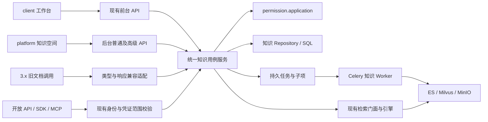
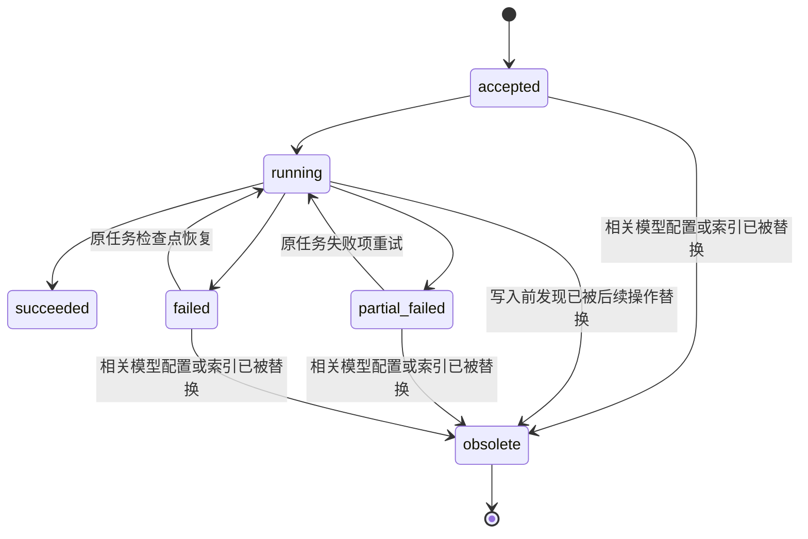
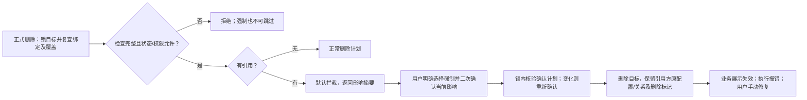
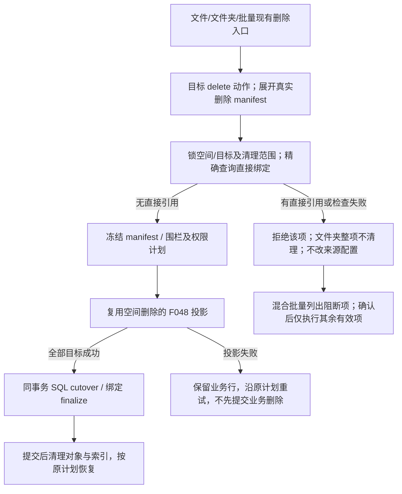

# 技术设计：文档知识库与知识空间统一

**状态**：✅ 已评审；spec 和技术设计已确认，2026-11-05 用户授权按依赖多agent并行开发。实施入口见 [tasks.md](./tasks.md) 与 [parallel-development.md](./parallel-development.md)；W0/W1核心及W2保存/删除接线已实施，当前状态见§15。本文明确区分源码事实与拟议变更。\
**目标版本 / 编号**：v3.1.0-beta1 / F118（暂定）\
**日期**：2026-11-03\
**需求**：[spec.md](./spec.md)（94 条 AC） · [版本契约草案](../release-contract.md)\
**PRD**：[《3.1 beta1》§1.1–§1.8](https://dataelem.feishu.cn/wiki/RGvDwDbyDiNaRQk7DqfcqEPxnoh)\
**调研基线**：本地 `feat/3.0.0`，`25e50eceeeb71989257e5ff38e35f5e011e59bae`。未查询线上数据、未验证远端部署；已有未提交的配置及 review 目录不属于本轮变更。

## 1. 目标、边界与交付形态

把旧文档库 `type=0` 收敛为知识空间 `type=3`，前后台共用资源、文件、版本、权限和处理结果。后台承担高级处理配置与任务管理；旧调用经兼容适配进入同一业务服务，3.x 不维持第二份数据或第二套授权。

本模块包含统一资源与入口、文件/版本与批量操作、权限与检索、高级处理与恢复、维护窗口迁移及兼容、模型删除引用保护。另纳入用户于 2026-11-03 追加确认的**全平台所有权限模型移除 use 动作**，由 F048 及各资源业务 Owner 协同实施；不能只修改知识空间。模型删除保护来自 PRD §1.8，仍单独跟踪验收。

遵循 [constitution.md](../../../docs/constitution.md) C1–C8。QA 数据和入口保持独立，但 QA 权限模型也移除 use；退役的 `type=2` 不恢复；不引入新解析算法、通用任务平台、全平台依赖图或双写系统。本轮不扩展文件 edit 的适用范围；不处理 Worker 在途异步写入与用户后续修改的竞态，不新增 attempt 隔离或外部索引写入围栏作为本次门槛。正常重建冲突限制、任务幂等和配置/索引过期检查继续保留。本文不是 tasks，不执行开发、数据转换、权限投影或部署。

## 2. 已核对的代码现状与差距

以下记录设计调研时基线事实；当前基线与实施增量见§15。历史设计和注释只作导航，以对应版本调用和实际分支为证据。

| 已核对位置 / 符号 | 源码事实 | 本次需要的增量 |
| --- | --- | --- |
| [knowledge.py](../../../src/backend/bisheng/knowledge/domain/models/knowledge.py)，`KnowledgeTypeEnum`、`KnowledgeBase` | 文档/QA/空间共用 Knowledge，类型为 0/1/3；含模型、索引位置、状态、`is_released`、`auth_type`、元数据字段 | 原行转类型；保留 ID/模型/索引位置；增加按类型的空间默认处理配置与可核对迁移来源 |
| [knowledge_file.py](../../../src/backend/bisheng/knowledge/domain/models/knowledge_file.py)，`KnowledgeFileBase` | 文件夹和文件共表，已有父路径、层级、原始/预览对象名、状态、`split_rule`、元数据 | 复用现有文件树；冻结每次实际处理配置，补齐后台版本注册和统一写入口 |
| [knowledge_document.py](../../../src/backend/bisheng/knowledge/domain/models/knowledge_document.py)、[knowledge_document_version.py](../../../src/backend/bisheng/knowledge/domain/models/knowledge_document_version.py) | 逻辑文档有主版本指针，版本行关联物理 file，唯一约束是 `(document_id, version_no)` | 迁移时补缺失首版本；复制和移动覆盖整链，不另建版本模型 |
| [knowledge_space_service.py](../../../src/backend/bisheng/knowledge/domain/services/knowledge_space_service.py)，`create_knowledge_space` | 前台空间创建使用工作台默认 embedding，当前签名无后台选模型或空间分类型策略参数 | 统一创建编排，区分可信入口的可提交字段；后台允许选模型，前台保持简化 |
| 同文件，`get_my_managed_spaces` | 非全局管理员从可见候选出发，再批量检查 edit/visible；不是“当前租户全部空间”列表 | 独立管理员列表契约，不能直接把 `/managed` 改为租户全量，破坏原消费者 |
| 同文件，`move_items` | 已校验源 move、目标 upload_file、同租户、循环、文件夹深度/重名，整链改归属并派发迁移 | 保留规则；补持久任务、元数据差异确认、并发围栏和授权变更先记账再投影；当前代码是 SQL commit 后再改父权限，不能照搬为新设计 |
| [move_worker.py](../../../src/backend/bisheng/worker/knowledge/move_worker.py)，`_migrate_one_file` | 从源 ES 读取 chunk，用目标模型写目标 Milvus/ES 后删源；当前重投直接 add_texts，不足以证明任意失败点无重复 | 增加子项步骤检查点和替换写幂等；源残留不得参与检索；显式验证图片/附件依赖 |
| [knowledge_service.py](../../../src/backend/bisheng/knowledge/domain/services/knowledge_service.py)，`copy_knowledge` | 存在旧库复制编排，调用 library 权限适配器并派发 `file_copy_celery` | 空间复制不能只改 type 后复用；需重建目录/版本映射、空间授权、独立索引及任务状态 |
| [knowledge.py](../../../src/backend/bisheng/knowledge/api/endpoints/knowledge.py)，`update_knowledge_model` | 旧入口更新模型和 REBUILDING 后只对 NORMAL/QA 分支派发重建 | 不能把统一 SPACE 送入此分支；下沉统一模型变更服务，旧入口转发 |
| [rebuild_knowledge_worker.py](../../../src/backend/bisheng/worker/knowledge/rebuild_knowledge_worker.py) | 用 ES chunk 重建向量；当前 `_process_single_file` 一次取最多 10000 条；失败路径可能删除失败文件 ES 数据 | 保留“重建不重新切分”的语义；全量分页读取；失败保留重试数据源；增加真实任务结果 |
| [knowledge_permission_service.py](../../../src/backend/bisheng/knowledge/domain/services/knowledge_permission_service.py)，`_target` / `_lifecycle_target` | 普通容器 target 限 PUBLISHED，生命周期 target 支持更多状态 | 模型重建不能以容器 REBUILDING 导致目录/下载鉴权全部失效，需拆处理状态与资源可访问生命周期 |
| [retrieval_facade_service.py](../../../src/backend/bisheng/knowledge/domain/services/retrieval_facade_service.py)，`_SPACE_ACTION` / `_LIBRARY_ACTION` | 开放检索门面现有空间 gate=visible、文档库 gate=use；共享 RetrievalEngine | 全局移除 use 后门面所有资源统一按可见性准入；旧已可见但无 use 的资格变化记录为预期差异 |
| [retrieval_engine.py](../../../src/backend/bisheng/knowledge/domain/services/retrieval_engine.py)，`retrieve_and_filter` | 已有索引预过滤及结果文件过滤，共享检索核心 | 复用并补齐任务状态、当前归属和主版本约束；逐调用者核对接线，不能只看门面存在 |
| [KnowledgePage/index.tsx](../../../src/frontend/platform/src/pages/KnowledgePage/index.tsx) | 后台目前为 file/qa 两个页签 | 普通知识空间与 QA 并列，新增独立管理页签；补目录页和空间配置 |
| [llm.py](../../../src/backend/bisheng/llm/domain/services/llm.py)，`delete_llm_server` / `update_llm_server` | 服务删除进入 DAO；服务编辑还有共享关系更新等前置写入 | 增加引用检查及统一保存事务，阻断时不能已部分保存共享或服务配置；全业务引用覆盖尚未逐一核实 |

### 2.1 Q-01 追加源码核对：全平台 use 的现有依赖

本次确认后定向读取了当前权限源码，未执行任何权限变更：

| 位置 | 当前事实 | 目标改动 |
| --- | --- | --- |
| `permission/domain/services/catalog_policy.py` | use 在 REGISTERED_ACTION_CODES 中，对 knowledge_library、workflow、assistant、tool、app、linsight_skill 有效 | 从动作注册、适用范围及当前发布合同移除，不再是可分配动作 |
| `permission/domain/services/model_policy.py`、`permission/application/catalog_api.py` | 标准模型由 Catalog 派生；自定义模型选择动作；预设含 use | 标准、自定义、预设都移除 use；仅 use 模型需保持可见授权，不因 action_codes 为空丢失可见性或变为不可撤销 |
| `core/openfga/authorization_model_f048.py` | 动作关系、权限模型/Grant 派生关系及 system_use_marker 仍存在 | 按授权发布流程生成无 use 的新活动模型，清理对应活动投影；历史 release 只保留审计，不继续作为独立使用判定来源 |
| `permission/application/runtime.py::tenant_use_grant`、`grant_service.py` | 工具/Skill 的租户全员 Grant 当前要求 use-only 模型 | 转为原范围内可撤销的可见授权；不自动授予 download/edit，不扩租户或全员范围 |
| `visibility_projection_service.py`、owner/system 投影 | 当前普通可见性贡献由 active Grant/Source 汇总，系统路径另有可见标记 | 移除 use 时保持有效可见性来源及撤销链；不要把 visible 当成新具体动作加入 action_codes |
| 工作流/助手入口、工具 executor、Skill 查询、应用入口及发布摘要、工作台/DSH、开放 task/retrieve | 已发现 action=use、use 结果过滤或 use 来源摘要依赖 | 调用、列表、异步执行和授权摘要全部切换现有可见性协议；仍保留身份、租户、凭证范围、发布/运行状态及其他动作检查 |

上述六种是当前 Catalog 中 use 的作用类型，并非范围上限；所有其他权限模型、遗留 use/can_use/业务别名均须继续盘点。`visible` 是现有可见性能力，与具体动作 Catalog 的职责不同。

## 3. 关键方案选择

### D1：在现有资源上转类型，统一领域服务

- **备选**：双表映射并双写；新建空间并复制全部文件；原 Knowledge 行及文件保留、原地转为 SPACE。
- **建议**：原地转换。新旧 HTTP 入口只是输入/输出适配，执行同一个知识域用例；QA 保留原分支。
- **理由**：ID、模型、索引位置、已有业务引用不变，减少“复制一套再改绑”的风险，符合 PRD 不双写、不默认重建要求。
- **重审条件**：实际存量检查发现两类资源存在不可兼容的结构；必须先输出异常与修复方案，不能静默改成全量复制。

### D2：两类后台列表分别准入，动作仍经 F048

- **备选**：让菜单自动授予数据权限；所有后台列表都走管理员范围；普通授权列表与管理员清单分开。
- **建议**：后者。普通列表按可见范围；管理列表由可信身份及当前具体租户准入，不按个人 Grant 过滤。管理清单不直接调用普通列表 fallback。
- **理由**：既有 `/managed` 还服务工作台管理视角，不应改变其语义。列表中出现对象也不自动形成新的权限授权。
- **已确认 Q-02-1**：仅平台超管与相应租户管理员可进入“知识空间管理”及其全量管理清单接口；部门管理员、资源 owner/manager 不因这些身份取得管理页签准入，仍按普通资源授权访问。准入以服务端可信身份判断，并保留原后台入口规则，不能信任前端管理员标记或仅隐藏页签。
- **已确认 Q-02-2**：超管默认管理所属租户，可切换其他具体租户；租户管理员仅管理所属租户。一次请求只使用一个明确的当前租户，不提供跨租户汇总或全平台混合清单。切换仅改变管理上下文，不改变操作者真实身份或资源归属。
- **已确认 Q-02-3**：管理页签支持当前选定具体租户内的完整管理：空间详情、文件内容、授权/配置、上传、移动、下载、删除。准入与资源操作仍走现有管理员身份及 F048，不要求逐资源补个人 Grant；业务 Service 在管理员快捷判断前确认目标属于当前管理租户。
- **业务约束保留**：配额、内容安全、部门审批、有效业务引用和任务冲突规则均适用。空间复制仍仅源空间创建者可执行，需在业务服务中检查创建者资格，不能因管理员的资源动作权限而放宽。Q-02 全部闭合；清空保护按已确认 Q-03 执行，不因管理员身份豁免。

### D3：全平台移除独立 use，由可见性承担原使用准入（已确认）

- **已确认**：Q-01 选择 A，并追加为所有权限模型，而非仅知识空间。目标为所有当前生效标准、自定义、预设与系统模型均不再包含独立 use，原使用入口检查资源可见性；权限核心实施中，全消费面接线和存量迁移待后续任务。
- **存量结果**：保留主体、可见范围及 use 之外动作。原已可见但缺少 use 的主体取得对应使用资格，这是预期产品语义变化，输出差异报告即可，不再单项请求确认或据此阻断迁移；没有可见性的主体不能因此获得访问。
- **仅 use 模型**：去掉动作后保留稳定 model_key、原 Grant/Source、可见性贡献及撤销能力。选定 §7.3.2 的纯可见模型标记与原管理等级兼容方案；不再把关键表示留待后续详细设计，也不添加 download/edit/visible 等具体动作凑数。
- **实现边界**：移除动作注册、适用范围、模型动作选择、预设、系统 use 标记及调用判定，不是只在 UI 隐藏或永久保留一个 use→visible 的第二授权模型。visible 复用现有可见性协议，不新增一个同名可分配动作来替代 use。
- **兼容**：受支持旧请求中的 use/use_kb 等协议别名在边界按可见性解释，不再进入独立 use 决策。当前模型与动作响应不返回独立 use；历史快照原文可保留，固定旧协议字段若必须保留仅表达可见性别名。
- **限制仍生效**：编辑、下载、删除、发布等其他动作，以及租户、凭证 scope、有效主体、数据范围、底层资源和资源状态/业务资格均不取消。原来 use 与其他条件联合校验的调用，仅替换 use 这一项。

### D4：默认策略版本化保存，实际配置冻结到文件

- **备选**：全局默认替代空间默认；在前端缓存每类型表单；空间持久默认 + 文件实际配置快照。
- **建议**：后者。复用现有 `FileProcessBase` / pipeline 参数及校验，仅增加策略选择与保存。
- **理由**：空间默认只影响后续上传；重试必须用原任务/文件配置，不能读取已经被改写的新默认。普通文档与表格分别保存，不持久化某个临时上传表格的实例配置。
- **重审条件**：新增文件类别或解析器能力；先扩展配置 schema 与能力约束，不创造第二套算法。

### D5：知识域任务及子项承载恢复，Celery 只做执行唤醒

- **备选**：仅查询 Celery 任务结果；每种操作各存一份临时进度；知识域统一任务头和子项、按操作保留步骤。
- **建议**：复用既有可靠任务做法，新增/扩展本领域的 durable job + item；不建设通用任务平台。
- **理由**：进程崩溃、消息重复、投递失败和前端离开均不应丢失进度；部分失败与同任务重试需要稳定业务记录。
- **重审条件**：未来多个领域已有共同任务契约且得到独立立项，此时再抽公共底座。

### D6：资源可访问状态与处理状态分开

- **备选**：直接用 Knowledge.REBUILDING 阻断所有访问；保持容器可授权，用处理任务与索引状态暂停检索/冲突写入。
- **建议**：后者。新流程不把业务资源变为不可授权对象；广场 `is_released`、资源生命周期、处理状态分别表达。
- **理由**：PRD 明确重建期仍可目录浏览、预览和下载。当前普通 target 限 PUBLISHED，直接复用 REBUILDING 会阻断这些能力。
- **重审条件**：如果资源生命周期后续统一重构，仍必须保留只读可用和失败文件隔离语义。

### D7：一次维护窗口，检查点恢复，不长期双协议写入

- **备选**：在线双写迁移；逐租户对用户开放混合类型；部署运维控制维护、全租户验证后统一恢复。
- **选定的职责边界（Q-04-1 已确认）**：采用最后一种维护流程；由运维暂停新派发/启动、等待运行任务自然完成、停止旧服务并完成一致备份；停服后脚本再正式盘点、预检并冻结基线与转换计划，之后执行转换和全租户验证，由运维在升级校验后恢复。超预算仍未完成则保持维护交人工处置，不自动强杀或继续转换。迁移脚本不检测或控制停服，不以服务/Worker 心跳、维护标记或停服确认参数作为数据迁移闸门；脚本只负责正式盘点、数据预检、基线/计划/账本、幂等转换、校验和恢复。
- **理由**：资源类型与权限目标同时改变，混合开放会使旧/new 业务读到不同事实；不将一次升级逻辑写入全局健康检查或正常请求启动路径。
- **重审条件**：明确改变停机窗口要求时，需重新评审迁移方案，不能偷偷增加双写。

### D8：业务同事务维护绑定，删除协调归资源 Owner

- **备选**：删除时扫描各业务原配置；任意资源依赖图；业务写入时同步维护有限目标的结构化绑定，删除按索引查询。
- **复查后建议**：最后一种。业务配置与引用明细/集合在同一 SQL 事务提交；知识/LLM Owner 各自协调删除，业务补充来源展示。此为对前稿“不落引用表、删除时扫描”的修订，不增加任务模型绑定。
- **理由**：有效业务资源、版本及默认配置的引用由所属业务定义，任务不独立绑定模型。一次“先查再删”存在竞态，需要把新增业务配置引用的写路径纳入同一并发协议。
- **重审条件**：出现明确的跨资源依赖查询产品需求，再考虑单独的依赖索引领域。

## 4. 目标模块与数据流（拟议）



拟增量职责如下，具体文件名在正式设计评审后确定；表内“拟新增”不代表已经存在。

| 模块 | 职责与边界 |
| --- | --- |
| 现有 KnowledgeSpaceService / KnowledgeService | 收敛新建、目录、上传、复制、删除用例；旧入口委托共同方法。新查询进入 Repository，不继续增加 DAO 入口或在 Service 写 ORM |
| 拟新增 `space_processing_service` | 配置读取/保存、模型变更、重切分、任务建立、冲突操作准入；调用现有 pipeline，不另写解析算法 |
| 拟新增 `knowledge_processing_repository` | 在同一事务中保存 job/item、配置版本、资源围栏及检查点；不作权限决定 |
| permission.application 及知识业务适配器 | verified target、Grant/Assignee 及类型/父级转换的持久账本与投影；业务不构造 FGA transport tuple |
| 现有 worker/knowledge | 按 job/item 读取冻结计划执行；租户上下文与 actor 来源显式携带，重投不创建新资源 |
| 拟新增知识迁移命令 | 分阶段 inventory / precheck / convert / verify / report；运维专用，不能被普通请求自动触发 |
| 知识空间 / LLM 引用保护服务 | 调各引用领域的 application 查询；汇总脱敏依赖，最终事务检查和删除；不跨模块导入 API 或任意 ORM |

### 4.1 创建与上传

1. 入口适配产生业务命令和可信调用上下文；前台隐藏字段不能成为服务端准入依据。前台命令不允许通过手工参数修改模型/高级策略。
2. 复用现有新建资格、租户、配额及 F048 创建流程；后台模型选择验证目标类型、当前租户可用性及实际可调用性。
3. 建立统一 SPACE 及必要权限投影；前后台返回同 ID。配置与初始授权失败的处理沿既有创建幂等合同，不留下可绕过权限的半成品。
4. 所有文件注册入口共用目录、版本、审批、安全、配额与处理配置解析；后台不再绕过 `_create_primary_document_for_file` 对应的版本能力。
5. 文件入队前保存实际配置快照。Worker 使用快照且复核文件当前归属和任务版本，不能用消息中旧空间 ID 写入过期索引。

### 4.2 列表、详情与检索

- 普通列表可由可见子项进入：只展示足以导航到授权子树的信息，不因管理列表全量逻辑放宽普通列表。
- 独立管理员清单绑定当前单一具体租户：超管默认所属租户，可显式切换其他具体租户；租户管理员仅能使用所属租户。复用既有可信管理范围解析，服务端验证真实管理员身份及所选租户；不得信任客户端 `admin=true` 或任意 tenant_id。过滤与分页在 Repository 和既有租户上下文机制下执行，不手写 tenant WHERE。
- 管理清单及其后续受支持的详情/操作都携带并复核同一具体租户上下文；切换后重新获取数据，缓存与分页上下文区分租户，不能复用上一租户结果。空范围、非法选择或无法确定合法具体租户时不得回退为全平台。前台导航或客户端直接调用也不能绕过租户管理员仅限所属租户的边界。
- 内容和动作统一调用 F048 business action / visibility 协议。管理清单仅平台超管/相应租户管理员准入，部门管理员与资源 owner/manager 走普通授权列表；全量枚举资格不新增 Grant。具体租户及完整管理范围按已确认 Q-02-2、Q-02-3 执行；详情/文件内容与授权、配置、上传、移动、下载、删除使用当前管理员身份判定，保留配额/安全/部门审批/引用/任务冲突和创建者复制限制。
- 所有资源原使用入口、应用选择器与检索均使用 D-01 / Q-01 的全局语义。通过身份上下文维持真实自然人、SAK/PAT、委托与声明白名单等既有收窄约束；兼容层不重建或替换身份。
- 检索有效集合取决于：声明范围（如有）∩ 可访问空间/授权子树 ∩ 文件可见性 ∩ 成功主版本 ∩ 当前归属 ∩ 可用索引。主版本、状态及归属的结果层复核不可省略。
- 重建期间返回明确“暂不可检索”的业务状态；部分失败恢复后只排除失败文件。旧空间残留向量不能因为仍存在于 ES/Milvus 被返回。

### 4.2.1 文件操作沿用现有动作映射（2026-11-05 最新口径）

本次只退役独立 use，不扩展 `edit` 到 `knowledge_file` 或 `folder`，不新增文件编辑模型/授权。继承与自定义仍由 F048 按原授权目标解析；不能为了统一入口把所有文件修改都改成文件 edit。前后台相同用例调用共同 Owner，旧协议只做兼容适配。

| 现有用例 | 保留的授权目标 / 动作 | 已核对接入点 |
| --- | --- | --- |
| 文件 / 文件夹重命名 | knowledge_file.rename / folder.rename | [KnowledgeSpaceService.rename_file / rename_folder](../../../src/backend/bisheng/knowledge/domain/services/knowledge_space_service.py) |
| 高级指定文件重新处理 / 切分 | 所属知识库 / 空间 edit | [KnowledgeService.rebuild_knowledge_file](../../../src/backend/bisheng/knowledge/domain/services/knowledge_service.py) → ensure_knowledge_write_async |
| Chunk 编辑 / 删除 | 所属知识库 / 空间 edit | KnowledgeService.update_knowledge_chunk / delete_knowledge_chunk |
| 文件元数据值修改 | 所属知识库 / 空间 edit | [KnowledgeFileService.modify_file_user_metadata](../../../src/backend/bisheng/knowledge/domain/services/knowledge_file_service.py) |
| 现有空间文件重试、标签 / 编码等文件维护 | 保留相应既有文件 rename 映射 | KnowledgeSpaceService.retry_space_files / update_file_tags / update_file_encoding；不借此扩为 edit |
| 删除 / 下载 / 移动 | 原目标 delete / download / move；移动另查目标容器 upload_file | KnowledgeSpaceService 对应已有用例 |

这里的容器 edit 是既有高级用例的授权目标，不是给所有文件动作额外叠加的检查。网页后台入口/API scope、原读取入口资格、租户、文件归属、版本及任务状态仍按原合同处理；不因权限模式另写 INHERIT/CUSTOM 准入分支。空间默认、模型和元数据结构继续检查空间相应动作。

**前稿纠正**：当前 Catalog 的 edit 适用范围没有 knowledge_file。此前“统一改为目标文件 edit”的接线要求撤回；本轮不修改该适用范围。文件标签、文件重试等当前使用 rename，不据其函数名自行改成 edit。

### 4.3 拟议持久结构

| 位置 | 建议字段 / 结构 | 约束 |
| --- | --- | --- |
| Knowledge 增量 | `processing_defaults`、`processing_config_version` | JsonType 保存带 schema_version 的普通文档/表格规则，版本用于并发更新；无配置按既有默认解释，不批量回填重处理 |
| KnowledgeFile 现有 + 增量 | 现有 `split_rule` 保存实际有效规则；必要时增加配置来源/版本 | 重试读取文件/任务快照，不能把空间新默认应用到已开始的历史操作；现有格式通过适配器规范化 |
| 知识处理任务（拟新增） | `id`、`tenant_id`、`space_id`、kind、state、actor 引用、幂等键、请求 hash、冻结处理参数/预期业务版本、计数、时间、错误 | 唯一 `(tenant_id, operation_kind, idempotency_key)`；同键不同 payload 拒绝；任务记录不存凭据 |
| 任务子项（拟新增） | job_id、file_id/version_id、预期归属/版本、step、attempt、result、error | 同任务资源唯一；重试增加 attempt、恢复原子项，不创建另一套文件/版本/授权 |
| 空间操作围栏（拟新增或并入任务） | space_id、active operation、generation/lease | SQL 是真相；Redis 可作辅助唤醒/限流，不能单独承担排他；任务步骤及 SQL finalize 校验 generation，不承诺阻断已在途外部 I/O 与用户修改的竞态 |
| 迁移清单（拟新增） | run_id、tenant_id、knowledge_id、原类型、目标类型、快照摘要、阶段、校验结果、checkpoint | 迁移来源持久保留，供个人配额长期豁免与审计核对；不在运行请求中保留第二套业务资源 |

表结构、唯一约束、租户自动注入登记及 Alembic 迁移须在正式设计中闭合；使用 C2 的双库类型。新文件遵循最近层级 AGENTS.md，不把上述候选名当成已存在模块。

### 4.4 默认配置的解析与保存

配置分普通文档与表格两组，外包 schema version，不保存上传文件名、临时 URL、表格实例 sheet 标识等瞬时数据。普通文档复用现有 chunk 长度/重叠、分隔标记及规则、层级、标题路径与解析选项；表格复用 `slice_length`、`append_header`、起止行等现行规则。实际后端字段以现有 schema 适配为准。

有效配置的构造顺序为：现行系统默认 → 对应文件类型空间默认 → 显式批次配置 → 显式文件配置，最后执行文件类型/解析器能力约束和专用流程覆盖。网页目前在 `KnowledgeFilePipeline` 覆盖 separator/overlap，保留这一优先行为，不将网页规则误保存为普通文档默认。

保存是一次提交：服务端校验全部类型及配置版本后整体更新。前端切换类型只改变当前展示，不销毁另一类型的草稿；取消或保存失败保留服务端旧值。配置保存不建立历史文件处理任务。重切分用明确命令并冻结目标文件、版本和确认过的覆盖影响。

## 5. 文件操作与异步恢复

### 5.1 批量操作两阶段确认

沿用可复用的现有 move 校验方式，但补齐一致性：预检返回有效项、不可执行项及影响摘要，不写业务；用户确认后只提交其确认的集合。执行时重新校验权限、归属、状态和关键影响版本。若元数据清除范围或授权继承影响发生变化，要求重新确认，不能沿用旧确认扩大操作范围。

多选父文件夹和其子项时先去重并展开实际操作集合；版本链作为完整单元。没有可执行项时直接返回明细；取消不写任务或对象。逐项结果对无权资源隐藏名称及详情。

### 5.2 移动的顺序与幂等

1. 锁定源/目标空间及相关资源（固定排序防死锁），检查活动任务、权限、租户、目录、版本链，计算元数据保留/清除及标签、权限影响。
2. 持久保存冻结计划与 F048 操作/投影账本，包含原/新父级和预期资源版本。通过 permission.application 完成所需原子权限投影，再以同一幂等操作 finalize SQL。禁止照搬当前“先 SQL commit 再改父关系”的窗口。
3. 切换逻辑归属时标记相关文件检索不可用，所有版本一起改；继承跟新父级、自定义 Grant 保留，不批量清授权。投影后 SQL finalize 失败由同一账本前向修复，冲突资源在恢复完成前禁止普通变更。
4. 已有源 chunk 作为迁移输入保留。每个子项按源分页读 → 目标可替换写 → 校验目标 → 清源 → 验证清理 → 记录完成。写入/替换以 operation/file/version/chunk 稳定标识去重；失败重投先核对步骤，不能“目标 add 成功但清源失败”后重复追加。
5. 结果过滤即时排除旧归属残留。失败项保留可恢复源数据及文件版本，重试原迁移计划，不重新解析、不重新移动 SQL 归属。

**图片与附件**：现有 worker 注释保留源路径，不能据此推断删源必坏图，也不能推断永远安全。应逐项盘点 object_name、预览、bbox、chunk 内图片和附件路径与删除 manifest；建议稳定对象引用或在移动任务中重定位并改写所有引用。删除源空间前校验无仍被目标资源依赖的对象进入清理清单。移动后删源的完整场景是必要验收项。

### 5.3 空间复制

仅创建者具业务复制资格，此外检查后台入口与新空间创建资格/配额。生成 source→target 的 folder/file/document/version/tag 映射；副本目录路径、主版本指针及普通授权指向副本，不保留指向原资源的 ID。副本所有者为执行复制的创建者，受保护 Owner Grant 重新建立；普通授权按 F048 复制规则处理。新副本默认 `is_released=false`，不复制 pin/member subscription/chat。

原始内容及派生对象须保证副本独立生命周期：若复用对象，必须具备可验证引用计数/删除保护；否则复制对象。索引独立创建。复制任务挂在目标副本上，不把源空间标记为 COPY 导致源只读访问中断。失败结果可定位并恢复，不能把仅建好空副本记为完成。

### 5.4 任务状态与消息投递



`obsolete` 表示不可重试的旧任务，保留已完成结果和失败项供查看，不从该状态回到 running；用户通过新的重建命令建立新任务。过期仅取决于模型选择/目标索引等相关业务修订，改空间名称/说明或其他无关字段不会过期。

这些是拟议的业务任务状态，不能直接等同 Celery result 或 Knowledge.state。子项记录步骤与实际结果；任务完成计数从终态子项汇总。任务可保留模型标识作为审计/过期校验信息，但不形成独立模型绑定；实际调用模型从所属业务配置读取。数据库提交任务后派发；投递失败由持久待派发记录/现有周期恢复机制补发，不能因 broker 故障丢任务。Worker 领取用租约及 generation 管理任务接管、步骤幂等和 SQL 结果提交；租约过期后的旧 Worker 不能 finalize 新代任务结果。这不等同于跨 SQL/ES/Milvus 的原子写入保证。

执行阶段从任务载入租户和可信主体信息，在对应上下文访问 Repository；不信任未验证的客户端 tenant_id，不保存 token。接受任务时检查完整授权；执行前复核目标仍有效、归属和操作计划未变。人工重试重新鉴权；故障自动恢复只续做已冻结操作，不重新扩大对象集合。

**本轮范围排除**：暂不治理 Worker 已发出的外部索引请求在租约接管或重建围栏释放后迟到，与用户后续 Chunk/元数据修改相交的竞态；不为此引入 attempt 独立 staging、外部写 CAS 或额外跨存储事务，也不把此反例作为本轮验收阻断。任务幂等、可控步骤的配置/索引修订检查、obsolete 和重建期间冲突操作限制继续执行。

### 5.5 模型重建及元数据任务

1. 校验模型可用性、空间 edit 与入口资格，展示暂停检索和冲突写入的影响，确认后建立任务。
2. 固定顺序锁定空间，检查已有冲突处理及文件状态；发现仍活跃的解析/其他操作时明确拒绝本次提交，不自动停止任务或补造旧操作证明。可控步骤保原配置/索引代际校验；已发出外部IO的迟到竞态仍按§5.4排除。
3. 建立空间处理围栏并暂停检索；目录、预览、下载使用可授权资源态继续工作。上传、新版本、Chunk、元数据值/结构修改和双向移动在统一业务入口检查围栏，旧 API 同样检查。
4. 保留可重试 chunk 文本及元数据来源，分页读取全部版本分段，不使用当前 10000 条单次上限，不重跑 ETL/切分，不清掉人工修改。
5. 新模型由受控业务操作分配新的逻辑index_generation；W6已冻结复用既有物理collection，不新增多代staging/双写或物理命名协议。首次处理按受控checkpoint重置目标，成功项存在后重试不得再drop；每文件验证完成后登记结果。失败不丢旧文本。全部尝试结束后受控finalize当前模型配置并发布同一逻辑generation，成功文件恢复检索，失败文件保持排除；释放空间写围栏。模型删除只查询业务资源/有效版本及默认配置：如采用分阶段模型切换，仍生效的当前/待切换模型归属于空间业务配置，由其引用保护；不为运行、旧代清理或失败重试任务另行登记模型引用。
6. 部分失败重试继续同任务，只恢复失败项，执行模型从空间当前合法业务配置读取，原任务/文件的分段与处理规则快照保留。任务记录操作相关的模型配置修订及索引 generation，仅用于过期写保护，不作为模型绑定；领取、恢复和可控批次/finalize 前核验，发现已被后续模型/重建操作替换时标记 obsolete 并拒绝新步骤及陈旧 SQL 提交，不从任务参数恢复已解除的模型绑定，不主动向已知失效的索引代启动新写入；已在途请求与用户后续修改的竞态按 §5.4 排除。恢复旧模型仍是明确的业务配置变更及必要重建，不能只改字段假称切换完成。名称/说明等无关修改不更新此相关修订；不允许旧任务按新模型仅补失败项而留下混合模型索引。

普通元数据结构/值任务也需冻结变更前后 schema 与目标范围，分别更新 SQL 和索引并记录结果；索引未完成不展示全成功。重命名/删除字段二次确认。单文件 Chunk 编辑/删除、元数据值修改及高级重处理沿 §4.2.1 的既有容器 edit；已有文件重试继续按原动作。索引按指定 version 定位，原始文件不变，不新增文件 edit。具体冲突矩阵按所触碰资源控制，只有模型重建按 PRD 扩展为整空间围栏。

## 6. 引用保护与业务绑定维护（复查修订）

**设计修订**：前稿“删除时让各业务扫描原配置、不落绑定表”不再作为正式路径。业务配置仍定义引用含义；各业务的写用例须在**同一 SQL 事务**同步维护结构化绑定，删除按绑定索引查询。全量解析配置用于存量回填、核对与修复，不用于每次删除扫描全部业务。本节技术方案已评审，引用核心已开始实现、业务Owner接线待后续任务；不增加任务—模型绑定。

### 6.1 分工和调用链

- **业务 Owner**：按 §6.4.1 的实际业务配置保留规则提取引用，已保存配置不因暂不能运行/下线/非当前而解除；新增、保存、删除、复制、导入、发布和回滚都调用同一绑定维护应用协议。不能要求前端上报“引用列表”，不能由模型/知识模块猜测工作流 JSON。
- **绑定存储能力**：拟新增专用 `resource_reference.application` 协议及本模块 Repository/双库表，接收外部事务 Session，负责集合差异、唯一约束和按目标查询；只处理模型、空间和直接文件这三类目标，不承载授权、任务绑定或任意资源图。`common/core` 不导入这些业务对象。
- **资源 Owner**：knowledge 的 `KnowledgeReferenceService`、llm 的 `ModelReferenceService` 负责目标校验、删除协调及结果展示。最终检查查绑定 Repository，不再遍历其他业务表；来源名称、版本入口由各业务应用接口批量补充并按权限裁剪。
- **事务归属**：业务应用用例持有唯一事务，按 `Endpoint → Service → Repository → DB` 调用。业务配置 Repository 和绑定 Repository 使用同一 Session，均不自行 commit；失败一起回滚。绑定写入不是 Celery、消息、ORM 事件或提交后回调，提交后消息仅用于缓存失效和非关键通知。

### 6.2 绑定数据：明细、来源集合及目标删除标记

表名为候选合同，实际字段长度、索引名和迁移 DDL 在实现前按 MySQL/DM8 冻结；使用显式关系列及项目 dialect helpers，不用 JSON 查询函数或数据库专有 upsert。

**`business_resource_reference`：一条有效业务配置槽位到目标的绑定；强删后保留为失效关系。**

| 字段 | 含义 |
| --- | --- |
| `id` | 绑定记录主键；非前端可随意修改的业务 ID |
| `tenant_id` | 引用来源所属租户，接入现有自动租户隔离 |
| `source_type/source_id/source_version` | 来源资源、稳定 ID、配置版本；草稿/当前配置使用稳定版本键，发布版本各自独立，不用 latest 混同所有版本 |
| `slot_key` | 稳定配置槽位，如 `node:n1.embedding_model`；多选列表以槽位与目标 ID 组成集合，不使用可漂移数组下标 |
| `target_type/target_id/target_tenant_id` | 目标为 `model/knowledge_space/knowledge_file`；目标 ID 必须解析为真实稳定 ID，记录可核实的真实拥有租户；存量缺失目标无法核实则保留未知，不猜测 |
| `target_space_id` | 直接文件/文件版本目标的当前空间归属，派生自真实文件关系；空间目标可填自身，模型目标为空。由知识域维护归属变化 |
| `legacy_invalid_reason/legacy_run_id/legacy_evidence_key` | 原目标 ID 明确且冻结预检已证明缺失时，记录存量失效及原基线证据；仅内部迁移写入，不伪造强删 tombstone；详见 §6.11 |
| `source_revision` | 该绑定对应的业务配置修订，供幂等和对账；不把历史任务模型 ID 写入 |

唯一键：`(tenant_id, source_type, source_id, source_version, slot_key, target_type, target_id)`。目标反查索引覆盖 `(target_type, target_id)`；空间内容引用索引覆盖 `(target_space_id)`；来源替换/删除索引覆盖 `(tenant_id, source_type, source_id, source_version)`。查询共享模型的目标索引必须覆盖全部实际来源租户，不能因普通租户过滤漏掉依赖。显示名称、URL、凭据、配置全文不冗余进表。

**`business_reference_set`：每个来源/版本一条集合校验记录。**

来源键与上表相同，保存 `source_revision`、`extractor_version`、规范化绑定集合摘要及有效/就绪状态。它用于明确“配置确实没有引用”与“还没有提取”的区别；零引用来源也必须写集合记录。集合与业务配置、明细同事务提交，不作为异步最终一致状态。只有仍生效来源维护明细，强删目标后的失效关系继续保留供修复；普通删除使用指向尚存目标的有效关系；来源经表 §6.4.1 的既有删除/配置解除操作不再保存引用时，才移除明细并将对应集合更新；不因显示为历史/非当前直接移除。迁移覆盖完成情况由升级账本按租户/来源类型记录，不新增任务模型占用系统。

目标的 deleting/deleted 由 §6.10 的 tombstone 识别，不逐条改写来源配置或修订。引用明细是同步维护、可由原配置重建的业务索引。禁止对外提供“单删一条引用以强制删除目标”的接口，也不维护独立引用计数作为删除依据。多态目标不依赖单一外键级联；目标存在性、状态、租户和共享可用性由对应 Owner 校验；原有失效关系的解除/保留按 §6.10–§6.11 处理，不要求被删旧目标仍有 live 行。

### 6.3 写协议：从新配置生成集合，同事务替换差异

统一应用协议候选名：`replace_source_bindings(session, source_key, expected_revision, new_revision, references, effective)`。由业务提取器生成完整集合，绑定层验证来源修订和目标已校验上下文，不允许裸传任意目标绕过业务授权。

```text
候选阶段：业务加载当前配置/修订，提取并规范化新配置，计算旧/新目标候选集合
BEGIN 新事务
  1. 按统一顺序锁旧、新有效目标与涉及服务；旧目标已缺失时核验原关系和 tombstone 或冻结存量证据；校验新增目标存在性/租户/共享范围/操作状态
  2. 锁来源资源及对应 reference_set；核对 expected_revision
     若当前目标集合或修订与候选不同，回滚后重新计算，不带着旧集合继续保存
  3. Owner 用新配置生成 R_new（来源不再有效时为空）
     读取该 source/version 的 R_old；R_new 的新增目标须通过合法性校验；原来源/版本未变的已登记强删/存量失效项可保留，运行/发布仍拒绝
  4. 保存业务配置或生命周期变化，修订改为 new_revision
  5. 删除 R_old - R_new；插入 R_new - R_old；交集更新 source_revision
     同时写 reference_set 的修订、提取器版本、摘要和有效/就绪状态
COMMIT（业务配置与绑定一起成功）
```

来源保留或解除已登记的强删/存量失效槽位按 §6.10–§6.11 处理，不能因旧目标 live 行已删导致无法修复。步骤 3 发现新的未锁目标时回滚重算；唯一约束与稳定来源键保证重复保存不产生重复关系。任何配置校验、绑定写入、唯一冲突或事务失败，业务修改和引用修改均回滚。并发修改使用来源修订 CAS；重复请求按业务幂等键返回原结果或已存在冲突，不把“重复”误判为成功覆盖。

例如工作流草稿原来引用空间 A、模型 M1，保存后变为 A/B、M2：该草稿集合增加 B/M2、删除 M1、保留 A，在同一事务提交。若线上 V3 仍引用 M1，只删除草稿的 M1 行，V3 的 M1 行保留，因此 M1 的普通删除仍会被阻止；也可按 Q-05 确认后强删，留下 V3 的失效关系待修复。

### 6.4 业务增删改、版本与默认配置维护矩阵

| 业务操作 | 对绑定集合的动作 | 事务与边界 |
| --- | --- | --- |
| 新建/复制/导入 | 从最终配置提取，按新来源键创建明细和集合；零引用也登记 | 原关系 ID 不复用；新增目标合法性检查，配置与绑定同事务 |
| 保存/改绑/取消某选项/移除节点 | 完整新集合与该来源/版本旧集合做差异替换 | 仅改本来源版本；其他版本关系保留，未改失效槽位可按 §6.10 保留 |
| 删除工作流/助手/频道/托管应用/空间或 QA | 当实际业务删除成功使其配置不可再使用时解除该来源关系 | 沿既有删除/投影事务与持久计划；异步清理接受不等于删除成功；保留历史审计，不以其重建引用 |
| 删除非当前工作流版本 | 该版本成功标记删除后移除本版本集合；当前版本仍禁止直接删除 | 复用 `FlowService.delete_version` 既有资格；不提供新“退役”状态 |
| 发布/切换工作流版本 | 新版本独立建/更新集合，非当前未删除版本继续保留 | 不能因 is_current=0 或下线而清关系；版本可能再次编辑/切换 |
| 托管应用新发布/停止/被替代/撤回/拒绝 | 冻结新版本新增独立集合；旧版本保留，停止/发布终态不自动解除 | 管理预览仍可能启动历史版本；AppVersion 不可变，无版本删除/退役/回滚写入口 |
| 默认模型替换/恢复继承 | 替换对应原始槽位；恢复继承仅解除本租户覆盖 | Root 原槽位仍保护模型；不为继承租户或任务复制派生绑定 |
| 频道同步关闭/恢复/移除目标 | 关闭只改变 is_enabled，绑定保留；移除目标并保存才删对应关系 | `knowledge_sync` 主/子频道列表为真实来源，取消个人订阅不是解除同步目标 |
| 直接文件/整版本链移动 | 保持 file ID 关系，知识域同事务更新 target_space_id | 锁源/目标空间和真实文件；显式空间绑定不自动改绑 |

所有已保存草稿即使当前缺参数不能运行，仍维护其已保存的模型/知识引用；工作流所有未删除版本继续维护。不可变应用历史内容不改写，非当前/只读展示本身不等于“不可执行历史”。绑定的 valid/invalid 是目标可用性；来源业务保留状态与目标失效状态分开。

### 6.4.1 实际业务、解除功能及源码证据（基线 577d8bd14，2026-11-04 定向核对）

Spec §3.15.1 为业务规则，以下把现有存储及入口映射为实现接入点，不声称已有自动绑定维护。当前未核实存在可对各模块统一套用的“版本退役仅供历史查看”能力，故删除该泛化假设；对话、审计、评测报告属于记录，不是待退役的业务模型配置。

| 实际业务 | 当前配置/状态与证据 | 需接入绑定维护的保存/解除入口 |
| --- | --- | --- |
| 工作流及 Flow/FlowVersion 配置 | [flow_version.py](../../../src/backend/bisheng/database/models/flow_version.py) 的 data/is_current/is_delete；非当前版本仍能读取/更新/切换，当前镜像 Flow.data 不重复统计同一版本 | [flow.py](../../../src/backend/bisheng/api/services/flow.py) 的版本保存/删除/切换，以及 [FlowDao.delete_flow](../../../src/backend/bisheng/database/models/flow.py)；删除非当前版本、移除模型节点/知识源、改绑模型时更新相应集合 |
| 助手 | [Assistant/AssistantLink](../../../src/backend/bisheng/database/models/assistant.py) 的 model_name、knowledge_id、status/is_delete；没有独立助手版本退役表 | [AssistantService](../../../src/backend/bisheng/api/services/assistant.py) 的 update_assistant（model_name/knowledge_list）及 delete_assistant；模型替换/知识来源移除是解除槽位，OFFLINE 不是 |
| 托管应用 | [AppVersion](../../../src/backend/bisheng/database/models/app_version.py) 不可变；[版本列表](../../../src/backend/bisheng/app_runtime/api/endpoints/apps.py) 无切换/回滚写；[PreviewInstanceService.start](../../../src/backend/bisheng/app_publish/domain/services/preview_instance_service.py) 的管理预览不因版本 terminal_state 自动拒绝，[资格校验](../../../src/backend/bisheng/app_publish/domain/services/release_tenancy_service.py) 还检查业务归属 | 发布时从 capabilities/injections 解析真实目标 ID，按 app/version 建集合；[AppStateService.delete](../../../src/backend/bisheng/app_runtime/domain/services/app_state_service.py) 成功后解除该应用来源。历史版本即使只读、已撤回/拒绝/被替代仍保留，避免遗漏管理预览；不新增删除/退役历史版本接口 |
| 频道同步 | [ChannelKnowledgeSync](../../../src/backend/bisheng/channel/domain/models/channel_knowledge_sync.py) 记录目标空间/folder 与 is_enabled；[ChannelService._save_knowledge_sync](../../../src/backend/bisheng/channel/domain/services/channel_service.py) 关闭时仍保存目标，整列表替换 | 主/子频道同步设置移除选项并保存、dismiss_channel 解散；以频道+稳定主/子配置槽位作为来源，不使用整表替换生成的新 sync 行 ID 当稳定来源键 |
| 空间与 QA | [Knowledge](../../../src/backend/bisheng/knowledge/domain/models/knowledge.py) 的模型等配置；处理任务只消费业务配置 | 空间/QA 模型变更及删除协调；切换阶段仍在业务配置里的旧/新模型都保留；清空只清内容不解除自身模型槽位 |
| 系统/租户默认模型 | [TenantSystemModelConfig](../../../src/backend/bisheng/llm/domain/models/tenant_system_model_config.py) 与 [LLMService](../../../src/backend/bisheng/llm/domain/services/llm.py) 的 update_knowledge_llm/update_assistant_llm/update_workflow_llm/update_evaluation_llm/update_workbench_llm | 对应设置保存和已有恢复继承操作；用默认来源 key+槽位定位，不将工作台临时聊天所选空间/文件建立永久模型绑定 |
| 评测任务与报告 | [Evaluation](../../../src/backend/bisheng/evaluation/domain/models/evaluation.py) 保存执行主体及版本，不是模型槽位；[EvaluationService](../../../src/backend/bisheng/evaluation/domain/services/evaluation_service.py) 调用 get_evaluation_llm_object | 评测默认配置的关系由上一行维护；删除评测记录不解除工作流/助手/默认模型绑定，评测任务参数不登记模型关系 |

**仅供历史的判断**：当前只读应用版本仍有管理预览入口，不能仅凭其不等于 current/pending 就删绑定；工作流非当前版本同理。被现有业务成功删除的来源不再具备原执行/预览资格，才解除其集合。若将来另加不可执行的历史归档状态，应另行定义恢复时重新校验，而不是本轮发明一个通用 retired 字段。

**强删接线差距**：频道现有 `_load_knowledge_sync` 会过滤失效目标，`ChannelKnowledgeSyncDao.adelete_by_space_id` 等清理接口可能删除选项。Q-05 要求强删后原选择及失效关系保留，因此需核对所有调用并改为显示失效，不照搬自动删配置的旧清理逻辑。源码证据只证明现状，本轮未改实现。

### 6.5 哪些业务负责提取

| 目标 | 来源业务 Owner | 提取范围 |
| --- | --- | --- |
| 空间/直接文件 | 应用、助手、工作流及版本 | 空间选择、旧知识库 ID、直接文件及非主版本文件选择 |
| 空间/直接文件 | 托管应用、频道等集成 | 按 §6.4.1 保留的已保存配置及全部仍有管理预览的应用版本；暂停同步仍保留 |
| 模型 | 空间/QA | 实际使用的 embedding/rerank/LLM/ASR/TTS 槽位；有阶段切换时当前/待生效业务槽位均维护 |
| 模型 | 助手、工作流/FlowVersion、托管应用及版本 | 已保存实际模型槽位，含草稿/非当前/管理预览历史版本；评测任务/报告不是模型配置来源 |
| 模型 | 系统/租户默认配置 | 仍生效的默认模型原始槽位，含 Root 继承来源 |

业务提取器与运行时读取同一配置 schema/解析语义，不做任意 JSON key 递归搜索或字符串 LIKE。保存时解析这一份新配置；删除目标时用 SQL 索引查关系。新增可引用的节点/配置槽位必须同步更新提取器及版本，补回填/验收后才能启用。

### 6.6 空间/模型删除怎么使用绑定



**知识空间**：最终查询同时覆盖目标为空间本体的绑定，以及 `target_space_id=该空间` 的直接文件绑定。普通删除和清空在有有效引用时拒绝；本轮只为空间删除增加显式强制模式，清空仍须先解引用。历史聊天/审计不生成有效绑定，确认须说明历史内容将不可访问，取消零修改。强删也先锁空间、复查覆盖/引用并核对已确认影响；通过后登记 `deleting`、删除标记与固定清理计划，沿既有账本/投影规则执行。API 接受不等于清理完成。清空保留空间 ID/配置/授权，沿既有 `clearing` 计划；失败按同一计划恢复，未完成不恢复可绑定状态。

**模型/服务**：单模型、编辑服务移除模型、整服务删除统一生成目标集合，持服务/模型锁后重算，并查全部实际来源租户。普通模式任一有效引用即整次拒绝；强制模式对完整待删集合及影响二次确认，关联目标写删除标记、保留入向关系后，模型删除和服务名称/配置/清单按同一 SQL 事务提交。任一覆盖/检查异常、权限/租户/共享只读不满足或确认过期均整体拒绝。必要共享投影仍沿既有持久计划，不能在引用检查前生效。默认配置也是受影响业务来源，不能强删后偷偷回退其他默认。

**双重角色**：空间自身也是模型引用来源。删除空间时，其出向模型关系随空间业务配置最终失效同事务移除；引用该空间的入向业务关系则在强删模式保留为失效关系。清空保留空间模型配置及出向绑定。外部清理阶段若仍需业务配置，仍由有效业务配置承担引用，不为任务另建绑定。强删不越过既有重建/移动等任务冲突规则。

绑定先提交，普通删除取得目标锁后发现引用并拒绝；强制删除发现影响集合变化时要求重新确认。删除先提交，新绑定写端看到目标不存在或 `deleting/clearing` 时拒绝。普通预览不能授权强删；强制请求必须携带服务器生成的确认计划及显式模式，由后端重新授权和核验，不能仅凭一个布尔值跳过所有检查。

### 6.7 锁顺序、读取一致性与异常

统一锁顺序：涉及模型先按 ID 锁相关服务，再按固定目标类型序及 ID 锁空间/模型，随后锁来源及集合。空间自身既为来源又为目标时，提前纳入目标锁集合；文件关系、移动还须锁相关文件并核对真实归属。空间删除涉及其出向模型绑定时，也遵守完整顺序。候选读用于计算锁集合，锁后用当前读重验；集合变化回滚重算，不在持锁期间追加顺序更小的锁。死锁/事务冲突按业务幂等键有限重试；本轮执行MySQL实测及C2静态复核，DM8实库按用户决定免测。

最终绑定查询不得复用预览旧快照或缓存；事务隔离/锁定读在两库分别证明。所有新旧 API、保存、导入、复制、发布、回滚、默认配置和直接文件移动写端均接入此协议。涉及多版本的发布/删除还须以同一根业务记录作为来源并发门闩，递增根修订并重验有效版本集合，防止删除计划漏掉并发新增版本。引用关系不是 FGA 授权关系，不能写进 OpenFGA 或用授权 tuple 判断能否删除；实际权限仍走 F048。

租户上下文由服务端确定，绑定表接入自动隔离。共享模型删除在拥有方可信内部协议下枚举实际来源租户，只在受审核 Repository 范围绕过来源租户过滤；对外响应不泄露无权来源 ID/租户/名称/版本。展示信息读取失败不影响已有绑定的阻断事实；最终关系存储异常或覆盖未就绪则拒绝删除。

### 6.8 存量回填与防漂移

1. 升级文档要求停服执行；运维停服并完成一致备份后，脚本先正式盘点、预检并冻结正式基线与计划，再进行转换和本节回填，仍不检测/控制停服。按 §6.4.1 的具体来源和全部需保留版本（含未删非当前工作流和可管理预览的应用历史版本）按租户分页，用与写入口相同的提取器回填明细和集合；配置没有引用也写集合就绪记录。
2. 旧文档 ID 规范化到同一空间，直接文件归属在文件/版本迁移完成后生成，模型保留真实 ID。默认继承按原始有效槽位维护，不为所有消费者复制模型行；任务不回填。
3. 每来源事务幂等替换，冻结原配置修订/提取器版本/摘要；中断用原升级账本及原预检基线续跑。合法强删失效照旧保留；迁移前原 ID 明确、目标已缺失的引用按 §6.11 保留并登记 invalid_legacy，不要求有新系统强删记录。名称歧义、非法跨租户绑定、坏版本及其他未解释的数据异常仍报告并阻断，不静默跳过。
4. 按租户/来源类型对账：全部需保留来源、包括零引用的集合、修订和摘要；关系分类核对 valid/invalid_legacy/强删失效，已完整登记的存量失效不是覆盖缺口，允许带人工修复清单升级。只有全部覆盖及一致性验证完成才启用删除保护；不在正常请求或启动时全量修复。
5. 定期只读对账按原配置重算，比较集合修订/摘要与关系明细，发现缺失/多余/过期立即记录不一致并禁止受影响范围删除。由显式修复命令按同一事务协议重建；新增有效关系须先校验目标仍存在；合法 tombstone 或原冻结存量证据对应的失效关系保留并报告待修复，不视为漂移或静默删除，已删目标不能凭对账复活。监控是兜底，不替代写事务。
6. 禁止绕过业务用例直接更新引用字段。必要数据修复脚本也必须使用同一维护协议或停服后回填并核验；提取器升级必须有范围回填和就绪检查，不能先启用新槽位再等异步索引补齐。

### 6.9 查询展示与源码接入点

预览接口返回 `blocked/check_complete/can_force_delete`，强制能力沿用原操作权限且须另行确认；`blocked` 表示普通模式引用阻断。其他字段包括来源类型数量、有权来源的名称/版本/槽位/入口；无权来源只返回类型数量。按来源/有效版本去重计数，详情列出多个槽位。名称/链接由业务批量查询，不冗余入绑定表；查询为空但迁移覆盖未就绪时返回不可判定。错误码按 knowledge/llm 所属段及注册表分配，路径和具体号码待 API 合同冻结。

已核对的现有差距（仍未改代码）：旧 `knowledge_service.py::delete_knowledge` 在权限检查后直接清理，须在副作用前接保护；文件/目录 `KnowledgeSpaceDirectDeleteService` 的持久清理模式可借鉴，但并非现有空间引用协调器。`llm.py::delete_llm_server` 直接委托 DAO，`LLMDao.update_server_with_models` 自开事务删除差集，需改为协调用例持有 Session。`tenant_system_model_config` 的 Root fallback 需由默认配置 Owner 提取绑定。现有空间/QA 重建任务仍显式携带模型 ID，需按业务资源配置校验和解析，不为其建立引用关系。各业务的保存/发布/删除入口仍需逐一列出接入清单，不能声称已全覆盖。

验收必须覆盖：配置保存成功关系必存在；绑定写失败配置零变化；改绑只动当前版本；删除来源释放关系、线上版本仍执行则保留；回滚目标已删失败；复制/导入重新提取；默认继承；空间清空保留其出向模型绑定；移动同步直接文件归属；共享隐藏引用；并发写与删；回填零引用集合/中断续跑/覆盖缺口；任务不入表。对应 Spec AC-87–AC-89，已有业务边界保持。

### 6.10 Q-05：强制删除与保留失效引用（已确认）

用户确认“有引用也可强制删除空间和模型配置”，并选择保留原业务 ID/关系、显示失效、执行报错、手动修复。这取代前稿“禁止强制确认”的结论；不引入自动跨业务解绑定，不扩大既有操作权限，清空不在本轮强制范围。

**请求与确认协议**：预览返回 `can_delete_normally/can_force_delete/check_complete`、有权明细和受限计数，`blocked` 只表示普通模式受引用阻断；是否可强制还取决于原删除/编辑权限、租户、状态、共享只读、完整性与任务冲突。选择强删后，服务端生成短期确认计划，冻结操作者、目标租户、操作类型、服务修订、精确目标集合、规范化入向绑定集合摘要和各类影响计数；界面明确提示业务将失效。最终锁内重读目标和关系并比较计划，不接受前端自己拼摘要；目标/引用集合或必要权限变化就返回需要重新确认，不把旧确认用于新影响范围。摘要由目标索引分批计算，不扫描其他业务 JSON；无权详情仅参与内部摘要，不对用户暴露。

**删除标记与关系存续**：拟增加 `resource_reference_tombstone`，唯一键为目标类型/目标 ID/拥有租户，记录删除操作 ID、阶段 `deleting/deleted`、时间和操作者；不得保存模型凭据/配置全文。模型逻辑删除/SQL 删除与 tombstone 同事务；空间在进入不可再绑定的删除计划时持久化标记，完成外部清理后更新阶段。ID 永不复用。模型可以物理删除，业务原配置 ID 和入向 `business_resource_reference` 都不级联删除。直接文件的失效可由其 `target_space_id` 对应的空间 tombstone 推导，不要求在大空间强删入口同步创建每文件的标记。

目标状态由 live 目标及 tombstone 合并解析，关系展示区分 `valid/deleting/invalid`。失效是目标状态，不改写引用方配置修订、历史发布内容或其绑定集合摘要；无需跨所有来源业务批量写配置。保留的失效记录能定位待修复来源，不视为“目标无引用”，也不作为绕过引用维护规则的理由。目标缺失时，合法 tombstone 对应强删失效，原冻结预检证据对应 invalid_legacy；两者均无依据才属于未解释的不一致。不得将存量失效伪造成已批准强删。

**运行与编辑行为**：引用方读配置/详情时展示失效目标，禁止因过滤不存在项而悄悄消除问题。执行或启用受影响配置时，以原 ID 解析模型/空间并校验删除状态；目标删除中/已删除明确报错，默认继承也不得因为已选模型消失而自动换其他模型。模型缓存、配置解析缓存必须感知删除标记或版本失效，不能仅凭旧缓存继续新调用。已经发出的外部调用不承诺中途终止，仍不建设任务占用/绑定系统。

**手动修复的事务**：用户在业务原配置槽位解除或改为合法新目标，仍调用 `replace_source_bindings` 同事务保存配置、移除旧失效关系/新增新关系及更新集合修订；各有效版本独立处理。只修一个可编辑来源/版本不清其他版本失效记录；工作流可按既有版本编辑/删除处理，托管应用只能以新版本修复新配置，旧历史仍保留失效关系，直至整个应用删除。允许原来源/原版本保存未变的已登记失效槽位，以便逐项修复并保留警示，但不能因此发布/运行；新建、复制/导入、增加槽位或回滚激活不能新增/恢复已删目标关系。解除失效关系时旧 live 目标可能已不存在，只需校验 tombstone 或冻结存量证据及原关系，并锁来源和合法新目标，不得因锁不到旧目标而让修复永久失败。

**对账与审计**：有合法删除标记或原预检的存量失效证据，且原配置仍保存原 ID 时，失效绑定为预期状态，保留并报告待修复，不自动清除、不复活目标；无两类合法依据或源集合对不上仍按漂移处理。修复/重建集合能够原样保留已登记失效槽位，不能靠回填创建新的非法绑定。审计记录普通/强制模式、操作者、目标租户/集合、引用摘要、确认计划及执行结果；强删重试复用原操作 ID/计划，已有删除标记返回原操作状态，不重复清理或篡改确认范围。无权引用仍只显示类型与数量。

验收：有引用普通删除拦截；同权限显式强删成功；无权限/共享只读/检查失败/覆盖未就绪/任务冲突不因强制而放行；影响变化重新确认；强删保留原配置/版本/关系且显示失效；默认、共享跨租户及直接文件同样失效；执行明确失败无静默回退；手动修复同事务更新正确来源/版本；空间删除的出向模型关系按自身配置失效处理；重试幂等、对账保留预期失效。对应 AC-90–AC-92。

### 6.11 存量失效引用的回填与标记（Q-06 已确认）

**业务结论**：以停服后正式盘点和预检、转换写入前冻结的正式基线为准；其中已经失效、原目标 ID 明确的引用保留原配置、版本及关系，并标记“存量失效引用”。完整回填/对账后允许升级；失效配置继续显示问题并在执行时明确失败，正常业务不因此整体停用。这不是目标强删记录，也不是新增一种迁移失败业务状态。

1. 运维完成任务收尾、停止旧服务和一致备份后，脚本再正式盘点、预检，并在任何转换写入前冻结正式基线与转换计划/hash；停服前的维护准备或工期估算不能代替该基线。基线包含来源/版本/配置修订、原目标类型/ID、规范化 ID、当时是否存在及证据摘要。类型 `0→3` 使用原 ID 的兼容解析规则，不能因仍按旧类型过滤而把实际存在的空间误判为缺失。当前方案保留 ID，正常迁移不删除这些目标；脚本自身误操作或映射错误造成的不一致走原迁移失败/检查点恢复流程。
2. 在 `business_resource_reference` 增加候选元数据 `legacy_invalid_reason=target_missing`、`legacy_run_id`、`legacy_evidence_key`，绑定仍指向原明确目标 ID。导入标记由内部迁移协议写入，不接收前端自行声明；证据关联原冻结基线。目标拥有租户如已无法确认可为空并报告，不将来源租户猜作目标拥有方，更不产生新授权。可唯一解析的原 ID 是此自动分类的前提；名称歧义、非法跨租户绑定、坏版本和其他未解释的数据异常仍阻断。
3. 已存在合法强删 tombstone 的原关系沿强删规则保留；无 tombstone 但原基线已证明目标缺失的关系，使用 `invalid_legacy` 展示原因而不伪造 deleted_at/删除操作者。没有任何合法标记/原预检证据却目标缺失，仍属于未解释的不一致。仅暂时不可调用但记录仍存在的模型，不因连接失败被归为 target_missing。
4. `business_reference_set` 的提取/覆盖就绪与目标有效性独立。来源可完整提取、修订与摘要一致但含 invalid_legacy 槽位；按有效、存量失效、强删失效分类对账，合计应覆盖原配置全部关系。零引用也登记。完整已知失效不是覆盖缺口，不要求回填把这些原配置恢复为可执行才开放整个租户。
5. 续跑复用原 run 与冻结基线，不在一次写入失败后重建基线并把本次错误“洗成”存量失效。迁移报告列出已登记失效数量、有权来源/版本/槽位、原标识、证据及人工修复入口；对外展示沿来源权限裁剪，审计不携带配置全文/凭据。
6. 详情保留原选择并提示“存量引用已失效”；执行、发布或重新启用仍引用缺失目标的配置时明确失败，无自动清空、忽略或模型回退。按 §6.10 允许原来源/版本逐项保存修复；不存在旧 live 目标时核对原关系与迁移证据即可，不因无 tombstone 永久无法修复。新建、复制/导入、增加槽位不能冒用该来源证据新增已删目标关系。

MySQL/DM8 使用显式元数据列和项目 dialect helpers；不为此引入任务绑定表或强删假记录。只读对账识别合法 invalid_legacy 并保留待修复，不自动删除、不复活目标；标记/证据与来源不符仍按漂移处理。无需增加脚本停服探测、进程心跳或新运行期健康闸门。

### 6.12 文件/文件夹删除的直接引用保护（Q-07 已确认）

适用现有文件删除、文件夹删除、批量删除及其兼容入口，不增加版本删除或文件强删新入口。权限仍检查实际目标的对应 `delete` 动作，由 F048 解析继承/自定义；直接引用检查属于业务保护，不增加空间 edit 或来源业务编辑权限作为删除授权。

**精确范围**：先由知识 Repository 生成实际清理 manifest，包括选中文件/文件夹、全部将被移除的后代及版本对应 canonical ID。按真实 file/document/version 映射查询直接关系：`target_type=knowledge_file` 中也表达目标文件夹，或由版本绑定规范化到其真实物理文件。只匹配实际删除集合，不使用“同空间存在任何绑定”或 `target_space_id=该空间` 的宽条件替代；空间整体绑定、仍保留的祖先文件夹绑定不因删除普通内容而拦截，历史对话/审计也不当成直接有效业务绑定。



- 文件夹中任一实际待删对象/版本被直接引用，整个文件夹作为不可执行项，不偷偷删除其中其他未引用内容。祖先/后代重复选择先归并为删除单元，沿用现有权限范围校验，不能通过单删某个子项绕开同一直接引用检查。
- 混合批量请求按 AC-12/AC-13 预检、确认跳过被拦截项；取消无副作用。最终执行前在同一目标/空间锁协议下重新扩展并检查，出现新引用则拒绝该项并报告；不扩大已确认对象集合。
- 所有绑定新增/改绑写端遵守空间锁及目标存在/状态核验。删除准备后以持久围栏封住实际范围的新绑定及冲突修改，但不先删除业务行；复用下述空间删除投影顺序。对象/索引异步清理不包含权限投影，不靠长事务覆盖 Worker 全程；空间内其他对象不被标成删除中。
- `can_force_delete=false`，UI 不提供文件/文件夹强制删除；旧 API/SDK/MCP 或 `force=true` 也不能跳过保护，应拒绝不支持的模式。强制仍只用于 Q-05 已确认的空间/模型配置，清空仍按 Q-03。
- 拦截响应提供依赖类型、数量、有权来源及解除入口；无权来源只返回类型/数量。用户到来源配置解除/改绑成功后重试删除，不由目标删除流程自动执行 `adelete_by_folder_ids` 等来源配置清理。来源业务自身被删除时仍由其 Owner 正常解除关系。

**选定的提交顺序：复用知识空间已有投影协议。** [KnowledgeSpaceService.delete_space / clear_space](../../../src/backend/bisheng/knowledge/domain/services/knowledge_space_service.py) 已先调用 `_project_resource_deletes` / `adapter.project_delete` 再删除业务数据；[F048Runtime.project_delete](../../../src/backend/bisheng/permission/application/runtime.py) 内部已有 prepare、PROJECTING 预约、幂等计划和 execute。复用这条协议，不另建权限投影体系。

1. 在知识事务内重新锁定实际 manifest、校验 delete 与完整直接引用集合，持久记录删除任务、固定目标/版本、F048 计划键及范围围栏；此处只提交准备事实，不执行 SQL cutover。确认取消发生在接受前，零修改。
2. 通过 permission.application / 已有业务 adapter 执行冻结目标的权限投影；权限模块负责原子投影与持久账本。全部目标投影成功后才允许本次 SQL finalize；部分失败保持围栏、保留业务行并按同一计划继续，不清空来源配置。
3. 再开启知识事务，核对原任务、manifest、目标修订及投影结果；由原 Repository 执行文件/版本 cutover，并将该操作涉及的绑定事实同事务 finalize。新增引用写端已被同一持久围栏阻断，不能绕过最终校验。
4. SQL 提交后沿现有知识删除任务清理 MinIO、ES、Milvus 并核对结果。FGA 不再作为“SQL 删除后再补”的 purge 步骤。通知/对话迁移等删除后效果以 SQL cutover 成功为触发点，任务接受不等于完成。

恢复按持久阶段续跑：准备后中断重用 manifest/幂等键；投影失败不提交业务删除；投影成功而 SQL 失败只补同一 SQL finalize，不新建投影计划；SQL 成功而对象/索引失败只续做剩余清理。现有 `KnowledgeSpaceDirectDeleteService.delete` 的 SQL cutover 在先、FGA 在提交后 purge 的次序不能原样照搬，需按上述顺序接入；保留其精确版本范围和持久清理能力。

**示例**：工作流只选择空间 A，不直接选择文件 f，则 f 可在授权与状态满足时删除。频道直接选择文件夹 D，而待删 D 含 f，则删除 D 被拦截；移除频道目标并保存后才可重试。批量删除 D、无引用的文件 g 时，确认跳过 D 后只删除 g，D 及全部子项保持原状。

验证对应 AC-94：精确直接文件/文件夹/非主版本引用；只有空间绑定时允许普通内容删除；目录整项阻断；混合批量/取消/新增引用竞态；来源配置零改写；无权摘要；强制参数拒绝；管理员及新旧入口同规则。

## 7. 一次性迁移方案

### 7.1 阶段与检查点

正式顺序：维护准备 → 停派发/任务收尾/停服及一致备份 → 停服后正式盘点/预检/冻结基线与计划 → 转换 → 全租户验证 → 恢复业务。M0 只准备维护材料，不产出正式盘点清单、失效分类或冻结计划；M2 完成后才允许进入 M3。

| 阶段 | 工作 | 放行条件 |
| --- | --- | --- |
| M0 运维维护准备 | 确定维护窗口、负责人、维护入口、停服/恢复步骤、备份方案及回退材料 | 准备就绪；正式盘点及基线冻结留到停服后 |
| M1 运维停服与一致备份 | 按升级文档暂停受影响入口写入及新任务派发/启动，等待运行任务自然完成、确认旧 Worker 无活跃写后停止旧 API/Worker/Beat；保留排队任务；完成 SQL/FGA/索引及必要对象的一致备份 | 运维完成停服和备份后才进入 M2；超预算保持维护、人工处置，不自动强杀/转换；脚本不检测或执行停服 |
| M2 停服后正式盘点、预检与冻结 | 按租户盘点类型、owner、文件树、版本、标签、元数据、模型/索引、SQL 授权/FGA、业务引用、任务记录和配额；预检目标存在性、配置修订、跨租户及版本/索引/授权异常，登记原 ID 明确的存量失效及 use 预期变化；在任何转换写入前冻结正式基线、run、计划/hash | 非预期异常已处置，正式基线与计划已持久冻结；预检或冻结未完成则保持维护，不进入 M3；不猜测主体/目标 |
| M3 按冻结计划转换与回填 | 沿 M2 的原正式基线/run/计划按租户与资源幂等转换；SQL 类型/版本/标签/来源、业务绑定回填及权限计划分阶段 checkpoint；F048 协议转换权限 | 每资源完成才登记，重复运行不重建版本/授权；中断按原基线和计划续跑，不重新冻结或将脚本错误归为存量失效 |
| M4 全租户验证 | 以 M2 停服后冻结的原正式基线核对当前资源/版本/标签/元数据/授权/配额/引用/文件可读与抽样检索，核对绑定覆盖/集合修订/摘要与旧接口合同 | 各租户覆盖/迁移一致性通过；存量失效核对为预期并保留修复清单，其他失败继续维护 |
| M5 运维恢复 | 部署兼容版本，校验保留队列任务的资源/版本/处理参数与新合同，校验通过再恢复 Worker/Beat/入口并做新旧调用 smoke | 由运维执行；不依赖迁移脚本自动启停或应用启动自动修复，保留报告与备份周期 |

### 7.1.1 迁移脚本与升级运维分工（Q-04-1 已确认）

完整步骤见 [upgrade-guide.md](./upgrade-guide.md)。正式迁移脚本在停服期间执行，这一要求写在升级文档中，由运维完成；脚本无需证明或感知停服状态。

- **升级运维负责**：停止新任务派发和启动，等待受影响运行任务自然完成，确认旧 Worker 无活跃写后停旧 API/Worker/Beat；保留排队任务，完成一致备份，运行迁移，验证后部署与恢复。超过维护窗口预算仍有运行任务时，保持维护交人工处置，不自动强杀或继续转换。
- **迁移脚本负责**：在运维已停服并备份后，依次正式盘点、数据/版本/权限合同预检、冻结正式基线和计划，然后持久记账、幂等转换、业务绑定回填及覆盖对账、结果校验、检查点续跑和报告。续跑读取原冻结基线/run/计划，不以当前已转换数据重建基线。任务记录可作为数据关联盘点对象，但不能据其运行状态推导“是否停服”。
- **脚本不负责**：探测 API 端口/健康检查、查询进程或 Worker 心跳来判停服、要求停服标记/确认参数、等待运行任务退出，以及停止/重启服务或恢复队列。停服前提不扩展为新的应用健康闸门。
- **排队任务恢复**：队列与必要 broker 数据保留；升级后由运维流程启动兼容版本并校验任务目标/版本/原冻结配置及类型/权限兼容，校验通过再恢复。不能直接让旧 Worker 消费新数据，也不因迁移清空未执行任务。

这里的运行任务等待属于一次升级流程；日常重建的并发围栏/检查点仍按 §5.5 执行，迁移脚本本身的“检查点”只指数据迁移步骤恢复。

### 7.2 类型、版本与索引

- 只把存量 NORMAL 转为 SPACE，原 `knowledge.id`、file ID、owner、tenant、model、collection_name、index_name 和文件对象地址不改；已有 SPACE 保持。
- 缺少逻辑文档/版本的文件补 V1 主版本，建立前先按 file 查已有版本关联；重复 run 命中已有映射。损坏或多重关联先进入异常，不能简单重复插入。
- 标签业务类型与关联归属按已有空间体系转换，保留标签内容；实际枚举和值在执行前 inventory，避免假设库文件 tag 与空间文件 tag 完全一致。
- 资源转换不调用解析/embedding。已有索引不改物理位置；类型适配及版本过滤须证明旧索引里的 file/document 标识能正确解读。
- `is_released=false`，不新增全员可见，不调用会删除授权的普通 `clear_space_authorization_for_private`。`auth_type` 的目标值根据实际授权计划决定，不能仅写 PRIVATE 即认为完成权限迁移。

### 7.3 SQL 授权与 FGA 的同步转换

同一个数字 ID 在 FGA 中的 `knowledge_library:{id}` 与 `knowledge_space:{id}` 是两个目标。只改 SQL type 或只让 FGA Write 成功均不足以完成迁移。

冻结的权限转换清单至少包含主体类型/ID、Grant/Assignee、移除 use 后的权限模型 key/可见性表示、受保护 owner、父级/资源模式、SQL 版本、目标 Catalog release、预期投影摘要。旧库入口授权请求规范化到新空间，QA library 不能跟着映射。

先以持久迁移账本登记计划，再由 permission.application/显式运维迁移工具执行投影与校验，最后 finalize 资源和 SQL 授权事实。旧 namespace 的清理也属于检查点，不保留可独立管理的旧 Grant。维护期间发生中断只重跑同一个 frozen plan；不允许用新的全量重算覆盖人工修复。全局 use 退役先完成 Catalog/授权模型发布与全资源权限迁移，再按冻结的无 use 合同核验；知识库类型转换与全局动作转换须协调到同一最终发布状态。

比较矩阵包含自然人、服务账号、部门、用户组、owner、管理员及受 token 数据范围收窄的主体；验证 visible、use 之外的每项动作、文件子树范围及检索范围；原已可见但无 use 的使用资格变化按已确认规则单列。权限运行时依赖 Catalog/model/checksum，若需要 Catalog 变更必须按已有授权发布流程，不在正常启动时创建模型或额外 store。

### 7.3.1 全平台 use 退役的发布与存量授权迁移

本节属于 §7.1 的同一次迁移：M1 运维完成停服及一致备份，M2 才正式盘点全平台权限并冻结正式基线和权限子计划，M3 执行转换，M4 对照该原基线核验；不另取维护前授权快照作为迁移依据。迁移脚本仍不检测或控制停服。

1. 运维完成 M1 后，在停服期间的 M2 按租户正式盘点全部标准/自定义/预设/系统模型、选中 use 的模型、Grant/Source、系统标记和全部业务调用准入，覆盖知识库（含 QA）、workflow、assistant、tool、app、linsight_skill 以及其他遗留模型；记录原可见集合、非 use 动作（含文件/文件夹 rename）和原使用准入判定。基于停服后的事实通过原权限运行时核对，不为采样启动旧 API 或派发业务任务。
2. 在任何转换写入前，将上述盘点事实、配置修订及 Catalog/model/checksum 纳入 M2 同一正式基线/run，持久冻结全局动作转换子计划/hash，续跑复用该原基线及计划。计划仅移除 use，保留其余选择和主体；rename 继续独立，不合并为 edit。仅 use 及按资源类型退化为纯可见的模型按 §7.3.2 标记并保留原管理等级、model_key 和撤销来源；tenant 全员工具/Skill 与系统共享路径保持原谓词范围，不得靠新增全员可见来源解决动作移除。
3. 通过 F048 既有 Catalog/授权模型发布协议生成一致的新 release，更新登记/预设/标准派生/自定义选择/系统能力及投影。动作 impact 计算要处理“旧 release 有、新 release 无”的删除差异，不能假设 before/after 都存在同一 action key。发布的 model ID、checksum 与 SQL CURRENT 同步，不在正常启动时创建模型或切换两个活动权限实现。
4. 同步切换所有资源的列表过滤、运行调用、异步准入、能力选择、授权展示和当前授权来源摘要。包含应用发布/审批中原按 use 读取的当前授权摘要，以及工具/Skill 全员授权；其他动作、底层权限和业务条件继续校验。
5. 在 M4 对照 M2 原正式基线校验每个主体的可见集合与非 use 动作效果；仅有 rename 的原授权仍可重命名，只有 edit 不因本次映射变更取得 rename，文件和文件夹、继承和自定义均覆盖。原 visible=true/use=false 的调用资格变化单列为预期；原 visible=false 仍拒绝。仅 use 模型授权可读取、可撤销，不增 download/edit/rename。无用例继续查询 can_use 或依赖 system_use_marker。
6. 兼容入口只做 use 别名→可见性语义适配，不保留独立 use Catalog/Grant/投影分支。历史 release/发布/审计快照保留以便追溯；活动旧 use 标记按冻结清理计划核对并退出。
7. 错误的可见范围变化、其他动作漂移、只用模型授权丢失、发布版本/校验和不一致或旧调用残留均阻断开放；已确认的 use 语义变化本身不阻断。失败沿同一发布/迁移账本恢复。

这是 F048 与各业务 Owner 的跨模块合同增量，不只是文档库 type=0→3 的数据修复。本节规定全平台最终合同，已落地核心与待接入消费者/迁移范围以 §15 和 tasks.md 为准；正式 FGA 发布及存量迁移尚未执行。

### 7.3.2 纯可见授权的控制面与撤销协议（本轮选定）

**选定表示**：仍使用 F048 原 PermissionModel、Grant、Source 和 model_key，不新增可分配的 visible 动作，也不把纯可见模型映射到带 download/edit 的其他模型。Catalog 模型发布快照增加候选元数据 `visibility_only_resource_types` 与 `visibility_level`；目标资源的模型快照据此派生 `visibility_only`，供模型可管理性判定，不作为资源动作。

| 冻结规则 | 选定合同 |
| --- | --- |
| 哪些模型/类型可标记 | M2 原基线确认有效且可见，本次移除 use 后在该原适用资源类型上不再有具体动作的模型；包含标准/自定义/预设/系统路径。不能只按全局 action_codes 是否为空判断：模型仍含 download，但该动作不适用某个原可用资源类型时，也需保留该类型的纯可见贡献 |
| 管理等级 | `visibility_level` 保留 M2 冻结的原有效管理等级（1–4），仅 use 常见为 1，但不猜测或统一降级。纯可见目标的管理快照继续有此等级；不因空动作派生成 None，不改变其他非空模型正常派生规则 |
| 稳定关系 | 原 model_key、Grant/Source 标识、主体、范围及受保护标记保留；不复制为逐用户动作，不重置来源的撤销链。转换及发布依旧走同一持久计划 |
| 新授予与撤销 | 现有合法纯可见模型可沿原 model_key 授予、改绑和撤销；仍校验操作者自身 manage_permission、等级、同级策略及受保护来源规则。纯可见标记不产生 manage_permission，不使被授权者获得授权管理能力 |
| 防止任意空模型生效 | 标记只能由受控 Catalog 发布/迁移协议依据原合同生成；普通客户端不能传布尔值将任意空模型变有效。未标记、未分级、非法或原不可用模型继续拒绝；停用模型不能新增授权，但其合法既存来源按原管理边界可撤销 |

**必须同步的 F048 接入点**：`model_policy` / Catalog 发布、模型和 Grant snapshot 的序列化/checksum/查询展示，`GrantService.require_grantable_model`、`require_manageable_existing_model` 及相关空动作过滤统一识别“标记合法、原等级保留”的纯可见目标；不能再仅凭 `not action_codes` 拒绝。标准模型等级仍固定；自定义模型仅在这类明确标记的纯可见目标上使用保留等级，作为继承 INV-12 的本次显式例外，非纯可见模型继续按最高有效动作派生。

**投影和撤销**：可见性编译仍从合法 active Grant/Source 聚合，纯可见模型没有 can_edit/download/delete 等具体动作贡献。工具/Skill 租户全员等系统路径将原 use 专用模型选择改为合法纯可见模型选择，保持原主体谓词和范围。新增/撤销通过原权限管理应用协议 prepare/投影/finalize；撤销 S1 只删除 S1 贡献，其余直接/部门/继承/系统合法来源保留；最后一个贡献撤销后才消失对应可见资格。资源 delete 动作不参与“取消某人授权”的准入。

**回填与验收**：同一 M2 基线/run 冻结原 model_key 的旧新发布快照、原管理等级、纯可见资源类型及来源摘要，M3 转换与发布，M4 验证仅 use 模型可见且可撤销、有合法模型的新增授权仍可操作、部分来源撤销不清其他来源、无额外动作/无新文件 edit、重跑无重复 Source。撤销路径不因空动作/模型停用而被模型状态校验挡住；保留原操作者管理权限和受保护来源限制。此为已选定方案；权限核心实施与回填/业务验收状态见§15。

### 7.4 配额

迁移来源记录作为长期事实，个人空间创建计数和配额显示共同排除这些空间；不能只在迁移创建时 `skip_user_limit` 一次后就结束。租户总数仍统计实际空间，超上限保留存量并阻止新增；存储按实际文件计量，转换不再次记用量。部门空间计数规则继续沿用既有配置。

### 7.5 失败与恢复

类型转换、版本补建、tag 转换、权限投影和验证分别记录阶段。全租户未完成前保持维护，不回到混合版本开放。失败后优先按 checkpoint 前向修复；若需回滚，SQL、FGA、索引元数据及发生变化的对象要恢复到同一备份点，不能只把 type 改回 0。

本轮只设计流程，没有授权执行生产/测试环境迁移。维护窗口长度、备份工具、实际数据量、异常清单和恢复演练结果均待环境阶段取得证据后确定，不编造耗时或“无损已验证”。

## 8. 接口与调用兼容

### 8.1 已有入口与拟议变化

路径以现有 `/api/v1/knowledge` 路由装配为前缀，新增路径为候选，正式编码前核对 OpenAPI 避免动态路径冲突。

| 能力 | 现有入口 / 参考 | 拟议处理 |
| --- | --- | --- |
| 旧文档 CRUD | `/knowledge/create`、`/knowledge/info`、`/knowledge/`、`/knowledge/copy` | 请求/响应保持旧合同，内部 type=0 规范化 SPACE；QA 不转换 |
| 空间创建与详情 | `/knowledge/space`、`/knowledge/space/{id}/info` | 共同用例；后台增加可信准入的模型/配置提交，前台保持简化 |
| 普通列表 | 旧 `/knowledge`，空间 `/mine`、`/joined`、`/managed` 等 | 维护各已有消费者语义；后台普通列表进入可见范围查询 |
| 管理员全量清单 | 当前无等价的全租户独立管理清单合同 | 拟新增 `/knowledge/space/admin/list`，Service 仅准入平台超管/相应租户管理员并校验具体租户，避免修改 `/managed`；Q-02-1–Q-02-3 已确认角色、单租户范围与完整管理；后续详情/操作同一上下文，保留业务限制，无全平台混合清单 |
| 目录/文件/移动 | `/space/{id}/children`、`/folders/upload`、`/files`、`/web-links`、`/files/move` | 后台也调用共同用例；批量预检与确认结果、任务返回作扩展适配 |
| 模型与重建 | 旧 `/knowledge/update_knowledge` | 委托统一 processing service；拟新增空间 re-embed/reprocess 命令及默认策略读写入口 |
| Chunk/元数据 | 旧 `/knowledge/chunk` 及 metadata 相关入口 | 后台/开放调用分别做准入适配，共用资源与任务规则 |
| 任务详情/重试 | 当前各自 worker，尚无本设计统一业务任务 API | 拟新增空间任务列表、任务详情、原任务失败项 retry；响应经过文件可见性裁剪 |
| 纯检索 | `RetrievalFacadeService`、`RetrievalEngine`；v2 retrieve / MCP / SDK | 复用身份与白名单合同，统一类型解析、处理可用性和文件过滤 |

### 8.2 兼容适配规则

- **输入**：旧文档调用的 type=0 映射统一空间；省略类型时保持原入口的默认语义。type=1 原样；type=2 按已退役行为处理，不借兼容恢复。
- **输出**：旧文档合同继续显示旧 type 表示与返回 envelope，所有已统一文档空间通过该兼容视图按原过滤/分页/排序输出。新空间合同显示 type=3。实体真相仅一个，不按请求反向更新持久类型。
- **错误与提交语义**：已有 HTTP/envelope 由适配器保持，内部是同一业务错误；不能把任务 accepted 转成 completed。新增异步明细以可兼容方式扩展，保留原可观测失败语义。
- **旧使用动作**：use、use_kb 等受支持的旧协议表达仅在适配层解释为可见性；资源业务和活动模型不得继续维护独立 use。历史快照保留旧字面值不表示旧规则继续生效。
- **资源与授权标识**：旧 library 名称只对已迁移/统一文档目标解析到 space，QA library 仍是 library；数字 ID、资源真实类型、租户需业务校验，不能仅凭用户传来的字符串改类型。
- **发布配置**：历史 workflow/assistant/hosted app 快照不改内容，运行解析旧标识；新选择器只呈现统一空间与独立 QA。应用的声明范围、OBO、SAK/PAT scope 不改变。
- **兼容周期**：整个 3.x；最早 4.0 才安排退出，退出需另行公告。不新增没有 PRD 依据的自动过期日期。

必须逐个盘点后台/前台 API 封装、助手工具、workflow knowledge node、workstation、channel sync、hosted app 能力声明/运行版本、v2 filelib、SDK、MCP 的读与写。一个客户端通过不代表兼容面完成。

## 9. 前端方案

### platform

基于现有 `KnowledgePage` 重组为普通知识空间、QA、管理员管理三页签，QA 页面保留。普通空间页补目录、文件夹上传、版本及批量选择；高级区复用 `RuleFile`、`RuleTable`、Chunk/metadata 现有能力，增加空间默认策略和任务详情。模型重建期间显示准确只读/暂停状态，各按钮由服务端能力和状态决定。

前端可以共享纯类型、展示基础组件和无应用依赖的校验辅助，不直接跨应用导入 client 页面/hooks/store。遵循 platform 的 Zustand、react-query、bs-ui 及设计规范，HTTP 通过 API 封装，三语文案同步。

### client

保留现有知识空间导航、目录、预览和问答，继续使用 client 的 Recoil/react-query/shadcn 体系。增加统一处理状态展示、受阻原因与移动的简化风险确认；不增加默认策略、Chunk/metadata 或选模型高级界面。访问旧空间链接时仍根据稳定 ID 取真实资源。

两端布局可不同，但确认影响、逐项结果、任务完成判定和错误含义相同。后台跳转前台广场/问答使用可解析的资源路由，不用置顶当访问资格。任务详情需要重新请求最新文件可见性，不能缓存管理员看到的明细后对普通身份复用。

## 10. 关键风险与护栏

| 风险 / 已观察事实 | 后果 | 设计护栏 |
| --- | --- | --- |
| Q-01 已确认全平台 use 退役 | 只改知识空间或只隐藏 UI 会遗留不同使用规则 | 所有模型与调用切换可见性；保留可见集合，预期使用资格变化单列，不额外授其他动作 |
| 仅 use 的自定义/全员授权模型 | 删动作后空模型可能丢失有效授权或引发等级/委托校验问题 | 按 §7.3.2 标记纯可见资源类型、保留原管理等级/model_key/Source，授予和撤销协议识别合法空动作；不添加其他动作凑数 |
| 资源 state 与授权 target 状态耦合 | 重建使目录/预览/下载全部失效 | 处理态独立，明确只读动作可用 |
| 当前 move 在 SQL commit 后改权限 | 父级及自定义权限出现短期不一致 | durable ledger、原子投影后 finalize、同键修复 |
| 当前向量迁移 add 成功后清源可失败 | 重投重复 chunk、残留检索 | 子项步骤、目标替换幂等、当前归属及状态过滤 |
| 文件 ID、逻辑 document ID 与版本 ID 不同 | 过滤错误、迁移历史版本遗漏 | 所有任务明确三者映射，整链校验；不把 chunk 的 document_id 名称直接当逻辑文档主键 |
| 当前重建单次 10000 chunk | 大文件后续 chunk 丢失 | 全量分页与数量核对，包含超过 10000 的用例 |
| 失败重建删除了 ES 文本源 | 无法保留人工分段并重试 | 新代重建保留文本源，清理在验证及恢复不再依赖后执行 |
| “没发布到广场”被误解为不可用 | 迁移资源被隐藏或被迫公开 | 发布、处理、授权三者独立 |
| 迁移仅跳过一次创建配额 | 后续个人配额仍被迁移空间占满 | durable origin 与显示/校验共用计数 |
| 模型引用预检后新引用提交 | 普通删除造成非预期失效，或强删超出已确认影响 | 业务配置引用写端和删除端同一行锁协议，覆盖资源/默认配置/有效版本；不新增任务绑定 |
| 服务编辑先提交共享/配置再检查删除 | 删除被阻止但服务已部分修改 | 计算删除计划、最终检查与统一提交/投影账本 |

## 11. 验证方案与交付证据

本轮仅完成源码调研和文档检查；以下是实施后的验证要求，均未宣称已执行。

| 验证组 | 关键样本 | 对应 AC |
| --- | --- | --- |
| 前后台同资源 | 前台建后台读、后台改前台刷新、相同 ID/目录/版本；后台 3 页签与普通/管理员列表隔离 | AC-01–AC-16 |
| 权限与入口 | 菜单无资源、edit 无后台、子项授权、自定义/继承、服务账号无菜单、PAT 收窄、有效委托身份；不扩展文件 edit，Chunk/元数据等高级用例沿原容器 edit，已有文件重试/重命名沿 rename；非 use 动作选择不变；旧库转SPACE沿用同模型现有适用范围并登记差异 | AC-03–AC-08、AC-30–AC-37、AC-80 |
| 配置 | 两类型切换保留输入、保存失败不改、参数边界、显式覆盖、网页/音视频约束、历史文件不重切 | AC-38–AC-48 |
| 目录/移动 | 最大深度、循环、同层重名、整版本链、标签清理、元数据保留/清除确认、自定义授权、移动后删源不坏图片附件 | AC-17–AC-24 |
| 批量与复制 | 混合无权/处理项、确认前零修改、执行时权限变化、父子去重、副本所有者/版本/索引/对象生命周期、排除 pin/chat/release | AC-12、AC-13、AC-25–AC-27 |
| 任务与重建 | 接收与完成分离、ES/Milvus 局部故障、消息重复、worker 崩溃、broker 投递失败、旧代 worker、人工 Chunk 保留、超过 10000 chunk、部分失败同任务重试 | AC-23、AC-24、AC-48–AC-54 |
| 删除与清空依赖 | 空间绑定/发布和直接文件有效引用均阻止普通删除及清空，强删按确认保留失效关系；仅历史对话/审计不阻止且需确认；取消零修改、无权摘要、检查异常、并发新引用、管理员/新旧入口同规则；清空保留空间本体/配置/授权 | AC-28、AC-29、AC-84 |
| 迁移演练 | NORMAL/QA/SPACE 混合租户、缺 owner/模型、缺版本、不同 Grant 主体、超配额、检查点重跑、SQL/FGA 部分失败、完整恢复演练 | AC-55–AC-64 |
| 升级运维与脚本边界 | 停派发、任务自然收尾、停旧服务及一致备份在先；正式盘点/预检/冻结基线与计划在停服后、转换前；停服前材料不作为正式基线，续跑沿原基线/计划；超预算不强杀/转换、排队任务校验后恢复；脚本无停服探测、标记或启停逻辑 | AC-56、AC-63、AC-64、AC-85、AC-93 |
| 业务绑定事务维护 | 新增/改绑/删除、发布/回滚、复制/导入、默认及文件移动保持配置与绑定同事务；零引用集合、回填覆盖和漂移阻断；普通删除无悬挂关系，强删有可定位的预期失效关系 | AC-87、AC-88、AC-89 |
| 强制删除与失效修复 | 普通拦截/强删确认；原配置及关系不变、删除标记与目标提交一致；共享隐藏来源/默认/直接文件失效；执行报错无回退；影响变化重确认；修复按来源/版本同事务；幂等及预期失效对账 | AC-90、AC-91、AC-92 |
| 存量失效引用兼容 | 原 ID 明确且预检前缺失的关系标记保留；有效/已知失效完整覆盖即可升级；不伪造强删、不将脚本错误重新归类；歧义/非法关系阻断；旧来源逐项修复，新增来源不得冒用标记 | AC-56、AC-64、AC-89、AC-93 |
| 文件/文件夹精确删除保护 | 只查实际范围直接绑定及版本；空间整体绑定不阻止普通内容删除；文件夹整项阻断、批量确认跳过/取消/新增引用；复用空间 F048 投影，成功后 SQL/绑定 finalize，再清对象/索引；各中断点沿原计划恢复，零来源配置改写、force 拒绝 | AC-12、AC-13、AC-28、AC-31、AC-94 |
| 模型业务引用边界 | 所有实际模型从业务资源/版本/默认配置解析；解除配置后任务模型参数不再独立有效，历史/失败任务不独立阻止删除；仅配置/有效版本的同步绑定阻止普通删除，强删保留失效；无配置明确失败，处理快照与幂等不变 | AC-71、AC-73、AC-74、AC-86 |
| 调用兼容 | 旧 type=0 请求/响应、QA type=1、新 type=3；列表详情创建上传复制删除检索与授权；历史发布快照和全部调用面 | AC-65–AC-69 |
| 模型保护 | 单模型/清单移除/服务整删、五类模型、跨租户共享、默认配置/有效业务版本引用、检查不可用、并发配置引用、整次保存原子性；任务记录不独立阻止删除 | AC-70–AC-77 |
| 全平台权限动作 | M1 停服及一致备份后，M2 正式盘点全平台模型/Grant/Source/原可见集合，冻结同一正式基线/run/权限子计划，M4 对照原基线核验；标准/自定义/预设/系统无 use，rename 等非 use 动作不变；仅 use 模型、tenant 全员、系统共享、六类及遗留资源、调用/列表/异步/发布摘要/旧协议全部切换 | AC-56、AC-63、AC-78、AC-79、AC-80、AC-81、AC-82、AC-83、AC-85 |
| 管理完整操作 | 仅超管/租户管理员、同一具体租户下内容读取与授权/配置/上传/移动/下载/删除；业务条件不跳过；非创建者管理员复制被拒绝；不扩普通列表范围 | AC-04、AC-05、AC-25、AC-84 |

AC 范围写法仅用于本设计表格概览；正式 tasks 的覆盖字段必须逐项写完整 AC-ID。本轮不生成或要求 Worker 在途外部 I/O 迟到与用户后续修改竞态的验收用例，该范围已由用户明确暂缓；表中的旧任务检查仅验证任务状态、可控步骤与 SQL finalize。

单元测试覆盖配置解析、兼容序列化、迁移 diff、任务状态与权限计划；集成测试覆盖事务、幂等、F048 投影及双索引故障恢复；API E2E 与两端页面清单验证真实行为。本轮用户免除DM8实库验证，保留C2的SQLModel/Repository/DDL静态兼容检查；MySQL及实际中间件继续验证事务、索引、投影与升级恢复。本地用 mock 通过不能替代迁移演练。新测试放 `test/knowledge/`、`test/llm/` 等模块目录。

日志至少带 trace_id、tenant、job/run、operation、space/file/version、step 和错误码；指标记录接受/完成/失败数、步骤耗时、重试、索引验证失败和未完成投影。日志不存凭据、分段全文或无权依赖详情。迁移报告按租户保存前后计数、授权差异、任务检查点和校验结论。

性能基线及维护窗口估算在真实数据 inventory 后测量；不预设未经测量的延迟或停机承诺。分页、批量权限检查、避免全量依赖加载和不同空间互不阻塞属于设计约束。

## 12. 建议实施顺序与评审出口

1. 本轮列出的 Q-01–Q-05 已全部闭合。按最新决策完成整个 spec/design 的一致性与技术细节审阅，保留显式模型参数等现有接线差距，不将业务确认视为代码已经实现。
2. 先定义统一用例、兼容边界、配置/任务与业务绑定 schema、各业务增删改/版本维护接入清单、权限类型转换计划和引用并发协议。
3. 实现普通操作与后台页面、高级配置/任务、移动/复制/删除保护；所有旧入口同时接入共同规则。
4. 实现类型/授权/配额迁移及历史配置解释，完成只读预检、幂等重跑和备份恢复演练。
5. 执行完整兼容矩阵、MySQL/中间件实测及C2静态复核、E2E 与 feature review，再安排维护发布。

上述是规划顺序，不是已经完成的任务。功能分支已建立；确认后已拆 [tasks.md](./tasks.md)，按 [并行合同](./parallel-development.md) 实施；设计已checkpoint并开始分波实施；当前实施状态见§15，未推送或部署。模型引用保护改动面较广，可独立分工作包，但不能从本 PRD 模块验收中遗漏。

## 13. 逐项确认结果（2026-11-03）

本轮待确认项全部闭合，现共 94 条 AC；整体技术方案已评审确认；以下为确认时记录。2026-11-05已进入分波实施，当前进度见§15，正式迁移未执行。

- **Q-01**：全平台所有权限模型移除独立 use，由可见性承担，见 D3 与 §7.3.1。
- **Q-02-1–Q-02-3**：仅超管/租户管理员；一次具体租户，超管可切换、租户管理员仅所属租户；完整管理保留业务保护，复制仅创建者，见 D2 与 §4.2。
- **Q-03**：有效空间/文件引用阻止清空，历史记录只提示；保留空间本体/配置/授权，见 §6.6。
- **Q-04-1**：运维等待运行任务自然完成、停服并一致备份后，才开展正式盘点、预检和基线/计划冻结，之后转换；排队保留/升级校验后恢复，续跑沿原基线和计划。脚本不检测/控制停服，见 D7、§7.1.1 与升级说明。
- **Q-04-2**：用户明确“按照业务绑定配置来即可”，不考虑任务与模型独立绑定。替代 PRD 和前稿中任务单独阻止模型删除的规则；任务按业务资源配置执行，模型删除只查有效业务/版本/默认配置，见 §5.5、§6.5–§6.6。

### 13.1 本轮技术复查修订

用户要求复查业务如何维护绑定，方案调整为业务写入时同步维护结构化引用明细与来源集合，覆盖新增、改绑、删除、版本、默认、移动与回填。删除按绑定索引查询，原配置扫描仅用于回填/对账；新增 AC-87–AC-89。此设计修订已纳入整体评审，不把此前不落表方案继续作为当前结论，也未增加任务模型绑定。

### 13.2 Q-05 强制删除与失效引用（已确认）

用户允许有引用时强制删除知识空间和模型配置，并明确选择保留原业务 ID/关系、展示失效、运行报错、手动修复。默认普通删除仍拦截，清空不纳入强制范围；新增 AC-90–AC-92，详见 §6.6 与 §6.10。该后续决策覆盖前稿禁止强制确认的条款。

### 13.3 2026-11-04 Spec 评审决策

文件操作按现有用例目标与动作判定，不扩展文件 edit；已有高级用例的容器 edit 保留，继承/自定义统一解析；相关配置/索引改变时旧任务 obsolete，不混用模型；引用生命周期落到 §6.4.1 的具体业务，移除无现有产品支撑的通用退役规则；失效配置可逐项保存修复但不能运行/发布。用户已确认四项规则；结合后续 AC-93、AC-94 当前共 94 条，整体技术设计已完成评审。本轮文档尚未提交，未修改业务代码。

### 13.4 本轮复查边界闭合（2026-11-04，已确认）

Q-06：迁移前存量失效关系保留并标记，完整对账后允许升级；与强删失效分别记录，不伪造历史，不将脚本错误归类为存量。Q-07：文件/文件夹按实际删除范围检查直接引用，空间整体绑定不阻止普通内容删除，目录整项拒绝、批量确认跳过；不提供文件强删，不自动改写来源配置。新增 AC-93、AC-94，当前共 94 条；详见 §6.11–§6.12。仅文档更新，未实施回填或业务代码。

### 13.5 技术设计评审后的四项用户决策（2026-11-05）

不扩展文件 edit，撤回前稿新增该目标动作的接线要求（§4.2.1）；纯可见授权保留且可撤销，选定原 model_key/Source/管理等级与纯可见类型标记的 F048 兼容方案（§7.3.2）；文件删除复用空间已有权限投影顺序，投影成功后才 SQL/绑定 finalize，再异步清对象/索引（§6.12）；Worker 在途异步写入和用户后续修改的竞态暂不治理，也不列为验收门槛（§5.4）。正常任务过期检查、幂等、索引代及重建期间冲突限制保留。当前设计已复审并获用户授权进入任务拆分，尚未编码。

## 14. 2026-11-05 实施合同与并行接缝

任务按 [parallel-development.md](./parallel-development.md) 的 Owner、DTO 与固定锁序拆分，热点 Service 唯一写入；Mock 开发与真实后端接线分任务，QA 八列用例仅供参考。新 tenant/全新空安装在全部同步写端启用、可信空数据证据下初始化覆盖就绪；既有未回填租户不能以无账本或空查询冒充 ready，仍需全量回填对账。来源集合/覆盖状态须持久化并记录 writer_contract 版本。

托管应用的 name/id 声明在保存或停服回填时按 Owner 的确定解析规则冻结真实目标 ID，保留历史 manifest 原文。该版本运行、管理预览及模型网关最终目标必须逐槽匹配已登记的 ID；改名、重名或名称重新解析到其他 ID 时明确失败，不调用未绑定目标。此约束落实既有“保留原引用、失效不回退”规则，不新增历史编辑或退役功能。

## 15. 实施细化与进度（2026-11-05）

需求仍为已确认的94条AC。以下细化同步到[contracts.md](./contracts.md)及任务清单，不增加文件edit动作、任务模型绑定或在途外部IO治理。

### 15.1 基线与持久结构

功能分支合并发版线`9eef0016de`，保留两侧历史，基线合并提交`a1b1a2387`。发版线F004已引入Flow/FlowVersion同事务软删；成功业务删除即解除执行引用，历史内容行保留不代表仍有效。新引用表、任务表、操作计划、迁移账本使用SQLModel整表发现；既有字段由唯一Alembic修订`f118_knowledge_unification`串接F004，只含DDL，不转换数据。

Knowledge的处理默认、处理配置版本、模型配置修订、索引generation、migration_origin及model_transition只在实体ORM持久化，不加入旧公共KnowledgeBase DTO，且从原始ORM JSON序列化排除，覆盖旧create的Any envelope出站。高级DTO显式构造，副本通过专用DTO复制defaults、初始化独立版本，不从ORM model_dump复制内部状态。model_transition为资源Owner的当前/待切换模型及索引业务配置，building阶段两槽均有效；任务仍从该资源读取模型，不从job参数恢复。业务自身完成既定切换不使自身任务过期，后续新配置意图继续单调递增相关修订。人工retry有独立持久收据，不因旧幂等key迟到重复发起新一轮。

### 15.2 引用合同V1.1与同步删除围栏

资源Owner用同一外部SQL Session查询并核验目标。`ReferenceTargetVerifier`实际调用已注册Owner、登记本事务发行的原receipt；Bindings和共享反查Repository只接受同Verifier签发的完整收据集合。调用方自造Target观察、替换receipt字段、自报目标租户、跨事务或跨Verifier均不成立。同步和原生async入口无内部commit/begin/rollback。

任何旧/新锁集合目标处于DELETING时，保持槽、删槽、删除来源等R2写入一律以10999/reference_target_deleting拒绝，并由业务用例整体回滚。这保证已prepare且需恢复的删除计划影响集合稳定。目标正式删除后原槽仍可保留或移除，冻结legacy仍可逐项修复；新槽不能冒用。读取可显示删除中。此围栏约束同步业务事务，不扩大worker在途IO范围。

共享模型覆盖必须由持久账本提供完整tenant清单、六类来源、writer版本、epoch与清单hash，在同事务当前读并前后重验。未提供INT/MIG adapter、缺来源、epoch变化均不得假ready。Source配置digest仅含slot/type/id，派生归属/失效证据单独对账；文件移动不改来源配置摘要。

### 15.3 权限与处理合同的实现约束

受控visibility types及原level持续保留为provenance；目标当前无有效具体动作才启用纯可见，临时加动作再移除不能丢来源撤销能力。创建前prospective DTO、已有授权及模型上下文使用相同目标化规则。CURRENT应按发布同一canonical算法核对SQL动作/模型/Scope与checksum，缺Scope不得静态回退放大；合法窄范围与经验证的空scope均须支持。启动不得在线补已发布CURRENT的Skill scope；范围改动走正式发布/停服迁移。完整性检查在current_catalog及启动/heartbeat绑定执行，不增加每次Check全目录实时探测。

处理设置保留既有空字符串分隔符fallback，按system→space→batch→file→专用规则解析；web/音视频继续走其专用配置。Job Repository接受Owner已核验的配置修订、冻结目标及实际快照；租约带代次，过期接管后旧claim不能写SQL检查点/结果。item完成只更新计数，业务索引/模型切换后Owner显式finalize才能成功。obsolete须先持久提交再映射错误，不能抛错导致该状态整体回滚。人工retry的执行凭据取本次持久收据并恢复/收窄，初次job actor仅作审计，不替代当前身份。

高级管理写路径按路由可接受的整数形式完整覆盖租户pin，含编码+7/空白7；普通文件/v2边界保持。通用10995提示调整引用，不在文件/clear场景建议强删。

### 15.4 实施与证据边界

W0/W1阶段的历史交付为86/273项、本地组合424项通过；本次W2继续由独立lane开发、交叉复核后合流，当前任务数及组合验证以[W2集成记录](./wave2-implementation-review.md)为准。完成项、固定提交和本地测试见[tasks.md](./tasks.md)及[implementation-review.md](./implementation-review.md)。任务分解原213项已由源码核对补充，当前总数以tasks为准。

W0/W1结束时WF/AS以外来源尚未接线；后续实际写端与运行接线分别见§15.5–§15.7。真实Coverage adapter、完整目标删除协调、两端页面及正式迁移脚本仍按依赖待实施。SQLite事务/租约回归、MySQL DDL编译和静态检查只证明本地范围；真实MySQL/DM8/OpenFGA、ES/Milvus、E2E、停服迁移及部署均未运行。


### 15.5 W2：实际业务写入口与事务接线

已实现WF每个保存版本的提取、外部事务Repository、首次v0创建、新版本/保存/恢复、current切换/发布、版本删除及根软删；复制和JSON导入实际复用create/newversion/save入口，无独立绕过写端。助手当前配置及三类links的增改删、prompt/flow/tool/描述/状态均通过统一事务helper。模型ID明确缺失不再默认回退；合法空配置仍按原业务默认解析。超管管理选定tenant来自可信ContextVar，JWT home与原actor身份不改。

通用Runtime由composition装配实际knowledge/model Owner、共享策略和legacy Reader，API与worker各自注册；未装配10994，无生产fake。Owner锁目标→业务回调锁真实root并重读→guard/source CAS→核实际旧配置digest→新增知识visible；业务写入、绑定替换与既有FGA投影在同一用例内完成，投影成功后唯一commit。任何中途失败整体回滚；创建新自增leaf可flush取得真实ID，不能提前commit。新知识按精确new-old槽集及真实type0/1/3调用原actor sole visible，已有隐藏/失效槽保持和移除不额外加门槛。助手重复ONLINE也完整核目标、摘要及来源有效性，通过后保持noop，不更新修订或再次初始化Agent。

整根删除复用批量R2：对所有来源完整target union先物理预锁（含parent/server/继承默认），再逐source验资格签收据，不能逐版本补锁或借其他版本的旧失效证据。持root/guard核真实版本manifest、所有来源集合和全部raw引用三方一致；缺集合、未知来源、终态残raw或摘要/revision漂移以10994拒绝，未执行投影、零最终业务修改；已删旧版本无set且无raw合法保留。第二source更新或原FGA投影失败时root、versions、set和raw全部回滚。终态已有记录保留，不能为删根重建索引掩盖缺口。

共享撤销与资源删除分开处理：真实live模型上派生new_binding_allowed=False，只能基于明确deny+同source/version原非legacy引用出具，R2还核原slot/type/id。原槽保存/改绑own/清除/删除来源可行，新增槽/复制/新版本和执行仍拒绝；不增加持久状态/权限动作或改digest。共享查询异常不转成deny或许可，deleting继续优先冻结所有写。source root_guard缺失但已有任意集合也必须10994，不能从零重建修订。

冻结ledger Reader仅验证原source/target/run/key与同tenant、冻结阶段及baseline/plan持久artifact descriptor；迁移脚本未来写相同协议，**停服及一致备份后**正式盘点再冻结。结构/Reader就绪不代表已回填或Coverage ready。

W2结束时运行入口尚未实施；该历史待办已由下节W3接线替代，具体实际入口见[运行入口记录](./execution-entrypoints.md)。worker在途外部IO竞态及独立任务模型绑定仍按用户确认范围排除。


W2最终集成：166/342项完成（本波新增80项）；主agent在411d4f461473组合验证821项通过（35个pytest路径），架构检查56文件无违规，Ruff 56文件通过。固定交付、L1及剩余边界详见[W2集成复查](./wave2-implementation-review.md)。


## 15.6 W3运行准入与共享来源读取落地

接口先在[运行/共享来源合同V1](./execution-read-contract.md)冻结，公共checkpoint为53dd9962b。WF、AS、REF独立worktree并行，精确前驱合入后开发；INT统一common Port、原身份、真实API/worker装配及评测，固定SHA交叉复查再合流。实现不改变94条spec AC。

已保存来源的执行顺序为原UserPayload及ambient actor/principal → 真实业务Owner授权来源 → 精确索引候选 → 全部目标按统一顺序当前读/加锁 → 同一业务root/版本/links重新授权及当前读 → guard/source/raw及完整配置摘要重验 → 返回不可变来源快照 → 会话、Redis及入队/模型调用。SourceOwnerTenant来自实际资源，原ContextTenant/actor/credential不切换；内部目标事实不污染外租户ORM identity map，也不作为R2写收据。Root模型共享仅查真实共享关系/继承默认，不从is_shared、Root身份或模型共享推导WF/AS共享执行权。

WF保存版本运行使用真实指定或业务解析版本；客户端图必须匹配完整nodes/edges。未保存全图/单节点仅原edit授权后走临时目标准入；全部目标后重验真实root/edit/current及canonical输入，不读取或要求来源index/coverage/legacy，也不建来源。public禁止preview，v2保原channel门槛；运行override仅允许不改变引用槽的深拷贝参数。所有WS动作保可信连接根，实际执行Port先于会话/Redis/WAITING/queue；10994/10996/10998原码保留。

AS共用Agent init/run/stream及缓存复用都读取实际snapshot配置/links；首次init成功才缓存，配置变化10998清旧缓存供下次重建，publish共用调用者原SQL事务。GET Info保完整knowledge_ids和裁剪reference_states，knowledge_list仅真实可展示目标；写响应reference_states=None表示未查询，不在已commit后补inspect导致伪保存失败。ACTIVE分享token只inspect，WORKBENCH_CHAT核真实MessageSession，不信meta且不扩大来源C3视图；签发授权 T404/T405 已由用户移出本次需求，单列于 [独立待办](../../../docs/backlog/share-link-issuance-authorization.md)，不作为 F118 前置；既有 token 的来源读取约束和兼容保持。

评测传原JWT对象，homeTenant与管理pin分开核，原owner/tenant在调度和任务入口各检查；每题重新准入真实保存version再入队，AS复用同一每次guard链。不建立任务模型绑定或治理已排除的worker在途外部IO竞态。WeakKey/WeakSet相关scope/旧R2 proof另加私有weakref原对象is核验，防重载相等性的子类clone借用登记。

主agent受测源码0c2587dbe5ec93135e06a45ed7615253a6a46ef1，1199 passed、6 subtests passed（46个pytest路径）；70个改动Python文件Ruff检查/格式通过，架构新增违规0；三个legacy common文件的6条既有RULE-1及2条既有RULE-3告警单列，未新增反向import。完整记录见[W3集成复查](./wave3-implementation-review.md)。W3结束时248/421项完成；不是全特性验收、CI或真实双库/中间件/E2E证明。

## 15.7 W4剩余业务来源接线（2026-11-06）

本波先冻结 [business-sources-contract.md](./business-sources-contract.md)，从同一合同提交建立 APP、CH、LLM 独立工作树。CH 冻结后将 KN 显式交给空闲 agent 的新工作树；APP 薄授权 Port 和 LLM 原生目标叶子也先转交、后实施。INT 保有公共 REF、权限、gateway/filelib、两端启动装配及文档。每卡最多两叶，固定提交由他人复查后正常 merge，主工作区不变。

| 真实来源 | 业务维护方式与准入 |
| --- | --- |
| HOSTED_APP_VERSION | 每个真实 AppVersion.id UUID，保存历史版本均保留引用，暂停/停止不解除。APP检索保持原0/3能力，不因通用0/1/3目标校验而新增QA；历史QA保ID标不可用。保存、预览/发布/启动及根删除复用真实授权；零版本根以 SourceRootKey 盘点，不能捏造 current。应用配置与完整版本引用同事务，根删除保留持久清理 intent 和失败诊断。 |
| CHANNEL_SYNC | 完整当前配置（包括 disabled）保持引用；增删改与业务配置同 Session 提交。自动化只根据真实有效 owner、成员关系和角色发行域私有身份；先 whole-source strict，再沿原 upload_file/SPACE 成员规则交付，失败不先调用 Importer。删除知识/目录/文件不自动裁掉频道配置中的原 ID。 |
| KNOWLEDGE | 实际 model 与已定义 transition.pending_model_id 是模型槽，processing_defaults 无模型字段。创建、修改、删除及 finalize 的业务配置和出向 R2 同事务；清空保留模型配置与引用。RAG/重建 worker 从准入后的实际当前配置取模型，不依赖任务中保存的模型 ID。 |
| MODEL_DEFAULT | knowledge_llm / assistant_llm / evaluation_llm / workflow_llm / linsight_llm 五个实际 key/current；Root 继承只有 Root source，Child override 才有 Child source。恢复继承解除 Child source，不修改 Root。业务 getter 全 key strict，管理 raw 保失效 ID，完整准入后再取原槽。 |

APP 名称在同 Session 以完整 uncached 目录解析并冻结到真实版本模型 ID。resolve_model_names_current 在每个候选读取/锁后复核阶段各完整验证一次私有计划，返回整批 NameResolution，再按 requested 名称映射各槽位；不再逐槽重复读取目录、查询共享及重算全部声明。空计划仍验证原身份/事务/范围，不跨阶段缓存校验结果；共享撤销、下线、重命名和目录漂移在下一阶段仍拒绝。名称匹配由 O(M²×C) 降至 O(M×C)，目录 SQL/共享查询不随槽位数重复；Gateway 在 provider 实例化前比对原请求别名、当前解析 ID/server 与冻结槽。管理页使用纯只读名称 findings 和 Core inspect，逐行保留失效 ID，不将观察结果当执行资格。filelib 透传原 principal，不能由裸 credential/user ID 补造身份。

2026-11-06 用户确认：每个空间独立保存 Embedding。工作台默认 Embedding 只在创建时复制到该空间 model 槽并建立自身引用；更换、清空默认或恢复 Root 继承只修改对应 model_default 来源及其 R2，不盘点、锁定、编辑已有空间，不修复旧空间模型，也不派发空间重建。删除旧全空间批次计划、清单校验及默认命令出口，避免默认设置随空间数增长。默认写保留原管理员/租户/目标验证、Root/current Tenant 辅助锁、旧有效配置并发检查和变更时 provider probe。其他资源依旧遵守实时共享/模型可用性校验，不因保存过旧默认获得永久共享授权。显式更改某一空间自己的模型才沿原变更用例重建：正常 A→B 保双槽，已失效旧槽按明确修复分支处理，finalize 才解除 A。

状态查询保原visible、状态/错误提示及阶段诊断，不再自动派发旧三参数重建；显式变更由事务Owner派发，查询不补造新操作或以visible取得重建资格。

7 字段重建命令只含 knowledge/type/operation/config_revision/index_generation/tenant/审计 actor_user_id，不绑定模型。只由显式空间模型变更的事务 Owner 在 commit 后派发，队列失败保留已提交配置并明确失败；默认配置写不产生此命令，外部 Session 无需拥有空间任务派发出口。worker 还核真实 Celery 上下文、资源 operation/revision/generation；受控逐文件partial正常完成后finalize，整体异常/过期/guard失败保当前stage诊断，不无条件发布成功/解除pending；finalize 同事务把 model=B、清 transition、PUBLISHED、revision+1、保同一 build generation 并更新 R2。完整处理框架和在途外部 IO 竞态不因这组接线自动完成。 旧仅 ID/modelHint/审计 UID 的重建消息缺显式期望或 stage，IO 前明确拒绝并保留诊断，不从当前值补造旧操作证明；M2 盘点，未来 M3 受控转换或运维按新操作恢复，正式升级适配完成前不放行。

KnowledgeModelReadRuntime 是内部模型配置消费门面，独立私有 graph 保原身份对象、当前 tenant 与 Session 事务，核完整模型配置/引用和实际资格，不重复增加 Knowledge.visible；数据访问继续沿原 AS/WF/检索与文件过滤（包括 knowledge_auth=False）。无 User 的合法同租户内部 RAG 不造人；后台命令另外核真实 worker proof。普通用户来源 inspect/读取仍保原可见规则，私有门面不成为 HTTP 许可。

清理专用 vectorstore 构造不调用模型，实际 index 由当前 own Knowledge 或当前持久删除 job 的租约和冻结 manifest 核验，不能以 isFake 绕过标准执行。文件/文件夹仍保持原动作、引用范围与投影在先顺序；本波出向绑定接线不宣称完整入向 R3 删除协调、跨 SQL/ES/Milvus 原子提交或故障恢复演练完成。

API、Celery 和独立 Linsight 子进程在原生来源读取接收业务前显式准备既有 F048 runtime；同步 getter 只读 READY 对象，不懒初始化异步数据库。启动取消两个默认 JSON 的在线 backfill；未来数据转换只能在升级说明的停服、备份、正式盘点并冻结 baseline/plan 后执行。未运行迁移，不自动制造来源索引或 Coverage ready。固定交付、集成验证与其余任务见 [W4 集成复查](./wave4-implementation-review.md)。

W4最终验证：d4d02e48b7d724c9ffe31d9650b75951eeb94e14，81路径2390 passed及6 subtests；438/597任务完成。170文件格式通过，架构及Ruff新增0，55条既有Ruff诊断已比对。此为本地SQLite/Port与实际调用链证据，不是双库/中间件、完整特性E2E或升级放行。

评审后兼容修复：普通/workbench响应独立派生ASR实时能力，依据仍为实际asr_rt类型，结果只写响应副本；管理/workbench/settings与用于共享资格的with_meta保持raw，避免探测失效ID或递归资格读取。不恢复丢弃失效ID的旧sanitize逻辑；完整来源执行仍沿原严格准入。

## 15.8 本轮修订与剩余范围（2026-11-06）

独立评审两项热点已按用户确认处理：撤销默认 Embedding 的全空间联动，APP 改为每阶段一次目录复核。若未来增加明确的管理员批量换模型功能，应另行设计显式范围、确认与批次校验，不能恢复默认设置隐式联动。当前历史604编号中465已完成/历史交付、137当前待办、2外移（T404/T405），完整分组及逐条编号见 [pending-tasks.md](./pending-tasks.md)。本地回归不代表完整特性或升级验收。

## 15.9 剩余任务范围校正（2026-11-06）

用户明确排除分享链接签发授权加固，原 T404/T405 保留编号追溯但移出本特性及其验收条件，见 [独立待办](../../../docs/backlog/share-link-issuance-authorization.md)。F118 仍兼容既有分享读取并维持原身份、真实来源、当前状态与引用准入；不修改生成端、旧 token 撤销联动或有效期，不扩大 token 的来源访问范围。

逐项核对原159个待办后，其余157项仍由已确认 AC 支撑；详细依据见 [范围复核](./scope-review.md)。原 T127–T156 的30项分别为22项 use→visible、6项旧知识协议兼容、2项冻结模型引用核验，不能以全平台适配为名改造聊天/工具/DSH/SDK 的其他业务。

应用只将原 use 使用检查及其枚举改为可见性。发布动作、分享动作、owner/管理资格、编辑/删除、凭据范围和生命周期继续使用原条件；来源可见也不替代应用自身发布权限。UI 各动作来自对应服务端结果。T135/T136/T193 的过宽表述已修正，不更改已确认 AC。

QA 仅兼容和维护原模型引用，不接入空间高级功能；SDK/MCP 只适配本次 type/ID/use，不升级协议；知识任务恢复不扩成通用任务系统；type=2 不复活且不顺带清理数据；升级入口仅运维 CLI，不建在线迁移 HTTP API或停服控制。默认 Embedding 仍只初始化新空间，worker 在途 I/O 竞态仍排除。已交付能力先复用，任务未验证闭合前不重复开发或自动勾选。

## 15.10 W5使用准入消费面（2026-11-06）

从abb8dc822延续已收敛范围，先冻结[W5合同](./wave5-consumers-contract.md)并从同一checkpoint建立EDGE/PERM/API树，再按前端DTO→APP、builtin输入→Owner的明确依赖正常合流。详情与任务级验证见[W5记录](./wave5-implementation-review.md)。原157队列完成20项，7个既有需求接缝叶子也闭合，当前137待办；前文W3/W4/范围复核数字保留当时时点，当前以本节和任务账本为准。

对外APP allowed_actions现在为visible加原五类管理动作，MANAGEMENT_ACTIONS排除visible，平台appActionState只认五类明确管理动作；未知/意外旧use不能获得管理入口。required_actions映射、审批阅读门禁、owner/publish/share/生命周期保持。当前可见摘要只将四处原use改visible，前后Source比较与原身份不变；对应审批skill已同步。AS与工具HTTP默认visible并兼容旧use，参数/身份/envelope保原；CH readonly仅visible，不封死同tenant管理。

Skill的可见性不能兼任全局enabled状态：真实使用/选择边界available_only=True（含显式candidates）独立过滤disabled，管理visible/edit/delete及重新启用路径保留。内置工具/Skill创建只签visible，与Owner非空visible/download白名单联合交付。系统共享原download、纯可见原等级/Source撤销并集/投影次序继续复用，不激活业务资源Root→Child共享或分享签发。

边界仍以scope-review为准。本波没有新Service/任务平台/新协议/页面风格，也未恢复默认Embedding联动；T063–T076因真实前置缺口保持待办。受测34fcbd7fec1809e5d4dc0513e7c2420f4489f6bc：100路径2852绿及15子测试；34个Python静态通过，前端目标6绿、全lint通过。平台typecheck22条与冻结基线相同，扩展APP query25/前端7个旧失败同集合、新增0，不能伪报这些范围全绿。真实双库/中间件/E2E、正式Coverage/迁移及部署未执行，无push。

## W6持续实施（2026-11-07）

W6持续实施；历史987编号：879已完成/历史交付、106当前待办、2外移；原137队列已完成40项、剩97项，另9张既有需求接缝卡待办。见[当前清单](./pending-tasks.md)及[W6记录](./wave6-implementation-review.md)，完整特性未验收。本轮真实原凭据、整版本精确JOIN、bounded列表、模型Owner影响核心、MIG同run/checkpoint及mock辅助已合；模型强删公开协调/SourceReader、全来源正式回填/Coverage等仍待推进。详情见[W6记录](./wave6-implementation-review.md)与[冻结合同](./wave6-completion-contract.md)。

109:3005由用户撤回后保持不动；109新独立项目已启动标准旧版本API/worker和真实中间件，真实注册/登录并准备隔离租户和mock模型，尚未执行F118迁移。用户选mock模型/ETL并免除本轮DM8实测；不免C2静态，也不以此代替MySQL事务、索引、投影和升级恢复演练。


## 既有异常文件列表能力兼容

统一后的普通及管理空间列表保留F064已上线的异常布尔与筛选能力：仅FILE状态3/6/7，按空间列表准入返回页级布尔，不泄露失败文件明细。SQL EXISTS先筛后分页、严格tenant，最终页一次有界批量标记；无需逐文件FGA循环或新统计列。原行点击仍进入未预筛详情，遵循既有b1635e9d34修复。QA不受影响。实现合同及尚未闭合任务见[W6§23](./wave6-completion-contract.md#23-统一列表保留既有异常文件标记与筛选子合同-v1已冻结)与T725–T731，不以当前缺DTO字段为由删除旧能力。


## 停服后结构准备与正式基线

旧版缺少F118新私有列与账本表，正式M2实际仓储读取前须在已停服且一致备份后执行中性DDL结构升级。顺序为：旧任务收尾/停所有写端→一致备份及原schema记录→仅中性DDL→正式原业务盘点/预检→全租户正式基线和计划freeze→业务转换/回填/新权限投影。DDL不做任何业务转换、seed或在线runtime启动；原业务事实摘要不把新列默认算成原业务变化，并记录备份/原新schema与DDL摘要。失败保持维护；脚本不检测/控制停服。详细边界见[W6§26](./wave6-completion-contract.md#26-停服维护中的中性结构准备顺序已冻结)。正式迁移命令尚未全部存在，当前不发布猜测命令。


## 联合namespace权限计划的AC-80已确认口径

实现前实际SSOT审计发现：同一权限模型从旧library目标改为SPACE目标时，全局非use selected/effective动作和等级可完全不变，但目标可适用动作发生变化。默认editor由旧库{use,edit}变为{edit,create_folder,upload_file}；manager/owner另适用原share；custom{use,upload_file}变为{upload_file}，不新增edit/rename/download。仅use模型继续只有原可见与撤销，不加其他动作。真实Catalog/ModelSnapshot/GrantService两例验证等级/allow_same与管理边界不变。

2026-11-09已收到用户最终确认：沿用同一模型在知识空间现有的动作范围，并登记预期变化。该适用变化来自文档库转SPACE的资源类型统一；全平台单独移除use不改变其他资源的动作范围。保原model_key、非use动作选择、管理等级、主体/Grant/Source/可见集合，标准模型按既有SPACE规则派生动作；自定义不补未选动作，纯use仅保可见与撤销，rename不并edit且文件edit不扩展。正式停服后逐模型冻结前后适用动作与差异原因，只有上述适用变化和可见代use属于允许差异；其他差异阻断切换。联合namespace/Catalog计划可按此口径继续冻结开发，尚未执行正式发布或迁移。


M3数据库时间保留的静态边界见[W6§50](./wave6-completion-contract.md#50-m2新建v1可表示时间-v1已冻结)：新V1统一可表示整秒，旧time严格保留与读回。DM原managed updater的临时运维窗口处于业务事务外，保存并恢复原状态，不能在业务TX里ALTER或扩展全局ORM语义；具体执行链随M3/CLI后继冻结。DM免实测不免该兼容要求。


## 真实SQL迁移入口及初始上传事务前置（2026-11-07）

[W6§57/58](./wave6-completion-contract.md#57-冻结产物到真实sql执行入口-v1已冻结)已冻结：M3 App先完整校验正式baseline/plan图和全部叶，再按真实tenant、≤199命令/新事务执行并同TX写checkpoint；已提交前缀每次恢复只线性核一次，commit失联停止等持久事实恢复。SQL子步完成不代表namespace/Catalog/初始引用回填/Coverage或完整升级完成，AC80口径已确认，联合权限计划待实际实施。正式停服、备份、盘点基线时序不变。

初始上传先补仅flush的File/Doc/V1原子注册Repo，后继再接现有入口；保原upload_file、scheduler及effective快照，无新增edit门槛。原版本link已确认自commit可能在失败后留下两个primary，需后继同事务重链；首注册组件不能代替整个上传/文件夹/网页/历史版本验收。主树d50401825本地选集4166绿、7原占位skip，未执行本轮正式升级/恢复或完整E2E。


W6§59继续抽取原上传准备段，effective规则只保留原唯一生产者，SQL注册/外部IO协调另接。109克隆MySQL已以固定44f5候选验证0→3/两个首版本注册同事务及强制回滚：11表逐列摘要相等、File全列不变、Run0；MySQL自增计数器仍会推进，不宣称物理状态逐位还原。这是组件准备证明（evidence/preparatory-native-sql.json），不是正式artifact App、停服升级/恢复或E2E。


共享冻结图读取及精确SQL命令反解已合入，并以主树七路径178项验证；真实执行App仍依§57后继。上传准备只提取原唯一resolver，主树54项通过，SPACE实际SQL/FGA协调未完成。模型bind原证据匹配已按§60由M×B候选扫描改为一次分组及同ID候选，root243项及非作者独立边界通过；完整权限、证据冲突、SQL和锁序保持。上述组件交付不等于正式M3、Coverage或E2E。


上传格式时序按现有前台保留：FileExtensionMap在原解析阶段识别unsupported，失败保留原失败File及完整版本链，不新造前置格式名单或审批。注册前仅按原限额核实际大小/配额；“无残留”限定孤立版本/半链。初始上传保原scheduler并读保存的effective快照，不借统一任务要求增空间edit；后续高级重处理按其原J1用例。


真实冻结产物SQL执行App与初始上传注册组件已合主d014e8dde7，本地选集4314 passed/7原占位skip；SQL仅子步完成，namespace/Catalog、初始引用回填/M4/Coverage和正式升级仍待实施。后继上传按W6§61短TX提交ACK后释放Session再Blob/FGA；错误补偿先原投影回滚、SQL删除commit确认后再删本次对象，unknown/链漂移保对象。实际Root idle在注册TX内读取并复用原guard，不扩大文件edit、格式名单或worker竞态范围。

初始上传commit收据组件已在独立MySQL克隆库验证真实提交回调/私有重绑定/SQL回收，11表完整行前后一致，自增各推进2；只5e模块+44f等价依赖，不是完整部署或升级验证。完整固定摘要及环境边界见[W6记录](./wave6-implementation-review.md)，原Service/DI按[§66](./wave6-completion-contract.md#66-原space普通上传入口与实际di接线-v1已冻结)实施中。

当前实施增量：普通上传已通过实际v1/v2/MCP工厂消费原子File/Doc/V1应用，版本link/merge/set-primary已改为单短事务且保原资格/响应/审计，入口独立复核中。新File物化采用实际数据库更新时间，兼容现有无条件updater；不影响迁移M3保旧时间。固定4fba完整4554绿/7原占位skip，后继版本入口189项组合绿；这两快照不相加，完整记录见[W6](./wave6-implementation-review.md)。目录/网页整链、移动/删除、namespace/回填/Coverage和完整E2E仍待实现。


网页初始上传已复用同一短事务注册和私有提交收据，Markdown/HTML实际key及metadata与File/Doc/V1一起提交；释放Session后才对象/FGA，预派发失败按收据核链并逆序清理。网页覆写保原FileID/完整DocV关系及原对象覆盖失败语义，只先核现完整链并使用实际空间规则/预览缓存指纹；不承诺Blob覆盖自动恢复。目录整批统一派发及初始上传后端已独立复核，真实迁移/恢复和完整E2E仍待实施。证据见W6记录。


移动任务主体前置已合入：原FrozenReference解析和两Model可空标量只记录主体事实，审计用户不代替S/D主体；原四kind允许NULL。中性DDL f118_move_actor_subject（parent f118_finalize_retry）仅四nullable列与一Retry索引，无JSON解析/回填。固定211663本地完整选集4890 passed/7旧占位skip，独立TCP mock39绿；实际move闭集/Owner/worker仍待装配。独立109克隆MySQL的Folder/Web八组件例全部通过，11表原数据摘要与容器配置不变、自增仍推进；运输隔离且未测JWT/HTTP/queue，不计正式升级或E2E。固定源码、摘要及边界见[W6记录](./wave6-implementation-review.md)。


目录移动覆盖历史File时按AC19迁整Doc：原Doc逻辑路径在选中目录内则保原relative；显式File选择沿原目的目录。仅逻辑路径在外时，从实际被所选目录覆盖的版本路径一次汇总目的归属，唯一候选承载全部历史；多个不同候选须在预检明确冲突，不能任取一条。原Web覆写合法产生历史File与主版本不同目录，不能据此把历史漏出闭集；详见W6§83，已完成仓储修正和原独立反例复验；实际Owner/worker/入口仍待装配。


2026-11-09 中性结构实现：permission_model.retired_use_level_floor为私有nullable Integer，knowledge_processing_job.move_logical_marker为私有nullable JsonType；DDL幂等且不回填、不猜历史ready、不签权限。旧NULL值保持，正式停服备份后先中性DDL再盘点冻结。MySQL JsonType的JSON null和SQL NULL经应用均为None；后继不得只用IS NULL判断ready。存储/typed携带及只读删除引用组件已有本地验证，完整签发/发布/迁移/ready与E2E仍按未完成卡推进。后继合同见W6§96/97。
