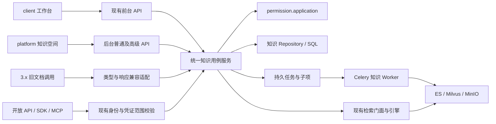
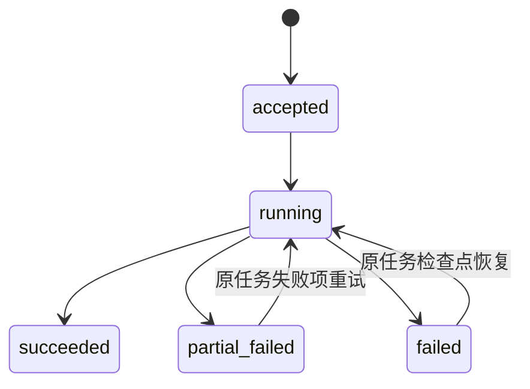
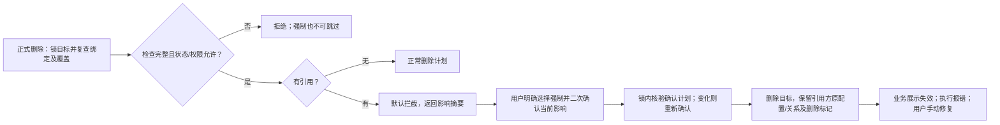

# 技术设计：文档知识库与知识空间统一

**状态**：本轮业务待确认项已全部闭合；技术设计仍待整体审阅、尚未实施。本文明确区分源码事实与拟议变更。  
**目标版本 / 编号**：v3.1.0-beta1 / F118（暂定）  
**日期**：2026-11-03  
**需求**：[spec.md](./spec.md)（92 条 AC） · [版本契约草案](../release-contract.md)  
**PRD**：[《3.1 beta1》§1.1–§1.8](https://dataelem.feishu.cn/wiki/RGvDwDbyDiNaRQk7DqfcqEPxnoh)  
**调研基线**：本地 `feat/3.0.0`，`25e50eceeeb71989257e5ff38e35f5e011e59bae`。未查询线上数据、未验证远端部署；已有未提交的配置及 review 目录不属于本轮变更。

## 1. 目标、边界与交付形态

把旧文档库 `type=0` 收敛为知识空间 `type=3`，前后台共用资源、文件、版本、权限和处理结果。后台承担高级处理配置与任务管理；旧调用经兼容适配进入同一业务服务，3.x 不维持第二份数据或第二套授权。

本模块包含统一资源与入口、文件/版本与批量操作、权限与检索、高级处理与恢复、维护窗口迁移及兼容、模型删除引用保护。另纳入用户于 2026-11-03 追加确认的**全平台所有权限模型移除 use 动作**，由 F048 及各资源业务 Owner 协同实施；不能只修改知识空间。模型删除保护来自 PRD §1.8，仍单独跟踪验收。

遵循 [constitution.md](../../../docs/constitution.md) C1–C8。QA 数据和入口保持独立，但 QA 权限模型也移除 use；退役的 `type=2` 不恢复；不引入新解析算法、通用任务平台、全平台依赖图或双写系统。本文不是 tasks，不执行开发、数据转换、权限投影或部署。

## 2. 已核对的代码现状与差距

以下均来自当前源码；文件中的历史设计和注释只作导航，以调用和实际分支为证据。

| 已核对位置 / 符号 | 源码事实 | 本次需要的增量 |
| --- | --- | --- |
| [knowledge.py](../../../src/backend/bisheng/knowledge/domain/models/knowledge.py)，`KnowledgeTypeEnum`、`KnowledgeBase` | 文档/QA/空间共用 Knowledge，类型为 0/1/3；含模型、索引位置、状态、`is_released`、`auth_type`、元数据字段 | 原行转类型；保留 ID/模型/索引位置；增加按类型的空间默认处理配置与可核对迁移来源 |
| [knowledge_file.py](../../../src/backend/bisheng/knowledge/domain/models/knowledge_file.py)，`KnowledgeFileBase` | 文件夹和文件共表，已有父路径、层级、原始/预览对象名、状态、`split_rule`、元数据 | 复用现有文件树；冻结每次实际处理配置，补齐后台版本注册和统一写入口 |
| [knowledge_document.py](../../../src/backend/bisheng/knowledge/domain/models/knowledge_document.py)、[knowledge_document_version.py](../../../src/backend/bisheng/knowledge/domain/models/knowledge_document_version.py) | 逻辑文档有主版本指针，版本行关联物理 file，唯一约束是 `(document_id, version_no)` | 迁移时补缺失首版本；复制和移动覆盖整链，不另建版本模型 |
| [knowledge_space_service.py](../../../src/backend/bisheng/knowledge/domain/services/knowledge_space_service.py)，`create_knowledge_space` | 前台空间创建使用工作台默认 embedding，当前签名无后台选模型或空间分类型策略参数 | 统一创建编排，区分可信入口的可提交字段；后台允许选模型，前台保持简化 |
| 同文件，`get_my_managed_spaces` | 非全局管理员从可见候选出发，再批量检查 edit/visible；不是“当前租户全部空间”列表 | 独立管理员列表契约，不能直接把 `/managed` 改为租户全量，破坏原消费者 |
| 同文件，`move_items` | 已校验源 move、目标 upload_file、同租户、循环、文件夹深度/重名，整链改归属并派发迁移 | 保留规则；补持久任务、元数据差异确认、并发围栏和授权变更先记账再投影；当前代码是 SQL commit 后再改父权限，不能照搬为新设计 |
| [move_worker.py](../../../src/backend/bisheng/worker/knowledge/move_worker.py)，`_migrate_one_file` | 从源 ES 读取 chunk，用目标模型写目标 Milvus/ES 后删源；当前重投直接 add_texts，不足以证明任意失败点无重复 | 增加子项步骤检查点和替换写幂等；源残留不得参与检索；显式验证图片/附件依赖 |
| [knowledge_service.py](../../../src/backend/bisheng/knowledge/domain/services/knowledge_service.py)，`copy_knowledge` | 存在旧库复制编排，调用 library 权限适配器并派发 `file_copy_celery` | 空间复制不能只改 type 后复用；需重建目录/版本映射、空间授权、独立索引及任务状态 |
| [knowledge.py](../../../src/backend/bisheng/knowledge/api/endpoints/knowledge.py)，`update_knowledge_model` | 旧入口更新模型和 REBUILDING 后只对 NORMAL/QA 分支派发重建 | 不能把统一 SPACE 送入此分支；下沉统一模型变更服务，旧入口转发 |
| [rebuild_knowledge_worker.py](../../../src/backend/bisheng/worker/knowledge/rebuild_knowledge_worker.py) | 用 ES chunk 重建向量；当前 `_process_single_file` 一次取最多 10000 条；失败路径可能删除失败文件 ES 数据 | 保留“重建不重新切分”的语义；全量分页读取；失败保留重试数据源；增加真实任务结果 |
| [knowledge_permission_service.py](../../../src/backend/bisheng/knowledge/domain/services/knowledge_permission_service.py)，`_target` / `_lifecycle_target` | 普通容器 target 限 PUBLISHED，生命周期 target 支持更多状态 | 模型重建不能以容器 REBUILDING 导致目录/下载鉴权全部失效，需拆处理状态与资源可访问生命周期 |
| [retrieval_facade_service.py](../../../src/backend/bisheng/knowledge/domain/services/retrieval_facade_service.py)，`_SPACE_ACTION` / `_LIBRARY_ACTION` | 开放检索门面现有空间 gate=visible、文档库 gate=use；共享 RetrievalEngine | 全局移除 use 后门面所有资源统一按可见性准入；旧已可见但无 use 的资格变化记录为预期差异 |
| [retrieval_engine.py](../../../src/backend/bisheng/knowledge/domain/services/retrieval_engine.py)，`retrieve_and_filter` | 已有索引预过滤及结果文件过滤，共享检索核心 | 复用并补齐任务状态、当前归属和主版本约束；逐调用者核对接线，不能只看门面存在 |
| [KnowledgePage/index.tsx](../../../src/frontend/platform/src/pages/KnowledgePage/index.tsx) | 后台目前为 file/qa 两个页签 | 普通知识空间与 QA 并列，新增独立管理页签；补目录页和空间配置 |
| [llm.py](../../../src/backend/bisheng/llm/domain/services/llm.py)，`delete_llm_server` / `update_llm_server` | 服务删除进入 DAO；服务编辑还有共享关系更新等前置写入 | 增加引用检查及统一保存事务，阻断时不能已部分保存共享或服务配置；全业务引用覆盖尚未逐一核实 |

### 2.1 Q-01 追加源码核对：全平台 use 的现有依赖

本次确认后定向读取了当前权限源码，未执行任何权限变更：

| 位置 | 当前事实 | 目标改动 |
| --- | --- | --- |
| `permission/domain/services/catalog_policy.py` | use 在 REGISTERED_ACTION_CODES 中，对 knowledge_library、workflow、assistant、tool、app、linsight_skill 有效 | 从动作注册、适用范围及当前发布合同移除，不再是可分配动作 |
| `permission/domain/services/model_policy.py`、`permission/application/catalog_api.py` | 标准模型由 Catalog 派生；自定义模型选择动作；预设含 use | 标准、自定义、预设都移除 use；仅 use 模型需保持可见授权，不因 action_codes 为空丢失可见性或变为不可撤销 |
| `core/openfga/authorization_model_f048.py` | 动作关系、权限模型/Grant 派生关系及 system_use_marker 仍存在 | 按授权发布流程生成无 use 的新活动模型，清理对应活动投影；历史 release 只保留审计，不继续作为独立使用判定来源 |
| `permission/application/runtime.py::tenant_use_grant`、`grant_service.py` | 工具/Skill 的租户全员 Grant 当前要求 use-only 模型 | 转为原范围内可撤销的可见授权；不自动授予 download/edit，不扩租户或全员范围 |
| `visibility_projection_service.py`、owner/system 投影 | 当前普通可见性贡献由 active Grant/Source 汇总，系统路径另有可见标记 | 移除 use 时保持有效可见性来源及撤销链；不要把 visible 当成新具体动作加入 action_codes |
| 工作流/助手入口、工具 executor、Skill 查询、应用入口及发布摘要、工作台/DSH、开放 task/retrieve | 已发现 action=use、use 结果过滤或 use 来源摘要依赖 | 调用、列表、异步执行和授权摘要全部切换现有可见性协议；仍保留身份、租户、凭证范围、发布/运行状态及其他动作检查 |

上述六种是当前 Catalog 中 use 的作用类型，并非范围上限；所有其他权限模型、遗留 use/can_use/业务别名均须继续盘点。`visible` 是现有可见性能力，与具体动作 Catalog 的职责不同。

## 3. 关键方案选择

### D1：在现有资源上转类型，统一领域服务

- **备选**：双表映射并双写；新建空间并复制全部文件；原 Knowledge 行及文件保留、原地转为 SPACE。
- **建议**：原地转换。新旧 HTTP 入口只是输入/输出适配，执行同一个知识域用例；QA 保留原分支。
- **理由**：ID、模型、索引位置、已有业务引用不变，减少“复制一套再改绑”的风险，符合 PRD 不双写、不默认重建要求。
- **重审条件**：实际存量检查发现两类资源存在不可兼容的结构；必须先输出异常与修复方案，不能静默改成全量复制。

### D2：两类后台列表分别准入，动作仍经 F048

- **备选**：让菜单自动授予数据权限；所有后台列表都走管理员范围；普通授权列表与管理员清单分开。
- **建议**：后者。普通列表按可见范围；管理列表由可信身份及当前具体租户准入，不按个人 Grant 过滤。管理清单不直接调用普通列表 fallback。
- **理由**：既有 `/managed` 还服务工作台管理视角，不应改变其语义。列表中出现对象也不自动形成新的权限授权。
- **已确认 Q-02-1**：仅平台超管与相应租户管理员可进入“知识空间管理”及其全量管理清单接口；部门管理员、资源 owner/manager 不因这些身份取得管理页签准入，仍按普通资源授权访问。准入以服务端可信身份判断，并保留原后台入口规则，不能信任前端管理员标记或仅隐藏页签。
- **已确认 Q-02-2**：超管默认管理所属租户，可切换其他具体租户；租户管理员仅管理所属租户。一次请求只使用一个明确的当前租户，不提供跨租户汇总或全平台混合清单。切换仅改变管理上下文，不改变操作者真实身份或资源归属。
- **已确认 Q-02-3**：管理页签支持当前选定具体租户内的完整管理：空间详情、文件内容、授权/配置、上传、移动、下载、删除。准入与资源操作仍走现有管理员身份及 F048，不要求逐资源补个人 Grant；业务 Service 在管理员快捷判断前确认目标属于当前管理租户。
- **业务约束保留**：配额、内容安全、部门审批、有效业务引用和任务冲突规则均适用。空间复制仍仅源空间创建者可执行，需在业务服务中检查创建者资格，不能因管理员的资源动作权限而放宽。Q-02 全部闭合；清空保护按已确认 Q-03 执行，不因管理员身份豁免。

### D3：全平台移除独立 use，由可见性承担原使用准入（已确认）

- **已确认**：Q-01 选择 A，并追加为所有权限模型，而非仅知识空间。目标为所有当前生效标准、自定义、预设与系统模型均不再包含独立 use，原使用入口检查资源可见性；尚未实施。
- **存量结果**：保留主体、可见范围及 use 之外动作。原已可见但缺少 use 的主体取得对应使用资格，这是预期产品语义变化，输出差异报告即可，不再单项请求确认或据此阻断迁移；没有可见性的主体不能因此获得访问。
- **仅 use 模型**：去掉动作后，仍保留可见性贡献和撤销能力。不通过添加 download/edit 等动作补足模型，也不以空动作/derived_level=None 清掉有效 Grant。具体的纯可见模型表示、可授予层级及旧 model_key 保留方式，在 F048 详细设计中落定，并满足已确认的行为约束。
- **实现边界**：移除动作注册、适用范围、模型动作选择、预设、系统 use 标记及调用判定，不是只在 UI 隐藏或永久保留一个 use→visible 的第二授权模型。visible 复用现有可见性协议，不新增一个同名可分配动作来替代 use。
- **兼容**：受支持旧请求中的 use/use_kb 等协议别名在边界按可见性解释，不再进入独立 use 决策。当前模型与动作响应不返回独立 use；历史快照原文可保留，固定旧协议字段若必须保留仅表达可见性别名。
- **限制仍生效**：编辑、下载、删除、发布等其他动作，以及租户、凭证 scope、有效主体、数据范围、底层资源和资源状态/业务资格均不取消。原来 use 与其他条件联合校验的调用，仅替换 use 这一项。

### D4：默认策略版本化保存，实际配置冻结到文件

- **备选**：全局默认替代空间默认；在前端缓存每类型表单；空间持久默认 + 文件实际配置快照。
- **建议**：后者。复用现有 `FileProcessBase` / pipeline 参数及校验，仅增加策略选择与保存。
- **理由**：空间默认只影响后续上传；重试必须用原任务/文件配置，不能读取已经被改写的新默认。普通文档与表格分别保存，不持久化某个临时上传表格的实例配置。
- **重审条件**：新增文件类别或解析器能力；先扩展配置 schema 与能力约束，不创造第二套算法。

### D5：知识域任务及子项承载恢复，Celery 只做执行唤醒

- **备选**：仅查询 Celery 任务结果；每种操作各存一份临时进度；知识域统一任务头和子项、按操作保留步骤。
- **建议**：复用既有可靠任务做法，新增/扩展本领域的 durable job + item；不建设通用任务平台。
- **理由**：进程崩溃、消息重复、投递失败和前端离开均不应丢失进度；部分失败与同任务重试需要稳定业务记录。
- **重审条件**：未来多个领域已有共同任务契约且得到独立立项，此时再抽公共底座。

### D6：资源可访问状态与处理状态分开

- **备选**：直接用 Knowledge.REBUILDING 阻断所有访问；保持容器可授权，用处理任务与索引状态暂停检索/冲突写入。
- **建议**：后者。新流程不把业务资源变为不可授权对象；广场 `is_released`、资源生命周期、处理状态分别表达。
- **理由**：PRD 明确重建期仍可目录浏览、预览和下载。当前普通 target 限 PUBLISHED，直接复用 REBUILDING 会阻断这些能力。
- **重审条件**：如果资源生命周期后续统一重构，仍必须保留只读可用和失败文件隔离语义。

### D7：一次维护窗口，检查点恢复，不长期双协议写入

- **备选**：在线双写迁移；逐租户对用户开放混合类型；部署运维控制维护、全租户验证后统一恢复。
- **选定的职责边界（Q-04-1 已确认）**：采用最后一种维护流程；升级文档要求正式迁移在停服期间执行，由运维暂停新派发/启动、等待运行任务自然完成、停止旧服务并在升级校验后恢复。超预算仍未完成则保持维护交人工处置，不自动强杀或继续转换。迁移脚本不检测或控制停服，不以服务/Worker 心跳、维护标记或停服确认参数作为数据迁移闸门；脚本只负责数据预检、计划/账本、幂等转换、校验和恢复。
- **理由**：资源类型与权限目标同时改变，混合开放会使旧/new 业务读到不同事实；不将一次升级逻辑写入全局健康检查或正常请求启动路径。
- **重审条件**：明确改变停机窗口要求时，需重新评审迁移方案，不能偷偷增加双写。

### D8：业务同事务维护绑定，删除协调归资源 Owner

- **备选**：删除时扫描各业务原配置；任意资源依赖图；业务写入时同步维护有限目标的结构化绑定，删除按索引查询。
- **复查后建议**：最后一种。业务配置与引用明细/集合在同一 SQL 事务提交；知识/LLM Owner 各自协调删除，业务补充来源展示。此为对前稿“不落引用表、删除时扫描”的修订，不增加任务模型绑定。
- **理由**：有效业务资源、版本及默认配置的引用由所属业务定义，任务不独立绑定模型。一次“先查再删”存在竞态，需要把新增业务配置引用的写路径纳入同一并发协议。
- **重审条件**：出现明确的跨资源依赖查询产品需求，再考虑单独的依赖索引领域。

## 4. 目标模块与数据流（拟议）



拟增量职责如下，具体文件名在正式设计评审后确定；表内“拟新增”不代表已经存在。

| 模块 | 职责与边界 |
| --- | --- |
| 现有 KnowledgeSpaceService / KnowledgeService | 收敛新建、目录、上传、复制、删除用例；旧入口委托共同方法。新查询进入 Repository，不继续增加 DAO 入口或在 Service 写 ORM |
| 拟新增 `space_processing_service` | 配置读取/保存、模型变更、重切分、任务建立、冲突操作准入；调用现有 pipeline，不另写解析算法 |
| 拟新增 `knowledge_processing_repository` | 在同一事务中保存 job/item、配置版本、资源围栏及检查点；不作权限决定 |
| permission.application 及知识业务适配器 | verified target、Grant/Assignee 及类型/父级转换的持久账本与投影；业务不构造 FGA transport tuple |
| 现有 worker/knowledge | 按 job/item 读取冻结计划执行；租户上下文与 actor 来源显式携带，重投不创建新资源 |
| 拟新增知识迁移命令 | 分阶段 inventory / precheck / convert / verify / report；运维专用，不能被普通请求自动触发 |
| 知识空间 / LLM 引用保护服务 | 调各引用领域的 application 查询；汇总脱敏依赖，最终事务检查和删除；不跨模块导入 API 或任意 ORM |

### 4.1 创建与上传

1. 入口适配产生业务命令和可信调用上下文；前台隐藏字段不能成为服务端准入依据。前台命令不允许通过手工参数修改模型/高级策略。
2. 复用现有新建资格、租户、配额及 F048 创建流程；后台模型选择验证目标类型、当前租户可用性及实际可调用性。
3. 建立统一 SPACE 及必要权限投影；前后台返回同 ID。配置与初始授权失败的处理沿既有创建幂等合同，不留下可绕过权限的半成品。
4. 所有文件注册入口共用目录、版本、审批、安全、配额与处理配置解析；后台不再绕过 `_create_primary_document_for_file` 对应的版本能力。
5. 文件入队前保存实际配置快照。Worker 使用快照且复核文件当前归属和任务版本，不能用消息中旧空间 ID 写入过期索引。

### 4.2 列表、详情与检索

- 普通列表可由可见子项进入：只展示足以导航到授权子树的信息，不因管理列表全量逻辑放宽普通列表。
- 独立管理员清单绑定当前单一具体租户：超管默认所属租户，可显式切换其他具体租户；租户管理员仅能使用所属租户。复用既有可信管理范围解析，服务端验证真实管理员身份及所选租户；不得信任客户端 `admin=true` 或任意 tenant_id。过滤与分页在 Repository 和既有租户上下文机制下执行，不手写 tenant WHERE。
- 管理清单及其后续受支持的详情/操作都携带并复核同一具体租户上下文；切换后重新获取数据，缓存与分页上下文区分租户，不能复用上一租户结果。空范围、非法选择或无法确定合法具体租户时不得回退为全平台。前台导航或客户端直接调用也不能绕过租户管理员仅限所属租户的边界。
- 内容和动作统一调用 F048 business action / visibility 协议。管理清单仅平台超管/相应租户管理员准入，部门管理员与资源 owner/manager 走普通授权列表；全量枚举资格不新增 Grant。具体租户及完整管理范围按已确认 Q-02-2、Q-02-3 执行；详情/文件内容与授权、配置、上传、移动、下载、删除使用当前管理员身份判定，保留配额/安全/部门审批/引用/任务冲突和创建者复制限制。
- 所有资源原使用入口、应用选择器与检索均使用 D-01 / Q-01 的全局语义。通过身份上下文维持真实自然人、SAK/PAT、委托与声明白名单等既有收窄约束；兼容层不重建或替换身份。
- 检索有效集合取决于：声明范围（如有）∩ 可访问空间/授权子树 ∩ 文件可见性 ∩ 成功主版本 ∩ 当前归属 ∩ 可用索引。主版本、状态及归属的结果层复核不可省略。
- 重建期间返回明确“暂不可检索”的业务状态；部分失败恢复后只排除失败文件。旧空间残留向量不能因为仍存在于 ES/Milvus 被返回。

### 4.3 拟议持久结构

| 位置 | 建议字段 / 结构 | 约束 |
| --- | --- | --- |
| Knowledge 增量 | `processing_defaults`、`processing_config_version` | JsonType 保存带 schema_version 的普通文档/表格规则，版本用于并发更新；无配置按既有默认解释，不批量回填重处理 |
| KnowledgeFile 现有 + 增量 | 现有 `split_rule` 保存实际有效规则；必要时增加配置来源/版本 | 重试读取文件/任务快照，不能把空间新默认应用到已开始的历史操作；现有格式通过适配器规范化 |
| 知识处理任务（拟新增） | `id`、`tenant_id`、`space_id`、kind、state、actor 引用、幂等键、请求 hash、冻结处理参数/预期业务版本、计数、时间、错误 | 唯一 `(tenant_id, operation_kind, idempotency_key)`；同键不同 payload 拒绝；任务记录不存凭据 |
| 任务子项（拟新增） | job_id、file_id/version_id、预期归属/版本、step、attempt、result、error | 同任务资源唯一；重试增加 attempt、恢复原子项，不创建另一套文件/版本/授权 |
| 空间操作围栏（拟新增或并入任务） | space_id、active operation、generation/lease | SQL 是真相；Redis 可作辅助唤醒/限流，不能单独承担排他；旧 Worker 写入需匹配 generation |
| 迁移清单（拟新增） | run_id、tenant_id、knowledge_id、原类型、目标类型、快照摘要、阶段、校验结果、checkpoint | 迁移来源持久保留，供个人配额长期豁免与审计核对；不在运行请求中保留第二套业务资源 |

表结构、唯一约束、租户自动注入登记及 Alembic 迁移须在正式设计中闭合；使用 C2 的双库类型。新文件遵循最近层级 AGENTS.md，不把上述候选名当成已存在模块。

### 4.4 默认配置的解析与保存

配置分普通文档与表格两组，外包 schema version，不保存上传文件名、临时 URL、表格实例 sheet 标识等瞬时数据。普通文档复用现有 chunk 长度/重叠、分隔标记及规则、层级、标题路径与解析选项；表格复用 `slice_length`、`append_header`、起止行等现行规则。实际后端字段以现有 schema 适配为准。

有效配置的构造顺序为：现行系统默认 → 对应文件类型空间默认 → 显式批次配置 → 显式文件配置，最后执行文件类型/解析器能力约束和专用流程覆盖。网页目前在 `KnowledgeFilePipeline` 覆盖 separator/overlap，保留这一优先行为，不将网页规则误保存为普通文档默认。

保存是一次提交：服务端校验全部类型及配置版本后整体更新。前端切换类型只改变当前展示，不销毁另一类型的草稿；取消或保存失败保留服务端旧值。配置保存不建立历史文件处理任务。重切分用明确命令并冻结目标文件、版本和确认过的覆盖影响。

## 5. 文件操作与异步恢复

### 5.1 批量操作两阶段确认

沿用可复用的现有 move 校验方式，但补齐一致性：预检返回有效项、不可执行项及影响摘要，不写业务；用户确认后只提交其确认的集合。执行时重新校验权限、归属、状态和关键影响版本。若元数据清除范围或授权继承影响发生变化，要求重新确认，不能沿用旧确认扩大操作范围。

多选父文件夹和其子项时先去重并展开实际操作集合；版本链作为完整单元。没有可执行项时直接返回明细；取消不写任务或对象。逐项结果对无权资源隐藏名称及详情。

### 5.2 移动的顺序与幂等

1. 锁定源/目标空间及相关资源（固定排序防死锁），检查活动任务、权限、租户、目录、版本链，计算元数据保留/清除及标签、权限影响。
2. 持久保存冻结计划与 F048 操作/投影账本，包含原/新父级和预期资源版本。通过 permission.application 完成所需原子权限投影，再以同一幂等操作 finalize SQL。禁止照搬当前“先 SQL commit 再改父关系”的窗口。
3. 切换逻辑归属时标记相关文件检索不可用，所有版本一起改；继承跟新父级、自定义 Grant 保留，不批量清授权。投影后 SQL finalize 失败由同一账本前向修复，冲突资源在恢复完成前禁止普通变更。
4. 已有源 chunk 作为迁移输入保留。每个子项按源分页读 → 目标可替换写 → 校验目标 → 清源 → 验证清理 → 记录完成。写入/替换以 operation/file/version/chunk 稳定标识去重；失败重投先核对步骤，不能“目标 add 成功但清源失败”后重复追加。
5. 结果过滤即时排除旧归属残留。失败项保留可恢复源数据及文件版本，重试原迁移计划，不重新解析、不重新移动 SQL 归属。

**图片与附件**：现有 worker 注释保留源路径，不能据此推断删源必坏图，也不能推断永远安全。应逐项盘点 object_name、预览、bbox、chunk 内图片和附件路径与删除 manifest；建议稳定对象引用或在移动任务中重定位并改写所有引用。删除源空间前校验无仍被目标资源依赖的对象进入清理清单。移动后删源的完整场景是必要验收项。

### 5.3 空间复制

仅创建者具业务复制资格，此外检查后台入口与新空间创建资格/配额。生成 source→target 的 folder/file/document/version/tag 映射；副本目录路径、主版本指针及普通授权指向副本，不保留指向原资源的 ID。副本所有者为执行复制的创建者，受保护 Owner Grant 重新建立；普通授权按 F048 复制规则处理。新副本默认 `is_released=false`，不复制 pin/member subscription/chat。

原始内容及派生对象须保证副本独立生命周期：若复用对象，必须具备可验证引用计数/删除保护；否则复制对象。索引独立创建。复制任务挂在目标副本上，不把源空间标记为 COPY 导致源只读访问中断。失败结果可定位并恢复，不能把仅建好空副本记为完成。

### 5.4 任务状态与消息投递



这些是拟议的业务任务状态，不能直接等同 Celery result 或 Knowledge.state。子项记录步骤与实际结果；任务完成计数从终态子项汇总。任务可保留模型标识作为审计/过期校验信息，但不形成独立模型绑定；实际调用模型从所属业务配置读取。数据库提交任务后派发；投递失败由持久待派发记录/现有周期恢复机制补发，不能因 broker 故障丢任务。Worker 领取用租约及 generation 防并发重复写入；租约过期后的旧 Worker 不能 finalize 新代任务结果。

执行阶段从任务载入租户和可信主体信息，在对应上下文访问 Repository；不信任未验证的客户端 tenant_id，不保存 token。接受任务时检查完整授权；执行前复核目标仍有效、归属和操作计划未变。人工重试重新鉴权；故障自动恢复只续做已冻结操作，不重新扩大对象集合。

### 5.5 模型重建及元数据任务

1. 校验模型可用性、空间 edit 与入口资格，展示暂停检索和冲突写入的影响，确认后建立任务。
2. 固定顺序锁定空间，排除活跃冲突写入；已有执行任务须完成或停止到可恢复检查点，不能只阻止新 HTTP 请求而放任旧 Worker 写旧索引。
3. 建立空间处理围栏并暂停检索；目录、预览、下载使用可授权资源态继续工作。上传、新版本、Chunk、元数据值/结构修改和双向移动在统一业务入口检查围栏，旧 API 同样检查。
4. 保留可重试 chunk 文本及元数据来源，分页读取全部版本分段，不使用当前 10000 条单次上限，不重跑 ETL/切分，不清掉人工修改。
5. 新模型写入独立索引 generation（具体物理命名在实施前确定），每文件验证完成后登记结果。失败不丢旧文本。全部尝试结束后切换当前 generation，成功文件恢复检索，失败文件保持排除；释放空间写围栏。模型删除只查询业务资源/有效版本及默认配置：如采用分阶段模型切换，仍生效的当前/待切换模型归属于空间业务配置，由其引用保护；不为运行、旧代清理或失败重试任务另行登记模型引用。
6. 部分失败重试继续同任务，只恢复失败项，执行模型从空间当前合法业务配置读取，原任务/文件的分段与处理规则快照保留。任务预期业务版本或索引 generation 仅用于过期写保护；发现不匹配时明确拒绝陈旧执行，不从任务参数恢复已解除的模型绑定，也不向错误代索引写入。恢复旧模型仍是明确的业务配置变更及必要重建，不能只改字段假称切换完成。

普通元数据结构/值任务也需冻结变更前后 schema 与目标范围，分别更新 SQL 和索引并记录结果；索引未完成不展示全成功。重命名/删除字段二次确认。单文件 Chunk 编辑/删除使用指定 version 的索引定位；原始文件不变。具体冲突矩阵按所触碰资源控制，只有模型重建按 PRD 扩展为整空间围栏。

## 6. 引用保护与业务绑定维护（复查修订）

**设计修订**：前稿“删除时让各业务扫描原配置、不落绑定表”不再作为正式路径。业务配置仍定义引用含义；各业务的写用例须在**同一 SQL 事务**同步维护结构化绑定，删除按绑定索引查询。全量解析配置用于存量回填、核对与修复，不用于每次删除扫描全部业务。本节为待整体评审的技术方案，尚未编码；不增加任务—模型绑定。

### 6.1 分工和调用链

- **业务 Owner**：按自己的执行语义提取引用，判断配置/版本是否仍可执行；新增、保存、删除、复制、导入、发布和回滚都调用同一绑定维护应用协议。不能要求前端上报“引用列表”，不能由模型/知识模块猜测工作流 JSON。
- **绑定存储能力**：拟新增专用 `resource_reference.application` 协议及本模块 Repository/双库表，接收外部事务 Session，负责集合差异、唯一约束和按目标查询；只处理模型、空间和直接文件这三类目标，不承载授权、任务绑定或任意资源图。`common/core` 不导入这些业务对象。
- **资源 Owner**：knowledge 的 `KnowledgeReferenceService`、llm 的 `ModelReferenceService` 负责目标校验、删除协调及结果展示。最终检查查绑定 Repository，不再遍历其他业务表；来源名称、版本入口由各业务应用接口批量补充并按权限裁剪。
- **事务归属**：业务应用用例持有唯一事务，按 `Endpoint → Service → Repository → DB` 调用。业务配置 Repository 和绑定 Repository 使用同一 Session，均不自行 commit；失败一起回滚。绑定写入不是 Celery、消息、ORM 事件或提交后回调，提交后消息仅用于缓存失效和非关键通知。

### 6.2 绑定数据：明细、来源集合及目标删除标记

表名为候选合同，实际字段长度、索引名和迁移 DDL 在实现前按 MySQL/DM8 冻结；使用显式关系列及项目 dialect helpers，不用 JSON 查询函数或数据库专有 upsert。

**`business_resource_reference`：一条有效业务配置槽位到目标的绑定；强删后保留为失效关系。**

| 字段 | 含义 |
| --- | --- |
| `id` | 绑定记录主键；非前端可随意修改的业务 ID |
| `tenant_id` | 引用来源所属租户，接入现有自动租户隔离 |
| `source_type/source_id/source_version` | 来源资源、稳定 ID、配置版本；草稿/当前配置使用稳定版本键，发布版本各自独立，不用 latest 混同所有版本 |
| `slot_key` | 稳定配置槽位，如 `node:n1.embedding_model`；多选列表以槽位与目标 ID 组成集合，不使用可漂移数组下标 |
| `target_type/target_id/target_tenant_id` | 目标为 `model/knowledge_space/knowledge_file`；目标 ID 必须解析为真实稳定 ID，记录真实拥有租户 |
| `target_space_id` | 直接文件/文件版本目标的当前空间归属，派生自真实文件关系；空间目标可填自身，模型目标为空。由知识域维护归属变化 |
| `source_revision` | 该绑定对应的业务配置修订，供幂等和对账；不把历史任务模型 ID 写入 |

唯一键：`(tenant_id, source_type, source_id, source_version, slot_key, target_type, target_id)`。目标反查索引覆盖 `(target_type, target_id)`；空间内容引用索引覆盖 `(target_space_id)`；来源替换/删除索引覆盖 `(tenant_id, source_type, source_id, source_version)`。查询共享模型的目标索引必须覆盖全部实际来源租户，不能因普通租户过滤漏掉依赖。显示名称、URL、凭据、配置全文不冗余进表。

**`business_reference_set`：每个来源/版本一条集合校验记录。**

来源键与上表相同，保存 `source_revision`、`extractor_version`、规范化绑定集合摘要及有效/就绪状态。它用于明确“配置确实没有引用”与“还没有提取”的区别；零引用来源也必须写集合记录。集合与业务配置、明细同事务提交，不作为异步最终一致状态。只有仍生效来源维护明细，强删目标后的失效关系继续保留供修复；普通删除使用指向尚存目标的有效关系；来源转历史时删除明细并将集合置为不生效。迁移覆盖完成情况由升级账本按租户/来源类型记录，不新增任务模型占用系统。

目标的 deleting/deleted 由 §6.10 的 tombstone 识别，不逐条改写来源配置或修订。引用明细是同步维护、可由原配置重建的业务索引。禁止对外提供“单删一条引用以强制删除目标”的接口，也不维护独立引用计数作为删除依据。多态目标不依赖单一外键级联；目标存在性、状态、租户和共享可用性由对应 Owner 校验；原有失效关系的解除/保留按 §6.10 处理，不要求被删旧目标仍有 live 行。

### 6.3 写协议：从新配置生成集合，同事务替换差异

统一应用协议候选名：`replace_source_bindings(session, source_key, expected_revision, new_revision, references, effective)`。由业务提取器生成完整集合，绑定层验证来源修订和目标已校验上下文，不允许裸传任意目标绕过业务授权。

```text
候选阶段：业务加载当前配置/修订，提取并规范化新配置，计算旧/新目标候选集合
BEGIN 新事务
  1. 按统一顺序锁旧、新有效目标与涉及服务；旧目标已强删时核验原关系和 tombstone；校验新增目标存在性/租户/共享范围/操作状态
  2. 锁来源资源及对应 reference_set；核对 expected_revision
     若当前目标集合或修订与候选不同，回滚后重新计算，不带着旧集合继续保存
  3. Owner 用新配置生成 R_new（来源不再有效时为空）
     读取该 source/version 的 R_old；R_new 的新增目标须通过合法性校验；原来源/版本未变的已登记失效项可保留，运行/发布仍拒绝
  4. 保存业务配置或生命周期变化，修订改为 new_revision
  5. 删除 R_old - R_new；插入 R_new - R_old；交集更新 source_revision
     同时写 reference_set 的修订、提取器版本、摘要和有效/就绪状态
COMMIT（业务配置与绑定一起成功）
```

来源保留或解除已登记的失效槽位按 §6.10 处理，不能因旧目标 live 行已删导致无法修复。步骤 3 发现新的未锁目标时回滚重算；唯一约束与稳定来源键保证重复保存不产生重复关系。任何配置校验、绑定写入、唯一冲突或事务失败，业务修改和引用修改均回滚。并发修改使用来源修订 CAS；重复请求按业务幂等键返回原结果或已存在冲突，不把“重复”误判为成功覆盖。

例如工作流草稿原来引用空间 A、模型 M1，保存后变为 A/B、M2：该草稿集合增加 B/M2、删除 M1、保留 A，在同一事务提交。若线上 V3 仍引用 M1，只删除草稿的 M1 行，V3 的 M1 行保留，因此 M1 的普通删除仍会被阻止；也可按 Q-05 确认后强删，留下 V3 的失效关系待修复。

### 6.4 业务增删改、版本与默认配置维护矩阵

| 业务操作 | 对绑定集合的动作 | 事务与边界 |
| --- | --- | --- |
| 新建 | 提取新配置并新增来源集合及明细；零引用也写集合记录 | 来源记录、配置和绑定同事务；目标无效则创建失败 |
| 修改/改绑/移除某配置项 | 对该来源/版本执行完整集合差异替换 | 不先删除全部来源或其他版本关系；新目标校验失败则原配置及绑定都保留 |
| 删除来源业务 | 删除此次确实失效的来源/版本全部明细，将集合失效 | 与业务删除/逻辑失效同事务；若业务父记录删除但某发布版本仍可执行，须保留该版本引用，或由 Owner 同事务阻止其继续执行后再移除 |
| 复制/导入 | 从目标副本最终配置重新提取，使用新 source_id/version | 不直接复制绑定行 ID；导入时旧目标 ID 映射后重新授权校验，同事务写入 |
| 发布/形成可执行版本 | 从该版本实际配置新增独立来源版本集合 | 与版本变为可执行/线上/待上线的状态切换同事务；不把草稿关系改名覆盖线上关系 |
| 版本退役/下线 | 按 Owner 的可执行性判定更新；不再可执行才删除该版本有效明细 | 仅 UI 下线但仍可回滚执行的版本，须符合既定有效版本规则；历史展示快照无明细 |
| 回滚历史版本 | 对将恢复的实际配置重新提取、校验目标并激活集合 | 与回滚/生效切换同事务；目标已删除则回滚失败，不能直接恢复旧绑定或静默替换模型 |
| 默认配置修改/恢复继承 | 默认槽位 Owner 按前后有效原配置替换模型绑定 | 继承租户不复制原始默认绑定；使用 Root 默认时，Root 生效槽位本身保护模型。切换继承不伪造子租户任务绑定 |
| 停用/恢复/解除频道等集成 | 由 Owner 判断是否仍有可恢复执行配置；有效则保留，解除则移除；恢复重新校验 | 不凭一个通用 enabled 字段统一删关系；与其业务状态提交一致 |
| 直接文件/整版本链移动 | 文件绑定仍指向原文件，知识域同事务更新受影响明细的 target_space_id | 锁源/目标空间及相关文件，归属和绑定索引一起变；原显式空间绑定仍引用原空间，不自动改绑 |

草稿若能测试运行，也属于有效配置并维护关系。历史发布 JSON 保留原文，回填/维护写外部结构化记录和版本状态，不重写历史配置内容。模型别名必须用业务现有解析器解析到唯一真实 ID；无法解析不能提交/激活对应绑定。

### 6.5 哪些业务负责提取

| 目标 | 来源业务 Owner | 提取范围 |
| --- | --- | --- |
| 空间/直接文件 | 应用、助手、工作流及版本 | 空间选择、旧知识库 ID、直接文件及非主版本文件选择 |
| 空间/直接文件 | 工作台、托管应用、频道等集成 | 生效业务配置与仍可执行/线上/待上线版本的绑定 |
| 模型 | 空间/QA | 实际使用的 embedding/rerank/LLM/ASR/TTS 槽位；有阶段切换时当前/待生效业务槽位均维护 |
| 模型 | 应用、助手、工作流、托管应用、评测及版本 | 实际模型配置槽位，不提取日志或任务参数 |
| 模型 | 系统/租户默认配置 | 仍生效的默认模型原始槽位，含 Root 继承来源 |

业务提取器与运行时读取同一配置 schema/解析语义，不做任意 JSON key 递归搜索或字符串 LIKE。保存时解析这一份新配置；删除目标时用 SQL 索引查关系。新增可引用的节点/配置槽位必须同步更新提取器及版本，补回填/验收后才能启用。

### 6.6 空间/模型删除怎么使用绑定



**知识空间**：最终查询同时覆盖目标为空间本体的绑定，以及 `target_space_id=该空间` 的直接文件绑定。普通删除和清空在有有效引用时拒绝；本轮只为空间删除增加显式强制模式，清空仍须先解引用。历史聊天/审计不生成有效绑定，确认须说明历史内容将不可访问，取消零修改。强删也先锁空间、复查覆盖/引用并核对已确认影响；通过后登记 `deleting`、删除标记与固定清理计划，沿既有账本/投影规则执行。API 接受不等于清理完成。清空保留空间 ID/配置/授权，沿既有 `clearing` 计划；失败按同一计划恢复，未完成不恢复可绑定状态。

**模型/服务**：单模型、编辑服务移除模型、整服务删除统一生成目标集合，持服务/模型锁后重算，并查全部实际来源租户。普通模式任一有效引用即整次拒绝；强制模式对完整待删集合及影响二次确认，关联目标写删除标记、保留入向关系后，模型删除和服务名称/配置/清单按同一 SQL 事务提交。任一覆盖/检查异常、权限/租户/共享只读不满足或确认过期均整体拒绝。必要共享投影仍沿既有持久计划，不能在引用检查前生效。默认配置也是受影响业务来源，不能强删后偷偷回退其他默认。

**双重角色**：空间自身也是模型引用来源。删除空间时，其出向模型关系随空间业务配置最终失效同事务移除；引用该空间的入向业务关系则在强删模式保留为失效关系。清空保留空间模型配置及出向绑定。外部清理阶段若仍需业务配置，仍由有效业务配置承担引用，不为任务另建绑定。强删不越过既有重建/移动等任务冲突规则。

绑定先提交，普通删除取得目标锁后发现引用并拒绝；强制删除发现影响集合变化时要求重新确认。删除先提交，新绑定写端看到目标不存在或 `deleting/clearing` 时拒绝。普通预览不能授权强删；强制请求必须携带服务器生成的确认计划及显式模式，由后端重新授权和核验，不能仅凭一个布尔值跳过所有检查。

### 6.7 锁顺序、读取一致性与异常

统一锁顺序：涉及模型先按 ID 锁相关服务，再按固定目标类型序及 ID 锁空间/模型，随后锁来源及集合。空间自身既为来源又为目标时，提前纳入目标锁集合；文件关系、移动还须锁相关文件并核对真实归属。空间删除涉及其出向模型绑定时，也遵守完整顺序。候选读用于计算锁集合，锁后用当前读重验；集合变化回滚重算，不在持锁期间追加顺序更小的锁。死锁/事务冲突按业务幂等键有限重试，MySQL/DM8 均须验证。

最终绑定查询不得复用预览旧快照或缓存；事务隔离/锁定读在两库分别证明。所有新旧 API、保存、导入、复制、发布、回滚、默认配置和直接文件移动写端均接入此协议。涉及多版本的发布/删除还须以同一根业务记录作为来源并发门闩，递增根修订并重验有效版本集合，防止删除计划漏掉并发新增版本。引用关系不是 FGA 授权关系，不能写进 OpenFGA 或用授权 tuple 判断能否删除；实际权限仍走 F048。

租户上下文由服务端确定，绑定表接入自动隔离。共享模型删除在拥有方可信内部协议下枚举实际来源租户，只在受审核 Repository 范围绕过来源租户过滤；对外响应不泄露无权来源 ID/租户/名称/版本。展示信息读取失败不影响已有绑定的阻断事实；最终关系存储异常或覆盖未就绪则拒绝删除。

### 6.8 存量回填与防漂移

1. 升级文档要求停服执行；迁移脚本仍不检测/控制停服。按租户、业务类型、来源及全部有效版本分页，用与写入口相同的提取器回填明细和集合；配置没有引用也写集合就绪记录。
2. 旧文档 ID 规范化到同一空间，直接文件归属在文件/版本迁移完成后生成，模型保留真实 ID。默认继承按原始有效槽位维护，不为所有消费者复制模型行；任务不回填。
3. 每来源事务幂等替换，冻结原配置修订/提取器版本/摘要；中断用原升级账本续跑。目标缺失但有合法强删标记及既有关系时保留失效；其他无效目标、歧义别名、跨租户非法绑定、坏版本均报告并阻断，不静默跳过。
4. 按租户/来源类型对账：有效来源总数、包括零引用的集合数、修订一致性、绑定摘要及抽样详情。只有全部覆盖就绪，才启用以绑定表为依据的删除；回填未完成不是“零引用”。不在正常请求或应用启动时全量修复。
5. 定期只读对账按原配置重算，比较集合修订/摘要与关系明细，发现缺失/多余/过期立即记录不一致并禁止受影响范围删除。由显式修复命令按同一事务协议重建；新增有效关系须先校验目标仍存在；合法 tombstone 对应的原有失效关系保留并报告待修复，不视为漂移或静默删除，已删目标不能凭对账复活。监控是兜底，不替代写事务。
6. 禁止绕过业务用例直接更新引用字段。必要数据修复脚本也必须使用同一维护协议或停服后回填并核验；提取器升级必须有范围回填和就绪检查，不能先启用新槽位再等异步索引补齐。

### 6.9 查询展示与源码接入点

预览接口返回 `blocked/check_complete/can_force_delete`，强制能力沿用原操作权限且须另行确认；`blocked` 表示普通模式引用阻断。其他字段包括来源类型数量、有权来源的名称/版本/槽位/入口；无权来源只返回类型数量。按来源/有效版本去重计数，详情列出多个槽位。名称/链接由业务批量查询，不冗余入绑定表；查询为空但迁移覆盖未就绪时返回不可判定。错误码按 knowledge/llm 所属段及注册表分配，路径和具体号码待 API 合同冻结。

已核对的现有差距（仍未改代码）：旧 `knowledge_service.py::delete_knowledge` 在权限检查后直接清理，须在副作用前接保护；文件/目录 `KnowledgeSpaceDirectDeleteService` 的持久清理模式可借鉴，但并非现有空间引用协调器。`llm.py::delete_llm_server` 直接委托 DAO，`LLMDao.update_server_with_models` 自开事务删除差集，需改为协调用例持有 Session。`tenant_system_model_config` 的 Root fallback 需由默认配置 Owner 提取绑定。现有空间/QA 重建任务仍显式携带模型 ID，需按业务资源配置校验和解析，不为其建立引用关系。各业务的保存/发布/删除入口仍需逐一列出接入清单，不能声称已全覆盖。

验收必须覆盖：配置保存成功关系必存在；绑定写失败配置零变化；改绑只动当前版本；删除来源释放关系、线上版本仍执行则保留；回滚目标已删失败；复制/导入重新提取；默认继承；空间清空保留其出向模型绑定；移动同步直接文件归属；共享隐藏引用；并发写与删；回填零引用集合/中断续跑/覆盖缺口；任务不入表。对应 Spec AC-87–AC-89，已有业务边界保持。

### 6.10 Q-05：强制删除与保留失效引用（已确认）

用户确认“有引用也可强制删除空间和模型配置”，并选择保留原业务 ID/关系、显示失效、执行报错、手动修复。这取代前稿“禁止强制确认”的结论；不引入自动跨业务解绑定，不扩大既有操作权限，清空不在本轮强制范围。

**请求与确认协议**：预览返回 `can_delete_normally/can_force_delete/check_complete`、有权明细和受限计数，`blocked` 只表示普通模式受引用阻断；是否可强制还取决于原删除/编辑权限、租户、状态、共享只读、完整性与任务冲突。选择强删后，服务端生成短期确认计划，冻结操作者、目标租户、操作类型、服务修订、精确目标集合、规范化入向绑定集合摘要和各类影响计数；界面明确提示业务将失效。最终锁内重读目标和关系并比较计划，不接受前端自己拼摘要；目标/引用集合或必要权限变化就返回需要重新确认，不把旧确认用于新影响范围。摘要由目标索引分批计算，不扫描其他业务 JSON；无权详情仅参与内部摘要，不对用户暴露。

**删除标记与关系存续**：拟增加 `resource_reference_tombstone`，唯一键为目标类型/目标 ID/拥有租户，记录删除操作 ID、阶段 `deleting/deleted`、时间和操作者；不得保存模型凭据/配置全文。模型逻辑删除/SQL 删除与 tombstone 同事务；空间在进入不可再绑定的删除计划时持久化标记，完成外部清理后更新阶段。ID 永不复用。模型可以物理删除，业务原配置 ID 和入向 `business_resource_reference` 都不级联删除。直接文件的失效可由其 `target_space_id` 对应的空间 tombstone 推导，不要求在大空间强删入口同步创建每文件的标记。

目标状态由 live 目标及 tombstone 合并解析，关系展示区分 `valid/deleting/invalid`。失效是目标状态，不改写引用方配置修订、历史发布内容或其绑定集合摘要；无需跨所有来源业务批量写配置。保留的失效记录能定位待修复来源，不视为“目标无引用”，也不作为绕过引用维护规则的理由。无 tombstone 却缺目标属于不一致，不能伪造成已批准强删。

**运行与编辑行为**：引用方读配置/详情时展示失效目标，禁止因过滤不存在项而悄悄消除问题。执行或启用受影响配置时，以原 ID 解析模型/空间并校验删除状态；目标删除中/已删除明确报错，默认继承也不得因为已选模型消失而自动换其他模型。模型缓存、配置解析缓存必须感知删除标记或版本失效，不能仅凭旧缓存继续新调用。已经发出的外部调用不承诺中途终止，仍不建设任务占用/绑定系统。

**手动修复的事务**：用户在业务原配置槽位解除或改为合法新目标，仍调用 `replace_source_bindings` 同事务保存配置、移除旧失效关系/新增新关系及更新集合修订；各有效版本独立处理。只修草稿不清线上版本的失效记录，须按原发布流程更新或退役。允许原来源/原版本保存未变的已登记失效槽位，以便逐项修复并保留警示，但不能因此发布/运行；新建、复制/导入、增加槽位或回滚激活不能新增/恢复已删目标关系。解除失效关系时旧 live 目标可能已不存在，只需校验 tombstone/原关系并锁来源和合法新目标，不得因锁不到旧目标而让修复永久失败。

**对账与审计**：有合法删除标记且原配置仍保存原 ID 时，失效绑定为预期状态，保留并报告待修复，不自动清除、不复活目标；缺标记或源集合对不上仍按漂移处理。修复/重建集合能够原样保留已登记失效槽位，不能靠回填创建新的非法绑定。审计记录普通/强制模式、操作者、目标租户/集合、引用摘要、确认计划及执行结果；强删重试复用原操作 ID/计划，已有删除标记返回原操作状态，不重复清理或篡改确认范围。无权引用仍只显示类型与数量。

验收：有引用普通删除拦截；同权限显式强删成功；无权限/共享只读/检查失败/覆盖未就绪/任务冲突不因强制而放行；影响变化重新确认；强删保留原配置/版本/关系且显示失效；默认、共享跨租户及直接文件同样失效；执行明确失败无静默回退；手动修复同事务更新正确来源/版本；空间删除的出向模型关系按自身配置失效处理；重试幂等、对账保留预期失效。对应 AC-90–AC-92。

## 7. 一次性迁移方案

### 7.1 阶段与检查点

| 阶段 | 工作 | 放行条件 |
| --- | --- | --- |
| M0 只读盘点 | 按租户导出类型、owner、文件树、版本、tag 业务类型、元数据、索引地址/模型、SQL 授权与 FGA 投影、引用、运行任务、配额 | 清单可复核，不修改资源 |
| M1 预检 | 检查缺失 owner、跨租户关系、坏版本、不可用模型、缺失索引、授权映射差异、全局 use 退役及仅 use 模型可见授权保留 | 所有非预期异常已处置，已确认 use 语义变化单列；冻结最终计划/hash，不猜测主体范围 |
| M2 运维停服准备 | 按升级文档停新派发/启动，等待运行任务自然完成、确认旧 Worker 无活跃写后停止旧 API/Worker/Beat；保留排队任务；完成 SQL/FGA/索引及必要对象备份 | 由运维负责停服前置条件，超预算不自动强杀/转换；此项不由迁移脚本检测或执行 |
| M3 停服期间运行迁移脚本 | 数据预检、按租户/资源幂等转换；SQL 类型/版本/tag/来源、业务绑定回填及权限计划分阶段 checkpoint；F048 协议转换权限 | 脚本不判断是否已停服；只按数据与发布合同校验，每资源完成才登记，重复运行不重建版本/授权 |
| M4 全租户验证 | 比较停服后最终冻结基线与当前资源/版本/标签/元数据/授权/配额/引用/文件可读与抽样检索，核对绑定覆盖/集合修订/摘要与旧接口合同 | 所有租户通过；任何失败继续维护 |
| M5 运维恢复 | 部署兼容版本，校验保留队列任务的资源/版本/处理参数与新合同，校验通过再恢复 Worker/Beat/入口并做新旧调用 smoke | 由运维执行；不依赖迁移脚本自动启停或应用启动自动修复，保留报告与备份周期 |

### 7.1.1 迁移脚本与升级运维分工（Q-04-1 已确认）

完整步骤见 [upgrade-guide.md](./upgrade-guide.md)。正式迁移脚本在停服期间执行，这一要求写在升级文档中，由运维完成；脚本无需证明或感知停服状态。

- **升级运维负责**：停止新任务派发和启动，等待受影响运行任务自然完成，确认旧 Worker 无活跃写后停旧 API/Worker/Beat；保留排队任务，完成一致备份，运行迁移，验证后部署与恢复。超过维护窗口预算仍有运行任务时，保持维护交人工处置，不自动强杀或继续转换。
- **迁移脚本负责**：数据/版本/权限计划预检、冻结实际数据基线、持久迁移账本、数据与权限幂等转换、业务绑定回填及覆盖对账、结果校验、检查点续跑及报告。任务记录可作为数据关联盘点对象，但不能据其运行状态推导“是否停服”。
- **脚本不负责**：探测 API 端口/健康检查、查询进程或 Worker 心跳来判停服、要求停服标记/确认参数、等待运行任务退出，以及停止/重启服务或恢复队列。停服前提不扩展为新的应用健康闸门。
- **排队任务恢复**：队列与必要 broker 数据保留；升级后由运维流程启动兼容版本并校验任务目标/版本/原冻结配置及类型/权限兼容，校验通过再恢复。不能直接让旧 Worker 消费新数据，也不因迁移清空未执行任务。

这里的运行任务等待属于一次升级流程；日常重建的并发围栏/检查点仍按 §5.5 执行，迁移脚本本身的“检查点”只指数据迁移步骤恢复。

### 7.2 类型、版本与索引

- 只把存量 NORMAL 转为 SPACE，原 `knowledge.id`、file ID、owner、tenant、model、collection_name、index_name 和文件对象地址不改；已有 SPACE 保持。
- 缺少逻辑文档/版本的文件补 V1 主版本，建立前先按 file 查已有版本关联；重复 run 命中已有映射。损坏或多重关联先进入异常，不能简单重复插入。
- 标签业务类型与关联归属按已有空间体系转换，保留标签内容；实际枚举和值在执行前 inventory，避免假设库文件 tag 与空间文件 tag 完全一致。
- 资源转换不调用解析/embedding。已有索引不改物理位置；类型适配及版本过滤须证明旧索引里的 file/document 标识能正确解读。
- `is_released=false`，不新增全员可见，不调用会删除授权的普通 `clear_space_authorization_for_private`。`auth_type` 的目标值根据实际授权计划决定，不能仅写 PRIVATE 即认为完成权限迁移。

### 7.3 SQL 授权与 FGA 的同步转换

同一个数字 ID 在 FGA 中的 `knowledge_library:{id}` 与 `knowledge_space:{id}` 是两个目标。只改 SQL type 或只让 FGA Write 成功均不足以完成迁移。

冻结的权限转换清单至少包含主体类型/ID、Grant/Assignee、移除 use 后的权限模型 key/可见性表示、受保护 owner、父级/资源模式、SQL 版本、目标 Catalog release、预期投影摘要。旧库入口授权请求规范化到新空间，QA library 不能跟着映射。

先以持久迁移账本登记计划，再由 permission.application/显式运维迁移工具执行投影与校验，最后 finalize 资源和 SQL 授权事实。旧 namespace 的清理也属于检查点，不保留可独立管理的旧 Grant。维护期间发生中断只重跑同一个 frozen plan；不允许用新的全量重算覆盖人工修复。全局 use 退役先完成 Catalog/授权模型发布与全资源权限迁移，再按冻结的无 use 合同核验；知识库类型转换与全局动作转换须协调到同一最终发布状态。

比较矩阵包含自然人、服务账号、部门、用户组、owner、管理员及受 token 数据范围收窄的主体；验证 visible、use 之外的每项动作、文件子树范围及检索范围；原已可见但无 use 的使用资格变化按已确认规则单列。权限运行时依赖 Catalog/model/checksum，若需要 Catalog 变更必须按已有授权发布流程，不在正常启动时创建模型或额外 store。

### 7.3.1 全平台 use 退役的发布与存量授权迁移

1. 在维护前 inventory 全部标准/自定义/预设/系统模型、选中 use 的模型、Grant/Source、系统标记和全部业务调用，覆盖知识库（含 QA）、workflow、assistant、tool、app、linsight_skill 以及其他遗留模型；记录原可见集合、非 use 动作和原调用结果。
2. 冻结全局动作转换计划：移除 use，保留其余选择和主体。仅 use 的模型转为可承载纯可见授权的形式，保留原有效可见性和撤销来源；tenant 全员工具/Skill 与系统共享路径保持原谓词范围，不得靠新增全员可见来源解决动作移除。
3. 通过 F048 既有 Catalog/授权模型发布协议生成一致的新 release，更新登记/预设/标准派生/自定义选择/系统能力及投影。动作 impact 计算要处理“旧 release 有、新 release 无”的删除差异，不能假设 before/after 都存在同一 action key。发布的 model ID、checksum 与 SQL CURRENT 同步，不在正常启动时创建模型或切换两个活动权限实现。
4. 同步切换所有资源的列表过滤、运行调用、异步准入、能力选择、授权展示和当前授权来源摘要。包含应用发布/审批中原按 use 读取的当前授权摘要，以及工具/Skill 全员授权；其他动作、底层权限和业务条件继续校验。
5. 校验每个主体“迁移后可见集合=迁移前可见集合”、非 use 动作效果相同；原 visible=true/use=false 的调用资格变化单列为预期；原 visible=false 仍拒绝。仅 use 模型授权可读取、可撤销，不增 download/edit。无用例继续查询 can_use 或依赖 system_use_marker。
6. 兼容入口只做 use 别名→可见性语义适配，不保留独立 use Catalog/Grant/投影分支。历史 release/发布/审计快照保留以便追溯；活动旧 use 标记按冻结清理计划核对并退出。
7. 错误的可见范围变化、其他动作漂移、只用模型授权丢失、发布版本/校验和不一致或旧调用残留均阻断开放；已确认的 use 语义变化本身不阻断。失败沿同一发布/迁移账本恢复。

这是 F048 与各业务 Owner 的跨模块合同增量，不只是文档库 type=0→3 的数据修复。当前仅更新设计，尚未修改动作注册、FGA、Grant 或任何调用代码。

### 7.4 配额

迁移来源记录作为长期事实，个人空间创建计数和配额显示共同排除这些空间；不能只在迁移创建时 `skip_user_limit` 一次后就结束。租户总数仍统计实际空间，超上限保留存量并阻止新增；存储按实际文件计量，转换不再次记用量。部门空间计数规则继续沿用既有配置。

### 7.5 失败与恢复

类型转换、版本补建、tag 转换、权限投影和验证分别记录阶段。全租户未完成前保持维护，不回到混合版本开放。失败后优先按 checkpoint 前向修复；若需回滚，SQL、FGA、索引元数据及发生变化的对象要恢复到同一备份点，不能只把 type 改回 0。

本轮只设计流程，没有授权执行生产/测试环境迁移。维护窗口长度、备份工具、实际数据量、异常清单和恢复演练结果均待环境阶段取得证据后确定，不编造耗时或“无损已验证”。

## 8. 接口与调用兼容

### 8.1 已有入口与拟议变化

路径以现有 `/api/v1/knowledge` 路由装配为前缀，新增路径为候选，正式编码前核对 OpenAPI 避免动态路径冲突。

| 能力 | 现有入口 / 参考 | 拟议处理 |
| --- | --- | --- |
| 旧文档 CRUD | `/knowledge/create`、`/knowledge/info`、`/knowledge/`、`/knowledge/copy` | 请求/响应保持旧合同，内部 type=0 规范化 SPACE；QA 不转换 |
| 空间创建与详情 | `/knowledge/space`、`/knowledge/space/{id}/info` | 共同用例；后台增加可信准入的模型/配置提交，前台保持简化 |
| 普通列表 | 旧 `/knowledge`，空间 `/mine`、`/joined`、`/managed` 等 | 维护各已有消费者语义；后台普通列表进入可见范围查询 |
| 管理员全量清单 | 当前无等价的全租户独立管理清单合同 | 拟新增 `/knowledge/space/admin/list`，Service 仅准入平台超管/相应租户管理员并校验具体租户，避免修改 `/managed`；Q-02-1–Q-02-3 已确认角色、单租户范围与完整管理；后续详情/操作同一上下文，保留业务限制，无全平台混合清单 |
| 目录/文件/移动 | `/space/{id}/children`、`/folders/upload`、`/files`、`/web-links`、`/files/move` | 后台也调用共同用例；批量预检与确认结果、任务返回作扩展适配 |
| 模型与重建 | 旧 `/knowledge/update_knowledge` | 委托统一 processing service；拟新增空间 re-embed/reprocess 命令及默认策略读写入口 |
| Chunk/元数据 | 旧 `/knowledge/chunk` 及 metadata 相关入口 | 后台/开放调用分别做准入适配，共用资源与任务规则 |
| 任务详情/重试 | 当前各自 worker，尚无本设计统一业务任务 API | 拟新增空间任务列表、任务详情、原任务失败项 retry；响应经过文件可见性裁剪 |
| 纯检索 | `RetrievalFacadeService`、`RetrievalEngine`；v2 retrieve / MCP / SDK | 复用身份与白名单合同，统一类型解析、处理可用性和文件过滤 |

### 8.2 兼容适配规则

- **输入**：旧文档调用的 type=0 映射统一空间；省略类型时保持原入口的默认语义。type=1 原样；type=2 按已退役行为处理，不借兼容恢复。
- **输出**：旧文档合同继续显示旧 type 表示与返回 envelope，所有已统一文档空间通过该兼容视图按原过滤/分页/排序输出。新空间合同显示 type=3。实体真相仅一个，不按请求反向更新持久类型。
- **错误与提交语义**：已有 HTTP/envelope 由适配器保持，内部是同一业务错误；不能把任务 accepted 转成 completed。新增异步明细以可兼容方式扩展，保留原可观测失败语义。
- **旧使用动作**：use、use_kb 等受支持的旧协议表达仅在适配层解释为可见性；资源业务和活动模型不得继续维护独立 use。历史快照保留旧字面值不表示旧规则继续生效。
- **资源与授权标识**：旧 library 名称只对已迁移/统一文档目标解析到 space，QA library 仍是 library；数字 ID、资源真实类型、租户需业务校验，不能仅凭用户传来的字符串改类型。
- **发布配置**：历史 workflow/assistant/hosted app 快照不改内容，运行解析旧标识；新选择器只呈现统一空间与独立 QA。应用的声明范围、OBO、SAK/PAT scope 不改变。
- **兼容周期**：整个 3.x；最早 4.0 才安排退出，退出需另行公告。不新增没有 PRD 依据的自动过期日期。

必须逐个盘点后台/前台 API 封装、助手工具、workflow knowledge node、workstation、channel sync、hosted app 能力声明/运行版本、v2 filelib、SDK、MCP 的读与写。一个客户端通过不代表兼容面完成。

## 9. 前端方案

### platform

基于现有 `KnowledgePage` 重组为普通知识空间、QA、管理员管理三页签，QA 页面保留。普通空间页补目录、文件夹上传、版本及批量选择；高级区复用 `RuleFile`、`RuleTable`、Chunk/metadata 现有能力，增加空间默认策略和任务详情。模型重建期间显示准确只读/暂停状态，各按钮由服务端能力和状态决定。

前端可以共享纯类型、展示基础组件和无应用依赖的校验辅助，不直接跨应用导入 client 页面/hooks/store。遵循 platform 的 Zustand、react-query、bs-ui 及设计规范，HTTP 通过 API 封装，三语文案同步。

### client

保留现有知识空间导航、目录、预览和问答，继续使用 client 的 Recoil/react-query/shadcn 体系。增加统一处理状态展示、受阻原因与移动的简化风险确认；不增加默认策略、Chunk/metadata 或选模型高级界面。访问旧空间链接时仍根据稳定 ID 取真实资源。

两端布局可不同，但确认影响、逐项结果、任务完成判定和错误含义相同。后台跳转前台广场/问答使用可解析的资源路由，不用置顶当访问资格。任务详情需要重新请求最新文件可见性，不能缓存管理员看到的明细后对普通身份复用。

## 10. 关键风险与护栏

| 风险 / 已观察事实 | 后果 | 设计护栏 |
| --- | --- | --- |
| Q-01 已确认全平台 use 退役 | 只改知识空间或只隐藏 UI 会遗留不同使用规则 | 所有模型与调用切换可见性；保留可见集合，预期使用资格变化单列，不额外授其他动作 |
| 仅 use 的自定义/全员授权模型 | 删动作后空模型可能丢失有效授权或引发等级/委托校验问题 | 支持纯可见授权、保留 Source 和撤销，详细设计覆盖等级派生；不添加其他动作凑数 |
| 资源 state 与授权 target 状态耦合 | 重建使目录/预览/下载全部失效 | 处理态独立，明确只读动作可用 |
| 当前 move 在 SQL commit 后改权限 | 父级及自定义权限出现短期不一致 | durable ledger、原子投影后 finalize、同键修复 |
| 当前向量迁移 add 成功后清源可失败 | 重投重复 chunk、残留检索 | 子项步骤、目标替换幂等、当前归属及状态过滤 |
| 文件 ID、逻辑 document ID 与版本 ID 不同 | 过滤错误、迁移历史版本遗漏 | 所有任务明确三者映射，整链校验；不把 chunk 的 document_id 名称直接当逻辑文档主键 |
| 当前重建单次 10000 chunk | 大文件后续 chunk 丢失 | 全量分页与数量核对，包含超过 10000 的用例 |
| 失败重建删除了 ES 文本源 | 无法保留人工分段并重试 | 新代重建保留文本源，清理在验证及恢复不再依赖后执行 |
| “没发布到广场”被误解为不可用 | 迁移资源被隐藏或被迫公开 | 发布、处理、授权三者独立 |
| 迁移仅跳过一次创建配额 | 后续个人配额仍被迁移空间占满 | durable origin 与显示/校验共用计数 |
| 模型引用预检后新引用提交 | 普通删除造成非预期失效，或强删超出已确认影响 | 业务配置引用写端和删除端同一行锁协议，覆盖资源/默认配置/有效版本；不新增任务绑定 |
| 服务编辑先提交共享/配置再检查删除 | 删除被阻止但服务已部分修改 | 计算删除计划、最终检查与统一提交/投影账本 |

## 11. 验证方案与交付证据

本轮仅完成源码调研和文档检查；以下是实施后的验证要求，均未宣称已执行。

| 验证组 | 关键样本 | 对应 AC |
| --- | --- | --- |
| 前后台同资源 | 前台建后台读、后台改前台刷新、相同 ID/目录/版本；后台 3 页签与普通/管理员列表隔离 | AC-01–AC-16 |
| 权限与入口 | 菜单无资源、edit 无后台、子项授权、自定义/继承、服务账号无菜单、PAT 收窄、有效委托身份 | AC-03–AC-08、AC-30–AC-37 |
| 配置 | 两类型切换保留输入、保存失败不改、参数边界、显式覆盖、网页/音视频约束、历史文件不重切 | AC-38–AC-48 |
| 目录/移动 | 最大深度、循环、同层重名、整版本链、标签清理、元数据保留/清除确认、自定义授权、移动后删源不坏图片附件 | AC-17–AC-24 |
| 批量与复制 | 混合无权/处理项、确认前零修改、执行时权限变化、父子去重、副本所有者/版本/索引/对象生命周期、排除 pin/chat/release | AC-12、AC-13、AC-25–AC-27 |
| 任务与重建 | 接收与完成分离、ES/Milvus 局部故障、消息重复、worker 崩溃、broker 投递失败、旧代 worker、人工 Chunk 保留、超过 10000 chunk、部分失败同任务重试 | AC-23、AC-24、AC-48–AC-54 |
| 删除与清空依赖 | 空间绑定/发布和直接文件有效引用均阻止普通删除及清空，强删按确认保留失效关系；仅历史对话/审计不阻止且需确认；取消零修改、无权摘要、检查异常、并发新引用、管理员/新旧入口同规则；清空保留空间本体/配置/授权 | AC-28、AC-29、AC-84 |
| 迁移演练 | NORMAL/QA/SPACE 混合租户、缺 owner/模型、缺版本、不同 Grant 主体、超配额、检查点重跑、SQL/FGA 部分失败、完整恢复演练 | AC-55–AC-64 |
| 升级运维与脚本边界 | 升级文档覆盖停派发、运行任务自然收尾、超预算不强杀/转换、停旧服务及排队任务校验恢复；迁移脚本无停服探测、标记或启停逻辑，只做数据校验/转换/恢复 | AC-63、AC-85 |
| 业务绑定事务维护 | 新增/改绑/删除、发布/回滚、复制/导入、默认及文件移动保持配置与绑定同事务；零引用集合、回填覆盖和漂移阻断；普通删除无悬挂关系，强删有可定位的预期失效关系 | AC-87、AC-88、AC-89 |
| 强制删除与失效修复 | 普通拦截/强删确认；原配置及关系不变、删除标记与目标提交一致；共享隐藏来源/默认/直接文件失效；执行报错无回退；影响变化重确认；修复按来源/版本同事务；幂等及预期失效对账 | AC-90、AC-91、AC-92 |
| 模型业务引用边界 | 所有实际模型从业务资源/版本/默认配置解析；解除配置后任务模型参数不再独立有效，历史/失败任务不独立阻止删除；仅配置/有效版本的同步绑定阻止普通删除，强删保留失效；无配置明确失败，处理快照与幂等不变 | AC-71、AC-73、AC-74、AC-86 |
| 调用兼容 | 旧 type=0 请求/响应、QA type=1、新 type=3；列表详情创建上传复制删除检索与授权；历史发布快照和全部调用面 | AC-65–AC-69 |
| 模型保护 | 单模型/清单移除/服务整删、五类模型、跨租户共享、默认配置/有效业务版本引用、检查不可用、并发配置引用、整次保存原子性；任务记录不独立阻止删除 | AC-70–AC-77 |
| 全平台权限动作 | 标准/自定义/预设/系统无 use；仅 use 模型、tenant 全员、系统共享、六类及遗留资源、调用/列表/异步/发布摘要/旧协议全部切换；可见集合与其他动作不变 | AC-78、AC-79、AC-80、AC-81、AC-82、AC-83 |
| 管理完整操作 | 仅超管/租户管理员、同一具体租户下内容读取与授权/配置/上传/移动/下载/删除；业务条件不跳过；非创建者管理员复制被拒绝；不扩普通列表范围 | AC-04、AC-05、AC-25、AC-84 |

AC 范围写法仅用于本设计表格概览；正式 tasks 的覆盖字段必须逐项写完整 AC-ID。

单元测试覆盖配置解析、兼容序列化、迁移 diff、任务状态与权限计划；集成测试覆盖事务、幂等、F048 投影及双索引故障恢复；API E2E 与两端页面清单验证真实行为。MySQL 与 DM8 均需通过对应兼容测试，DM8/中间件集成由中央环境验证；本地用 mock 通过不能替代迁移演练。新测试放 `test/knowledge/`、`test/llm/` 等模块目录。

日志至少带 trace_id、tenant、job/run、operation、space/file/version、step 和错误码；指标记录接受/完成/失败数、步骤耗时、重试、索引验证失败和未完成投影。日志不存凭据、分段全文或无权依赖详情。迁移报告按租户保存前后计数、授权差异、任务检查点和校验结论。

性能基线及维护窗口估算在真实数据 inventory 后测量；不预设未经测量的延迟或停机承诺。分页、批量权限检查、避免全量依赖加载和不同空间互不阻塞属于设计约束。

## 12. 建议实施顺序与评审出口

1. 本轮列出的 Q-01–Q-05 已全部闭合。按最新决策完成整个 spec/design 的一致性与技术细节审阅，保留显式模型参数等现有接线差距，不将业务确认视为代码已经实现。
2. 先定义统一用例、兼容边界、配置/任务与业务绑定 schema、各业务增删改/版本维护接入清单、权限类型转换计划和引用并发协议。
3. 实现普通操作与后台页面、高级配置/任务、移动/复制/删除保护；所有旧入口同时接入共同规则。
4. 实现类型/授权/配额迁移及历史配置解释，完成只读预检、幂等重跑和备份恢复演练。
5. 执行完整兼容矩阵、双库/中间件验证、E2E 与 feature review，再安排维护发布。

上述是规划顺序，不是已经完成的任务。正式开发在确认后建立特性分支并拆 `tasks.md`；本轮文档未提交、未推送、未部署。模型引用保护改动面较广，可独立分工作包，但不能从本 PRD 模块验收中遗漏。

## 13. 逐项确认结果（2026-11-03）

本轮待确认项全部闭合，现共 92 条 AC；整体技术方案、实现细节和实际验证仍待后续审阅，不进入编码/迁移。

- **Q-01**：全平台所有权限模型移除独立 use，由可见性承担，见 D3 与 §7.3.1。
- **Q-02-1–Q-02-3**：仅超管/租户管理员；一次具体租户，超管可切换、租户管理员仅所属租户；完整管理保留业务保护，复制仅创建者，见 D2 与 §4.2。
- **Q-03**：有效空间/文件引用阻止清空，历史记录只提示；保留空间本体/配置/授权，见 §6.6。
- **Q-04-1**：运维等待运行任务自然完成后停服，排队保留/升级校验后恢复；脚本只在升级文档要求的停服期间执行，不检测/控制停服，见 D7、§7.1.1 与升级说明。
- **Q-04-2**：用户明确“按照业务绑定配置来即可”，不考虑任务与模型独立绑定。替代 PRD 和前稿中任务单独阻止模型删除的规则；任务按业务资源配置执行，模型删除只查有效业务/版本/默认配置，见 §5.5、§6.5–§6.6。

### 13.1 本轮技术复查修订

用户要求复查业务如何维护绑定，方案调整为业务写入时同步维护结构化引用明细与来源集合，覆盖新增、改绑、删除、版本、默认、移动与回填。删除按绑定索引查询，原配置扫描仅用于回填/对账；新增 AC-87–AC-89。此为待整体评审的设计修订，不把此前不落表方案继续作为当前结论，也未增加任务模型绑定。

### 13.2 Q-05 强制删除与失效引用（已确认）

用户允许有引用时强制删除知识空间和模型配置，并明确选择保留原业务 ID/关系、展示失效、运行报错、手动修复。默认普通删除仍拦截，清空不纳入强制范围；新增 AC-90–AC-92，详见 §6.6 与 §6.10。该后续决策覆盖前稿禁止强制确认的条款。
