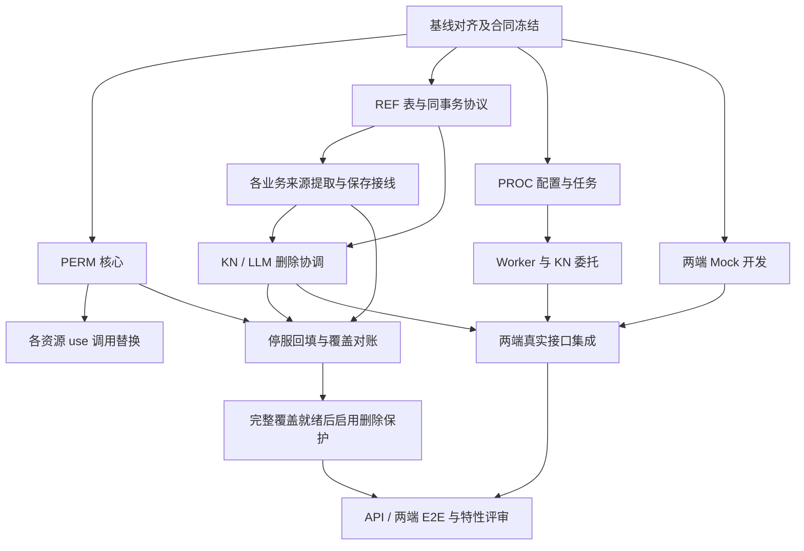

# F118 多 agent 开发边界与接入合同

**阶段**：2026-11-05，spec 和技术设计已确认，按依赖实施中，W0/W1核心开发、交叉复核与主agent集成已开始。任务入口见 [tasks.md](./tasks.md)。本文件规定交接规则，不另立需求或新增通用平台。

## 1. 开发方式

采用“合同先行、独立文件并行、热点文件单写者、依赖顺序合流”。长期责任组与同时运行的 agent 槽位分开；一个 agent 可以顺序接手多个责任组，一个责任组同一时刻只有一个写入者。当前最多 4 个并发槽位，固定为协调/集成 1 个、开发 3 个。表中的队列按任务空闲情况复用，不一次启动全部责任组。

每个实施任务控制在约 30 分钟、1–2 个叶子文件，测试任务与实现任务分开。后端先提交可观察失败的测试，再实现；基础设施定义例外。若接手发现必须超过 2 个文件，先拆任务、登记依赖和 Owner，不在一次任务中顺手修改调用方。测试、实现与前端职责均写在任务卡内。

### 开工前的 Git 边界

现有功能分支为 `codex/3.1.0-beta1/118-knowledge-space-unification`，工作区位于主仓库 `.worktrees/118-knowledge-space-unification`。本文拆分时功能 HEAD 为 `577d8bd14f953b997ccfd6bb6a1352c45c5bcdc8`，已修订文档尚未提交；这不是最新发版线的声明。

由 INT 在实际实施前清点脏文件，保留并按路径 checkpoint 本功能文档；读取/拉取实际最新 `feat/3.1.0-beta1`，在功能分支 merge 保留双方提交，记录基线 SHA。不得用 reset/rebase 覆盖用户工作。重核热点源码和合同后，所有子工作区从同一个已冻结功能提交创建。分支使用 `codex/3.1.0-beta1/118-<lane>` 前缀。

业务 agent 只提交自己任务的路径，交付任务 ID、提交、测试结果、公共合同变更及未决风险；由 INT 按依赖合流。公共修复按项目 release-line-first 规则先进入发版线再合回功能分支；各 agent 不自行推共享分支或跨线 cherry-pick。禁止 repo-wide stash、checkout、reset、clean、restore；禁止 `checkout --theirs` 覆盖整文件。此轮只形成任务文档，未创建子工作区、提交或合流。

## 2. 唯一写入责任

下表后端路径省略 `src/backend/bisheng/`。所有权覆盖实现文件及该 Owner 名下测试。其他责任组通过新增独立 helper 或合同交付，不能直接修改热点调用方。

| Owner | 唯一写入范围 | 交给谁接线 |
| --- | --- | --- |
| INT | 本功能合同/任务；总 router、错误注册、共享三语词条、公共模型导出；基线与合流 | 所有跨域接线均排队；不代写业务 JSON 提取语义 |
| PERM | `permission/**`、`core/openfga/authorization_model_f048.py`、`api/services/f048_application_permission.py`、`tenant/domain/services/resource_share_service.py`，授权 UI 协议 | 业务 use 调用交其各自 Owner 替换；F048 Catalog/model 发布由本 Owner 串行 |
| REF | 拟新增 `resource_reference/{application,domain}/**`（下述叶子例外除外） | 提供绑定存储应用协议，不解析所有业务配置，不编排目标删除 |
| WF | `api/services/flow.py`、`api/services/workflow.py`、`api/v1/workflow.py`、`database/models/{flow,flow_version}.py`；workflow 模块适配（knowledge_retriever 叶子交 EDGE） | 负责版本新增/保存/切换/删除事务，Flow.data 镜像不重复计数 |
| AS | `api/services/assistant.py`、`database/models/assistant.py` | create/update/delete 全入口，不只 update |
| APP | `app_publish/**`、`app_runtime/**` | 名称解析、不可变 app/version 插入、删除与历史预览准入 |
| CH | `channel/**` | 稳定频道配置来源键；暂停保留，解除配置/解散才移除 |
| LLM | `llm/**`，尤其 `llm/domain/services/llm.py` | 删除服务、清单差集、默认保存、恢复继承同属一人；不另派默认模型 agent 同写 |
| KN | `knowledge/domain/services/{knowledge_space_service,knowledge_service,knowledge_file_service,knowledge_version_service,knowledge_metadata_service,knowledge_permission_service,knowledge_space_direct_delete_service,retrieval_facade_service}.py`；knowledge API、删除 Repository 及 `role/domain/services/quota_service.py` | 大 Service 唯一写者；PROC/REF/PERM 交付 helper，由 KN 接线 |
| PROC | 拟新增 knowledge processing/job schema、服务、Repository；`knowledge/rag/knowledge_file_pipeline.py`、`api/v1/schemas.py` 的 FileProcessBase、`worker/knowledge/**` | 业务大 Service 委托由 KN 做；任务不作为模型引用来源 |
| EDGE | 盘点后逐项认领 tool、linsight、workstation、open_endpoints、MCP/SDK 兼容文件 | 不修改 WF/AS/APP/CH 已有写入范围；路径清单先交 INT 审核 |
| MIG | 新/旧表结构迁移、`core/database/tenant_filter.py` 注册、F118 专用停服升级入口与账本；不写 `permission/migration/**` | 全平台权限子计划由 PERM 提供，MIG 调用；Alembic revision/down_revision 唯一写者 |
| PLATFORM | `src/frontend/platform/src/pages/KnowledgePage/**`、平台知识/权限 API 与选择器 | Zustand/react-query/bs-ui；禁止导入 client 页面、hooks、store |
| CLIENT | `src/frontend/client/src/pages/knowledge/**`、client 知识/权限 API | Recoil/react-query/shadcn；不新增后台高级配置界面 |

**叶子例外**：MIG 独占 `resource_reference/application/{backfill,reconcile}.py`；INT 独占 `resource_reference/application/bootstrap.py` 与 `tenant/domain/services/tenant_service.py` 的新租户就绪接线；EDGE 独占 `workflow/nodes/knowledge_retriever/knowledge_retriever.py` 与 `open_api/domain/services/{model_range_policy,model_gateway_service}.py`。这些路径不再由模块默认 Owner 认领；REF 提供应用合同，业务/迁移消费者不得反向依赖其 Service。

`knowledge_space_service.py`、`knowledge_service.py`、`llm.py`、`flow.py` 不按函数区段分配并发写入。某 Owner 的相邻任务修改相同文件时，依赖前一任务后串行。locale 原文件、共享 Permission DTO、错误码注册、总 router 由 INT 统一收集变更清单落盘；业务 agent 提供键名和三语文案，不直接抢写。API 错误文案通过现有生成链生成，不手改产物。

## 3. 开工前冻结的合同

合同文件拟为 `contracts.md` 与各模块 schema；T002 冻结语义/签名 V1，各模块 DTO（T003/T006/T007）交付后两端即可 Mock 并行，具体依赖见任务卡。候选路径需对照实际 OpenAPI 确认动态路由顺序，使用项目现有 envelope/PageData、错误码分配及命名，不另造协议层。合同测试锁定序列化与业务语义；任意破坏性变更由提供方先更新合同、列出全部消费者任务，再由 INT 排序变更。

| 合同 | 提供方 → 消费方 | 必须冻结内容 |
| --- | --- | --- |
| P1 权限快照 | PERM → 全业务/MIG/UI | `visibility_only_resource_types`、`visibility_level`、原 `model_key`/Grant/Source、snapshot/checksum；合法纯可见模型仍可管理和撤销；不新增 visible 动作、不扩展文件 edit；动作映射见 design §4.2.1 |
| R1 来源/目标 | REF → 各业务/MIG | `SourceKey(tenant_id, source_type, source_id, source_version)`、稳定 `slot_key`、目标真实 ID/租户/空间归属、extractor_version、revision、规范化摘要；零引用也有 reference_set |
| R2 同事务替换 | REF → WF/AS/APP/CH/KN/LLM | `replace_source_bindings(session, source_key, expected_revision, new_revision, references, effective)`；调用方持有事务，内部不 commit；接收已验证目标上下文，失败整体回滚；不允许前端任意上报绑定 |
| R3 目标与删除 | REF + KN/LLM → UI/API/MIG | live、deleting/deleted、强删失效、冻结基线证明的存量失效；`check_complete`、`blocked`、`can_force_delete`、受限依赖计数/摘要、确认计划 ID/digest/修订/幂等键；文件/夹永不强删，清空也不强删 |
| B1 业务提取 | 各来源 → REF/MIG | 来源枚举与生命周期见 spec §3.15.1；WF 所有未删版本，APP 所有保留不可变版本，暂停频道保留；Root 原始默认与租户 override 不复制继承；任务/聊天/审计/评测结果不作为来源 |
| B2 APP 名称解析 | APP → REF/MIG/运行 | 当前 CapabilityModelRef 只有 name，知识声明 name/id；保存/回填必须采用与运行相同的确定解析规则，歧义拒绝，绑定记真实 ID，历史 manifest 保留原文；解析真实 ID 按版本/槽位冻结，运行、预览及模型网关最终目标必须匹配该版本已登记 ID，名称改名/重名或重新指向其他 ID 明确失败，不漂移。先冻结解析结果合同，不递归扫任意 JSON 猜 ID |
| J1 配置与任务 | PROC → KN/API/UI/Worker | 分文件类型默认配置 schema/version；batch/file > space > system，网页/音视频专用规则优先；实际快照、相关模型/索引 generation、job/item 状态、检查点/幂等键；accepted 不等于 completed |
| A1 管理/查询 API | KN/PROC/LLM + INT → 两端/EDGE | 一次仅一个具体可信租户；普通/管理员列表隔离；管理员只有超管/租户管理员；copy 仅创建者；列表/任务详情裁剪、批量预检/确认/结果、失效展示与部分修复；旧协议 3.x 兼容 |

R3 确认计划至少绑定操作者及租户、目标集合、影响摘要、资源/来源修订；执行阶段重验最新集合，变化重新确认。新 tenant/全新空安装仅在所有同步写端已启用、可信空数据证据下初始化 coverage，记录 writer_contract 版本；既有存量缺账本仍需回填，不以无行自动 ready。未就绪/检查异常不能以空结果放行，强删只越过已知引用阻断，不越过共享只读、权限、业务状态或冲突。

### 事务与耦合处理

业务 Owner 持唯一 SQL Session：加载并提取最终配置 → 确定旧/新目标锁集合 → 按 design §6.3 固定锁序锁定并当前读重验 → 保存业务 + 替换明细 + 零引用集合 → 一次提交。锁集变化回滚重算，禁止事务内临时追加反序锁；版本新增/删除共用来源根 revision 门闩。多个模型的服务级操作先按服务 ID，再按固定目标类型/ID，再文件范围，再来源根及 reference_set。共享模型跨来源租户反查只由受信 Repository 完成，再裁剪展示。

REF 应用协议不反向导入 WF/KN/LLM 服务；各业务提取与目标校验通过应用层适配，禁止 API 层跨模块互导或 common/core 导入业务。目标删除由 KN/LLM 编排，引用模块只提供存储与对账能力；不新增通用依赖图、任务模型绑定或分布式事务。

空间/文件删除的状态序列不可并行改写：持久计划及删除围栏 → 引用重验 → F048 全部投影成功 → SQL finalize → MinIO/ES/Milvus 清理。失败按原计划阶段恢复。这里沿用空间删除顺序，不能把文件权限投影塞到 SQL 删除后的 purge。Worker 迟到外部 I/O 与用户后续修改竞态不在本次范围；配置过期检查、正常冲突规则、SQL finalize generation/lease 和任务幂等仍实施。

## 4. DAG 和可并行队列

| 阶段 | 协调槽 INT | 开发槽 A | 开发槽 B | 开发槽 C |
| --- | --- | --- | --- | --- |
| W0 | 同步基线/Owner/API 合同 | PERM 快照合同 | REF 合同/表 | PROC 合同/表 |
| W1 | 顺序注册/检查接口 | PERM 核心 | REF Repository/替换 | PROC 默认策略 |
| W2 | 合同验收/前端 Mock 数据 | WF / AS 接入队列 | APP / CH 接入队列 | PLATFORM Mock 队列 |
| W3 | 跨域合流/文件锁调度 | LLM 默认与删除 | KN CRUD/版本/移动接线 | CLIENT Mock 队列 |
| W4 | EDGE 清单/回归调度 | EDGE use/兼容切片 | PROC Worker/KN 委托排队 | PLATFORM 真接口 |
| W5 | Alembic/权限发布顺序合流 | MIG 回填/对账 | KN / LLM 集成修正 | CLIENT 真接口 |
| W6 | 全覆盖就绪与评审 | 双库并发/投影故障 | 迁移恢复演练 | 两端与开放调用 E2E |

Wave 是排程建议，任务卡的依赖才是启动条件；不能因进入 W3 就跳过 REF 前驱。两端可以在 A1/J1/R3 冻结后用 Mock 并行，但不得宣称 Mock 已验证后端权限或事务。MIG 可早写协议测试，正式回填与删除保护启用必须等全部来源接入及覆盖对账。测试参考用例 [test-cases.md](./test-cases.md) 仅供 QA，任务和自动化测试直接追溯 spec AC，不将 QA 文档设为 Harness/合流门禁。

## 5. 交接与验收

领取任务必须写明任务 ID、Owner、base SHA、只写文件、依赖产物版本、测试命令。合流请求附：实现提交、配对测试及实际结果、未运行的环境项、接口差异、回滚办法。新发现的入口先补任务并分配唯一 Owner，不能凭“全局 use 已删”结论跳过入口盘点。

INT 检查任务内路径及范围、无同文件并发、测试先于实现、完整 AC 自动化映射。每次合流运行相关范围检查；中间件/MySQL/DM8、投影中断恢复、迁移演练与真实 E2E 记录各自证据。最终执行 `/e2e-test` 和 `/sdd-code-review --base feat/3.1.0-beta1`；没有执行的项目保持待执行，不以静态审查、构建或 HTTP 200 代替业务验证。

数据库新增整表沿 SQLModel 自动发现；已有表结构由 MIG 编排 Alembic，升级/降级及 MySQL/DM8 一起验证。数据转换不进 Alembic；转换后回退依靠维护期完整一致备份，不能只将 type 改回 0。迁移脚本不探测/控制停服，正式盘点和权限基线都在运维停服并备份后冻结。

## 6. 实施基线与合同冻结记录

2026-11-05：已完成文档checkpoint `0b80802ae`、fetch远端发版线 `9eef0016de` 并合并至功能提交 `a1b1a2387`。接口见 [contracts.md](./contracts.md) V1；从冻结合同提交创建lane独立worktree。T006落点修正为DTO/GrantModelSnapshot；T214补PermissionModel结构，MIG统一DDL；T215–T218补Source/control-state/Catalog持久链；T219补预检确认计划表，T220–T221限定高级管理写scope。该冻结时计划227项，完成T001/T002。原前文“尚未提交/实施”是拆分时快照，以本节与任务实施记录为当前状态。

## 7. W1实施补充

当前任务共273项，source核对补充详见tasks实施记录与contracts澄清。INT另外独占open_api/domain/http_status.py错误装配；MIG负责Knowledge.model_transition、retry receipt登记及测试DDL。原scope/model/action字段来源与受控provenance不可由HTTP伪造。独立复查三项PERM接缝及正常启动接缝已修复、复核并合流；当前三线组合424项通过。后续Owner以主集成快照与REF V1.1为入口，不从各lane旧头自行拼装。

## 8. W0/W1交付与下一波

REF逻辑快照ac5e8739a、PROC ff2672e983、PERM c970545d3均经其他agent独立复核后主agent合流。组合受测4932d120de，随后只有T270文件尾格式修正9300b557c及文档状态更新；合同和业务语义不变。完成86/273，后续保持最多协调1+开发3、每热点唯一写者，不把本地通过视为真实双库/中间件或E2E完成。当前各lane均已交付，无未说明的后台开发任务。

下一Owner启动前先同步主集成分支，核对自身任务依赖与V1.1构造器；业务Owner及覆盖持久adapter尚未提供时不得用测试fake在生产装配，也不得跳过回填ready门槛。
